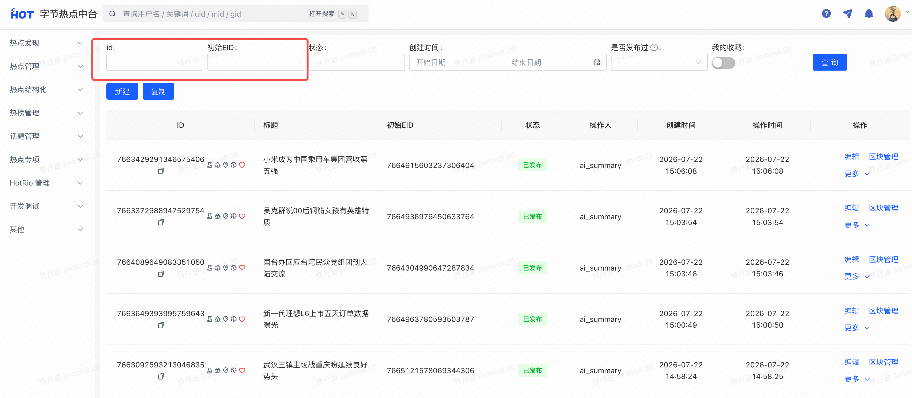

# 【热点技术方案】热榜AI总结支持插入图片

# 文档修订记录（可选）

|**版本**|**日期**|**作者**|**说明**|
|---|---|---|---|
|0\.1|2026\.9\.29|@尹岩|梳理现状|
|1|2026\.10\.10|@尹岩|明确整体方案|

# 评审意见（必填）

> 项目Owner记录
> 
> 

|评审时间|评审人|评审意见（好、不好都需要记录）|评审状态|
|---|---|---|---|
|||||

## TODO

* [ ] 


# 项目背景

## 背景（必填）

> 介绍项目背景
> 
> - 技术项目：需要介绍具体是解决什么问题或实现什么功能，相关业务背景以及技术背景；
> 
> - 产品需求：链接产品需求文档，概述下即可；
> 
> 

- prd：[【热点业务】热榜AI总结增加图片插入能力](https://bytedance.larkoffice.com/docx/C9jddbr3moohXsxFGxccqdRinLe)

    - 一句话概述：热榜事件AI总结需要支持图片、视频、文本混排，之前已支持插入视频混排，本次需要支持插入图片混排。

- 需求拆解：

    - 支持热榜事件热门相关文章的相关图片召回能力。

    - 图片插入AI总结后需要单独送安全队列审核。

## 目标（必填）

> 要达成什么样的目标
> 
> - 技术项目：解决背景中的问题，技术衡量指标（时延）或者实现某个功能；
> 
> - 产品需求：对齐产品需求目标收益即可，明确可量化的业务指标；
> 
> 

- 提升热榜AI总结好用率，sbs有收益。

- 提升用户落地页消费时长和次数。

# 总体方案设计

> 中大型技术项目（大于1个月）必填，包括架构图、流程图、类图等
> 
> 明确涉及的系统、系统边界、系统间关系
> 
> 


## 前期调研

> 如有，补充调研结果
> 
> 

- AI总结模型迭代记录：[📕热榜AI总结大模型迭代记录](https://bytedance.larkoffice.com/wiki/MzyTwoF7Niqk03kcx1ncEBkMnCf)

- 当前AI总结业务链路：

- 历史技术方案：（[热点 x AI](https://bytedance.larkoffice.com/wiki/Tg6SwOFoniI9n8k4QvpcfQD9nzf?sheet=lJ5Vut)）

    - [【热点技术方案】热榜落地页AI总结](https://bytedance.larkoffice.com/wiki/ReLwwWctgi299JkhbHec1zIpn7b)

    - [【热点技术方案】落地页AI总结插入视频](https://bytedance.larkoffice.com/wiki/DeXywJYXRiCN97k7W1YcGEXpne0)

- 当前AI总结技术链路：

- AI总结管理后台：

    - AI总结页面列表：https://hot\.bytedance\.net/hotblocks/page/30000037?（支持按eid或总结页面id检索）



    - AI总结区块列表：https://hot\.bytedance\.net/hotblocks/block/10000096。

    - 可以通过HOT[榜单管理](https://hot.bytedance.net/hotmanage/hotlist?active_tab=v2&sortByThermal=0)进入对应事件的AI总结管理：


## 系统架构

> 架构图、时序图、流程图等
> 
> 

### 业务新流程

本次核心流程变更是：原来业务审核通过后，安全服务端内部会直接将结果再转送到安全审核队列；本次需要做拆分，在业务审核完成后，通知热点服务端，热点服务端在markdown中插入图片后再送入安全审核队列。

### 技术新流程

本次核心变更有：

1. ai总结区块schema元信息：原本markdown段落只支持相关视频绑定，本次需要支持相关图片绑定。

2. 审核回调：增加业务审核回调流程，处理业务审出结果，拼接图片信息，再送安全审核；安全审出后再组装带图片/视频信息的区块数据落库。

3. AI模型服务增加插入图片的接口：原来AI模型服务在豆包维护，本次迁移到热点服务端，接口调用需要迁移；同时需要增加一个图片插入的接口。

## 可选方案对比

> 如果存在多套方案，明确方案优劣势，并给出明确分析结论和最终选型决策理由
> 
> 


# 详细方案设计

> 和c端、后台、审核服务端\&前端、ai模型服务端分别如何协作
> 
> 

## 详细设计（必填）

### 生产链路

本次改造将 AI 总结审出链路拆分为业务审核与安全审核两个阶段，并新增动态图片选择、图片安全审核、段落级图视频互斥和 HotRIO 结构化图片下发能力。核心约束是：业务审核通过不直接写 HotRIO；最终 HotRIO Markdown 正文不带图片信息；图片通过段落级相关图片字段保存；同一段落内图片与视频互斥。

本次生产链路变更都在audit服务内，主要梳理audit的逻辑：

```text
business_review + pass
  -> 调用 toutiao.trending.candidate_access#GetEventCandidates 查询事件候选：ID=eid、BizID=162、Count=300、Offset=0、Order=desc、OrderBy=impr、CreateTimeRange.GTE=now-24h
  -> 保持接口返回顺序，批量读取候选 gid 的文章全文与内容元信息；过滤可见有图文章并剔除无图内容后截取 Top50
  -> 抽取文章封面图和正文配图，保留 image_uri 与来源 gid
  -> URI 精确去重 + pHash 感知去重
  -> 调用 Perplexity InsertPicture 选择图片和目标段落
  -> 保留无图正文为 ai_summary_without_richmedia
  -> 将图片 Markdown 写入对应段落，形成仅用于安全审核展示的 ai_summary
  -> 将 segment_key -> images[] {image_uri, gid} 写入 tcs_trans_data.biz_trans_data.ai_summary_images
  -> 使用 toutiao_hot_board_ai_summary_safety_manual_review 触发安全审核

safety_review + pass
  -> 读取 ai_summary_without_richmedia 作为最终正文
  -> 读取 biz_trans_data.ai_summary_images 作为最终图片事实源
  -> 有图段落设置 related_media_type=images，写入 Images.Data，并跳过视频插入
  -> 无图但有视频段落设置 related_media_type=videos，复用现有视频插入逻辑写入 Videos.Data
  -> 无图且无视频段落设置 related_media_type=none
  -> 组装 HotRIO Block raw_data；Images.Data 数组元素只包含 gid 和 image 两个可打包字段
  -> image.t_form_input 保存 uri / width / height / template / format，image packer 打包阶段补齐 url
  -> 创建或更新 HotRIO Block / Page
  -> MPackHotRioBlock 根据元信息分别打包 gid 与 image 字段，下发结构化图片和视频
```

#### 阶段决策

|callback\_stage|review\_result|处理动作|写 HotRIO|
|---|---|---|---|
|business\_review|pass|动态选图、构造带图安全送审内容、触发安全审核。|否|
|business\_review|reject|结束流程，保留现有拒绝语义。|否|
|safety\_review|pass|消费无图正文与图片透传字段，对无图段落补视频，写入 HotRIO。|是|
|safety\_review|reject|不组装媒体，不更新线上总结。|否|
|缺失|pass / reject|按旧安全回调兼容处理。|沿用旧逻辑|

#### 获取事件候选文章

- 调用 toutiao\.trending\.candidate\_access\#GetEventCandidates 查询事件候选文章。请求参数固定为：ID=eid、BizID=162、Count=300、Offset=0、Order=desc、OrderBy=impr、CreateTimeRange\.GTE=now\-24h；BindingTypeCodes、GroupIDs、RelevanceLevels 默认不传。GetEventCandidates 只负责按文章顶点 impr 曝光属性倒序返回候选 gid，不直接支持按“图文/微头条/有图”过滤；内容类型与有图过滤放到 audit 业务侧完成。业务侧保持候选 gid 返回顺序，批量读取 Article 全文与内容元信息，过滤出可见有图文章TOP50，作为 InsertPicture 和 mock selector 的图片候选来源。

#### 获取文章封面\+文章内图片

- 新增 collectAISummaryImageCandidates\(ctx, eid\) 统一完成文章图片候选构建：先复用 audit/dal/service\.MGetArticleFullByGids 批量读取 Top 候选 gid 的 ArticleFull，使用 MustVisible=true 保证只处理可见文章；不能直接复用 MGetArticleMetaByGids，因为当前封装只返回 ArticleAttrData，拿不到 ContentMetaData\.CoverImageInfos / ImageInfos。

- 每篇文章从 ContentMetaData\.CoverImageInfos 和 ContentMetaData\.ImageInfos 合并抽图。单张图优先取 WebUri，为空再取 Uri；同时保留 Width、Height、MimeType/ImageType，并记录来源 gid、来源标题、source\_type=cover/detail。无 ContentMetaData、无有效 uri、无图的文章直接跳过。

- 函数输出只保存原始图片结构化信息，不在 audit 阶段生成最终展示 URL。DisplayURL 仅作为 InsertPicture 模型理解图片的临时输入时按需签出；最终 HotRIO 展示 URL 统一由 images\.data\[\]\.image 的 image packer 基于 t\_form\_input\.uri 签出。

- 保持 GetEventCandidates 的曝光倒序，遍历候选 gid，只要可见且存在有效图片的文章；每篇文章内图片顺序为封面图在前、正文图在后。

#### 候选图片去重策略

> [热榜事件7694619806313483818 goimagehash pHash图片去重阈值报告](https://bytedance.larkoffice.com/docx/F7x4dON3koYSH4xl2JCcKJ9HnSg)
> 
> 

图片去重发生在候选图片抽取之后、InsertPicture / mock selector 之前，目标是减少同一图片多 CDN 签名、多来源重复图和相似截图重复进入模型选择。默认 pHash 汉明距离阈值使用 **10**，阈值代码写死。

1. 候选输入：从过滤后的有图候选文章中抽取封面图和正文配图，候选图片需要保留 image\_uri、来源 gid、图片宽高和来源排序信息。

2. URI 精确去重：优先使用内容元信息里的 image\_uri 作为唯一键；如果只有签名展示 URL，则规范化为 TOS path，去掉 CDN host、query 参数和 tplv 缩放后缀。相同 URI 只保留热度顺序最靠前的首个候选，并记录 URI 去重前后数量。

3. pHash 感知去重：对 URI 去重后的图片组装 320px 缩略图展示 URL，下载并解码后使用 github\.com/corona10/goimagehash\.PerceptionHash\(img\) 计算 64\-bit pHash。对可计算 pHash 的图片按汉明距离做 single\-linkage 聚类：任意两张图片距离 \<= 10 即连边，同一连通分量视为一组相似图片。

4. pHash 性能保护：pHash 输入只处理 URI 精确去重后的前 120 张图片；单图下载\+解码超时 500ms，响应体上限 2MiB，并发 worker 默认 8，单事件 pHash 总 wall time 预算 2s。超过总预算时立即停止新增 pHash 任务，已完成结果继续参与聚类，未完成图片降级为仅参与 URI 精确去重。上述 max\_images、thumb\_size、per\_image\_timeout\_ms、max\_body\_bytes、concurrency、total\_budget\_ms 均通过 TCC 配置，默认值按上述口径。

5. 代表图选择：每个相似簇保留热度顺序最靠前的图片作为代表图，代表图携带原始 image\_uri、gid、宽高进入 InsertPicture / mock selector。被合并图片不进入模型候选，但需要统计 pHash 去重数、重复簇数、跨 gid 重复簇数和最大簇大小。

6. 失败降级：单图下载、解码或 pHash 计算失败时，该图片只参与 URI 精确去重，不参与感知聚类；单事件 pHash 超过总耗时预算，或失败/超时比例超过 50% 时，停止继续计算 pHash，本事件整体降级为 URI 精确去重。失败项记录指标和有限诊断信息，不打印完整 URI / gid 列表，也不阻断安全送审链路。

7. 业务校验：InsertPicture / mock 输出仍必须只引用去重后候选集内的 image\_uri 和已知 segment\_key；同一图片不得被多个段落复用，单段图片数需要受配置限制。非法输出直接丢弃并打点。

#### 图片选择

本方案不复用现有 toutiao\.perplexity\.rpc\#InsertRichMedia 接口。InsertRichMedia 继续只承担 AI 总结相关视频插入；图片选择新增独立接口 InsertPicture，避免图片候选、段落绑定、审核展示 Markdown 等语义污染已有视频链路，也避免为了兼容 InsertRichMedia 的 required Videos 字段传空视频列表。InsertPicture 只负责根据事件标题、无图 AI 总结段落和候选图片上下文，输出图片与 segment\_key 的绑定关系；不负责生成候选外图片、不负责安全审核、不负责 HotRIO URL 签出。IDL 变更独立提交 MR，先生成 Perplexity client，再接入 audit 业务代码。

```thrift
struct InsertPictureRequest {
    1: required string Query
    2: required list<AISummarySegment> Segments
    3: required list<OptionalInsertPicture> Pictures
    4: optional SummaryResultType ResultType
    5: optional map<string, string> Extra
}

struct AISummarySegment {
    1: required string SegmentKey
    2: required string Content
}

struct OptionalInsertPicture {
    1: required string PictureID
    2: required string URI
    3: required string DisplayURL
    4: optional string SourceGID
    5: optional string SourceTitle
    6: optional i32 Width
    7: optional i32 Height
    8: optional string SourceType
}

struct SegmentPictureSelection {
    1: required string SegmentKey
    2: required list<string> PictureIDs
}

struct InsertPictureResponse {
    1: required list<SegmentPictureSelection> Selections
    2: optional string Reason
}
```

##### InsertPicture Mock 方案

在 Perplexity InsertPicture 接口 ready 前，audit 侧先实现一个本地 mock selector，用同一套 SegmentPictureSelection 响应模型产出图片与段落绑定关系。mock 只替代 InsertPicture 的返回结果，不跳过候选图片获取、URI/pHash 去重、业务侧校验、安全送审、biz\_trans\_data 透传、HotRIO Images\.Data 写入和 image packer 签 URL 等后续链路。mock 的默认逻辑为：从 top 热度 gid 的图片池中取图，先执行 URI 精确去重和 pHash 感知去重，再从去重后的图片池随机挑选 3 张图片；为保证测试可复现，默认使用 eid \+ 无图正文 hash 作为随机 seed。

```json
{
  "enable_ai_summary_insert_picture_mock": true,
  "ai_summary_insert_picture_mock_mode": "random_top_gid",
  "ai_summary_insert_picture_mock_whitelist_eids": ["7420000000000000000"],
  "ai_summary_insert_picture_mock_top_gid_count": 50,
  "ai_summary_insert_picture_mock_random_count": 3,
  "ai_summary_insert_picture_mock_max_per_segment": 1,
  "ai_summary_insert_picture_mock_seed_strategy": "eid_content_hash"
}
```

|模式|用途|
|---|---|
|random\_top\_gid|默认 mock 模式。从 top 热度 gid 的图片池中取图，去重后随机挑选 3 张，并按稳定段落顺序绑定到可插图段落，用于跑通安全审核、回调透传和图视频互斥链路。|
|disabled|关闭 mock，走真实 InsertPicture。真实接口 ready 后灰度切到该模式。|

mock 约束：只允许测试队列、PPE 或白名单 eid 命中；mock 图片池必须来自 top 热度 gid 的候选图片，并复用正式链路的 URI 精确去重与 pHash 感知去重；随机选出的图片仍必须经过业务侧统一校验，不能引用候选外 picture\_id 或不存在的 segment\_key；日志只记录 mock 命中、top gid 数、去重前后图片数、随机选中数和 seed 策略，不打印完整图片 URI、URL 或 gid 列表。

调用约束：

- 图片选择只调用 InsertPicture；视频插入继续调用 InsertRichMedia，两个接口互不复用，图片请求不再携带 Videos 字段。

- Segments 使用稳定段落键，例如 segment\_0、segment\_1；Content 使用无图正文段落，不包含 Markdown 图片标签。

- Pictures 非空时才调用 InsertPicture；候选为空或去重后为空时，直接降级为无图片安全送审。

- DisplayURL 仅用于模型理解和安全审核展示前的 Markdown 插图；最终 HotRIO 展示 URL 仍由 image packer 基于 image\.t\_form\_input\.uri 签出。

- 模型输出必须只引用请求内 PictureID 和已知 SegmentKey；业务侧校验 segment\_key 存在、picture\_id 属于请求候选、同一图片只出现一次，并限制每段图片数。非法或越界项直接丢弃并打点，不写入安全送审 Markdown，也不进入 biz\_trans\_data\.ai\_summary\_images。

#### 安全送审数据打包

业务审核与安全审核继续复用 AISummaryTcsData 的 Markdown/Cites 结构，不在 ai\_summary 内新增 images 字段，段落后如果有图片就用markdown图片格式进行渲染，直接写入markdown text数据中，用于人审。同时新增顶层 ai\_summary\_without\_richmedia 保存无图片 Markdown text用于数字人审核；图片 URI 和来源 gid 统一放入 tcs\_trans\_data\.biz\_trans\_data\.ai\_summary\_images，并由审核侧原样透传至业务回调。

```go
type AISummaryTcsReq struct {
    AISummary                 AISummaryTcsData  `json:"ai_summary"`
    AISummaryWithoutRichmedia *AISummaryTcsData `json:"ai_summary_without_richmedia,omitempty"`
    TcsTransData              map[string]any    `json:"tcs_trans_data"`
}

type AISummaryTcsResult struct {
    EIDStr                    string            `json:"eid_str"`
    ReviewResult              string            `json:"review_result"`
    CallbackStage             string            `json:"callback_stage"`
    AISummary                 *AISummaryTcsData `json:"ai_summary"`
    AISummaryWithoutRichmedia *AISummaryTcsData `json:"ai_summary_without_richmedia,omitempty"`
    BizTransData              map[string]any    `json:"biz_trans_data,omitempty"`
}
```

```json
{
  "ai_summary_images": [
    {
      "segment_key": "segment_0",
      "images": [
        {
          "image_uri": "tos-cn-i-example/image-a",
          "gid": "7420000000000000000"
        }
      ]
    }
  ]
}
```

#### hotrio数据组装

最终写入 HotRIO 的 Markdown 正文必须不包含图片标签、图片 URL 或图片 URI。每个 AISummaryHotrioSegment 需要增加 related\_media\_type，用于声明当前段落绑定的是一批图片、一批视频，还是无富媒体；枚举值建议为 images、videos、none。图片通过段落级 Images\.Data 保存，视频通过 Videos\.Data 保存，二者绑定在同一个段落上并保持互斥。Images\.Data 是数组，数组元素只包含 gid 和 image 两个可打包字段：gid 负责来源内容打包与归因，image 负责图片 URL 签出。image\.t\_form\_input 必须保存 uri、width、height、template、format 五个输入字段，打包后 image 字段保留这些输入信息并补齐 url。

```go
const (
    AISummaryRelatedMediaNone   = "none"
    AISummaryRelatedMediaImages = "images"
    AISummaryRelatedMediaVideos = "videos"
)

type AISummaryHotrioSegment struct {
    SegmentKey       string          `json:"segment_key,omitempty"`
    RelatedMediaType string          `json:"related_media_type,omitempty"`
    Body             AISummaryBody   `json:"body"`
    Cites            AISummaryCites  `json:"cites"`
    Images           AISummaryImages `json:"images,omitempty"`
    Videos           AISummaryVideos `json:"videos,omitempty"`
}

type AISummaryImage struct {
    // 来源内容字段，挂 gid packer；用于下发来源内容 raw_data/log_pb 或后续跳转归因。
    GID   AISummaryImageGID    `json:"gid"`
    // 图片字段，挂 image packer；t_form_input 必须包含 uri/width/height/template/format。
    Image AISummaryPackedImage `json:"image"`
}

type AISummaryImageGID struct {
    TFormInput     string              `json:"t_form_input,omitempty"`
    TPackerConfigs []HotrioPackerConf  `json:"t_packer_configs,omitempty"`
    ID             string              `json:"id,omitempty"`
    RawData        string              `json:"raw_data,omitempty"`
    LogPB          map[string]string   `json:"log_pb,omitempty"`
}

type AISummaryPackedImage struct {
    TFormInput     *AISummaryImageInput `json:"t_form_input,omitempty"`
    TPackerConfigs []HotrioPackerConf   `json:"t_packer_configs,omitempty"`
    URI            string               `json:"uri,omitempty"`
    Width          int64                `json:"width,omitempty"`
    Height         int64                `json:"height,omitempty"`
    Template       string               `json:"template,omitempty"`
    Format         string               `json:"format,omitempty"`
    URL            string               `json:"url,omitempty"`
}

type AISummaryImageInput struct {
    URI      string `json:"uri"`
    Width    int64  `json:"width"`
    Height   int64  `json:"height"`
    Template string `json:"template"`
    Format   string `json:"format"`
}
```

### 消费链路

business 侧打包 HotRIO AI Summary 时，继续以 HotBoardCandidateInfo\.AISummaryHotrioID 为入口调用现有 MPackHotRioBlock，不新增专门的 AI Summary 图片解析和签 URL 逻辑。图片适配的关键在 HotRIO raw\_data / schema：audit 写入无图正文 Body\.Data 和结构化 images\.data\[\]；HotRIO 元信息在 images\.data\[\]\.gid 与 images\.data\[\]\.image 上挂 t\_packer\_configs；business 通用 HotRIO executor 扫描这些配置后自动完成 gid 打包与 image URI 签 URL，最终通过 HotrioPageData 下发。

#### 消费入口与现有代码复用

|消费面|当前入口|图片协议适配方案|
|---|---|---|
|搜索落地页头卡|legacy/trending/topic\_card\_packer/pkg/x\_search/feature/f\_header\.HeadCardPacker\.packAISummary：读取 AISummaryHotrioID，调用 service\.MPackHotRioBlock\(ctx, \[\]\*common\.LoadParam\{\{Id: id\}\}, ReqParams\)，将返回的 ObjectCell 写入 HeaderCardInfo\.AISummary\.HotrioPageData。|入口逻辑保持不变。只要求 MPackHotRioBlock 返回的 Subitems\[0\]\.RawData 中包含已打包后的 ai\_summary\[\]\.images\.data\[\]，端上继续从 HotrioPageData 渲染。|
|搜索落地页 AI 总结拆卡|legacy/trending/topic\_card\_packer/pkg/x\_search/feature/f\_ai\_summary\.AISummaryCardPacker\.Pack：同样基于 AISummaryHotrioID 调用 MPackHotRioBlock，并把 ObjectCell 透传到 model\.AISummary\.HotrioPageData。|无需在 AISummaryCardPacker 中手动解析 images。只校验 RawData 非空，图片 URL、gid 内容由通用 HotRIO packer 在返回前完成。|
|Feed 热榜小卡 AI 总结文案|handler 注入 hotrio\.FetchHotrioBlocks，HotEventAISummaryLoader 批量拉取 block 后只用 sonic\.GetFromString\(Subitems\[0\]\.RawData, "ai\_summary", segment, "body", "data"\) 抽取文案。|该链路只消费纯文本摘要，不消费 images。由于 Body\.Data 已改为无图 Markdown，现有轻量抽取方式可以保持；不得把图片 URL 拼入 ai\_summary\_text。|
|Push 创意 AI 总结|PushAISummaryLoader 通过 FetchHotrioBlocks 拉取 HotRIO block，parsePushAISummary 只解析 vl\_ctrl 和 ai\_summary\[\]\.body\.data。|当前 Push 不展示图片，结构体未声明 images 字段时 JSON 反序列化会忽略新增字段；保持只读 body\.data。若后续 Push 要展示图片，再单独扩展 PushAISummarySection。|

#### MPackHotRioBlock 打包流程

1. 消费入口根据事件候选信息读取 AISummaryHotrioID，组装 common\.LoadParam\{Id: hotrioID\}。

2. service\.MPackHotRioBlock 构造 PackObjectCellByIDsRequest，带上 RequestInfo 和 ABParams，调用 amos\_module\_packer\.NewPackObjectCellsHandler\(\.\.\.\)\.Handle。

3. HotRioObjectJob 通过 MGetBlockRecordWithCache 拉取 HotRIO BlockRecord，并把 BsonRawData 反序列化为 bson\.M。

4. PackObjectCellsHandler\.batchPackObjectContent 对主 block 与 sub item 分别创建 engine\.Executor。Executor 调用 amos\_bson\_parser\.ParseBsonM 递归扫描 bson\.M / bson\.A 中的 t\_packer\_configs，因此 images\.data\[\] 数组内的 gid 和 image 节点会被识别。

5. Executor 按 t\_packer\_type 分发到 gid / image 等 packer 并回填结果：gid packer 负责把来源 gid 打成端上可用内容；image packer 读取 image\.t\_form\_input\.uri、width、height、template、format，调用 GetSignedImageUrl 生成 image\.url。

6. 回填结束后删除 t\_form\_input、t\_packer\_configs 等配置字段，序列化为 ObjectCell\.RawData；容器 block 再通过 ObjectCell\.Subitems 下发子项数据。

#### 图片字段打包约定

- Body\.Data 只保存无图 Markdown。端上展示图片不得从 Markdown 图片标签解析，也不得从 body\.data 中反查。

- 每个段落通过 related\_media\_type 声明媒体类型：images / videos / none。同一段落只允许一种媒体类型；当 related\_media\_type=images 时，videos\.data 必须为空。

- images\.data\[\] 每个元素必须包含 gid 和 image 两个 key。gid 节点挂 t\_packer\_type=gid；image 节点挂 t\_packer\_type=image。

- image\.t\_form\_input 必须包含 uri、width、height、template、format。template 允许为空，image packer 会使用默认 resize 模板；t\_output\_fields 必须至少输出 url，并建议同时保留 uri、width、height、template、format，方便端上调试和回溯。

- 如果 image packer 签 URL 失败，t\_err\_handle=ignore 时不影响 AI Summary 正文下发；端上应跳过缺失 image\.url 的图片项。业务监控需要按 block\_id、eid、segment\_key、gid 统计签 URL 失败。

#### business 侧改动边界

- 搜索落地页头卡和 AI Summary 拆卡：原则上不新增业务解析逻辑，只补充单测或联调用例，验证 MPackHotRioBlock 能把 images\.data\[\]\.image\.url 和 gid 打入 HotrioPageData。

- Feed 小卡文案和 Push 创意：保持只读取 ai\_summary\[\]\.body\.data。因为最终 Body\.Data 已是无图 Markdown，现有 cleanAISummaryMarkdown / CleanMarkdownText 继续作为文案兜底清洗，不承担图片处理。

- 如端上需要基于 related\_media\_type 控制段落内图片/视频展示，由 HotrioPageData\.RawData 中的结构化字段驱动；business 不应把图片转换成富文本或 Markdown 标签。

- 唯一必须保证的是 HotRIO schema 与 audit 写入 raw\_data 一致：字段路径必须是 ai\_summary\[\]\.images\.data\[\]\.gid 和 ai\_summary\[\]\.images\.data\[\]\.image，不能另起 image\_uri 或 related\_images 字段，否则通用 packer 无法自动处理。

#### 验收用例

- 构造一个 AI Summary HotRIO block：body\.data 为无图 Markdown，某个 segment 的 related\_media\_type=images，images\.data\[\] 含一个 gid packer 和一个 image packer。调用 MPackHotRioBlock 后，Subitems\[0\]\.RawData 中应存在 images\.data\[\]\.image\.url，且 body\.data 不包含 Markdown 图片标签。

- 构造图片和视频互斥用例：related\_media\_type=images 时 videos\.data 为空；related\_media\_type=videos 时 images\.data 为空；related\_media\_type=none 时二者都为空。

- 构造 image URI 签发失败用例：确认 t\_err\_handle=ignore 不会导致整个 AI Summary block 被过滤，正文仍可下发，失败图片不展示并产生监控。

- 回归 Feed 小卡和 Push：带 images 字段的 RawData 不影响 ai\_summary\_text、PushAISummary\.FirstPart、PushAISummary\.Sections 的解析结果。

## 外部依赖

本次需求涉及模型服务、审核侧、Review Scheduler、HotRIO 元信息和图片平台等外部依赖。所有新增协议字段需要保持 optional 或透传语义，避免影响旧业务审核与旧视频插入链路。

### AI 总结模型服务

热榜卡的模型能力在豆包这边，但近期豆包需求承载负荷较高，人力投入变少；加上热榜卡本身业务比较独立，并没有走到豆包主链路，所以我们和豆包服务端对齐将 AI 总结和富文本插入模型服务接到热点服务端维护：[热榜卡交接文档](https://bytedance.larkoffice.com/docx/IWmNdXQwPonSJdxRj2YcSMfDn3c)。

本次需求新增 Perplexity InsertPicture 图片选择能力。模型输入为 AI 总结段落、候选图片列表和事件上下文；模型输出为 image\_id 与 segment\_key 的映射。输出必须只引用候选内图片和已知 segment\_key，业务侧会做强校验。

|依赖方|诉求|
|---|---|
|toutiao\.perplexity\.rpc|新增独立 InsertPicture 接口承载图片选择，不复用 InsertRichMedia；InsertRichMedia 保持现有视频插入语义和兼容性。|
|安全审核侧|支持 callback\_stage、ai\_summary\_without\_richmedia，并原样透传 biz\_trans\_data\.ai\_summary\_images；安全审核场景使用 toutiao\_hot\_board\_ai\_summary\_safety\_manual\_review。|
|Review Scheduler|通过 incoming\_features 承载送审对象数据；ObjectID 固定使用 eid \+ callback\_stage \+ ai\_summary\_without\_richmedia hash，用于服务端幂等，并允许 Markdown 正文更新后重新送审。|
|candidate\_access / Article|候选查询使用 toutiao\.trending\.candidate\_access\#GetEventCandidates。推荐请求参数：ID=eid、BizID=162、Count=300、Offset=0、Order=desc、OrderBy=impr、CreateTimeRange\.GTE=now\-24h；BindingTypeCodes、GroupIDs、RelevanceLevels 默认不传。接口按文章顶点 impr 倒序返回候选 gid，业务侧通过 collectAISummaryImageCandidates 复用 MGetArticleFullByGids 批量拉取 ArticleFull，过滤可见有图文章后截取 Top50，并从 ContentMetaData\.CoverImageInfos / ImageInfos 提取图片 URI、宽高和格式信息。|
|图片平台 / ImageX / ImageZ|提供 image\_uri 到展示 URL 的稳定转换能力；由 HotRIO 打包阶段的 image packer 统一签出 URL，audit 不直接生成或落库 image\_url。|
|HotRIO / hotboard\_business|AI 总结 Block 元信息支持段落级 related\_media\_type 与相关图片字段；MPackHotRioBlock / HotrioPageData 下发无图 Markdown \+ Images\.Data，并在打包阶段通过 images\.data\[\]\.image\.t\_form\_input\.uri 签出 image\.url。|

## 异常处理（必填）

|异常点|处理策略|是否写 HotRIO|
|---|---|---|
|候选文章查询失败|降级为无图片安全送审并告警，不阻断业务审核通过后的安全审核链路。|否|
|部分文章或图片读取失败|跳过失败项，使用剩余候选；候选为空则走无图安全送审。|否|
|pHash 计算失败|该图片只参与 URI 精确去重；单事件超过 2s 总预算或失败/超时比例超过 50% 时，本事件整体降级为 URI 精确去重；计算异常记录指标，不阻断安全送审链路。|否|
|InsertPicture 调用失败或返回非法结果|丢弃非法 picture\_id / segment\_key / 重复图片；InsertPicture 整体失败时降级为无图片安全送审。|否|
|安全送审失败|返回错误触发 MQ 重试；不得进入最终 HotRIO 写入。|否|
|安全审核拒绝|结束流程，不更新线上 AI 总结。|否|
|安全通过但 ai\_summary\_without\_richmedia 缺失|兼容兜底为清理 ai\_summary\.markdown 中的图片标签并告警；不得从正文 URL 反推图片数据。|是，降级|
|biz\_trans\_data\.ai\_summary\_images 缺失|按无图片降级并告警；不从 Markdown 解析 image\_uri，也不补推 gid。|是，降级|
|视频插入失败|保存无图正文和已审核图片；无图段落 Videos\.Data 为空。|是|
|HotRIO 写入失败|返回错误并依赖消息重试；不得吞错，避免审核通过但线上未更新。|失败|

幂等策略：business\_review \+ pass 使用 eid \+ callback\_stage \+ ai\_summary\_without\_richmedia hash 作为 Review Scheduler ObjectID 控制重复安全送审；同一无图正文重复消息命中完成标记时直接返回成功，不重新选图、不重复创建安全任务；ai\_summary\_without\_richmedia 变化时 hash 变化，允许重新创建安全审核任务。

## 数据实体（必填）

### 存储与配置

- HotRIO Block raw\_data 保存最终 AI 总结结构：ai\_summary、title、update\_time；Page / Block 关系不变。

- AI 总结 Block 元信息需要声明 segment\_key、related\_media\_type、body、cites、images、videos；related\_media\_type 标识当前段落绑定 images、videos 或 none；images 为段落级相关图片字段，其中 images\.data\[\] 是图片数组，每个元素包含 gid 与 image 两个字段，二者都需要声明对应 t\_packer\_configs。

- Redis 仅用于业务审核通过后的安全送审锁和完成标记，不作为图片事实源。

- 日志不得打印完整 Markdown、完整图片 URI、完整图片 URL 或完整 gid 列表；只记录 eid、callback\_stage、review\_result、候选数、去重数、模型入选数、保留图片段落数和插入视频段落数。

### 审核送审请求

MakeTcsReq 在原有 ai\_summary 基础上新增 ai\_summary\_without\_richmedia。业务审核送审时两者可以一致；业务审核通过后二次安全送审时，ai\_summary 为带图 Markdown，仅用于安全审核展示，ai\_summary\_without\_richmedia 为无图 Markdown，用于最终 HotRIO Body\.Data。

```json
{
  "ai_summary": {
    "markdown": "第一段正文\\n",
    "cites": []
  },
  "ai_summary_without_richmedia": {
    "markdown": "第一段正文",
    "cites": []
  },
  "tcs_trans_data": {
    "biz_trans_data": {
      "ai_summary_images": [
        {
          "segment_key": "segment_0",
          "images": [
            {"image_uri": "tos-cn-i-example/image-a", "gid": "7420000000000000000"}
          ]
        }
      ]
    }
  }
}
```

### 审核回调协议

安全审核侧需要返回 callback\_stage=safety\_review，并原样返回 ai\_summary\_without\_richmedia 与 biz\_trans\_data。业务侧以 ai\_summary\_without\_richmedia 作为正文事实源，以 biz\_trans\_data\.ai\_summary\_images 作为图片事实源。

```json
{
  "callback_stage": "safety_review",
  "review_result": "pass",
  "ai_summary_without_richmedia": {
    "markdown": "第一段正文",
    "cites": []
  },
  "biz_trans_data": {
    "ai_summary_images": [
      {
        "segment_key": "segment_0",
        "images": [
          {"image_uri": "tos-cn-i-example/image-a", "gid": "7420000000000000000"}
        ]
      }
    ]
  }
}
```

### Review Scheduler

|Scene|toutiao\_hot\_board\_ai\_summary\_safety\_manual\_review|
|---|---|
|ObjectID|固定使用 eid \+ callback\_stage \+ ai\_summary\_without\_richmedia hash，例如 fmt\.Sprintf\("%d:%s:%s", eid, callback\_stage, sha256\(ai\_summary\_without\_richmedia\)\)。同一正文重复投递命中同一 ObjectID；Markdown 正文更新后 hash 变化，可重新创建安全审核任务。|
|IncomingFeatures|传入完整送审对象，包含 ai\_summary、ai\_summary\_without\_richmedia 和 tcs\_trans\_data\.biz\_trans\_data\.ai\_summary\_images。|

### HotRIO / 打包协议

HotRIO raw\_data 新增 AISummaryHotrioSegment\.RelatedMediaType 和 Images。区块元信息同步声明段落级相关图片字段。MPackHotRioBlock / HotrioPageData 需要下发无图 Markdown \+ 结构化相关媒体；URL 签出必须发生在 HotRIO 打包阶段：images\.data\[\] 为数组，每个元素包含 gid 和 image 两个 key；gid 字段配置 t\_packer\_type=gid，用于来源内容打包；image 字段配置 t\_packer\_type=image，image\.t\_form\_input 必须包含 uri、width、height、template、format 五个信息。audit 不直接生成 image\_url，也不解析 Body\.Data。

```json
{
  "related_media_type": "images",
  "images": {
    "type": "images",
    "data": [
      {
        "gid": {
          "t_form_input": "7420000000000000000",
          "t_packer_configs": [
            {"t_packer_type": "gid", "t_err_handle": "ignore"}
          ]
        },
        "image": {
          "t_form_input": {
            "uri": "tos-cn-i-example/image-a",
            "width": 0,
            "height": 0,
            "template": "",
            "format": "image"
          },
          "t_packer_configs": [
            {
              "t_packer_type": "image",
              "t_err_handle": "ignore",
              "t_output_fields": {
                "uri": "$t_form_input.uri",
                "width": "$t_form_input.width",
                "height": "$t_form_input.height",
                "template": "$t_form_input.template",
                "format": "$t_form_input.format",
                "url": ""
              }
            }
          ]
        }
      }
    ]
  },
  "videos": {"type": "videos", "data": []}
}
```

## 接口定义（必填）

> 本次audit侧无新增接口
> 
> 

## 代码设计

### 代码落点

|文件 / 模块|改造点|
|---|---|
|audit/models/ai\_summary\.go|新增 callback\_stage、ai\_summary\_without\_richmedia、biz\_trans\_data\.ai\_summary\_images、AISummaryHotrioSegment\.Images、SegmentKey 和 RelatedMediaType 等结构；Images\.Data 数组元素包含 gid 与 image 两个可打包字段。|
|audit/handlers/ai\_summary/ai\_summary\.go|MakeTcsReq 支持 ai\_summary\_without\_richmedia；业务审核送审可与 ai\_summary 一致，二次安全送审传无图正文。|
|audit/handlers/ai\_summary/image\_pipeline\.go|新增 collectAISummaryImageCandidates，负责候选 gid 查询、ArticleFull 批量读取、封面图与正文配图抽取、Top50 有图文章截断、URI 精确去重、pHash 去重；同文件继续承载模型选图和安全展示 Markdown 插图。|
|audit/handlers/hot\_callback/ai\_summary\.go|按 callback\_stage 分流；business\_review \+ pass 只触发安全审核；safety\_review \+ pass 才进入最终组装和 HotRIO 写入。|
|audit/handlers/ai\_summary/media\_merge\.go|解析 biz\_trans\_data，选择无图正文，构造 Images\.Data，设置 related\_media\_type，计算可插视频段落，并做图视频互斥校验。|
|audit/dal/service/perplexity\.go|新增 InsertPicture 调用封装并保留 InsertRichMedia 视频插入封装；图片选择抽象为 PictureSelector，支持 real InsertPicture 与 mock selector 两种实现，共用同一套响应校验逻辑。|
|hotboard\_business / amos\_module\_packer|透传或适配扩展后的 HotRIO raw\_data；在 schema 元信息中为 images\.data\[\]\.gid 配置 gid packer，为 images\.data\[\]\.image 配置 image packer，打包阶段基于 image\.t\_form\_input\.uri 自动签出 URL，不从 Markdown 解析图片。|

### 核心伪代码

```text
Handle(callback)
  result = parse(callback)
  switch result.callback_stage
    case business_review:
      if result.review_result != pass: return
      plain = result.ai_summary
      candidates = collectAISummaryImageCandidates(ctx, eid)
      selector = newPictureSelector(tcc.mock_config)
      selections = selector.Select(title, plain.segments, candidates) // mock 或 real InsertPicture
      imagePlan = validatePictureSelections(selections, candidates, plain.segments)
      rich = insertPictureMarkdown(plain, imagePlan)
      safetyReq.ai_summary = rich
      safetyReq.ai_summary_without_richmedia = plain
      safetyReq.tcs_trans_data.biz_trans_data.ai_summary_images = imagePlan.bySegment
      enqueueSafetyReview(safetyReq)
      return

    case safety_review:
      if result.review_result != pass: return
      plain = selectWithoutRichmedia(result)
      imageMap = parseBizTransImages(result.biz_trans_data)
      videoSegments = segmentsWithoutImages(plain, imageMap)
      videos = insertVideosByInsertRichMedia(videoSegments)
      hotrio = buildHotrio(plain, imageMap, videos)
      assertNoImageInBody(hotrio)
      assertImageVideoMutex(hotrio)
      saveHotrio(hotrio)
      return

    default:
      runLegacyCallbackPathOrRejectUnknownStage()
```

#### collectAISummaryImageCandidates 实现细节

新增函数建议落在 audit/handlers/ai\_summary/image\_pipeline\.go，作为图片候选准备的唯一入口，供真实 InsertPicture selector 和 random\_top\_gid mock selector 共同复用。它只负责产出候选图片池，不负责段落选择、不负责安全审核、不负责最终 HotRIO URL 签发。

|项目|设计|
|---|---|
|函数签名|collectAISummaryImageCandidates\(ctx context\.Context, eid int64\) \(\[\]\*AISummaryImageCandidate, error\)|
|输入|eid。时间窗、候选数量、Top 文章数、每篇文章图片上限、模板和格式可由 TCC 配置，默认沿用 GetEventCandidates 的 24h、Count=300、OrderBy=impr。|
|输出|按曝光顺序组织的图片候选列表。单项包含 PictureID、SourceGID、SourceTitle、SourceType、URI、Width、Height、Template、Format、DisplayURL、Impr；其中 URI 是后续安全透传和 HotRIO image\.t\_form\_input\.uri 的事实源。|
|复用逻辑|复用 service\.GetEventCandidates 获取候选 gid，复用 service\.MGetArticleFullByGids 批量读取 ArticleFull，并参考 auditNewsHandler\.packCoverImage 中 CoverImageInfos \+ ImageInfos、WebUri 优先回退 Uri 的抽图规则。|
|不直接复用|不直接调用 auditNewsHandler\.packCoverImage：该函数绑定单篇新闻审核 handler，会生成签名 URL、追加视频抽帧并限制 10 张图；AI Summary 需要跨 Top gid 构建图片池，保留 gid/width/height/template/format，并把最终 URL 签发交给 HotRIO image packer。|

```go
type AISummaryImageCandidate struct {
    PictureID string
    SourceGID int64
    SourceTitle string
    SourceType string // cover 或 detail
    URI string
    Width int32
    Height int32
    Template string
    Format string
    DisplayURL string // 仅供 InsertPicture 识图使用，不写入 HotRIO 最终事实源
    Impr int64
}

func collectAISummaryImageCandidates(ctx context.Context, eid int64) ([]*AISummaryImageCandidate, error) {
    // 1. 候选召回：GetEventCandidates(ID=eid, BizID=162, Count=300, Offset=0, Order=desc, OrderBy=impr, CreateTimeRange.GTE=now-24h)
    eventCandidates := service.GetEventCandidates(...)
    gidList := orderedUniqCandidateGIDs(eventCandidates)

    // 2. 文章读取：必须读取 ArticleFull，因为 MGetArticleMetaByGids 当前只返回 ArticleAttrData，无法拿到 ContentMetaData
    fullMap := service.MGetArticleFullByGids(ctx, gidList, nil)

    // 3. 按曝光顺序过滤有图文章，过滤后的文章数达到 50 后停止
    var result []*AISummaryImageCandidate
    acceptedArticleCount := 0
    for _, gid := range gidList {
        full := fullMap[gid]
        if !isValidImageArticle(full) {
            continue
        }
        images := extractArticleImageInputs(full)
        if len(images) == 0 {
            continue
        }
        acceptedArticleCount++
        result = append(result, images...)
        if acceptedArticleCount >= 50 {
            break
        }
    }

    // 4. 图片去重：先 URI 精确去重，再做 pHash/dHash 感知去重；保留首次出现项以继承曝光排序
    return dedupByURIThenPHash(result), nil
}
```

- isValidImageArticle 的最小条件：ArticleFull、ArticleAttrData、ContentMetaData 均非空；MGetArticleFullByGids 已带 MustVisible=true，函数内可再用 VisibilityLevel \>= 40 做兜底；文章至少存在一张有效封面图或正文图。

- extractArticleImageInputs 的顺序：先遍历 CoverImageInfos，SourceType=cover；再遍历 ImageInfos，SourceType=detail。单图 URI 优先 WebUri，其次 Uri；Width/Height 使用 ImageInfo\.Width/Height；Format 由 MimeType/ImageType 归一化，无法识别时默认 image；Template 默认传空字符串，由 HotRIO image packer 使用默认 resize 规则。

- PictureID 建议稳定生成：fmt\.Sprintf\("%d:%s:%d", sourceGID, sourceType, index\)，用于 InsertPicture 返回选择结果后反查原始候选；不把 URL 当作候选 ID。

- DisplayURL 仅用于真实 InsertPicture 识图输入，可通过现有 utils\.PackSignedImage 临时生成；安全透传、HotRIO raw\_data 和幂等校验只依赖 URI、gid、width、height、template、format。

- 该函数返回的图片池同时供 real InsertPicture 和 random\_top\_gid mock 使用，二者后续必须共同经过 validatePictureSelections 校验，保证模型或 mock 不能输出候选外图片。

### 关键实现约束

- segment\_key 必须在图片选择、biz\_trans\_data、HotRIO Images\.Data 和视频插入过滤中保持稳定。

- 最终 Body\.Data 只能来自 ai\_summary\_without\_richmedia；只有兼容旧回调时才允许清理 ai\_summary\.markdown 兜底。

- 含 Images\.Data 的段落必须强制 Videos\.Data 为空。

- related\_media\_type 必须与实际媒体字段一致：Images\.Data 非空时为 images，Videos\.Data 非空时为 videos，二者都为空时为 none；不允许 images/videos 同时非空。

- 安全通过当前按“全部图片通过”处理；不支持安全侧部分删图。若后续支持，安全侧必须同步改写 biz\_trans\_data\.ai\_summary\_images。

- HotRIO Page 与 Block 的关系模型不变，仅扩展 AI 总结 Block raw\_data 和元信息。

- audit 写入 Images\.Data 时需要构造 gid 与 image 两个字段：gid\.t\_form\_input 使用来源 gid 并配置 gid packer；image\.t\_form\_input 使用图片 uri、width、height、template、format 并配置 image packer。

- mock selector 与 real InsertPicture 必须复用同一套 validatePictureSelections 校验逻辑，避免 mock 绕过候选外图片、非法 segment\_key、超出每段图片上限等约束。

- InsertPicture 未 ready 前允许通过 mock selector 产出 SegmentPictureSelection，但 mock 只能在测试队列、PPE 或白名单 eid 生效；真实流量默认关闭 mock。

## 监控告警（必填）

- 按 callback\_stage、review\_result 分类统计消息量、处理成功率、处理耗时和拒绝量。

- 业务审核通过后的安全送审量、重复消息拦截量、疑似重复建单量、review\_scheduler 调用失败率。

- 候选文章数、原始图片数、URI 精确去重数、pHash 去重数、模型输入图片数、模型入选图片数。

- Perplexity InsertPicture 图片选择接口与 InsertRichMedia 视频插入接口分别统计错误率、空结果率、P95/P99 时延。

- InsertPicture mock 命中量、top gid 数、去重前后图片数、随机选中图片数、mock 输出非法项丢弃量、mock 与 real 切换状态。

- 安全回调透传图片数、有图段落数、无图段落数、视频插入段落数。

- 图视频互斥冲突次数，目标值必须为 0。

- related\_media\_type 与实际媒体字段不一致次数，目标值必须为 0。

- HotRIO 创建/更新失败率、pageID/blockID 关联异常量、相关图片字段缺失量。

- HotRIO gid packer / image packer 打包失败量、image 签出空 URL 量、签出耗时和降级忽略量。

- 最终 Body\.Data 疑似包含 Markdown 图片标签、图片 URL 或图片 URI 的异常量。

告警优先级：安全送审失败、HotRIO 写入失败、图视频互斥冲突、Body\.Data 含图片信息属于高优先级；模型空结果、图片下载失败、pHash 失败属于中低优先级，以降级和观察为主。

## 稳定性（必填）

### 容量与性能

- 图片候选范围限制为事件曝光倒序、过滤后的有图候选文章 Top50，避免全量候选扫描。

- 图片去重采用低成本分层链路：URI 精确去重 \-\> dHash/pHash 感知去重 \-\> 必要时边界样本复核。

- pHash 计算必须有硬边界，避免拖慢回调消费：URI 去重后最多处理 120 张图，缩略图尺寸 320px，单图下载\+解码超时 500ms，响应体上限 2MiB，并发 worker 默认 8，单事件总 wall time 预算 2s。超过预算或失败比例过高时停止 pHash，未完成图片只保留 URI 精确去重结果。

- Perplexity 图片选择和视频插入分两次调用，分别使用 InsertPicture 与 InsertRichMedia，避免一个接口混合图片、视频两类候选导致协议复杂化。

### 一致性与幂等

- business\_review \+ pass 使用 eid \+ callback\_stage \+ ai\_summary\_without\_richmedia hash 作为 Review Scheduler ObjectID 控制重复安全送审，并支持正文更新后重新送审。

- 安全审核回调以 ai\_summary\_without\_richmedia 作为最终正文事实源，以 biz\_trans\_data\.ai\_summary\_images 作为最终图片事实源。

- HotRIO raw\_data 和区块元信息必须共同表达同一套段落绑定关系，包含 segment\_key、related\_media\_type，以及 images\.data\[\]\.gid / images\.data\[\]\.image 两个可打包字段。

- 安全送审成功但 Redis 完成标记写入失败时存在重复建单窗口，因此需要 Review Scheduler 侧 eid \+ callback\_stage \+ ai\_summary\_without\_richmedia hash ObjectID 兜底。

### 降级与回滚

- 关闭 enable\_ai\_summary\_dynamic\_image：业务通过后使用纯文本总结送安全审核。

- 关闭 enable\_ai\_summary\_segment\_media\_mutex：恢复旧安全通过后全段落视频插入行为。

- 关闭 enable\_ai\_summary\_business\_stage\_safety\_trigger：停止 audit 创建安全任务，并按预案恢复策略侧触发。

- HotRIO 元信息或客户端未完成支持时，不开启安全通过后的图片落库和下发。

- 关闭 enable\_ai\_summary\_insert\_picture\_mock：停止使用 mock selector；若真实 InsertPicture 未 ready，则图片选择降级为空图安全送审。

### 安全与日志

- 不打印完整 Markdown、完整图片 URI、完整图片 URL 或完整 gid 列表。

- 只记录必要统计字段：eid、callback\_stage、review\_result、候选数、去重数、模型入选数、保留图片段落数、插入视频段落数、状态码和 logID。

- mock 配置不得记录或透出完整图片 URI、URL 或 gid 列表；随机逻辑只记录 seed 策略、top gid 数、去重前后图片数和随机选中图片数。

## 实验方案

### 开关与灰度

1. 上线 callback\_stage 解析、分支框架和监控，所有新开关默认关闭。

2. 开启动态图片影子计算，只记录候选、去重和模型映射，不修改送审内容。

3. InsertPicture 接口 ready 前，仅在测试队列、PPE 或白名单 eid 开启 mock selector，验证图片选择后的安全送审、回调透传、HotRIO Images\.Data 和 image packer 链路。

4. 测试队列启用 business\_review \+ pass 后的图片安全送审，验证回调和幂等。

5. 确认安全回调原样返回 ai\_summary\_without\_richmedia 和 biz\_trans\_data\.ai\_summary\_images。

6. 确认 HotRIO 区块元信息、hotboard\_business 打包侧和客户端支持段落级 related\_media\_type 与 Images\.Data，并确认 images\.data\[\]\.gid 已配置 t\_packer\_type=gid、images\.data\[\]\.image 已配置 t\_packer\_type=image 后，再开启 safety\_review \+ pass 后的 HotRIO 写入。

7. 按事件比例或白名单逐步放量，观察异常量和用户侧渲染。

### 核心验收指标

- 业务审核通过后不再直接更新 HotRIO。

- 安全审核任务使用指定 scene，重复业务回调不重复建单。

- 候选图片全部来自事件曝光倒序、过滤后的有图候选文章 Top50，模型输出不引入候选外图片。

- 图片选择必须调用独立 InsertPicture 接口，不复用 InsertRichMedia；视频插入仍通过 InsertRichMedia 完成。

- InsertPicture 未 ready 前可用 random\_top\_gid mock selector 跑通链路；mock 从 top 热度 gid 去重后的图片池随机挑选 3 张图片，且必须受测试队列、PPE 或白名单 eid 约束，线上真实流量默认不命中 mock。

- 安全回调回传的 ai\_summary\_without\_richmedia 与 ai\_summary\_images 与安全送审值一致。

- 最终 HotRIO 任意 Body\.Data 不包含 Markdown 图片标签、图片 URL 或图片 URI。

- 最终 HotRIO 通过段落级 related\_media\_type 声明段落媒体类型，并通过 Images\.Data/相关图片字段保存图片信息。

- HotRIO 打包后 images\.data\[\]\.image\.url 可用，且 URL 来自 image packer 根据 image\.t\_form\_input\.uri 签出；images\.data\[\]\.gid 也完成 gid packer 打包。

- 任意段落不会同时存在图片和视频。

### 效果观测

- 有图段落占比、图片模型入选率、图片审核通过率。

- AI 总结点击率、展开率、停留时长、相关内容点击率。

- 图片加载失败率、image packer 签出失败率、相关图片字段缺失率、端侧渲染异常率。

- 与原视频插入链路相比的写入成功率、回调耗时和用户交互指标变化。

# 开发测试

## 开发明细（必填）

> 开发分支、MR记录、流水线、测试环境
> 
> 自测用例，测试状态
> 
> 


## 测试方案（必填）

### Mock 测试方案

- random\_top\_gid：准备包含多篇 top 热度 gid 的事件候选，抽取候选图片并完成 URI/pHash 去重后，随机挑选 3 张图片，验证安全送审 Markdown 插图、biz\_trans\_data\.ai\_summary\_images 透传和 HotRIO Images\.Data 写入。

- 随机边界：验证去重后图片池少于 3 张、无图片候选、段落数少于 3 个、同一 seed 重复执行结果一致等边界。

- 非法输出：构造不存在的 picture\_id、不存在的 segment\_key、同图多段复用、单段超上限，验证 validatePictureSelections 会丢弃非法项并打点。

- 图视频互斥：mock 命中图片的段落 Videos\.Data 必须为空；无图段落继续通过 InsertRichMedia 插入视频。

- 安全回调：验证 ai\_summary\_without\_richmedia 与 biz\_trans\_data\.ai\_summary\_images 原样回传；最终 Body\.Data 不包含图片标签、图片 URL 或图片 URI。

- 打包验证：HotRIO raw\_data 写入 related\_media\_type、Images\.Data\[\]\.gid 和 Images\.Data\[\]\.image；gid 字段完成 gid packer 打包，image 字段基于 t\_form\_input\.uri 生成 image\.url，并保留 uri、width、height、template、format。

- 切真实接口：InsertPicture ready 后关闭 enable\_ai\_summary\_insert\_picture\_mock，保留同一套校验和监控，对比 mock 与 real 的有图段落数、选图数、非法项丢弃量、接口耗时和随机 mock 覆盖过的端到端链路结果。

# 上线方案

## 上线CheckList（必填）

- 上线前

    - 测试\&合码

        * [ ] 测试通过

        * [ ] 代码MR是否合入

    - 前置依赖

        * [ ] 埋点验收

        * [ ] 配置变更是否需要先上线

        * [ ] 依赖方上线是否完成

        * [ ] 已有服务（含下游依赖）扩容、鉴权申请

        * [ ] 新增数据表、MQ是否完成生产环境创建

    - 观测\&预案

        * [ ] 监控告警是否补齐

        * [ ] 上线方案是否完成

        * [ ] 放量计划是否必选

        * [ ] 上线周知

- 上线中

    * [ ] 小流量停留时长达标，质检通过

    * [ ] 单机房停留时长达标，质检通过

- 上线后

    * [ ] 服务性能指标符合预期

    * [ ] 业务监控符合预期

    * [ ] 测试环境回收


## 上线依赖（必填）

> 灰度方案
> 
> 明确多端上线先后顺序，以及服务端内部上线先后顺序 
> 
> 


## 上线观测（必填）

> 明确影响面，上线过程需要观测的指标、监控、告警
> 
> 


## 回滚方案（必填）

> 服务回滚、代码回滚、数据回滚
> 
> 


## 放量计划

> 是否涉及到放量，比如实验控制、TCC控制、前端灰度等，需补充放量计划；
> 
> 

# 排期

## 任务拆解（必填）

> 任务拆解、预估工时和排期
> 
> 任务拆解最小单元为 0\.5人天，如果周期较长需要拆分标记关键节点
> 
> 排期确认后需要和PM对齐，明天交付时间节点， 有变化及时更新同步
> 
> 


## Milestone

> 涉及到多方关键Milestone，联调等
> 
> 中大型项目拆解关键MIlestone节点
> 
> 

- 开发：

    - 热点服务端开发：

        - AI总结交接：本周五

        - 生产和送审改造：技术调研3人天（done），开发2人天

        - 图片插入接口：下周3

    - 热点前端开发：

        - C端：

        - B端：

    - 审核服务端开发：

- 联调：

    - 热点服务端和安全服务端联调：10\.13\-10\.14

    - 热点服务端和热点前端联调：

- 提测：

- 上线：


