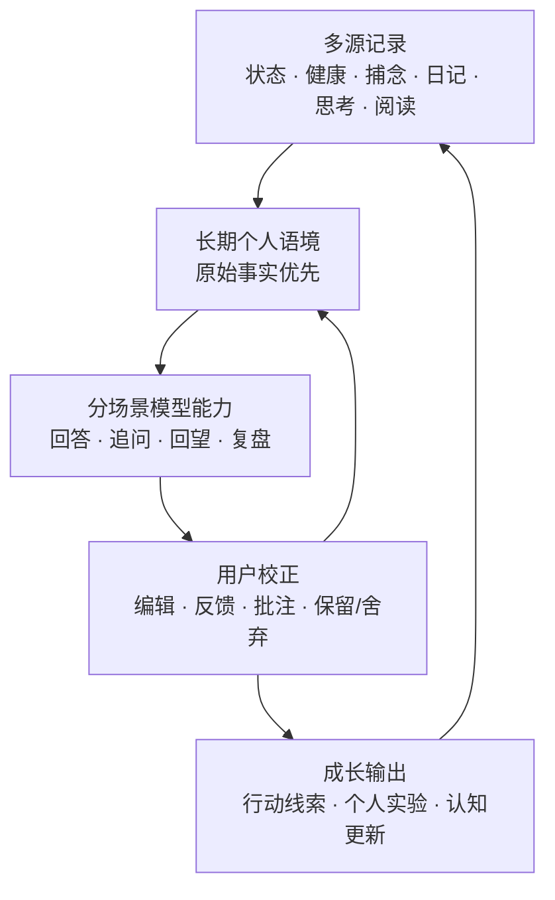
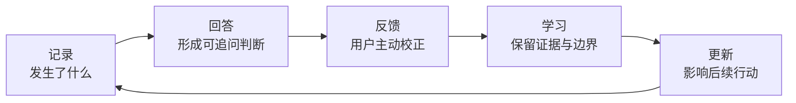
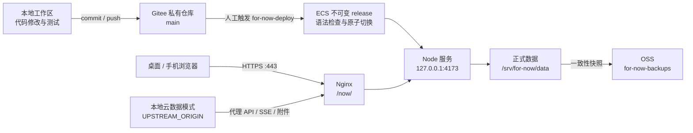
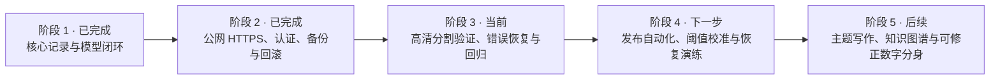

# 个人成长追踪

一个以长期记录为基础、可持续纠正和进化的个人成长系统。它把每天的状态、健康、捕念、日记、思考、阅读与反馈连成同一条证据链，让模型给出的回答不只“像你”，也能被你检查、修正并沉淀为后续行动。

## 项目背景与目标
这是一个本地优先、可自进化的个人成长系统。它以“记录 → 回答 → 反馈 → 学习 → 更新”为闭环，持续跟踪状态、认知、行为与目标，并把记录转化为定制回答、习惯支持和可修正的数字分身。

目标是让用户与模型长期交互产生的记录可持续积累、可编辑、可追溯；新的 Agent 不依赖聊天历史也能安全继续维护。

## 产品定义

- 关键词：自进化、成长记录、成长跟踪、成长建议、定制回答、习惯养成、内观、打破信息茧房、知识漏洞发现。
- 记录重点：睡眠、情绪、压力、认知、行为、目标、反馈。
- 编码重点：动态、分层、带置信度、可修正。
- 系统闭环：记录 → 回答 → 反馈 → 学习 → 更新。
- 核心功能：状态记录、定制回答、习惯养成、数字分身。
- 价值主张：一个越用越懂你、但始终允许你纠正的本地成长系统：把零散记录变成定制回答、行动反馈和可验证的成长建议，同时主动发现知识漏洞与信息茧房。

## 产品全景



## 启动

macOS 双击 `启动.command`，或执行 `./启动.command`，然后打开 <http://127.0.0.1:4173/>。

本机使用云端正式数据时设置 `UPSTREAM_ORIGIN=https://123.57.140.24/now` 后启动。云端安装、Gitee 发布、Nginx 路由、数据迁移与 OSS 备份见 `deploy/README.md`。

公网正式环境：

- 应用：<https://123.57.140.24/now/>
- 应用入口：<https://123.57.140.24/apps/>

## 核心体验

1. **记录**：以低负担方式保存此刻状态、健康、捕念、日记、思考、书摘、小物与善言。
2. **回答**：模型读取允许进入上下文的原始记录，给出分场景、可追问的定制回答。
3. **反馈**：用户通过编辑、保留/舍弃、批注、追问和复盘主动校正模型。
4. **学习**：系统保留原始事实、用户修正、模型结论及置信边界，不把模型推断自动写成事实。
5. **更新**：新的回答、习惯建议和认知复盘基于已验证的长期记录继续演进。



## 已完成

### 核心记录与回顾

- 本地 JSON 持久化已运行；原始数据位于 `data/store.json`。
- “今天”支持 1–5 此刻状态、睡眠/心率/体重/运动每日记录、由问题—初步想法—回答组成的主题思考，以及长期对话；睡眠和心率可从截图识别后确认入库。
- “捕念”是低负担的碎片收集箱，支持快捷保存、多关键词、精确发生时间、编辑删除，并可带入初步想法继续展开成思考。
- “日记”支持自由原文、可选写作引导、Markdown、标签与历史编辑；可基于已写文字追加 AI 引子、结构或主题，保存后可生成流式回望。
- “思绪”支持时间线、多标签、Markdown/LaTeX、折叠回答、追问答对、编辑删除、备注与选文评论；编辑正文时批注会重定位，失效项进入评论漂流箱。
- 状态图按自然日汇总，同日多次逐项取均值，并显示多指标浅色线和综合分。
- “回顾”支持长期趋势、延迟相关线索、问题聚类、个人实验、自定义指标和持久化认知复盘历史。
- “读书笔记”支持零记录冷启动、书籍画廊、随机笔记回顾与书籍详情；书目记录阅读起止日期，详情以笔记时间线为主，支持完整时间、三档收藏、增删改查及批注。
- “小物收集”将小票、纸品、立牌与小物照片保存为原图和透明轮廓图；支持自动主体识别、少量场景边缘外扩、保留接触手指，以及手动画笔增删蒙版。
- “善言收集”“设置”页面已具备基础工作流；“关于”页集中说明产品主张、记录闭环、能力边界与设计原则，桌面端从侧栏左下角进入，移动端从设置页进入。
- 模型能力统一使用 DeepSeek；Lite/Mid/High/Ultra 四档均可独立配置 Flash/Pro 与思考强度，每个 AI 场景独立选择档位，并以场景契约单独控制篇幅与表达。
- 所有“给我回答”统一使用流式思考/回答弹窗；弹窗可关闭且任务继续在后台生成，完成后按数据域增量刷新。模型思考独立持久化、默认折叠且不进入后续上下文。
- 日期归属与午夜切换使用本地自然日，时间以 00–23 小时制显示；业务记录保存完整、可编辑的发生时间。
- 图片识别共用选择、粘贴、拖放、预览、附件与 Flash 调用链路；体重同时保留秤上原值、衣物校正值和穿衣记录的 95% 估计区间。

### 模型与可修正性

- Lite/Mid/High/Ultra 四档模型配置、逐场景档位、SSE 流式回答和模型思考独立持久化已经落地。
- 长文本已统一支持 Markdown/LaTeX、选文评论、划线和批注级 `@神鸡`；正文编辑后会重定位批注，无法可靠定位的内容进入评论漂流箱。
- 思考追问始终携带完整原始链；模型思考不进入后续上下文，用户原文不会被 AI 静默改写。
- 写操作按数据域增量刷新，不会因为一次保存重绘整页或清空无关表单。

### 云端、数据与安全

- 公网 IP HTTPS、Nginx `/now/` 反向代理、`/apps/` 应用入口和 Let's Encrypt IP 证书自动续期已完成。
- 邀请码注册、scrypt 独立盐值密码哈希、HttpOnly/SameSite Cookie、多用户数据隔离和登录边界已完成。
- 云端正式数据独立保存在 `/srv/for-now/data`，代码、运行数据与 OSS 备份彼此分离；正式数据和附件不进入 Git。
- ECS 使用 RAM 角色向 OSS 写入一致性快照，不在服务器保存长期 AccessKey；定时备份已启用。
- Gitee 主分支发布、不可变 release 目录、原子软链接切换、systemd 重启、`/readyz` 健康检查和失败回滚已完成。

## 当前系统架构



- **代码源**：Gitee `main`；服务器不直接改代码。
- **正式数据源**：云端 `/srv/for-now/data`；本地默认使用隔离数据，需要时通过代理访问云端数据。
- **备份源**：OSS 只接收云端一致性快照，不与运行目录双向同步。
- **模型调用**：应用服务端统一调用 DeepSeek；模型设置与密钥按用户保存在正式数据目录。

## 发布与同步

当前发布不是自动 CI/CD，而是经过明确触发的半自动流程：

```text
本地修改 → 本地测试通过 → commit → push Gitee main
→ SSH 到 ECS 执行 for-now-deploy → 健康检查 → 切换或自动回滚
```

本地发布前至少执行：

```bash
npm run check
npm test
npm run test:auth
```

推送后触发服务器更新：

```bash
git push origin main
ssh -i .secrets/for-now-deploy root@123.57.140.24 \
  sudo /usr/local/sbin/for-now-deploy
```

智能体可以在本地测试通过后执行上述提交、推送和部署命令，所以技术上可以做到“一次任务完成后同步服务器”。但目前仓库没有监听本地文件或 Gitee push 的自动触发器；未明确要求部署时，智能体不会自行更新正式环境。推荐继续保留这个人工发布闸门，待回归测试覆盖稳定后再接入 Gitee CI/Webhook 自动部署。

## 当前 TODO

### P0：正在验证

- 为 ECS RAM 角色补齐阿里云 VIAPI 最小权限，使用当前两张样图闭环测试 `SegmentHDCommonImage`；只有效果通过后才正式接入“小物收集”。
- 若高清分割边缘仍不理想，再接入 `RefineMask`；输出 Alpha 蒙版继续复用现有涂抹、擦除、膨胀和原图保护流程。
- 补齐删除、编辑、流式中断、上传失败和模型失败后的错误恢复一致性，并扩大对应回归覆盖。

### P1：稳定与自动化

- 为生产发布定义自动化门槛：全量检查通过、主分支无未提交改动、部署后健康检查成功、失败自动回滚并通知。
- 在数据量足够后校准长期趋势、问题聚类、缺席主题和延迟相关阈值，继续明确“相关线索不等于因果”。
- 增加备份恢复演练、证书续期告警和部署结果通知，避免只有定时任务而没有可见反馈。

### P2：产品拓展

- 主题写作：把问题、初步想法、回答和追问发展为可版本化的长期主题。
- 捕念知识图谱与发散辅助：所有候选关系保留证据、时间、置信度和纠错入口。
- 捕念收件箱批量整理，以及更贴合真实使用反馈的日记周期回望。

更完整的已明确产品拓展见 `README-TODO.md`。

## 产品路线图



## 关键约束

- 所有指标方向、权重和日级统计口径以 `knowledge/metrics.md` 为准。
- 产品定位、闭环和核心能力以 `knowledge/product-definition.md` 为准。
- 追问必须携带完整原始链；SP/UP 结构以 `knowledge/prompt-architecture.md` 为准。
- 初始化可全量渲染，写操作不得导致整页刷新和无关状态重置。
- 聚类、缺席主题与延迟相关只提供线索，不构成因果、人格判断或医疗诊断。
- API Key 只存本机 `data/llm-settings.json`，不得进入项目文档或聊天。

## 文档地图

- `PROJECT_RULES.md`：长期项目规则；复杂任务和跨会话工作的必读文件。
- `one-mistake-one-rule.md`：复发风险错误与对应行为规则。
- `knowledge/engineering-rules.md`：代码范围、设计原则、验证、提交与发布规则。
- `knowledge/architecture.md`：运行结构、增量更新、模型交互与验证边界。
- `knowledge/metrics.md`：量表、同日均值、综合分和延迟相关口径。
- `knowledge/prompt-architecture.md`：DeepSeek 的 SP/UP 与完整追问链规则。
- `knowledge/product-definition.md`：产品关键词、记录重点、闭环、核心功能、记录边界与价值主张。
- `knowledge/iteration-history.md`：按日期保存的重要迭代历史。
- `README-TODO.md`：已明确但尚未实现的产品拓展，不与当前能力混写。
- `server.mjs`：服务端、持久化、统计和模型调用。
- `public/`：交互页面实现。

## 数据与设置

- `data/store.json` 保存用户原始记录，修改前先备份；`data/llm-settings.json` 保存本机模型设置与密钥，权限 0600，不应纳入版本控制。
- 云端启用邀请码账户后，各用户数据位于 `data/users/<user-id>/`；`auth.json` 只保存密码哈希和会话摘要。正式数据与附件不进入 Git。

## Iteration
当前日期的重要变化及完整历史统一维护在 `knowledge/iteration-history.md`。
