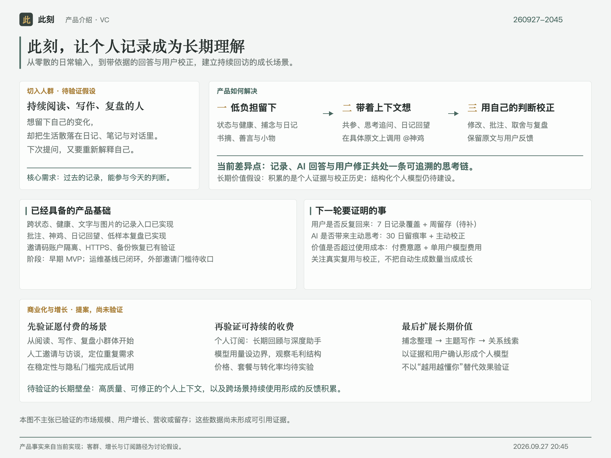
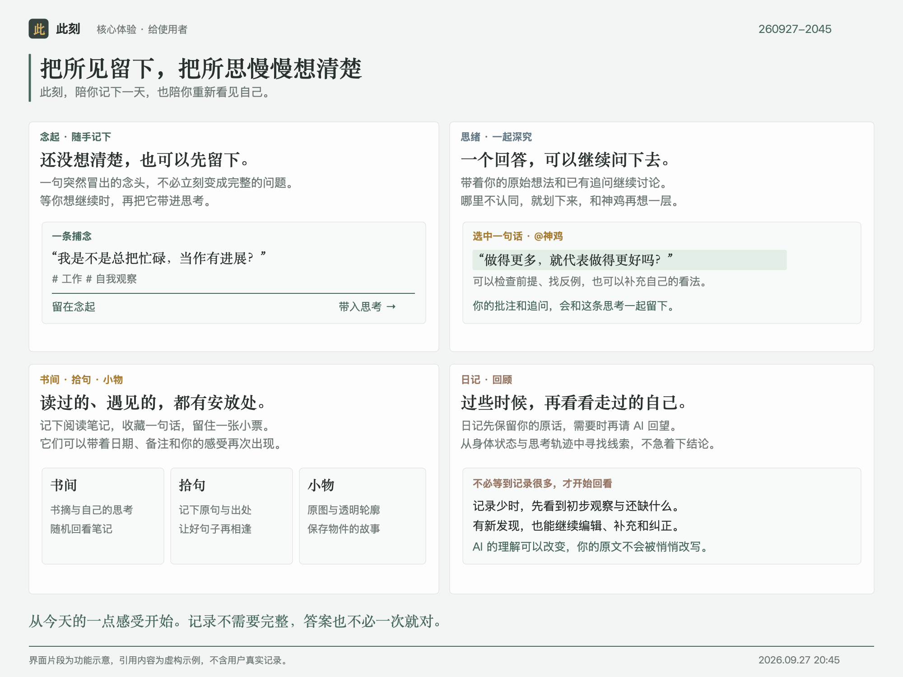
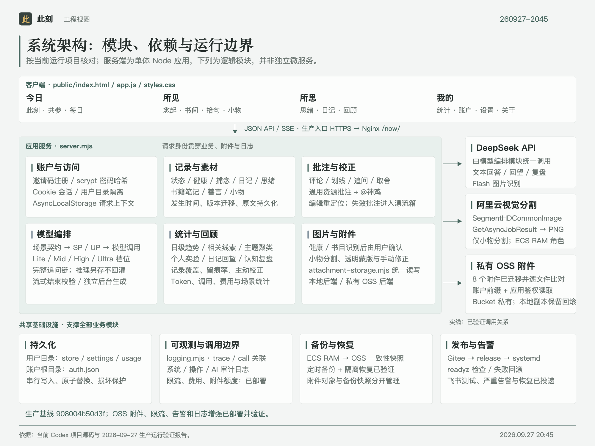
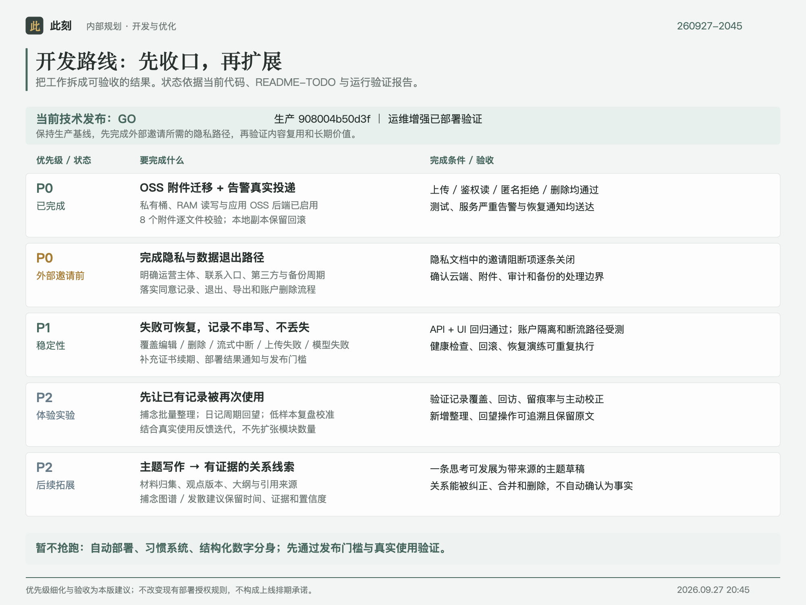

# 个人成长追踪

图册更新时间：2026-09-27 20:54（Asia/Shanghai）；当前图版 **260927-2045**。[四图说明与矢量源](reports/product-visuals-260927-2045.md)。

一个以长期记录为基础、可持续纠正和进化的个人成长系统。它把每天的状态、健康、捕念、日记、思考、阅读与反馈连成同一条证据链，让模型给出的回答不只“像你”，也能被你检查、修正并沉淀为后续行动。

## 项目背景与目标
这是一个本地优先、可自进化的个人成长系统。它以“记录 → 回答 → 反馈 → 学习 → 更新”为闭环，持续跟踪状态、认知、行为与目标，并把记录转化为定制回答、习惯支持和可修正的数字分身。

目标是让用户与模型长期交互产生的记录可持续积累、可编辑、可追溯；新的 Agent 不依赖聊天历史也能安全继续维护。

## 产品定义

产品定位、关键词、记录边界、系统闭环和价值主张统一维护在 `knowledge/product-definition.md`。界面命名与文化表达统一维护在 `knowledge/cultural-content-preferences.md`。

## 产品全景



## 启动

首次运行需 Node.js 20+ 与 npm，先执行 `npm ci` 安装锁定依赖。macOS 双击 `启动.command`，或执行 `./启动.command`，然后打开 <http://127.0.0.1:4173/>。

云端安装、Gitee 发布、Nginx 路由、数据迁移与 OSS 备份见 `deploy/README.md`。

本地功能验收使用：

```bash
npm run start:local-test
```

打开终端输出的地址（默认从 `http://127.0.0.1:4174/` 起选择空闲端口）并登录线上主账户。“设置 → 本地测试数据”可在“使用模拟”和“冷启测试”间切换；线上业务数据只读拉取为本地副本，所有测试写入留在 `data/local-test/`。如需强制限定主账户，启动前设置 `LOCAL_TEST_MAIN_USER_ID`。

公网正式环境：

- 应用：<https://77liu.top/now/>
- 应用入口：<https://77liu.top/apps/>
- 只读治理中台：<https://77liu.top/platform/>（仅 `shenji` 管理员）

## 核心体验

1. **记录**：以低负担方式保存此刻状态、健康、捕念、日记、思考、书摘、小物与善言。
2. **回答**：模型读取允许进入上下文的原始记录，给出分场景、可追问的定制回答。
3. **反馈**：用户通过编辑、保留/舍弃、批注、追问和复盘主动校正模型。
4. **学习**：系统保留原始事实、用户修正、模型结论及置信边界，不把模型推断自动写成事实。
5. **更新**：新的回答、习惯建议和认知复盘基于已验证的长期记录继续演进。



## 当前状态

- **生产 `v0.5.1` 已上线**：公网运行提交为
  `810a8a694fbd4f88fee4ffc98b28061e5f6c6096`。V0.5.0 完成 Preview 与
  Release 后，生产部署暴露 Nginx 静态目录权限问题；V0.5.1 已持久修复并
  复验网页、API、PWA、备份恢复和认证边界，30 分钟观察已关闭。PostgreSQL
  继续作为唯一正式写源。
- **线上 Preview 保留**：`preview/v0.5.1@810a8a6` 与生产代码一致，独立
  服务、数据和权限边界保持有效，验收数据与凭据已清理。V0.5.0 公网基准为
  当前屏反馈 `430.5ms`、稳定首页 `786.8ms`；V0.5.1 两次公网样本中一次
  当前屏反馈为 `596.2ms`、一次为 `481.3ms`，不把单次通过表述为稳定 P95。
- **`v0.1.1` 发布历史保留**：提交 `54a6326f14ca`、标签 `hotfix-v0.1.1-thought-answer` 在 v0.1.0 基础上修复了收集页思绪自动回答任务创建问题，现已由 v0.2.1 替代。
- **`v0.1.0` 发布历史保留**：主应用功能提交 `5ae6a7035169` 和标签 `release-20260928-p00-p0-commercial-system` 已发布 P00/P0、商业化、AI 成本和五阶段架构设计，并由 v0.1.1 继承。
- **中台已上线**：独立中台提交为 `d157537f7f4c`，发布标签为 `release-20260928-platform-mvp`；公网 `/platform/` 只读治理控制面已部署。
- **v0.1.0/治理中台发布已关闭**：两轮测试、发布前备份与隔离恢复、生产冒烟及 30 分钟观察均通过；完整证据见 `reports/pre-launch-2026-09-28-p00-p0-platform.md`。
- **正式域名已上线并纳入 `v0.2.0` 运维交付**：`https://77liu.top/now/` 使用匹配域名的 Let's Encrypt 证书，HTTP 与公网 IP HTTPS 均 308 跳转至该域名；本次仅变更 Nginx，未发布 v0.2.0 应用代码。
- **`v0.2.0` 主版本与 `v0.2.1` 恢复门修复已发布**：`v0.2.0` 先以 JSON 写源部署，恢复演练发现小物私有对象与公开 API 投影摘要口径不一致；`v0.2.1` 修复并复验后完成正式迁移。3 个账户、12 个会话、260 个业务对象和 30 个附件索引已进入 PostgreSQL；停写 212 秒，切换前后备份、逻辑恢复、数据库级独立恢复、写入重启冒烟均通过。当前功能范围包含思绪检索/回访、跨体裁导出、行动/习惯、产品反馈、生命周期与幂等账本、小物 WebP 派生、跨体裁图片原文和后台图片理解，共 50 个模块、201 条拥有路由、60 条 OpenAPI 路径、104 个操作和 23 个视图；Store 为 v15。
- **夜间探索轨道**：P1、P2、P3 三个递进探索版均已在本地非主线分支验证；所有版本使用隔离样例数据，不连接生产。执行约束与阶段状态见 `knowledge/exploration-release-track.md`。
- **PostgreSQL 验收与恢复（2026-09-30）**：本地 PostgreSQL 16.14 的 Store v15 全领域、旧表升级、完整导出恢复及持久幂等专项通过；ECS PostgreSQL 16.15 的正式迁移、重复导入验真、生产备份、逻辑恢复和数据库级独立恢复均通过。证据见 `reports/g2-r4-postgres-2026-09-30.json` 与 `reports/v0.2.1-production-cutover-2026-09-30.json`。
- **V0.3.0 已完成发布**：本轮交付当前全部未完成 P00/P0 和计划内部分 P1，
  发布记录、完整中文说明、生产验证与观察证据见
  `reports/pre-launch-2026-10-01-v0.3.0.md`；范围与实施过程见
  `reports/iteration-plan-v0.3.0-2026-09-30.md`。
- **状态单一事实来源**：工程排期、验收标准和剩余阻塞统一见 `README-TODO.md`；
  业务需求及交付关联维护在飞书 Base“需求池”和“研发交付记录”。

## 当前生产与工作区能力

未特别标注的能力已随 v0.1.x 至 v0.3.0 上线。逐项状态以 `README-TODO.md` 为准。

### 核心记录与回顾

- **v0.3.0 生产底座**：PostgreSQL 为唯一正式写源，Store v15 覆盖行动、习惯、习惯打卡、反馈、验证台账、同步账本和多供应商用量关系；原子注册、并发、隔离、断连、重启、旧元数据表升级、全量关系导出和第二数据库恢复已验证。生命周期与幂等账本通过显式位置和原始 payload 保持无损顺序与扩展字段；当前每数据库只允许一个应用实例。
- “今日”的三个子视图分别承载即时状态与主题思考、长期记录对谈、健康日常；具体信息架构见 `knowledge/architecture.md`，栏目命名见 `knowledge/cultural-content-preferences.md`。
- “捕念”是低负担的碎片收集箱，支持快捷保存、多关键词、精确发生时间、编辑删除，并可带入初步想法继续展开成思考。
- “日记”支持自由原文、可选写作引导、Markdown、标签与历史编辑；可基于已写文字追加 AI 引子、结构或主题，保存后可生成流式回望。
- “寻迹”支持按正文/标签和内容类型检索思绪，区分用户原文与 AI 派生内容，并提供未回访筛选、已读、明日再看和当前筛选内任意门。
- “今日”支持行动优先级、完成/撤销、来源引用，以及每日/每周习惯、自然日打卡和调整记录；删除习惯时打卡按父子关系一并进入回收站。
- “我的”提供默认排除密钥与模型内部推理的 JSON/Markdown 账户导出，以及默认不附带私人记录的产品反馈入口；付费验证台账区分计划、同意/退出、补偿/奖励和真实参与证据。
- “思绪”以问题为根、内容块为倒序时间线，支持多次 AI 回答、用户回答、记录、初步想法、追问和备注；每块独立编辑、软删除和恢复，并显示时间、来源、版本及 AI 派生标记。
- 状态图位于“所思 → 回顾 → 长期趋势”，按自然日汇总，同日多次逐项取均值，并显示多指标浅色线和综合分；图下可逐次编辑发生时间、量表、备注和当天因素。
- “回顾”支持低样本当前观察、渐进式趋势与延迟相关线索、问题聚类、个人实验、自定义指标和持久化认知复盘历史。
- “读书笔记”支持零记录冷启动、书籍画廊、随机笔记回顾与书籍详情；书目记录阅读起止日期，详情以笔记时间线为主，支持完整时间、三档收藏、增删改查及批注。
- “小物收集”将照片保存为原图和透明轮廓图，不再维护类型字段；自动主体识别只使用阿里云 `SegmentHDCommonImage`，并支持少量场景边缘外扩与手动画笔增删蒙版。陈列按行优先排列，基于 Alpha 连通域过滤贴边噪点、计算外扩包围盒并稳定主体重心；首屏 12 件、接近底部加载下一页。标签支持可创建多选，“帮我填写”仅从账户已有标签中匹配最多 3 个，并调用 DeepSeek 生成名称与可编辑备注。
- 捕念语音以“上传音频”为主入口，现场录音默认折叠，展开后提供开始、暂停/继续、停止和取消；原件、ASR 原文与独立 AI 整理稿分层保存。
- “我的”采用设置页式分组入口，只显示账户、统计、通知、回收站、AI 成本、架构设计、设置、商业化、探索实验室和关于的简述，点击后进入独立内容页；探索实验室只读写隔离样例，不复用其他一级页面的横向组内标签。
- “我的 → 商业化”汇总当前账户的商业线索与近 30 天 AI 实际成本，支持有偿调研、月度订阅、一次性交付和用量包四套可保存模拟；订阅按月展示现金流、研发工时与完整结余。
- “我的 → AI 成本”按 15 个 DeepSeek 场景独立模拟模型、峰谷价格、调用量、输入缓存和输出 Token，并与近 30 天账户实测比较；方案独立保存，不自动修改真实模型配置。“我的 → 统计”另按 DeepSeek、豆包语音、火山视觉和阿里云图片分割展示调用趋势、原始计量单位、已知费用与待账单次数。
- “我的 → 架构设计”按五阶段展示请求入口、防火墙、分发、主服务器、Worker、数据、监控与灾备，并同步给出规划规格、成本区间、进入条件和白话术语解释；只描述目标路线，不把未部署能力标记为已上线。
- 主导航已收拢为四个一级入口；今日、所见、所思通过组内导航进入，“我的”通过设置列表进入。具体命名与分组分别见 `knowledge/cultural-content-preferences.md` 和 `knowledge/architecture.md`。
- 文本生成与结构化整理使用 DeepSeek；语音转写/合成和可选 OCR/文档解析使用火山引擎，小物主体分割使用阿里云视觉。DeepSeek 的 Lite/Mid/High/Ultra 四档均可独立配置 Flash/Pro 与思考强度，每个文本场景独立选择档位，并以场景契约单独控制篇幅与表达。
- 模型提示词使用独立不可变目录版本；当前激活版本、文件摘要、必需提示和占位符在 `prompts/manifest.json` 校验，每次 AI 审计记录目录版本，可独立于应用版本固定和回滚。
- `/api/v1` 公共内核已冻结为 `1.0.0`，统一 `data/error/meta`、TraceID、游标、ETag/If-Match 与 Idempotency-Key；OpenAPI 位于 `/api/v1/openapi.json`，旧接口继续兼容。
- 思绪回答默认创建持久后台任务，不弹窗阻断录入；通知中心展示排队、生成、完成、失败和过期状态，并支持结果跳转与失败重试。草稿等主动查看场景仍可流式展示，模型思考独立持久化、默认折叠且不进入后续上下文。
- 全体裁删除进入 30 天回收站，恢复保留原正文、互动和附件引用；永久清理使用清单哈希与二次确认。助手称呼和逐场景回答风格与模型档位分离。
- 无记录账户可选择快速版 8 题或详细版 18 题完成必答的价值判断问卷；性别、地区、职业、专业、学校、兴趣、自我介绍、作品与导入材料均可跳过。原始选择和可修正初始认知会进入个人语境，但后续真实记录优先。
- 日期归属与午夜切换使用本地自然日，时间以 00–23 小时制显示；业务记录保存完整、可编辑的发生时间。
- 睡眠、心率、体重/体成分、运动图片共用选择、粘贴、拖放、预览、附件与健康识别链路，用户核对回填后保存。体重缺总重量时可只存体成分；有总重量时保留衣物校正和 95% 估计区间。运动记录项目、秒级时长、活动/总热量、心率及可编辑描述，未显示的字段留空；口径见 `knowledge/metrics.md`。

### 模型与可修正性

- Lite/Mid/High/Ultra 四档模型配置、逐场景档位、SSE 流式回答和模型思考独立持久化已经落地。
- 长文本已统一支持 Markdown/LaTeX、选文评论、划线和批注级 `@神鸡`；正文编辑后会重定位批注，无法可靠定位的内容进入评论漂流箱。
- 思考追问始终携带完整原始链；模型思考不进入后续上下文，用户原文不会被 AI 静默改写。
- 写操作按数据域增量刷新，不会因为一次保存重绘整页或清空无关表单。

### 云端、数据与安全

- 公网域名 HTTPS、IP 到域名跳转、Nginx `/now/` 反向代理、`/apps/` 应用入口和 Let's Encrypt 证书自动续期已完成。
- 邀请码注册、scrypt 独立盐值密码哈希、HttpOnly/SameSite Cookie、多用户数据隔离和登录边界已完成。
- 云端业务、认证、设置和用量数据保存在 PostgreSQL；`/srv/for-now/data` 保留日志、旧 JSON 回滚副本和 PostgreSQL 写源标记，持久图片保存在私有 OSS 附件前缀。代码、运行数据、附件与 OSS 备份彼此分离，均不进入 Git。
- ECS 使用 RAM 角色向 OSS 写入一致性快照，不在服务器保存长期 AccessKey；定时备份已启用。
- Gitee 主分支发布、不可变 release 目录、原子软链接切换、systemd 重启、`/readyz` 健康检查和失败回滚已完成。
- **只读中台已部署**：独立中台使用生产管理员认证、`shenji` owner 保护、服务令牌只读聚合、`/platform/` 路由、独立 systemd/数据目录和失败回滚；中台使用同一 Gitee remote 的 `platform/main` orphan 分支和独立 worktree。

## 当前系统架构



- **代码源**：Gitee `main`；服务器不直接改代码。
- **正式数据源**：ECS PostgreSQL 16.15 保存业务、认证、设置和用量数据；私有 OSS 附件前缀保存持久图片。`/srv/for-now/data` 的旧 JSON 仅作为受写源标记保护的回滚副本，不再接受正式写入。
- **OSS**：`for-now-backups` 保存一致性快照，`for-now-attachments/<user-id>` 保存图片；两者都不与运行目录双向同步。
- **模型调用**：应用服务端统一调用 DeepSeek；模型设置与密钥按用户保存在正式数据目录。捕念朗读与转写由服务端调用火山豆包语音，浏览器不接触语音 API Key。
- **文字与文档识别**：配置火山视觉后，健康截图和书目信息先经通用 OCR 提取文字，再由 DeepSeek 结构化；智能文档解析提供独立受认证接口。视觉 AK/SK 只存在服务端环境中。
- **小物分割**：应用服务端通过 ECS RAM 角色调用阿里云 `SegmentHDCommonImage`，用同类目 `GetAsyncJobResult` 查询异步结果并立即下载临时透明 PNG；不调用 DeepSeek 或 `RefineMask`。
- **日志与审计**：系统日志、用户操作摘要、DeepSeek 用量及 AI 开始/终态审计已在本地接通；阿里云分割独立留痕。字段、隐私、保留和未关闭边界统一见 `knowledge/observability.md`。
- **运行边界**：DeepSeek 全局 20 QPS/20 在途，图片分割 5 QPS/5 在途，火山语音 5 QPS/5 在途，火山 OCR 10 QPS/10 在途，智能文档解析 2 QPS/2 在途；每用户每日 200 次 DeepSeek 调用、附件 1 GiB。阈值来源和扩容条件见 `knowledge/operations-capacity.md`。
- **已上线治理控制面**：独立中台只经本机服务令牌读取脱敏聚合，不直接读取业务数据目录；主应用契约见 `knowledge/architecture.md`，认证、部署和回滚细节维护在 `platform/main` 分支 README。

## 生产检查状态

2026-10-03，`v0.5.1 / 810a8a694fbd` 已完成 Git/Gitee 发布、生产静态资源
权限热修、部署后备份、隔离恢复和 30 分钟观察。观察期 PID 与 ready 稳定、
重启和 `/now/` 5xx 均为 0，RSS 为 70.2–145.5 MiB，监控
`issues: []`。V0.5.0 的 Preview、功能、真实第三方与性能证据见
`reports/pre-launch-2026-10-03-v0.5.0.md`，热修和生产证据见
`reports/pre-launch-2026-10-03-v0.5.1.md`。

## 发布与同步

当前发布使用经过明确触发的 Preview → Release 半自动流程：

```text
低风险单域暂存变更 → commit:task 隔离验证 → 本地任务 commit
其他提交 / push / tag / Gitee Release → 人工明确授权
已授权 push preview/* → Preview 服务器只读拉取并部署精确 SHA
→ 公网 Preview E2E / 性能 / 响应式 / 日志检查
→ 冻结候选并通过 Release 门
→ push main / tag / Gitee Release
→ SSH 到 ECS 执行 for-now-deploy → 健康检查 → 切换或自动回滚
```

本地发布前至少执行：

```bash
npm run test:system
```

该命令串行执行后端与前端功能稳定性测试。功能开发阶段不执行压测；容量评估时再单独运行 `npm run test:load`。测试矩阵与边界见 `knowledge/system-testing.md`。

涉及持久化、schema、迁移或数据库 repository 时，先运行
`npm run test:postgres:preflight`，再运行 `npm run test:postgres:stable`；
该入口固定选择已核验的 PostgreSQL 16 测试工具链。

推送后触发服务器更新：

```bash
git push origin main
ssh -i .secrets/for-now-deploy root@123.57.140.24 \
  sudo /usr/local/sbin/for-now-deploy
```

低风险、单一任务域可在暂存后运行
`npm run commit:task -- --message "<feat|fix|test|docs>(scope): 摘要"`，由门禁在
隔离候选上完成相应验证并创建本地提交；`commit:feat` 作为兼容别名保留。
高风险、跨域及发布整合提交仍需人工授权。任何 push、tag、Gitee Release、
部署或生产写入始终需要本次人工明确授权，本地测试或自动提交均不构成授权。
主分支同一待提交单元超过 500 行增删或 15 个文件时，须在安全线内按同一或
同组需求及时形成功能级/任务级本地提交；不得跨无关任务合并。完整边界以
`knowledge/engineering-rules.md` 为准。
仓库没有监听本地文件或 Gitee push 的自动触发器。首次引入 SDK 依赖前还需
按 `deploy/README.md` 升级旧部署器。

## 当前 TODO

需求判断以用户亲自写下的问题、初步想法、捕念、追问和批注为主；AI 生成回答
仅作弱参考，不代表用户立场。V0.5.0/V0.5.1 已完成“真实体验 → 两线开发 →
线上 Preview → Release → 生产热修”闭环；当前排期在 `README-TODO.md`
维护，详细流程见 `reports/iteration-plan-v0.5.0-2026-10-03.md`。

## 产品路线图



## 关键约束

- 所有指标方向、权重和日级统计口径以 `knowledge/metrics.md` 为准。
- 产品定位、闭环和核心能力以 `knowledge/product-definition.md` 为准。
- 追问必须携带完整原始链；SP/UP 结构以 `knowledge/prompt-architecture.md` 为准。
- 初始化可全量渲染，写操作不得导致整页刷新和无关状态重置。
- 聚类、缺席主题与延迟相关只提供线索，不构成因果、人格判断或医疗诊断。
- DeepSeek API Key 只存运行数据目录内的账户模型设置；火山语音 API Key 与视觉 AK/SK 只存服务端受保护环境文件。任何密钥不得进入 Git、文档、日志或聊天。

## 文档地图

- `PROJECT_RULES.md`：长期项目规则；复杂任务和跨会话工作的必读文件。
- `one-mistake-one-rule.md`：复发风险错误与对应行为规则。
- `SOP/README.md`：标准作业流程目录；迭代复盘与过程报告按
  `SOP/iteration-retrospective.md` 执行。
- `knowledge/engineering-rules.md`：代码范围、设计原则、验证、提交与发布规则。
- `knowledge/pre-launch-confirmation.md`：上线前双轮检查、人工配置与确认、证据失效、Git/服务器发布和观察关闭流程。
- `knowledge/development-release-checklist.md`：新功能测试完成、准备上线时执行的阻断式自查清单。
- `knowledge/release-notes-rules.md`：版本更新说明的分类、用户故事、问题与价值表达、模板及发布前检查规则。
- `knowledge/system-testing.md`：后端、压测、前端系统测试矩阵、统一命令、阈值与维护规则。
- `knowledge/user-journey-testing.md`：真实用户任务、异常恢复、视觉兼容性、分层运行与自动提交门槛；机器可读覆盖见 `knowledge/user-journey-matrix.json`。
- `knowledge/observability.md`：系统日志、用户操作日志与 AI 调用审计的现状、字段、隐私和未完成项。
- `knowledge/operations-capacity.md`：生产容量、调用/存储边界、OSS 权限、飞书告警和恢复演练。
- `knowledge/commercialization.md`：商业化阶段、证据边界、成本收益公式、变现优先级与决策门。
- `knowledge/ai-cost-control.md`：个人 AI 成本模拟变量、计算公式、实测校准与模型配置建议边界。
- `knowledge/privacy-notice.md`：邀请用户注册后的隐私告知草案、确认流程和上线阻断项。
- `knowledge/architecture.md`：运行结构、增量更新、模型交互与验证边界。
- `knowledge/modularization-design.md`：v0.2.0 起的模块边界、依赖方向、跨模块影响矩阵、检查门禁与迁移顺序。
- `knowledge/module-boundaries.json`：已实施模块、公开入口、依赖、路由所有权、测试和迁移例外的机器可读登记。
- `knowledge/postgres-migration.md`：全领域关系映射、附件实物/哈希校验、覆盖保护、迁移命令与剩余运行接入范围。
- `knowledge/scalable-architecture-design.md`：前后端分离、并发稳定性、PostgreSQL/pgvector 数据底座和渐进迁移设计。
- `knowledge/exploration-release-track.md`：P1-P3 本地递进分支、样例隔离、发布和验收约束。
- `knowledge/cultural-content-preferences.md`：文化表达与界面命名偏好的单一事实来源。
- `knowledge/metrics.md`：量表、同日均值、综合分和延迟相关口径。
- `knowledge/onboarding-strategy.md`：冷启动资料、快速/详细问卷、初始认知与本地测试模式边界。
- `knowledge/prompt-architecture.md`：DeepSeek 的 SP/UP 与完整追问链规则。
- `knowledge/volcengine-integration.md`：火山语音、OCR、智能文档解析的服务端配置、隐私边界和真实冒烟命令。
- `knowledge/product-definition.md`：产品关键词、记录重点、闭环、核心功能、记录边界与价值主张。
- `knowledge/iteration-history.md`：按日期保存的重要迭代历史。
- `README-TODO.md`：P00-P3 排期、实施状态、验收标准和阻塞项的单一事实来源。
- `reports/product-iteration-review-2026-09-27.md`：生产条目审阅范围、需求证据、审阅时实现核对与优化取舍。
- `reports/iteration-plan-v0.2.0-2026-09-28.md`：最新主账户原文审阅、版本号、P00-P3 判断和本轮执行计划。
- `reports/iteration-plan-v0.3.0-2026-09-30.md`：V0.3.0 全部 P00/P0、
  选定 P1、`v0.2.x` 功能批次及串并行开发流程。
- `reports/pre-launch-2026-10-01-v0.3.0.md`：V0.3.0 冻结对象、双轮审计、
  中文发行说明、生产部署、五服务冒烟和观察关闭证据。
- `reports/pre-launch-2026-10-03-v0.4.0.md`：V0.4.0 最终候选、双轮审计、
  备份恢复、真实第三方冒烟、生产部署和 40 分钟观察。
- `reports/v0.4.0-retrospective-2026-10-03.md`：V0.4.0 事实、提交与文件账本、
  失败纠正、Git 收尾和 V0.5.0 行动项。
- `reports/iteration-plan-v0.5.0-2026-10-03.md`：V0.5.0 的 P00/P0/P1 范围、
  两线编排、性能目标、旅程、验证和人工门。
- `reports/v0.5.0-development-process-2026-10-03.md`：V0.5.0 影子体验、
  本地提交、性能证据、系统门、主动试运行、账户清理和剩余外部验收。
- `reports/pre-launch-2026-10-03-v0.5.0.md`：V0.5.0 线上 Preview、
  公网 E2E/性能、备份恢复、最终发布门与完整中文发行说明。
- `reports/pre-launch-2026-10-03-v0.5.1.md`：V0.5.1 静态资源权限热修、
  最终门、Git/Gitee 发布、部署后备份恢复与生产观察。
- `reports/v0.3.0-git-closeout-2026-09-30.md`：旧工作树、探索 stash、
  本地 `main` 和可恢复归档记录。
- `reports/g1-contract-freeze-2026-09-29.json`：G1 契约文件摘要、系统测试、PostgreSQL 证据边界及三路重构资源预留。
- `reports/s3-10-integration-2026-09-29.json`：B1/B2/B3 隔离工作树、串行集成顺序、产物摘要和 36 阶段系统测试证据。
- `reports/s3-11-12-completion-2026-09-29.json`：状态/健康 v1 纵向链、前端薄壳与页面生命周期，以及 38 阶段系统测试证据。
- `reports/g2-i-integration-2026-09-29.json`：G2 A-D 工作树、I 串行集成、Store v15、51 个 OpenAPI 操作、43 阶段系统测试及 PostgreSQL 阻塞证据。
- `reports/g2-r4-postgres-2026-09-30.json`：G2 R4 真实 PostgreSQL 16.14、持久幂等、旧表升级、完整恢复、系统测试及剩余生产门禁证据。
- `reports/production-postgres-recovery-2026-09-30.json`：正式空库/最小角色、最新 OSS inventory、生产备份两库恢复和候选 HTTP 读取证据。
- `reports/v0.2.0-g2-intermediate-checkpoint-2026-09-30.md`：本地中间提交的逐项实现、提交前验证、待办及“非权威、可继续修改”边界说明。
- `reports/pre-launch-2026-09-29-v0.2.0.md`：v0.2.0 当前发布候选、两轮检查、人工配置、发行说明、生产阻断和最终 GO 记录。
- `reports/hotfix-thought-answer-task-2026-09-28.md`：v0.1.1 思绪自动回答严重故障的根因、修复、验证与生产发布记录。
- `reports/domain-https-cutover-2026-09-29.md`：`77liu.top` 证书切换、HTTP/IP 跳转、续期、回滚点及与 v0.2.0 应用发布的边界。
- `server.mjs`：HTTP 装配入口及尚未迁移的领域、统计和模型调用。
- `src/shared/persistence/`：JSON/PostgreSQL repository、整批迁移与停写导出恢复。
- `src/modules/thoughts/`：已拆出的构思领域服务。
- `src/modules/auth/` 与 `src/http/`：认证/会话领域规则及 HTTP、Cookie、JSON 适配。
- `src/modules/annotations/`、`tasks/`、`notifications/` 与 `src/app/`：批注、任务/通知领域及跨领域事务编排；兼容路由归 HTTP，通用 AI 供应商继续迁移。
- `src/modules/trash/`、`src/shared/attachments/` 与 `src/app/`：回收条目、版本化恢复、持久清理、上传/配额/临时文件与存储适配；本段 PG 验证缺口见系统测试文档。
- `public/frontend/`：API、会话、状态、内容/时间/媒体共享能力，以及思绪回访、导出、行动/习惯和反馈纯功能模块；页面运行时仍会按后续领域继续细分。
- `src/config/` 与 `src/shared/observability/`：统一运行配置、异步请求上下文、脱敏、私有日志与资源变更摘要；请求完成与错误适配归 `src/http/`。
- `src/modules/ai/`：模型设置、成本模拟/统计、用量/费用、额度、通用 Prompt 与调用/重试审计；账户文档适配归持久化，设置/成本接口归 HTTP。DeepSeek、阿里云分割及火山语音/视觉传输归 `src/infrastructure/ai-providers/`；业务上下文继续迁移。
- `src/modules/keepsakes/`：小物校验/归一化、创建/编辑、分割与临时图片流程；HTTP 适配、供应商、回收事务分别装配。通用发生时间解析归 `src/shared/time/`，共享队列归 `src/shared/concurrency/`；前端继续迁移。
- `public/`：交互页面实现。

## 数据与设置

- `data/store.json` 保存用户原始记录，修改前先备份；`data/llm-settings.json` 保存本机模型设置与密钥；`data/ai-usage.json` 保存 AI 用量元数据，`data/logs/ai-audit-*.ndjson` 保存默认 30 天的完整 AI 调用审计。敏感文件权限为 0600，均不应纳入版本控制。
- 云端启用邀请码账户后，各用户文字与结构化数据位于 `data/users/<user-id>/`；`auth.json` 只保存密码哈希和会话摘要。持久图片迁移后位于私有 OSS；正式数据与附件不进入 Git。

## Iteration
当前日期的重要变化及完整历史统一维护在 `knowledge/iteration-history.md`。
