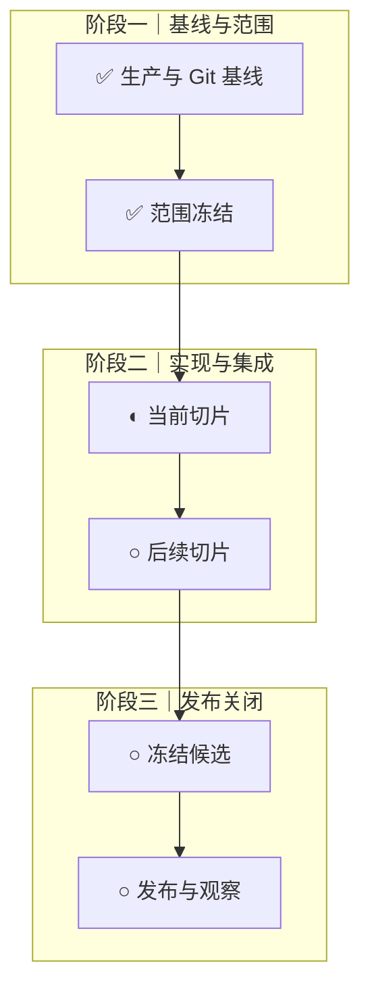

# 迭代计划制作 SOP

本 SOP 用于从产品需求、工程现状和生产证据出发，制作或重排一份可执行、
可验收、可追踪的迭代计划。

它只定义制作计划的方法，不复制具体版本事实。当前需求状态以飞书 Base
“需求池”为准，工程执行状态以 `README-TODO.md` 为准，发布流程和检查项
分别以 `knowledge/pre-launch-confirmation.md` 与
`knowledge/development-release-checklist.md` 为准。

## 1. 适用范围

以下情况必须使用本 SOP：

- 启动新的主版本或次版本迭代。
- 新增 P00/P0 导致当前迭代需要重排。
- 生产发布后，需要把实际结果回写到原迭代计划。
- 需求池、研发交付记录与仓库执行状态明显不一致。
- 现有计划缺少依赖、验收、证据、Git 路径或发布关闭条件。

以下工作不由本 SOP 替代：

- 功能开发和代码实现。
- 详细上线检查。
- 正式发布授权。
- 迭代过程记录和复盘；该流程由 `SOP/iteration-retrospective.md` 负责。

## 2. 角色与责任

| 角色 | 责任 |
| --- | --- |
| Owner | 确认版本目标、必须完成范围、延期项、风险接受、时间窗口和最终发布授权 |
| 计划编制者 | 收集事实、去重需求、拆分任务、识别依赖、形成排期、维护计划文档 |
| 工程执行者 | 按任务边界开发、测试和提交，回填实际状态与证据 |
| 独立审阅者 | 检查遗漏、错误依赖、状态夸大、测试缺口和不可执行排期 |

同一人可以承担多个角色，但最终发布授权不能由 Agent 自行推定。

## 3. 必需输入

制作计划前必须读取以下输入；缺失项要在计划中明确标记，不能用猜测补齐。

### 3.1 产品与需求

- 飞书 Base“需求池”的全部当前记录，而不是只读取某个视图。
- 飞书 Base“研发交付记录”，用于区分需求与已经执行的开发、测试、迁移、
  发布和文档工作。
- 用户原始反馈、评论、复盘文档和明确的版本指令。
- 上一迭代中保留的 P1/P2/P3、已取消和重复需求。

### 3.2 工程与生产

- `README.md`
- `README-TODO.md`
- `PROJECT_RULES.md`
- `knowledge/engineering-rules.md`
- `knowledge/modularization-design.md`
- `knowledge/system-testing.md`
- `knowledge/iteration-history.md`
- 当前分支、工作树、未提交变更、标签、远端主线和生产运行提交。
- 上一版本发布报告、恢复报告、观察结论和未关闭风险。

### 3.3 人工约束

- 版本目标和明确不做的范围。
- 可用时间、最大并行数、维护窗口和允许中断时间。
- 真机、外部服务、生产数据、费用和凭据的授权边界。
- 必须人工完成的视觉、隐私、运营和发布决策。

## 4. 必需输出

一次完整计划至少产生：

1. `reports/iteration-plan-vX.Y.Z-YYYY-MM-DD.md`
2. 飞书“需求池”中的版本、优先级、需求状态、验收标准、阻塞原因和证据
3. 飞书“研发交付记录”中的计划交付项及其关联需求
4. `README-TODO.md` 中的工程执行状态
5. 一张覆盖全部阶段的 Mermaid 总流程图
6. 任务编号、分支策略、依赖、负责人、验收、测试和计划时间
7. 计划完成条件及发布关闭条件

计划文档只引用单一事实来源，不复制长期规则全文。

## 5. 状态与对象必须分开

### 5.1 三类对象

| 对象 | 回答的问题 | 存放位置 |
| --- | --- | --- |
| 需求 | 为什么做、需要什么能力 | 需求池 |
| 交付任务 | 本次具体做什么工作 | 研发交付记录、迭代计划 |
| 交付证据 | 如何证明完成 | 测试报告、提交、Release、部署及观察记录 |

“执行了一次真实供应商验证”属于交付任务或证据，不应作为独立产品需求长期
留在需求池。

### 5.2 三类状态

| 状态维度 | 示例 |
| --- | --- |
| 需求状态 | 待评估、待规划、待开始、进行中、待验收、已完成、已取消、重复 |
| 执行状态 | 待排期、待开始、进行中、阻塞、待验收、已完成、已取消 |
| 发布状态 | 不适用、未发布、待发布、已发布、已回滚 |

不得用“已完成”同时表示代码写完、测试通过、已经发布和生产观察关闭。计划
中应明确使用“本地已实现”“本地已验证”“已提交”“已发布”“生产已观察”
等可核验表达。

## 6. 标准流程

### 步骤 0：保护当前工作区

执行只读盘点：

```bash
git status --short --branch
git worktree list
git log -10 --oneline --decorate
git tag --sort=-creatordate | head
```

记录：

- 当前分支、HEAD、`origin/main` 和生产运行提交。
- 所有工作树、stash、未提交文件及归属。
- 哪些变化来自其他任务或用户。

不得为制作计划清理、回退、提交或合并不属于本任务的变化。

计划门禁处的活跃工作树总数不得超过 6 个。超过上限时先停止新建工作树，
逐个判断已结束现场应归档还是删除；未完善、未合入或归属不明的工作树保留并
登记。详细调度和处置顺序见 `SOP/multi-agent-orchestration.md`。

### 步骤 1：读取并归一化需求

1. 读取需求池全部记录及字段定义。
2. 按需求标题、用户问题、用户故事和验收结果识别重复项。
3. 区分产品需求、系统质量需求、一次性交付任务和纯证据。
4. 合并重复项时保留来源，并关联被保留记录。
5. 已取消项保留取消原因；不得直接删除历史需求。
6. 检查每条未完成需求是否具有：
   - 用户故事或系统目标
   - 优先级
   - 计划版本
   - 可验证的验收标准
   - 阻塞原因或明确“无外部阻塞”
   - 当前证据

输出一份范围统计：总记录数、各优先级数量、各状态数量、重复与缺失字段。

### 步骤 2：冻结版本基线

写明：

- 当前生产版本、运行提交和数据写源。
- 当前 Git 主线和候选基线。
- 上一版本已经完成的能力。
- 尚未关闭的生产问题和已接受风险。
- 本轮可复用的测试、迁移、备份和恢复证据。

测试证据只有在候选 SHA、依赖、脚本、配置和运行环境均未发生相关变化时才
可复用。

### 步骤 3：定义版本目标与非目标

版本目标必须是可验收结果，不写“持续优化”“体验提升”等无法关闭的表达。

至少回答：

1. 本轮必须解决什么用户问题？
2. 哪些数据、安全或发布风险必须关闭？
3. 哪些能力明确不在本轮完成？
4. 为什么使用当前版本号？
5. 什么条件满足后才允许宣告版本关闭？

版本号遵循项目已有规则；已经推送的标签保持不可变。

### 步骤 4：冻结范围

默认规则：

- 未完成 P00 全部进入本轮，除非 Owner 明确取消或改级。
- 未完成 P0 全部进入本轮。
- P1 按价值、依赖和容量选择，明确纳入或后置。
- P2/P3 保留在后续计划，不因本轮不做而从流程中消失。
- 新需求在范围冻结后默认进入下一批；只有阻断当前目标的必要修复可插入。

范围表至少包含优先级、需求数量、本轮处理方式和后置原因。

### 步骤 5：拆分可验收切片

每个切片必须：

- 有唯一编号，例如 `V0.4.0-01`。
- 只解决一个清晰目标或一组强依赖问题。
- 能在不依赖后续切片的情况下运行专项验收。
- 明确涉及的模块、接口、数据、页面和文档。
- 明确不做的范围。
- 具备成功路径、关键失败路径和恢复路径。
- 自 V0.4.0 起，在实现开始前标出
  `knowledge/user-journey-matrix.json` 中受影响旅程；没有现成旅程时，
  新旅程、业务结果、持久化、异常恢复和副作用断言属于同一切片交付。

优先按用户完整任务或纵向链路拆分，不按“前端任务”“后端任务”横向分割
成无法独立验收的半成品。

### 步骤 6：建立依赖与所有权

为每个切片记录：

- 前置需求和前置交付。
- 公共契约、schema、模块登记、根入口、共享样式和依赖锁负责人。
- 允许修改的目录和禁止修改的共享文件。
- 工作树、端口、数据库和测试资源隔离方式。
- 合并顺序和每次合并后的影响测试。

并行规则：

- 同一共享契约或热点文件同时只有一个负责人。
- 两条实现线必须有不同模块所有权和隔离资源。
- 公共契约发现缺口时，暂停支线，回到串行任务修订并重新冻结。
- 多任务始终串行合并。
- 每个计划、集成和候选门重新检查活跃工作树数量，必须保持不超过 6 个。
- Reviewer 确认可合并后，按“串行合入、合入后测试、归档或删除已结束工作树”
  完成闭环；未完善现场继续保留。

### 步骤 7：规划小版本与里程碑

不要把所有能力积压到主版本末尾一次发布。按风险和依赖将任务组织成可验收的
小版本，例如：

```text
基线和门禁
→ 高优缺陷
→ 公共数据或请求契约
→ 用户可见能力
→ 全业务接入
→ 质量、成本和原生交付
→ 选定 P1
→ 主版本总集成
```

每个小版本写明：

- 包含需求
- 进入条件
- 完成条件
- 候选分支和提交策略
- 需要运行的验证
- 是否需要发布、迁移或人工授权

### 步骤 8：映射验收、测试和证据

每条需求至少映射：

| 内容 | 要求 |
| --- | --- |
| 验收标准 | 可通过操作或数据断言判断通过/失败 |
| 自动化 | 成功路径和最关键失败路径 |
| 人工验收 | 真机、视觉、文案或业务判断 |
| 生产冒烟 | 上线后必须验证的最短闭环 |
| 恢复 | 失败后的重试、撤销、回滚或数据恢复 |
| 证据 | 命令、报告、截图、提交、Release 或观察记录 |

共享契约、认证、持久化、附件、AI、迁移和部署变化必须扩大测试范围。最终
发布候选按 `knowledge/pre-launch-confirmation.md` 执行两轮检查。

自 V0.4.0 起，计划必须把验证分成三个不同节点：

1. 功能切片：领域专项与受影响 Journey Smoke。
2. 跨域里程碑：影响矩阵专项、系统门及适用的稳定 PostgreSQL 门。
3. 冻结候选：完整 Journey Release 门、恢复、真机和获准外部服务验证。

新增第三方供应商时，首个接入切片同时规划 plan-only、获准本地 live 和
生产 live 三层冒烟、预算及清理步骤，不得把真实可用性验证留到最终发布前。

### 步骤 9：估算排期

排期依据：

- 相似版本和任务的真实历史耗时。
- 当前完整系统、后端、前端和 PostgreSQL 测试耗时。
- 实现、集成、人工验收、返工、发布和观察时间。
- 外部授权、真机、凭据和维护窗口可用性。

排期必须：

- 区分目标时间与承诺时间。
- 写明最大并行数和串行节点。
- 标记低置信度任务及原因。
- 定义失效条件，例如 P00 复现失败、契约再次变化、候选 SHA 变化或人工授权
  未取得。
- 不得通过跳过测试、恢复、真机或发布门禁维持日期。

### 步骤 10：制作单一 Mermaid 总图

每份迭代计划只维护一个 Mermaid 总图。总图必须：

- 覆盖基线、开发、集成、测试、发布、迁移、观察和后续计划。
- 用 `subgraph` 按阶段分区。
- 已完成节点标记 `✅`。
- 正在执行或待验收节点标记 `◐`。
- 已计划但未开始节点标记 `○`。
- 保留计划但未完成的节点，不因本轮未做而删除。
- 历史失败保留为已识别、已修复的过程节点。
- 更新节点状态，不为每次进展追加新的独立流程图。
- 在图后用文字分段说明各阶段的范围、实际结果、失败和边界。

参考骨架：



### 步骤 11：设计 Git 与交付路径

明确：

- 一个任务一个短分支；需要并行时使用独立工作树。
- 分支从已提交且验证过的基线创建。
- 每个可验收切片形成真实类型的本地提交。
- 合并按依赖顺序串行进行。
- 固定候选 SHA 后再运行候选级测试。
- push、tag、Gitee Release、部署和生产写入逐次取得人工授权。
- 每个共享远端标签必须具有对应 Gitee Release 和详细中文更新说明。
- 自 V0.4.0 起，预计超过 500 行增删或 15 个文件的任务在计划中先拆分；
  强依赖、生成工程或原子迁移无法继续拆分时，提前写明不可拆原因、风险和
  对应验证。

本地自动提交边界以 `knowledge/engineering-rules.md` 为准，不能由迭代计划
放宽。

### 步骤 12：写入计划文档

推荐结构：

```text
# Vx.y.z 迭代计划：主题
计划日期 / 生产基线 / Git 基线 / 需求来源

## 1. 版本目标
## 2. 编号与版本规则
## 3. 范围基线
## 4. P00/P0 全量交付
## 5. 本轮选定的 P1
## 6. 关键能力边界
## 7. 启动任务与排期
## 8. 单一 Mermaid 总体流程
## 9. 各阶段文字说明
## 10. 串并行规则
## 11. 分层验证
## 12. Git 与发布规则
## 13. 完成条件
## 14. 实施状态追加记录
```

计划文档中事实必须链接到需求、代码、测试、发布或生产证据。

### 步骤 13：同步事实来源

计划完成后逐项同步：

1. 需求池：版本、优先级、状态、验收、阻塞和证据。
2. 研发交付记录：交付项、类型、关联需求、计划日期和完成条件。
3. `README-TODO.md`：当前工程状态和阻塞。
4. 迭代计划：目标、排期、流程和完成条件。
5. `knowledge/iteration-history.md`：已经实际发生的重要变化。

不要把“计划将做”写入迭代历史，也不要把“本地完成”写成“生产已发布”。

### 步骤 14：独立审阅与 Owner 确认

审阅者检查：

- 是否遗漏任何 P00/P0。
- 是否把交付任务误当成需求。
- 是否存在重复需求或平行实现。
- 依赖和合并顺序是否可执行。
- 共享文件是否存在并行冲突。
- 每项是否具备验收、失败恢复和证据。
- 排期是否包含测试、返工、人工验收、发布和观察。
- Mermaid 是否只有一张，状态是否与正文一致。
- 未完成计划是否仍在图和范围说明中。

Owner 至少确认：

- 版本目标和非目标。
- 必须完成及后置范围。
- 排期是目标还是承诺。
- 可接受风险、维护窗口和人工事项。
- 是否允许进入开发；该确认不等于发布授权。

## 7. 执行期间维护

计划不是一次性文档。每个切片结束后：

1. 更新任务表状态和实际提交。
2. 更新单一 Mermaid 中对应节点标记。
3. 在阶段文字中追加实际结果、失败和范围变化。
4. 回填需求池与研发交付记录。
5. 判断哪些测试证据仍有效。
6. 新 P00/P0 插入时重新计算依赖和排期。

自 V0.4.0 起，连续执行超过 2 小时的任务每 2～3 小时追加一次可恢复检查点，
记录当前分支/HEAD、工作区、已完成、NO-GO、下一步和证据路径。检查点不得
跨无关任务，也不得为形成提交而保存不可验证的半成品。

不得：

- 为每次进展追加一个新 Mermaid 图。
- 删除尚未完成的计划节点来制造“全部完成”。
- 用汇总节点覆盖失败、迁移或回滚事实。
- 在未部署时标记“已发布”。
- 用旧候选测试结果证明新候选。

## 8. 发布后关闭

发布和观察完成后：

1. 核对生产运行提交、标签、Gitee Release 和发布说明。
2. 核对数据迁移、备份、恢复、冒烟和观察结果。
3. 将已完成节点更新为 `✅`。
4. 未完成的 P1/P2/P3 和后续工作继续保留在总图末端。
5. 更新完成条件、需求状态、发布状态和交付证据。
6. 将实际版本变化追加到 `knowledge/iteration-history.md`。
7. 进入迭代过程报告与复盘 SOP。

部署成功不等于迭代关闭；生产观察和证据回填完成后才能关闭。

自 V0.4.0 起还必须：

1. 在原迭代计划中追加最终关闭段，记录最终标签、运行提交、Gitee Release、
   延期项、候选门、备份恢复、生产冒烟、观察和原完成条件的实际结论。
2. 同步本地 `main` 到已核对的 `origin/main`。
3. 逐个检查旧功能工作树；只有干净且必要提交已进入主线或归档时才移除，
   脏工作树和未合入提交必须保留并登记。

## 9. 交付前检查清单

- [ ] 已读取完整需求池和研发交付记录。
- [ ] 已核对生产、Git、工作树和未提交变更。
- [ ] 活跃工作树不超过 6 个；已结束工作树已决定归档或删除，未完善现场已保留。
- [ ] 所有 P00/P0 均有处理结论。
- [ ] P1/P2/P3 的纳入或后置原因明确。
- [ ] 需求、交付任务和证据没有混用。
- [ ] 每个切片有编号、边界、依赖、验收和失败恢复。
- [ ] 并行任务的模块与共享文件所有权明确。
- [ ] 排期基于历史耗时，并包含测试、返工、发布和观察。
- [ ] 计划只有一个 Mermaid 总图。
- [ ] 已完成、进行中、未开始标记与正文一致。
- [ ] 计划但未完成的节点仍保留。
- [ ] Git、测试、发布和人工授权边界没有被计划放宽。
- [ ] 需求池、交付记录、TODO 和计划文档已互相核对。
- [ ] `git diff --check` 通过。
- [ ] 未修改或回退其他任务的工作区内容。

## 10. 常见错误

| 错误 | 正确做法 |
| --- | --- |
| 只看 README 制作计划 | 同时读取 Base、仓库、生产和发布证据 |
| 把一次测试写成产品需求 | 放入研发交付记录并关联需求 |
| 使用“已完成”笼统描述 | 明确本地实现、验证、提交、发布和观察状态 |
| 按前端/后端拆成半成品 | 按可独立验收的用户或系统闭环拆分 |
| 每个阶段新建一张 Mermaid | 维护一张总图，正文分段说明 |
| 完成后删除未做节点 | 保留后续节点并更新优先级和版本 |
| 为赶日期跳过门禁 | 将承诺降为目标并记录阻塞 |
| 多分支同时修改共享契约 | 单一负责人串行修改后重新冻结 |
| 测试 A、发布 B | 固定候选 SHA 后执行候选级验证 |
| 计划完成即自动开发或发布 | 分别取得开发、远端操作和生产授权 |
