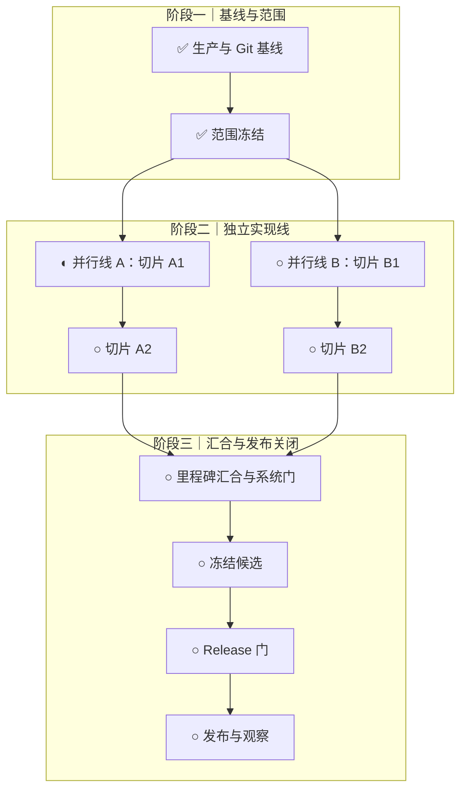

# 迭代计划制作 SOP

- SOP 编号：`SOP-DEV-002`
- 版本：`2.1`
- 状态：生效
- 对应阶段：本轮需求冻结、开发规划与风险验证
- 进入门禁：候选需求已通过 `G0`
- 退出门禁：`G1 范围已冻结`、`G2 开发已就绪`

本 SOP 用于从产品需求、工程现状和生产证据出发，制作或重排一份可执行、
可验收、可追踪的迭代计划。

生命周期、门禁和状态以 `knowledge/development-lifecycle.md` 为准。本 SOP
只定义制作计划的方法，不复制具体版本事实。当前需求状态以飞书 Base“需求池”
为准，工程执行状态以 `README-TODO.md` 为准；发布流程和检查项分别以
`knowledge/pre-launch-confirmation.md` 与 `knowledge/development-release-checklist.md`
为准，旅程和分层测试以
`knowledge/user-journey-testing.md`、`knowledge/user-journey-matrix.json`
与 `knowledge/system-testing.md` 为准。

## 1. 适用范围

以下情况必须使用本 SOP：

- 启动新的主版本或次版本迭代。
- 新增 P00/P0 导致当前迭代需要重排。
- 生产发布后，需要把实际结果回写到原迭代计划。
- 需求池、研发交付记录与仓库执行状态明显不一致。
- 现有计划缺少依赖、验收、证据、Git 路径或发布关闭条件。

以下工作不由本 SOP 替代：

- 候选需求的原始收集与 `G0` 准入；由 `SOP/requirement-intake.md` 负责。
- 功能开发和代码实现。
- 集成审计与候选验收；由 `SOP/integration-audit.md` 负责。
- 详细上线检查。
- 正式发布授权。
- 迭代过程记录和复盘；该流程由 `SOP/iteration-retrospective.md` 负责。

## 2. 角色与责任

| 角色 | 责任 |
| --- | --- |
| Owner | 确认版本目标、必须完成范围、延期项、风险接受、时间窗口和最终发布授权 |
| 计划编制者 | 收集事实、去重需求、拆分任务、识别依赖、形成排期、维护计划文档 |
| 工程执行者 | 按任务边界开发、测试和提交，回填实际状态与证据 |
| 独立审阅者 | 检查遗漏、错误依赖、状态夸大、测试缺口和不可执行排期 |

同一人可以承担多个角色，但最终发布授权不能由 Agent 自行推定。

## 3. 必需输入

制作计划前必须读取以下输入；缺失项要在计划中明确标记，不能用猜测补齐。

### 3.1 产品与需求

- 已通过 `G0` 的需求及其来源证据。
- 飞书 Base“需求池”的全部当前记录，而不是只读取某个视图。
- 飞书 Base“研发交付记录”，用于区分需求与已经执行的开发、测试、迁移、
  发布和文档工作。
- 用户原始反馈、评论、复盘文档和明确的版本指令。
- 上一迭代中保留的 P1/P2/P3、已取消和重复需求。

### 3.2 工程与生产

- `README.md`
- `README-TODO.md`
- `PROJECT_RULES.md`
- `knowledge/development-lifecycle.md`
- `knowledge/engineering-rules.md`
- `knowledge/modularization-design.md`
- `knowledge/system-testing.md`
- `knowledge/user-journey-testing.md`
- `knowledge/user-journey-matrix.json`
- `knowledge/pre-launch-confirmation.md`
- `knowledge/development-release-checklist.md`
- `knowledge/iteration-history.md`
- 当前分支、工作树、未提交变更、标签、远端主线和生产运行提交。
- 上一版本原迭代计划的最终关闭段、发布报告、复盘行动项、恢复报告、观察结论
  和未关闭风险。
- 发布后本地 `main`、`origin/main`、发布标签、归档分支、旧工作树和 stash
  的收尾状态。

### 3.3 人工约束

- 版本目标和明确不做的范围。
- 可用时间、最大并行数、维护窗口和允许中断时间。
- 真机、外部服务、生产数据、费用和凭据的授权边界。
- 必须人工完成的视觉、隐私、运营和发布决策。

## 4. 必需输出

一次完整计划至少产生：

1. `reports/iteration-plan-vX.Y.Z-YYYY-MM-DD.md`
2. 飞书“需求池”中的版本、优先级、需求状态、验收标准、阻塞原因和证据
3. 飞书“研发交付记录”中的计划交付项及其关联需求
4. `README-TODO.md` 中的工程执行状态
5. 一张覆盖全部阶段的 Mermaid 总流程图
6. 任务编号、分支策略、依赖、负责人、验收、测试和计划时间
7. 计划完成条件及发布关闭条件
8. 每个切片的受影响旅程 ID、旅程状态、验证层级和人工补验
9. 预计改动规模、提交拆分、长任务检查点和工作树隔离方案
10. 候选冻结记录、第二轮准入和发布后 Git/原计划收尾任务
11. `G1` 与 `G2` 的逐项结论和证据
12. 依赖 DAG、关键路径、并行波次、汇合点和串行合并顺序

计划文档只引用单一事实来源，不复制长期规则全文。

## 5. 状态与对象必须分开

### 5.1 三类对象

| 对象 | 回答的问题 | 存放位置 |
| --- | --- | --- |
| 需求 | 为什么做、需要什么能力 | 需求池 |
| 交付任务 | 本次具体做什么工作 | 研发交付记录、迭代计划 |
| 交付证据 | 如何证明完成 | 测试报告、提交、Release、部署及观察记录 |

“执行了一次真实供应商验证”属于交付任务或证据，不应作为独立产品需求长期
留在需求池。

### 5.2 三类状态

| 状态维度 | 示例 |
| --- | --- |
| 需求状态 | 待评估、待规划、待开始、进行中、待验收、已完成、暂缓、已取消、重复 |
| 执行状态 | 待排期、待开始、进行中、阻塞、待验收、已完成、已取消 |
| 发布状态 | 不适用、未发布、待发布、已发布、已回滚 |

不得用“已完成”同时表示代码写完、测试通过、已经发布和生产观察关闭。计划
中应明确使用“本地已实现”“本地已验证”“已提交”“已发布”“生产已观察”
等可核验表达。

`G0-G7`、候选已验收、观察中和发布已关闭属于流程门禁或证据表达，不新增为
Base 单选值。

## 6. 标准流程

### 步骤 0：保护当前工作区并核对上一版本收尾

执行只读盘点：

```bash
git status --short --branch
git worktree list
git log -10 --oneline --decorate
git tag --sort=-creatordate | head
git stash list
```

按 [`worktree-lifecycle.md`](worktree-lifecycle.md) 分类和收尾工作树；本步骤只
检查结果，不在本 SOP 复制合并、归档或删除流程。进入 `G1/G2` 时活跃工作树
必须不超过 6 个。

记录：

- 本地 `main`、当前分支、HEAD、`origin/main`、发布标签和生产运行提交。
- 本地领先或落后远端的提交及其 push 授权状态。
- 所有工作树、归档分支、stash、未提交文件及归属。
- 哪些变化来自其他任务或用户。

不得为制作计划清理、回退、提交或合并不属于本任务的变化。

新迭代开发启动前还必须确认：

1. 上一版本的生产观察已经关闭，原迭代计划已追加最终标签、运行提交、
   延期项、门禁、观察和完成条件实际结论。
2. 本地 `main` 至少包含已核对的 `origin/main` 发布关闭提交。若本地因已授权
   文档或治理提交领先远端，记录完整提交和“尚未 push”，不把它误报为未同步，
   也不自行 push。
3. 旧功能工作树已干净移除或形成可恢复归档；脏工作树、未合入提交和用户文件
   保留现场并登记，禁止强制删除。
4. 上一迭代复盘中的 P00/P0 行动项已纳入本轮范围或明确后置。

上述条件未关闭时，允许继续制作计划以暴露阻塞，但不得把开发状态推进为
“已开始”。

### 步骤 1：读取并归一化需求

1. 读取需求池全部记录及字段定义。
2. 按需求标题、用户问题、用户故事和验收结果识别重复项。
3. 区分产品需求、系统质量需求、一次性交付任务和纯证据。
4. 合并重复项时保留来源，并关联被保留记录。
5. 已取消项保留取消原因；不得直接删除历史需求。
6. 检查每条未完成需求是否具有：
   - 用户故事或系统目标
   - 优先级
   - 计划版本
   - 可验证的验收标准
   - 阻塞原因或明确“无外部阻塞”
   - 当前证据

输出一份范围统计：总记录数、各优先级数量、各状态数量、重复与缺失字段。

### 步骤 2：冻结版本基线

写明：

- 当前生产版本、运行提交和数据写源。
- 发布标签目标、`origin/main`、本地 `main` 和计划分支基线；标签停在代码
  提交而主线包含后续纯文档提交时分别记录。
- 上一版本已经完成的能力。
- 尚未关闭的生产问题和已接受风险。
- 本轮可复用的测试、迁移、备份和恢复证据。
- 上一版本复盘行动项、归档分支和仍未 push 的本地治理提交。

测试证据只有在候选 SHA、依赖、脚本、配置和运行环境均未发生相关变化时才
可复用。

### 步骤 3：定义版本目标与非目标

版本目标必须是可验收结果，不写“持续优化”“体验提升”等无法关闭的表达。

至少回答：

1. 本轮必须解决什么用户问题？
2. 哪些数据、安全或发布风险必须关闭？
3. 哪些能力明确不在本轮完成？
4. 为什么使用当前版本号？
5. 什么条件满足后才允许宣告版本关闭？

版本号遵循项目已有规则；已经推送的标签保持不可变。

### 步骤 4：冻结范围

默认规则：

- 未完成 P00 全部进入本轮，除非 Owner 明确取消或改级。
- 未完成 P0 全部进入本轮。
- P1 按价值、依赖和容量选择，明确纳入或后置。
- P2/P3 保留在后续计划，不因本轮不做而从流程中消失。
- 新需求在范围冻结后默认进入下一批；只有阻断当前目标的必要修复可插入。

范围表至少包含优先级、需求数量、本轮处理方式和后置原因。

#### `G1 范围已冻结`

- [ ] 本轮只有一个主要用户结果；
- [ ] 做、不做和后置范围明确；
- [ ] 成功、失败、恢复、权限、持久化和体验验收可判断；
- [ ] 关键兼容行为和不可接受结果明确；
- [ ] 新需求插入与范围回退规则明确；
- [ ] Owner 已确认本轮承诺。

`G1` 只冻结目标、范围和验收，不冻结可随证据调整的实现方案。

### 步骤 5：拆分 Epic 与可验收叶子

Epic 表达一个完整的用户或系统能力，必须有范围、非目标、兼容要求以及成功、
失败、恢复和发布关闭条件。叶子任务表达可独立准备、审查和验证的工程工作，
可以交付模块、契约、测试或风险结论，但不能以“叶子已完成”替代 Epic 的完整
用户结果。一个 Epic 按真实状态/资源 owner、公开 API、依赖和验收边界拆分，
不规定固定叶子数量，也不为凑并行数强拆原子迁移。

每个切片必须：

- 有唯一编号，例如 `V0.4.0-01`。
- 明确所属 Epic；Epic 自身不是包含多个 owner 的派发节点。
- 只解决一个清晰目标或一组强依赖问题。
- 能在不依赖后续切片的情况下运行专项验收。
- 明确涉及的模块、接口、数据、页面和文档。
- 明确不做的范围。
- 具备成功路径、关键失败路径和恢复路径。
- 按当前标准，在实现开始前标出
  `knowledge/user-journey-matrix.json` 中受影响旅程；没有现成旅程时，
  新旅程、业务结果、持久化、异常恢复和副作用断言属于同一切片交付。
- 写明旅程当前状态 `automated`、`partial` 或 `blocked`；后两者必须同时写出
  人工补验、责任人和不能自动提交的边界。
- 写明本切片使用“功能专项与 Journey Smoke”“里程碑系统门”或“冻结候选
  Release 门”中的哪一层，不用无差别全量重跑代替切片验收。
- 估算文件数和增删行；预计超过 15 个文件或 500 行增删时，在计划阶段继续
  拆成可验收子切片。确因强依赖、生成工程或原子迁移不可拆时，记录原因、
  风险和验证证据。
- 预计连续执行超过 2 小时时，写明 2～3 小时检查点位置、当前 NO-GO 记录和
  可恢复证据路径。

优先按用户完整任务或纵向链路拆分，不按“前端任务”“后端任务”横向分割
成无法独立验收的半成品。

每个叶子至少记录：

```text
taskId / epicId / goal / nonGoals / owner / baseSha / dependsOn
readSet / writeSet / resources / publicContract / invariants
acceptance / tests / evidence / authorization / status / next
```

可将 30–60 分钟作为初始切片粒度目标，并用真实开始、阻塞、恢复、交付与返工
事件校准；它不是统一工时承诺。强原子迁移或侦察发现真实风险时允许更长切片，
但必须记录不可继续拆分的原因和对应验证。

推荐在计划和研发交付记录中为每个切片维护同一份执行契约：

| 字段 | 内容 |
| --- | --- |
| 需求与边界 | 关联需求、明确不做 |
| 模块与所有权 | 允许目录、热点文件、唯一负责人 |
| 依赖与并行 | 硬前置、共享热点、所属波次、可并行切片、汇合点 |
| 用户旅程 | 旅程 ID、状态、成功/失败/恢复/副作用 |
| 验证层级 | 专项 + Smoke / 系统门 / Release 门 |
| 规模与提交 | 预计文件/行数、拆分或不可拆理由 |
| 隔离与检查点 | 工作树、端口、数据库、2～3 小时检查点 |
| 人工与外部依赖 | 真机、费用、凭据、生产或迁移授权 |

### 步骤 6：建立依赖与所有权

先把全部切片建成有向无环图（DAG），再决定串行或并行。只有后置切片必须消费
前置切片的代码、数据、契约、迁移结果或决策时，才建立依赖边；相同优先级、
相同里程碑、最终需要一起发布或由同一人执行，本身不构成依赖。

为每个切片记录：

- 硬前置及其必须产出的代码、数据、契约、迁移结果或决策。
- 共享热点、独占资源和只影响启动顺序的软约束，不把它们伪装成硬依赖。
- 公共契约、schema、模块登记、根入口、共享样式和依赖锁负责人。
- 允许修改的目录和禁止修改的共享文件。
- 工作树、端口、数据库和测试资源隔离方式。
- 所属并行波次、可同时执行的其他切片和汇合里程碑。
- 合并顺序和每次合并后的影响测试。
- 长任务检查点的记录位置和 NO-GO 更新负责人。

依赖分析必须产出一张表：

| 切片 | 硬前置 | 共享热点或独占资源 | 并行波次 | 可并行切片 | 汇合点 | 串行合并顺序 |
| --- | --- | --- | --- | --- | --- | --- |
| 示例 A | 公共契约 | 无 | W1 | 示例 B | M1 系统门 | 1 |
| 示例 B | 无 | 独立数据库 | W1 | 示例 A | M1 系统门 | 2 |

编排顺序：

1. 列出全部节点与硬依赖边，检查循环依赖；发现环时先重新拆分或冻结公共契约。
2. 按拓扑层级生成 `W0`、`W1`、`W2` 等并行波次。
3. 在同一波次内按优先级、风险和可用资源选择任务，但不得无依据把独立切片
   首尾相连。
4. 波次用于表达可启动集合，不是整批等待门；切片的直接前置完成且资源可用后
   即可启动，无需等待上一波次中与其无关的切片。
5. 标出关键路径、每条并行线的入口和汇合点；被阻塞的支线不得阻断无依赖支线。
6. 在汇合点前完成各切片专项与 Journey Smoke，再按固定顺序串行合并并运行
   影响测试。

叶子的执行状态至少区分 `blocked`、`ready`、`active`、`review`、`validated`、
`integrated` 和 `closed`。直接前置完成、范围/验收/所有权已冻结且输出有独立
价值时可以标记 `ready`；真正派发还必须确认无契约或写集冲突、授权覆盖、
资源和执行者可用。`ready` 但未派发时，计划或其唯一调度记录必须写明具体
原因、责任人、解除条件和下一复核事件；派发责任和原因格式以
[`multi-agent-orchestration.md`](multi-agent-orchestration.md) 为准。

并行规则：

- 存在硬依赖的切片必须串行；公共契约应先由单一负责人冻结，再从同一已验证
  基线分叉。
- 不存在依赖路径、共享写热点或独占资源冲突的切片默认并行，计划必须明确
  并行线，不能仅因最终一起集成而排成单链。
- 同一共享契约或热点文件同时只有一个负责人；确需修改时，将相关切片放入
  不同波次。
- 两条实现线必须有不同模块所有权，并使用独立工作树、端口、数据库、账户和
  测试资源。
- 并行开发不等于并行合并；所有任务按计划顺序串行合入，每次合入后运行
  对应影响测试。
- 公共契约发现缺口时，暂停支线，回到串行任务修订并重新冻结。
- 每个计划、集成和候选门重新检查活跃工作树数量，必须保持不超过 6 个。
- Reviewer 确认可合并后，按“串行合入、合入后测试、归档或删除已结束工作树”
  完成闭环；未完善现场继续保留。
- 实际并发不得超过人工约束中的最大并行数；资源不足时降低并发，不得篡改
  DAG 将资源等待误报为功能依赖。
- 人工约束未给出并行上限且存在至少两条可隔离实现线时，计划不得默认按
  “最大并行数 1”编排；应根据可用执行者和资源给出可验证的并行上限。

### 步骤 7：规划小版本与里程碑

不要把所有能力积压到主版本末尾一次发布。按风险和依赖将任务组织成可验收的
小版本，例如：

```text
基线和门禁
→ 高优缺陷
→ 公共数据或请求契约
├─ 并行线 A：用户可见能力 → 全业务接入
├─ 并行线 B：质量与成本
└─ 并行线 C：原生交付
→ 里程碑汇合与系统门
→ 选定 P1
→ 主版本总集成
```

每个小版本写明：

- 包含需求
- 进入条件
- 完成条件
- 所属并行波次、前置节点、可并行节点和汇合点
- 候选分支和提交策略
- 需要运行的验证
- 是否需要发布、迁移或人工授权
- 进入里程碑系统门的固定提交或 tree，以及哪些下层证据仍有效

主版本末尾必须单列“候选冻结”里程碑，不能把它隐含在总集成或第二轮审计中。
该里程碑至少产出 Git 状态、完整候选哈希、版本元数据、依赖锁、原生版本、
Prompt/部署版本、调试资产、生成制品、生产配置存在性、延期项和旅程
`partial` / `blocked` 人工结论。

### 步骤 7.1：夜间跨版本开发火车

按 [`night-continuous-development.md`](night-continuous-development.md)
运行夜间队列时，生产发布不是下一版本本地开发的前置条件。当前版本已经形成
不可变候选，或当前 Release 节点仅因 Preview 后生产授权、真机、Base、费用或
云资源等待时，可以并行启动下一已登记版本的 G0-G2 和隔离本地实现。

跨版本计划必须明确：

- 后续版本基于已发布主线还是当前已测试候选，以及候选回滚后的重新评估方式。
- 当前候选与后续版本的分支、工作树、版本元数据、发布文件和共享写集隔离。
- 后续版本只开发需求池、TODO、路线图或 Owner 指令中已经存在的需求，不为
  延长夜间运行自行创造范围。
- 后续版本可以形成本地任务提交，但上一版本关闭前不得合入生产主线、创建正式
  tag、发布生产或改变上一版本候选。
- 当前版本出现 blocker/P0/P1、Preview 回滚或候选失效时，调度优先回到当前
  版本修复；否则持续推进后续版本的 ready 节点。

### 步骤 8：映射验收、测试和证据

每条需求至少映射：

| 内容 | 要求 |
| --- | --- |
| 验收标准 | 可通过操作或数据断言判断通过/失败 |
| 自动化 | 成功路径和最关键失败路径 |
| 人工验收 | 真机、视觉、文案或业务判断 |
| 生产冒烟 | 上线后必须验证的最短闭环 |
| 恢复 | 失败后的重试、撤销、回滚或数据恢复 |
| 证据 | 命令、报告、截图、提交、Release 或观察记录 |

共享契约、认证、持久化、附件、AI、迁移和部署变化必须扩大测试范围。最终
发布候选按 `knowledge/pre-launch-confirmation.md` 执行两轮检查。

计划必须把验证分成三个不同节点：

1. 功能切片：领域专项与受影响 Journey Smoke。
2. 跨域里程碑：影响矩阵专项、系统门及适用的稳定 PostgreSQL 门。
3. 冻结候选：完整 Journey Release 门、恢复、真机和获准外部服务验证。

新增第三方供应商时，首个接入切片同时规划 plan-only、获准本地 live 和
生产 live 三层冒烟、预算及清理步骤，不得把真实可用性验证留到最终发布前。

每个切片必须直接列出旅程 ID 和本次执行命令。没有匹配旅程时，先更新矩阵和
证据锚点，再实现功能。`partial` / `blocked` 旅程不能作为自动本地提交的唯一
证据；计划必须保留人工补验节点。

同一候选未发生行为、依赖、测试桩或环境变化时，可以引用仍有效的下层证据；
候选变化时按发布流程的证据失效表重跑，不以“之前全量通过”证明新候选。

### 步骤 8.1：热点入口雷达与候选入图

每个检查点和新增跨域功能前，复用现有静态分析收集：

- 文件 LOC/字节、可变状态、API/DOM/event/timer/template 数量；
- 最近 50 个提交的修改频率、增删量与跨领域共改；
- 依赖扇入/扇出、共享写者排队、review 返工和测试失败；
- 当前正式硬门、迁移例外到期点及剩余删除条件。

等待、返工和耗时没有事件证据时写 `unknown`，不得填 0。文件移动和重命名按
迁移识别，不能把新文件误判为低频。入口新增禁止职责、迁移例外到期或所有权
冲突直接触发拆分评估；一般文件 500 行仅为观察线。任何试行评分都必须先固定
归一化和窗口，只用于排序，不替代 `knowledge/module-boundaries.json` 的硬门。

热点候选进入 DAG 前必须包含：职责、状态/资源 owner、依赖和消费者、公开 API、
行为不变量、失败反例、目标落点、写集、影响测试、旧实现删除条件。雷达只提供
候选；是否纳入本轮仍由调度者按冻结范围决定，不自动扩展需求或发起重构。

### 步骤 9：估算排期

排期依据：

- 相似版本和任务的真实历史耗时。
- 当前完整系统、后端、前端和 PostgreSQL 测试耗时。
- 实现、集成、人工验收、返工、发布和观察时间。
- 外部授权、真机、凭据和维护窗口可用性。

排期必须：

- 区分目标时间与承诺时间。
- 写明最大并行数和串行节点。
- 将共享写者、工作树、端口、数据库、浏览器和人工授权作为排程资源，不假设
  目录不同就能并行。
- 分别估算任务工时与考虑并行后的日历时长，不能把所有切片工时简单相加后
  当作迭代周期。
- 写明每个并行波次的计划开始、汇合条件和缓冲时间，并标出决定最短工期的
  关键路径。
- 标记低置信度任务及原因。
- 定义失效条件，例如 P00 复现失败、契约再次变化、候选 SHA 变化或人工授权
  未取得。
- 不得通过跳过测试、恢复、真机或发布门禁维持日期。
- ETA 使用最近三批可比切片的实际开始、交付、返工和验证事件形成范围；提交
  时间只能作为里程碑，不能反推开发时长。外部授权等待单列，证据不足时写
  “待测”。
- `ready` 未派发、共享接线和资源等待只采用实际事件计时；无法证明起止时写
  `unknown`，不能填 0 或假设 Agent 始终满载。
- 对超过 2 小时的连续任务预留 2～3 小时检查点；对跨域里程碑预留系统门，
  对冻结候选单独预留 Release 门和第二轮审计，三者不能合并成一个“测试”时段。

### 步骤 10：制作单一 Mermaid 总图

每份迭代计划只维护一个 Mermaid 总图。总图必须：

- 覆盖基线、开发、集成、测试、发布、迁移、观察和后续计划。
- 显式包含上一版本收尾、Journey Smoke、里程碑系统门、候选冻结、
  Release 门和发布后 Git/原计划收尾。
- 用 `subgraph` 按阶段分区。
- 依赖边只表示真实前置关系；不得为了版面整齐或执行人相同，把无依赖切片
  画成一条串行链。
- 从共同基线分叉展示独立实现线，并在系统门或集成节点显式汇合；串行链与
  并行线必须能从图中直接区分。
- 已完成节点标记 `✅`。
- 正在执行或待验收节点标记 `◐`。
- 已计划但未开始节点标记 `○`。
- 局部阻塞节点标记 `⛔`，同时保留不依赖该节点的可执行支线。
- 保留计划但未完成的节点，不因本轮未做而删除。
- 历史失败保留为已识别、已修复的过程节点。
- 更新节点状态，不为每次进展追加新的独立流程图。
- 在图后用文字分段说明各阶段的范围、实际结果、失败和边界。

参考骨架：



若本轮经依赖分析确实没有可并行切片，可以使用单链，但必须在图后说明原因；
只要存在满足隔离条件的独立切片，就必须在总图中分叉表达。

### 步骤 11：设计 Git 与交付路径

明确：

- 一个任务一个短分支；同一波次的并行任务使用独立工作树。
- 分支从已提交且验证过的基线创建。
- 同一波次从共同基线分叉；公共契约变更先串行合入并验证，再让依赖支线更新
  基线后启动。
- 本地 `main` 领先 `origin/main` 时，先记录领先提交和 push 状态；任务分支
  使用已确认的本地基线，不自行推送这些提交。
- 每个可验收切片形成真实类型的本地提交。
- 合并按依赖与计划顺序串行进行；并行支线在各自验证通过前不得提前汇合。
- 候选已提交时固定 SHA；尚未提交时固定可重建完整候选视图的 tree 或
  manifest，再运行候选级测试。完整性口径见
  [`multi-agent-orchestration.md`](multi-agent-orchestration.md) 与
  `knowledge/system-testing.md`。
- push、tag、Gitee Release、部署和生产写入逐次取得人工授权。
- 每个共享远端标签必须具有对应 Gitee Release 和详细中文更新说明。
- 预计超过 500 行增删或 15 个文件的任务在计划中先拆分；
  强依赖、生成工程或原子迁移无法继续拆分时，提前写明不可拆原因、风险和
  对应验证。
- 第二轮审计前先形成独立候选冻结记录；冻结后业务代码、依赖、测试桩、
  发布配置或版本元数据变化时，返回相应阶段并重新冻结。
- 发布观察关闭后的本地 `main` 同步、旧工作树归档/移除和原计划最终关闭段
  属于本迭代交付，不后移给下一轮临时补做。

本地自动提交边界以 `knowledge/engineering-rules.md` 为准，不能由迭代计划
放宽。

### 步骤 12：写入计划文档

推荐结构：

```text
# Vx.y.z 迭代计划：主题
计划日期 / 生产基线 / Git 基线 / 需求来源

## 1. 版本目标
## 2. 编号与版本规则
## 3. 范围基线
## 4. P00/P0 全量交付
## 5. 本轮选定的 P1
## 6. 关键能力边界
## 7. 启动任务、依赖 DAG、并行波次与排期
## 8. 单一 Mermaid 总体流程
## 9. 各阶段文字说明
## 10. 串并行、资源隔离与合并规则
## 11. 切片执行契约、旅程与分层验证
## 12. 检查点、候选冻结与证据失效
## 13. Git 与发布规则
## 14. 完成条件
## 15. 实施状态与最终关闭追加记录
```

计划文档中事实必须链接到需求、代码、测试、发布或生产证据。

### 步骤 13：同步事实来源

计划完成后逐项同步：

1. 需求池：版本、优先级、状态、验收、阻塞和证据。
2. 研发交付记录：交付项、类型、关联需求、计划日期和完成条件。
   还应在交付范围或验收中记录旅程 ID、旅程状态、验证层级、
   预计规模、拆分结论、硬前置、并行波次、汇合点、检查点和人工补验。
3. `README-TODO.md`：当前工程状态和阻塞。
4. 迭代计划：目标、排期、流程和完成条件。
5. `knowledge/iteration-history.md`：已经实际发生的重要变化。

不要把“计划将做”写入迭代历史，也不要把“本地完成”写成“生产已发布”。

### 步骤 14：独立审阅与 Owner 确认

审阅者检查：

- 是否遗漏任何 P00/P0。
- 是否把交付任务误当成需求。
- 是否存在重复需求或平行实现。
- 依赖边是否都能说明被消费的具体产物，是否存在循环依赖或人为串行化。
- 独立切片是否已进入并行波次，关键路径、汇合点和串行合并顺序是否可执行。
- 共享文件是否存在并行冲突。
- 每项是否具备验收、失败恢复和证据。
- 每个切片是否有旅程 ID、状态、验证层级、规模判断和检查点。
- `partial` / `blocked` 旅程是否保留人工补验，未被误写成自动化通过。
- 排期是否包含测试、返工、人工验收、发布和观察。
- 是否单列候选冻结记录，第二轮没有直接接在功能实现之后。
- 上一版本 Git/工作树/原计划收尾是否关闭，未 push 本地提交是否如实记录。
- Mermaid 是否只有一张，状态是否与正文一致。
- 未完成计划是否仍在图和范围说明中。

Owner 至少确认：

- 版本目标和非目标。
- 必须完成及后置范围。
- 排期是目标还是承诺。
- 可接受风险、维护窗口和人工事项。
- 是否允许进入开发；该确认不等于发布授权。

#### `G2 开发已就绪`

- [ ] 每个切片有目标、边界、基线、所有权和禁止越界范围；
- [ ] 关键数据库、文件、端口、云 API、迁移或模型风险已预验证；
- [ ] 依赖 DAG 无环，接口稳定，独立切片已并行编排，关键路径、汇合点与
  串行集成顺序可执行；
- [ ] 用户旅程、测试层级、命令和证据位置明确；
- [ ] 工作树、端口、数据、账户和凭据相互隔离；
- [ ] 活跃工作树不超过 6 个；不完善现场已保留并登记，待合并分支已有 reviewer；
- [ ] 提交、费用、真机、生产和不可逆操作的授权边界清楚；
- [ ] Owner 未决事项已关闭或标为局部阻塞；
- [ ] 任务可直接交给 `SOP/feature-development.md` 执行。

## 7. 执行期间维护

计划不是一次性文档。提交形成、候选固定、交付、review 返回、测试结束、
阻塞变化、资源释放或范围调整后，按
[`multi-agent-orchestration.md`](multi-agent-orchestration.md) 重排唯一 DAG；
当前候选进入测试或复审时，可以同步准备下一批独立叶子，但不得改动候选视图
或抢占其独占资源。每个切片结束后：

1. 更新任务表状态和实际提交。
2. 更新受影响旅程状态、证据锚点和本次实际验证层级。
3. 更新单一 Mermaid 中对应节点标记。
4. 在阶段文字中追加实际结果、失败和范围变化。
5. 回填需求池与研发交付记录。
6. 判断哪些测试证据仍有效。
7. 核对实际文件/行数；越过 500 行或 15 文件阈值时拆分，或记录不可拆理由。
8. 切片提前、延期、阻塞或新增 P00/P0 时，重新计算 DAG、并行波次、关键路径
   和排期；不得让一条阻塞支线无依据冻结其他独立支线。
9. 核对所有 `ready` 节点已派发，或已有具体未派发原因与下一复核事件。

连续执行超过 2 小时的任务每 2～3 小时追加一次可恢复检查点，
记录当前分支/HEAD、工作区、已完成、NO-GO、下一步和证据路径。检查点不得
跨无关任务，也不得为形成提交而保存不可验证的半成品。

不得：

- 为每次进展追加一个新 Mermaid 图。
- 删除尚未完成的计划节点来制造“全部完成”。
- 用汇总节点覆盖失败、迁移或回滚事实。
- 在未部署时标记“已发布”。
- 用旧候选测试结果证明新候选。

## 8. 发布后关闭

发布和观察完成后：

1. 核对生产运行提交、标签、Gitee Release 和发布说明。
2. 核对数据迁移、备份、恢复、冒烟和观察结果。
3. 将已完成节点更新为 `✅`。
4. 未完成的 P1/P2/P3 和后续工作继续保留在总图末端。
5. 更新完成条件、需求状态、发布状态和交付证据。
6. 将实际版本变化追加到 `knowledge/iteration-history.md`。
7. 确认 `G6` 通过后进入迭代过程报告与复盘 SOP。

部署成功不等于迭代关闭；生产观察和证据回填完成后才能关闭。

还必须：

1. 在原迭代计划中追加最终关闭段，记录最终标签、运行提交、Gitee Release、
   延期项、候选门、备份恢复、生产冒烟、观察和原完成条件的实际结论。
2. 同步本地 `main` 到已核对的 `origin/main`。
3. 逐个检查旧功能工作树；只有干净且必要提交已进入主线或归档时才移除，
   脏工作树和未合入提交必须保留并登记。

## 9. 交付前检查清单

- [ ] 已读取完整需求池和研发交付记录。
- [ ] 已核对生产、Git、工作树和未提交变更。
- [ ] 上一版本原计划最终关闭段、复盘行动项、本地 main、远端 main、归档分支
  和旧工作树收尾已核对。
- [ ] 所有 P00/P0 均有处理结论。
- [ ] P1/P2/P3 的纳入或后置原因明确。
- [ ] 需求、交付任务和证据没有混用。
- [ ] 每个 Epic 对应完整能力，每个叶子有编号、边界、依赖、验收和失败恢复。
- [ ] `ready` 叶子已派发，或记录未派发原因、解除条件和下一复核事件。
- [ ] 每个切片有编号、边界、依赖、验收和失败恢复。
- [ ] 每个切片有旅程 ID/状态、验证层级、人工补验、预计规模和检查点。
- [ ] 超过 500 行增删或 15 文件的切片已拆分，或记录不可拆原因和风险。
- [ ] 依赖 DAG 无环，硬依赖均能指出具体产物，独立切片没有被无依据串行化。
- [ ] 已标出并行波次、关键路径、汇合点、最大并行数和串行合并顺序。
- [ ] 并行任务的模块、共享文件所有权、工作树、端口、数据库和测试资源明确。
- [ ] 排期基于历史耗时，区分任务工时与并行后的日历时长，并包含测试、返工、
  发布和观察。
- [ ] 计划只有一个 Mermaid 总图。
- [ ] Mermaid 对独立切片使用分叉/汇合表达，图中的每条依赖边都与正文一致。
- [ ] 已完成、进行中、未开始标记与正文一致。
- [ ] 计划但未完成的节点仍保留。
- [ ] Git、测试、发布和人工授权边界没有被计划放宽。
- [ ] `G1` 与 `G2` 有独立结论，未被“计划已写完”替代。
- [ ] 集成审计、候选冻结、Release 门、观察和 `G7` 已进入计划。
- [ ] 已单列候选冻结记录和冻结后证据失效路径。
- [ ] 新增供应商已在首个切片规划 plan-only、本地 live、production live、
  预算和清理；无新增供应商时已明确 N/A。
- [ ] 发布后本地 main、旧工作树和原迭代计划最终关闭已进入完成条件。
- [ ] 需求池、交付记录、TODO 和计划文档已互相核对。
- [ ] `git diff --check` 通过。
- [ ] 未修改或回退其他任务的工作区内容。

## 10. 常见错误

| 错误 | 正确做法 |
| --- | --- |
| 只看 README 制作计划 | 同时读取 Base、仓库、生产和发布证据 |
| 把一次测试写成产品需求 | 放入研发交付记录并关联需求 |
| 使用“已完成”笼统描述 | 明确本地实现、验证、提交、发布和观察状态 |
| 按前端/后端拆成半成品 | 按可独立验收的用户或系统闭环拆分 |
| 把叶子完成写成 Epic 完成 | 继续核对完整能力、集成、发布和恢复验收 |
| `ready` 节点无解释等待 | 立即派发，或记录具体资源/授权原因和解除事件 |
| 每个阶段新建一张 Mermaid | 维护一张总图，正文分段说明 |
| 把所有任务画成一条串行链 | 先建依赖 DAG，独立切片分叉执行并在里程碑汇合 |
| 把共享发布门当成功能依赖 | 发布前统一汇合；开发阶段按真实依赖并行 |
| 并行开发后同时合并 | 独立工作树并行实现，按固定顺序串行合并并逐次验证 |
| 完成后删除未做节点 | 保留后续节点并更新优先级和版本 |
| 为赶日期跳过门禁 | 将承诺降为目标并记录阻塞 |
| 多分支同时修改共享契约 | 单一负责人串行修改后重新冻结 |
| 测试 A、发布 B | 固定完整候选 SHA/tree/manifest 后执行候选级验证 |
| 每个切片都跑完整 Release | 专项与 Journey Smoke 前移，系统门放在里程碑，Release 只跑冻结候选 |
| 旅程只写“已覆盖” | 写明旅程 ID、状态、断言和人工补验 |
| 第二轮前没有冻结记录 | 先核对版本、制品、调试资产、配置和完整候选哈希 |
| 下一迭代才处理旧工作树 | 发布观察关闭后立即同步 main、归档工作树并回写原计划 |
| 把计划写完当作开发就绪 | 分别核对 `G1` 范围和 `G2` 依赖/风险/授权 |
| 计划完成即自动开发或发布 | 分别取得开发、远端操作和生产授权 |
