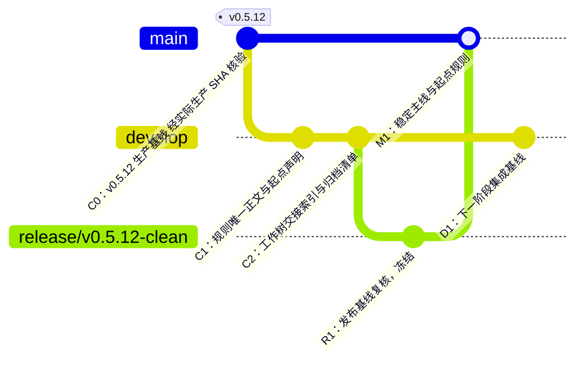

# Git 历史与工作树彻底收口：执行提示词、起点图景与验收

日期：2026-10-11（Asia/Shanghai）

## 给 Git 整理主控 Agent 的执行提示词

> 你现在只做 Git 历史、分支、工作树和交接文档收口，不开发产品功能、不修改业务代码、不部署、不推送、不发布。
>
> 目标是建立一个可审查、可恢复、可继续开发的干净起点。整理完成后，普通开发只允许从 `develop` 开始，发布准备只允许从 `release/*` 开始，生产稳定代码只允许从 `main` 开始。旧提交、旧功能分支和旧工作树只能作为归档证据，禁止修改、迁回、继续开发或作为新任务基线。
>
> ### 硬边界
>
> 1. 先冻结新写入，通知所有正在写入的 Agent；保留正在进行的有效工作，不得 reset、clean、删除工作树或强制覆盖未提交文件。
> 2. 每棵工作树先写交接文档，再归档或接入。交接文档必须记录：路径、分支、起始基线、HEAD、未提交差分、未跟踪文件、任务目的、写集、已验证内容、未完成项、风险、建议接入方式和责任人。
> 3. 未提交内容先保存为可校验的补丁/目录归档，并记录 SHA-256。没有交接文档和归档校验，不得移除工作树。
> 4. 不把旧功能分支之间互相 cherry-pick、merge 或 rebase。当两个任务有重叠写集，只能选一个负责人；另一条线只能提取经审查的独立差分。
> 5. 不改写已经发布的提交历史，不使用 `filter-repo`、强制重写、隐式 squash 来“美化”历史。旧历史通过 archive ref 保留，新的开发起点通过清晰分支和规则文件表达。
> 6. 规则整理本身先建立临时 `docs/git-history-cleanup`，从当前选定的 `develop` 基线创建；不得在脏的 `main` 或旧 `release` 工作树直接形成新的开发基线。
> 7. 必须把 `PROJECT_RULES.md`、`SOP/README.md`、`SOP/multi-agent-orchestration.md`、`SOP/worktree-lifecycle.md` 和起点说明作为同一套规则基线审核；不复制相反条款，不只在顶部添加“以新规则为准”。
> 8. 当前生产基线先核对实际生产 SHA、`v0.5.12` 标签、`origin/main` 和本地 `main`。目前可见的生产标签候选是 `v0.5.12@4359648`，必须在整理过程中再次核验，不能仅凭分支名认定。
> 9. 生成并提交 `reports/git-handoff/<branch>.md` 交接索引和 `knowledge/git-starting-point.md` 起点规则；三条允许起点都必须能读取到同一份起点规则。
> 10. 整理结束前不得派发新业务开发。只有验收通过，才允许从新的 `develop` 创建新的 `feat/*`。
>
> ### 当前工作树逐项处理
>
> 对以下现有工作树逐一处理，不跳过：
>
> - 根目录 `main`：脏的规则/SOP/状态整理现场；先保存并拆分，不把整个脏差分当作一个提交。
> - `release/v0.5.12`：发布后仍有额外提交和未提交内容；决定哪些是已发布事实、哪些是未发布修复、哪些是规则整理，然后关闭该现场。
> - `hotfix/account-refresh-stop`：确认是否仍是生产热修；完成、回流或归档。
> - `hotfix/keepsake-image-stability`：与 Keepsake feature 工作树存在重叠写集，必须指定唯一负责人。
> - `codex/v0.5.12-source-context-view`：从旧基线创建；审查提交后选择性搬入新的 `develop`，然后归档旧分支。
> - `feat/v0.5.13.1-keepsake-flicker`：从 `develop` 创建，保留为新体系下的候选工作线，直到交接或接入完成。
>
> ### 历史处理方式
>
> 1. 为每个旧分支建立 `refs/archive/git-cleanup-20261011/<原分支名>`，指向原 HEAD。
> 2. 保存每个工作树的补丁和未跟踪文件归档，并在 manifest 中记录哈希。
> 3. 删除旧的本地开发分支引用，使普通 `git branch` 只看到当前允许的起点和必要的短期工作分支。归档 ref 不得作为开发起点。
> 4. 保留已发布 tag 和生产证据；tag 不移动、不重写。
> 5. 在仓库根目录增加清晰的起点声明，明确 `archive/*`、旧 `codex/*`、旧 `feat/*`、旧 `release/*` 只读、不可迁回、不可继续开发。
> 6. 如需远程删除旧分支，先生成删除清单和恢复清单；本任务默认不直接删除远程引用。
>
> ### 验收条件
>
> - `git worktree list` 只有明确用途的工作树；没有无主、无任务、无交接的写工作树。
> - `main`、`develop`、冻结的 `release/*` 都指向清楚的、可解释的起点；三者都包含同一版本的起点规则和交接索引。
> - `develop` 是下一阶段普通开发唯一基线；`release/*` 只做候选收口；`main` 只代表已发布稳定状态。
> - 新的 `feat/*` 只能从整理后的 `develop` 创建；禁止从旧分支、旧工作树或另一个 `feat/*` 创建。
> - 旧提交历史仍可审计，但没有任何旧开发分支被列为当前开发起点。
> - `git status`、`git branch -vv`、`git worktree list --porcelain`、archive manifest、起点规则和三条分支的规则文件相互一致。
> - 规则清理提交、工作树交接、归档清单和最终 GitGraph 均通过独立只读审查。
>
> ## 完成后必须留下的文件
>
> - `knowledge/git-starting-point.md`：唯一的起点与旧历史使用规则。
> - `reports/git-handoff/index.md`：所有工作树交接总表。
> - `reports/git-handoff/<branch>.md`：每个曾经活跃写入现场的交接记录。
> - `reports/git-archive/git-cleanup-20261011-manifest.json`：旧分支、恢复 ref、补丁和哈希。
> - `reports/git-history-clean-start-runbook-2026-10-11.md`：本提示词和验收口径。
> - `reports/git-history-clean-start-map-2026-10-11.svg`：现状到目标的图示。
>
## 整理结束后的允许起点



图中语义：

- `main`：稳定生产代码，只接收已发布的 `release/*` 或生产热修。
- `develop`：下一阶段唯一普通开发入口；所有新的 `feat/*` 必须从这里创建。
- `release/v0.5.12-clean`：本次整理后的冻结发布线，只用于证明发布基线和规则一致；完成后不继续写业务。
- `archive/*`：历史恢复引用，不能作为任务基线。
- `hotfix/*`：仅当生产确有紧急问题时，临时从 `main` 派生；它不是普通开发入口。

## 历史 Git 图如何处理

不要为了让图看起来漂亮而改写旧提交。可靠做法是“历史不可变，引用可收敛”：

```text
旧分支 / 旧工作树
        │
        ├── 保存补丁、未跟踪文件和交接说明
        ├── 建立 refs/archive/git-cleanup-20261011/*
        └── 删除旧的本地开发分支引用

新起点
        ├── main：生产稳定
        ├── release/*：候选冻结
        └── develop：下一阶段开发
```

这样既保留审计和恢复能力，又不会让普通 `git branch` 把过期任务误认为可继续开发的入口。旧提交可以查看，不能作为新任务基线；旧代码需要复用时，必须在新 `develop` 上由协调者审查后选择性搬运，不允许把旧分支整体迁回。

## 不能省略的建议

1. **先处理所有写现场，再处理分支名。** 分支名可以删除，未提交差分不能猜测。
2. **规则提交必须先于新业务提交。** 否则新业务又会在旧规则快照上产生。
3. **只保留三个普通入口，不保留长期 docs 分支。** 文档随规则或业务变更提交。
4. **给 Agent 一个机器可见的拒绝条件。** 若当前分支不属于 `main`、`develop`、`release/*`、必要的临时 `feat/*`/`hotfix/*`，或基线不符合规则，任务卡标为 `DO_NOT_START`。
5. **归档与删除分开。** 先校验可恢复，再删除本地引用；远程删除另列清单，不在本次默认执行。
6. **最终验收看起点图和工作树，不看分支数量。** 119 个历史分支本身不是问题；无主脏工作树和模糊基线才是问题。
