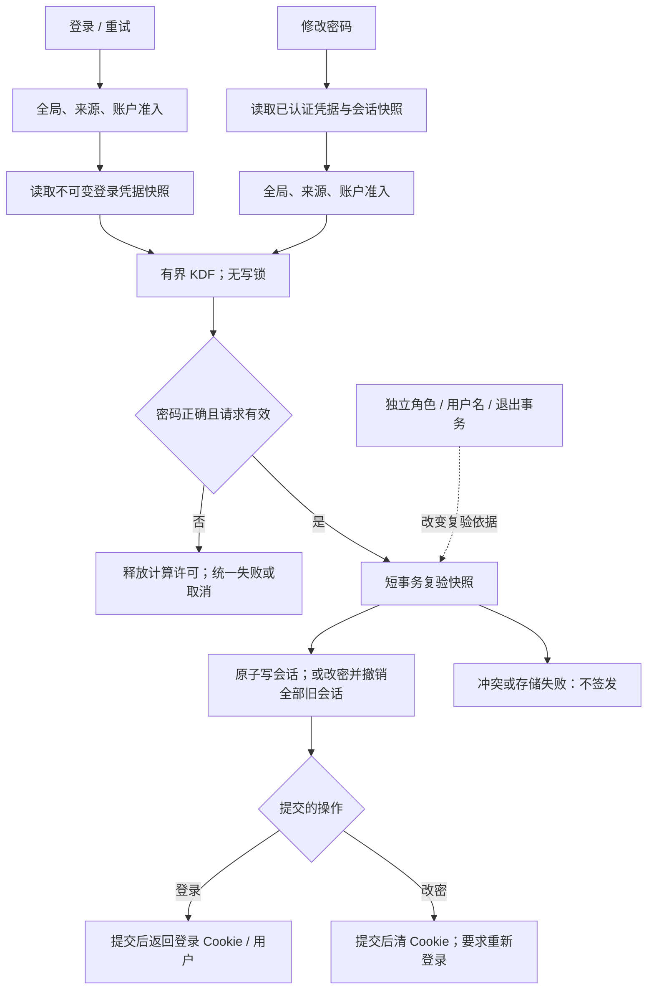
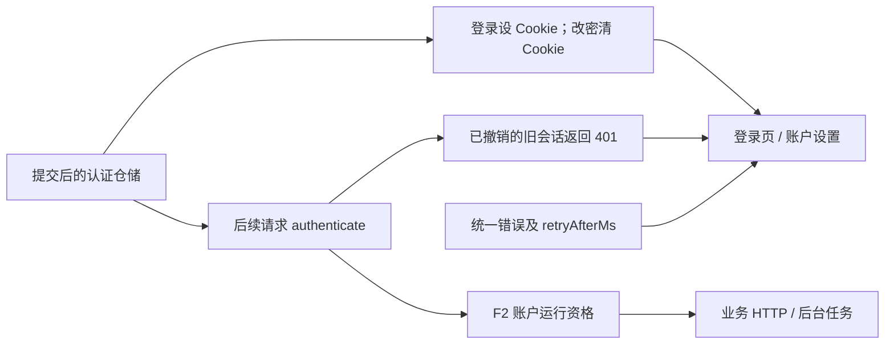

# F1 认证跨账户阻塞治理 技术方案

| 文档信息           | 内容                                   |
| -------------- | ------------------------------------ |
| 需求 / 来源        | F1；用户指定历史会话中的第 1 项工程问题               |
| 版本 / 优先级       | 历史登记 P1、计划 v0.5.16；远端状态未重新核实         |
| Owner / 协作     | Owner 待确认；认证服务、HTTP、前端账户页、测试及发布负责角色  |
| 状态 / 日期 / 文档版本 | 有前提的 Owner 评审稿；2026-10-15；0.2        |
| 范围             | 认证计算与存储锁拆分、准入边界、凭据并发一致性；实际工期由实现拆分后估算 |

## 评审摘要

推荐将密码校验和失败延时移出认证仓储写锁，用有界准入与独立 KDF 门控保护计算资源；签发会话前在短事务中重新校验凭据快照。修改密码的同类锁内计算也移到锁外。按本次 Owner 意见，改密提交时原子更新密码、递增 sessionVersion、撤销该账户全部旧会话，包含当前设备；提交后清除当前 Cookie，要求重新登录。权限变更是独立的账户权限操作，不由换密码触发；仍保留其现有权限校验与会话失效规则。沿用 JSON 写队列和 PostgreSQL advisory lock 的持久化互斥能力，不删除锁。

| 决策             | 推荐及依据                           | 其他选择及影响                         | 负责角色     |
| -------------- | ------------------------------- | ------------------------------- | -------- |
| D1 防爆破与正常登录的权衡 | 采用 3.1.1.1 建议初值，压测后校准；保留账户失败保护  | 仅按来源限流不能覆盖分布式尝试；过严账户策略会增加恶意锁定风险 | 认证/Owner |
| D2 性能验收        | 先确保锁内无 KDF/失败延时，再测定义场景下的 p95 增量 | 不以历史单样本冒充线上 SLO                 | 测试/Owner |

## 资料来源与前提

代码核对基线：`de90dfe2421b01d30066131be44478773fd2da68`，读取日期 2026-10-15。以下 E 编号均是已读取本地来源。

| 证据 | 来源                                                                                                                                                                                                                           | 支持的事实                                            |
| -- | ---------------------------------------------------------------------------------------------------------------------------------------------------------------------------------------------------------------------------- | ------------------------------------------------ |
| E1 | [工程审计报告](../audits/engineering-2026-10-14.md)                                                                                                                             | 历史隔离实验：正常登录约 21ms，叠加 6 次错误登录后约 1581ms；并非现网基线     |
| E2 | [认证模块](../../src/modules/auth/index.mjs#L61-L282)                                                                                                                                   | scrypt、失败延时位于登录写事务；密码修改也在事务内计算；现有 sessionVersion |
| E3 | [JSON 认证仓储](../../src/shared/persistence/auth-repository.mjs#L20-L40)、[PG 仓储](../../src/shared/persistence/postgres-runtime.mjs#L441-L460) | 认证写入有全局串行边界                                      |
| E4 | [认证 HTTP](../../src/http/auth.mjs#L8-L70)                                                                                                                                           | 受信代理地址处理；事务提交后设置 Cookie                          |
| E5 | [账户设置控制器](../../public/frontend/features/account-settings/account-controller.mjs#L146-L179) | submitPassword 当前忽略响应正文，并提示其他设备退出；本次需同步修改为全部旧会话失效与当前设备重登 |

| 前提       | 状态与依据                    | 不成立时处理 / 负责角色            |
| -------- | ------------------------ | ------------------------ |
| A1 单应用实例 | 当前架构事实；F3 仍保留应用锁         | 若改多实例，内存限流须独立设计共享实现 / 架构 |
| A2 建议参数  | 尚无本次真实 CPU、NAT 分布及线上请求基线。 | 实施前测试同规格环境，调整初值 / 测试运维   |

## 需求追踪

| 需求点         | 章节 / 落点                    | 用例      | 指标                                 |
| ----------- | -------------------------- | ------- | ---------------------------------- |
| 错误登录不长期占写锁  | 3.6；login、changePassword   | TC1、TC2 | auth\_write\_hold\_ms              |
| 拆锁后不签发陈旧凭据  | 3.4、3.6；CredentialSnapshot | TC3、TC4 | auth\_snapshot\_conflict\_total    |
| 准入有界且兼容现有登录 | 3.1、3.5；KdfGate            | TC5—TC8 | auth\_kdf\_pending、auth\_login\_ms |
| 改密使全部旧登录态失效 | 3.1、3.5、3.6；changePassword、auth HTTP | TC4、TC9、TC10 | auth_password_revocation_total |
| 权限变更与改密独立 | 2.2、3.6、3.8；setRole | TC3、TC11 | auth_snapshot_conflict_total |

## 名词解释

|名词|解释|语境|
|---|---|---|
|NAT 分布|NAT 让多个设备共用一个对外 IP；这里指每个 IP 背后的用户分布，用于避免限流误伤同一公司或家庭。|“尚无本次真实 CPU、NAT 分布及线上请求基线。”（资料来源与前提）|
|KDF / KDF 门控|KDF 把密码变成难以反推的校验值；门控限制同时计算和等待的数量，保护 CPU 和线程资源。|“推荐将密码校验和失败延时移出认证仓储写锁，用有界准入与独立 KDF 门控保护计算资源；签发会话前在短事务中重新校验凭据快照。”（评审摘要）|
|有界准入|处理前限制请求速率、等待人数和计数记录数，满了就拒绝，避免无限堆积。|“推荐将密码校验和失败延时移出认证仓储写锁，用有界准入与独立 KDF 门控保护计算资源；签发会话前在短事务中重新校验凭据快照。”（评审摘要）|
|同类锁内计算|改密也像登录一样，在持有写锁时做耗时密码计算；它是需要一起移出锁的同类问题。|“修改密码的同类锁内计算也移到锁外。”（评审摘要）|
|advisory lock|PostgreSQL 的应用约定锁；遵守同一约定的写入方会互相等待，这里保护整份认证文档。|“沿用 JSON 写队列和 PostgreSQL advisory lock 的持久化互斥能力，不删除锁。”（评审摘要）|
|签发会话|生成登录凭据并保存会话记录，提交后交给浏览器，供后续请求证明身份。|“推荐将密码校验和失败延时移出认证仓储写锁，用有界准入与独立 KDF 门控保护计算资源；签发会话前在短事务中重新校验凭据快照。”（评审摘要）|
|JSON 认证仓储|把用户、密码校验值和会话保存到 JSON 文件的存储模块；写入按队列串行执行。|“JSON 认证仓储通过文件保存用户和会话，认证 HTTP 负责接收请求及写入或清除 Cookie。”（1.1）|
|认证 HTTP|对外提供登录、改密、退出接口的一层，把结果转成状态码、响应正文和 Cookie。|“JSON 认证仓储通过文件保存用户和会话，认证 HTTP 负责接收请求及写入或清除 Cookie。”（1.1）|
|Promise 队列 / Promise 队列控制|Promise 表示异步结果；同一键的请求依次等前一个完成，但这种排队本身不限制长度。|“登录用按 IP 与用户名的 Promise 队列控制同键并发，但其内部仍在认证仓储全局写互斥期间执行 scrypt 和 250ms 失败延时。”（1.1）|
|scrypt|本项目的密码校验算法，通过增加猜测密码的计算成本保护密码，因此也需限制并发。|“登录用按 IP 与用户名的 Promise 队列控制同键并发，但其内部仍在认证仓储全局写互斥期间执行 scrypt 和 250ms 失败延时。”（1.1）|
|凭据快照|一次读取时复制的用户 ID、用户名、密码校验值和会话版本，计算后与最新记录比较。|“推荐将密码校验和失败延时移出认证仓储写锁，用有界准入与独立 KDF 门控保护计算资源；签发会话前在短事务中重新校验凭据快照。”（评审摘要）|
|短事务 / 写锁|事务只包住最新状态复验和提交；写锁让其他写入等待。逻辑涉及单用户，实际锁仍覆盖全局认证文档。|“只有正确密码进入仓储短事务，按当前记录签发 token。”（2.2.2）|
|sessionVersion|会话版本号；会话记录版本落后即失效，改密和权限操作分别按自己的流程更新它。|“新设计在改密时也递增 sessionVersion，但权限变更仍由独立的 setRole 流程负责。”（2.1）|
|hash / passwordHash|hash 是计算得到的摘要；passwordHash 是保存的密码校验值，不是明文密码。|“E2 的 passwordHash 本身可作为乐观并发指纹，不需要新增持久化 passwordVersion。”（2.1）|
|乐观并发指纹|先计算后比较读取时的标记，期间数据变化就放弃提交，避免一直占锁。|“E2 的 passwordHash 本身可作为乐观并发指纹，不需要新增持久化 passwordVersion。”（2.1）|
|Cookie / token|token 是登录凭据，Cookie 是浏览器携带它的方式；其他设备失效依靠服务端撤销，不能只清当前 Cookie。|“HTTP 只能在提交成功后设置 Cookie。”（2.2.2）|
|dummy hash|未知用户也使用的固定合法密码校验值，让计算路径相似，减少响应差异泄露用户名的机会。|“不存在用户时使用固定合法 dummy hash，返回相同凭据错误；不进入签发事务。”（3.1.1.2）|
|p95|约 95% 请求耗时不超过的值，用来观察较慢请求的体验。|“p95 建议值待环境基线校准。”（3.9.2）|
|幂等|同一清理操作重复执行，效果与一次相同，避免重复归还许可或修改计数。|“失败尝试、KDF release 和计数 settle 均幂等；会话仍以随机 token 的 hash 标识。”（3.8.2）|
|线性化点|给并发操作确定先后顺序的时点；本方案以提交作为签发或撤销生效的时点。|“事务提交是会话签发及改密撤销的线性化点。”（3.8.2）|

## 评审记录

0.1：初始稿待评审，原建议改密后保留当前会话。

0.2（2026-10-15）：收到 Owner 两项意见并应用到本稿：①所有旧密码对应的登录态失效，含当前设备；②权限变更是独立账号权限操作，与换密码独立。同步补充名词解释、逐动作事务陈述、展开的 JSON/实体和 Python 伪代码。其余待决项及整稿仍待 Owner 评审；未实施、未执行本方案测试。

# 1. 项目背景

## 1.1 背景（必填）

登录用按 IP 与用户名的 Promise 队列控制同键并发，但其内部仍在认证仓储全局写互斥期间执行 scrypt 和 250ms 失败延时。账户 A 的错误请求因此阻塞账户 B 的写入。只移走延时仍保留密码计算开销；只删除互斥会破坏认证文件或认证文档的一致性。

JSON 认证仓储通过文件保存用户和会话，认证 HTTP 负责接收请求及写入或清除 Cookie。

本次保持密码格式、Cookie 属性、角色规则、会话有效期与本机模式；按 Owner 意见修改改密后的会话撤销范围。注册预计算已在事务外，账户初始化另有副作用，保持现状并记录其写锁耗时，不将其隐含扩展为本需求。

## 1.2 目标（必填）

| 目标        | 基线         | 验收口径                                                               |
| --------- | ---------- | ------------------------------------------------------------------ |
| 消除锁内计算和延时 | E2 静态确认    | 插桩断言所有登录及改密事务均不调用 KDF/失败延时                                         |
| 防凭据竞争     | 现有拆锁前语义待保持 | 密码、用户名、sessionVersion 变化后，旧快照不得创建会话                                |
| 全部旧会话失效 | 现有改密保留当前会话；本稿按评审修改 | 改密提交后所有既有会话鉴权失败；当前 Cookie 清除；使用新密码重新登录才创建新会话 |
| 权限独立 | 现有 setRole 单独操作 | 改密不改变角色；权限操作无需改密，仍遵守权限及最后一个 Owner 保护 |
| 减少跨账户延迟   | E1 仅历史样本   | 建议：同规格隔离环境、正常请求已经准入、固定 6 次错误请求干扰，至少 200 次正常请求，p95 比空载增量 ≤100ms；待校准 |
| 资源有界      | 现有每键排队可累积  | 队列、计数表、计算许可均不超过配置；拒绝不进入写事务                                         |

# 2. 总体方案设计

采用“准入 → 读凭据快照 → 有界计算 → 短事务复验并提交 → HTTP 回包”。密码变更遵循同样的快照复验规则；存储互斥只覆盖状态提交。

## 2.1 前期调研

E2 的 passwordHash 本身可作为乐观并发指纹，不需要新增持久化 passwordVersion。现状是修改密码保留当前会话且不增加 sessionVersion；这是本次要改变的行为。新设计在改密时也递增 sessionVersion，但权限变更仍由独立的 setRole 流程负责。不能因此省略完整 hash、用户名和用户身份的复验；兼容旧实现及重命名仍需这些条件。现有按 IP:username 的串行队列无法阻止大量不同键，应替换为总量有界的准入。

## 2.2 系统架构

| 协作方               | 输入 / 输出及职责        | 变更                      |
| ----------------- | ----------------- | ----------------------- |
| C 端登录/账户页         | 凭据、错误提示、会话 Cookie | 兼容 429；改密成功退出并提示重登 |
| 服务端认证/HTTP        | 鉴权、来源解析、会话签发      | 新增准入及短事务复验              |
| JSON/PG 仓储        | 认证文档及提交结果         | 接口复用，保留互斥与持久化语义         |
| 后台管理              | 独立的角色/用户名管理       | 沿用权限校验，不由改密触发 |
| 审核服务端/审核前端/AI 模型端 | 不参与密码认证           | 不适用；AI 配额与认证 KDF 门控独立   |

### 2.2.1 业务新流程

正常用户提交凭据后取得会话；忙碌时显示稍后重试。错误凭据继续给统一提示。改密提交成功后撤销所有旧会话，当前设备清除 Cookie 并显示“密码已修改，请重新登录”，其他设备下次请求返回未登录；不自动使用新密码签发会话。旧密码登录若先提交，会随改密一起撤销；若后提交，则因快照冲突被拒绝。权限管理可单独进行，不更改密码；换密码也不更改角色。

### 2.2.2 技术新流程

来源、账户和全局准入在内存中同步判定；快照为不可变副本。计算阶段不持仓储写锁。只有正确密码进入仓储短事务，按当前记录签发 token。HTTP 只能在提交成功后设置 Cookie。取消已运行 scrypt 时必须等回调释放计算许可。

## 2.3 可选方案对比

| 方案             | 收益           | 成本 / 限制              |
| -------------- | ------------ | -------------------- |
| 只移走 250ms 延时   | 缩短失败写锁       | KDF 仍串行阻塞；不足以满足目标    |
| 快照计算 + 提交复验，推荐 | 保留现有存储，缩短互斥区 | 需要处理凭据竞争和计算准入        |
| 独立认证服务/逐用户存储   | 可进一步隔离       | 迁移会话与存储范围大；当前缺乏必要性证据 |

# 3. 详细方案设计

## 3.1 详细设计（必填）

共享约束：认证有效性归 F1，账户业务运行资格归 F2。登录成功不表示账户恢复已就绪。AI 排队属于 F5；两类计算/费用许可不得混用。参见 [版本协同说明](版本级集成设计与协同执行说明.md) 的 IT-01、IT-03。

### 3.1.1 生产链路

| 入口             | 输入 / 校验            | 处理与副作用                    |
| -------------- | ------------------ | ------------------------- |
| POST login     | 用户名、密码、受信来源；复用长度规范 | 准入、快照、KDF，成功短事务写 session  |
| PATCH password | 当前 Cookie、旧/新密码    | 事务外验旧与新 hash；事务内复验、换 hash、增版本、撤销全部会话 |
| 用户名/角色修改       | 现有权限规则             | 写入后使旧登录快照冲突               |
| 注册/退出/过期清理     | 沿用当前入口             | 保持原持久化语义，作为竞争方回归          |
| 失败重试、客户端断开     | 每次重新准入；取消 signal   | 失败延时在锁及计算许可外；取消不发 Cookie  |



|处理动作|原所在事务|本次事务|事务粒度|事务内新增逻辑|事务外与提交后|
|---|---|---|---|---|---|
|登录|E2：repository.update 包含读用户、scrypt、失败延时和会话写入|缩短原 update，只复验并写入；错误密码无需写事务|逻辑为单用户一次登录；物理仍是全局认证文档：JSON 写队列与文件原子替换，或 PG 单事务与认证 advisory lock；从最新读取到持久化完成持锁|核对 ID、用户名、hash、sessionVersion 与截止时间，创建 session；失败不提交变更|准入、读取副本、KDF 和失败延时均在锁外；只有 update 成功后 HTTP 才设置 Cookie|
|修改密码|E2：update 内验当前会话、验旧密码、算新 hash；原先只撤销其他会话|缩短并修改原 update；一次提交完成改密和全会话撤销|逻辑为单账户全部会话；实际锁粒度同上，非逐用户数据库锁|复验当前 token、会话及凭据快照；写新 hash、sessionVersion +1、删除该用户全部 session；任一步失败整个认证变更不生效|旧密码校验与新 hash 计算在锁外；提交后清 Cookie、返回未登录；不在事务内自动重登|
|角色/用户名管理及退出|现有各自的 update 入口，角色操作单独检查管理权限和最后一个 Owner|各自事务保持独立，不并入改密事务|单次管理或退出动作，物理认证文档锁仍全局|无由改密新增的权限操作；管理变更使在途旧快照冲突|保留各自提交与响应语义；并发冲突由最新状态复验处理|

#### 3.1.1.1 处理阶段与新增配置

以下均拟新增技术参数，建议值不是已确认线上配置。集中到 `authAdmission`，启动读取；禁止运行中悄悄重置限流状态。

| 配置键                                  | 类型 / 建议默认              | 作用域与依据         | 关闭 / 依赖                 |
| ------------------------------------ | ---------------------- | -------------- | ----------------------- |
| globalRatePerSecond / globalBurst    | number 8 / integer 16  | 进程准入；待 CPU 校准  | 不支持 0 绕过                |
| ipRatePerMinute / ipBurst            | number 30 / integer 10 | 可信来源，需验证共享 NAT | 满额拒绝                    |
| accountFailures / failureWindowMs    | integer 8 / 900000     | 保留账户失败防护的窗口规模  | 在途尝试预占失败名额，成功/取消释放，失败确认 |
| kdfConcurrency / kdfMaxPending       | integer 2 / 32         | 独立计算队列         | 必须正值；旧 Promise 队列移除     |
| kdfQueueTimeoutMs / requestTimeoutMs | integer 1000 / 5000    | 排队及总截止，毫秒      | KDF 已开始不能强制停止           |
| failureDelayMs                       | integer 250            | 与历史失败等待一致      | 计算许可释放后执行               |
| maxCounterKeys / counterTtlMs        | integer 10000 / 900000 | 计数表容量及空闲回收     | 不得淘汰仍有效的限流记录腾空间         |

```json
{
  "authAdmission": {
    "globalRatePerSecond": 8,
    "globalBurst": 16,
    "ipRatePerMinute": 30,
    "ipBurst": 10,
    "accountFailures": 8,
    "failureWindowMs": 900000,
    "kdfConcurrency": 2,
    "kdfMaxPending": 32,
    "kdfQueueTimeoutMs": 1000,
    "requestTimeoutMs": 5000,
    "failureDelayMs": 250,
    "maxCounterKeys": 10000,
    "counterTtlMs": 900000
  }
}
```

#### 3.1.1.2 接口与数据处理

先校验输入、准入，再读取快照。不存在用户时使用固定合法 dummy hash，返回相同凭据错误；不进入签发事务。来源键和账户键使用进程内摘要，日志不得保存其明文。一次尝试使用一次名额，在 finally 结算，失败延时不持有计算许可。成功不清除来源/全局的限流债务。

### 3.1.2 消费链路



|处理动作|原所在事务|本次事务|事务粒度|事务内新增逻辑|事务外与提交后|
|---|---|---|---|---|---|
|HTTP 消费登录/改密结果|无 HTTP 事务；等待认证 update 完成后写响应|无新增数据库事务，严格等待提交结果|一次请求与当前浏览器；不是跨浏览器 Cookie 事务|无；HTTP 不提前发登录 Cookie|登录提交后设 Cookie；改密提交后清 Cookie 并返回 authenticated=false；已提交但断连不撤回改密|
|后续 authenticate|现有仓储读取与过期清理路径|读取最新会话与用户版本，清理仍走原 update|一次鉴权读取；如需清理仍以全局认证文档写互斥提交|不新增签发；沿用 session 存在性、有效期和版本检查|旧会话因已删除/版本失配被拒绝；已完成鉴权的在途业务不倒销，后续鉴权必须失败|
|前端状态与 F2 门禁|无；浏览器状态和业务资格检查不属于认证写事务|无，分别消费提交后的认证结果|当前页面；F2 按账户检查运行资格|无|改密成功清空登录状态；其他页面遇 401 退出；F2 不能把隔离状态当成登录凭据|

#### 3.1.2.1 消费入口

| 消费面      | 字段与行为                             | 兼容 / 用例         |
| -------- | --------------------------------- | --------------- |
| 登录页      | authenticated、user、error          | 成功形状不变；TC1、TC7  |
| 账户设置     | authenticated=false、可选 reauthRequired | 当前设备退出并重新登录；TC4、TC9 |
| 后续鉴权     | session token hash、sessionVersion | 沿用原有效期与撤销规则；TC3 |
| F2 门禁/后台 | 已认证 user.id                       | 认证与运行资格独立；TC8   |

#### 3.1.2.2 协议、打包与改动边界

现有 JSON 返回新增可选 `retryAfterMs`；429 同时返回 `Retry-After` 秒值。旧客户端继续显示 `error`，不依赖新字段。Cookie 名、HttpOnly、SameSite、Secure、Path 不改；改密成功使用相同作用域清除 Cookie。改密响应改为 `authenticated=false`，可选 `reauthRequired=true`；旧端不识别新字段也不能保留有效会话，下次鉴权收到 401，需回归其退出体验。密码与 hash 不进入 publicUser、日志或追踪。

#### 3.1.2.3 消费验收

TC1 验证普通登录与错误提示，TC3/4 验证并发凭据更新，TC7 验证旧客户端忽略可选字段，TC8 验证隔离账户只能访问允许入口；TC9/10 验证全会话撤销及响应丢失，TC11 验证权限变更独立。

## 3.2 外部依赖

### 3.2.1 依赖方与诉求

| 依赖      | 交付与就绪条件           | 发布先后 / 延期处理              |
| ------- | ----------------- | ------------------------ |
| HTTP/前端 | 429 可选字段、改密退出与来源解析回归 | 服务端保证全会话撤销；前端同期交付改密退出体验，旧端 401 路径需验收 |
| 运行环境    | 同规格 KDF 与事件循环基线   | 未测不宣称 SLO，功能不变量仍须通过      |
| F2      | 认证之后检查账户运行资格      | 软协作依赖，可独立实施；组合版本验证 IT-01 |

## 3.3 异常处理（必填）

| 异常           | 策略 / 重试                   | 持久化与恢复                     |
| ------------ | ------------------------- | -------------------------- |
| 凭据错误/未知用户    | 统一 401；延时在锁外              | 确认失败计数，不写 session          |
| 计数满、排队满或排队超时 | 429；用户按 retryAfterMs 重试   | 释放暂占名额，无仓储写入               |
| 总超时/断连       | 终止排队；已开始 KDF 等回调清理        | 不签发；不提前释放计算许可              |
| 快照变化         | 统一 401，用户重新提交；服务不自动重复 KDF | 原事务不创建 session             |
| 仓储提交失败       | 5xx，不自动重复会话写入             | HTTP 不发 Cookie；事务回滚        |
| 提交成功后响应丢失    | 用户可重新登录                   | 允许多个正常会话；已有 session 由有效期回收 |
| 改密成功后响应丢失 | 不自动重试改密；旧会话下一次鉴权失败，用户用新密码登录 | 已更新密码及全会话撤销保持生效；不能恢复旧密码或旧会话 |

## 3.4 数据实体（必填）

无持久化 Schema 变更。沿用用户 passwordHash、sessionVersion 和 session 列表，改变改密更新语义：版本递增且删除全部既有 session。

```ts
type CredentialSnapshot = Readonly<{
  userId: string;
  normalizedUsername: string;
  passwordHash: string;
  sessionVersion: number;
}>;
type LoginAttempt = {
  attemptId: string;
  accountKey: string;
  sourceKey: string;
  deadline: number;
  state: "pending" | "computing" | "settled";
};
// deadline 为进程单调时钟毫秒；仅驻留内存，不跨进程传输。
```

| 实体                 | 事实源 / 生命周期                                                  | 约束                              |
| ------------------ | ----------------------------------------------------------- | ------------------------------- |
| CredentialSnapshot | 仓储读到的副本；一次请求                                                | 必填字段逐项与提交时当前用户比较，不持久化           |
| LoginAttempt       | 准入模块；至一次结算                                                  | attemptId 只用于追踪，不做指标标签          |
| 限流计数/KDF 队列        | 内存；有界 TTL / 请求结束                                            | 不驱逐活跃限制，满容量拒绝新增键                |
| 规范样例               | userId=`user-a`、normalizedUsername=`alice`、sessionVersion=2 | passwordHash 必须取真实读取值；文档不提供可用凭据 |

## 3.5 接口定义（必填）

| 接口                               | 调用方 → 提供方           | 定义与兼容                                             |
| -------------------------------- | ------------------- | ------------------------------------------------- |
| POST `/api/auth/login`           | 登录页 → auth HTTP     | username、password 均为必填 string；无鉴权；成功形状不变 |
| PATCH `/api/auth/password`       | 设置页 → auth HTTP     | currentPassword、newPassword 均为必填 string，携带当前 Cookie；成功撤销全部旧会话并清 Cookie |
| `login(input, source, {signal})` | HTTP → auth service | 拟增可选第三参；旧调用方省略；总预算 5000ms 建议值                     |
| `changePassword(token, input, options?)` | HTTP → auth service | 拟增可选 options 传 source/signal；省略时走默认来源和截止时间；复用准入与总预算 |
| `acquireKdf({signal,deadline})`  | auth → 拟新增 KdfGate  | 返回幂等 release；取消/满队列有类型错误                          |

拟规范化内部错误 `AUTH_INVALID_CREDENTIALS`（401）、`AUTH_RATE_LIMITED`（429）、`AUTH_REQUEST_TIMEOUT`（503）；旧 `error` 文本保留统一含义。示例拒绝如下，具体等待由限制器计算，不固定为示例值。

```json
{
  "error": "请求较多，请稍后重试",
  "code": "AUTH_RATE_LIMITED",
  "retryAfterMs": 1000
}
```

改密成功响应为 HTTP 200，同时清除认证 Cookie。下列 reauthRequired 为拟新增可选字段；不得返回新 token 或自动创建会话。原密码错误、会话已撤销或快照冲突返回 401；输入格式错误沿用现有校验响应；提交失败返回 5xx，不清除当前 Cookie 来伪装成功。

```json
{
  "authenticated": false,
  "reauthRequired": true
}
```

登录和改密不按网络超时自动后台重试；断连不写响应。权限接口保持现有独立鉴权和最后一个 Owner 保护，改密接口不写角色字段。

## 3.6 代码设计

### 3.6.1 代码落点

| 文件                                   | 拟改动                                 |
| ------------------------------------ | ----------------------------------- |
| `src/modules/auth/index.mjs`         | login/changePassword 快照流程，移除无界每键队列  |
| `src/http/auth.mjs`                  | signal、429 Header、错误转换；登录提交后设 Cookie，改密提交后清 Cookie |
| `public/frontend/features/account-settings/account-controller.mjs` | submitPassword 消费改密结果，清登录态并提示重登；替换原“其他设备上的登录已退出”文案（E5） |
| 拟新增 `src/modules/auth/admission.mts` | 计数上界、尝试结算与独立 KDF 门控                 |
| 两个认证仓储                               | 复用 read/update；增加测量钩子时不记录内容         |

### 3.6.2 核心伪代码

采用 Python 语法表达流程，helper 对应工程同名能力。`repository.update(callback)` 表示现有原子更新入口，回调结果等待持久化成功才返回；JSON 后端为文件临界区，PG 后端为数据库事务。

```python
async def login(input, source, signal):
    validate(input)
    attempt = admission.reserve(source, normalize(input.username), signal)
    try:
        snapshot = await readCredentialSnapshot(input.username)  # 写锁外
        release = await kdf.acquire(signal, queueDeadline(attempt.deadline))
        try:
            password_hash = snapshot.passwordHash if snapshot else dummyHash
            matched = await passwordMatches(input.password, password_hash)
        finally:
            release()  # 等待 scrypt 回调完成，不因断连提前归还
        assertRequestActive(signal, attempt.deadline)
        if snapshot is None or not matched:
            attempt.confirmFailure()
            await cancellableDelay(failureDelayMs, signal, attempt.deadline)
            raise InvalidCredentials()

        def commit_login(document):  # 原仓储事务内，仅复验与写入
            assertRequestActive(signal, attempt.deadline)
            current = findById(document, snapshot.userId)
            if not sameCredentialIdentity(current, snapshot):
                raise InvalidCredentials()
            return issueSession(document, current)

        return await repository.update(commit_login)  # 提交后 HTTP 才设 Cookie
    finally:
        attempt.settleExactlyOnce()


async def changePassword(current_token, input, source, signal):
    validatePasswordChange(input)
    snapshot = await readAuthenticatedCredentialSnapshot(current_token)
    attempt = admission.reserve(source, snapshot.normalizedUsername, signal)
    try:
        release = await kdf.acquire(signal, queueDeadline(attempt.deadline))
        try:  # 全部在写锁外
            matched = await passwordMatches(input.currentPassword, snapshot.passwordHash)
            if matched:
                assertRequestActive(signal, attempt.deadline)
                new_hash = await hashPassword(input.newPassword)
        finally:
            release()
        assertRequestActive(signal, attempt.deadline)
        if not matched:
            attempt.confirmFailure()
            await cancellableDelay(failureDelayMs, signal, attempt.deadline)
            raise InvalidCredentials()

        def commit_password(document):  # 单次原子更新，失败全部不生效
            assertRequestActive(signal, attempt.deadline)
            current = authenticateCurrentSession(document, current_token)
            if not sameCredentialIdentity(current, snapshot):
                raise InvalidCredentials()
            current.passwordHash = new_hash
            current.sessionVersion += 1
            removeAllSessionsForUser(document, current.id)  # 包含当前设备
            # 不改 role，不调用 setRole，不签发新会话
            return PasswordChanged(authenticated=False, reauthRequired=True)

        return await repository.update(commit_password)
    finally:
        attempt.settleExactlyOnce()


async def password_http(request, response):
    result = await changePassword(
        request.token, request.body, trustedSource(request), request.signal
    )
    if response.can_write:
        clearAuthCookie(response)  # 只能在改密提交成功后执行
        sendPasswordChanged(response, result)
```

#### 3.6.2.1 关键动作实现细节

| 动作                     | 输入 / 输出                               | 复用与限制                                                             |
| ---------------------- | ------------------------------------- | ----------------------------------------------------------------- |
| readCredentialSnapshot | 规范用户名 → 不可变 CredentialSnapshot 或 null | 拟新增服务内 helper；复用 repository.read 后按用户名查找并映射规范字段，不新增仓储 readUser 协议 |
| sameCredentialIdentity | 快照、当前用户 → boolean                     | 比较 id、规范用户名、完整 hash、sessionVersion；不能只比较版本                        |
| admission.reserve      | 来源/账户 → 尝试                            | 同步预占防止并发越过失败额度；成功/取消释放预占，失败转正式计数                                  |
| KdfGate.acquire        | 取消及截止 → release                       | 不复用 F5 AI 费用准入；scrypt 不可中途释放资源                                    |

### 3.6.3 关键实现约束

TC2 保证 KDF/延时不进入写事务；TC3/4 保证快照冲突不签发；TC5 保证准入容量；TC6 保证释放幂等和取消后清理。TC9/10 保证全部旧会话撤销；TC11 保证改密不写角色、权限操作不写密码。原子写失败不得发成功 Cookie 或宣称改密成功。注册与存储 I/O 仍可能导致锁等待，监控需区分，不承诺所有跨账户等待消失。

## 3.7 监控告警（必填）

| 指标                                                    | 口径 / 维度             | 建议告警与动作                             |
| ----------------------------------------------------- | ------------------- | ----------------------------------- |
| auth\_write\_hold\_ms / auth\_write\_wait\_ms         | 写互斥持有/等待 p95，操作类与后端 | 5 分钟持续高于校准基线 2 倍且 ≥100 样本，排查存储或锁内计算 |
| auth\_login\_ms                                       | 已准入正常登录 p95；不记录用户名  | 按 1.2 场景验收；线上单独建立基线                 |
| auth\_kdf\_pending / auth\_admission\_rejected\_total | 队列数/拒绝数，原因枚举        | 超过配置上界立即阻断放量                        |
| auth\_snapshot\_conflict\_total                       | 冲突计数                | 先排查合法并发，不能等同攻击                      |
| auth_password_revocation_total | 改密原子提交成功次数，不带用户标签 | 配合 TC9 的旧会话拒绝验证；发现仍可鉴权的旧会话立即停止放量 |

看板拟新增，由服务端/运维维护；错误签发或跨账户泄漏任一例立即停止发布。

## 3.8 稳定性

### 3.8.1 容量与性能

KDF 稳态吞吐上限约为 `并发许可数 / 单次 KDF 平均秒数`，还受线程池及其他任务影响。准入速率不能据此宣称全部成功。pending ≤32、computing ≤2；250ms 延时阶段约占 `失败速率 × 0.25s` 个等待对象，受全局准入约束。测试应记录 CPU、事件循环延迟和线程池争抢，不沿用 AI 并发值。

### 3.8.2 一致性与幂等

事务提交是会话签发及改密撤销的线性化点。旧密码登录若先提交，其会话属于改密待撤销集合；若晚提交，旧 hash/版本复验失败。即使先前登录的 HTTP 响应晚到并设置 Cookie，服务端也会拒绝其中已撤销的 token。新密码登录必须在改密提交后读取新快照。

权限变更使用独立 setRole 事务及现有授权规则；它不调用改密，改密也不写角色。并发时按提交顺序复验最新权限与会话版本，不能覆盖另一操作。业务操作独立不表示可绕过失效会话继续提交。

失败尝试、KDF release 和计数 settle 均幂等；会话仍以随机 token 的 hash 标识。登录提交后取消不再回包，已提交 session 按到期/退出规则处理；改密提交后取消保留新密码和全部旧会话撤销结果。已鉴权并开始执行的其他业务请求不做历史回滚，敏感写入沿用其提交前授权规则。

### 3.8.3 降级与回滚

过载明确拒绝，不能绕过 KDF 或降低密码算法成本。参数调整经重启生效，先排空请求。代码回退可能恢复原阻塞问题；按 5.4 选择保留全会话撤销语义的兼容制品，保留入口限流条件。

### 3.8.4 安全与日志

复用 E4 可信代理规则，不盲信任任意 XFF。日志只记录操作类、耗时、错误枚举及受控关联标识；不记录密码、hash、token、明文用户名/IP。账户级限制仍可能被用于针对性锁定，需结合实际流量评估，不能声称限流保证绝对公平。

## 3.9 实验方案

### 3.9.1 开关与灰度

不新增可绕过安全检查的业务开关。先测试环境，后在单实例受控部署；调参使用 3.1.1.1 的同一配置。F1 与 F5 参数分开；现网不同时运行两个 PG 业务写实例。

### 3.9.2 核心验收指标

1.2 中正确性与资源上界为硬条件。p95 建议值待环境基线校准。TC1—TC11 均通过才算功能就绪。

### 3.9.3 效果观测

对比同规格、同数据、同负载的旧/新实现，分别报告排队、KDF、仓储时间；线上按正常准入样本观察，不能用大量 429 降低平均耗时冒充性能提升。

# 4. 开发测试

## 4.1 开发明细（必填；评审时留空，开发结束后填写）

2026-10-16 实施切片：登录及改密在锁外读取凭据快照、执行有界KDF与失败延时，沿用原JSON串行更新及PG advisory lock；提交时复验身份、用户名、完整密码散列和会话版本。改密在同一提交中更新密码、递增版本并删除所有旧会话；HTTP成功后清Cookie，账户页复用完整认证退出入口。

新增源码为 `src/modules/auth/admission.mts`；参数由 `src/config/index.mjs` 单点解析，并在真实装配 `src/app/runtime-access.mjs` 注入。排队超时429与总截止/取消503区分，许可等待实际密码计算结束后释放。原注册初始化流程未扩大修改。

开发者自查与主控独立审查均覆盖配置→装配→JSON/PG仓储→快照/复验→HTTP Cookie→浏览器会话重置。定向验证使用真实JSON HTTP及临时PG16.14，覆盖跨账户失败、凭据竞态、全会话撤销及事务回滚；回执见忽略Git的 `artifacts/local/v0516-f1-acceptance-current.json`。单样本性能对照不作分位SLO结论；真实浏览器、负载分位、生产看板/写锁等待及持有指标和F2/F5组合仍待相应后续集成验收，不能据此宣称整版可发布。

## 4.2 测试方案（必填）

| 用例        | 前置 / 操作                   | 预期                         |
| --------- | ------------------------- | -------------------------- |
| TC1 主链路   | JSON、PG 各执行正确/错误/未知用户登录   | 正确 Cookie 在提交后；错误统一；历史接口兼容 |
| TC2 隔离    | A 错误尝试，B 正常；注入可控 KDF 和延时  | B 不等待 A 的失败延时；事务钩子记录无 KDF  |
| TC3 凭据竞争  | KDF 暂停时改密、改角色、重命名、删除用户后继续 | 旧快照不创建有效新会话                |
| TC4 改密竞争  | 两次改密、当前会话撤销与改密交错          | 至多按当前快照成功；成功时包括当前会话在内全部撤销 |
| TC5 过载    | 超过来源、账户、总队列和计数表限制         | 429，计数不越界，不写仓储             |
| TC6 取消    | 入队前/后、KDF 运行中、授权同 tick 取消 | 许可与监听器最终归零，运行 KDF 不提前释放    |
| TC7 失败与兼容 | 提交异常、响应丢失、旧客户端            | 失败无 Cookie；可重登；未知可选字段不影响   |
| TC8 版本组合  | 与 F2/F5、注册/退出/过期清理同时运行    | IT-01/03 成立；没有新增授权绕过       |
| TC9 全会话撤销 | 当前设备与两台其他设备已登录；旧密码登录分别先于/晚于改密提交 | 三个旧会话及先提交的旧密码会话全部 401；后提交者冲突；当前 Cookie 清除；新密码重登成功 |
| TC10 改密原子性 | 分别注入持久化失败、提交后断连、旧登录响应晚到 | 失败时密码/版本/会话均不变；提交后断连仍全撤销；晚到 Cookie 无法通过鉴权 |
| TC11 权限独立 | 单独改密、单独改角色、两者并发；测试最后一个 Owner 降权 | 改密不改角色；角色操作不改密码；保留权限限制与版本失效，冲突不覆盖最新状态 |

复用 `test:auth` 及认证并发/角色回归入口，实施时扩展对应测试。真实 PG 测试须使用隔离库，不把 JSON 结果替代 PG 锁行为。当前仅为测试计划。

### 4.2.1 Mock测试方案

用可控 promise 替换 KDF 耗时，保留真实认证仓储和 HTTP，明确暂停/释放点。未知用户 fixture 无真实凭据。Mock 验证竞态；性能验收必须切回真实 scrypt、实际线程池和目标后端。

# 5. 上线方案

## 5.1 上线CheckList（必填）

- [ ] 认证负责人：TC1—TC11 与全会话撤销、Cookie、独立权限语义证据齐备。
- [ ] 测试/运维：KDF 参数、NAT 场景、资源基线及告警已确认。
- [ ] 版本负责人：实际候选制品与 F2/F5 组合通过，回滚版本已验证。
- [ ] 发布后：正常用户成功率及拒绝原因可解释，资源计数有界。

## 5.2 上线依赖

| 顺序 | 动作               | 前置与兼容            |
| -- | ---------------- | ---------------- |
| 1  | 合入快照契约、KDF 门控和测试 | 不改密码数据格式         |
| 2  | 发布兼容错误字段及全会话撤销的服务端 | 旧端 401 路径通过；受控单实例切换 |
| 3  | 前端改密退出提示与重试信息 | 改密退出体验同期验收；重试信息可延后 |
| 4  | 组合验收及参数观察        | F2/F5 同版本时遵守总体契约 |

## 5.3 观测方案

发布负责角色观察 3.7 指标。建议首轮覆盖至少 200 次受控正常登录及错误压力，并观察一个实际业务峰值；线上样本不足时保持“尚不足以判断性能”。任一错误签发、许可泄漏或容量突破停止发布。

## 5.4 回滚方案

| 对象    | 步骤                            | 数据 / 在途处理            |
| ----- | ----------------------------- | -------------------- |
| 服务与配置 | 停止准入，等待已运行 KDF 回调，再受控重启       | 不强行重置活跃许可；认证会话数据保留   |
| 代码    | 回到已验证且保留全会话撤销的制品；revision 由发布记录确定；若仅有保留当前会话的旧版，先禁用改密入口或补齐撤销逻辑 | 不重新启用已撤销会话，无 Schema 回退 |
| 数据    | 核对签发与撤销异常；必要时撤销受影响会话 | 不得恢复旧备份覆盖新密码、权限、sessionVersion 或复活已撤销会话 |

## 5.5 放量计划

| 阶段   | 范围 / 建议窗口                | 继续条件                       |
| ---- | ------------------------ | -------------------------- |
| 隔离测试 | JSON/PG、正常/错误/竞态数据集      | 全部正确性用例、真实 KDF 性能测量完成      |
| 受控发布 | 单业务实例，发布人员值守；至少一轮压力与正常验证 | 无 3.7 硬护栏异常                |
| 持续观察 | 覆盖实际峰值及足够正常样本            | 参数符合环境，拒绝与延迟可解释；否则按 5.4 处理 |

## 2026-10-16 集成修订

认证只负责会话与凭据，不自行维护账户业务可用性；按K1消费F2资格。新建 admission 模块使用.mts。F9的按钮反馈500ms不等于承诺密码计算或整次登录在500ms完成；登录完成耗时另外报告。

共享接口责任、复用组件和严格顺序统一见[版本级集成设计第7节](版本级集成设计与协同执行说明.md#7-v0516-十一项有效需求的集成约定)。本修订仅为设计；未实施、未取得性能验收。

## 2026-10-17 新规后续修订

本文关于锁外 KDF、凭据复验、改密撤销全部旧会话和权限操作独立的历史设计及实施回填继续保留。本文使用完整认证文档 `repository.read/update` 的后续数据访问设计不再作为合规目标；精准用户名、token 摘要和用户 ID 查询及行级条件写入由[`reczz28ORRaxPAap` 新方案](reczz28ORRaxPAap-应新规修订F1认证精准查询-技术方案.md)取代。新方案尚未实施，不改写本文已有交付事实。
