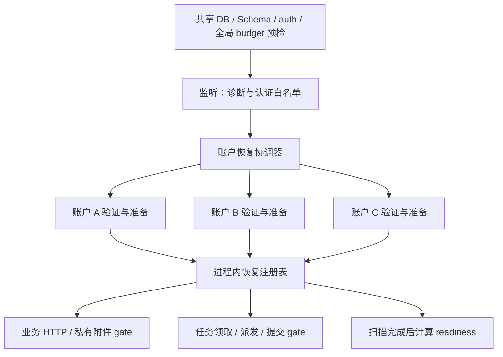
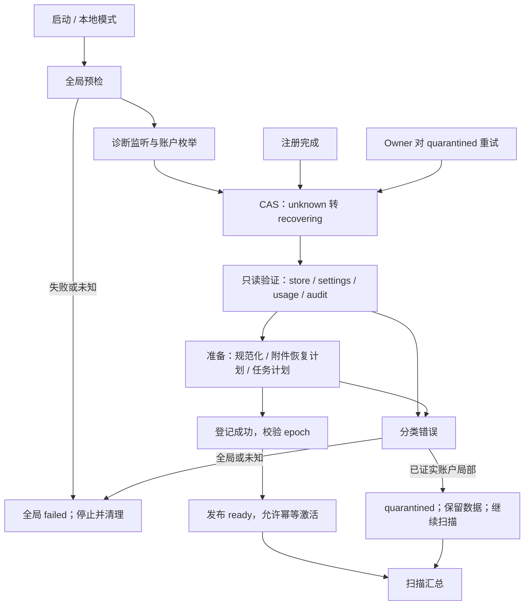
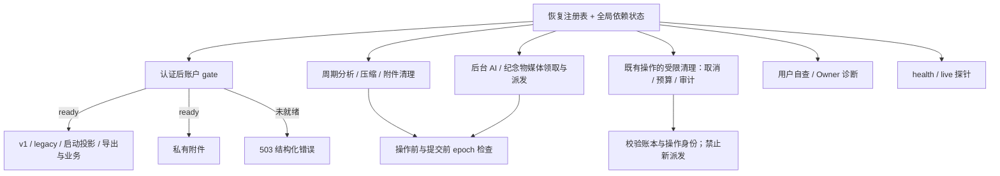

# F2 账户恢复故障隔离技术方案

|文档信息|内容|
|---|---|
|需求来源|指定历史对话第 2 项；[工程审计](../audits/engineering-2026-10-14.md) F2|
|Owner / 协作角色|项目 Owner、服务端生命周期负责人、存储负责人、前端与测试负责人；具体人员待确认|
|状态 / 日期 / 版本|有前提的 Owner 评审稿 / 2026-10-15 / r2|
|版本计划|历史为 P1、v0.5.16，记录 `reczz28NLb1qzsCc`；未实时核验需求池|
|范围 / 规模|账户恢复状态、故障分类、HTTP 与后台隔离、受控重试；跨启动与执行链路的中等改造|

## 评审摘要

推荐建立进程内账户恢复注册表，把全局依赖准备与单账户恢复分开。已证实只属于账户的数据损坏进入 `quarantined`，继续恢复其他账户；共享数据库、Schema、全局认证或预算恢复失败仍阻止服务就绪。先监听诊断入口，完成有界账户扫描后计算 readiness。业务请求、私有附件、周期任务、AI 和媒体恢复统一检查账户状态，避免仅隔离 HTTP。

|决策|推荐|替代 / 代价|负责角色|
|---|---|---|---|
|D1 故障分类不确定时如何处理|按全局失败保守退出，并要求补结构化分类证据|直接隔离会掩盖共享故障并误报健康|Owner、存储负责人|
|D2 部分账户隔离的健康语义|只要扫描完成、共享依赖健康且有可用账户，readiness 成功并标记 degraded|任何账户失败都返回不就绪会触发重启循环|Owner、运维|
|D3 本期修复方式|Owner 修复原始数据后显式重试，仅作用于隔离账户|自动定时反复修复可能覆盖损坏证据或反复产生副作用|Owner|

## 资料来源与前提

代码基线 `de90dfe2421b01d30066131be44478773fd2da68`；2026-10-15 静态读取。以下历史复现实验未在本次执行。

|编号|证据|结论范围|
|---|---|---|
|E1|[工程审计](../audits/engineering-2026-10-14.md)|A/B/C 账户中 B 恢复失败导致 C 未执行，服务未监听|
|E2|[account-lifecycle](../../src/app/account-lifecycle.mjs)、[server-lifecycle](../../src/app/server-lifecycle.mjs)|串行账户循环遇错退出；监听发生在账户恢复之后|
|E3|[runtime-foundation](../../src/app/runtime-foundation.mjs)、[ai-runtime](../../src/app/ai-runtime.mjs)|`ensureStore` 包含初始化/规范化/附件恢复副作用；全局预算恢复也在启动链路|
|E4|[HTTP application](../../src/http/application.mjs)、[runtime-access](../../src/app/runtime-access.mjs)|健康检查、认证、业务与附件路由顺序及 AsyncLocalStorage 账户上下文|
|E5|[runtime-http-wiring](../../src/app/runtime-http-wiring.mjs)|压缩与周期分析遍历账户，必须与恢复注册表联动|
|E6|[account-lifecycle-regression](../../scripts/account-lifecycle-regression.mjs)|旧测试明确期待 B 失败阻断 C，需随契约更新|
|E7|指定历史对话（项目外部材料）|需求和历史版本计划；已读|

|前提|核对与影响|
|---|---|
|A1 继续单实例|注册表、重试合并、epoch 在进程内有效；多实例需要共享协调|
|A2 错误可携带阶段、作用域和原因码|存储负责人逐类确认账户损坏证据。只凭 SQLSTATE 或任意异常不能判为账户局部。|
|A3 全局扫描仍需等待所有已枚举账户结束|本期降低故障扩散，不承诺海量账户快速启动；慢恢复需后续进一步设计|
|A4 所有参数和监控阈值均为建议值|通过真实 JSON/PG 恢复耗时和部署探针配置校准|

## 需求追踪

|需求点|设计|实体 / 接口|用例|指标|
|---|---|---|---|---|
|R1 单账户损坏不阻断其他账户|3.1、3.6|`AccountRuntimeState`|TC01、TC02|恢复结果数|
|R2 故障账户不能读写或派发任务|3.1.2、3.6|`assertAccountReady`|TC03、TC04|隔离账户越权执行数|
|R3 共享故障仍阻止就绪|2.2、3.3|`GlobalRuntimeState`|TC05、TC06|readiness|
|R4 保留原始数据并可安全重试|3.4—3.6、5.4|epoch、retry API|TC07—TC10|重试结果、数据摘要|

## 名词解释

|名词|解释|语境|
|---|---|---|
|恢复注册表|进程内保存各账户恢复进度、是否可使用的状态表；不保存用户正文。|“注册表是本进程‘是否允许业务执行’的事实源，业务仓库是内容事实源。”（3.1）|
|quarantined / 故障隔离|账户数据有已确认的局部故障时，暂停该账户业务，保留诊断和修复入口。|“局部失败置 quarantined，继续下一个；全局或未知故障置 failed，停止扫描、关闭业务准入并按既有启动失败清理退出。”（2.2.2）|
|gate|执行前的准入检查；账户没有准备好，就拦截读写和后台任务。|“因此，恢复 gate 同时约束 HTTP、后台派发与提交。”（2.1）|
|readiness / degraded|readiness 表示能否接业务；degraded 表示部分能力不可用但仍有账户能正常使用。|“初始扫描未完成时 `/health` 不就绪；扫描完成且共享依赖健康，有至少一个 ready 账户时返回 200，部分隔离标记 degraded。”（2.2.2）|
|liveness|存活检查，只判断进程能否响应；不代表账户数据已经恢复可用。|“拟新增 `/health/live` 仅表达进程能响应；现有 `/health` 保留健康主体字段并新增 optional `degraded` 和账户数量汇总。”（3.1.2.2）|
|CAS|比较旧状态后再更新；状态已变化就拒绝，避免两次修复同时启动。|“重试使用 CAS 核对 bootId 与 epoch，再通过 single-flight 合并同一活动 attempt。”（3.1.1.2）|
|bootId / epoch / attempt|分别是本次进程启动标识、账户状态版本、一次恢复尝试；用于识别重启和过期执行结果。|“重试使用 CAS 核对 bootId 与 epoch，再通过 single-flight 合并同一活动 attempt。”（3.1.1.2）|
|single-flight|把针对同一账户的重复恢复请求合并为一次执行，并共享该次结果。|“重试使用 CAS 核对 bootId 与 epoch，再通过 single-flight 合并同一活动 attempt。”（3.1.1.2）|
|journal|记录任务或附件恢复进度的持久化记录，重试根据它避免重复执行已完成步骤。|“附件 journal、任务 ID 沿用原幂等身份。”（3.1.1.2）|
|CleanupToken|只允许指定既有操作做许可归还、任务终结或账务清理的内部授权，不能用来启动新工作。|“协调器可为既有操作签发内部 `CleanupToken`，只允许释放内存许可、对已校验可用的任务记录写取消终态、结算该操作的预算与审计；禁止领取新任务、调用模型或修改业务正文。”（3.1.1.2）|
|Schema / SQLSTATE|Schema 是数据库结构定义；SQLSTATE 是数据库错误分类码，单凭错误码不足以判定只是某账户损坏。|“只凭 SQLSTATE 或任意异常不能判为账户局部。”（资料来源与前提）|
|协作取消|发出停止信号，由正在执行的步骤配合退出；无法中止的 I/O 仍要等待真实结束。|“无法中止的 I/O 必须等待实际结束才释放恢复槽、允许重试；超预算不等于已停止。”（3.1.1.1）|

## 评审记录

r1：初始评审稿。r2（2026-10-15）：按文档评审意见补名词解释、生产/消费事务陈述，展开 JSON 与实体字段，改用 Python 语法伪代码。方案仍待 Owner 评审；未执行实现测试。

# 1. 项目背景

## 1.1 背景（必填）

当前恢复顺序是确保业务存储、设置、用量、审计、附件清理，再恢复后台 AI 与纪念物媒体流程。账户循环没有局部故障隔离，任一异常都会使整个启动失败（E2）。同时，直接给循环增加 `try/catch` 会留下更严重的不一致：账户可能只恢复了一半，却被 HTTP 或定时任务当作正常账户使用。

本期必须同时解决恢复状态、业务准入和副作用顺序。账户数据损坏不能被默认空对象覆盖；共享存储故障不能被“跳过账户”掩盖。原有 local mode 和 local test mode 继续支持，不能强制依赖正式认证账户列表。

## 1.2 目标（必填）

|目标|基线|目标 / 口径|
|---|---|---|
|A/C 在 B 损坏时可用|E1 中 C 未恢复、服务未监听|确定性：A/C 读写成功；B 返回隔离错误；共享状态 degraded|
|故障账户无业务副作用|现有无统一恢复 gate|确定性：B 的业务、附件、周期任务、AI/媒体派发次数均为 0|
|共享故障不误报健康|健康检查主要依赖 PG ready|确定性：共享 DB、Schema、auth、budget 恢复失败时 readiness 非 200|
|安全恢复与重试|当前失败终止启动|确定性：局部坏数据原文不被初始化覆盖；重复重试不并发激活|
|启动与恢复耗时可测|缺账户分阶段指标|建议恢复并发 1；总扫描耗时按阶段采样，先建立 p95 基线|

# 2. 总体方案设计

## 2.1 前期调研

`ensureStore` 在 PG 路径执行 initialize 后恢复附件，在 JSON 路径可能写回规范化文件；它不是无副作用校验函数。`tasks.recover` 类逻辑可能把存量 running 任务当成中断，不能在已正常运行的账户上任意重复执行。服务器 schedulers 和 HTTP 请求都能进入账户上下文，因此恢复隔离必须成为运行时共同约束。

因此，恢复 gate 同时约束 HTTP、后台派发与提交。

## 2.2 系统架构

|系统 / 角色|职责与改造|
|---|---|
|生命周期协调器|全局准备、诊断监听、账户扫描、readiness 汇总|
|账户存储、设置、用量、审计|账户级验证和必要规范化；结构化错误，不返回空默认值掩盖损坏|
|HTTP / C 端 / 私有附件|认证后 gate；展示可恢复状态；登录、退出与自查可用|
|周期分析、压缩、附件清理、后台 AI、纪念物媒体|只有 ready 账户可以领取任务和派发副作用|
|Owner 运维入口|查状态、请求已隔离账户重试；不自动修复业务内容|
|审核服务端 / 审核前端|当前无该协作系统，不适用|
|AI 模型服务端|模型协议不变；账户未就绪时本地禁止调用|



### 2.2.1 业务新流程

启动期间用户能获取通用恢复状态；账户 ready 后可以进入业务。某账户数据不可恢复时，该用户看到“账户数据暂不可用，请稍后重试”，可退出登录；其他 ready 账户继续使用。Owner 查看安全诊断摘要、修复对应数据，再发起一次受控重试。恢复不自动删除内容或重建为空账户。

### 2.2.2 技术新流程

先完成共享预检，再监听诊断与认证入口；枚举账户并置为 `unknown`，以有界并发转入 `recovering`。分三阶段：只读验证、可恢复的准备/规范化、登记待激活任务。全部通过后原子发布 ready 并允许调度。局部失败置 quarantined，继续下一个；全局或未知故障置 failed，停止扫描、关闭业务准入并按既有启动失败清理退出。

初始扫描未完成时 `/health` 不就绪；扫描完成且共享依赖健康，有至少一个 ready 账户时返回 200，部分隔离标记 degraded。没有账户的系统允许注册，视为可用；已有账户全部隔离时返回 503，但诊断、登录与修复入口保留。部署需要区分存活与就绪，避免“全隔离”导致无意义重启。

## 2.3 可选方案对比

|方案|效果|代价 / 风险|选型|
|---|---|---|---|
|仅循环 catch 后继续|C 能恢复|B 可能以半恢复状态被访问，共享故障被吞|不采用|
|注册表 + 分阶段恢复 + 统一 gate|局部隔离、全局失败和重试边界明确|需核对 HTTP 与后台所有执行入口|推荐|
|每账户独立进程|隔离更强|资源、部署、共享预算和路由复杂度显著增加|当前单实例规模下不采用|

# 3. 详细方案设计

## 3.1 详细设计（必填）

注册表是本进程‘是否允许业务执行’的事实源，业务仓库是内容事实源。注册表不存内容，不推断数据已修复；每次进程启动重新从存储验证。任何账户隔离都须附结构化阶段与分类，禁止捕获异常后直接返回 ready。

### 3.1.1 生产链路

|上游|输入 / 频率|行为 / 输出|
|---|---|---|
|服务器启动 / restart|全局配置、认证账户列表|共享预检；建立本轮 bootId 与账户状态|
|local / localTest|本地固定存储上下文|按原模式处理一个合成账户键，不强制遍历正式 auth|
|注册完成|已成功持久化的新账户|先进入 recovering，准备通过才允许业务；并入注册表|
|Owner 重试|bootId、accountId、expectedEpoch|仅 quarantined 接受；CAS 后 single-flight|
|后台恢复阶段|既有任务/附件清理记录|只登记恢复计划；ready 发布前不得派发|



|处理动作|原所在事务|本次事务|事务粒度|事务内新增逻辑|事务外与提交后|
|---|---|---|---|---|---|
|启动枚举与恢复状态|E2 串行循环无覆盖全部账户的数据库事务|无全局长事务；状态变更为进程内原子更新|一个 bootId 下逐账户 CAS；只在同步状态转换时更新注册表|无数据库新增写；内存中核对 epoch、合并 attempt、转换状态|共享预检和扫描在外；全局失败清理退出，不能以事务回滚宣称已撤回其他账户准备|
|只读验证与准备|E3 ensureStore 含各仓储初始化/规范化和附件恢复，非跨文件总事务|拆分只读验证；验证后保留各仓储原子提交，不新增跨存储总事务|单账户、单仓储一次更新；业务 PG 沿用账户锁及 SQL 事务，JSON 沿用写队列/原子替换；settings/usage/audit 各自提交|写前核对恢复能力与 epoch，禁止坏数据空初始化；每个仓储失败仅回滚该次写|先完整验证后写；已完成其他仓储提交保留，以 journal 重试收敛；附件/模型外部调用不放进 SQL 事务|
|注册后准备与 Owner 重试|注册沿用认证持久化；重试接口为新增|注册提交后登记；重试只做内存 CAS，无新认证事务|单账户、单活动 attempt，旧执行器退出前不重入|无跨账户写；CAS 验证 bootId、expectedEpoch、隔离状态及冷却|202 仅表示接受恢复；只有准备完成且 epoch 有效才发布 ready；激活失败关闭 gate 并收敛旧任务|

#### 3.1.1.1 处理阶段与新增配置

拟新增 `accountRecovery`，进程级、启动读取；以下初值均为建议。开关只能在重启时选择，运行中不旁路 gate。

|键|类型 / 默认建议|作用 / 关闭行为|
|---|---|---|
|`enabled`|boolean / false|开时新隔离链路；关时原启动失败行为，不能强行放行坏账户|
|`concurrency`|integer / 1|最多并行账户恢复数；先保持原资源占用|
|`accountDeadlineMs`|integer / 30000|协作取消预算；达到后发 signal，不用裸 Promise.race 丢弃工作|
|`retryCooldownMs`|integer / 60000|隔离账户连续重试冷却；当前 attempt 合并|
|`dependencyProbeMs`|integer / 5000|共享依赖状态检查周期，与现有连接错误事件共同更新|

```json
{
  "accountRecovery": {
    "enabled": false,
    "concurrency": 1,
    "accountDeadlineMs": 30000,
    "retryCooldownMs": 60000,
    "dependencyProbeMs": 5000
  }
}
```

无法中止的 I/O 必须等待实际结束才释放恢复槽、允许重试；超预算不等于已停止。若底层操作长期不返回，全局保持未就绪，由部署启动超时退出整个进程，不能一边遗留 worker 一边恢复其他账户。

#### 3.1.1.2 接口与数据处理

`validateAccount` 必须区分缺失的新账户、合法旧版本、损坏数据：只有已授权的新账户创建流程可以初始化空存储。已存在账户缺少迁移后数据、JSON 解析失败、索引不完整，不得写空默认值。

准备阶段的规范化需保留既有备份和原子写语义；仅在完整验证通过后执行。附件 journal、任务 ID 沿用原幂等身份。恢复执行器使用包含 bootId、accountId、epoch 的内部能力，不对 HTTP 暴露绕过 gate 的参数。重试只作用于已隔离账户，绝不对 ready 账户执行“把所有 running 标为中断”的全量恢复。

重试使用 CAS 核对 bootId 与 epoch，再通过 single-flight 合并同一活动 attempt。

隔离后仍须收敛已经发生的工作。协调器可为既有操作签发内部 `CleanupToken`，只允许释放内存许可、对已校验可用的任务记录写取消终态、结算该操作的预算与审计；禁止领取新任务、调用模型或修改业务正文。任务或账本本身损坏时保留待对账状态，不能用清理权限绕过数据校验。该路径与普通业务准入分开，避免 F2 隔离后把 F5 的必要清理一并阻断；参见已有[版本协同说明](版本级集成设计与协同执行说明.md) IT-02。

### 3.1.2 消费链路



|处理动作|原所在事务|本次事务|事务粒度|事务内新增逻辑|事务外与提交后|
|---|---|---|---|---|---|
|业务 HTTP、附件与后台提交|各业务原有读写事务；不存在覆盖请求全程的统一事务|复用业务原提交边界；gate 是内存检查，不冒称数据库锁|当前账户、当前操作；PG/JSON 仍按原仓储粒度提交|持有原写锁后、写入前复验 RunToken 与 epoch；失败不提交该次业务写|入口和外部派发前也校验；异步等待后重验，只有提交成功才发业务成功响应|
|既有任务取消、预算与审计收尾|任务、预算、审计各自提交；无跨仓储原子事务|保留各自事务，以 CleanupToken 限定允许动作|一个既有 operation/attempt，分别在所属账本互斥更新|核对操作身份、账本有效性和终态幂等条件；仅写必要终结|不启动 provider；分步失败保留待对账，不能把某一步成功当成全部已清理|
|状态自查、health/live 与前端|无，读取进程内汇总|无新增持久化事务|一次状态投影；无账户内容读取|无|响应仅包含安全摘要；前端 503 保留原视图；ready 发布后才允许正常业务|

#### 3.1.2.1 消费入口

|入口|契约 / 边界|验收|
|---|---|---|
|认证后的 owner、v1、legacy 业务路由|绑定账户后统一检查；业务 owner 权限不等于绕过恢复|TC03|
|私有附件、上传下载、导出|任何访问账户文件的路径都走 gate|TC03|
|周期分析、压缩与缓存任务中账户操作|遍历只选 ready；每次派发重验 epoch|TC04|
|后台 AI、纪念物媒体、附件清理|领取与 provider 调用前检查；提交时检查上下文版本|TC04、TC08|
|既有任务终结、预算和审计清理|仅有效 CleanupToken 和已校验记录；不要求业务 ready，不允许新派发|TC04、TC08|
|auth/me、logout、自查状态、安全静态资源|允许隔离账户使用；不读取业务存储|TC03|
|前置 admin / upstream proxy|admin 仍需自身权限且不直接访问坏账户业务；代理由目标服务实施同一 gate|TC03|
|健康探针|全局和扫描状态，不用单一 PG.ready 代替|TC05、TC06|

#### 3.1.2.2 协议、打包与改动边界

业务未就绪返回 503，`code` 取 `ACCOUNT_RECOVERING` 或 `ACCOUNT_RECOVERY_FAILED`；只给通用提示，不发文件路径、SQL 和内容。`/api/auth/me` 可新增 optional `accountRuntime` 对象，其中包含 status 字段；旧前端仍可识别原鉴权字段。启动页面只读状态接口后决定显示恢复提示，不将错误空数组当成真实空账户。

拟新增 `/health/live` 仅表达进程能响应；现有 `/health` 保留健康主体字段并新增 optional `degraded` 和账户数量汇总。未认证探针不返回账户 ID。部署 probe 变更先于启用隔离。

#### 3.1.2.3 消费验收

TC03 遍历全部路由分类；TC04 验证不经 HTTP 的任务也无法使用 B 数据或调用模型；TC06 证明 B 隔离时 A/C 可用且 readiness 不触发重启循环。旧客户端收到 503 不覆盖本地已有内容。

## 3.2 外部依赖

### 3.2.1 依赖方与诉求

|依赖方|诉求 / 就绪证据|顺序 / 失败处理|
|---|---|---|
|存储负责人|结构化 `RecoveryFailure`、只读验证、创建与损坏区分|先提供分类，再启用隔离；未知错误按全局|
|任务 / 附件负责人|准备与派发分离，既有任务 ID 可幂等恢复|未改造完整前不能开放隔离 gate|
|部署 / 运维|liveness 与 readiness 分开，给扫描充足启动窗口|先更新探针；共享失败仍退出|
|前端|optional 状态、503 错误保留已有视图数据|可先发布，旧端兼容通用错误|
|AI / OSS 等执行依赖|协议不变，ready 后才允许调用|依赖故障按阶段和作用域判断；不等于必然账户损坏|

所有旧响应新增字段 optional；新诊断接口有独立必填契约。外部服务未承诺新能力，本方案不依赖它们新增接口。

## 3.3 异常处理（必填）

|异常点|分类与动作|数据 / 重试|恢复条件|
|---|---|---|---|
|B 的 JSON 语法或已验证局部结构损坏|account → quarantined|保留原文件；无空初始化；显式重试|修复后完整验证通过|
|全局 auth、DB 连接、Schema、预算恢复失败|global → failed|停止新业务与扫描；按既有清理退出|全局依赖修复后重启|
|磁盘满、共享权限错误、未知 SQL 错误|默认 global|不能仅按正在处理 B 就归咎 B|存储负责人提供局部证据后才能改分类|
|超预算但 I/O 未结束|停止后续阶段，保持本 attempt 占位|等待结束，不启动重试；必要时进程退出|确认旧执行器终止|
|准备成功、登记或激活失败|撤销业务准入，epoch 递增并隔离|既有任务 journal 幂等保留；等待在途执行退出|修复后基于 journal 重试|
|重复 / 乱序重试|相同活动 epoch 返回当前 attempt；旧 bootId/epoch 409|不得并发恢复|客户端刷新状态|
|运行中账户出现已证实局部损坏|gate 关闭、递增 epoch，阻止新领取和提交|取消可取消任务并等待旧执行器；不得直接重试|隔离且旧操作排空|
|重启|内存注册表消失|重新扫描；不能信任旧 ready|新 bootId 下重新验证|

## 3.4 数据实体（必填）

```ts
type AccountRuntimeState = {
  accountId: string;
  bootId: string;
  epoch: number;
  status: "unknown" | "recovering" | "ready" | "quarantined";
  phase: "validate" | "prepare" | "activate" | "idle";
  attemptId: string | null;
  startedAt: string | null;
  finishedAt: string | null;
  reasonCode: string | null;
  retryAfter: string | null;
};
type GlobalRuntimeState = {
  bootId: string;
  status: "initializing" | "ready" | "failed";
  scanComplete: boolean;
  dependenciesHealthy: boolean;
  degraded: boolean;
};
type RecoveryFailure = {
  scope: "account" | "global" | "unknown";
  phase: string;
  reasonCode: string;
  accountId?: string;
  cause: Error;
};
type AccountRunToken = {
  bootId: string;
  accountId: string;
  epoch: number;
};
type CleanupToken = {
  bootId: string;
  accountId: string;
  operationId: string;
  attemptId: string;
  allowed: ("release_permit" | "cancel_existing_task" | "settle_budget" | "finish_audit")[];
};
```

|实体|事实源 / 生命周期 / 约束|兼容|
|---|---|---|
|Account / Global Runtime|内存 Map，每账户一项；重启全部重建；诊断日志只保存脱敏结果|无业务 Schema 迁移|
|epoch / RunToken|协调器在准入变化时单调递增；所有执行提交前核验|只在新实现内部传递|
|CleanupToken|只授权已登记操作的幂等终结；不可用于业务写入或外部派发|内存私有能力，清理结束或重启即失效；重启后走恢复对账|
|RecoveryFailure|底层按已验证原因构造；cause 仅受控日志|外部只消费安全 reasonCode|
|旧任务 / 附件 journal|保留原持久化事实源和幂等键|不引入第二份任务状态|

自查规范响应示例：

```json
{
  "status": "quarantined",
  "reasonCode": "ACCOUNT_RECOVERY_FAILED",
  "retryAfter": null
}
```

Owner 响应另含 `bootId`、`epoch`、`attemptId`、安全阶段和更新时间，不含 `cause`。

## 3.5 接口定义（必填）

|接口|定义 / 鉴权 / 错误|
|---|---|
|`GET /api/v1/account-runtime`（拟新增）|当前会话鉴权；返回本人安全状态；401 未登录；不读取业务 store|
|`GET /api/v1/owner/accounts/:accountId/recovery`（拟新增）|Owner 权限；返回 3.4 诊断投影；404 不存在，403 非 Owner|
|`POST /api/v1/owner/accounts/:accountId/recovery/retry`（拟新增）|Owner 权限及现有同源写入防护；必填 body 字段 bootId:string、expectedEpoch:integer；202 返回当前 attempt|
|`assertAccountReady(accountId,token?)`（拟新增内部）|入口生成 token；派发/提交阶段核对；不通过抛对应 503|
|`finalizeExistingOperation(cleanupToken,action)`（拟新增内部）|核对能力、原操作与已验证账本，只执行列明终结动作；重复幂等，错误保留待对账状态|
|`recoverAccount(accountId,{epoch,signal})`（拟新增内部）|仅协调器调用；返回恢复结果或结构化错误；不能被用户输入启用 bypass|
|`GET /health`、`GET /health/live`|前者就绪，后者存活；无敏感账户信息|

重试请求示例：

```json
{
  "bootId": "boot-fixture-1",
  "expectedEpoch": 2
}
```

接受后的响应示例：

```json
{
  "attemptId": "attempt-fixture-3",
  "epoch": 3,
  "status": "recovering"
}
```

CAS 接受后同一旧 epoch 的重复请求在当前 attempt 活跃时返回同一 202；完成后旧 epoch 返回 409，客户端先重新 GET。进程重启旧 bootId 返回 409，不假装跨重启 exactly-once。

该接口只登记异步恢复，轻量受理响应目标 P75≤500ms；30 秒预算属于恢复执行而非 HTTP 持有时长。ready 状态不能发起修复，返回 409；冷却期间返回 429 和剩余毫秒。未登录和非 Owner 无法获知他人状态。

## 3.6 代码设计

### 3.6.1 代码落点

|文件 / 模块|改造点|
|---|---|
|`src/app/account-lifecycle.mjs`|分阶段恢复、single-flight、局部失败继续、注册接入|
|`src/app/account-runtime-state.mts`（拟新增）|注册表、CAS、全局汇总、token 检查|
|`src/app/runtime-foundation.mjs`|拆 `ensureStore` 验证/准备副作用，禁止损坏时空初始化|
|`src/app/server-lifecycle.mjs`|共享预检后诊断监听；恢复后开放 schedulers；退出完整清理|
|`src/http/application.mjs`、`runtime-access.mjs`|统一 gate、上下文 token、自查与 Owner 路由装配|
|`src/app/runtime-http-wiring.mjs`、后台 AI / 媒体执行模块|遍历过滤、领取/派发/提交检查，幂等激活|
|存储提交入口|核对账户运行 token；内部恢复能力限定在协调器|

### 3.6.2 核心伪代码

```python
async def start():
    try:
        await preflightSharedDependencies()  # 全局失败不能吞掉
        await listenWithBusinessGateClosed()
        accounts = await listAccountsOrLocalAccount()
        registry.seed(accounts)
        await runBounded(accounts, recoverOne, concurrency)
        registry.markScanComplete()
        startSchedulersUsingReadyAccounts()
        publishReadinessFromRegistryAndDependencies()
    except Exception:
        await failGlobalAndCleanup()  # 关闭业务入口，等待执行器退出
        raise


async def recoverOne(account, expected=None):
    expected = expected or registry.current(account)
    attempt, created = registry.beginCAS(expected)  # 内存原子更新，不是 DB 事务
    if not created:
        return await attempt.result
    try:
        plan = await validateReadOnly(account, attempt.signal)
        await prepareValidatedStorage(plan, attempt.signal)
        # 每个仓储独立原子提交，不声称跨文件/数据库总回滚
        prepared = await registerRecoveryActionsWithoutDispatch(plan)
        require(attemptStillCurrent(attempt))
        registry.markReady(attempt)
        await activateIdempotently(prepared, runToken(attempt))
    except Exception as error:
        registry.closeGateAndAdvanceEpoch(account)
        await stopAndJoinAttemptWorkers(
            attempt, restrictedCleanupCapability(attempt)
        )
        # 只允许已验证账本上的收尾，旧执行器未退出前禁止重试
        failure = classifyWithEvidence(error, account, attempt.phase)
        if failure.scope != "account":
            raise failure
        registry.markQuarantined(account, safeReason(failure))


async def runBusiness(account, action):
    token = registry.requireReady(account)
    with requestStorage.context(account=account, token=token):
        registry.requireCurrent(token)
        return await action(
            beforeDispatch=lambda: registry.requireCurrent(token),
            beforeCommit=lambda: registry.requireCurrent(token),
        )
        # beforeCommit 必须在业务原有写锁内、写入前调用
```

#### 3.6.2.1 关键动作实现细节

|函数|输入 → 输出|复用 / 不直接复用|
|---|---|---|
|`validateReadOnly`|账户 → 合法恢复计划|复用解析校验；不直接复用会写默认值的 ensureStore|
|`classifyWithEvidence`|错误、阶段 → scope|只认显式局部错误；未知错误不得统一降级成 account|
|`registerRecoveryActionsWithoutDispatch`|计划 → 幂等待激活项|复用任务/附件 journal；不能调用立即运行模型的 resume|
|`activateIdempotently`|待激活项、token → 完成|实际 runner 每次派发重验 token；失败撤销 gate，旧结果提交前也需校验|
|`retryCAS`|bootId、expectedEpoch → attempt|同进程合并；不对 ready 账户运行全量 tasks.recover|

`markReady` 到激活完成间可能已有业务进入：业务存储此时已完整准备，允许普通读写；恢复计划不得以旧快照覆盖新操作，领取与提交必须用任务版本/现有幂等 journal。激活失败立即关闭准入，等待旧操作退出后才允许重试。不能靠 epoch 撤销已经发生的外部调用，需按原任务审计结算。

### 3.6.3 关键实现约束

1. 部分恢复账户的业务 gate 默认关闭，所有未知账户也是关闭（TC03）。
2. 局部故障分类必须可解释，共享和未知故障不被吞（TC05）。
3. 先完整验证再规范化，损坏原始数据不得被空初始化覆盖（TC07）。
4. 普通业务执行前、外部派发前、提交前检查账户/epoch；定时任务无特权旁路。既有操作的必要终结只经 CleanupToken 白名单，不能派发或写业务正文（TC04）。
5. 超时和重试先停止旧执行器；ready 账户不能被全量重复恢复（TC08—TC10）。

## 3.7 监控告警（必填）

均为拟新增监控；服务端负责人维护恢复看板。

|指标|口径 / 维度|建议阈值 / 动作|
|---|---|---|
|`account_recovery_total`|按 phase、result、reason 类别计数，无账户标签|新增 quarantined 即 P2，定位受控日志并通知值守|
|`account_recovery_duration_ms`|分阶段 p95、扫描总耗时|超过 30 秒预算记录超时；观察是否可协作结束|
|`account_runtime_count`|unknown/recovering/ready/quarantined 数量|扫描完成但 unknown 非零为 P1，停止开放业务|
|`global_readiness`|共享依赖、扫描完成、账户汇总|共享失败却返回 200 为 P1；探针断言|
|`quarantined_account_execution_total`|非 ready token 成功派发或提交数|任何一次 P1，关闭相关执行入口|
|`recovery_retry_total`|accepted/coalesced/conflict/failed|连续同账户失败由受控日志聚合，不用账户 ID 指标标签|

## 3.8 稳定性

### 3.8.1 容量与性能

账户数 N、平均恢复耗时 t、并发 c，则扫描耗时约 `N×t/c`，共享依赖准备另计；c 初值为 1。注册表内存 O(N)，每账户固定状态，无正文与无限 attempt 历史。在线重试与启动共用同一并发池，避免重试风暴。30 秒是协作预算，不代表底层不可取消 I/O 可以凭空中断；部署启动超时需覆盖实测扫描上界。

### 3.8.2 一致性与幂等

状态机 `unknown→recovering→ready/quarantined`；`quarantined→recovering` 必须 CAS；ready 只有明确运行错误或停机可转为关闭态。任务和附件状态仍以原 journal 为准，恢复注册表不复制内容状态。外部成功而记录失败沿用原审计/结算补偿，不将其当成“未执行”。恢复过程中发生注册时，由注册服务同步登记；业务请求遇到未登记账户不得自动放行。

### 3.8.3 降级与回滚

局部失败只关闭对应账户，其他账户继续使用。全局失败阻止所有业务。隔离开关关闭需重启，恢复原启动失败策略；坏账户未修复时回退旧实现可能使整个服务不能启动，须提前评估，不能以关闭 gate 达成回退。具体步骤见 5.4。

### 3.8.4 安全与日志

自查仅限本人，Owner 诊断有权限和同源写入防护。记录 bootId、attemptId、phase、reasonCode、脱敏账户关联，禁止正文、凭据、私有附件 URL。原数据由现有权限保护，JSON 目录权限沿用 0700。诊断不是读取他人业务内容的入口。

## 3.9 实验方案

### 3.9.1 开关与灰度

按启动实例整体选择 `accountRecovery.enabled`，不在账户恢复途中热切换。先测试隔离数据副本，再单实例受控发布。若仅开启 HTTP gate 而后台未改完，视为无效配置，不允许发布。

### 3.9.2 核心验收指标

R1—R4 均以确定性状态和副作用断言验收。局部故障 A/C 必须成功读写，B 的存储摘要必须保留；共享故障 readiness 必须失败。恢复性能先建基线，不以合成小账户数据承诺生产启动时延。

### 3.9.3 效果观测

建议一次完整重启、一次局部修复重试，观察 24 小时后台周期任务。对照原启动日志看各阶段耗时与失败传播；不在真实用户数据中注入损坏，不进行线上故障实验。样本不足不宣称故障率下降。

# 4. 开发测试

## 4.1 开发明细（必填；评审时留空，开发结束后填写）

## 4.2 测试方案（必填）

计划更新 `scripts/account-lifecycle-regression.mjs` 的旧失败契约，再覆盖真实 JSON 和 PG。下列测试尚未执行。

|用例|操作 / 故障注入|预期|
|---|---|---|
|TC01 / R1|A/B/C；B usage 校验失败且可证实局部|A/C ready，B quarantined，扫描完成、degraded|
|TC02 / R1|B 处于首、中、尾；空账户列表；local/localTest|扫描顺序不影响隔离；无账户可注册；本地模式可用|
|TC03 / R2|对 B 调用 v1、legacy、startup、owner 业务、附件、导出、admin 与 proxy 相关路径|业务均被正确边界拦截；me/logout/自查可用；他人诊断 403|
|TC04 / R2|运行周期分析、压缩、后台 AI、媒体恢复、附件清理；已有操作隔离后终结|B 的新领取、外部派发与业务提交为 0；已校验任务/预算可幂等终结；损坏账本保留待对账；A/C 正常|
|TC05 / R3|共享 DB 断开、Schema 错、全局 auth/budget 损坏、未知错误|全局 failed；禁止 200；不伪装 B 局部失败|
|TC06 / R3|部分隔离、全部隔离、扫描未完成，分别探测 health/live|符合 2.2.2；存活不等于就绪；无重启循环配置|
|TC07 / R4|坏 JSON、缺失迁移账户、合法旧版本，比较原始字节摘要|损坏不被覆盖；合法规范化有原子写与备份|
|TC08 / R4|准备成功激活失败、旧结果晚到；Owner 连续重试|gate 关闭，旧 epoch 禁止提交；同 attempt 合并|
|TC09 / R4|超时后底层延迟完成，同时请求 retry|不遗留 worker 并发运行；完成/退出前不启动新 attempt|
|TC10 / R4|重启后带旧 bootId 重试；ready 账户重试；扫描中注册|旧请求 409；ready 不重复恢复；新账户须准备完成|
|TC11 / 回滚|保留 B 坏数据演练回退与修复后回退|识别旧代码启动风险；不删除 B 或恢复旧全库备份|

### 4.2.1 Mock测试方案

固定 A/B/C fixtures，按恢复 phase 注入错误；Mock 任务派发器统计 accountId 与 token，不调用付费模型。保留真实账户上下文、状态机、HTTP gate 和事务提交检查。真实文件损坏与独立 PG 连接故障验证分类边界，Mock 不能证明数据库错误一定可隔离。切回真实存储后用合成账户跑完整重启与修复，不接触生产内容。

# 5. 上线方案

## 5.1 上线CheckList（必填）

- [ ] 上线前：存储负责人确认可隔离错误白名单和未知错误策略。
- [ ] 上线前：测试覆盖全部 HTTP/后台入口、坏数据保留与旧执行器退出。
- [ ] 上线前：部署区分 live/ready，完成全隔离与共享故障演练。
- [ ] 上线中：先检查共享预检，再核对账户状态计数和周期任务。
- [ ] 上线后：Owner 重试权限、24 小时任务观测与回退证据齐备。

## 5.2 上线依赖

|顺序|系统 / 角色|动作与前提|
|---|---|---|
|1|服务端、存储、任务负责人|交付验证/准备分离、统一 gate、重试与指标；默认关闭|
|2，可并行|前端|optional 状态与通用 503 展示；不把失败响应写为空内容|
|3|运维|先提供兼容探针配置，验证新 live 路径再切 probe|
|4|服务端发布|开启隔离并重启；单实例内部先全局、再账户、再 schedulers|
|5|Owner / 测试|正常账户读写与隔离诊断验证；不自动修改真实用户数据|

## 5.3 观测方案

首次启动全程由服务端负责人值守，核对枚举数等于 ready+quarantined，扫描后无 unknown/recovering 遗留。共享故障、非 ready 派发或数据覆盖任何一次立即停用相关入口。建议 24 小时观察至少一次各类后台周期；没有触发的类别用隔离 fixture 补测，不伪造线上样本。

## 5.4 回滚方案

|对象|步骤|在途与验证|
|---|---|---|
|服务 / 开关|停止新业务和新任务，取消并等待账户执行器；关开关后重启|旧实现不能容忍坏账户；先评估是否会全站不可用|
|代码|回退上线前制品，具体版本发布时记录|仅在账户全部可被旧恢复读取或接受停机窗口时执行|
|数据 / 注册表|内存状态随进程重建；保留原业务数据与 journal|不删隔离账户，不用旧全库快照覆盖正常账户新数据|
|已派发外部任务|按既有审计/成本结算处理|取消本地不能撤销已发生的外部调用；保留结果关联|

## 5.5 放量计划

|阶段|范围|建议窗口 / 通过标准|负责角色|
|---|---|---|---|
|隔离环境|A/B/C、JSON、PG、本地模式|TC01—TC11 全部符合，恢复时延有基线|测试、存储|
|受控重启|单实例整体开启|一次完整扫描，30 分钟无 gate 绕过或探针误判|服务端、运维|
|稳定观察|全部业务与后台周期|24 小时；异常立即停止扩展，局部问题只处理对应账户|Owner、服务端|

恢复属于启动状态机，使用实例级发布，不按百分比混跑两种恢复逻辑。

## 2026-10-16 集成修订

K1账户资格是F3/F5/F9共同入口，K2受限清理与F5对齐。受控重试的轻量受理响应目标改为P75≤500ms；恢复完成仍为独立后台阶段，不以HTTP超时截断。F9等待者在隔离/撤权时终止，不保持旧账户可用假象。

共享接口责任、互斥写集和顺序统一见[版本级集成设计第7节](版本级集成设计与协同执行说明.md#7-v0516-九项方案的集成约定)。本修订仅为设计；未实施、未取得性能验收。
