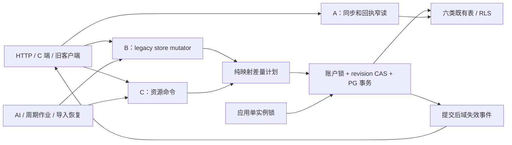
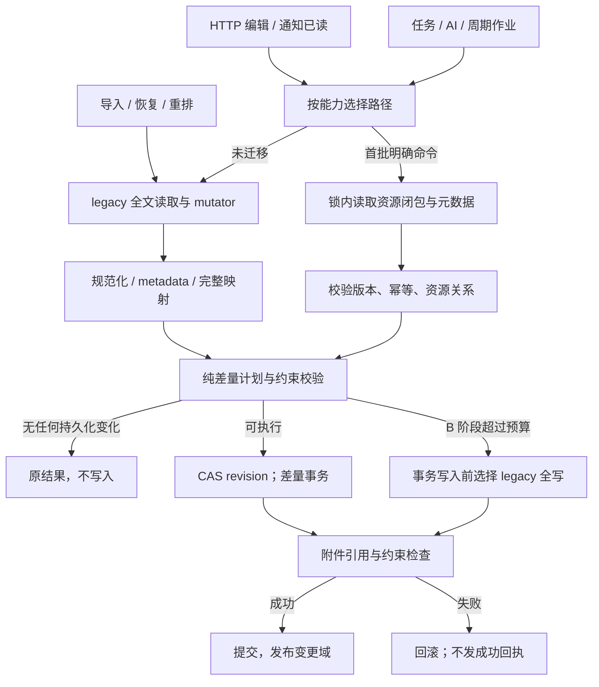
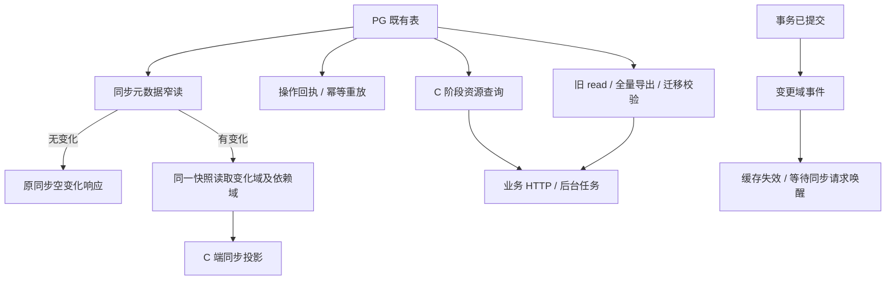

# F3 PostgreSQL 增量读写演进技术方案

|文档信息|内容|
|---|---|
|需求来源|指定历史对话第 3 项；[工程审计](../audits/engineering-2026-10-14.md) F3|
|Owner / 协作角色|项目 Owner、持久化负责人、业务模块负责人、数据库与测试负责人；具体人员待确认|
|状态 / 日期 / 版本|有前提的 Owner 评审稿 / 2026-10-15 / r2|
|版本归属|历史未指定版本；本方案不自动纳入 v0.5.16，范围与排期待 Owner 决策|
|范围 / 规模|单实例下分阶段减少同步查询、写放大及高频命令全量读取；跨持久化与业务契约，需按阶段估算|

## 评审摘要

推荐保留 PostgreSQL 作为事实源、保留当前单应用实例锁，分三阶段实施：A 为同步轮询与回执增加窄读取；B 在现有整仓库事务外观下改为行级差量写入；C 把通知已读、任务状态迁移、已有记录编辑迁入按资源读写的命令接口。A/B 不改表结构，C 复用现有映射与元数据协议。每阶段独立验收和回退，不能将 B 的写入改善称为整体 O(1)。

连续 `position` 索引要求插入头部、删除和重排可能更新整个分组；本期保留该不变量以保持导出与旧代码兼容。多实例还受预算恢复、进程内配额、任务所有权、取消和限流影响，去掉应用锁不构成可用方案。本方案不解除它。

|决策|推荐|替代与代价|负责角色|
|---|---|---|---|
|D1 本期阶段与版本|单独排期 A→B→C；各阶段独立进入发布|只做 A/B 可降风险，但单次写入仍全量读；不能验收 C 目标|Owner|
|D2 排序结构|本期保留连续位置，明确重排成本|稀疏顺序键需迁移映射、导出、旧写者，另评审|Owner、存储负责人|
|D3 多实例|继续强制单应用实例|解除锁需先完成共享调度、预算与 fencing 等完整工程|Owner|
|D4 C 阶段首批操作|通知已读、任务状态迁移、已有记录编辑|一次迁完所有集合更大、回归和回退面更广|Owner、业务负责人|

## 资料来源与前提

代码基线为 `de90dfe2421b01d30066131be44478773fd2da68`，2026-10-15 已静态核对。历史 SQL 生成实验不是 PG 实际性能测试。

|编号|证据|支持事实|
|---|---|---|
|E1|[工程审计](../audits/engineering-2026-10-14.md)|100→1000 合成对象，仍 6 次账户级 DELETE，插入参数约 39646→398746 字节；非 WAL/吞吐数据|
|E2|[postgres-runtime](../../src/shared/persistence/postgres-runtime.mjs)|账户事务先全读；commit CAS revision、clear/write、附件校验、提交后回调；同步读取也全量|
|E3|[postgres-objects](../../src/shared/persistence/postgres-objects.mjs)|六类映射全量读取、账户范围清表、批量 INSERT|
|E4|[postgres-schema](../../src/shared/persistence/postgres-schema.sql)、[store-mapping](../../src/shared/persistence/store-mapping.mjs)|对象键、外键、RLS、连续唯一 position、payload 与投影列一致性、重建校验|
|E5|[persistence-metadata](../../src/shared/persistence/persistence-metadata.mjs)、[sync HTTP](../../src/http/sync.mjs)|同步游标、操作回执、元数据保留上限；HTTP 409/410 和变更域快照|
|E6|[任务模块](../../src/modules/tasks/index.mjs)、[AI budget runtime](../../src/app/ai-budget-runtime.mjs)、[AI usage](../../src/modules/ai/usage.mjs)|恢复和配额存在单进程假设，多实例锁有必要|
|E7|指定历史对话（项目外部材料）|第 3 项未进入历史 v0.5.16 清单；本次授权编写方案|

|前提|影响 / 核对方式|
|---|---|
|A1 真实账户规模、WAL、查询 p95 未测|数据库负责人在脱敏测试库测 N=100/1000/10000，不能用 E1 推算生产收益|
|A2 A—C 保持当前表结构与连续位置|旧导出和旧写者可读新数据；若变更则重新评审迁移与回滚|
|A3 C 命令只覆盖明确定义的资源及依赖闭包|未迁移调用保留 legacy 事务；不对任意 mutator 声称局部读取|
|A4 商业额度、费用规则不改|本方案只改变存储访问路径，不改变预算业务口径|

## 需求追踪

|需求点|设计|接口 / 实体|验收|观测|
|---|---|---|---|---|
|R1 无变更同步不扫描业务对象|阶段 A，3.1.2、3.5|`readSyncChanges`|TC01、TC02|读取行数 / 字节|
|R2 小改动不清空重写六表|阶段 B，3.6|`StoreDelta`、`commitDelta`|TC03—TC06|改动行数 / WAL|
|R3 高频已知操作局部读取|阶段 C，3.1.1|`ResourceMutationPlan`|TC07—TC09|业务读取行数与 N 的关系|
|R4 同步、幂等、附件和导出一致|3.4—3.8|原 metadata、receipt、映射|TC10—TC13|摘要、冲突、附件差异|
|R5 诚实保留单实例与可回退|2.3、3.8、5.4|应用锁 / 模式开关|TC14、TC15|锁拒绝、回退比对|

## 名词解释

|名词|解释|语境|
|---|---|---|
|事实源|最终以哪份数据为准；本方案仍以 PostgreSQL 中已经提交的数据为准。|“推荐保留 PostgreSQL 作为事实源、保留当前单应用实例锁，分三阶段实施：A 为同步轮询与回执增加窄读取；B 在现有整仓库事务外观下改为行级差量写入；C 把通知已读、任务状态迁移、已有记录编辑迁入按资源读写的命令接口。”（评审摘要）|
|窄读 / 差量写|窄读只取本次需要的数据；差量写比较新旧内容，只写有变化的行。|“推荐保留 PostgreSQL 作为事实源、保留当前单应用实例锁，分三阶段实施：A 为同步轮询与回执增加窄读取；B 在现有整仓库事务外观下改为行级差量写入；C 把通知已读、任务状态迁移、已有记录编辑迁入按资源读写的命令接口。”（评审摘要）|
|legacy / mutator|legacy 是兼容旧实现的路径；mutator 是接收完整文档并修改它的业务函数。|“B：保持原整仓库读/clone/mutator，纯函数生成新映射与差量；事务内 CAS 后按约束顺序执行差量。”（2.2.2）|
|revision / CAS|revision 是账户仓库版本；CAS 比较期望版本后才写入并递增，防止旧快照覆盖新数据。|“仓库 CAS 用 expectedRevision 对比当前 revision，匹配后才递增并提交。”（3.1）|
|advisory lock / 单实例锁|应用约定的 PostgreSQL 锁；应用锁限制只运行一个业务实例，账户锁另用于串行同账户操作。|“当前应用 advisory lock 是单实例保护，不能以‘PG 已支持并发’为理由直接删除。”（1.1）|
|RLS|数据库的行级访问策略，根据受信账户上下文限制可访问的行，防止跨账户读写。|“所有查询由 AsyncLocalStorage 绑定账户，并设置 RLS 上下文；固定表名与字段白名单，用户输入只做参数。”（3.8.4）|
|repeatable-read|可重复读隔离级别，让一次读取事务中看到一致版本的数据；不把事务外的等待也包进去。|“A：在同一 repeatable-read 快照中读取 `_persistence`、判断游标；无变化直接返回，变化时只装配需要的域及依赖域。”（2.2.2）|
|资源依赖闭包|一次资源操作必须一并读取或更新的全部关联数据，例如对象、附件引用与元数据。|“C 的资源依赖闭包必须在写入前明确，不对任意 mutator 猜测关联范围。”（3.1）|
|position / 连续位置|表示同一分组中对象顺序的整数；本期保留从零连续排列的规则，所以重排可能改很多行。|“连续 `position` 索引要求插入头部、删除和重排可能更新整个分组；本期保留该不变量以保持导出与旧代码兼容。”（评审摘要）|
|payload / 投影列|payload 是完整内容；投影列是从中提取、便于查询或约束的字段，两份表达必须同步。|“现有对象 payload 与 `content/status/version/lifecycle` 等列重复表达部分信息；差量不能只改 payload。”（2.1）|
|metadata / 回执 / 幂等 ledger|metadata 是同步等管理信息；操作回执供查询操作结果；幂等 ledger 记录重复请求的身份与结果，职责不同。|“已有幂等 ledger 与同步 operation receipt 是不同实体。”（2.1）|
|WAL|数据库预写日志；衡量它可了解一次修改带来的实际持久化写入成本。|“WAL 与 SQL 参数字节需分别量测，参数缩短不直接代表日志写入减少。”（3.8.1）|
|O(N) / O(1)|描述成本随数据量变化的方式；O(N) 约随总量增长，O(1) 不随总量增长，不能把少写几行等同于整个操作固定成本。|“B 保留 O(N) 读取与映射，C 也保留有界但非零的同步元数据开销。”（1.2）|
|fencing|给执行者加上可校验的递增身份，拒绝过期执行者继续写入；它属于后续多实例工程。|“多实例后续至少需：任务 owner/租约/心跳与 fencing、跨实例取消、共享全局/场景限流、账户日额度并发控制、预算预留和恢复所有权、恢复 single-flight、重复调度去重、leader 退出与故障接管演练。”（3.8.3）|

## 评审记录

r1：初始评审稿。r2（2026-10-15）：补充名词、分阶段事务陈述，展开 JSON/实体，改用 Python 伪代码。A/B/C 分期、单实例约束及待决项保留；整稿仍待 Owner 评审。

# 1. 项目背景

## 1.1 背景（必填）

当前业务文档虽拆成关系表，但仓库外观仍是“读完整 store→mutator→重建完整映射→清六表→重写”。通知已读、草稿保存和任务阶段更新也付出随账户总数据量增长的读写成本（E2、E3）。同步元数据与操作回执读取同样重建整个 store；无变化轮询尤其容易放大无效 IO。

auth、settings/usage、日志和媒体二进制有各自存储路径，不应把它们都算进这六表重写。当前应用 advisory lock 是单实例保护，不能以‘PG 已支持并发’为理由直接删除。范围内为业务 store 六类映射和同步读取；全域 SQL 查询重构、顺序键迁移与多实例调度属于后续工作。

## 1.2 目标（必填）

|阶段 / 目标|基线|验收目标及状态|
|---|---|---|
|A 无变化同步与回执窄读|现有全量读六表|确定性：无变更轮询不读 `store_objects`；回执不重建业务 store|
|B 小改动差量写|E1 6 次账户清表、参数随 N 增长|确定性：单字段编辑不执行账户级六表 DELETE，不写无变化业务对象|
|C 首批资源命令局部读|全量读 + clone + map|确定性：业务读取限于资源依赖闭包；固定闭包的行数不随无关 N 增长|
|语义等价|现有导出/同步/幂等契约|确定性：内容摘要、排序、回执、附件引用、资源生命周期结果等价|
|性能护栏|真实 PG 基线待测|建议：目标操作 SQL 参数字节与 WAL 比原实现降低 ≥80%，p95 不回退 >10%；重排单列报告|

80% 是待实测的候选收益门槛，不是结论；如元数据或生命周期重排主导成本，应按实际数据调整选型。B 保留 O(N) 读取与映射，C 也保留有界但非零的同步元数据开销。

# 2. 总体方案设计

## 2.1 前期调研

现有对象 payload 与 `content/status/version/lifecycle` 等列重复表达部分信息；差量不能只改 payload。`store_objects`、生命周期和幂等记录均有顺序约束，映射重建要求 position 连续。附件引用与关系表有外键，删除顺序不可随意颠倒。`onCommit(previous,next)` 需要两个公共快照，C 若为满足该回调重新全读，会抵消资源化收益。

同步 `changes` 当前保留 30 天且最多 2000 条，操作回执 90 天且最多 5000 条；这些上限来自现有实现，不是新配置建议。元数据写在 `_persistence` field payload，不能误称每条 operation 已有独立索引。已有幂等 ledger 与同步 operation receipt 是不同实体。

## 2.2 系统架构

|协作方 / 系统|职责 / 改造|
|---|---|
|C 端、旧客户端|继续调用原业务与同步 HTTP，无新必填字段|
|HTTP / 业务模块|首批命令形成明确资源读写计划；未迁移保留 legacy|
|仓库适配层|A 窄读、B 差量、C 资源事务；共用账户锁和 revision CAS|
|PG / 映射 / RLS|事实源、约束和账户隔离，表结构不变|
|任务、AI、周期作业、导入恢复|按已迁移能力选择 command 或 legacy，不能绕过幂等与 metadata|
|附件 / 同步通知|同事务引用与元数据；提交后失效通知|
|审核服务端、审核前端|当前业务无此协作系统，不适用|
|AI 模型服务端|无协议变化；AI 本地任务读写间接受益|



### 2.2.1 业务新流程

用户行为和响应内容保持一致。无变化同步更少访问业务数据，小范围编辑只改相关行；同步游标和操作回执仍在成功提交后生效。任何冲突按既有 409 语义刷新重试，不能把事务失败伪装成保存成功。未迁移操作继续使用兼容路径。

### 2.2.2 技术新流程

A：在同一 repeatable-read 快照中读取 `_persistence`、判断游标；无变化直接返回，变化时只装配需要的域及依赖域。等待最多沿用现有 1500ms，等待结束开启新事务重新读取，不能持事务睡眠。

B：保持原整仓库读/clone/mutator，纯函数生成新映射与差量；事务内 CAS 后按约束顺序执行差量。若新旧文档、元数据、幂等回执和清理结果完全相同，跳过写入；但不能因业务字段不变而漏写新操作回执。

C：在同一个账户锁下读取指定资源、必要关联和元数据，校验版本，生成差量与同步变化；一次事务提交 revision、实体、生命周期、幂等与附件引用。提交后只发布变更域事件，不为满足旧快照回调重建整个文档。

## 2.3 可选方案对比

|方案|读写成本|兼容 / 回滚|结论|
|---|---|---|---|
|保持全量，加大连接池|每操作 O(N)，更多并发会放大 IO|最小改动；无法根治|只作为短期诊断手段|
|直接全业务改 SQL|可按域优化|一次改动覆盖广，排序/同步/导出迁移风险高|不首选|
|A 窄读 → B 差量 → C 资源命令|逐步减少成本，收益边界可量测|A—C 表结构不变，可逐阶段关闭|推荐|
|直接解除单实例锁|并不能减少每操作成本|可能重复恢复任务、结算或超配额|禁止作为本需求实现|

# 3. 详细方案设计

## 3.1 详细设计（必填）

以“现有文档规范结果相同”为兼容基准，而非仅以某条 UPDATE 成功为基准。所有路径使用同一账户锁、RLS、revision、元数据算法和附件验证，不产生第二套一致性语义。未知命令不能猜测局部依赖，应明确返回内部不支持并由调用方选择 legacy，不能执行一半后再换路径。

仓库 CAS 用 expectedRevision 对比当前 revision，匹配后才递增并提交。

C 的资源依赖闭包必须在写入前明确，不对任意 mutator 猜测关联范围。

### 3.1.1 生产链路

|上游|输入 / 入口|本期处理|
|---|---|---|
|HTTP 业务写入、草稿保存|现有操作 ID、资源与输入|未迁移使用 B；首批已定义编辑使用 C|
|通知已读|通知 ID / 当前版本|C：单通知对象和必要元数据|
|任务阶段变更、AI 结果与取消|任务 ID、期望状态/版本|C 先覆盖纯状态迁移；多资源结果提交未定义前仍 B|
|周期分析、压缩、附件流程|定时或任务触发|保留账户上下文；按依赖闭包决定 B/C|
|导入、迁移、恢复、批量删除重排|完整文档或大范围集合|保留 B 或 legacy 全写，显式标记成本|
|重试 / 幂等重放|scope、key、requestHash / operationId|原回执校验；重放不重复执行业务和提交副作用|



|处理动作|原所在事务|本次事务|事务粒度|事务内新增逻辑|事务外与提交后|
|---|---|---|---|---|---|
|B 兼容文档写入|E2：账户 session advisory lock 保护整仓库读、mutator 和多次 commit；每次 commit 有 SQL 事务|保留外层账户锁与原 commit 事务，只把全清全写替换为差量 SQL|账户级互斥跨读、计算及 commit；单个 SQL 事务负责本次 revision 与六类映射，不冒称逐行独立事务|CAS 后按依赖顺序差量更新、重排、校验附件与列一致性；任一步失败整次 commit 回滚|diff 与预算判断在锁内、SQL 写事务前；提交后通知；不重复运行 mutator|
|C 资源命令|旧业务入口使用整仓库事务外观；没有此资源命令入口|拟新增资源事务，沿用同一账户锁、RLS 和 CAS|锁仍为账户级；SQL 事务从闭包读取到该命令完整提交；不是多账户事务|读取关联和回执，版本/迁移校验，更新资源、同步元数据、生命周期及附件引用；全部同事务成败|外部 provider 不进入此事务；提交成功后才返回业务结果并通知变更域|
|导入/恢复/批量重排及重放|沿用现有账户锁、commit 与幂等账本|保留 B/legacy 路径；写前选择模式|每次原 commit 范围；一个外层操作若有多次 commit，不声称能整体回滚|原幂等校验不变；差量仅在支持且预算内使用|失败不半途切换 writer；已提交部分按原恢复协议收敛|

#### 3.1.1.1 处理阶段与新增配置

拟新增 `pgIo`，进程启动读取，账户白名单用于 A/B/C 灰度。变更需要排空并重启；以下为建议初值。JSON backend 忽略该配置并记录非适用，不启用部分 SQL 语义。

|键|类型 / 初值|依赖 / 关闭行为|
|---|---|---|
|`syncReadMode`|`legacy/metadata`，legacy|A；metadata 不支持某域时在同一读取事务回退旧装配|
|`writeMode`|`legacy/delta`，legacy|B；delta 不改变读方式；关闭后旧 writer 可读新数据|
|`resourceCommands`|boolean / false|C；要求 writeMode=delta，否则启动报配置错|
|`accountAllowlist`|string[] / 空列表|空列表表示无人启用；列表中仅有星号字符串时才是全部账户|
|`maxDeltaRows`|integer / 2000|B 计划超过后写入前选择 legacy；C 拒绝并在下一完整操作选择 legacy|
|`maxDeltaBytes`|integer / 4194304|B/C 单计划建议上限，SQL 仍按批处理|

```json
{
  "pgIo": {
    "syncReadMode": "legacy",
    "writeMode": "legacy",
    "resourceCommands": false,
    "accountAllowlist": [],
    "maxDeltaRows": 2000,
    "maxDeltaBytes": 4194304
  }
}
```

配置不能关闭 RLS、账户锁、revision CAS、应用单实例锁或导出连续性检查。同步保留期和业务额度不在本方案配置中修改。

#### 3.1.1.2 接口与数据处理

B 对六类映射按稳定身份键比较规范化行：fields `(account,field)`；objects `(account,object_key)`；relations `(account,object_key,relation)`；attachment refs `(account,owner_key-or-empty,field_name,value_path)`；lifecycles `(account,resource_key)`；idempotency `(account,scope,key)`。实际 SQL 主键/唯一键以现有 schema 为准，差量身份不把 position 当业务身份。

字段删改、父子移动、关联删除必须在计划中给出完整依赖。对象 payload、抽取列、child_fields、position 同步更新。对含重排的分组先把所有受影响存量 position 移至与旧/新值不重叠的高正数区间，再删除/更新/插入，最后赋最终连续位置。元数据数组裁剪也按同样规则处理，成本单列。

偏移量 `offset > max(oldPosition,newPosition)`，且 `oldPosition+offset ≤2147483647`；计算使用足够精度并显式校验。越界或不支持的结构在任何 SQL 写入前选择全写路径。不能利用负 position，因为现有 CHECK 禁止负值。

### 3.1.2 消费链路



|处理动作|原所在事务|本次事务|事务粒度|事务内新增逻辑|事务外与提交后|
|---|---|---|---|---|---|
|A 同步窄读与变化域装配|E2：同步读取沿用全量仓储装配；现有读取隔离细节需在实施时复核|明确使用只读 repeatable-read 事务|单账户、一次查询快照；metadata、游标判定和所需域在同一事务|仅新增窄读与一致快照检查，无持久化写；游标非法返回原错误|long-poll 的最多 1500ms 等待在事务外；唤醒后开新事务，不能持事务睡眠|
|操作回执/幂等结果读取|原回执随全 store 重建；ledger 使用既有身份键|独立只读查询；在 C 重放时并入 C 所属事务|当前账户一个回执或有界 metadata；受 RLS 约束|检查有效期、requestHash，不把两类回执混用|读失败不生成空回执冒充未执行；写结果不明时查持久化结果再决定重试|
|提交后通知、缓存与旧导出|旧 onCommit 消费提交后的 before/after；导出沿用完整读|通知无数据库事务；导出保留原完整读取契约|一次已提交 revision 的事件；完整导出仍按账户范围|无通知内的可靠业务写；必须持久化的副作用应纳入命令事务|通知失败不能回滚已提交 SQL；可重发并由下一轮同步恢复，C 不为通知重新全读|

#### 3.1.2.1 消费入口

|消费者|读取契约 / 改造|用例|
|---|---|---|
|同步 HTTP|保持游标、409/410、变化域快照；有变化读依赖闭包，如 thoughts 联动 clusters/insights|TC01、TC02、TC10|
|操作回执查询|读取 `_persistence.sync.operations` 的有界内容，不误用 idempotency ledger|TC10|
|幂等重放|按 scope/key 查询既有 ledger，校验 requestHash、过期|TC09、TC10|
|首批 C 命令读取|按 object_key 和必需关联读取|TC07、TC08|
|legacy read、导出、恢复、校验脚本|仍可重建完整 store，保持顺序和摘要|TC11—TC13|
|缓存 / 提交后回调|C 使用变更域投影，不需要 previous/next 全量快照|TC09|

#### 3.1.2.2 协议、打包与改动边界

A 读取示意 SQL（参数账户取自受信上下文，事务设置 `app.account_id`）：

```sql
SELECT payload
FROM for_now.store_fields
WHERE account_id = $1 AND field = '_persistence';
```

读取 payload 仍有 K 条有界元数据成本，不是绝对 O(1)。检查游标、计算变化域和读取域快照必须同一个 repeatable-read 事务。若游标超前、过期或变化超过既有上限，返回原协议错误，不拼接不同版本的 metadata 与业务对象。

旧客户端不需要知道内部读写模式；新客户端可选字段本期不新增。operation receipt 元数据不携带业务正文。C 的提交事件属于内部协议，不作为可靠消息队列；若失效通知失败，客户端下一次同步仍能从持久化 cursor 恢复。

#### 3.1.2.3 消费验收

TC01 证明无变化同步不扫描业务对象；TC02 在并发写时证明快照一致；TC10 证明回执与幂等不是两个互相替代的机制；TC11—TC13 用现有重建和导出验证新旧路径结果等价。

## 3.2 外部依赖

### 3.2.1 依赖方与诉求

|依赖方|交付 / 就绪条件|顺序与失败处理|
|---|---|---|
|PG / 数据库负责人|真实测试角色、RLS、索引、事务/锁观测、WAL 量测|先基线，后灰度；无生产库压测授权|
|业务负责人|首批命令列清读写资源、版本、幂等和关联影响|未证明闭包完整的操作保留 legacy|
|同步 / 前端负责人|保持域依赖与 cursor 语义，校验旧客户端|先契约测试，后启用 A/C|
|附件负责人|差量后引用校验与对象存储关联不丢失|校验失败整事务回滚|
|运维 / 任务负责人|持续保留单实例应用锁、旧制品回退|多实例不列为本期依赖交付|

审核、模型服务端、OSS 外部接口不变；内部新增接口不要求外部必填字段。具体人员与真实 PG 测试环境由项目 Owner 指定，不能把此方案视为已得到依赖承诺。

## 3.3 异常处理（必填）

|异常|策略 / 重试|持久化与用户结果|
|---|---|---|
|revision / resource version 冲突|409；客户端刷新，带相同 operationId 重试遵循原幂等协议|不部分提交|
|差量计划不支持 / 超预算|B 在写入前选 legacy；C 整个事务结束后由调用方选择完整路径|不得在半个事务后自动执行同一 mutator|
|顺序唯一约束 / FK 失败|回滚，记录计划类型，不记录正文；停止该账户 delta 灰度|原数据保留；不得吞错继续提交 metadata|
|无业务变化但有新 receipt / 清理|仍提交相应元数据|不错误跳过操作回执|
|幂等 key 相同、hash 不同|原冲突错误|不返回另一操作结果|
|SQL 已提交、HTTP 或回调失败|从持久化幂等/operation receipt 判定，不重做外部副作用|客户端可查回执；失效事件可重发|
|连接丢失、提交结果不明|新事务先查幂等回执；无幂等的命令返回待确认错误|不盲重试有副作用操作|
|metadata 损坏 / account 缺失|返回存储错误，进入既有故障处理|不以空 metadata 初始化掩盖问题|
|第二实例启动|应用锁拒绝|无第二个 writer / task recovery|

## 3.4 数据实体（必填）

A—C 无必需新增表。拟新增内部模型：

```ts
type RowChange = {
  table: "fields" | "objects" | "relations" | "attachmentRefs" | "lifecycles" | "idempotency";
  key: string;
  before: Record<string, unknown> | null;
  after: Record<string, unknown> | null;
};
type StoreDelta = {
  accountId: string;
  expectedRevision: number;
  rows: RowChange[];
  reorderGroups: {
    table: string;
    groupKey: string;
    offset: number;
  }[];
  changedDomains: string[];
  bytes: number;
  rowCount: number;
};
type ResourceMutationPlan = {
  kind: "notification.read" | "task.transition" | "record.update";
  resourceKey: string;
  expectedVersion?: number;
  operationId?: string;
  idempotency?: {
    scope: string;
    key: string;
    requestHash: string;
  };
  patch: Record<string, unknown>;
};
type DomainCommitEvent = {
  accountId: string;
  revision: number;
  changedDomains: string[];
  firstCursor: number | null;
  lastCursor: number | null;
  operationId?: string;
};
```

|实体 / 字段|约束 / 生命周期|兼容|
|---|---|---|
|`StoreDelta`|纯内存、只在账户锁内构建/提交；before 用于验证和诊断摘要|不持久化第二份文档|
|`ResourceMutationPlan`|kind 决定可读写字段白名单；resourceKey 使用现有 object key 规则|内部新接口，外部字段不变|
|`DomainCommitEvent`|提交后生成；不含正文；短生命周期通知|旧回调仅用于 legacy；不能把事件当可靠账本|
|既有 `_persistence`|包含同步 cursor、changes、operations，继续原保留期|旧读写者兼容；元数据可能有有界重写|
|既有六类表|原类型、约束、RLS、索引保持；payload 与列一致|旧 writer、导出器能读取新 writer 数据|

计划样例（resourceKey 是既有编码后的字符串，不能改成数组字段）：

```json
{
  "kind": "notification.read",
  "resourceKey": "[\"notifications\",\"notice-fixture-1\"]",
  "operationId": "op-fixture-1",
  "patch": {}
}
```

该命令复用现有[通知模块](../../src/modules/notifications/index.mjs)的语义，由服务端时钟设置 `readAt`，不接受调用方传入已读时间，也不新增 `read` 布尔字段。所有读写键从账户上下文与真实资源解析，客户端不能指定 SQL 标识符。

`expectedVersion` 只承接原业务已有的版本校验条件：原操作要求时必须提供并校验，原通知已读没有此输入时不凭空要求客户端新增版本。映射列的缺省 version 不能当成可靠递增的业务版本。所有命令仍在锁内读取账户 revision 并用 `StoreDelta.expectedRevision` 做仓库 CAS；这与客户端旧编辑检测不是同一个保障。

## 3.5 接口定义（必填）

|接口（拟新增内部）|输入 / 输出 / 契约|
|---|---|
|`readSyncChanges({cursor,limit})`|受信账户上下文；返回与现有同步相同的 metadata+所需域快照；limit 上限沿用 HTTP；cursor 非法按原 409/410|
|`readOperationReceipt(operationId)`|从 `_persistence` 有界 operations 查找；返回原 receipt 或不存在；无业务对象读取|
|`readIdempotency({scope,key,requestHash})`|既有 ledger 按身份查询，校验有效期/冲突；返回原业务 response|
|`commitDelta(delta)`|只在当前账户事务与锁内调用；CAS revision，执行六类差量，返回提交结果；不可独立匿名调用|
|`updateResource(plan)`|鉴权已由业务层完成，仓库再次绑定账户；校验 version、kind 字段白名单和依赖闭包；返回原业务结果|
|`onDomainsCommitted(event)`|提交后内部通知，失败记录并可重发；相同 revision 重复通知幂等|

HTTP 方法、路径与 body 不新增必填项；继续原通知、记录、任务和同步接口。只读查询允许在连接错误时由既有策略重试；写命令只用原幂等键重放，不自动重执行未知结果。每阶段记录真实查询与事务耗时，沿用存量 HTTP/PG 超时，不在本方案虚构新总超时承诺。

`updateResource` 的首批“已存在记录编辑”限于资源身份与父子位置不变的已定义字段；附件变化须读取该 owner 的完整引用集合。不包含身份变更、跨资源关系重建、新增位置、跨集合移动、任意导入和整批删除；这些必须显式调用 legacy，避免隐藏的 O(N) 与不完整关联更新。使用 EXPLAIN 与 buffers 量测物理扫描，不能只凭返回行数少就宣称数据库扫描有界；若必要查询缺少有效索引，先停止对应 C 命令启用，再单独评审索引与发布成本。

## 3.6 代码设计

### 3.6.1 代码落点

|文件 / 模块|改造点|
|---|---|
|`src/shared/persistence/postgres-runtime.mjs`|A 窄读、B commit 选择、C 资源事务；保留账户锁、RLS、CAS|
|`src/shared/persistence/postgres-objects.mjs`|按稳定键读取、delta SQL、约束顺序|
|`src/shared/persistence/store-mapping.mjs`|复用字段规范；新增局部映射帮助函数，保持完整重建验证|
|`src/shared/persistence/persistence-metadata.mjs`|抽出共享变化/回执/裁剪逻辑，支持显式资源变更输入|
|`src/shared/persistence/store-delta.mts`（拟新增）|纯计划器、重排规划、大小预检|
|`src/http/sync.mjs`|使用 A 接口，保留 wait 和域依赖契约|
|通知、任务、记录业务模块|适配 C 命令；其他调用显式 legacy；提交回调改域事件|

### 3.6.2 核心伪代码

下文 transaction/lock 表示原仓储边界的 Python 抽象；正常退出事务块才提交，异常退出回滚。它们不是拟新增的工程 API。

```python
async def legacyMutation(mutator):
    async with accountSessionLock():
        before = await readWholeStore()
        after = clone(before)
        result = await mutator(after)  # 只运行一次
        synchronizeMetadataAndReceipts(before, after)
        delta = diffSixMappings(mapStore(before), mapStore(after))
        validateDeltaAndPositions(delta)  # 纯计算，仍持账户锁，尚无 SQL 写
        if delta.empty:
            return result
        mode = chooseDeltaOrLegacyBeforeAnyWrite(delta)
        async with transaction():
            await bindAccountRls()
            await compareAndIncrementRevision(delta.expectedRevision)
            if mode == "legacy":
                await clearAndWriteAsBefore(after)
            else:
                await applyDeltaInConstraintOrder(delta)
            await verifyAffectedAttachmentsAndInvariants()
        await afterCommitNotify()  # 仅提交成功后执行
        return result


async def applyDeltaInConstraintOrder(delta):
    await removeChangedOrDeletedRelationsAndAttachmentRefs(delta)
    await upsertRequiredFields(delta)
    await moveAffectedExistingPositionsToSafeDisjointRange(delta)
    await deleteRemovedObjectsAndMetadataRows(delta)
    await upsertObjectsAndMetadataWithFinalPositions(delta)
    await upsertRelationsAndAttachmentRefs(delta)
    await deleteUnusedFieldsLast(delta)
    await assertChangedGroupsContiguousAndColumnsMatchPayload(delta)


async def updateResource(plan):
    async with accountSessionLock():  # 与 legacy 使用同一把账户锁
        async with transaction():
            await bindAccountRls()
            meta, rows, relations = await readDeclaredClosure(plan)
            receipt = await matchingReceipt(plan)
            if receipt is not None:
                return receipt.response
            require(expectedResourceVersionAndAllowedTransition(plan, rows))
            changes, response = applyTypedMutation(plan, rows, relations)
            metadata = appendSameSyncLifecycleAndReceiptRules(meta, changes, plan)
            delta = buildLocalDelta(changes, metadata)
            requireSupportedAndWithinBudget(delta)  # 不允许半途降级
            await compareAndIncrementRevision(delta.expectedRevision)
            await applyDeltaInConstraintOrder(delta)
            await verifyAffectedAttachmentsAndInvariants()
        await notifyDomainsCommittedAfterCommit(delta)
        return response


async def readSyncOnce(cursor, limit):
    async with transaction(read_only=True, isolation="repeatable_read"):
        await bindAccountRls()
        metadata = await readPersistenceField()
        domains = validateCursorAndFindDomains(metadata, cursor, limit)
        snapshots = await readDomainsAndDependencies(domains)
        return packSyncResponse(metadata, snapshots)
    # long-poll 的等待由外层负责，唤醒后重新调用并建立新事务
```

#### 3.6.2.1 关键动作实现细节

|函数|输入 → 输出|复用 / 不直接复用|
|---|---|---|
|`diffSixMappings`|规范化前后映射 → keyed delta|复用 canonicalJson；不按数组下标充当对象身份|
|`readDeclaredClosure`|kind / resourceKey → 资源、关联、元数据|复用账户 RLS；不调用全量 readRaw|
|`appendSameSyncLifecycleAndReceiptRules`|显式变化 → metadata|共享 retention、fingerprint、cursor 规则；不能只改业务对象|
|`applyDeltaInConstraintOrder`|纯 delta → SQL 写|复用列映射；不复用 clearStoreObjects 清全账户|
|`notifyDomainsCommittedAfterCommit`|event → 失效 / 唤醒|可重复；不能让 C 回头全读来构造 before/after|

同一账户新旧路径都先获取同一 advisory lock，避免 C 更新元数据与 B 全量快照竞争。读取事务 snapshot 必须在所需锁取得后建立。所有必须可靠保存的业务效果写在事务内，提交通知只承担失效/唤醒；现有回调若含其他持久化副作用，迁入 C 前须明确迁移其事务责任并增加 TC09 断言。

### 3.6.3 关键实现约束

1. 不移除应用锁、账户锁、RLS 或 CAS（TC14）。
2. 业务对象、同步游标、回执、生命周期、附件引用同事务提交（TC09、TC10、TC12）。
3. 最终顺序连续且无冲突，列和 payload 一致；中间偏移不能泄漏到提交后状态（TC05、TC06）。
4. 真正无变化才跳过写；新 receipt、TTL 裁剪是持久化变化（TC04）。
5. A 的元数据与变化域同一快照；C 不隐含全量读来补回调（TC02、TC07）。
6. 未知结果不盲重试 mutator，不以恢复旧快照完成回滚（TC09、TC15）。

## 3.7 监控告警（必填）

拟新增 PG IO 看板，维度限 backend、operationKind、mode、result；账户/请求 ID 不作指标标签。

|指标|口径 / 建议护栏|告警动作|
|---|---|---|
|`store_read_rows/bytes`|每操作读取业务与元数据分别计量|无变化同步读业务对象 >0 或 C 固定闭包随 N 增长，阻止阶段验收|
|`store_write_rows/parameter_bytes`|按表计数；no-op 单列|小编辑出现六表账户清空为 P1，实现回退|
|PG WAL bytes / operation|隔离数据库控制背景流量，按事务窗口差量|收益候选 ≥80%，未达需解释主导成本|
|`store_transaction_ms`|按 mode / operation p95/p99|相对同负载基线 p95 增长 >10%，连续 15 分钟且 ≥100 操作，暂停扩量|
|`store_invariant_failure_total`|映射、外键、排序、摘要、附件错误|任何一次 P1，停止新 delta/C 请求|
|`store_delta_fallback_total`|按预算/结构/重排原因|持续高比例说明阶段收益不足，定位而非无限放大阈值|
|`sync_snapshot_mismatch_total`|一致性校验不匹配|任何一次 P1，关闭 metadata 读|

## 3.8 稳定性

### 3.8.1 容量与性能

设账户业务行 N、实际变化行 d、重排分组行 g、保留元数据条数 K。当前每次操作读写约 O(N+K)；A 无变化读 O(K)；B 读/clone/map 仍 O(N+K)，写 O(d+g+元数据变化)；C 固定依赖闭包读取 O(d+关联+K)，写仍可能包含 g。高频命令无排序变化时 g=0，但 ledger 裁剪可能带来元数据重排。

WAL 与 SQL 参数字节需分别量测，参数缩短不直接代表日志写入减少。

吞吐受单账户串行锁和磁盘能力共同限制，不能用增加连接池推断线性扩容。当前 data/auth/budget 池配置分别为 8/8/2（E2）；本期不修改它们。压测按 N=100/1000/10000、不同正文体积、同账户与多账户并发分组，记录 SQL 行数、参数、WAL、CPU、内存和锁等待。

### 3.8.2 一致性与幂等

资源唯一键、operationId、幂等 scope/key 均保留。fingerprint 不同不能复用回执；同步 cursor 只对规范化变化递增。metadata 裁剪在同一事务执行并保留原游标过期语义。多次 commit 的仓库事务外观仍须保持已有 account session lock 跨 commit 语义；不能仅用单个 SQL transaction lock 替代。

C 对已有业务版本契约保留旧编辑检测，账户 revision 防仓库并发快照覆盖；无原业务版本的命令保持原条件校验，不将映射缺省版本冒充新能力。提交后回调失败不能回滚已成功 SQL；通过幂等回执和下一轮同步收敛。

### 3.8.3 降级与回滚

关闭 C 回到完整业务 mutator，关闭 B 回到全写，关闭 A 回到全量读取，均无需 Schema 反向迁移。切换前排空该账户执行器，不能让同一请求半途更换实现。若差量已产生坏数据，先停写并核对，关闭开关只能阻止扩大，不能修复已有损坏。

多实例后续至少需：任务 owner/租约/心跳与 fencing、跨实例取消、共享全局/场景限流、账户日额度并发控制、预算预留和恢复所有权、恢复 single-flight、重复调度去重、leader 退出与故障接管演练。此清单是独立方案的准入条件，本期没有实现或放量安排。

### 3.8.4 安全与日志

所有查询由 AsyncLocalStorage 绑定账户，并设置 RLS 上下文；固定表名与字段白名单，用户输入只做参数。性能日志只记行数、字节、操作类型、耗时，不能打印 SQL 参数正文、AI 文本或附件 URL。对照摘要在受控测试生成，不上传真实内容。

## 3.9 实验方案

### 3.9.1 开关与灰度

统一使用 3.1.1.1 模式与账户白名单。A 可先独立启用；B 需差量等价性通过；C 必须 B 已启用且业务命令闭包验证通过。读影子校验只在测试/指定账户执行，避免线上双读抵消性能收益。应用锁始终启用。

### 3.9.2 核心验收指标

R1—R5 是各阶段硬门槛；性能候选收益以真实 PG 量测裁决。B 验收报告必须注明仍全量读取；C 只对首批命令宣称闭包成本。重排、导入、导出和未迁移业务必须单列，不能从报表中隐藏。

### 3.9.3 效果观测

每阶段建议同数据集、同查询集合做 legacy/new 交替对照，预热后每场景至少 1000 操作；生产白名单观察至少 24 小时且 ≥100 次目标操作，不足延长。记录背景 IO 与缓存状态，避免把缓存预热误认成改造收益。

# 4. 开发测试

## 4.1 开发明细（必填；评审时留空，开发结束后填写）

2026-10-16：本版仅阶段 A，以 `develop` 提交 `1ad74f` 为实现基线。新增同步及操作回执窄读端口：元数据、游标判断和变化域依赖闭包在同一账户 repeatable-read/RLS 事务内读取；无变化、错误游标及回执查询不扫描业务对象。按域页面投影沿真实规范化及派生统计/音频消费者计算；未知域、明确合法旧格式保留同快照全读，JSON 仍全文件读取。B/C、写事务、schema 和单实例锁均未改变。

主控独立核对 12 文件、真实 PG 映射/重建/读取与 HTTP 消费者，关闭 metadata 被补空、旧坏类型误回退、空音频用例及重复配置默认的预审问题。真实 PG16.14、JSON 协议、投影与必要工程检查通过；原 macOS sharp 签名加载失败保留为失败，临时测试 Node 环境修正后全 PG 门通过，未改原运行时或锁文件。回执 `artifacts/local/v0516-f3a-acceptance-current.json` 绑定候选与环境。

在同一 534 业务对象数据集，无变化读取从 7 个 SELECT/1104 返回行/1430367 JSON 字节降至 2 个 SELECT/3 返回行/92413 字节（包含 RLS 绑定）；仅为查询返回量，不代表物理扫描、WAL 或全站 P75。默认 `PG_SYNC_READ_MODE=legacy` 且空白名单，生产未启用；500ms 目标、提交唤醒及完整版本有状态门留后续切片验收。

## 4.2 测试方案（必填）

以下为计划，未执行真实 PG 性能验证。复用现有 PG 映射、集成、幂等账本和压缩回滚脚本，并增加阶段针对性断言。

|用例|操作 / 前置|验收|
|---|---|---|
|TC01 / A|N=100/1000/10000，无变更同步与回执查询|不读业务对象；元数据读取有界；响应兼容|
|TC02 / A|读取 metadata 后并发写业务，模拟 wait 唤醒|同事务快照一致；等待前后不同事务；409/410 保持|
|TC03 / B|单通知、单记录字段更新；比较两 writer|无账户六表清空；未变对象无写；导出摘要一致|
|TC04 / B|完全 no-op；业务 no-op 但新 receipt；TTL 裁剪|仅前者零写；后两者元数据正确提交|
|TC05 / B|头插、尾插、删除、反转顺序、父子移动|中间唯一约束不冲突；最终 0..n-1 连续|
|TC06 / B|大 position / offset 溢出、预算超限、FK 失败|写前选 legacy 或完整回滚；无半差量残留|
|TC07 / C|固定资源周围增加 10 倍无关对象|业务读取行数不变；无隐藏全量回调读取|
|TC08 / C|记录关联、任务非法迁移、旧版本编辑|依赖闭包完整；冲突不写，不越字段白名单|
|TC09 / C|相同操作重放、提交后通知失败、连接丢失、旧结果晚到|不重复副作用；可查持久化回执；旧版本不覆盖|
|TC10 / 全部|operation receipt、idempotency ledger、cursor、清理窗口|各自原规则正确，不能互相冒充|
|TC11 / 全部|新 writer→旧 reader/export→重建，新旧交替写|完整规范化摘要和顺序一致|
|TC12 / 全部|附件引用增删、缺失附件、事务故障注入|附件引用原子；失败不提交业务与 metadata|
|TC13 / 全部|空账户、未知 field、旧 payload、合法迁移数据|沿用规范化规则；损坏数据显式报错|
|TC14 / 安全|跨账户读取、第二实例启动|RLS 隔离；应用锁阻止第二实例|
|TC15 / 回滚|真实数据副本跑 A/B/C 后退回旧制品|当前最新数据可读写，无需恢复旧快照|
|TC16 / 性能|多规模、单/多账户、重排与普通编辑|记录完整成本分解及建议收益门槛|

### 4.2.1 Mock测试方案

纯计划器用固定种子生成嵌套对象、关系和附件引用，比较 legacy 映射与 delta 应用后的规范化映射。SQL spy 验证语句形态，但唯一约束、外键、RLS、advisory lock、WAL 和隔离级别必须用真实独立 PostgreSQL 实例验证。Mock 通过不能证明性能或事务正确；退出 Mock 后先校验角色与 Schema，再运行同一 fixtures。

# 5. 上线方案

## 5.1 上线CheckList（必填）

- [ ] 上线前：确认本版只实施阶段 A；D1—D4 中属于 B/C 的决定留待后续版本，不阻断已获授权的 A 范围。
- [ ] 上线前：真实 PG 基线、阶段等价性、跨账户与回退测试记录齐备。
- [ ] 上线前：逐个列清 C 命令依赖闭包、metadata 与提交回调责任。
- [ ] 上线中：保留应用锁，按 A/B/C 和账户白名单启用；看板阈值一致。
- [ ] 上线后：导出摘要、幂等、同步、附件引用与最新数据回退可读性核对完成。

## 5.2 上线依赖

|顺序|动作 / 负责角色|前置证据与兼容|
|---|---|---|
|1|数据库负责人建立真实 PG 基线与监控|当前 schema、RLS、锁有效；无新 DDL|
|2|发布 A 窄读与 legacy 回退|旧 HTTP 契约、变化域快照一致|
|3|发布 B 差量，先关闭|TC03—TC06、TC11—TC15 通过才开账户白名单|
|4|发布 C 仓库接口与业务适配器|先提供方后调用方；未迁移调用仍 legacy|
|5|扩大 C 命令/账户范围|首批性能和语义达标后另批确认|

前端与模型服务端无需强制同步升级。A—C 不是一次性总开关，任何阶段未达标可以停止后续阶段。

## 5.3 观测方案

每阶段由持久化负责人值守前 30 分钟，数据库负责人关注 24 小时读写、WAL、锁等待和事务 p95。任何语义不变量失败即暂停该模式；性能护栏沿用 3.7。用户侧核对保存后刷新、同步到另一会话、幂等重试与导出结果，不能只看 SQL 成功率。

## 5.4 回滚方案

|对象|触发 / 步骤|最新数据与在途处理|
|---|---|---|
|服务 / 模式|停止该账户新命令，排空事务；先关 C，再关 B，A 可独立关闭|同一请求不能中途换 writer；未提交事务回滚|
|代码|回退上线前已验证制品；发布时记录具体版本|连续 position、原 schema 保证旧代码可读；先验证最新导出|
|数据|无 Schema 迁移；发现差量错误先停写，保留当前快照与 WAL/审计证据|按受影响资源修复并验证元数据；禁止恢复旧全库备份覆盖新合法操作|
|缓存 / 提交通知|重建缓存、重新同步游标|持久化 receipt/cursor 为准，失效通知可重发|

## 5.5 放量计划

|阶段|范围|建议窗口 / 样本|继续条件|
|---|---|---|---|
|基线与对照|独立 PG，多数据规模|每场景 ≥1000 操作|语义等价，成本与瓶颈有解释|
|A 白名单|测试账户→Owner 指定账户|24 小时且 ≥100 次同步/回执|零快照差异，业务扫描下降|
|B 白名单|同一批账户，仅差量写|24 小时且 ≥100 次编辑，含重排演练|无约束错误，收益与性能护栏达标|
|C 首批命令|通知已读、任务状态、已有记录编辑|每类 ≥100 次，至少 24 小时|闭包正确，无隐藏全量读取|
|扩量|账户白名单扩大至仅含星号的全量配置|每次扩大后至少 24 小时|前一阶段稳定；Owner 决定节奏|

后续全域资源查询、顺序键迁移、多实例不属于本表的自动放量步骤。

## 2026-10-16 集成修订

本版本仅阶段A；F9是A的消费者，A须先接入再实施等待唤醒。readSyncChanges及回执的返回/游标/一致性由本方案唯一维护；等待注册、提交通知与客户端续接归F9。B/C不作为本版依赖，不修改原写入模型。

共享接口责任、互斥写集和顺序统一见[版本级集成设计第7节](版本级集成设计与协同执行说明.md#7-v0516-九项方案的集成约定)。本修订仅为设计；未实施、未取得性能验收。
