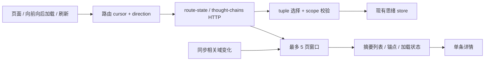
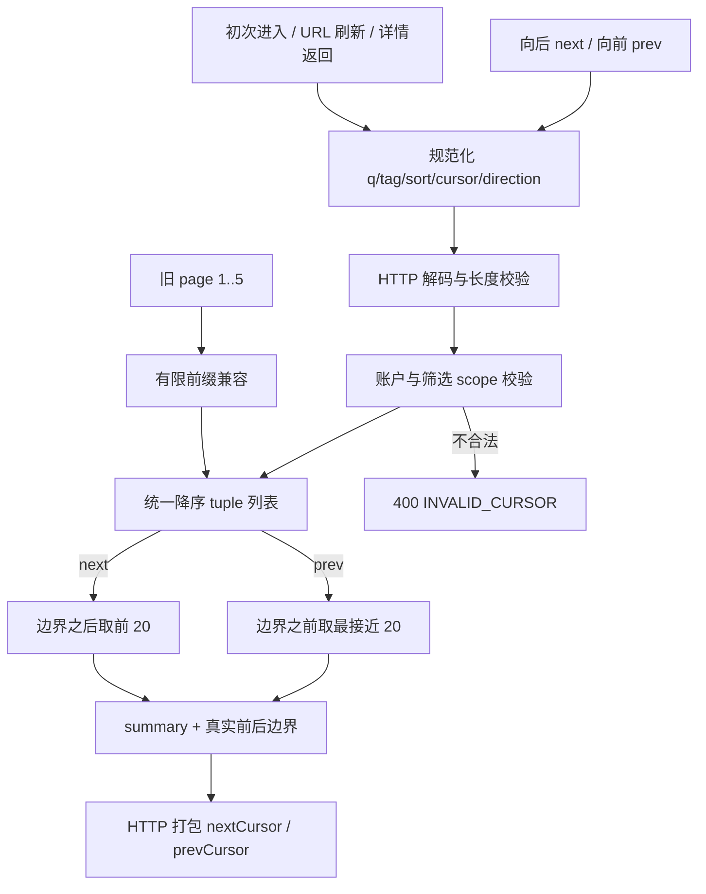
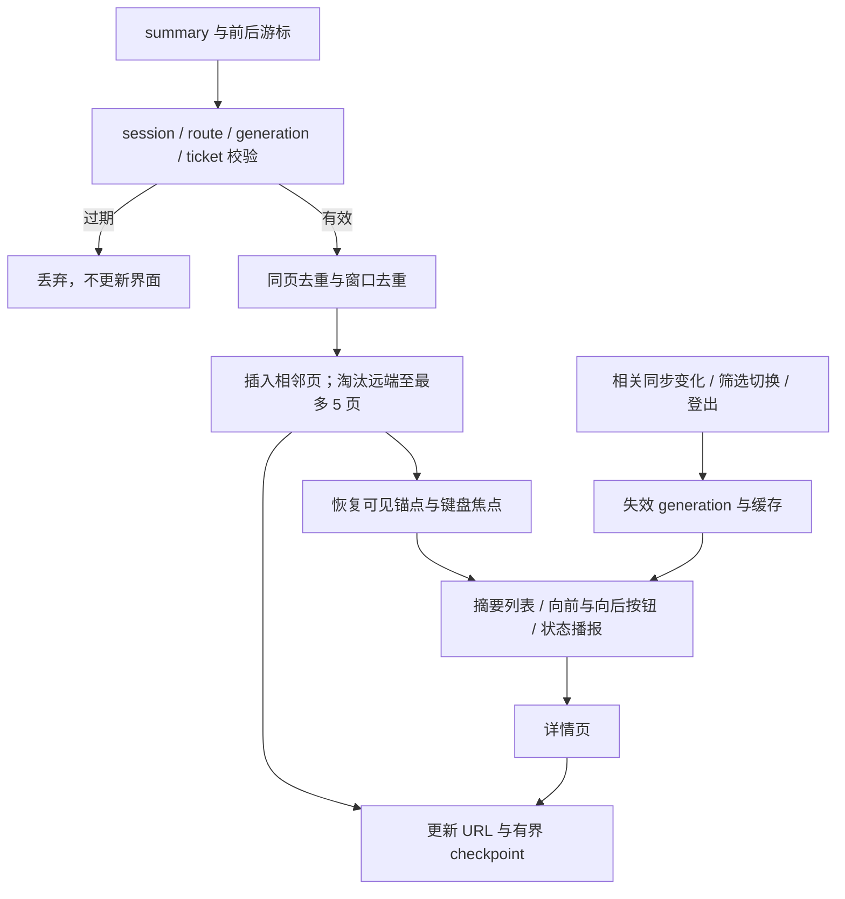

# F4 思绪完整游标分页技术方案

|文档信息|内容|
|---|---|
|需求来源|指定历史对话第 4 项；[工程审计](../audits/engineering-2026-10-14.md) F4|
|Owner / 协作角色|项目 Owner、思绪服务负责人、前端与测试负责人；具体人员待确认|
|状态 / 日期 / 版本|有前提的 Owner 评审稿 / 2026-10-15 / r2|
|版本计划|历史为 P2、v0.5.16，记录 `reczz28NLb1qxaIE`；未实时查询需求池|
|范围 / 规模|服务端双向游标、路由投影、前端有界窗口和历史定位；中等前后端联动|

## 评审摘要

推荐复用现有按时间和 ID 排序、带账户与筛选作用域的 v3 游标，新增可选向前翻页能力，删除“累计 100 条即到底”的业务限制。浏览器只保留相邻 5 页、每页 20 条摘要，继续向后加载时淘汰远端页面并保留可见位置；通过“加载较新内容”重新访问已淘汰部分。URL 保存当前页请求游标和方向，刷新直接取当前页，不再重放无限页前缀。

当前 API 是实时数据集，本方案保证静态数据完整遍历，动态修改通过失效提示与刷新处理，不承诺跨并发修改的冻结快照。F3 的数据库查询优化不是发布依赖；本期服务端全量过滤成本仍需观测。

|决策|推荐|替代与代价|负责角色|
|---|---|---|---|
|D1 浏览方式|有界 5 页窗口，支持向前/向后加载、保持位置|无限累加 DOM 更简单但内存持续增长；纯页码难稳定定位|Owner、前端|
|D2 动态数据语义|沿用实时列表；相关变更使窗口失效并提示刷新|冻结快照需持久化快照或版本读取，明显扩大范围|Owner|
|D3 旧 page URL|保留 page=1..5 的有限兼容，再规范化为游标模式|无限 page 前缀会重新引入无界读取|Owner、前端|

## 资料来源与前提

主代码基线 `de90dfe2421b01d30066131be44478773fd2da68`，读取日期 2026-10-15；`data-runtime.mjs` 工作区另有书摘乐观回滚改动，不属于本方案实施内容。

|编号|证据|支持事实|
|---|---|---|
|E1|[工程审计](../audits/engineering-2026-10-14.md)|历史 121 条假数据，第五页截为 100 且 nextId 为空，第六页仍为第五页；数据未删除|
|E2|[思绪领域模块](../../src/modules/thoughts/index.mjs)|稳定 tuple 排序、v3 cursor 作用域、过滤与 summary；领域层可继续取第 101 条|
|E3|[思绪 HTTP](../../src/http/thoughts.mjs)|每页上限 20、decoded cursor 上限 256、q 200/tag 30、v1 envelope|
|E4|[启动投影](../../src/app/startup-projections.mjs)、[startup HTTP](../../src/http/startup.mjs)|page≤5、前缀≤100、nextCursor 打包|
|E5|[前端 operations](../../public/frontend/features/thoughts/operations.mjs)、[page-catalog](../../public/frontend/page-catalog/index.mjs)|长度≥100 停止、slice(0,100)、页数上限及 query 白名单会丢弃 cursor|
|E6|[data-runtime](../../public/frontend/app/runtime/data-runtime.mjs)|路由数据 key、请求与旧响应保护；需纳入 cursor/direction|
|E7|指定历史对话（项目外部材料）|第 4 项与历史版本计划，已读取|

|前提|影响 / 核对方式|
|---|---|
|A1 保持实时分页，无冻结快照|静态遍历无重复无遗漏；并发修改需按 3.1.2 失效，不伪称强快照一致|
|A2 20×5 是缓存建议初值|页大小 20 与现有协议一致；5 页窗口可按目标设备性能校准|
|A3 服务端仍全读后过滤排序|不把 UI 修复称为数据库规模问题已解决；F3 独立推进|
|A4 当前未做本方案浏览器回归|所有用例和性能护栏均为计划，不能使用历史结果冒充通过|

## 需求追踪

|需求点|设计|接口 / 实体|验收|观测|
|---|---|---|---|---|
|R1 100 条之后可达|3.1.1、3.5|nextCursor、prevCursor|TC01、TC02|提前终止计数|
|R2 DOM 与缓存有界|3.1.2、3.6|`ThoughtPageWindow`|TC03、TC04|摘要/DOM 数量|
|R3 刷新、返回和筛选定位正确|3.4—3.6|`RouteCheckpoint`|TC05—TC08|恢复结果、旧响应丢弃|
|R4 游标隔离和兼容|3.5、3.8|v3 scope、旧 page URL|TC09—TC12|游标错误分类|

## 名词解释

|名词|解释|语境|
|---|---|---|
|游标 / cursor|服务端给出的翻页位置标记，描述当前数据边界，不等于第几页。|“以当前页首/页尾 tuple 生成边界游标。”（2.2.2）|
|tuple|用于稳定排序的一组值；这里由主排序时间、创建时间和 ID 共同决定顺序。|“现有 tuple 包含主排序时间、创建时间、ID，可以在边界记录删除后继续比较，因此无须依赖‘游标那一行必须仍存在’。”（2.1）|
|scope / 作用域|游标适用的账户和筛选条件；条件不同就不能沿用旧游标。|“v3 cursor 绑定账户与 q/tag/sort，可沿用防串页边界。”（2.1）|
|opaque cursor|前端只保存和传回、不解释内部结构的游标；不能自行拼接或当登录凭据。|“上下游均用 opaque cursor，不在前端解码、修改或根据页号计算 token。”（3.1）|
|next / prev|向较早/较新内容翻页；两种方向的结果仍保持相同展示排序。|“`next` 取边界之后的 20 条；`prev` 取边界之前且最接近边界的 20 条，输出仍是统一降序。”（2.2.2）|
|有界窗口 / DOM|窗口只缓存相邻几页；DOM 是浏览器实际渲染的页面节点，限制数量可控制内存和布局成本。|“只移除 operations 中一个判断仍会被投影或路由截断；只把 `slice(0,100)` 去掉则会持续增加 DOM 与内存。”（1.1）|
|summary / detail|列表只使用摘要；详情正文单独读取，避免每页携带全部内容。|“保留现有 summary/detail 分离，不把详情正文批量塞进列表；不改变思绪内容、标签与排序定义，也不设计按任意页号随机跳转。”（1.1）|
|generation / requestId|generation 标记当前页面数据代次，requestId 标记单次请求；旧请求返回时据此丢弃过期结果。|“每个请求绑定 session、routeKey、generation、requestId；回来时仍匹配才接受。”（2.2.2）|
|routeKey / session|routeKey 表示完整页面查询条件；session 表示当前登录上下文，用来隔离路由与账户缓存。|“每个请求绑定 session、routeKey、generation、requestId；回来时仍匹配才接受。”（2.2.2）|
|锚点 / checkpoint|锚点是当前可见条目和视口偏移；checkpoint 额外保存重取当前页所需的游标与方向。|“打开详情再返回，先恢复窗口缓存；缓存已释放时根据 URL 只取对应页并定位锚点。”（2.2.1）|
|LRU|优先淘汰最久未使用的位置记录，本方案最多保存 10 个 checkpoint。|“当前账户最多保存 10 个路由位置，LRU；只保存位置不保存正文”（3.1.1.1）|
|实时列表 / 冻结快照|实时列表每次读取当前数据；冻结快照则要求多次翻页始终看同一历史版本，本期不提供后者。|“动态数据不提供冻结快照，变化失效由 generation 管理；边界删除可继续，重排需要刷新以重新建立连续窗口。”（3.8.2）|
|envelope / optional|envelope 是统一响应外层；optional 表示新增字段可缺省，兼容旧调用方。|“`GET /api/v1/thought-chains` 沿用 Cookie 鉴权和 v1 envelope。”（3.5）|

## 评审记录

r1：初始评审稿。r2（2026-10-15）：增加名词解释与读请求/前端状态的事务陈述，展开 JSON 和嵌套实体字段，伪代码改为 Python 语法。实时分页、5 页窗口和旧 URL 待决项保留；整稿待 Owner 评审。

# 1. 项目背景

## 1.1 背景（必填）

思绪长时间积累后，用户需要回看超过前 100 条的历史记录。现有领域分页可继续，但启动投影、前端累计列表和路由页数分别设置了上限，导致界面误判“已到底”。只移除 operations 中一个判断仍会被投影或路由截断；只把 `slice(0,100)` 去掉则会持续增加 DOM 与内存。

本期解决历史可达性、前端容量和路由恢复。保留现有 summary/detail 分离，不把详情正文批量塞进列表；不改变思绪内容、标签与排序定义，也不设计按任意页号随机跳转。

## 1.2 目标（必填）

|目标|基线|目标 / 统计方式|
|---|---|---|
|完整历史可达|历史 121 条仅显示 100|静态 121/1001 条遍历全部唯一 ID，末页才无 nextCursor|
|窗口有界|现有硬限 100，同时截断历史|最多 5 页、100 条摘要；实际 DOM 卡片≤100；详情缓存独立|
|浏览定位|路由 page≤5|刷新及详情返回恢复当前页和可用锚点；静态场景位置误差建议≤24px|
|筛选与账户隔离|已有 query/tag/sort 作用域|切筛选/账户后旧响应不写入，新游标不能跨作用域使用|
|性能护栏|本次基线未测|建议目标设备交互 p95 不较基线回退 >10%；服务端查询耗时独立报告|

# 2. 总体方案设计

## 2.1 前期调研

现有 tuple 包含主排序时间、创建时间、ID，可以在边界记录删除后继续比较，因此无须依赖‘游标那一行必须仍存在’。v3 cursor 绑定账户与 q/tag/sort，可沿用防串页边界。现有 `page-catalog` 不仅限制页数，还只保留 q/tag/sort/page；必须添加 cursor/direction，否则 URL 恢复会悄悄退回首页。

## 2.2 系统架构

|系统 / 角色|职责 / 本次变更|
|---|---|
|C 端思绪界面|有界相邻页、双向加载、滚动锚点、无障碍状态|
|路由目录 / 数据 runtime|保留 cursor/direction，纳入缓存 key 与请求 generation|
|启动投影 / HTTP|游标直接取一页；有限兼容旧 page 前缀|
|思绪领域模块|复用排序与作用域，新增 prev 方向选择|
|存储|保持内容和旧数据结构；仍现有全量读取|
|后台 / AI|内容变化沿用同步通知，可使窗口失效；模型协议不变|
|审核服务端 / 审核前端|不参与当前列表链路，不适用|



### 2.2.1 业务新流程

用户点击“加载更早内容”可以越过 100 条。窗口满后淘汰距离可见位置最远的一页，保留当前锚点；顶部有更多内容时显示“加载较新内容”。打开详情再返回，先恢复窗口缓存；缓存已释放时根据 URL 只取对应页并定位锚点。网络失败保留已有列表与重试按钮。

### 2.2.2 技术新流程

以当前页首/页尾 tuple 生成边界游标。`next` 取边界之后的 20 条；`prev` 取边界之前且最接近边界的 20 条，输出仍是统一降序。响应分别提供可选 prevCursor 和既有 nextCursor。

前端维护相邻页数组，不维护从首页到当前页的无限游标历史。每个请求绑定 session、routeKey、generation、requestId；回来时仍匹配才接受。添加页、去重、淘汰、锚点恢复作为一次状态更新，最后根据后端边界决定按钮，不用累计条数推断结束。

## 2.3 可选方案对比

|方案|可达性 / 性能|兼容成本|结论|
|---|---|---|---|
|简单移除 100 限制、无限追加|可达，DOM/内存随历史增长|小改但长期不稳定|不推荐|
|纯单页前后翻|容量最小，滚动连续性较弱|需改变现有“继续加载”体验|可作为窗口体验不达标时替代|
|双向游标 + 5 页窗口|历史可达、内存有界、保留连续浏览|需锚点、路由与 prev 协议|推荐|
|冻结快照 / 任意页码|能定义跨修改稳定视图或跳页|新存储/快照成本，超出问题范围|本期不做|

# 3. 详细方案设计

## 3.1 详细设计（必填）

100 是建议窗口容量，不是历史总量上限。窗口内必须有连续页序，不能随机删除中间页后继续拼接。上下游均用 opaque cursor，不在前端解码、修改或根据页号计算 token。

### 3.1.1 生产链路

|入口|输入|处理 / 输出|
|---|---|---|
|初次进入|q/tag/sort，无 cursor|默认 next，首 20 条|
|加载更早 / 较新|末页 nextCursor / 首页 prevCursor|服务端按 tuple 方向选择|
|URL 刷新、浏览器前后退|cursor、direction、同一筛选|直接单页查询，不累计前缀|
|旧 URL|page=1..5|保留最多 100 条兼容前缀并产生真实继续游标|
|详情返回|owner-scoped checkpoint + URL|有缓存恢复；无缓存读当前页|
|筛选变化、切账户、相关同步变化|新 generation|取消旧请求、清理或标失效，不混合不同快照|



|处理动作|原所在事务|本次事务|事务粒度|事务内新增逻辑|事务外与提交后|
|---|---|---|---|---|---|
|领域列表与 HTTP 分页|E2/E3：现有仓储读取后过滤排序，不写业务数据|无新增写事务，复用既有读取；本次响应使用同一次读取结果|当前账户一次页查询的读取副本；不跨多个翻页请求保持数据库快照或写锁|无持久化新增逻辑；对读取副本校验 scope、选择方向及生成边界|鉴权/入参校验在读取前；在同一副本上生成 items、tags、next/prev，再打包响应；读取失败不改库|
|route-state 与旧 page 兼容|E4：启动投影读取并拼接有限前缀，无分页写事务|无新事务，cursor 入口只取一页；旧 page 保留有限前缀|一次账户路由投影，仍最多兼容 5 页；不引入跨请求长事务|无；只改变读投影和游标包装|成功后发投影；失败不返回伪空账户，前端保留已有视图；跨请求并发变化按实时语义处理|
|翻页/刷新/详情返回请求|无；浏览器网络请求不属于数据库事务|无数据库事务，创建带账户/路由/代次的请求 ticket|当前页面每方向最多一条在途请求|无持久化写入|返回后再校验 ticket；过期丢弃，不因请求发出就提前淘汰当前页|

#### 3.1.1.1 处理阶段与新增配置

拟新增客户端发布配置 `thoughtPaging`。服务端页大小沿用 20；这些初值中 maxPages 与开关为建议，decoded cursor 256 为现有边界。为避免多份配置漂移，公共分页常量由构建产物同时导入，客户端输入仍由服务端校验。

|键|类型 / 初值|作用与生效|
|---|---|---|
|`enabled`|boolean / false|控制新窗口 UI；刷新生效；关后使用旧 UI 并提示历史浏览功能不可用|
|`pageSize`|integer / 20|与服务端 maxLimit 对齐，本期不可单端修改|
|`maxPages`|integer / 5|内存窗口上限；每次更新立即淘汰远端页|
|`maxCursorDecodedLength`|integer / 256|沿用 v1 解码校验；不是编码后 token 长度|
|`maxCheckpoints`|integer / 10|当前账户最多保存 10 个路由位置，LRU；只保存位置不保存正文|

```json
{
  "thoughtPaging": {
    "enabled": false,
    "pageSize": 20,
    "maxPages": 5,
    "maxCursorDecodedLength": 256,
    "maxCheckpoints": 10
  }
}
```

服务端 prev 为 additive 能力，部署即接受；回退客户端不要求撤掉它。前端开启必须确认服务端已支持 prevCursor，缺字段时采用明确兼容提示，不能淘汰页面后让用户无法返回。

#### 3.1.1.2 接口与数据处理

领域层仍返回内部 `nextId`，新增 optional `prevId`；HTTP 统一编码为 `meta.nextCursor`、`meta.prevCursor`。route-state 的 `thoughtPage` 同样转换两个字段，删除内部 Id 字段。首次无边界 prev 请求视为输入错误，不能反向返回任意末页。

旧 page=1..5 可在一次请求中返回最多 page×20 的前缀，并保留末页真实 nextCursor；前端将它拆成窗口页并规范化后续路由。page>5 返回 `400 LEGACY_PAGE_UNSUPPORTED`，引导从游标入口继续，不能偷偷截到第 5 页。新 cursor 与旧 page 同时出现时返回 400，避免两种定位含义冲突。

### 3.1.2 消费链路



|处理动作|原所在事务|本次事务|事务粒度|事务内新增逻辑|事务外与提交后|
|---|---|---|---|---|---|
|窗口响应合并|E5/E6：前端列表与请求状态更新，无数据库事务|无数据库事务；将去重、边缘插入、淘汰作为一次同步内存状态提交|一个 ownerKey/routeKey/generation 下的窗口；提交段不跨 await|无 DB 写；在候选副本上复验 ticket、保证页序和容量后一次发布|网络请求在前；DOM 布局、锚点与焦点恢复在状态提交后；处理失败不发布半窗口|
|URL 与 checkpoint|原页面路由与浏览器历史状态，无数据库事务|无跨 URL/sessionStorage 原子事务，按可重建的位置更新|当前账户最多 10 个位置，不存正文|无 DB 写；checkpoint 写入失败不撤回业务读取|窗口提交后更新 URL，再尽力保存位置；存储失败时仍可从 URL 重取当前页|
|同步变化/退出/切账户|原失效与旧响应保护，无持久化事务|无，先同步递增 generation 并隔离旧状态|当前会话/筛选的全部在途 ticket 和缓存|无；停止接受旧代次结果，不与服务端内容更新组成总事务|取消请求、标过期或清缓存；旧 finally 只清对应 ticket，不覆盖新页面状态|

#### 3.1.2.1 消费入口

|消费面|行为 / 兼容|用例|
|---|---|---|
|思绪 operations / controller / view|删除累计 100、page≤5 停止条件；按真实游标判断|TC01—TC04|
|page-catalog / queryString|保留 cursor/direction，纳入 route key；旧 page 只用于兼容入口|TC05、TC09|
|data runtime|路由 key 和 generation 包含完整筛选/游标/方向|TC06、TC07|
|详情和浏览器历史|保存页请求边界与锚点；不存完整历史正文|TC05、TC08|
|旧客户端|忽略 prevCursor，原 next 协议继续可用；旧端自身 100 限制需升级才能解除|TC10|
|同步事件|相关思绪/标签/排序字段变更使窗口失效|TC11|

#### 3.1.2.2 协议、打包与改动边界

实时数据语义：静态数据按游标单向遍历恰好一次；新插入在当前边界之前的记录不自动拼入当前窗口，刷新后出现。改变排序键、删除、标签或搜索匹配可能影响已加载页；收到相关同步变化时递增 generation、取消在途分页，保留当前视图为过期状态并提示刷新，停止继续拼接直到刷新完成。

即使同步通知延迟，窗口按 ID 去重也不能保证跨变更数据集全局无遗漏；该限制写入验收定义。边界行被删除仍以 cursor tuple 比较，不能因找不到 ID 就返回首页。空响应与 next/prev 元数据必须一致；若服务器产生“同游标无进展”，客户端停止该方向重试并报可恢复错误，避免无限请求。

#### 3.1.2.3 消费验收

超过 100 条后能继续到第 121/1001 条；淘汰首部后可向前取回；最后一页才无 next。筛选切换和退出登录后旧响应不得渲染。网络失败保留数据，屏幕阅读器能感知加载和错误，键盘焦点不会落到已删除节点。

## 3.2 外部依赖

### 3.2.1 依赖方与诉求

|依赖方|交付与条件|顺序 / 失败处置|
|---|---|---|
|思绪服务端|prev 选择、统一 scope、route-state 游标能力|先于新 UI；失败保持已有页|
|前端路由 / runtime|query 白名单、routeKey、checkpoint、session 清理|与思绪 UI 同批；不能只改局部 operations|
|浏览器平台|滚动定位、AbortController、历史状态|目标桌面/移动浏览器回归；焦点与锚点有 fallback|
|同步模块|既有相关域通知，用于失效|通知丢失不破坏账户隔离，实时遍历限制明确|
|存储 / F3|继续现有 read/filter 能力|F3 不是前置依赖；慢查询独立跟踪|

审核与 AI 服务无新协议。既有 API 扩展方向参数和 prevCursor 均 optional，默认 next；旧读写者不要求迁移。

## 3.3 异常处理（必填）

|异常点|策略 / 重试|用户侧与状态|
|---|---|---|
|游标损坏、超长、账户/筛选不匹配|400 INVALID_CURSOR；不自动复用旧 cursor|保留现有视图，提示重新加载|
|方向非法、prev 无 cursor、page/cursor 冲突|400 INVALID_QUERY|不悄悄改成首页|
|网络失败 / 503|按钮允许显式重试同请求|原窗口和锚点不丢失|
|筛选 / 路由 / session 变化|abort 并递增 generation，忽略晚到响应|新视图不会混入旧账户内容|
|重复点击 / 相同方向并发|同 generation 每方向至多一个请求；合并或忽略|不重复插页、重复扣页数|
|边界记录删除|使用 tuple，不依赖行存在|继续取后续记录|
|相关同步变更|窗口标过期，停止继续拼接，刷新新 generation|不自动跳动当前阅读位置|
|空页 / 不前进 cursor|空页检查真实边界；重复 cursor 作为协议错误停止|无无限轮询；可刷新恢复|
|刷新锚点已删除|定位当前页最邻近条目，找不到则页首|提示内容已变化，不伪造旧位置|

## 3.4 数据实体（必填）

无持久化业务数据修改。拟新增客户端结构：

```ts
type ThoughtPage = {
  requestCursor: string;
  direction: "next" | "prev";
  items: ThoughtSummary[];
  nextCursor: string;
  prevCursor: string;
};
type ThoughtPageWindow = {
  ownerKey: string;
  routeKey: string;
  generation: number;
  pages: ThoughtPage[];
  stale: boolean;
  pending: {
    next?: string;
    prev?: string;
  };
};
type RouteCheckpoint = {
  ownerKey: string;
  filterKey: string;
  cursor: string;
  direction: "next" | "prev";
  anchorId: string | null;
  offsetPx: number;
  savedAt: number;
};
```

|字段 / 实体|约束 / 事实源|生命周期 / 兼容|
|---|---|---|
|`items`|沿用领域 summary，无详情正文；页内 ID 唯一|内存最多 100 条；淘汰即释放引用|
|`requestCursor` / `direction`|能重新请求该页的输入；不等同于响应 nextCursor|与页一起缓存，刷新使用 URL|
|`nextCursor` / `prevCursor`|服务端产生，客户端不解码|未知 prev 字段时不能启用完整窗口淘汰|
|`ownerKey` / `generation`|当前登录 session 的身份与失效计数|登出、切账户、筛选变化清理|
|`RouteCheckpoint`|客户端可见页锚点；最多 10 条 LRU|session 级存储；不持久化正文；退出清除|
|v3 cursor|现有 tuple + account/query/tag/sort scope|格式保持，direction 不进入业务 tuple|

规范位置示例，时间仅用于 fixture，不代表实际观测：

```json
{
  "ownerKey": "fixture-owner-a",
  "filterKey": "occurred:q=:tag=",
  "cursor": "",
  "direction": "next",
  "anchorId": "thought-fixture-7",
  "offsetPx": 12,
  "savedAt": 1792022400000
}
```

## 3.5 接口定义（必填）

`GET /api/v1/thought-chains` 沿用 Cookie 鉴权和 v1 envelope。参数：`cursor?:string`、`limit?:integer=20≤20`、`q?:string≤200`、`tag?:string≤30`、`sort?:occurred|created`，拟新增 `direction?:next|prev=next`。cursor 解码上限 256，复用 v1 校验；不是把编码后字符长度错当 decoded 长度。

成功示意（保留现有 `data/error/meta` envelope；省略未变化的公共 meta 和摘要字段）：

```json
{
  "data": [
    {
      "id": "thought-fixture-101"
    }
  ],
  "error": null,
  "meta": {
    "nextCursor": "opaque-next-token",
    "prevCursor": "opaque-prev-token",
    "tags": []
  }
}
```

示意 token 不是可执行游标，fixture 使用真实编码器生成。新增 `meta.prevCursor` optional，空字符串表示无较新页；nextCursor 沿用原空值语义。`GET /api/v1/route-state?view=thoughts` 同样接受 cursor/direction，返回 `thoughtPage.nextCursor/prevCursor`，旧 page 兼容见 3.1.1.2。详情 `GET /api/v1/thought-chains/:id` 不改。

错误沿用 401/503，游标 400 INVALID_CURSOR，非法组合 400 INVALID_QUERY，旧 page>5 为 400 LEGACY_PAGE_UNSUPPORTED。GET 无写入幂等键，可重试相同参数；实时数据可能变化，不能声称重试返回字节级相同内容。请求取消沿用现有 transport 超时预算，本方案不增加自动重试放大。

内部 `listChains({afterId,direction,query,tag,sort,limit})` 新增 direction optional，输出 `{items,nextId,prevId,tags}`；prevId optional。客户端和 route-state 必须只消费经 HTTP 编码的游标。

## 3.6 代码设计

### 3.6.1 代码落点

|文件 / 模块|改造点|
|---|---|
|`src/modules/thoughts/index.mjs`|复用 tuple 与 scope；新增反向页选择及边界|
|`src/http/thoughts.mjs`、`src/http/startup.mjs`|方向校验、游标解码、prevId 转 prevCursor|
|`src/app/startup-projections.mjs`|直接游标单页查询；有限旧 page 兼容，真实继续游标|
|`public/frontend/features/thoughts/operations.mjs`|有界窗口、请求 ticket、双向加载、删除结束硬限|
|思绪 controller / view 模块|绑定前后加载与无障碍状态、锚点/焦点处理|
|`public/frontend/page-catalog/index.mjs`|query 白名单与序列化扩展，不丢 cursor/direction|
|`public/frontend/app/runtime/data-runtime.mjs`|路由 key、请求 generation、checkpoint 接入；实施时保留工作区已有其他改动|

### 3.6.2 核心伪代码

```python
async def listPage(input, account):
    cursor = decodeAndValidateScope(
        input.cursor, account, input.q, input.tag, input.sort
    )
    store = await readAccountStore(account)  # 原读取，无新增写事务
    rows = filterAndSortByExistingCanonicalTuple(store.thoughts, input)
    if input.direction == "next":
        candidates = rowsAfter(rows, cursor.tuple) if cursor else rows
        items = candidates[:input.limit]
    else:
        if cursor is None:
            raise InvalidQuery()
        candidates = rowsBefore(rows, cursor.tuple)
        items = candidates[-input.limit:]  # 最接近边界，仍为统一降序
    next_id, prev_id = encodeActualBoundaries(rows, items, cursor)
    # 空页也根据同一读取副本判断边界，不访问不存在的首/尾元素
    return Page(summaries(items), next_id, prev_id, tagsFrom(rows))


async def loadAdjacent(direction):
    snapshot = captureOwnerRouteGeneration()
    cursor = edgeCursor(window, direction)
    if not cursor or pending(direction) or window.stale:
        return
    ticket = beginRequest(direction, snapshot)
    try:
        page = await fetchPage(cursor, direction, ticket.signal)
        if not stillCurrent(snapshot, ticket):
            return
        requireCursorProgress(cursor, page)
        anchor = captureVisibleAnchorAndFocus()
        draft = cloneWindow(window)
        page.items = dedupeAgainstWindow(page.items, draft)
        insertAtWindowEdge(draft, page, direction)
        while len(draft.pages) > maxPages:
            evictFarEdgeFromVisibleAnchor(draft, anchor)
        publishWindow(draft)  # 合并到发布之间无 await，一次内存状态提交
        await restoreAnchorAndFocusAfterLayout(anchor)
        if stillCurrent(snapshot, ticket):
            replaceCurrentRouteCheckpointForVisiblePage()
    except Exception as error:
        if stillCurrent(snapshot, ticket):
            showRetryWithoutDroppingWindow(error)
    finally:
        finishOnlyMatchingTicket(ticket)
```

#### 3.6.2.1 关键动作实现细节

|函数|输入 → 输出|复用 / 不直接复用|
|---|---|---|
|`decodeAndValidateScope`|游标和筛选 → tuple|复用 v3 scope，不能只检查 ID 存在|
|`evictFarEdgeFromVisibleAnchor`|窗口 / 可见条目 → 连续≤5页|保护锚点所在页；不能删除窗口中间页|
|`restoreAnchorAndFocusAfterLayout`|ID 与相对视口偏移 → scroll 修正|布局前后测矩形差；不按预估固定卡片高度|
|`replaceCurrentRouteCheckpointForVisiblePage`|页请求与锚点 → URL / LRU|用 replaceState 更新当前滚动位置；不对每页产生无穷 history 状态副本|
|`finishOnlyMatchingTicket`|ticket → 清 pending|旧请求 finally 不得清除新请求的加载状态|

若窗口去重后没有新条目但服务端游标确有推进，可接受空摘要页作为临时边界，但不得自动无限追页；由下一次用户操作继续。实现可丢弃空页并更新边缘游标，必须保留相邻关系和最多 5 页的不变量。动态数据发生明显不连续时优先标失效并刷新。

### 3.6.3 关键实现约束

1. 只由真实服务端游标决定到头/到底，不用 length=100 或 page=5（TC01）。
2. 服务端 prev 仍返回统一降序，静态 next/prev 可逆（TC02）。
3. 每次状态提交后缓存和 DOM≤100 条摘要，页数≤5（TC03）。
4. 请求必须匹配账户、路由、generation、ticket；旧 finally 不清新状态（TC06、TC07）。
5. URL 和 checkpoint 不存正文，退出清理 owner-scoped 缓存（TC07）。
6. 当前可见锚点与焦点不能被淘汰；图片等异步高度变化需二次位置校正或固定布局占位尺寸（TC04、TC08）。

## 3.7 监控告警（必填）

拟新增思绪分页看板；不以账户 ID、搜索词、游标或内容做标签。

|指标|口径 / 维度|建议门槛与动作|
|---|---|---|
|`thought_pagination_request_total`|direction/result；含第 100 条以后请求数|识别提前结束；确定性 fixture 必须全部可达|
|`thought_window_items/pages`|页面状态提交后的数量|>100 / >5 任一次阻止发布|
|`thought_cursor_no_progress_total`|输入与边界重复且无新增内容|有即检查协议与动态失效，不自动循环|
|`thought_page_latency_ms`|服务端查询与浏览器呈现分别 p95|同负载 p95 回退 >10%，≥100 请求则暂停扩量|
|`thought_restore_result`|exact/nearest/top/failed|静态场景 exact，偏移建议≤24px；动态回退单列|
|`thought_stale_response_dropped_total`|按 session/route/generation 原因|丢弃是保护行为；已渲染旧账户响应任何一次 P1|

## 3.8 稳定性

### 3.8.1 容量与性能

列表摘要内存上界约 `20×5×单摘要字节`，另有最多两条在途请求及 10 个轻量 checkpoint；处理响应后释放已淘汰页面引用。每个方向一个请求，不能在快速点击中排无界队列。详情缓存沿用既有策略，与摘要计数分开量测。

当前服务端列表读取 O(N)、排序约 O(N log N)，每页返回≤20；分页可达性修复不会自动降低该计算。用 1001 条及更大脱敏 fixture 量测，超阈值作为 F3/领域查询优化输入，不扩大客户端窗口掩盖服务端耗时。

### 3.8.2 一致性与幂等

业务数据不写入，GET 重试无副作用；窗口更新按 ticket 唯一接受一次。游标作用域涵盖账户、q/tag/sort，时间并列用 ID 稳定比较。动态数据不提供冻结快照，变化失效由 generation 管理；边界删除可继续，重排需要刷新以重新建立连续窗口。

### 3.8.3 降级与回滚

服务端故障保留当前窗口并提供重试，不清空显示。关闭客户端新窗口时清除分页请求和 checkpoint，仅保留可解释的首页状态；若退回旧 UI，历史 100 条限制可能重新出现，必须在回滚记录中说明。服务端 additive 字段可以保留，不影响旧客户端。

### 3.8.4 安全与日志

游标虽 opaque 但不是授权凭据，每次请求仍需账户鉴权和 scope 校验。URL 只含既有筛选和 opaque token，不增加正文；不得把游标或搜索词写入监控。账户切换清理 sessionStorage 对应 checkpoint、内存 pages、详情回跳上下文和在途控制器。

## 3.9 实验方案

### 3.9.1 开关与灰度

先部署服务端双向能力，再启用新 UI。以发布版本和 Owner 测试账户验证，不同时对一个页面混用无限累计与窗口状态。开关关闭发生在刷新/重新进入时，先 abort 当前请求，防止旧响应复活窗口。

### 3.9.2 核心验收指标

121/1001 条静态数据完整唯一可达为硬门槛；100 条摘要上限、作用域隔离、刷新恢复为硬门槛。位置误差 24px 与性能 10% 为建议门槛，目标设备测量后确认。并发修改场景按实时语义验证，不混入静态完整性断言。

### 3.9.3 效果观测

建议前后各 24 小时观察分页请求、错误、历史访问和恢复结果；不以较少分页请求证明“用户已找到内容”。低流量主要依赖浏览器 fixtures 的确定性验证，真实用户行为用于补充体验评估。

# 4. 开发测试

## 4.1 开发明细（必填；评审时留空，开发结束后填写）

## 4.2 测试方案（必填）

计划覆盖思绪服务、启动投影、前端功能、URL 历史与 UI 回归。现有 `scripts/ui-regression.mjs` 有工作区改动，实施时须合并保留，不直接覆盖。

|用例|操作 / fixture|预期|
|---|---|---|
|TC01 / R1|0/1/20/21/100/101/121/1001 条，逐页 next|静态所有 ID 恰好一次；仅末页无 next|
|TC02 / R1|到第 6 页后逐页 prev；大量相同时间|统一排序，前后可逆，不依赖时间唯一|
|TC03 / R2|连续浏览 1001 条，记录 DOM、pages、heap 引用|≤5 页/100 摘要；淘汰引用释放，无无限游标历史|
|TC04 / R2|窗口满时追加/前插，图片异步加载，键盘焦点在锚点|视口不明显跳动；焦点保留或合理转移|
|TC05 / R3|第 6 页以后刷新、浏览器前后退|URL cursor/direction 保留，直接取当前页而非前缀|
|TC06 / R3|请求 A 延迟，切 q/tag/sort 发 B，再返回 A|A 丢弃；A finally 不清 B loading|
|TC07 / R3|退出/切账户时有在途请求，重新登录|无跨账户摘要或 checkpoint 残留；游标跨账户 400|
|TC08 / R3|详情返回有/无缓存，锚点已删|静态恢复建议≤24px；删除时合理 fallback|
|TC09 / R4|旧 page1..5、page6、page+cursor|有限兼容且真实 next；非法组合明确 400|
|TC10 / R4|旧客户端、新服务端；新 UI 缺 prev 能力|旧端可用；新 UI 不进行不可返回的淘汰|
|TC11 / 动态|边界删除、插入较新项、修改排序键、相关同步到达|tuple 继续或窗口失效，符合实时语义，不假承诺固定快照|
|TC12 / 异常|超长/损坏游标、非法方向、网络失败、同游标无进展|明确错误；原数据保留，无无限重试|
|TC13 / 回滚|在途请求时关开关，前后端分别回退|旧响应无效；协议兼容；已知历史限制明确|

### 4.2.1 Mock测试方案

固定 seed 生成思绪 ID、相同时间戳、标签与少量详情，使用正式 cursor 编解码器。Mock transport 控制响应乱序、超时和错误，但保留真实路由 key、窗口与 DOM。随后用真实服务端和浏览器验证 121/1001 条完整遍历及移动设备滚动；Mock 不能证明真实分页接口的排序和性能。

# 5. 上线方案

## 5.1 上线CheckList（必填）

- [ ] 上线前：服务端 next/prev、route-state、旧 URL 契约与静态遍历测试通过。
- [ ] 上线前：前端四处截断/丢参路径均已处理，100 条窗口与作用域隔离已验证。
- [ ] 上线前：详情返回、刷新、键盘和移动浏览器定位证据齐备。
- [ ] 上线中：先服务端再 UI，确认 prev 能力和配置一致。
- [ ] 上线后：观测历史访问、无进展游标、恢复与错误率，核对回滚入口。

## 5.2 上线依赖

|顺序|动作 / 角色|兼容条件|
|---|---|---|
|1|服务端部署 optional direction/prevCursor 和 route-state 游标读取|旧端忽略新字段|
|2|前端同时部署 catalog、runtime、controller、operations、view|默认不开新窗口，静态资源版本一致|
|3|Owner 测试账户启用新 UI|TC01—TC13 证据和服务端能力齐备|
|4|发布配置全量开启|新旧前端过渡期服务端同时支持两种入口|

## 5.3 观测方案

前端负责人在开启后 30 分钟验证第 101 条之后可达、向前取回、刷新和详情返回；随后 24 小时观察 3.7 指标。跨账户渲染和无限请求任何一次立即停用新 UI；性能护栏超阈值暂停扩量。服务端慢查询与客户端 DOM 成本分别归因。

## 5.4 回滚方案

|对象|步骤|状态与数据|
|---|---|---|
|UI / 配置|关闭 enabled，abort 请求、递增 generation、清窗口和位置缓存，刷新到可解释入口|无业务数据回滚；旧 UI 可能恢复 100 条限制|
|服务端代码|优先保留 additive 协议；必须回退时先回退 UI|新 UI 不能依赖不存在的 prev；原 cursor 格式未变|
|缓存 / 路由|清当前账户 checkpoint；失效 URL 提供回首页入口|不删除思绪内容、不恢复旧 store|

## 5.5 放量计划

|阶段|范围|建议停留 / 样本|继续条件|
|---|---|---|---|
|浏览器验证|桌面与移动测试环境，121/1001 fixtures|TC 全覆盖，至少两次往返遍历|静态完整、有界、定位正确|
|Owner 试用|指定账户新 UI|24 小时并完成超过 100 条浏览|无作用域、无进展和滚动阻断问题|
|全量开启|发布配置控制的新前端|24 小时，≥100 分页请求不足则延长|3.7 护栏稳定；Owner 确认体验|

## 2026-10-16 集成修订

本方案唯一拥有阅读窗口、路由和分页状态；F7在此状态上补充展开与交互代数，F6/F8只消费。data-runtime先完成窗口接入，再交F9局部同步；不得将未加载条目判为删除。

共享接口责任、互斥写集和顺序统一见[版本级集成设计第7节](版本级集成设计与协同执行说明.md#7-v0516-九项方案的集成约定)。本修订仅为设计；未实施、未取得性能验收。
