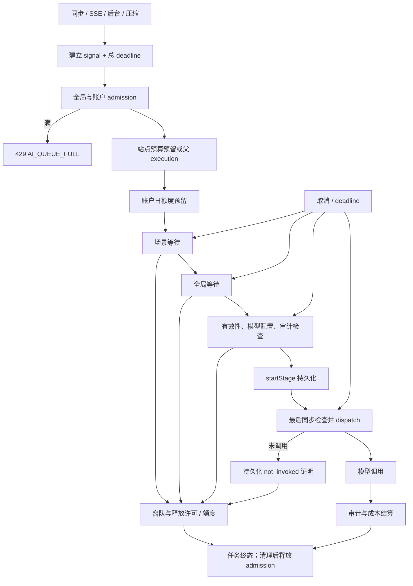
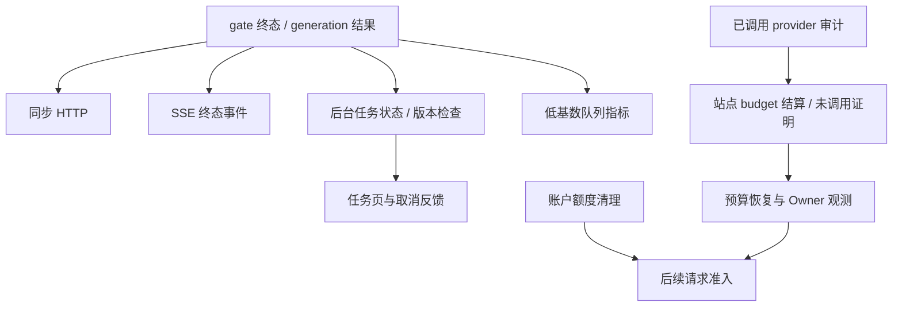

# F5 AI 排队取消与超时技术方案

|文档信息|内容|
|---|---|
|需求来源|指定历史对话第 5 项；[工程审计](../audits/engineering-2026-10-14.md) F5|
|Owner / 协作角色|项目 Owner、AI 运行时负责人、预算与任务负责人、前端与测试负责人；具体人员待确认|
|状态 / 日期 / 版本|有前提的 Owner 评审稿 / 2026-10-15 / r2|
|版本计划|历史为 P2、v0.5.16，记录 `reczz28NLb1qxhIC`；未实时查询需求池|
|范围 / 规模|容量队列取消/超时、有界准入、派发前复查、两层配额结算；跨并发、AI 与预算的中等改造|

## 评审摘要

推荐为容量 gate 增加兼容的 `acquire({signal,deadline})`，让等待者在取消或到期时自行离队，不依赖占用者归还许可。AI 入口增加全局和账户在途上限，场景 gate 与全局 gate 共用同一个排队截止时间；在每次异步准备后、真正调用模型之前重新检查取消和有效性。

同时处理账户日额度与站点预算两层预留。排队取消没有模型调用，必须归还两层预留；若 `startStage` 已落库而模型尚未调用，由运行时持久化“未调用证明”后释放。崩溃或结果不明时保持保守结算，不能因用户点击取消就假定第三方未计费。

|决策|推荐|替代与代价|负责角色|
|---|---|---|---|
|D1 队列初值|全局在途 64、每账户 8、共用排队预算 30 秒，实测校准|更大队列提高等待和预留占用；更小队列更易拒绝|Owner、AI 负责人|
|D2 未调用证明范围|纳入预算 runtime 与恢复读取，覆盖 startStage 后取消窗口|只修 gate 无法可靠释放该窗口预留|Owner、预算负责人|
|D3 其他媒体调用方|兼容无参数 acquire，本期验证回归；不自动宣称都支持取消|同步迁移 ASR/视觉/语音/媒体需逐一评审预算和取消语义|Owner|

## 资料来源与前提

代码基线 `de90dfe2421b01d30066131be44478773fd2da68`，读取日期 2026-10-15。本次未调用付费模型或重跑历史复现。

|编号|证据|支持事实|
|---|---|---|
|E1|[工程审计](../audits/engineering-2026-10-14.md)|历史独占 gate 时，取消后 80ms、20ms 超时后 90ms 仍等待；释放占用者后才继续|
|E2|[并发 gate](../../src/shared/concurrency/index.mjs)|pending 只存 resolve；无取消、deadline 与等待上限|
|E3|[AI generation](../../src/modules/ai/generation.mjs)|场景/全局 acquire 无 signal；budget.startStage 后才进入 provider callback；默认请求超时 300 秒|
|E4|[AI runtime](../../src/app/ai-runtime.mjs)、[配置](../../src/config/index.mjs)|全局 QPS/并发默认 20/20，压缩场景并发 1；generic gate 还有其他媒体消费者|
|E5|[AI budget runtime](../../src/app/ai-budget-runtime.mjs)、[预算模块](../../src/modules/ai/budget.mjs)|站点 reserve/start/settle/release；startedAt 阶段不能 release；旧 normalizer 显式列字段|
|E6|[AI usage](../../src/modules/ai/usage.mjs)、[background-ai](../../src/app/background-ai.mjs)|账户日额度在内存预留；取消先持久化 cancelled 再 abort controller|
|E7|指定历史对话（项目外部材料）|第 5 项与历史版本计划；历史 transport 观察不能证明真实外部付费请求发生|

|前提|核对 / 影响|
|---|---|
|A1 保持单实例|内存队列、账户上限和未调用证明的执行者唯一性依赖当前应用锁|
|A2 取消上限针对可取消等待|已开始且不可取消的持久化必须等待真实结束后检查；不能用 Promise.race 丢弃预留副作用|
|A3 不改商业费率、额度与已有未知成本策略|仅修复未调用与已调用的分类，所有成本仍按原业务规则|
|A4 新技术参数均待校准|以饱和场景、目标机器事件循环与真实存储测量，不用 Mock 证明生产 SLO|

## 需求追踪

|需求点|设计|接口 / 实体|用例|指标|
|---|---|---|---|---|
|R1 等待中取消 / 超时立即离队|3.1、3.6|GateWaiter、acquire|TC01—TC04|离队延迟、pending|
|R2 无取消后派发|3.1.1、3.6|ExecutionControl、guarded runStage|TC05、TC06|取消后 provider 调用数|
|R3 两层预留正确释放|3.4—3.6|NoIoProof、预算阶段字段|TC07—TC10|预留泄漏与结算失败|
|R4 队列有界、公平与兼容|3.1.1.1、3.8|AI admission、旧 acquire()|TC11—TC13|拒绝率、活动与队列|
|R5 重试/前端/回滚语义正确|3.1.2、5|终态错误、可选字段|TC14—TC16|错误映射与恢复结果|

## 名词解释

|名词|解释|语境|
|---|---|---|
|gate / 许可|限制同时运行任务数的门控；拿到许可才可继续，结束时归还许可。|“现有 gate 许可 release 已幂等，可以保留；需要把 pending 改为有状态记录。”（2.1）|
|pending / waiter / grant|pending 是等待状态；waiter 是一个等待记录；grant 是获准使用计算名额。|“QPS 令牌在 grant 时消费，待执行取消不能消费。”（2.1）|
|QPS|每秒可开始的请求数，与同时运行的任务数量不同；长任务会持续占并发槽。|“QPS 令牌在 grant 时消费，待执行取消不能消费。”（2.1）|
|admission / 在途上限|入口总量控制，统计准备、排队、调用和清理中的完整生成流程，避免队列外无限堆积。|“admission 持有至本次清理结束，避免大量‘已取消但还在等待预算’的闭包绕过在途上限。”（3.1）|
|AbortController / signal|取消控制器及其信号；发出取消意图，各等待步骤需要主动监听并清理。|“当前 AbortController 只影响后续 provider 调用，`await gate.acquire()` 不监听它。”（1.1）|
|deadline / 单调时钟|deadline 是最晚允许继续的时刻；单调时钟只用于量耗时，不受系统日期调整影响。|“generation 入口创建单调时钟总 deadline 并关联调用方 signal，先申请有界 admission，再进行可能分配预算的操作。”（2.2.2）|
|provider / dispatch|provider 是模型调用适配器；dispatch 是实际发出外部请求的动作，此后可能发生费用。|“真正 dispatch 前最后一次同步检查到设置 invoked 标记、调用 provider 之间不允许 await。”（2.2.2）|
|账户日额度 / 站点 reservation|前者限制账户当天使用量，后者预留站点费用预算；两者各有释放与结算责任。|“审计和额度有不同责任：账户日额度的每次尝试预留由 generation 结算；站点 reservation 由 `executeTask` 所有者结算。”（2.1）|
|startStage / startedAt|登记某次模型执行阶段已开始及其时间；登记成功并不等于外部请求已经发出。|“当前 budget runtime 通过 `startedAt` 判断是否应结算，`startStage` 后到 callback 之间有取消窗口；`releaseTask` 对任意 startedAt 拒绝，因此不能仅在 generation finally 调用 release 解决。”（2.1）|
|NoIoProof / 未调用证明|由运行时产生并持久化的证据，证明指定阶段根本没有调用模型，才能据此归还预留。|“预算新增内部 `markStageNotInvoked`：仅 guarded runtime 持有当前 stage 的私有执行能力，确认 provider callback 尚未进入且不会再进入时，按 reservationId/stageId/dispatchAttemptId 条件写入证明。”（3.1.1.2）|
|guarded runtime / capability|有保护的执行器及其私有授权，只有它能判断是否实际派发，客户端不能自行声明免费。|“预算新增内部 `markStageNotInvoked`：仅 guarded runtime 持有当前 stage 的私有执行能力，确认 provider callback 尚未进入且不会再进入时，按 reservationId/stageId/dispatchAttemptId 条件写入证明。”（3.1.1.2）|
|not_invoked / effectiveStarted|not_invoked 表示已证明未调用；effectiveStarted 是结合旧开始记录与新证明后得出的计费判断。|“stage.startedAt 保留审计历史，不清零；effectiveStarted 由 `startedAt && dispatchState!="not_invoked"` 计算。”（3.1.1.2）|
|normalizer|读取数据时规范化字段的函数；旧实现若只保留已知字段，会丢掉新增证明。|“旧 normalizer 会丢弃新字段并保留 startedAt，因此旧代码读取未结算证明可能保守扣费。”（3.4）|
|waitingBudget|因预算暂不足而等待后续恢复的任务状态；不能把用户取消或排队超时放进这个自动重跑队列。|“取消/超时/过载不得被 `admissionFailure` 泛化为 waitingBudget 可重跑状态；仅原预算准入错误才有预算等待语义。”（3.1.2.2）|
|SSE|服务器向浏览器持续推送事件的连接；响应头已经发送后，错误需通过后续事件表达。|“SSE、legacy 和 v1 共用错误分类映射，旧客户端忽略新增字段仍能显示原 error 文本。”（3.1.2.2）|
|Little 定律|用到达速率乘平均等待时间估算排队数量，帮助判断等待上限是否合理。|“Little 定律近似 `等待数≈到达率×平均等待秒数`，用实际到达率和服务耗时校准，不由 QPS=20 推断可持续每秒 20 个长任务。”（3.8.1）|
|幂等|重复执行清理仍只有一次效果，避免许可、额度或费用重复归还。|“waiter state 和 release 均一次执行，重复清理须保持幂等。”（3.8.2）|
|保守结算|不能证明外部未计费时，沿用原未知成本处理，不能因为用户取消就按免费释放。|“崩溃或结果不明时保持保守结算，不能因用户点击取消就假定第三方未计费。”（评审摘要）|

## 评审记录

r1：初始评审稿。r2（2026-10-15）：补名词和队列/账务事务陈述，展开 JSON/实体字段，伪代码改用 Python 语法。保留队列初值、费用所有权与兼容边界；整稿仍待 Owner 评审。

# 1. 项目背景

## 1.1 背景（必填）

当前 AbortController 只影响后续 provider 调用，`await gate.acquire()` 不监听它。队列容量被占满时，被取消请求仍占据等待项和已预留配额，超时也要等别人释放资源才能继续。简单在 acquire 返回后抛错可以阻止部分模型调用，但不能及时移除等待项或缩短资源占用。

队列前已做站点预算和账户日额度预留；队列后还有配置读取、审计写入和 `startStage` 等 await。必须同时修复这些边界，避免在检查取消后又跨一个 await，最终发出已经不需要的请求。本期主要迁移文本生成调用链，generic gate 的其他消费者保留接口兼容。

## 1.2 目标（必填）

|目标|历史基线|目标 / 口径|
|---|---|---|
|等待取消不依赖占用者释放|E1 中一直等待|确定性：不释放占用者也能 reject；建议事件循环正常时 p99 离队延迟≤100ms，1000 次竞态样本|
|统一排队预算|当前 gate 无 timeout|建议场景+全局总排队≤30 秒，并受请求总 deadline 限制|
|排队取消无 provider 调用|历史只观察 transport，未证明真实调用|确定性：被取消等待项的 audit.start 与 provider.complete 均为 0|
|预留及时归还|无独立排队释放链路|健康存储下建议终止后≤1秒完成已分配预留清理；失败进入可恢复对账，不假报成功|
|资源有界|pending 无上限|建议全局生成在途≤64、单账户≤8；活动并发/QPS 保留现值|

不承诺对已经发出的外部请求实现撤销计费，也不承诺磁盘故障下预算清理仍在 1 秒内完成。

# 2. 总体方案设计

## 2.1 前期调研

现有 gate 许可 release 已幂等，可以保留；需要把 pending 改为有状态记录。QPS 令牌在 grant 时消费，待执行取消不能消费。当前 budget runtime 通过 `startedAt` 判断是否应结算，`startStage` 后到 callback 之间有取消窗口；`releaseTask` 对任意 startedAt 拒绝，因此不能仅在 generation finally 调用 release 解决。

审计和额度有不同责任：账户日额度的每次尝试预留由 generation 结算；站点 reservation 由 `executeTask` 所有者结算。注入的 `budgetExecution` 可能属于父任务，子生成器不能释放整个父 reservation。

## 2.2 系统架构

|系统 / 角色|边界 / 改造|
|---|---|
|C 端、同步响应、SSE、任务页|展示取消、排队超时、繁忙；保持原任务终态|
|AI generation|统一 control、入口准入、两级排队、每次 await 后检查|
|generic gate|可选 signal/deadline，独立离队定时器、有界等待|
|账户日额度 / 站点 budget|分别释放与结算；未调用证明内部可验证|
|任务 runtime|取消终态和版本，旧任务不能写回|
|模型服务端|协议不变，接收现有 AbortSignal；本地不派发已取消请求|
|审核服务端 / 审核前端|不参与当前执行链路，不适用|
|ASR / 视觉 / 语音 / 纪念物媒体|generic gate 旧调用兼容；本期不默认改变所有调用语义|


### 2.2.1 业务新流程

用户取消后，任务页保持既有 cancelled 结果，排队项退出并清理预留。排队过久显示超时，服务繁忙时明确拒绝，不进入“等待预算”自动恢复列表。已发出请求仍尝试通过 signal 中止，实际成本按审计与预算策略结算。

### 2.2.2 技术新流程

generation 入口创建单调时钟总 deadline 并关联调用方 signal，先申请有界 admission，再进行可能分配预算的操作。取得任何不可取消预留后立即检查 control；若已终止则清理，不入队。场景与全局 acquire 共用 `min(totalDeadline,queueStart+30s)`，避免两个队列各等待 30 秒。

在场景/全局排队、配置验证、审计准备、stage 持久化之后均检查。真正 dispatch 前最后一次同步检查到设置 invoked 标记、调用 provider 之间不允许 await。终止原因首次确定后不可被后到 timeout/cancel 覆盖。

## 2.3 可选方案对比

|方案|覆盖范围|风险 / 成本|结论|
|---|---|---|---|
|acquire 后检查 signal|可阻止部分晚派发|排队取消仍不能及时退出|不充分|
|Promise.race(acquire,abort)|调用方可先结束|原等待项仍可能获许可并泄漏；预算副作用也会遗留|不采用|
|有状态 waiter + 全链路检查 + 预算证明|覆盖取消、deadline、资源与结算|需跨 gate/runtime/budget，成本中等|推荐|
|外部共享队列与调度服务|利于多实例所有权|引入部署/持久化/恢复协议，当前问题无需此规模|后续多实例再设计|

# 3. 详细方案设计

## 3.1 详细设计（必填）

队列许可、入口 admission、账户额度、站点 reservation 是四种资源，各有唯一归还方。gate 应尽快 release；预算清理需等真实存储完成；admission 持有至本次清理结束，避免大量‘已取消但还在等待预算’的闭包绕过在途上限。

### 3.1.1 生产链路

|上游|输入 / 触发|改造边界|
|---|---|---|
|同步 AI / SSE 请求|调用方 signal、生成参数|入口 control 与 error 映射|
|后台 AI / 任务取消|taskId、版本、isCurrent、controller|持久化取消后 abort，队列能响应|
|压缩 / 周期任务|场景 recordCompression|场景并发 1 保留，scene/global 共用 deadline|
|既有空响应重试|下一 attempt|仅 control 仍有效且剩余预算足够时允许|
|父任务注入 budgetExecution|已预留 reservation 与 stage IDs|只执行/报告自身 stage，父任务负责总 reservation|
|其他 generic gate 用户|原无参数 acquire|接口兼容，单独回归；不宣称已迁移取消|



|处理动作|原所在事务|本次事务|事务粒度|事务内新增逻辑|事务外与提交后|
|---|---|---|---|---|---|
|AI 入口与 gate 入队/离队|E2：进程内计数与 resolve 队列，无数据库事务|无 DB 事务；同步状态转换保证一次终态|单 waiter 或一次全局/账户计数更新，不跨 await|无持久化新增逻辑；内存中判容量、删除等待项、转终态并清理监听|等待不占数据库锁；获准才扣 QPS；reject 后由调用方清理已有预留|
|站点预算与账户日额度预留|E5/E6：站点预算仓储原子更新，账户日额度内存预留；无跨两者总事务|分别保留原边界，admission 先于预留|站点预算文档一次 update：JSON 写队列/原子替换或 PG budget 锁与事务；账户计数为单账户一次内存预占|预算规则不变；每次异步预留完成后检查终止，记录由谁归还|取消不能丢弃已在执行的预算写；等其完成后补偿清理，不能用 Promise.race 冒充回滚|
|startStage 与未调用证明|原 startStage 在预算 update 内登记 startedAt；模型调用在其后|复用 stage 写事务；新增独立的条件证明 update|同一 reservation/stage/dispatchAttemptId；原预算锁仍按预算文档粒度|startStage 写 attempt 与 may_have_started；证明事务复验能力和身份后写 not_invoked/noIoAt；失败不允许免费释放|provider 始终在事务外；开始记录提交后复查；证明必须先持久化，再由所有者释放/结算|
|后台取消与结果写回|E6：原任务事务先写 cancelled，再 abort；结果受任务版本保护|原事务保留，补齐队列 signal 传递|一个任务状态更新，沿用业务账户仓储锁/事务|保留合法状态与版本检查，旧结果不能覆盖取消|任务取消提交后发 abort；已发外部请求不能靠本地事务撤销计费|

#### 3.1.1.1 处理阶段与新增配置

拟新增 `aiQueue` 为进程级、重启生效；以下限额均为建议技术初值，不改变商业预算。保持既有全局 QPS=20、concurrency=20 和压缩 concurrency=1。

|键|类型 / 初值|作用与依赖|
|---|---|---|
|`enabled`|boolean / false|启用新 AI 排队策略；预算兼容读取和派发前检查不因关闭而移除|
|`maxOutstanding`|integer / 64|整个 generation 流程及清理的全局上限|
|`maxOutstandingPerAccount`|integer / 8|当前账户在途上限，≤全局|
|`maxPendingPerGate`|integer / 64|AI 使用的每个 gate 待执行上限；generic 默认保持兼容|
|`maxQueueWaitMs`|integer / 30000|场景+全局共享，不在第二次 acquire 重置|
|`overloadRetryAfterMs`|integer / 5000|429 建议重试间隔，无自动重排|

```json
{
  "aiQueue": {
    "enabled": false,
    "maxOutstanding": 64,
    "maxOutstandingPerAccount": 8,
    "maxPendingPerGate": 64,
    "maxQueueWaitMs": 30000,
    "overloadRetryAfterMs": 5000
  }
}
```

请求总预算沿用已有 `timeoutMs`，默认 300000ms，但开始计时点拟前移到 generation 入口，包含图像输入准备。底层准备操作若不能取消，返回后立刻检查；不声称取消能打断任意文件 I/O。运行中调小上限不强制驱逐已派发任务，配置变更按排空重启处理。

#### 3.1.1.2 接口与数据处理

gate 等待项状态 `pending→granted|cancelled|expired|rejected`，终态一次；active 只在 granted 增加，QPS 时间戳只在 grant 添加。取消 pending 要移除队列、定时器和 signal listener，再 reject。grant 与 abort 同一事件循环相遇时，以第一次成功状态转移为准；即便已 grant，调用方仍需检查 control 并 release。

预算新增内部 `markStageNotInvoked`：仅 guarded runtime 持有当前 stage 的私有执行能力，确认 provider callback 尚未进入且不会再进入时，按 reservationId/stageId/dispatchAttemptId 条件写入证明。stage.startedAt 保留审计历史，不清零；effectiveStarted 由 `startedAt && dispatchState!="not_invoked"` 计算。证明持久化失败时保持结果不明、走保守结算/恢复，不能先归还费用再补证明。

### 3.1.2 消费链路



|处理动作|原所在事务|本次事务|事务粒度|事务内新增逻辑|事务外与提交后|
|---|---|---|---|---|---|
|账户额度/站点预算清理|原 generation 处理账户额度，executeTask 处理站点 reservation；各自存储边界|不新增跨账本总事务；每份账本单独幂等结算|账户额度的单次尝试；站点预算的所属 reservation，父子 stage 不越权|预算 update 内按 effectiveStarted 和持久化证明计算释放/结算；重复证明及重复终结不多退|先完成真实账务写再报告清理完成；失败保留恢复记录，admission 等清理分支结束才释放|
|崩溃恢复|原 budget recover 在所属预算仓储更新|复用恢复事务，读取新 optional 字段|单次原预算恢复提交，仍遵守全局预算锁与单实例所有权|识别 not_invoked；缺证明的 startedAt 保守处理；损坏账本不强写|不重发已取消模型请求；F2 隔离后仅用受限清理能力处理已验证账本|
|HTTP / SSE / 任务页|响应无 DB 事务；后台任务终态另有原业务事务|响应仍无；任务写入保留版本校验事务|一次响应或一个任务终态更新|任务事务保留 cancelled，超时/过载不改成 waitingBudget|同步响应在结果确定后发出；SSE 已发头则发终态事件；错误不伪装为预算已归还|

#### 3.1.2.1 消费入口

|消费面|结果 / 兼容|用例|
|---|---|---|
|同步 HTTP|取消、超时、过载的结构化 code；不返回伪成功内容|TC14|
|SSE|headers 已发后使用既有 error/终态事件承载 code，不尝试改 HTTP status|TC14|
|任务列表 / background-ai|用户取消保持 cancelled；超时失败标 reason；旧版本结果不能覆盖|TC05、TC14|
|账户日额度|无 provider 调用释放；已调用按既有 retain/commit|TC07|
|站点预算 / 恢复|认可持久化 not_invoked；缺字段按旧 startedAt 保守解释|TC08—TC10|
|其他媒体 gate 调用|acquire() 行为保持；release 幂等|TC13|

#### 3.1.2.2 协议、打包与改动边界

拟统一错误码：`AI_TASK_CANCELLED`、`AI_QUEUE_TIMEOUT`、`AI_REQUEST_TIMEOUT`、`AI_QUEUE_FULL`，保留 `AI_TASK_STALE`。取消/超时/过载不得被 `admissionFailure` 泛化为 waitingBudget 可重跑状态；仅原预算准入错误才有预算等待语义。

同步接口建议取消 409、超时 504、过载 429；已有任务取消 API 仍按原成功取消响应返回，不为了内部错误改成失败。429 可加 optional `retryAfterMs`。SSE、legacy 和 v1 共用错误分类映射，旧客户端忽略新增字段仍能显示原 error 文本。

#### 3.1.2.3 消费验收

TC01/TC02 必须在占用者完全不释放时观察等待者结束；TC07—TC10 区分账户配额和站点预算；TC14 验证任务不会取消后被旧结果恢复为成功，也不会进入等待预算队列。

## 3.2 外部依赖

### 3.2.1 依赖方与诉求

|依赖方|交付条件|顺序 / 失败处理|
|---|---|---|
|并发模块|optional acquire 参数、原调用兼容、状态机测试|先于 AI 调用方切换|
|预算模块 / repository|保留 optional 阶段证明字段，start/settle/release/recover 同步解释|先读者再写者；未齐备不能启用 no-I/O 释放|
|任务 / 前端|统一终态和错误码映射，取消版本保护|与 generation 同批或先兼容|
|provider transport|沿用 signal，定义 provider 调用发生边界|不能假定第三方取消必不计费|
|其他媒体调用方|无参数 acquire 回归|不强制新增 signal；不扩展本期行为承诺|

外部模型与审核服务无新接口。预算证明是内部字段，不能允许 C 端传入“未调用”来免除费用。

## 3.3 异常处理（必填）

|异常点|策略 / 重试|预留和副作用|
|---|---|---|
|入队前 signal 已终止|立即抛首次终止原因|未分配的不创建；已完成的预留由所有者清理|
|pending 取消 / 到期|独立定时器离队并 reject，不等 release|无 QPS 扣减，无 provider，无 audit.start|
|scene 已 grant，global 等待取消|global 离队，finally 归还 scene|不长期占场景槽；两层额度清理|
|入口或 gate 满|429 AI_QUEUE_FULL，不自动重试|入口拒绝在预算预留前；后段拒绝清理已有预留|
|配置 / isCurrent / audit await 后取消|每次 await 后检查|未派发；若审计已开始则结束为未调用取消记录|
|startStage 成功后取消、callback 未进入|持久化 not_invoked 后允许无调用结算|私有能力验证；证明失败不能假定免费|
|provider 已调用或崩溃结果不明|发送 abort，按实际 usage 或原保守策略结算|不清零费用；不自动重试取消/超时|
|预算 release/settle 失败|返回合并清理错误，保留可恢复状态|不假报已归还；恢复任务对账|
|空响应重试|仅原可重试错误，control 仍有效才下一 attempt|新 attempt 使用剩余总预算；不重置 deadline|
|父 budgetExecution|子只报告 stage 与 usage|不释放其他 stage 或父任务总 reservation|

## 3.4 数据实体（必填）

```ts
type GateWaiter = {
  id: string;
  state: "pending" | "granted" | "cancelled" | "expired" | "rejected";
  enqueuedAt: number;
  deadline: number;
  signal?: AbortSignal;
  resolve: Function;
  reject: Function;
  cleanup: Function;
};
type ExecutionControl = {
  totalDeadline: number;
  signal: AbortSignal;
  reason: null | "cancelled" | "request_timeout" | "queue_timeout";
  throwIfStopped(): void;
};
type StageDispatchExtension = {
  dispatchAttemptId?: string;
  dispatchState?: "may_have_started" | "not_invoked";
  noIoAt?: string;
};
type NoIoProof = {
  reservationId: string;
  stageId: string;
  dispatchAttemptId: string;
  reason: "cancelled" | "timeout" | "stale" | "failed_before_io";
};
```

|实体 / 字段|事实源与约束|存储 / 生命周期 / 兼容|
|---|---|---|
|GateWaiter / ExecutionControl|单调时钟毫秒；第一次终态获胜；cleanup 幂等|内存，离队或完成即释放 timer/listener|
|Admission counters|全局+当前账户计数，无排队|开始预占，清理结束归还；账户零计数即删|
|StageDispatchExtension|预算 stage 的 optional JSON 字段；startStage 写 attempt 与 may_have_started|现有预算 JSON 存储，无新 SQL 列；normalizer 必须保留|
|NoIoProof|只能由活的 guarded runtime 产生，provider 回调未进入|写入前条件匹配 stage/attempt，禁止客户端指定|
|旧 startedAt / reservation|继续保存与使用，原预算唯一事实源|缺新字段：无 startedAt=未开始，有 startedAt=结果不明，保守结算|

新 stage 字段片段如下，其他原必需 stage 字段保持不变；示例时间仅为 fixture。

```json
{
  "id": "deepseek-attempt-1",
  "startedAt": "2026-10-15T00:00:00.000Z",
  "dispatchAttemptId": "dispatch-fixture-1",
  "dispatchState": "not_invoked",
  "noIoAt": "2026-10-15T00:00:00.020Z"
}
```

旧 normalizer 会丢弃新字段并保留 startedAt，因此旧代码读取未结算证明可能保守扣费。兼容矩阵：旧数据→新代码安全；新已结算数据→旧代码兼容；新未结算 not_invoked→旧代码不允许直接回退，需先排空对账，见 5.4。

## 3.5 接口定义（必填）

|接口|完整契约要点|
|---|---|
|`gate.acquire(options?)`，拟扩展|options 可选字段 signal:AbortSignal、deadline:number；deadline 为同进程单调时钟绝对毫秒，无参数沿用旧语义；返回 Promise<release>；满/取消/超时明确 reject|
|gate 构造 options|新增 optional `maxPending`，默认旧兼容；AI 显式传配置值；release 幂等|
|`execution.runStage(stageId,operation,options?)`，拟扩展|options 含 control、dispatchGuard；旧调用保守沿用；受控调用只允许 runtime 调用一次 dispatch callback|
|`budget.markStageNotInvoked(proof,capability)`，拟新增内部|私有执行能力、reservation/stage/attempt 必须匹配；重复同证明幂等；已调用/错误 attempt 返回冲突|
|`budget.startStage/settleTask/releaseTask/recover`，拟修改|统一解释 effectiveStarted，保存 optional 字段；unknown 仍保守；新字段不接受外部覆盖|
|AI HTTP / SSE / task 协议|请求不新增必填项，沿用 signal 与任务版本；响应 optional retryAfterMs；错误映射见 3.1.2.2|

时间预算：`准备与预算 + 场景/全局共享排队 + 审计与stage + provider + 必要清理`。总 deadline 限制启动新工作和 provider signal；到期后的必要结算可能继续，不把已到期的费用释放工作丢弃。排队 deadline 与总 deadline 同时触发时按更早截止原因，用户取消先发生则保留取消原因。

## 3.6 代码设计

### 3.6.1 代码落点

|文件 / 模块|改造点|
|---|---|
|`src/shared/concurrency/index.mjs`|有状态 waiter、独立 deadline timer、监听清理、maxPending、幂等 release|
|`src/modules/ai/generation.mjs`|入口 deadline/admission，双 gate options，每次 await 后检查、重试约束|
|`src/app/ai-runtime.mjs`、`src/config/index.mjs`|AI gate 参数与账户 admission 装配，原 QPS/并发不改|
|`src/app/ai-budget-runtime.mjs`|guarded runStage、父子预算所有权、未调用证明与恢复|
|`src/modules/ai/budget.mjs`、`src/shared/persistence/ai-budget-repository.mjs`|normalize/public/internal stage、条件证明、effectiveStarted 结算|
|`src/app/background-ai.mjs` 与 AI HTTP 错误映射|取消/timeout/overload 不进入等待预算，旧结果版本保护|

### 3.6.2 核心伪代码

使用 Python 语法说明状态转换，异步结果、计时器和仓储方法均可为抽象 helper。gate 内存状态转换不跨 await；budget 方法各自代表原仓储 update，不表示把整个生成流程包进数据库事务。

```python
def acquire(signal=None, deadline=float("inf")):
    checkSignalAndDeadline(signal, deadline)
    if pending.size >= maxPending:
        raise QueueFull()
    waiter = pendingRecord(signal, deadline)
    enqueue(waiter)
    attachAbortAndDeadline(
        waiter,
        on_abort=lambda: finishAndReject(waiter, "cancelled"),
        on_deadline=lambda: finishAndReject(waiter, "expired"),
    )
    pump()
    return waiter.future


def finishWaiter(waiter, next_state):
    if waiter.state != "pending":
        return False
    waiter.state = next_state
    removeFromQueue(waiter)
    clearTimerAndListener(waiter)
    return True


def finishAndReject(waiter, reason):
    if finishWaiter(waiter, reason):
        waiter.reject(errorFor(reason))


def pump():
    while hasCapacityAndQps():
        waiter = nextLivePending()
        if waiter is None:
            break
        reason = stoppedReason(waiter.signal, waiter.deadline)
        if reason:
            finishAndReject(waiter, reason)
            continue
        if finishWaiter(waiter, "granted"):
            incrementActive()
            debitQpsAtGrant()
            waiter.resolve(idempotentRelease(activeMinusOneAndPump))


async def generate(account, caller_signal, timeout_ms):
    control = createControlAtEntry(caller_signal, timeout_ms)
    admission = None
    try:
        admission = tryAcquireAiAdmission(account)
        await prepareInputsAndSettingsWithChecks(control)
        control.throwIfStopped()

        async def generate_attempt(execution):
            quota = await reserveAccountAttempt()
            invoked = False
            scene_release = None
            global_release = None
            usage = None
            try:
                control.throwIfStopped()
                queue_deadline = min(control.totalDeadline, nowMono() + maxQueueWaitMs)
                scene_release = await scene.acquire(
                    signal=control.signal, deadline=queue_deadline
                )
                control.throwIfStopped()
                global_release = await global_gate.acquire(
                    signal=control.signal, deadline=queue_deadline
                )
                control.throwIfStopped()
                await validateTaskAndEffectiveSettings()
                control.throwIfStopped()
                await audit.start()
                control.throwIfStopped()

                def dispatch():  # 同步发出请求并返回异步结果，不再 await 准备
                    nonlocal invoked
                    invoked = True
                    return provider.complete(signal=control.signal)

                result = await guardedRunStage(execution, stageId, control, dispatch)
                usage = result.usage
                return result
            finally:
                if global_release:
                    global_release()
                if scene_release:
                    scene_release()
                await finishAccountQuotaAndAudit(quota, invoked, usage)
                # 未调用释放；已调用按原 retain/commit 规则，不凭取消免费

        return await executeOwnBudgetOrUseParent(generate_attempt)
        # 此所有者负责自有 reservation；子生成器不释放父 reservation
    finally:
        disposeControlAfterCleanup(control)
        if admission:
            admission.release()


async def guardedRunStage(execution, stage_id, control, dispatch):
    control.throwIfStopped()
    attempt = createPrivateDispatchCapability()
    await budget.startStage(
        reservationId=execution.reservation.id,
        stageId=stage_id,
        dispatchAttemptId=attempt.id,
    )  # 原预算事务先落库 may_have_started；失败/结果不明由预算所有者恢复
    try:
        control.throwIfStopped()
        current = await checkTaskCurrentAndAccountRunnable()
        control.throwIfStopped()
        require(current)
        attempt.markInvokedSynchronously()
        return await dispatch()  # 调用先同步发出，await 只等待其结果
    except Exception as error:
        if not attempt.invoked:
            attempt.closePermanently()
            await budget.markStageNotInvoked(
                proof(attempt, error), attempt.capability
            )  # 独立条件写事务，持久化成功后才可按未调用释放
        raise
```

#### 3.6.2.1 关键动作实现细节

|函数|输入 → 输出|复用 / 不直接复用|
|---|---|---|
|`finishWaiter`|等待记录、终态 → bool|唯一状态转换；不能只 race 返回而不移除队列|
|`createControlAtEntry`|调用方 signal / timeout → control|复用 AbortController；首次原因冻结，不仅检查最终 timedOut 布尔值|
|`guardedRunStage`|stage、control、同步 dispatch → result|复用 stage 预留；不能让无保护 callback 跨 await 后派发|
|`markStageNotInvoked`|证明与私有能力 → 持久化结果|条件匹配；不直接清 startedAt，也不信任用户 supplied started=false|
|`settleOwnedReservation`|effectiveStarted 与 usage → release/settle|父任务单一所有者；证明失败维持保守恢复|

最后检查、`attempt.markInvokedSynchronously()` 和实际调用组成不可 await 的派发片段；`dispatch` 只设置本次尝试的本地调用标记并调用 provider，不再执行可能抛取消的检查。`return await dispatch()` 的等待发生在调用已经发出之后，用于让错误和资源清理留在当前作用域。入口 admission 被拒绝时也必须销毁已经创建的 control；预算预留成功后若取消，必须由 reservation 所有者进入清理分支。

与 F2 同版本时，派发前消费账户运行资格；账户隔离不允许新模型工作。既有请求的许可归还、已校验账本上的幂等取消和预算终结使用范围受限的清理能力，不能被普通业务 gate 一并拦死；账本本身损坏时保留待对账状态，不绕过校验写坏数据。参见已有[版本协同说明](版本级集成设计与协同执行说明.md) IT-02。

### 3.6.3 关键实现约束

1. 取消 pending 不依赖任意占用者归还；每等待项只 settle 一次（TC01—TC04）。
2. 成功 grant 才扣 QPS，release 幂等；已 grant 后取消仍由 caller finally 归还（TC03）。
3. 每个 await 后复查，最后检查到 provider 调用无 await（TC05、TC06）。
4. no-I/O 证明成功落库后才视为未调用；结果不明保守处理（TC08—TC10）。
5. 全局/账户 admission、gate、账户额度、站点预算各由唯一所有者结算（TC07、TC11）。
6. timeout、cancel、queue full 不进入 waitingBudget 或空响应自动重试（TC14）。

## 3.7 监控告警（必填）

拟新增 AI 排队看板；按 gate、scene、reason 分组，不以账户/任务 ID 做指标标签。

|指标|口径 / 建议门槛|动作|
|---|---|---|
|`ai_queue_wait_ms`|enqueue→grant/离队，分别记录|p95 接近 30 秒持续 5 分钟且 ≥100 请求，P2 检查容量与拒绝|
|`ai_queue_cancel_latency_ms`|signal 触发→等待项 reject|控制环境 p99≤100ms；线上分离事件循环阻塞|
|`ai_gate_pending/active`|各 gate 当前数量|超配置任何一次 P1；停止新准入|
|`ai_admission_rejected_total`|global/account/gate；除以生成请求总数|5 分钟 >10% 且 ≥100 请求，暂停扩量并校准初值|
|`ai_provider_after_stop_total`|终止后仍发出的未授权 provider 调用|任何一次 P1，关闭相关路径|
|`ai_budget_cleanup_ms/failure_total`|终止到两层清理完成；失败分类|健康存储建议≤1秒；失败立即 P2 对账，残留持续增加升 P1|
|`ai_no_io_proof_total`|stored/conflict/failed|冲突和失败不免费释放；检查 stage/attempt 竞争|
|`ai_waiter_resources`|测试 timer/listener/队列残留|完成后归零，作为回归硬门槛|

## 3.8 稳定性

### 3.8.1 容量与性能

AI generation 在途上限 64，单账户 8；最多 64 个流程处于准备、排队、调用或清理。一个流程最多占用一个场景等待项或一个全局等待项；持有 scene 许可再等待 global 的现有顺序保留，取消立即释放，避免引入反向锁顺序。

Little 定律近似 `等待数≈到达率×平均等待秒数`，用实际到达率和服务耗时校准，不由 QPS=20 推断可持续每秒 20 个长任务。30 秒共享排队预算限制延迟，入口直接拒绝限制闭包和预算放大。每 waiter 一个 timer/listener，可后续统一最小堆，但本期 64 上限下先保持实现清晰。

### 3.8.2 一致性与幂等

waiter state 和 release 均一次执行，重复清理须保持幂等。budget proof 由 reservation/stage/dispatchAttemptId 唯一标识，写为 not_invoked 后该 attempt 永不再派发；失败不得恢复执行。恢复读取无证明的 startedAt 按原保守策略处理。已调用模型而本地记录失败仍可能计费，不凭取消退费。

父 execution 注入时，generation 的账户额度和 gate 仍自己清理，站点 stage 交父执行器汇总结算；内部 API 不跨越所有权。旧任务结果写入仍需 isCurrent/任务版本检查，gate 取消不能替代结果版本保护。

### 3.8.3 降级与回滚

过载拒绝比无限排队优先；不绕过 gate 或预算。关闭新队列策略只能在排空后重启；已部署的预算证明读取与派发前检查仍保留。代码回退旧预算 normalizer 前必须结清所有新证明 reservation，否则可能重复保守计费，见 5.4。

### 3.8.4 安全与日志

取消权沿用任务所属账户权限，不能取消他人任务；accountKey 来自认证上下文。日志仅记 task/trace 的受控关联、场景、错误分类和时间，不添加模型正文、API key、完整 prompt 或私有附件地址。未调用证明不暴露写接口给用户或模型输出。

## 3.9 实验方案

### 3.9.1 开关与灰度

generic gate 扩展先保持兼容，预算读者先支持 optional 字段，之后启用 AI queue。采用实例级配置与测试账户运行受控请求，不对同一个 reservation 混用新旧结算解释。其他媒体消费者仅回归原调用，新增取消支持另行迁移。

### 3.9.2 核心验收指标

R1—R5 确定性断言必须通过；特别要求占用者不释放时取消仍完成、provider=0、两层预留无泄漏。100ms/1秒是健康测试条件下建议值；存储故障用可恢复状态而非虚假延迟达标验收。

### 3.9.3 效果观测

建议受控环境各竞态 1000 次，生产启用后至少 24 小时、≥100 个生成请求，区分排队取消、运行取消、超时与预算拒绝。禁止为凑样本调用付费模型；无调用路径用 fake provider，真实依赖仅在授权的正常验收范围验证。

# 4. 开发测试

## 4.1 开发明细（必填；评审时留空，开发结束后填写）

## 4.2 测试方案（必填）

以下为计划，尚未执行本方案实现测试。

|用例|前置 / 操作|断言|
|---|---|---|
|TC01 / R1|占满 global，B 排队后取消，始终不释放 A|B 及时 reject，pending 移除，provider/audit.start=0|
|TC02 / R1|分别占满 scene/global，20ms deadline fixture|不释放占用者也超时；两个 gate 不各重置预算|
|TC03 / R1|入队前已取消、grant 与 abort 同 tick、重复 release|终态一次、active 不负、QPS 不重复、无许可泄漏|
|TC04 / R1|cancel 与 timeout 相邻发生，计时器推进|首次原因稳定；timer/listener 清理|
|TC05 / R2|在 isCurrent/settings/audit await 处挂起后取消|恢复 await 后不派发；任务旧结果不落库|
|TC06 / R2|在 startStage 前后及 dispatch 临界片段取消|未调用证明正确；callback 未进入时 provider=0|
|TC07 / R3|等待取消、过载、stale、空响应重试|账户日额度与自有站点预留各结算一次|
|TC08 / R3|startStage 已落库，not_invoked 已落库，随后崩溃|恢复按未调用释放，不保守扣实际调用数|
|TC09 / R3|startStage 已落库但证明未落库即崩溃；provider 已发出后崩溃|结果不明保持原保守结算，不错误免费|
|TC10 / R3|release/settle/证明写入失败，父 execution 有其他 stage|报告清理失败可恢复；不释放父其他 stage|
|TC11 / R4|64 全局、8/账户、多个账户并发及慢清理|在途有界；新拒绝不创建预算；取消清理不绕过上限|
|TC12 / R4|累计千次取消/超时后检查资源|pending/active/timer/listener 回归基线|
|TC13 / R4|ASR、视觉、语音、媒体无参数 acquire 回归|旧调用可用、release 幂等；不假称已支持取消|
|TC14 / R5|HTTP、SSE、legacy、任务取消，空响应后 timeout|code 一致，已发 SSE 用终态事件；不 waitingBudget、不重试取消|
|TC15 / R5|旧 budget 数据由新代码读取，新证明由旧 normalizer 读取演练|缺字段保守；发现旧读者丢 proof，回退前必须排空|
|TC16 / R5|排队/运行/清理三阶段切换开关并回退|新准入先停，结清再回退，无残留新证明|

### 4.2.1 Mock测试方案

保留真实 gate、generation、预算 runtime 与任务版本检查，替换 provider 为计数 fake、存储为可暂停/可失败适配器；固定单调时钟与事件顺序。等待取消实验不释放占用者，明确区别于“最终等到 release 后才通过”。再用真实 JSON/测试 PG 验证预算字段规范化、落库、重启恢复及清理时延。Mock 不证明第三方取消或费用 SLA，不发真实付费请求。

# 5. 上线方案

## 5.1 上线CheckList（必填）

- [ ] 上线前：gate 竞态、双队列 deadline、资源残留和其他媒体兼容证据齐备。
- [ ] 上线前：预算 normalizer、settle/release/recover 均识别新字段，证明权限与父子所有权验证完成。
- [ ] 上线前：错误码与 waitingBudget 分类核对，回退前对账工具/步骤可执行。
- [ ] 上线中：先兼容读者再启用 writer 与队列，保持既有商业额度和 QPS。
- [ ] 上线后：取消无派发、清理残留、保守结算和 24 小时观测已核对。

## 5.2 上线依赖

|顺序|动作 / 负责角色|兼容条件|
|---|---|---|
|1|并发模块发布 optional acquire；预算模块先支持新字段读取与恢复|旧调用、旧 stage 均可用|
|2|AI runtime 发布 guarded stage、admission 和错误分类，初始关闭新 queue|未调用证明必须有完整 reader 支持|
|3，可先行|前端/任务消费者支持 optional code/retryAfter|旧服务端字段缺失正常展示|
|4|运维排空并启用新队列策略|全局/场景上限一致，预算残留有基线|

## 5.3 观测方案

AI 与预算负责人值守开启后 30 分钟，检查 queued cancel 的 provider=0、waiter 清理、两层预留归还；24 小时持续看过载、队列和结算失败。任何取消后未授权派发或错误免费释放为 P1，立即停止新准入并保留审计；预算清理失败不以“用户已看到取消”视为完成。

## 5.4 回滚方案

|对象|步骤|在途与数据处理|
|---|---|---|
|服务 / 队列配置|停止新 AI 准入，取消 pending，等待运行与预算清理；关闭 queue 后重启|保留预算兼容读取和最终派发检查，不能中途丢 finally|
|代码 / budget reader|先确认无新格式未结算 reservation，再退回旧制品|若仍有 not_invoked 证明，维持新读者完成对账，禁止旧 normalizer 抹掉证据|
|预算数据|保留已结算账本、证明和审计；按具体 reservation 修复|禁止恢复旧整份预算文件覆盖已发生调用与费用|
|已发外部请求|signal 尝试取消，实际/未知成本沿用规则|不能逆转第三方计费；保留关联等待审计或人工对账|

## 5.5 放量计划

|阶段|范围|建议窗口 / 样本|继续条件|
|---|---|---|---|
|隔离验证|真实 gate + fake provider + JSON/测试 PG|竞态各 1000 次，TC 全覆盖|无派发/资源/预算不变量失败|
|受控启用|单实例、指定测试账户和正常授权请求|30 分钟，覆盖 scene/global 取消|离队、错误映射、预留清理正常|
|稳定观察|该实例 AI 请求|24 小时且 ≥100 请求，不足延长|3.7 护栏稳定，D1 初值适用|

扩展到其他媒体消费者或多实例需要独立验证，不包含在本次自动放量范围。
