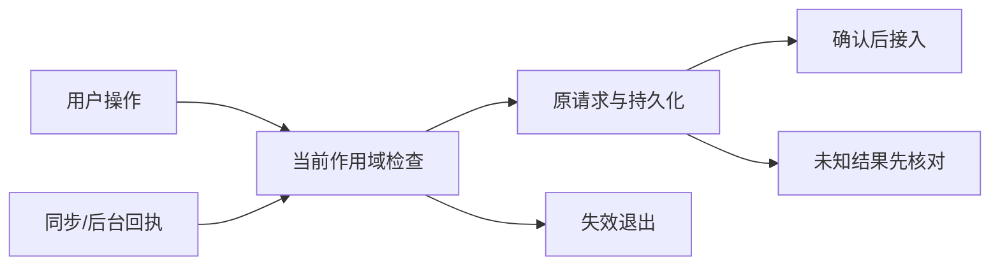
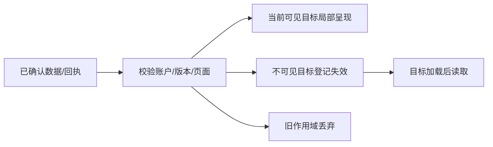

# F8 iOS-PWA选字与批注 技术方案

|文档信息|内容|
|---|---|
|需求编号|[recvxlWptXiRfk](https://my.feishu.cn/base/MwUibJRQKaae9hsY9lMceQBYnAh?table=tblHW2FjQpyJlSck&record=recvxlWptXiRfk)|
|Owner / 协作角色|Owner；主控负责契约与接入，主开发负责实施；暂无新增角色派发|
|状态 / 版本 / 日期|r1，2026-10-16|
|范围|iOS-PWA选字与批注；复用当前系统，不扩大为全站重构|

## 评审摘要

保留系统原生选区，固定从document监听并在当前挂载范围过滤；菜单触摸前捕获选区快照，打开输入后用快照而非已坍塌的DOM Selection提交。按同一文本规范校验quote及偏移；页面重绘、正文改变或账户切换使失效快照明确退出，保留用户输入。

|待决项|推荐|其他选择与影响|责任|
|---|---|---|---|
|验收环境与样本|使用真实生产形态的隔离状态切片，桌面与移动端分组；没有真机证据标partial|只用桌面合成数据无法证明手机体验|主控准备，Owner提供实际设备条件时补验|

## 资料来源与前提

|证据|位置|候选 / 读取时间|状态|
|---|---|---|---|
|E1|[public/frontend/features/annotations/controller.mjs](../../public/frontend/features/annotations/controller.mjs)|55c4df；2026-10-16读取|已读取相关入口；非运行验收|
|E2|[public/frontend/features/annotations/view.mjs](../../public/frontend/features/annotations/view.mjs)|55c4df；2026-10-16读取|已读取相关入口；非运行验收|
|E3|[public/frontend/features/annotations/model.mjs](../../public/frontend/features/annotations/model.mjs)|55c4df；2026-10-16读取|已读取相关入口；非运行验收|
|E4|[public/frontend/features/annotations/operations.mjs](../../public/frontend/features/annotations/operations.mjs)|55c4df；2026-10-16读取|已读取相关入口；非运行验收|
|E5|[public/frontend/styles/application.css](../../public/frontend/styles/application.css)|55c4df；2026-10-16读取|已读取相关入口；非运行验收|
|E6|[src/modules/annotations/index.mjs](../../src/modules/annotations/index.mjs)|55c4df；2026-10-16读取|已读取相关入口；非运行验收|

现状：annotations/controller.mjs 将 selectionchange 监听放在mount传入的root上，默认是document；实际挂载root必须在实施时核验。该事件在Document触发且不冒泡。touchend延迟180ms、selectionchange延迟80ms；viewport变化会隐藏菜单。view.selectionValue要求选区同一commentable且最长1000字符，范围跨越和触摸菜单焦点均可能影响选择。尚无本轮真机复现。

前提：当前单实例、账户作用域及原幂等协议保留。最新生产请求分段耗时、原反馈真实设备复现尚未取得，实施者先补基线；本稿不把源码风险写成已证明的线上根因。

## 需求追踪

|需求点|设计章节|接口 / 落点|验收|观测|
|---|---|---|---|---|
|iOS-PWA选字与批注|3.1—3.6|[public/frontend/features/annotations/controller.mjs](../../public/frontend/features/annotations/controller.mjs)|TC01—TC05|3.7定义的行为及延迟|
|重复、失败与账户切换|3.3、3.8|作用域ticket与原数据接口|后续异常用例|错误、重复副作用及迟到写入|

## 名词解释

|名词|解释|语境|
|---|---|---|
|PWA|安装到主屏幕并以独立窗口运行的网页应用|PWA和Safari分别记录验收结果。|
|选区快照|在原生选区消失前保存的文本位置和归属|选区快照只属于捕获时的账户和页面。|

## 评审记录

2026-10-16：Owner要求逐需求方案及全局依赖统筹；本稿据此新增，整稿待Owner评审。范围及执行状态只读[唯一控制面](../../coordination/current.json)。

浏览器依据：[MDN Document selectionchange](https://developer.mozilla.org/en-US/docs/Web/API/Document/selectionchange_event)，2026-10-16核对：Document级事件不冒泡；不能靠子容器监听假定必达。

# 1. 项目背景

本章界定用户问题及可验证目标。

## 1.1 背景（必填）

annotations/controller.mjs 将 selectionchange 监听放在mount传入的root上，默认是document；实际挂载root必须在实施时核验。该事件在Document触发且不冒泡。touchend延迟180ms、selectionchange延迟80ms；viewport变化会隐藏菜单。view.selectionValue要求选区同一commentable且最长1000字符，范围跨越和触摸菜单焦点均可能影响选择。尚无本轮真机复现。

范围内为上述需求的现有入口；范围外为新媒体格式、付费模型策略和全站编辑器替换。

## 1.2 目标（必填）

|目标|基线与来源|验收目标|方法|
|---|---|---|---|
|用户路径正确|旧反馈与上述源码；未复现|全部适用TC通过|真实UI操作加持久化回读|
|交互及时|当前分位未知|接入F9统一500ms P75口径|不新建第二套性能指标|
|账户安全|已有隔离机制|零跨账户结果接入|切换与迟到响应负例|

# 2. 总体方案设计

保留系统原生选区，固定从document监听并在当前挂载范围过滤；菜单触摸前捕获选区快照，打开输入后用快照而非已坍塌的DOM Selection提交。按同一文本规范校验quote及偏移；页面重绘、正文改变或账户切换使失效快照明确退出，保留用户输入。

## 2.1 前期调研

annotations/controller.mjs 将 selectionchange 监听放在mount传入的root上，默认是document；实际挂载root必须在实施时核验。该事件在Document触发且不冒泡。touchend延迟180ms、selectionchange延迟80ms；viewport变化会隐藏菜单。view.selectionValue要求选区同一commentable且最长1000字符，范围跨越和触摸菜单焦点均可能影响选择。尚无本轮真机复现。

不因已有基础能力就关闭本条；实施时以固定候选重现具体路径，再作最小修改。

## 2.2 系统架构

|协作方|职责|变更 / 不适用|
|---|---|---|
|C端|事件、页面状态、显示与恢复|本方案主要消费者|
|业务后台|账户鉴权、持久化与回执|复用原批注和详情协议，不新增写入模型|
|审核服务端 / 审核前端|本项目无本需求涉及的独立审核链|不新增审批系统|
|AI模型服务端|批注@助手或后台结果可触发同步|复用异步任务；模型耗时不进入点击受理目标|
|PostgreSQL / JSON|账户数据事实|保留原事务与恢复能力|


### 2.2.1 业务新流程

用户操作先确定当前作用域与目标，显示真实受理状态；读取或写入成功才接入权威结果。失败保留草稿、阅读位置及可执行恢复入口；取消或离页后结果不得进入另一账户。

### 2.2.2 技术新流程

保留系统原生选区，固定从document监听并在当前挂载范围过滤；菜单触摸前捕获选区快照，打开输入后用快照而非已坍塌的DOM Selection提交。按同一文本规范校验quote及偏移；页面重绘、正文改变或账户切换使失效快照明确退出，保留用户输入。

F7提供阅读恢复，F8只管理选区与菜单，不抢滚动/焦点恢复所有权；F6提供计数。F9在活跃选区期间不得全量替换当前选中文本宿主。

## 2.3 可选方案对比

|方案|效果|代价与选择|
|---|---|---|
|在现有契约内分离状态和调度|保留历史兼容、限定影响|推荐；需沿完整数据链验证|
|全量刷新或新建通用状态平台|容易重复实现且损失阅读状态|不选；不能解决本需求的归属与及时性|

# 3. 详细方案设计

以下所有“拟新增”均为设计，不代表已有可调用实现。

## 3.1 详细设计（必填）

PWA和Safari分别记录验收结果。
选区快照只属于捕获时的账户和页面。

F7提供阅读恢复，F8只管理选区与菜单，不抢滚动/焦点恢复所有权；F6提供计数。F9在活跃选区期间不得全量替换当前选中文本宿主。

### 3.1.1 生产链路

|入口|输入 / 转换|状态与副作用|
|---|---|---|
|用户点击、选区或提交|校验当前账户、根对象、页面generation|仅合法当前操作可继续|
|已有后台结果、同步轮询|按真实ID和版本合入|重复与迟到不重复生效|
|离页、切账户、重试|撤销旧页面等待，复用原操作身份|不取消已提交事实；不制造第二条任务|



|处理动作|原所在事务|本次事务|事务粒度|事务内新增逻辑|事务外与提交后|
|---|---|---|---|---|---|
|创建/回复/删除批注|annotation-resources的repository.update/executeIdempotent|沿用原写事务|单账户根记录；实际JSON/PG适配器保持|本方案不增写表；原权限和原文校验仍在|提交成功后派生界面；未知结果不自动重发|
|采集页面状态|无；浏览器内存|无；非持久业务事实|当前账户与页面|无数据库写|网络前捕获，离页失效|

#### 3.1.1.1 处理阶段与新增配置

不新增服务端配置；不全局preventDefault，不关闭系统复制或浏览器原生选择，不引入自绘选区编辑器。

#### 3.1.1.2 接口与数据处理

复用既有批注创建接口；root/type/id/targetKey/start/end/quote按真实资源定位，Cookie及同源校验不变。客户端快照中的generation不作为服务端信任字段；服务端继续校验原文范围。未知写入结果先核对幂等回执；400原文变化须重新选取，401停止、保留本账户草稿。

内部投影示例见3.4；该示例不冒充现有HTTP响应，不向历史接口增加必填字段。

### 3.1.2 消费链路



|处理动作|原所在事务|本次事务|事务粒度|事务内新增逻辑|事务外与提交后|
|---|---|---|---|---|---|
|计数、选区、开合恢复|无；从当前快照读取|无；UI投影不变成业务事实|当前页面目标ID|无数据库写|迟到代数丢弃；目标删除不恢复旧DOM|
|同步/详情读取失败|原读取事务|不扩大事务|当前账户|无写入|保留旧可见内容并标状态，不伪装为空数据|

#### 3.1.2.1 消费入口

|消费面|入口|处理与兼容|验收|
|---|---|---|---|
|思绪列表与详情|thoughts view/controller|按实际加载范围接入，未载入不当作不存在|TC01—TC03|
|批注面板与移动选择|annotations view/controller|统一目标归属，不重建另一状态源|适用移动和失败用例|
|后台结果与其他页|现有sync/data-runtime|仍按当前账户和原接口，不要求新必填字段|切换与重复用例|

#### 3.1.2.2 协议、打包与改动边界

start/end采用现有UTF-16偏移和左闭右开范围；文本遍历与锚点恢复使用同一规范，保留原quote不改写用户内容。sourceVersion仅在已有版本可取得时使用，缺失时提交前以原文/范围复验，不猜版本。

旧客户端/新服务端沿用旧协议；新客户端/旧服务端缺少可选能力时回退原读取并显示真实状态。内部UI实体不持久化到服务端。

#### 3.1.2.3 消费验收

4.2逐项记录界面、网络副作用和回读结果；成功不只看提示。失败、旧对象删除、旧会话返回与回滚均保留对应证据，未执行项标partial。

## 3.2 外部依赖

F7提供阅读恢复，F8只管理选区与菜单，不抢滚动/焦点恢复所有权；F6提供计数。F9在活跃选区期间不得全量替换当前选中文本宿主。

### 3.2.1 依赖方与诉求

|依赖|就绪条件|顺序与延期|
|---|---|---|
|共享阅读状态/同步契约|提供方和消费者使用相同作用域及失效语义|先完成总体设计指定的契约，不凭分支已创建判断就绪|
|真实设备/网络|测试者能重放目标路径并记录设备|可先本地/模拟器，不能代替真机结论|
|现有持久化接口|旧数据和回滚读取通过|缺失时暂停受影响切片，不扩建平台|

## 3.3 异常处理（必填）

|异常|处置|恢复|
|---|---|---|
|401或账户变化|停止当前接入与等待，保留各自账户草稿|重登后重新读取|
|404/删除目标|解释不可用，不恢复旧对象|返回可用父层|
|409/版本变化|重新读取权威状态，不覆盖用户新操作|重新选择或按新版本重试|
|超时/未知提交|不冒称失败未写入；保持操作ID|先核对回执/目标，不盲重复提交|
|重复/乱序|按ID、版本、generation去重|只接入当前合法结果|
|DOM目标已淘汰|保留数据失效标记，不新建虚假对象|再次加载后接入|

## 3.4 数据实体（必填）

start/end采用现有UTF-16偏移和左闭右开范围；文本遍历与锚点恢复使用同一规范，保留原quote不改写用户内容。sourceVersion仅在已有版本可取得时使用，缺失时提交前以原文/范围复验，不猜版本。

以下为拟新增内部状态示例，非持久数据库结构；不改历史业务ID。

```json
{
  "accountId": "account-fixture",
  "rootKey": "thought:fixture",
  "targetKey": "followup:fixture",
  "generation": 3,
  "sourceVersion": 2,
  "start": 0,
  "end": 4,
  "quote": "示例原文",
  "status": "captured"
}
```

|字段|类型 / 必填|语义与生命周期|
|---|---|---|
|accountId|string / 内部有效状态必填|来自当前会话；只用于客户端归属，服务端仍鉴权|
|rootKey|string / 内部有效状态必填|根记录类型及稳定ID；不使用数组下标|
|targetKey|string / 内部有效状态必填|当前正文/追问稳定目标；不能跨目标复用|
|generation|number / 内部有效状态必填|当前挂载/路由生命周期代数；变化丢弃旧结果|
|sourceVersion|number或null / 可缺|可取得时使用现有正文版本；不可取得为null并以原文范围复验|
|start|number / 内部有效状态必填|UTF-16左闭起点，与现有锚点规范一致|
|end|number / 内部有效状态必填|UTF-16右开终点，不以Unicode码点替代|
|quote|string / 内部有效状态必填|当时选区原文；提交前与当前文本复验|
|status|string / 内部有效状态必填|选区captured/invalidated/submitting等本地状态，不等同发布状态|

## 3.5 接口定义（必填）

复用既有批注创建接口；root/type/id/targetKey/start/end/quote按真实资源定位，Cookie及同源校验不变。客户端快照中的generation不作为服务端信任字段；服务端继续校验原文范围。未知写入结果先核对幂等回执；400原文变化须重新选取，401停止、保留本账户草稿。

接口失败沿原HTTP映射；本方案不增加无界重试。请求截止时间沿原transport，500ms是体验目标而非500ms强行中断所有业务。写入未知时保留操作身份，读取重试不改变原操作。

## 3.6 代码设计

仅在当前feat切片改下列落点。新增帮助模块使用.mts及项目文件头/JSDoc，编译到隔离目录，禁止提交生成物。

### 3.6.1 代码落点

|文件 / 模块|职责与边界|
|---|---|
|[public/frontend/features/annotations/controller.mjs](../../public/frontend/features/annotations/controller.mjs)|统一挂载/卸载和事件作用域，合并选择事件，账户或页面变化时清除旧回调。|
|[public/frontend/features/annotations/view.mjs](../../public/frontend/features/annotations/view.mjs)|按目标局部呈现，保存和恢复阅读锚点；不以整页重绘覆盖当前交互。|
|[public/frontend/features/annotations/model.mjs](../../public/frontend/features/annotations/model.mjs)|派生目标作用域与完整加载标志；按稳定ID区分线程、回复及待确认操作。|
|[public/frontend/features/annotations/operations.mjs](../../public/frontend/features/annotations/operations.mjs)|提交前捕获阅读/选区，确认回执后按ID合并；未知写入回原回执核对。|
|[public/frontend/styles/application.css](../../public/frontend/styles/application.css)|修复菜单及移动触摸布局；保留原生选字、复制和可访问焦点。|
|[src/modules/annotations/index.mjs](../../src/modules/annotations/index.mjs)|沿现有原文定位和偏移契约核验选区；不猜测已变化的锚点。|

### 3.6.2 核心伪代码

```python
def capture_selection(event, session):
    selection = read_document_selection()
    if not belongs_to_current_root(selection, session):
        return None
    token = snapshot_selection(selection, session)
    if not same_target(token) or not valid_existing_length(token.quote):
        return None
    return token

async def submit_captured_selection(token, draft, session):
    if not session.matches(token.accountId, token.generation):
        preserve_draft(draft)
        return show_selection_expired()
    if not matches_current_text(token):
        preserve_draft(draft)
        return request_reselection()
    try:
        ack = await existing_annotation_create(token, draft, stable_request_id())
    except UnknownWriteResult:
        preserve_draft_and_reconcile()
        return
    if session.matches(token.accountId, token.generation):
        apply_confirmed_annotation(ack)
```

#### 3.6.2.1 关键动作实现细节

|拟新增/修改函数|作用|限制|
|---|---|---|
|上述伪代码中的主入口|按作用域捕获、校验和接入；抽象helper需映射既有端口|不能仅复制成功路径，异常分支与4.2同步实现|
|既有HTTP与repository端口|继续负责鉴权、持久化、幂等|UI状态不能绕过后端原文与版本校验|

### 3.6.3 关键实现约束

F7提供阅读恢复，F8只管理选区与菜单，不抢滚动/焦点恢复所有权；F6提供计数。F9在活跃选区期间不得全量替换当前选中文本宿主。

所有性能优化保留权限、幂等、原文和恢复语义；代码先自查，主控独立审查整个数据链，再用验证确认。只合入已可用的最小闭环，不先合空壳占位。

## 3.7 监控告警（必填）

|指标|口径|维度/处置|
|---|---|---|
|交互和同步耗时|F9统一P75及失败分母；不把request完成当paint|操作族、设备、前后台；超标定位阶段|
|归属错误/重复副作用|任何不应发生的跨账户接入、重复创建|发生即阻止发布并定位；不记录用户正文|
|目标状态不一致|计数、锚点或阅读恢复与数据不符|本地回归和受控观察；缺真机证据标partial|

阈值引用1.2；持续生产样本不足不写达标。观察日志只保留动作类型、耗时、状态码和受控关联键，不以ID作为高基数指标标签。

## 3.8 稳定性

性能与正确性共享同一数据链，不能以跳过权限或省略数据获得延迟收益。

### 3.8.1 容量与性能

合并同一帧的selectionchange；选区文本仅限当前宿主，不扫描整页。监听数量与挂载实例数一致且卸载归零；不为每个文本节点注册事件。1000字符为现有限制，本需求不扩大。

### 3.8.2 一致性与幂等

账户/根对象/目标ID/版本作为归属，页面generation保护异步回调。创建沿用原幂等键；重复ACK与同步按ID合并，不累计计数。提交后UI失败不撤销已提交事实；草稿和未知结果交原恢复入口。

### 3.8.3 降级与回滚

回退本需求UI/调度实现时保留持久数据与操作队列；恢复上一兼容制品前核对新旧读者。不清库、不删除批注、不伪造同步游标。性能回退需明确未达标而非静默豁免。

### 3.8.4 安全与日志

日志不含正文、quote、认证凭据或完整账户资料。服务端依据会话绑定账户，客户端只将身份用于防串页；不能信任请求中的accountId。已有审计与错误入口复用。

## 3.9 实验方案

采用同数据、同设备、同网络的受控前后对照，不引入新实验平台。

### 3.9.1 开关与灰度

不新增服务端配置；不全局preventDefault，不关闭系统复制或浏览器原生选择，不引入自绘选区编辑器。

先隔离环境，再有授权的受控生产观察。未授权时不部署，不触发真实付费调用。

### 3.9.2 核心验收指标

功能目标按1.2与TC核对；F9延迟目标为统一门。专项通过不等同全版本发布就绪，组合干扰与恢复场景还需通过总体设计中的集成用例。

### 3.9.3 效果观测

固定候选及状态切片，分别报告正常、错误、移动和重绘场景；同一段有效证据可复用，不为报告重复测试。旧候选或不同环境结果不可冒充当前值。

# 4. 开发测试

## 4.1 开发明细

以 `e79d06` 为实施基线。状态由唯一控制面维护；本机唯一回执 `artifacts/local/v0516-f8-acceptance-current.json` 保存实际源码六位摘要、命令、有效证据、原失败和限制，不作为额外状态或报告链。

- 真实shell一直挂载document；本片不将监听根冒认为已证明线上根因。document选择事件合并为单个待处理回调，卸载清理；菜单触摸前复用 `pendingSelection` 固定普通值快照，原生选区坍塌仍可打开表单，不全局阻止系统选择、复制或触摸滚动。
- 新增 TypeScript 正文片段/UTF-16端口，DOM正文、原生范围及锚点使用同一规范；排除按钮等控件，公式按既有 `data-tex` 原文计入偏移，不重复计算KaTeX视觉与隐藏树。公式内部或跨公式无法精确对应的视觉选区明确不支持，不能改写quote凑通过；公式前后、段落/列表/表格及emoji沿真实消费者核对。
- 优先使用既有 `rawStart/start`，唯一精确上下文作恢复；重复词没有可靠位置不猜首项。快照绑定账户/session、语义页面、稳定根/目标及真实来源；非正文版本递增仍以精确原文和范围复验。思绪仅位置query不当作页面变化。
- 活跃原生Range沿公开index/loader/controller接入实际thought view重绘保护；表单快照不阻止普通ACK呈现。释放后消费既有延后patch/consume凭据，离页清理，不新增阅读状态源。已提交数据事实与当前页面UI收尾分离，迟到ACK不能清新页面选区或草稿。
- 失效锚点与废弃整份草稿区分：`reselect`保留文字/图片及明确重新选取入口，不触发既有media消费者的 `invalid→abandon`；过期quote不可提交。重复恢复不覆盖正在输入或在途快照，也不反复提示。
- 主控接入审查确认aside评论编辑器不在既有main form重置范围；会话重置现明确清当前DOM的文字、选区、提示及请求/在途标识，恢复提交按钮，不删除owner持久草稿。既有专项验证A残留→resetSession→B打开及旧响应不写新账户。
- 本机Chrome覆盖原生Range/触摸模拟、同文刷新、公式后重复词、真实POST及持久回读、坍塌退出与旧页ACK/新页草稿；主控独立Chrome亦验证真实KaTeX后第二处重复词start/rawStart一致、1POST、无内部快照字段泄入HTTP。具体适用源码及后续补证见同一回执。
- iOS27.0 SE3模拟器、375pt竖屏WKWebView：XCUITest真实长按→蓝色结束手柄拖至第二段→评论→键盘输入→保存→HTTP回读通过，41 UTF-16引用覆盖明确第二段标记，start/rawStart均2。截图仍有系统Copy菜单；未用JS造Range。测试URL为临时本机HTTPS反代，临时自签证书仅加入该模拟器信任，不改业务SceneDelegate或全局Node/系统信任。
- 补齐图片change的真实竞争闭包：仅comment成功回调不再清批注域的新警告，其他编辑器保持原行为；source失效时图片仍可恢复。原生恢复为reselect而非整份草稿abandon。
- 原失败保留：首次xctestrun环境注入层级不符导致skip；用例误找“发送”导致失败；private-LAN HTTP非secure源未提供randomUUID，未保存，换本机HTTPS夹具验证，不修改业务ID实现。单行8字符原生PASS不能替代后续跨段41字符PASS。
- 不宣称Safari、安装PWA、真机、生产、全站500ms分位或整版发布门通过。没有后端/schema、依赖、默认配置、Git或生产操作；后续F9调度不在本片实施。


## 4.2 测试方案（必填）

|用例|环境|操作与预期|证据|
|---|---|---|---|
|TC01|隔离本机、固定候选与同一数据集|真机Safari与已安装PWA跨行长按选字、拖手柄、打开菜单、输入提交并重登读取|实际行为与持久数据核对，失败保留证据|
|TC02|隔离本机、固定候选与同一数据集|菜单触摸导致原生选区坍塌后仍按捕获快照提交同一quote；取消不写入|实际行为与持久数据核对，失败保留证据|
|TC03|隔离本机、固定候选与同一数据集|正文重绘/版本变化后拒绝错位锚点；保持草稿并提示重新选择|实际行为与持久数据核对，失败保留证据|
|TC04|隔离本机、固定候选与同一数据集|跨目标、超长、空选区、公式与嵌套mark按现有契约处理，不截断造锚点|实际行为与持久数据核对，失败保留证据|
|TC05|隔离本机、固定候选与同一数据集|切账户、离页、键盘与visualViewport变更后监听清理；无重复创建|实际行为与持久数据核对，失败保留证据|

### 4.2.1 Mock测试方案

Mock只替换网络延迟/错误/乱序和可控时钟；保留真实DOM、账户隔离、原协议和持久化。固定样例包含两个账户、同名但不同ID目标、跨页追问及重复ACK。切真实浏览器和隔离PG验证；不能用模拟选择事件证明iOS系统长按手势可用。

# 5. 上线方案

按项目已有发布流程准备；本稿不授予上线权限，不新建发布流程层。

## 5.1 上线CheckList（必填）

- [ ] 主开发自查与主控完整链路审查完成。
- [ ] 对应TC和组合用例有效，候选/环境固定。
- [ ] 新鲜生产切片隔离PG启动、重启恢复与核心冒烟完成。
- [ ] 受影响端设备证据与partial边界明确。
- [ ] 回滚制品、配置与数据兼容核验完成。

## 5.2 上线依赖

|顺序|动作|就绪条件|
|---|---|---|
|1|共享契约及必要提供方接入|总设计对应契约样例与消费者验证|
|2|本需求UI/同步消费者|旧新协议组合、迟到结果与恢复通过|
|3|版本集成与候选固定|仅对实际变更重验；有状态全局门通过|
|4|授权部署与观察|明确发布信号；独立记录真实结果|

## 5.3 观测方案

主控按当前候选、真实设备及用户路径核对3.7；操作样本不足时维持partial。任一跨账户、原文破坏或重复写入立即停止放量；延迟超标先定位并回退受影响模块，不反复盲重试生产。

## 5.4 回滚方案

|对象|动作|数据与恢复|
|---|---|---|
|客户端模块|回上一兼容制品并重建当前页面状态|不删除服务端批注、草稿或已确认内容|
|服务端等待/读取|按配置或制品恢复旧兼容端口|旧游标仍可读；不得回退已发生业务写入|
|在途任务|取消只读等待，写入未知走原回执核对|不把客户端断连当作服务器未提交|
|历史数据|本需求无批量迁移|不要用旧备份覆盖新增用户数据|

## 5.5 放量计划

|阶段|范围|进入/退出条件|
|---|---|---|
|隔离验证|脱敏状态、真实浏览器与PG|TC、故障恢复及影响矩阵通过|
|受控观察|已有授权范围内的账户和设备|真实效果满足目标、无数据不变量破坏|
|正式推广|版本发布授权后|按实际样本与告警观察；样本不足如实保留|

未预设虚假的上线时间或百分比。前置依赖不成立时，回到总设计处理受影响切片，不让开发者现场临时更改共享接口。
