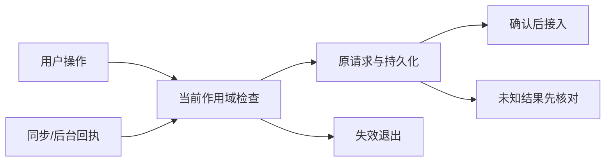
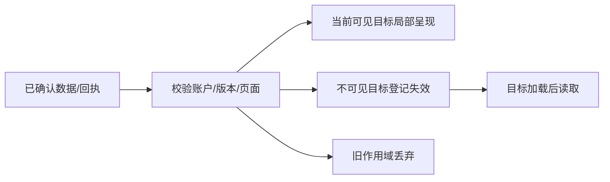

# F9 同步与交互延迟治理 技术方案

|文档信息|内容|
|---|---|
|需求编号|[recvxyrQv7utyV](https://my.feishu.cn/base/MwUibJRQKaae9hsY9lMceQBYnAh?table=tblHW2FjQpyJlSck&record=recvxyrQv7utyV)|
|Owner / 协作角色|Owner；主控负责契约与接入，主开发负责实施；暂无新增角色派发|
|状态 / 版本 / 日期|方案r1，2026-10-16；当前实施与授权见唯一控制面|
|范围|同步与交互延迟治理；复用当前系统，不扩大为全站重构|

## 评审摘要

先按全用户路径量测，再重建现有同步调度：提交后按账户唤醒长轮询，先订阅再复查游标防丢唤醒；轮询返回后前台立即续接，取消过时等待以服务主动刷新。存储窄读由F3-A提供，复用现有cursor和ACK。按钮先呈现真实受理/执行反馈，再按已确认结果局部更新，不显示虚假保存成功。

|待决项|推荐|其他选择与影响|责任|
|---|---|---|---|
|验收环境与样本|使用真实生产形态的隔离状态切片，桌面与移动端分组；没有真机证据标partial|只用桌面合成数据无法证明手机体验|主控准备，Owner提供实际设备条件时补验|

## 资料来源与前提

|证据|位置|候选 / 读取时间|状态|
|---|---|---|---|
|E1|[src/http/sync.mjs](../../src/http/sync.mjs)|55c4df；2026-10-16读取|已读取相关入口；非运行验收|
|E2|[src/shared/persistence/postgres-runtime.mjs](../../src/shared/persistence/postgres-runtime.mjs)|55c4df；2026-10-16读取|已读取相关入口；非运行验收|
|E3|[src/app/runtime-foundation.mjs](../../src/app/runtime-foundation.mjs)|55c4df；2026-10-16读取|已读取相关入口；非运行验收|
|E4|[public/frontend/sync/index.mjs](../../public/frontend/sync/index.mjs)|55c4df；2026-10-16读取|已读取相关入口；非运行验收|
|E5|[public/frontend/app/runtime/data-runtime.mjs](../../public/frontend/app/runtime/data-runtime.mjs)|55c4df；2026-10-16读取|已读取相关入口；非运行验收|
|E6|[public/frontend/api/index.mjs](../../public/frontend/api/index.mjs)|55c4df；2026-10-16读取|已读取相关入口；非运行验收|

现状：src/http/sync.mjs snapshotAfter无变更时pause(waitMs)，上限1500ms；public/frontend/sync/index.mjs默认pollMs=1500，完成后再排下一轮，主动pull遇在途请求只标immediatePullQueued；postgres-runtime.mjs readSyncSnapshot当前重建账户对象。代码证明存在等待和重建路径，不证明所有按钮都因此变慢。

前提：当前单实例、账户作用域及原幂等协议保留。最新生产请求分段耗时、原反馈真实设备复现尚未取得，实施者先补基线；本稿不把源码风险写成已证明的线上根因。

## 需求追踪

|需求点|设计章节|接口 / 落点|验收|观测|
|---|---|---|---|---|
|同步与交互延迟治理|3.1—3.6|[src/http/sync.mjs](../../src/http/sync.mjs)|TC01—TC06|3.7定义的行为及延迟|
|重复、失败与账户切换|3.3、3.8|作用域ticket与原数据接口|后续异常用例|错误、重复副作用及迟到写入|

## 名词解释

|名词|解释|语境|
|---|---|---|
|P75|将样本从快到慢排序后位于75%位置的值|P75分别按操作族和设备类型计算，不用全站平均掩盖慢路径。|
|提交后唤醒|写入成功后通知等待中的读取重新检查数据|提交后唤醒只作提示，持久游标仍是事实源。|
|ACK|服务器对持久化操作的确认|ACK之前不得显示已同步成功。|

## 评审记录

2026-10-16：Owner要求逐需求方案及全局依赖统筹；本稿据此新增，整稿待Owner评审。范围及执行状态只读[唯一控制面](../../coordination/current.json)。

测量依据：[web.dev 交互延迟分解](https://web.dev/articles/optimize-inp)，2026-10-16核对：需区分输入等待、处理和呈现；本项目P75按动作样本定义，不冒称它等于Core Web Vitals的页面级INP。

# 1. 项目背景

本章界定用户问题及可验证目标。

## 1.1 背景（必填）

src/http/sync.mjs snapshotAfter无变更时pause(waitMs)，上限1500ms；public/frontend/sync/index.mjs默认pollMs=1500，完成后再排下一轮，主动pull遇在途请求只标immediatePullQueued；postgres-runtime.mjs readSyncSnapshot当前重建账户对象。代码证明存在等待和重建路径，不证明所有按钮都因此变慢。

范围内为上述需求的现有入口；范围外为新媒体格式、付费模型策略和全站编辑器替换。

## 1.2 目标（必填）

|目标|基线|目标及状态|统计口径|验收|
|---|---|---|---|---|
|按钮有效反馈|用户报告常超过1秒，尚无分位基线|Owner明确P75≤500ms|事件开始到呈现有效操作状态，按操作族/设备分组|TC03|
|同步可见|尚无分位基线|Owner明确P75≤500ms|正常在线前台，普通记录提交动作到另一前台可见；另报提交确认及提交后传播|TC02—TC04|

上传和模型生成的完成耗时单列，不承诺500ms生成；其点击反馈仍受500ms约束。离线、后台受节流样本独立报告，不删除失败、超时或慢样本。建议每操作族/设备至少100次固定序列，三轮并报告分布与失败率；这是验收采样建议，不是已对齐线上容量。两个设备使用同一测试控制器时钟测端到端；线上跨设备测量需校准时钟误差，未校准不直接相减。

# 2. 总体方案设计

先按全用户路径量测，再重建现有同步调度：提交后按账户唤醒长轮询，先订阅再复查游标防丢唤醒；轮询返回后前台立即续接，取消过时等待以服务主动刷新。存储窄读由F3-A提供，复用现有cursor和ACK。按钮先呈现真实受理/执行反馈，再按已确认结果局部更新，不显示虚假保存成功。

## 2.1 前期调研

src/http/sync.mjs snapshotAfter无变更时pause(waitMs)，上限1500ms；public/frontend/sync/index.mjs默认pollMs=1500，完成后再排下一轮，主动pull遇在途请求只标immediatePullQueued；postgres-runtime.mjs readSyncSnapshot当前重建账户对象。代码证明存在等待和重建路径，不证明所有按钮都因此变慢。

不因已有基础能力就关闭本条；实施时以固定候选重现具体路径，再作最小修改。

## 2.2 系统架构

|协作方|职责|变更 / 不适用|
|---|---|---|
|C端|事件、页面状态、显示与恢复|本方案主要消费者|
|业务后台|账户鉴权、持久化与回执|新增提交唤醒，窄读复用F3-A|
|审核服务端 / 审核前端|本项目无本需求涉及的独立审核链|不新增审批系统|
|AI模型服务端|批注@助手或后台结果可触发同步|复用异步任务；模型耗时不进入点击受理目标|
|PostgreSQL / JSON|账户数据事实|保留原事务与恢复能力|


### 2.2.1 业务新流程

用户操作先确定当前作用域与目标，显示真实受理状态；读取或写入成功才接入权威结果。失败保留草稿、阅读位置及可执行恢复入口；取消或离页后结果不得进入另一账户。

### 2.2.2 技术新流程

先按全用户路径量测，再重建现有同步调度：提交后按账户唤醒长轮询，先订阅再复查游标防丢唤醒；轮询返回后前台立即续接，取消过时等待以服务主动刷新。存储窄读由F3-A提供，复用现有cursor和ACK。按钮先呈现真实受理/执行反馈，再按已确认结果局部更新，不显示虚假保存成功。

F3-A唯一修改窄读和回执读取协议；F9唯一修改等待、唤醒和客户端调度。F2拥有运行资格检查；F4/F7拥有页面窗口和阅读状态。共享文件按统一设计串行接入，不并行编辑。

## 2.3 可选方案对比

|方案|效果|代价与选择|
|---|---|---|
|在现有契约内分离状态和调度|保留历史兼容、限定影响|推荐；需沿完整数据链验证|
|全量刷新或新建通用状态平台|容易重复实现且损失阅读状态|不选；不能解决本需求的归属与及时性|
|WebSocket/SSE重建全传输|可减少等待但引入鉴权续接、代理和连接治理|先不选；若事件唤醒及窄读仍无法达标，以实测瓶颈评审升级，不直接加第二通道|

# 3. 详细方案设计

以下所有“拟新增”均为设计，不代表已有可调用实现。

## 3.1 详细设计（必填）

P75分别按操作族和设备类型计算，不用全站平均掩盖慢路径。
提交后唤醒只作提示，持久游标仍是事实源。
ACK之前不得显示已同步成功。

F3-A唯一修改窄读和回执读取协议；F9唯一修改等待、唤醒和客户端调度。F2拥有运行资格检查；F4/F7拥有页面窗口和阅读状态。共享文件按统一设计串行接入，不并行编辑。

### 3.1.1 生产链路

|入口|输入 / 转换|状态与副作用|
|---|---|---|
|用户点击、选区或提交|校验当前账户、根对象、页面generation|仅合法当前操作可继续|
|已有后台结果、同步轮询|按真实ID和版本合入|重复与迟到不重复生效|
|离页、切账户、重试|撤销旧页面等待，复用原操作身份|不取消已提交事实；不制造第二条任务|



|处理动作|原所在事务|本次事务|事务粒度|事务内新增逻辑|事务外与提交后|
|---|---|---|---|---|---|
|业务提交并唤醒|postgres-runtime transact内短SQL事务，提交后onCommit|沿用提交事务，唤醒在提交后|单账户；锁按原实现持有|不新增可靠业务写；未提交不得通知成功|唤醒失败不改已提交结果，超时轮询补读|
|等待注册与检查|旧pause无事务|进程内订阅，无DB锁|账户等待集合|无数据库写|订阅后读取；等待期间释放连接|

#### 3.1.1.1 处理阶段与新增配置

拟新增 SYNC_ACCOUNT_WAKE_ENABLED:boolean，默认false（环境配置与env.example唯一来源，经启动读取）；只切换等待机制，不改变cursor/数据结构。关闭后使用旧有界轮询，明确可能不满足性能目标。前台立即续接、失败沿用有界退避；未知结果不加速写入重试。

```json
{
  "SYNC_ACCOUNT_WAKE_ENABLED": false
}
```
这是配置映射示例，不是另一个配置文件。开启与关闭都清理等待者；配置仅启动读取，在途切换通过进程排空。

#### 3.1.1.2 接口与数据处理

GET /api/v1/sync 保留cursor、waitMs及data.cursor/changes/snapshot；旧客户端仍兼容，400/409/410含义不变。F3提供readSyncChanges与操作回执窄读，F9不另造读取契约。拟新增进程内subscribeAccountCommits(accountId)、notifyAccountCommitted(accountId,cursor)；事件不可靠、不可跨进程，单实例锁仍必须存在。HTTP断连撤销等待并清理监听，不撤销已提交写入；无资金副作用的GET可重新发起，写入沿用原操作ID。

内部投影示例见3.4；该示例不冒充现有HTTP响应，不向历史接口增加必填字段。

### 3.1.2 消费链路



|处理动作|原所在事务|本次事务|事务粒度|事务内新增逻辑|事务外与提交后|
|---|---|---|---|---|---|
|长轮询消费|readSyncSnapshot只读账户事务|F3-A一致快照窄读；等待在事务外|单账户游标和变化域|不写业务数据；检查当前账户资格|旧游标409/410重建；客户端应用成功后前移cursor|
|同步/详情读取失败|原读取事务|不扩大事务|当前账户|无写入|保留旧可见内容并标状态，不伪装为空数据|

#### 3.1.2.1 消费入口

|消费面|入口|处理与兼容|验收|
|---|---|---|---|
|思绪列表与详情|thoughts view/controller|按实际加载范围接入，未载入不当作不存在|TC01—TC03|
|批注面板与移动选择|annotations view/controller|统一目标归属，不重建另一状态源|适用移动和失败用例|
|后台结果与其他页|现有sync/data-runtime|仍按当前账户和原接口，不要求新必填字段|切换与重复用例|

#### 3.1.2.2 协议、打包与改动边界

账户通知只作唤醒提示，不承载业务正文、不替代持久cursor。通知丢失时超时后复查；重复/乱序按持久游标处理。客户端时间只用于本进程测量，不与另一设备时钟直接相减。

旧客户端/新服务端沿用旧协议；新客户端/旧服务端缺少可选能力时回退原读取并显示真实状态。内部UI实体不持久化到服务端。

#### 3.1.2.3 消费验收

4.2逐项记录界面、网络副作用和回读结果；成功不只看提示。失败、旧对象删除、旧会话返回与回滚均保留对应证据，未执行项标partial。

## 3.2 外部依赖

F3-A唯一修改窄读和回执读取协议；F9唯一修改等待、唤醒和客户端调度。F2拥有运行资格检查；F4/F7拥有页面窗口和阅读状态。共享文件按统一设计串行接入，不并行编辑。

### 3.2.1 依赖方与诉求

|依赖|就绪条件|顺序与延期|
|---|---|---|
|共享阅读状态/同步契约|提供方和消费者使用相同作用域及失效语义|先完成总体设计指定的契约，不凭分支已创建判断就绪|
|真实设备/网络|测试者能重放目标路径并记录设备|可先本地/模拟器，不能代替真机结论|
|现有持久化接口|旧数据和回滚读取通过|缺失时暂停受影响切片，不扩建平台|

## 3.3 异常处理（必填）

|异常|处置|恢复|
|---|---|---|
|401或账户变化|停止当前接入与等待，保留各自账户草稿|重登后重新读取|
|404/删除目标|解释不可用，不恢复旧对象|返回可用父层|
|409/版本变化|重新读取权威状态，不覆盖用户新操作|重新选择或按新版本重试|
|超时/未知提交|不冒称失败未写入；保持操作ID|先核对回执/目标，不盲重复提交|
|重复/乱序|按ID、版本、generation去重|只接入当前合法结果|
|DOM目标已淘汰|保留数据失效标记，不新建虚假对象|再次加载后接入|

## 3.4 数据实体（必填）

账户通知只作唤醒提示，不承载业务正文、不替代持久cursor。通知丢失时超时后复查；重复/乱序按持久游标处理。客户端时间只用于本进程测量，不与另一设备时钟直接相减。

以下为拟新增内部状态示例，非持久数据库结构；不改历史业务ID。

```json
{
  "accountId": "account-fixture",
  "cursor": 42,
  "generation": 3,
  "reason": "committed",
  "receivedAtMonotonicMs": 1200
}
```

|字段|类型 / 必填|语义与生命周期|
|---|---|---|
|accountId|string / 内部有效状态必填|来自当前会话；只用于客户端归属，服务端仍鉴权|
|cursor|number / 内部有效状态必填|持久化同步游标；不是通知次数，成功应用后才推进|
|generation|number / 内部有效状态必填|当前挂载/路由生命周期代数；变化丢弃旧结果|
|reason|string / 内部有效状态必填|通知原因如committed，不包含业务正文|
|receivedAtMonotonicMs|number / 内部有效状态必填|本进程单调时钟采样，不跨设备直接相减|

## 3.5 接口定义（必填）

GET /api/v1/sync 保留cursor、waitMs及data.cursor/changes/snapshot；旧客户端仍兼容，400/409/410含义不变。F3提供readSyncChanges与操作回执窄读，F9不另造读取契约。拟新增进程内subscribeAccountCommits(accountId)、notifyAccountCommitted(accountId,cursor)；事件不可靠、不可跨进程，单实例锁仍必须存在。HTTP断连撤销等待并清理监听，不撤销已提交写入；无资金副作用的GET可重新发起，写入沿用原操作ID。

接口失败沿原HTTP映射；本方案不增加无界重试。请求截止时间沿原transport，500ms是体验目标而非500ms强行中断所有业务。写入未知时保留操作身份，读取重试不改变原操作。

## 3.6 代码设计

仅在当前feat切片改下列落点。新增帮助模块使用.mts及项目文件头/JSDoc，编译到隔离目录，禁止提交生成物。

### 3.6.1 代码落点

|文件 / 模块|职责与边界|
|---|---|
|[src/http/sync.mjs](../../src/http/sync.mjs)|订阅后复查并等待账户提交，超时和断连释放监听；复用F3读取与错误码。|
|[src/shared/persistence/postgres-runtime.mjs](../../src/shared/persistence/postgres-runtime.mjs)|只在真实SQL提交后发账户提示；F3拥有窄读实现，通知失败不得改变提交结果。|
|[src/app/runtime-foundation.mjs](../../src/app/runtime-foundation.mjs)|在原JSON/PG仓储装配注入统一提交通知及F2资格检查；后台写入不能漏接。|
|[public/frontend/sync/index.mjs](../../public/frontend/sync/index.mjs)|前台长轮询连续续接；主动读取撤销旧只读等待并合并请求；错误保留有界退避。|
|[public/frontend/app/runtime/data-runtime.mjs](../../public/frontend/app/runtime/data-runtime.mjs)|按账户、generation及变化域局部应用；保护F4/F7阅读和F8选区，应用成功后推进cursor。|
|[public/frontend/api/index.mjs](../../public/frontend/api/index.mjs)|透传只读等待取消信号和请求关联计时；不取消已提交写入、不更改认证与重试语义。|

### 3.6.2 核心伪代码

```python
async def read_or_wait(account, after, signal, deadline):
    assert_account_ready(account)
    subscription = subscribe_account_commits(account)
    try:
        # 订阅后读取，消除检查与挂起之间的丢唤醒窗口。
        value = await read_sync_changes(account, after)
        while value.cursor <= after and not deadline.expired():
            await subscription.wait(signal, deadline)
            assert_account_ready(account)
            value = await read_sync_changes(account, after)
        return value
    finally:
        subscription.close()

async def committed_write(context):
    result = await existing_transaction_commit(context)
    # 数据已提交；提示失败不能撤销已确认写入。
    signal_account_waiters_best_effort(context.account)
    return result

async def immediate_pull(session):
    session.cancel_waiting_read_only_request()
    value = await sync_get(wait_ms=0)
    if session.is_current(value):
        await apply_domains_preserving_reading(value)
        persist_cursor_after_apply(value.cursor)
```

订阅对象须保存递增的通知代数或pending位：读取期间到达的通知不能在下一次wait前被清空。wait收到截止超时正常返回，随后最后读一次持久游标；断连/撤权抛出并由finally清理。查询发现旧/未来游标仍按原409/410处理，不能用cursor比较吞掉重建条件。唤醒处理只标记pending，不在提交事务中执行读取或等待HTTP。

客户端取消旧只读请求前提升请求代数；即使旧响应抢先返回也不得应用或前移游标。每个实例最多一个长等待，主动刷新合并；没有变化时仍由服务端等待，立即续接不等于空转请求。切后台按已有退避，恢复前台立即检查；所有错误路径保持限速。

#### 3.6.2.1 关键动作实现细节

|拟新增/修改函数|作用|限制|
|---|---|---|
|上述伪代码中的主入口|按作用域捕获、校验和接入；抽象helper需映射既有端口|不能仅复制成功路径，异常分支与4.2同步实现|
|既有HTTP与repository端口|继续负责鉴权、持久化、幂等|UI状态不能绕过后端原文与版本校验|

### 3.6.3 关键实现约束

F3-A唯一修改窄读和回执读取协议；F9唯一修改等待、唤醒和客户端调度。F2拥有运行资格检查；F4/F7拥有页面窗口和阅读状态。共享文件按统一设计串行接入，不并行编辑。

所有性能优化保留权限、幂等、原文和恢复语义；代码先自查，主控独立审查整个数据链，再用验证确认。只合入已可用的最小闭环，不先合空壳占位。

## 3.7 监控告警（必填）

按钮清点覆盖：导航/选项卡、展开收起、编辑保存删除、批注与追问、通知读/重试、音频生成/播放/倍速以及设置/认证。先为每族记录事件开始、处理开始、请求开始/结束、确认接入、下一帧呈现；本地纯交互必须实际完成动作才算反馈，网络动作反馈须有真实受理状态且另外统计最终结果，不能仅出现spinner就把整条用户路径判为通过。同步测量包括发送排队、服务端锁/SQL、等待唤醒、客户端投影和另一前台绘制。按设备、网络和操作族报告P50/P75/P95与失败率，不把失败样本剔除；未完成样本列为超时并计失败分母。


|指标|口径|维度/处置|
|---|---|---|
|交互和同步耗时|F9统一P75及失败分母；不把request完成当paint|操作族、设备、前后台；超标定位阶段|
|归属错误/重复副作用|任何不应发生的跨账户接入、重复创建|发生即阻止发布并定位；不记录用户正文|
|目标状态不一致|计数、锚点或阅读恢复与数据不符|本地回归和受控观察；缺真机证据标partial|

阈值引用1.2；持续生产样本不足不写达标。观察日志只保留动作类型、耗时、状态码和受控关联键，不以ID作为高基数指标标签。

## 3.8 稳定性

性能与正确性共享同一数据链，不能以跳过权限或省略数据获得延迟收益。

### 3.8.1 容量与性能

当前一个空闲前台客户端可能经历一次1500ms等待加1500ms间隔；P75不能靠将pollMs粗暴改为100ms实现。拟前台保持每客户端最多1个等待读，提交合并唤醒；连接数约等于活跃前台数C，数据库无变化检查率约C/T，写入唤醒上界按账户合并。等待不占数据库事务或连接。目标预算用于实测分解，不把各阶段P75相加冒充端到端P75。

### 3.8.2 一致性与幂等

账户/根对象/目标ID/版本作为归属，页面generation保护异步回调。创建沿用原幂等键；重复ACK与同步按ID合并，不累计计数。提交后UI失败不撤销已提交事实；草稿和未知结果交原恢复入口。

### 3.8.3 降级与回滚

回退本需求UI/调度实现时保留持久数据与操作队列；恢复上一兼容制品前核对新旧读者。不清库、不删除批注、不伪造同步游标。性能回退需明确未达标而非静默豁免。

### 3.8.4 安全与日志

日志不含正文、quote、认证凭据或完整账户资料。服务端依据会话绑定账户，客户端只将身份用于防串页；不能信任请求中的accountId。已有审计与错误入口复用。

## 3.9 实验方案

采用同数据、同设备、同网络的受控前后对照，不引入新实验平台。

### 3.9.1 开关与灰度

拟新增 SYNC_ACCOUNT_WAKE_ENABLED:boolean，默认false（环境配置与env.example唯一来源，经启动读取）；只切换等待机制，不改变cursor/数据结构。关闭后使用旧有界轮询，明确可能不满足性能目标。前台立即续接、失败沿用有界退避；未知结果不加速写入重试。

先隔离环境，再有授权的受控生产观察。未授权时不部署，不触发真实付费调用。

### 3.9.2 核心验收指标

功能目标按1.2与TC核对；F9延迟目标为统一门。专项通过不等同全版本发布就绪，组合干扰与恢复场景还需通过总体设计中的集成用例。

### 3.9.3 效果观测

固定候选及状态切片，分别报告正常、错误、移动和重绘场景；同一段有效证据可复用，不为报告重复测试。旧候选或不同环境结果不可冒充当前值。

# 4. 开发测试

本章保留分片实际实施与验证范围；当前候选、接入及发布结论见唯一控制面。

## 4.1 开发明细（必填；评审时留空，开发结束后填写）

2026-10-16：服务端切片从develop `4ec189` 开始，注册初始化缺陷回原F3修复并接收develop `40d52b` 后完成。新增TS账户/存储作用域提示端口；真实JSON落盘、PG COMMIT、恢复与本地工作区最终激活后提示。先订阅再读取，通知代数覆盖查询竞争；重复/丢失提示只影响时效，最终持久游标回读仍决定结果。断连、会话撤销、F2隔离及停机清理等待，迟到读取不得越过停机。

主控独立核对18文件及真实生产者/仓储/HTTP消费者，原PG初始化、JSON helper作用域及验收夹具失败保留并分别闭环；真实PG16.14、JSON、local-test与必要工程门通过。8样本仓储写入至handler返回P75：JSON约1.79ms，PG约161.4ms，包含写入、不含网络鉴权；真实网络400ms等待开关0/1单样本约407.7/67.9ms。均不代表全站按钮或跨前台500ms目标达标。证据绑定在 `artifacts/local/v0516-f9-server-acceptance-current.json`。

服务端唤醒开关默认关闭，生产未启用。以下客户端接续不改变生产默认配置。

2026-10-16：客户端从正常接收develop的同一保留分支接续，实现主动读取取消过时长GET、前台成功续接与失败有界退避；写入恢复不阻塞只读。账户、session及实际本地工作区归属贯通队列命名空间、发送前复验、持久ACK后的通知、游标及异步UI消费者。已提交事实保留在原作用域，过期UI结果丢弃。游标错误或终态写入恢复使用会话生命周期屏障，并将临时guard贯通真实state替换、待同步重放、通知读取及actions加载。

思绪列表使用既有20×5有界摘要窗口；权威同步更新当前ID，保留未确认编辑，仅在真实最新边缘与容量/阅读保护允许时纳入新根。深页保持阅读并标记stale，禁止沿旧游标继续；摘要不携带批注、追问和模型正文。详情使用当前根的真实完整内容，保留较新版本及待同步事实。F4窗口、F7草稿/锚点、F6计数和F8原生Range沿原公开端口消费。

真实恢复竞态曾出现旧增量覆盖完整恢复、隐藏再显示绕过恢复屏障，均保留原失败，修正后既有同步专项及主控独立公开模块复核通过。实际state/notifications/actions异步接入专项、思绪专项、构建和工程门结果及六位文件指纹集中引用同一 `artifacts/local/v0516-f9-server-acceptance-current.json` 的client字段。发布启动门增加显式本地组合profile并记录实际配置，默认profile及外发隔离保持。

性能夹具使用隔离PG16.14、真实鉴权与两个独立Chrome前台，分离点击反馈、持久ACK、另一前台渲染和视口命中。旧87条capture有效样本P75约23.3/112.3/154.9ms，但整轮因夹具未等待上次表单真实收尾而中止，不能算完整达标；原失败保留。临时夹具已沿真实busy解除修正，支持指定仅loopback的隔离状态实例。最终小轮桌面4族各3样本及移动捕念3样本均完成，但移动日记保存按钮真实命中底部导航而失败；定位为通用移动footer的sticky规则误用于页面表单。仅恢复journal直系footer普通文档流后，同375px真实指针3次保存、持久ACK及另一前台渲染完成，computed position为static；日记对端不在视口内，不能称视口可见。原失败不覆盖。合成状态和Chrome移动仿真不替代新鲜生产切片、iOS/真机、全族分位及组合发布门；未完成部分仍是版本验收限制。


2026-10-16：固定候选的新生产业务快照在默认profile通过，组合profile因4账户全部缺settings/usage而隔离，原失败保留。根因是gate仅导入store与合成认证用户，遗漏真实账户文档；没有放宽F2。修复gate在同一READ ONLY REPEATABLE READ事务采真实settings/usage及可选costPlan，源连接关闭后定向脱敏，并沿正式map/rebuild/normalize核对数值、固定状态与引用。新schema2隔离导入使用真实writeAccountDocument及读回；旧schema1仍可读取，但不能用于组合门声称完整文档验收。非空API凭据仅替换不可用占位，隐私显示/语音ID及自由诊断文本替换；实际模型/场景/受控错误类别、重试原因、日期、token及费用保留，合法负TTS速率按正式消费者保留。costPlan真实缺失仍为null，不补默认。新快照与固定候选的真实组合门由主控继续执行；本片selfTest与本机PG文档往返不代替该结论。证据集中于原F9回执documentContractRepair。

2026-10-16：新生产形态小轮19个有效保存仍未达到500ms目标，未扩大采样。移动追问准备失败的定向取证确认：成功toast覆盖compose按钮，真实指针点击命中toast，表单从未打开；不是已打开表单被迟到ACK收起。原被动toast仅增加pointer-events:none，视觉提示与aria播报保留。修后375px真实Chrome在toast仍显示时连续命中compose并完成3次追问保存、另一前台渲染和鉴权GET回读；同轮3次日记保存完成，但对端日记渲染P75约597ms且不在视口内，整体SLO仍FAIL。

公共投影只移除重复装配：最终不输出的内部集合先剥离；可见字段裁剪一次，publicCapture/publicKeepsake仍消费已裁剪值；任务、统计和语音仍从原仓库派生并独立裁剪后合并，member垃圾箱沿原过滤后计数。完整/按域及Owner/member与固定旧工厂对4账户真实切片和引用权限边界共84次深相等通过，未改变协议、正文、统计来源或引入缓存。单工厂15样本局部CPU P75约11.58→8.44ms，不代表HTTP或整版性能达标。实际修改指纹与真实快照fixture基线分别绑定，原失败和新证据集中在原F9回执projectionRepair；全量写放大、大同步正文和版本性能门仍待主控依据实测裁定，不扩展F3-B/C。

单次真实新思绪POST另做临时V8 CPU取证：任务输入准备与压缩趋势构建有明显JS采样，原全量SQL写入亦存在；采样包含Inspector/并发与空闲开销，只用于下一步定位，不是正式分位或差量写入必要性的证明。没有因此扩大本片实现。

2026-10-16：根据单POST CPU定位，仅在既有趋势选择端前置精确摘要候选筛选。预筛与eligibleReadySummary共享原封装、status/schema/prompt/date/timezone/window/invalidatedAt条件；已结束增量窗口无合法候选不扫描来源，有候选仍完整构建输入并核当前源哈希与权限，保留原排序、增量优先及全日回退。失败替代和历史补充照旧；没有新增缓存、协议或写策略。固定旧上下文与公开wrapper对20组整结果（4真实账户、合法摘要/slot、撤权、失效、回退、失败替代）深比较通过，另8类非法参数保原错误类型及信息。4账户输入构建54→14，剩余14次为未改历史补充实际需要；次数减少不等于HTTP分位达标。新增slot夹具初次未按保存边界补localDate/sourceRefs、且误用持久slot schema作为模型返回schema，均修正夹具，未放宽业务校验或预期。必要趋势/服务/历史补充/预算等待专项结果与三文件指纹记录在原F9回执trendCandidatePrefilter；真实延迟及整版门仍由主控固定候选后执行。

## 4.2 测试方案（必填）

|用例|环境|操作与预期|证据|
|---|---|---|---|
|TC01|隔离本机、固定候选与同一数据集|线上状态切片隔离本地启动，前后台分阶段追踪事件、请求、锁、SQL、ACK、同步和呈现|实际行为与持久数据核对，失败保留证据|
|TC02|隔离本机、固定候选与同一数据集|两个前台客户端交错提交与订阅，提交在订阅前/后均不丢更新；同cursor不反复全量重建|实际行为与持久数据核对，失败保留证据|
|TC03|隔离本机、固定候选与同一数据集|逐按钮族输入到有效反馈P75≤500ms；普通记录同步端到端P75≤500ms，失败/超时不丢样本|实际行为与持久数据核对，失败保留证据|
|TC04|隔离本机、固定候选与同一数据集|F1错误登录压力、F2隔离、F5排队与F3窄读同开，资源有界且不串账户|实际行为与持久数据核对，失败保留证据|
|TC05|隔离本机、固定候选与同一数据集|断网/后台/浏览器休眠明确不在线；恢复后补cursor，旧会话请求取消不影响已提交写入|实际行为与持久数据核对，失败保留证据|
|TC06|隔离本机、固定候选与同一数据集|通知丢失/重复/进程重启依持久游标恢复；开关回退性能退化不冒称达标|实际行为与持久数据核对，失败保留证据|

### 4.2.1 Mock测试方案

Mock只替换网络延迟/错误/乱序和可控时钟；保留真实DOM、账户隔离、原协议和持久化。固定样例包含两个账户、同名但不同ID目标、跨页追问及重复ACK。切真实浏览器和隔离PG验证；不能用模拟选择事件证明iOS系统长按手势可用。

# 5. 上线方案

按项目已有发布流程准备；本稿不授予上线权限，不新建发布流程层。

## 5.1 上线CheckList（必填）

- [ ] 主开发自查与主控完整链路审查完成。
- [ ] 对应TC和组合用例有效，候选/环境固定。
- [ ] 新鲜生产切片隔离PG启动、重启恢复与核心冒烟完成。
- [ ] 受影响端设备证据与partial边界明确。
- [ ] 回滚制品、配置与数据兼容核验完成。

## 5.2 上线依赖

|顺序|动作|就绪条件|
|---|---|---|
|1|共享契约及必要提供方接入|总设计对应契约样例与消费者验证|
|2|本需求UI/同步消费者|旧新协议组合、迟到结果与恢复通过|
|3|版本集成与候选固定|仅对实际变更重验；有状态全局门通过|
|4|授权部署与观察|明确发布信号；独立记录真实结果|

## 5.3 观测方案

主控按当前候选、真实设备及用户路径核对3.7；操作样本不足时维持partial。任一跨账户、原文破坏或重复写入立即停止放量；延迟超标先定位并回退受影响模块，不反复盲重试生产。

## 5.4 回滚方案

|对象|动作|数据与恢复|
|---|---|---|
|客户端模块|回上一兼容制品并重建当前页面状态|不删除服务端批注、草稿或已确认内容|
|服务端等待/读取|按配置或制品恢复旧兼容端口|旧游标仍可读；不得回退已发生业务写入|
|在途任务|取消只读等待，写入未知走原回执核对|不把客户端断连当作服务器未提交|
|历史数据|本需求无批量迁移|不要用旧备份覆盖新增用户数据|

## 5.5 放量计划

|阶段|范围|进入/退出条件|
|---|---|---|
|隔离验证|脱敏状态、真实浏览器与PG|TC、故障恢复及影响矩阵通过|
|受控观察|已有授权范围内的账户和设备|真实效果满足目标、无数据不变量破坏|
|正式推广|版本发布授权后|按实际样本与告警观察；样本不足如实保留|

未预设虚假的上线时间或百分比。前置依赖不成立时，回到总设计处理受影响切片，不让开发者现场临时更改共享接口。
