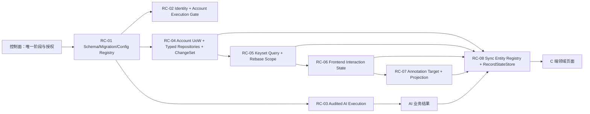
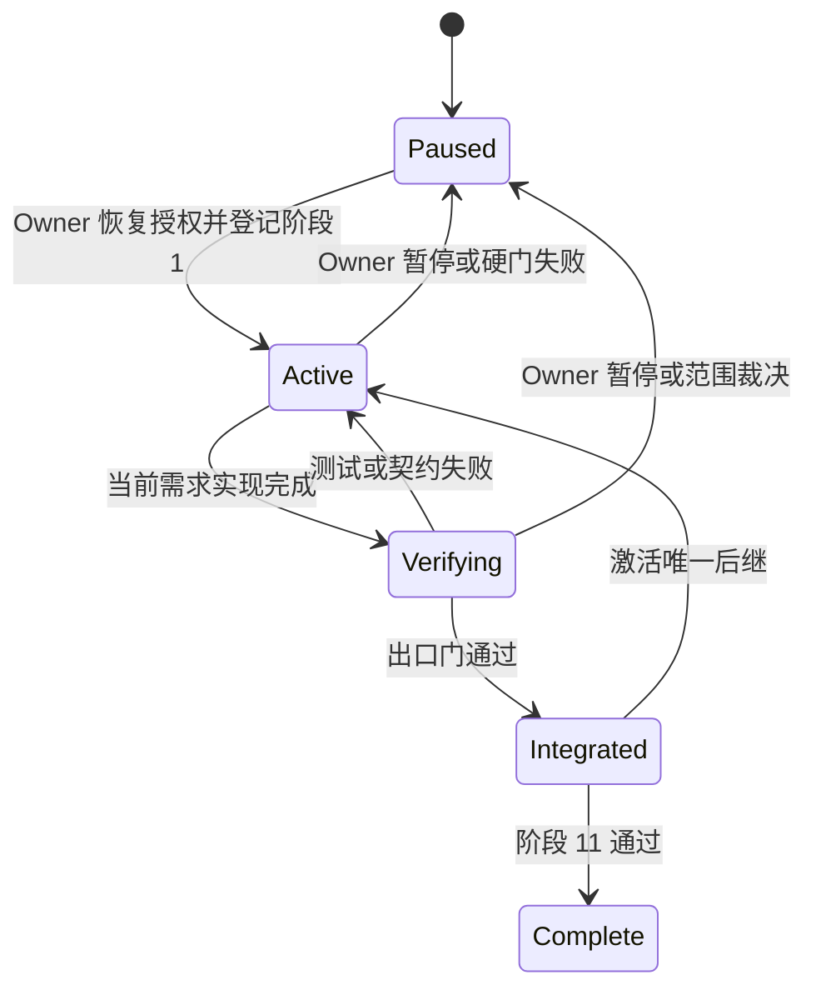
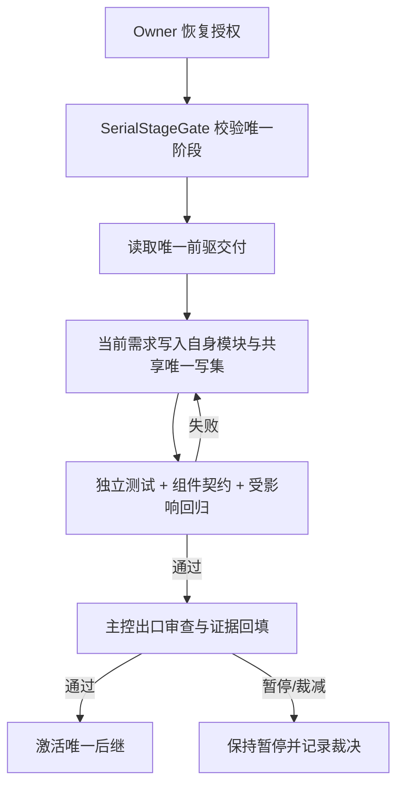
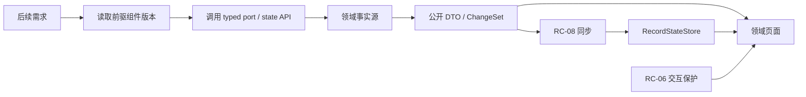

# V0516 跨需求共用底座与串行开发技术方案

|文档信息|内容|
|---|---|
|需求编号 / PRD|v0.5.16 版本级技术重基线；有效需求集合见本文 3.2.2|
|Owner / 协作角色|Owner；版本技术负责人、各领域模块、持久化、前端状态、测试与发布负责角色|
|文档状态 / 版本 / 日期|宏观重基线评审稿；1.0；2026-10-17|
|设计范围 / 预估规模|11 项有效需求、8 类跨需求复用组件、唯一严格串行开发链；不实施应用代码，不恢复已暂停的开发授权|

## 评审摘要

推荐把 v0.5.16 从“九项切片和条件并行”重基线为“11 项有效需求和一条严格串行链”。先抽取长期稳定的机制组件，再由每项需求按唯一顺序提供或消费这些组件；共享机制只承载事务、身份、审计、分页、交互保护、批注目标和同步注册等通用能力，不吸收领域业务语义。任何时刻只能有一个需求处于实现状态，当前项必须完成方案内测试、组件契约、共享写集集成和主控出口审查，下一项才可开始。本文是设计基线，不改变[控制面](../../coordination/current.json)的 `execution_enabled=false`。

|决策编号|Owner 决策事项|本轮结论及方案落实|排除的选择及代价|受影响章节 / 负责角色|
|---|---|---|---|---|
|D1|是否允许不同写集并行开发|不允许；11 项按本文唯一顺序逐个开发，测试、返修和共享文件集成也属于当前项|条件并行能缩短表面工期，但会重新引入 schema、config、frontend state 和 DTO 语义冲突|2.2、3.2.2、5.2；Owner 与版本技术负责人|
|D2|共用能力如何长期复用|采用 RC-01 至 RC-08 八类窄接口组件；组件 Owner 维护机制与不变量，领域维护业务语义|按需求复制工具会产生多套状态；万能仓储或万能状态机又会吞并领域所有权|2.1、3.1、3.4、3.6；模块 Owner|
|D3|旧 F1/F3/F4/F9 如何处理|新四份方案替代旧方案的后续设计；旧方案只保留历史事实和已发生证据|同时把新旧方案列为有效需求会重复开发并产生冲突验收|1.1、3.2.2；版本 Owner|
|D4|何时可以执行本顺序|只有控制面明确恢复授权并把有效集合、基线和当前阶段写入后才可开始阶段 1|把文档评审等同开发授权会越过 Owner 暂停决定|3.9、5.1、5.5；Owner 与主控|

## 资料来源与前提

|证据编号|资料 / 代码位置|版本或读取时间|支持的事实|可访问与核实状态|
|---|---|---|---|---|
|E-001|[设计契约](../../knowledge/design-contracts.md)|2026-10-17 生效|精准查询、记录级写、数据库分页、命令驱动变化和短事务是现行规则|已读取|
|E-002|[模块化设计](../../knowledge/modularization-design.md)|2026-10-17 读取|领域拥有业务语义，应用层编排跨域事务，共享层不得成为万能业务层|已读取|
|E-003|[研发准入卡点处置报告](2026-10-17-研发准入卡点处置报告.md)|2026-10-17|六份新规方案已关闭文档与架构卡点，但尚未实施|已读取|
|E-004|[评审索引](评审索引.md)|2026-10-17|旧九项、新六项及四组替代关系可定位|已读取|
|E-005|[v0.5.16 版本说明](../versions/v0.5.16/README.md)|2026-10-17 读取|旧页面仍记录九项和 F3-A，需重基线|已读取|
|E-006|[唯一控制面](../../coordination/current.json)|revision 417；2026-10-17|Owner 已暂停开发，`execution_enabled=false`|已读取|
|E-007|本地需求快照 `artifacts/local/requirements-current.json`|requirements revision 578；2026-10-17|需求池共 327 条，六条新规需求处于待规划且未关联计划版本|已读取；忽略目录|
|E-008|11 份有效独立技术方案|2026-10-17|各需求局部边界、接口、测试和回滚已分别定义|已读取|

|前提编号|假设、建议或待确认内容|采用依据|不成立的影响|核对方式 / 负责角色|
|---|---|---|---|---|
|A-001|恢复开发时仍采用模块化单体、PostgreSQL 单实例和现有前端构建链|E-001、E-002、E-006|若运行形态改变，RC-04、RC-08 的锁和投递边界需重评|激活阶段 1 前读取最新控制面和架构规则；版本技术负责人|
|A-002|串行顺序不承诺日期和工期|当前没有可信容量与排期证据|不能用本文推算发布日期|每项出口审查后按真实剩余工作更新计划；Owner|
|A-003|六条新规需求是否正式纳入计划上线版本仍由需求事实源决定|当前未设置计划上线版本|设计顺序成立，但发布集合可能缩小或分期|恢复开发前由 Owner 更新 Base 和控制面|

## 需求追踪

|需求点|设计章节|接口 / 实体 / 代码落点|验收用例|观测指标|
|---|---|---|---|---|
|识别跨需求共用依赖|2.1、2.2、3.4|`ReusableComponentContract`、RC-01 至 RC-08|TC-01、TC-02|重复机制数、越权依赖数|
|形成长期复用组件|3.1、3.5、3.6|八类 typed port、registry 与 state API|TC-03、TC-04|组件契约通过率|
|更新独立需求的版本位置|3.2.2、5.2|11 份方案的 `3.2.2` 与 `5.2`|TC-05|孤立需求数、前驱歧义数|
|严格逐个串行开发|2.2.2、3.6.3、5.2|`SerialStageGate`、控制面当前阶段|TC-06、TC-07|同时开发需求数|
|不越过 Owner 暂停|3.9、5.1、5.5|`coordination/current.json`|TC-08|未授权实现动作数|
|替代旧方案但保留历史|1.1、3.2.2、5.4|评审索引、版本说明、旧方案替代声明|TC-09|双重有效方案数|

## 名词解释

|名词|解释|语境|
|---|---|---|
|有效需求集合|去除被新方案替代的旧 F1/F3/F4/F9 后，本次版本重基线实际统筹的 11 条需求。|“恢复开发前，主控先验证有效需求集合、唯一顺序和当前阶段一致。”（3.1.1.1）|
|复用组件|具有稳定所有权和窄接口、可被多个需求调用但不包含具体领域业务规则的底层能力。|“共享机制只承载事务、身份、审计、分页、交互保护、批注目标和同步注册等通用能力，不吸收领域业务语义。”（评审摘要）|
|唯一前驱|当前需求开始开发前必须完成出口审查的唯一上一阶段；即使其他依赖已满足，也不能越级开工。|“每项只有一个唯一前驱和一个串行位置。”（3.2.2）|
|出口门|一项需求完成实现、测试、文档回填和共享集成后，主控据以判断是否解锁下一项的证据集合。|“当前项未通过出口门时，下一项保持未开始。”（2.2.2）|
|唯一写者|一个共享契约或热点文件在一个阶段内只有一个负责整合的人或模块，其他需求只通过公开端口消费。|“RC-01 是 schema、migration 与 typed config slice 的唯一写者入口。”（3.1）|
|ChangeSet|领域命令在同一事务中明确产生的记录变化集合，供审计、通知和同步使用，不通过整账户快照比较推断。|“RC-04 把业务命令、幂等回执和 ChangeSet 放在同一账户短事务中。”（3.1）|
|有界 rebase|同步游标失效时，仅按当前页面或详情作用域重新读取有限当前状态，不拉取整账户快照。|“RC-05 为 RC-08 提供有界 rebase 查询。”（3.1）|
|RecordStateStore|前端按实体键保存权威当前状态并应用记录变化的唯一缓存；页面只能通过它和交互状态读取。|“RC-08 在 F9 中扩展 RecordStateStore，但不得重建第二套阅读状态。”（3.1）|

## 评审记录

2026-10-17：用户要求从整个小版本宏观识别共用底层依赖，形成长期复用组件，回写各独立需求，并给出严格逐项而非并行的唯一开发顺序。本稿按该要求形成重基线；不代表控制面已恢复开发或六条待规划需求已获发布授权。

# 1. 项目背景

## 1.1 背景（必填）

旧 v0.5.16 以九项和 F3-A 为范围，并允许固定契约后条件并行。2026-10-17 的设计契约和研发准入复审新增六项修订需求，其中新 F1/F3/F4/F9 分别替代旧方案的后续设计，另有 AI 原子行审计和 AI 推理可见性。若简单把六项叠加到旧九项，会把四组替代项重复计算为 15 项，并让 schema、config、AI runtime、frontend state 与 sync 的共享写集再次发生并行竞争。

本次范围是版本级技术统筹：确定 11 项有效需求、抽取 8 类长期复用组件、把组件生产与消费关系写回独立方案，并确定严格串行顺序。范围外包括应用代码实现、排期承诺、需求状态变更、计划版本关联、部署和生产操作。旧方案中的真实开发与测试证据继续保留，但不再指导后续设计。

## 1.2 目标（必填）

|目标|基线与来源|目标值及状态|统计口径 / 窗口 / 样本|验收方式|
|---|---|---|---|---|
|有效范围唯一|旧九项与六项新规并存，E-004|11 项且四组替代关系唯一；本轮已确定|版本索引、README、11 份独立方案|TC-01、TC-09|
|共享组件唯一所有权|旧 K1-K6 与各方案局部定义分散|8 类组件均有 Owner、提供方、消费者和禁止边界；本轮设计目标|逐组件静态检查|TC-02 至 TC-04|
|开发严格串行|旧方案允许条件并行|同时处于实现或返修状态的需求数必须为 1；本轮已确定|控制面每次阶段切换|TC-06、TC-07|
|方案可独立执行|部分方案只写局部依赖|11 份方案均写明组件、唯一前驱、进入和出口条件|文档检查|TC-05|
|授权不漂移|E-006 当前暂停|本文交付后仍为暂停；确定性要求|控制面 diff 与命令审计|TC-08|

# 2. 总体方案设计

本方案增加版本级机制层，不增加运行时“总平台”。八类组件按现有模块归属维护，版本文档只规定跨需求契约、接入顺序和验收，不成为源码调用中心。

## 2.1 前期调研

11 份方案显示，共享问题集中在四类热点：一是 schema/migration/config 的顺序和装配；二是身份、账户资格、AI 准入与审计的调用前门；三是记录级事务、分页、变化生产和同步消费的数据链；四是阅读状态、选区、批注目标与增量重绘的交互链。旧 K1-K6 已覆盖部分边界，但把需求编号和一次性集成步骤混在一起，不足以表达长期 API 所有权。

组件划分遵循四条准则：

1. 多于一个需求消费，或后续同类需求显然会重复使用。
2. 接口可由机制不变量描述，不需要知道领域私有业务规则。
3. 有唯一 Owner、版本和兼容窗口，不靠共享文档复制状态。
4. 组件失败时能明确阻断或降级，不允许静默回到全账户读写、全量替换或第二套状态。

## 2.2 系统架构

|系统 / 协作方|职责与边界|输入 / 输出|本次变更|负责角色 / 证据|
|---|---|---|---|---|
|版本控制面|记录授权、当前唯一阶段、基线和出口证据|阶段状态 / 下一阶段许可|拟登记 `SerialStageGate` 语义，不改运行时|主控；E-006|
|schema 与 config 装配|维护 migration registry 和 typed config slices|组件版本 / 装配结果|形成 RC-01|持久化与应用装配角色|
|认证与账户执行|精准解析身份，签发运行/清理令牌|身份、账户状态 / token|形成 RC-02|认证、账户生命周期角色|
|AI 运行时|审计准入、取消检查、供应商尝试与 usage|invocation contract / 原子审计行|形成 RC-03|AI runtime、审计角色|
|领域与应用工作流|维护领域不变量，编排必要跨域原子命令|typed command / 业务结果、ChangeSet|形成 RC-04|领域与应用角色|
|有界查询层|keyset 分页和 rebase scope|query / page、detail|形成 RC-05|thoughts 与各领域查询角色|
|前端状态层|保护 scope、generation、阅读锚点、焦点和选区|记录变化 / 稳定交互状态|形成 RC-06|frontend.state|
|批注领域|维护目标、线程与计数权威投影|target command / thread projection|形成 RC-07|annotations|
|同步层|注册实体 transport、rebase 与合并策略|ChangeSet / record batch|形成 RC-08|sync 与 frontend.state|
|C 端|通过公开 DTO、state API 和领域 feature 使用能力|用户操作 / 可见结果|不直接依赖审计表、私有表或 transport|前端领域角色|
|AI 模型服务端|接受审计准入后的供应商请求|实际请求 / 实际响应|接口不变；由 RC-03 包装|外部依赖|



### 2.2.1 业务新流程

Owner 恢复开发后，主控只激活阶段 1。当前需求完成时，用户侧能力和技术护栏按其独立方案验收；主控核对共享组件契约、回归范围和文档回填，形成出口证据。只有出口门通过，当前需求才转为已集成，下一需求进入开发。任一阶段失败就留在当前阶段修复或正式裁减范围，不允许先开发后续项等待回头集成。

最终 F9 才连接所有稳定生产者、DTO、查询范围和交互保护，完成记录级同步。这样 F9 不需要为尚未稳定的领域类型制造临时适配器，也不会用同步实现反向定义业务状态。

### 2.2.2 技术新流程



技术上每个阶段使用同一模式：读取前驱交付的公开契约；只修改本阶段登记的领域文件和共享唯一写集；运行独立方案测试与受影响回归；回填真实证据；主控原子更新当前阶段。当前项未通过出口门时，下一项保持未开始。

## 2.3 可选方案对比

|方案|满足目标程度|复杂度与成本|性能 / 稳定性|兼容 / 迁移 / 回滚|主要限制|
|---|---|---|---|---|---|
|A：八类复用组件 + 11 项严格串行|完整满足|总历时可能更长，协调最简单|共享边界逐步稳定，失败范围最小|每阶段可单独回退，替代关系清楚|必须接受无并行开发|
|B：先建统一平台再开发需求|过度满足机制统一，延迟用户价值|一次性重构大|平台成为新单点，验证面大|迁移和回滚跨所有领域|违反模块化单体的领域所有权|
|C：各需求自带 helper 并按写集并行|短期快，长期不满足复用|初期低、后期合并高|重复状态和语义漂移风险高|末期才暴露组合错误|与用户明确的逐项开发要求冲突|

采用方案 A。只有 Owner 明确撤销严格串行要求，且控制面重新登记互斥写集和组合验证责任时，才可重评并行；不能由开发者自行解释为“文件不同即可并行”。

# 3. 详细方案设计

## 3.1 详细设计（必填）

|组件|唯一 Owner 与职责|稳定接口 / 数据|首个提供阶段|后续消费者|禁止边界|
|---|---|---|---|---|---|
|RC-01 Schema/Migration/Config Registry|持久化 migration owner 与应用装配 owner；统一顺序、版本、回滚和 typed slice|`MigrationDescriptor`、`ConfigSlice<T>`、能力版本|阶段 1 建立登记规则；各阶段串行扩展|全部 11 项|不存领域业务状态；不允许各需求绕过 registry 改共享入口|
|RC-02 Account Identity & Execution Gate|auth 拥有身份查询；lifecycle 拥有业务资格、`RunToken` 与 `CleanupToken`|`AccountIdentityPort`、`AccountExecutionGate`|阶段 2 提供身份端口，阶段 3 完成 gate|F5、F3、后台任务、F9|认证成功不等于业务可执行；cleanup token 不授予普通业务读写|
|RC-03 Audited AI Execution|AI runtime 拥有 invocation contract、审计硬门、取消准入和 usage attempt|`InvocationContractRegistry`、`AuditedAiExecution`|阶段 1；阶段 4 增强可取消准入|F5、推理可见性、全部 AI 场景|审计表不作为产品 DTO；begin 失败不得调用供应商|
|RC-04 Account UoW & Typed Repositories|应用层拥有 UoW 编排，领域拥有 typed repository，persistence 拥有事务原语|`AccountUnitOfWork`、`ChangeSet`、幂等回执、sync head|阶段 5|F4、推理结果、F9|禁止万能 CommandPlan、全账户快照比较和普通路径全量回退|
|RC-05 Keyset Page & Rebase Query|领域 query owner 维护稳定 tuple、scope hash 和单页上限|`KeysetPageContract<T>`、`RebaseScopeReader<T>`|阶段 6|F7、F6、F8、F9|不承载页面交互状态；禁止应用层内存全扫代替 DB 分页|
|RC-06 Frontend Interaction State|frontend.state 唯一拥有 scope/generation/阅读锚点/焦点/选区保护|`FrontendInteractionState`|阶段 7，阶段 9 补选区保护|F6、F8、F9|不保存领域事实；页面不得各建 scroll、expanded 或 selection 副本|
|RC-07 Annotation Target & Projection|annotations 拥有目标契约、线程和计数权威投影|`AnnotationTargetContract`、`ThreadProjection`|阶段 8|F8、F9|计数不由 UI、同步或页面重新推导|
|RC-08 Sync Entity Registry & Record State|sync 拥有 transport/cursor；frontend.state 拥有实体缓存和合并|`SyncEntityRegistry`、`RecordStateStore`|阶段 11|所有已登记实体与页面|不同步整账户快照；transport 不含领域合并规则|

RC-01 是 schema、migration 与 typed config slice 的唯一写者入口。RC-04 把业务命令、幂等回执和 ChangeSet 放在同一账户短事务中。RC-05 为 RC-08 提供有界 rebase 查询。RC-08 在 F9 中扩展 RecordStateStore，但不得重建第二套阅读状态。

### 3.1.1 生产链路

|上游 / 触发入口|输入与协议|调用方式 / 频率|校验与转换|输出 / 状态 / 副作用|改动与证据|
|---|---|---|---|---|---|
|Owner 恢复决定|控制面授权与阶段号|人工、低频|核对有效集合、基线和暂停项|唯一 active stage|拟新增版本级 gate|
|当前需求实现|独立方案、前驱组件版本|每阶段一次或返修|检查前驱出口证据和写集|代码、migration、契约测试|沿用各方案|
|领域命令|身份、run token、命令 DTO|同步请求或后台任务|typed repository 校验不变量|业务结果、幂等回执、ChangeSet|RC-02、RC-04|
|AI 调用|invocation contract、SP/UP、deadline|按业务触发|审计 begin、账户 gate、取消准入|供应商尝试、usage、终态|RC-03|
|页面交互|scope、generation、target、selection|用户操作|状态保护与领域命令分离|稳定阅读状态、批注结果|RC-05 至 RC-07|
|记录提交|ChangeSet、sync head|每次真实提交|实体 registry 验证 producer coverage|record changes、提交通知|RC-04、RC-08|



|处理动作|原所在事务|本次事务|事务粒度|事务内新增逻辑|事务外与提交后|
|---|---|---|---|---|---|
|切换串行阶段|控制面 JSON 原子更新；E-006|沿用文件原子替换，不是 DB 事务|一个版本、一个当前阶段|校验前驱出口证据、授权和 active 数量|提交后下一项才可创建实现任务|
|登记 schema/config|各方案直接改共享文件，顺序靠人工|migration registry 自身无业务 DB 事务；migration 按单次发布事务规则|一个 migration 或 config slice|唯一 ID、依赖版本、回滚和 owner 校验|装配成功后消费者才启用|
|执行领域命令|旧路径按各方案，有全账户事务风险|RC-04 账户短 DB 事务|一个账户和命令必要闭包；账户锁仅覆盖 SQL|条件写、幂等回执、ChangeSet、sync head|模型调用和重计算在事务外；提交后通知|
|执行 AI 尝试|旧审计可能文件 append 或分散写|RC-03 audit begin/finish 与 usage 各按方案记录级事务|一个 callId 和一次真实供应商尝试|begin 硬门、终态、usage attempt|供应商 I/O 必须在 begin 提交后|
|提交前端交互|无 DB 事务；浏览器单线程状态更新|无 DB 事务；RC-06 原子 reducer 批次|一个 account/scope/generation|保护锚点、焦点与选区|DOM 渲染和滚动恢复在状态提交后|

#### 3.1.1.1 处理阶段与新增配置

恢复开发前，主控先验证有效需求集合、唯一顺序和当前阶段一致。实现期不新增一套环境变量作为版本调度器；唯一授权与阶段仍保存在控制面，运行时配置由 RC-01 将各组件现有开关装配为 typed slices。

|配置键|类型 / 默认值|作用域 / 负责模块|读取与生效时机|配置依赖 / 关闭行为|依据|
|---|---|---|---|---|---|
|`serialStage.activeRequirementId`|string / 无激活值|版本控制面|任务创建和阶段切换时读取|控制面暂停时为空；不得从 Git 分支推断|D1、D4|
|`serialStage.predecessorEvidenceRevision`|integer / 无|版本控制面|激活下一项前|缺失时阻断|出口门|
|`componentVersions`|map / 已部署版本|应用装配|启动时构造 typed slices|版本不满足时对应能力保持关闭|RC-01|

以下是控制面语义示例，不要求把它原样加入应用运行配置：

```json
{
  "serialStage": {
    "activeRequirementId": null,
    "predecessorEvidenceRevision": null
  },
  "componentVersions": {
    "RC-01": "design-1",
    "RC-02": "disabled",
    "RC-03": "disabled",
    "RC-04": "disabled",
    "RC-05": "disabled",
    "RC-06": "disabled",
    "RC-07": "disabled",
    "RC-08": "disabled"
  }
}
```

#### 3.1.1.2 接口与数据处理

阶段 gate 只处理版本执行资格，不替代 Git、测试或发布系统。组件版本由提供阶段交付，消费阶段只能依赖已通过契约测试的公开接口。领域数据继续由领域表和业务结果记录作为事实源；版本 registry 只保存能力版本和依赖，不复制业务数据。

### 3.1.2 消费链路



|处理动作|原所在事务|本次事务|事务粒度|事务内新增逻辑|事务外与提交后|
|---|---|---|---|---|---|
|消费组件契约|文档引用，无事务|无 DB 事务；编译/契约检查|一个调用模块和组件版本|接口版本、禁止依赖和默认行为校验|构建通过后才进入集成测试|
|读取领域页面|旧 F4 可能全量内存分页|RC-05 使用只读 DB 查询；不持有写锁|一个账户、scope 和有上限页|scope hash、稳定 tuple、上限|返回后由 RC-06 保护交互状态|
|消费批注投影|页面可能局部推导|必要更新随 RC-04 命令同事务；读取无事务|一个 target/thread|权威 count/version|提交后页面按 ACK 或同步变化更新|
|消费记录变化|旧 F9 域快照读取|batch/rebase 只读短事务；前端 reducer 无 DB 事务|一个账户、cursor、有限 batch 或 scope|实体版本和 scope membership 校验|批次提交后一次渲染；失败不部分可见|

#### 3.1.2.1 消费入口

|下游 / 消费面|入口与版本|读取字段 / 数据来源|转换 / 打包 / 缓存|本次改动与兼容性|验收用例|
|---|---|---|---|---|---|
|认证和账户页面|RC-02 v1|身份、账户状态、诊断 DTO|不缓存密码材料|新字段 additive；旧端保持通用错误|TC-03|
|AI 工作流|RC-03 v1|invocation contract、audit callId、usage|每次尝试独立|begin 失败硬拒绝|TC-04|
|thoughts 页面|RC-05 v1、RC-06 v1|page summary、detail、interaction state|RecordStateStore 在 F9 前不启用为权威|旧 page 参数按 F4 方案退场|TC-05|
|annotations 页面|RC-07 v1|target、thread、count、version|领域投影，不由 UI 聚合|现有接口 additive|TC-05|
|推理展示|RC-03、领域 DTO、RC-06|业务结果中的 reasoning 字段|共享折叠组件|未知和历史记录默认隐藏|TC-04|
|同步 transport|RC-04、RC-05、RC-08 v1|record changes、rebase scope|frontend.state 唯一合并|未登记类型保持 v1，禁止双权威|TC-07|

#### 3.1.2.2 协议、打包与改动边界

组件使用显式版本；新增字段默认 optional，未知字段由旧消费者忽略。RC-04 的 ChangeSet、RC-05 的 page cursor 与 RC-08 的 sync cursor 是三种不同契约，不能复用同一个数字或 token。前端打包产物可以继续修改现有 `.mjs` 输出，但新增源码模块必须按项目规则使用 `.mts` 并由构建产出，不能手写第二套运行时副本。

#### 3.1.2.3 消费验收

消费验收以 TC-03 至 TC-07 为准：每个消费者只能导入公开端口；旧新协议组合必须有默认行为；页面在迟到 ACK、记录变化、重绘和账户切换后保持事实与交互状态一致；F9 必须证明所有启用类型的 producer coverage，而不能用抽样替代。

## 3.2 外部依赖

### 3.2.1 依赖方与诉求

|依赖方 / 负责角色|诉求与交付物|协议 / 版本|就绪条件 / 证据|联调与发布先后|失败或延期处置|
|---|---|---|---|---|---|
|Owner / 主控|恢复授权、有效集合和唯一 active stage|控制面 revision|`execution_enabled=true` 且阶段 1 已登记|所有实现之前|继续暂停，不创建开发任务|
|11 项需求 Owner|独立方案内写明 RC 消费/提供、前驱和出口|本文 v1|文档链接与语义检查通过|阶段激活前|需求保持未开始|
|模块 Owner|维护 typed port 和禁止边界|RC-01 至 RC-08 v1|契约测试和依赖检查通过|提供阶段先于消费阶段|停留当前阶段修复|
|PostgreSQL|additive migration、索引和回滚|schema registry|迁移与旧读者兼容通过|按 11 阶段串行|不得让下一需求先写 schema|
|测试与发布角色|阶段出口、组合回归和候选证据|测试矩阵|实际 revision 绑定证据|每阶段出口；最终发布另审|证据不足不解锁后继|

### 3.2.2 有效需求、复用组件与唯一串行位置

每项只有一个唯一前驱和一个串行位置。这里的“完成”指通过该项出口门，不是仅完成编码；阶段内设计补正、实现、测试、返修、共享集成和开发回填均属于同一项，禁止与下一项重叠。

|阶段|有效需求 / 方案|唯一前驱|消费组件|本阶段提供或扩展|进入条件|出口门与解锁后继|
|---|---|---|---|---|---|---|
|1|AI 请求原子行审计 `reczz28ORRaxSCBn`|控制面恢复授权|RC-01 登记骨架|RC-01 首批 schema/migration 登记；RC-03 审计硬门、usage repository|授权、隔离 PG、方案 1.2|begin 失败零供应商调用；每次尝试一行；解锁新 F1|
|2|新 F1 认证精准查询 `reczz28ORRaxPAap`|阶段 1|RC-01|RC-02 `AccountIdentityPort`|audit schema 已稳定且 migration owner 可接入|精准查询、position 退场和旧新组合通过；解锁 F2|
|3|F2 账户恢复故障隔离 `reczz28NLb1qzsCc`|阶段 2|RC-01、RC-02 身份端口|RC-02 `AccountExecutionGate`、`RunToken`、`CleanupToken`|认证错误边界稳定|健康/隔离/恢复中账户与全局 readiness 通过；解锁 F5|
|4|F5 AI 排队取消与超时 `reczz28NLb1qxhIC`|阶段 3|RC-02、RC-03|RC-03 可取消准入、deadline、NoIoProof|账户 gate 与审计硬门稳定|取消/到期离队、派发前复验和预算幂等通过；解锁新 F3|
|5|新 F3 记录级持久化 `reczz28ORRaxPiK3`|阶段 4|RC-01、RC-02|RC-04 UoW、typed repositories、ChangeSet、sync head|AI 和账户生命周期不再依赖全账户写|首批命令 producer coverage、短事务和禁止 fallback 通过；解锁新 F4|
|6|新 F4 数据库游标分页 `reczz28ORRaxSFnV`|阶段 5|RC-01、RC-04|RC-05 keyset page、bounded query、rebase scope|thoughts 命令与读模型生产者稳定|数据库分页、索引、旧 URL 退场和有界查询通过；解锁 F7|
|7|F7 追问批注阅读状态保持 `reczz28JmeyoL7D0`|阶段 6|RC-05|RC-06 scope/generation/reading anchor/focus|page/detail 边界稳定|展开、滚动、账户切换、迟到结果保护通过；解锁 F6|
|8|F6 批注入口与计数一致 `reczz28JmUJNsOl9`|阶段 7|RC-04、RC-05、RC-06|RC-07 target/thread/count projection|阅读状态唯一所有权稳定|入口唯一、线程/回复计数和失败回滚通过；解锁 F8|
|9|F8 iOS PWA 选字批注 `recvxlWptXiRfk`|阶段 8|RC-06、RC-07|RC-06 selection protection 与原生选区适配|批注目标和阅读恢复稳定|Safari/PWA 真机、跨行选区、锚点恢复通过；解锁推理可见性|
|10|AI 推理可见性 `reczz28ORRaxQBcy`|阶段 9|RC-03、RC-04、RC-06|invocation 可见性 registry、领域 reasoning DTO、共享 disclosure UI|AI 审计、领域结果写入和共享前端状态稳定|五场景、consent、默认隐藏、DTO 权限和 UI 通过；解锁新 F9|
|11|新 F9 记录级同步 `reczz28ORRaxQJDJ`|阶段 10|RC-04、RC-05、RC-06、RC-07 及稳定 DTO|RC-08 entity registry、transport、RecordStateStore|全部目标 producer、query、DTO、交互保护已稳定|batch/rebase、断线续传、合并、性能和组合验收通过；完成开发链|

旧 F1 `reczz28NLb1qyuSM`、旧 F3 `reczz28NmXA3HYn6`、旧 F4 `reczz28NLb1qxaIE`、旧 F9 `recvxyrQv7utyV` 不再作为独立开发阶段；其历史证据分别由阶段 2、5、6、11 的新方案承接。

## 3.3 异常处理（必填）

|异常点|处理策略|重试 / 幂等 / 补偿|持久化与用户影响|监控与恢复条件|
|---|---|---|---|---|
|控制面仍暂停|拒绝激活阶段 1|无自动重试，等待 Owner 明确决定|不产生应用代码或需求状态变化|`execution_enabled=true` 后重新核对|
|同时出现两个 active requirement|视为 P0 流程不变量破坏，停止两者共享集成|主控撤销较晚激活记录并审计差异|未合入代码隔离；用户能力不应放量|active 数恢复为 1 且写集核清|
|前驱证据缺失或失效|当前项不得开始|前驱在原阶段补测；候选变化后重跑受影响证据|不把 mock 或旧 revision 当通过|出口证据绑定最新基线|
|组件契约需要破坏性修改|退回组件首个提供阶段修订，并重评全部消费者|新版本号，不覆盖旧契约|已发布读者保持兼容窗口|消费者矩阵和迁移测试通过|
|schema migration 失败|停留当前阶段并执行该项回滚|migration ID 幂等；不得跳过登记|不开运行时能力|旧新 schema round-trip 通过|
|领域请求绕过 typed port|阻断合入|修正依赖，不提供临时私表 helper|用户行为保持旧路径|静态依赖和契约测试通过|
|F9 发现 producer coverage 缺口|不得启用该实体 v2；若为版本必需则退回对应生产阶段|补生产者与回归，不用全快照兜底|该类型维持 v1 权威|coverage=complete|
|当前项延期或取消|Owner 重算剩余依赖闭包|正式更新有效集合与后继前驱|不得静默越级|新版本文、索引和控制面一致|

## 3.4 数据实体（必填）

```typescript
type ReusableComponentContract = {
  componentId: string
  version: string
  ownerModule: string
  providedByRequirementId: string
  consumers: string[]
  invariants: string[]
  forbiddenDependencies: string[]
}

type SerialStage = {
  order: number
  requirementId: string
  predecessorRequirementId: string | null
  status: "paused" | "not_started" | "active" | "verifying" | "integrated"
  componentInputs: string[]
  componentOutputs: string[]
  evidenceRevision: number | null
}

type ChangeSet = {
  accountId: string
  commandId: string
  syncCursor: string
  changes: RecordChange[]
}

type RecordChange = {
  entityType: string
  entityId: string
  operation: "upsert" | "delete"
  entityVersion: string
  scopeKeys: string[]
}
```

|实体 / 字段路径|类型 / 必选性 / 默认值|含义 / 单位 / 枚举|生产方 / 消费方 / 事实源|存储、索引与生命周期|兼容 / 迁移|
|---|---|---|---|---|---|
|`ReusableComponentContract.componentId`|string / 必选|RC-01 至 RC-08|版本技术负责人 / 各需求|文档与契约测试登记；长期保留|新增版本不复用旧 ID 语义|
|`ReusableComponentContract.version`|string / 必选|接口兼容版本|组件 Owner / 消费者|代码 registry；随发布|破坏性变化升版本|
|`SerialStage.order`|integer / 必选|1 至 11 唯一顺序|主控 / 控制面|控制面；一个版本有效|重排需 Owner 新决定|
|`SerialStage.status`|enum / 必选|阶段状态|主控 / 所有角色|控制面事实源|旧控制面可先只保存 active task|
|`ChangeSet.syncCursor`|opaque string / 必选|独立同步 head|RC-04 / RC-08|PostgreSQL；按 F3/F9 保留|不复用账户 revision|
|`RecordChange.scopeKeys`|string[] / 必选，可空数组|可受影响的有界作用域|领域命令 / rebase 与 state|record_changes 索引；可裁剪|未知类型不启用 v2|

上述版本级实体不要求新建通用业务表。`ReusableComponentContract` 可先由源码 registry 和文档生成；`SerialStage` 继续使用控制面；`ChangeSet` 与 `RecordChange` 按 F3/F9 独立方案落 PostgreSQL。

## 3.5 接口定义（必填）

|接口 / 消息 / 回调|调用方 → 提供方|新增 / 修改 / 复用|协议版本与详细定义|
|---|---|---|---|
|`AccountIdentityPort`|认证 service → auth repository|拟新增|RC-02 v1；按 username/token/userId 精准查询|
|`AccountExecutionGate.authorize`|HTTP/任务/AI → lifecycle|拟新增|RC-02 v1；返回 `RunToken` 或结构化隔离错误|
|`AuditedAiExecution.run`|AI workflow → AI runtime|拟新增|RC-03 v1；audit begin 成功后才允许 provider I/O|
|`AccountUnitOfWork.run`|应用工作流 → persistence|拟新增|RC-04 v1；注入事务作用域 typed repositories|
|`KeysetPageContract.query`|HTTP/query → 领域 repository|拟新增|RC-05 v1；scope、limit、opaque cursor|
|`FrontendInteractionState.apply`|领域 feature/sync → frontend.state|拟新增|RC-06 v1；account、scope、generation、mutation|
|`AnnotationTargetContract.resolve`|annotations UI/service → annotations|拟新增|RC-07 v1；返回权威 target/thread projection|
|`SyncEntityRegistry.register`|领域适配器 → sync|拟新增|RC-08 v1；声明 decode、merge、scope 和 rebase reader|
|`SerialStageGate.activateNext`|主控 → 控制面|版本流程语义|design v1；不作为应用 HTTP 接口|

接口统一要求：调用者不得绕过提供模块读取私有表；错误码由组件命名空间定义；超时、重试、幂等和鉴权仍由各独立方案细化。`SerialStageGate` 只接受 Owner 已恢复授权、唯一前驱 `integrated`、出口证据 revision 有效且当前无 active 项的激活请求。

## 3.6 代码设计

### 3.6.1 代码落点

|文件 / 模块|改造点|复用边界 / 调用关系|证据或拟新增标记|
|---|---|---|---|
|`src/shared/persistence/migrations/registry.mts`|RC-01 migration descriptor 与顺序|只管理 schema 生命周期|拟新增|
|`src/app/runtime/config-slices.mts`|RC-01 typed config 装配|业务入口只取本场景 slice|拟新增|
|`src/modules/auth/ports/account-identity.mts`|RC-02 身份端口|auth service 唯一调用入口|拟新增|
|`src/app/account-execution-gate.mts`|RC-02 run/cleanup token 装配|消费 lifecycle 公开状态|拟新增|
|`src/modules/ai/runtime/audited-execution.mts`|RC-03 审计硬门与调用尝试|不向产品 DTO 暴露 audit repository|拟新增|
|`src/shared/persistence/account-unit-of-work.mts`|RC-04 事务与 typed adapter 注入|不解释领域命令|拟新增|
|`src/modules/thoughts/query/keyset-page.mts`|RC-05 thoughts page/rebase|领域拥有 SQL 和排序 tuple|拟新增|
|`src/frontend/state/interaction-state.mts`|RC-06 reducer 与保护规则|构建后由现有 frontend runtime 装配|拟新增|
|`src/modules/annotations/ports/annotation-target.mts`|RC-07 目标与投影|领域页面只消费公开 DTO|拟新增|
|`src/app/sync/entity-registry.mts`|RC-08 服务端实体登记|依赖领域 query/serializer|拟新增|
|`src/frontend/state/record-state-store.mts`|RC-08 客户端合并|复用 RC-06，不拥有阅读语义|拟新增|
|`coordination/current.json`|唯一 active stage 和授权|仅主控按真实事件更新|已有；本稿不修改|

路径是版本级拟新增落点，开发开始时需按最新代码树核对；不得因为表中列出路径就越过控制面或提前创建文件。

### 3.6.2 核心伪代码

```python
def activate_next_stage(control, requested_requirement_id, evidence):
    if not control.authorization.execution_enabled:
        raise DevelopmentPaused()
    if control.active_requirement_id is not None:
        raise ConcurrentStageForbidden()
    expected = control.serial_plan.next_requirement()
    if requested_requirement_id != expected.requirement_id:
        raise OutOfOrderStage()
    if expected.predecessor_id is not None:
        verify_exit_evidence(expected.predecessor_id, evidence)
    return control.atomic_update(
        active_requirement_id=requested_requirement_id,
        predecessor_evidence_revision=evidence.revision,
    )


async def execute_domain_command(identity_input, command):
    identity = await account_identity_port.resolve(identity_input)
    run_token = await account_execution_gate.authorize(identity.account_id, command.kind)
    prepared = await prepare_external_inputs(command)
    return await account_unit_of_work.run(
        account_id=identity.account_id,
        run_token=run_token,
        operation=lambda repositories: apply_typed_command(
            repositories=repositories,
            command=command,
            prepared=prepared,
        ),
    )


async def execute_ai_attempt(invocation, provider_request):
    run_token = await account_execution_gate.authorize(
        invocation.account_id,
        invocation.scene,
    )
    audit_call = await audited_ai_execution.begin(invocation, run_token)
    try:
        ensure_not_cancelled(invocation)
        response = await call_provider(provider_request, invocation.signal)
        await audited_ai_execution.finish_success(audit_call, response)
        return response
    except Exception as error:
        await audited_ai_execution.finish_failure(audit_call, error)
        raise


def apply_sync_batch(state, interaction_state, batch):
    verify_cursor_continuity(state.cursor, batch.from_cursor)
    draft = state.begin_batch()
    for change in batch.changes:
        adapter = sync_entity_registry.require(change.entity_type)
        adapter.apply(draft, change)
    interaction_state.protect_before_commit(draft.affected_scopes)
    draft.commit(cursor=batch.to_cursor)
    interaction_state.restore_after_commit(draft.affected_scopes)
```

#### 3.6.2.1 关键动作实现细节

|函数签名|输入|输出|复用逻辑|不直接复用|
|---|---|---|---|---|
|`activate_next_stage(control, requirementId, evidence)`|授权、当前阶段、前驱证据|新控制面 revision|复用控制面原子更新|不复用 Git 分支存在性；它不能证明阶段获准|
|`AccountExecutionGate.authorize(accountId, action)`|账户和动作|`RunToken` 或错误|复用 F2 恢复状态|不直接复用 auth success；它不表示存储可用|
|`AuditedAiExecution.run(invocation, fn)`|调用契约和 provider 函数|结果或终态错误|复用审计、usage、取消准入|不复用产品 reasoning DTO；隐私目的不同|
|`AccountUnitOfWork.run(accountId, operation)`|账户、typed operation|业务结果和 ChangeSet|复用账户锁、事务、幂等原语|不接受万能物理写计划|
|`FrontendInteractionState.apply(mutation)`|scope/generation/交互变化|下一状态|复用 F7/F8 保护规则|不保存领域实体正文|
|`RecordStateStore.applyBatch(batch)`|连续记录变化|新 cursor 和实体状态|复用 entity registry 与 interaction protection|不复用旧整页替换 projector 作为 v2 权威|

### 3.6.3 关键实现约束

1. 同时处于 `active` 或 `verifying` 的需求总数不得超过 1，对应 TC-06。
2. 只有主控可以切换阶段；分支、工作树、提交或文档状态都不是授权，对应 TC-08。
3. RC-01 至 RC-08 均有唯一 Owner；消费者不得导入私有 adapter、表或页面局部状态，对应 TC-03。
4. 共享组件不解释领域业务语义；领域命令不把物理 SQL 计划泄漏给 persistence，对应 TC-04。
5. 普通局部操作禁止整账户读、清写、快照比较或异常时静默全量回退，对应 TC-04。
6. frontend.state 是实体缓存与交互保护的唯一所有者；F9 transport 只投递，不决定业务合并，对应 TC-07。
7. 旧四份方案只保留历史证据，不得被任务入口重新激活，对应 TC-09。

## 3.7 监控告警（必填）

|指标 / 告警|口径与单位|维度与基数限制|阈值 / 窗口 / 样本|严重度 / 负责角色|告警后动作 / 看板|
|---|---|---|---|---|---|
|`serial_active_requirements`|当前 active+verifying 数|版本，不含 requirementId 高基数扩展|必须为 0 或 1；每次控制面更新|P0 / 主控|>1 立即暂停并核共享写集|
|`stage_exit_evidence_valid`|有效出口证据项 / 必需项|版本、阶段|激活后继时必须 100%|P0 / 测试角色|拒绝阶段切换|
|`component_contract_failures`|契约测试失败次数|componentId 仅 8 值|任一失败阻断当前阶段|P1 / 组件 Owner|回到提供阶段修复|
|`forbidden_dependency_count`|静态检查发现的越权导入数|模块类别|必须为 0|P1 / 模块 Owner|阻断合入|
|`full_account_fallback_count`|普通路径全量 fallback 次数|场景低基数|必须为 0|P0 / 持久化角色|停用新路径并定位|
|`sync_producer_coverage_gap`|启用类型未覆盖生产者数|entityType 受控枚举|必须为 0|P0 / F3/F9|该类型保持 v1|
|各需求用户指标|沿用独立方案|按各方案限制|按各方案硬门|对应 Owner|不在本文复制阈值|

## 3.8 稳定性

### 3.8.1 容量与性能

版本级调度本身是低频控制面，不进入请求性能预算。组件运行时容量由独立方案量测，但必须汇总三类放大：单命令 SQL 数约为必要闭包行数而非账户总记录数；AI 尝试数等于真实 provider 尝试数且每次至少一行审计；同步传输量约为有效 record changes 加有界 rebase，不得退化为账户快照大小。F9 最终阶段复测组合容量，不能用单组件基准替代。

### 3.8.2 一致性与幂等

阶段切换以控制面 revision 为乐观并发键，重复激活同一阶段返回现状，越级或并发激活失败。RC-04 的命令 ID 是业务幂等键，ChangeSet 与业务写同事务；RC-03 的 callId 对应一次真实供应商尝试；RC-08 按 entityType、entityId、entityVersion 去重并要求 cursor 连续。三类键互不替代。

### 3.8.3 降级与回滚

当前阶段异常时只回退该阶段开关、代码或 additive schema 的使用，不自动撤销已经稳定的前驱组件。破坏组件契约时暂停后继并回到提供阶段升版本。F9 可按实体类型停止 v2 并保持 v1，但不得同时让两套状态成为同一实体的权威。回滚细节以各方案 5.4 为准。

### 3.8.4 安全与日志

控制面不记录凭据和用户正文。RC-03 私有审计按现行隐私规则保存 SP、UP、reasoning 和 usage，产品 DTO 不读取审计表。RC-02 token 只在进程内传递且绑定账户、动作和短生命周期。指标不使用账户 ID、callId 或 recordId 作为标签；受控诊断日志按权限查询。

## 3.9 实验方案

### 3.9.1 开关与灰度

本文没有统一业务开关；各组件继续使用独立方案已定义的开关和白名单。版本级唯一门是控制面授权与当前阶段。阶段 1 至 11 可以在各自内部按测试账户、小流量和全量推进，但在该项完成出口审查前，下一项仍不得开始开发。

### 3.9.2 核心验收指标

核心流程指标是：11 项顺序无歧义、active 数不超过 1、组件契约失败为 0、越权依赖为 0、普通全账户 fallback 为 0、F9 启用实体 producer coverage 缺口为 0。用户功能与延迟目标沿用各方案；当前已知 F9 P75 未达标的阻塞不能因文档重基线被关闭。

### 3.9.3 效果观测

每阶段比较接入前后的 SQL 行数、事务时长、错误率和用户链路，样本与阈值按独立方案。版本级观察依赖等待、返修次数、契约破坏和阶段停留时间，仅用于改进顺序，不按代码量或阶段速度评价个人。全部阶段结束后才运行组合候选验证。

# 4. 开发测试

## 4.1 开发明细（必填；评审时留空，开发结束后填写）

## 4.2 测试方案（必填）

|用例编号 / 对应需求|环境与前置条件|输入 / 操作 / 故障注入|预期输出 / 持久化 / 用户行为|监控与通过标准|
|---|---|---|---|---|
|TC-01 有效集合|文档工作区|枚举旧九项和六项新规，应用替代关系|仅 11 项有效；旧四项可追溯但不可激活|重复或遗漏为 0|
|TC-02 组件覆盖|11 份方案|逐项映射 RC 输入/输出|每项至少一个明确组件关系；八类均有 Owner|孤立组件和无主组件为 0|
|TC-03 模块边界|静态依赖夹具|尝试从消费者导入私有 adapter/table|构建或门禁失败；公开 port 正常|forbidden dependency=0|
|TC-04 数据边界|隔离 PG、测试账户|执行身份、AI、领域命令和分页|无整账户读清写；审计硬门、ChangeSet 和有界查询成立|full-account fallback=0|
|TC-05 独立方案位置|11 份方案|检查 `3.2.2` 与 `5.2`|组件、前驱、进入、交付、后继一致|前驱歧义=0|
|TC-06 串行互斥|控制面 fixture|并发激活两个阶段或越级激活|只有期望后继成功；其他拒绝|active<=1|
|TC-07 最终同步|阶段 1-10 出口 fixture|执行 batch、断线、失效 cursor 和交互中更新|记录合并收敛，阅读/焦点/选区受保护|coverage gap=0|
|TC-08 暂停授权|当前控制面|尝试在 `execution_enabled=false` 激活阶段 1|拒绝且无代码/任务/需求状态副作用|未授权动作=0|
|TC-09 替代关系|索引、README、Base|查询旧新 F1/F3/F4/F9|新方案是后续唯一设计，旧证据保留|双有效方案=0|
|TC-10 组合候选|阶段 11 完成、固定候选|运行 11 项受影响矩阵与生产形态性能|功能、隔离、隐私、同步和回滚满足各方案|所有硬门有当前 revision 证据|

测试分两层：每阶段执行独立方案的单元、契约、集成和端到端测试；出口门执行组件消费者与前驱回归。TC-10 只在阶段 11 后运行，不允许提前用局部绿色结果声称版本发布就绪。

### 4.2.1 Mock测试方案

控制面 fixture 可模拟授权、阶段和 evidence revision；fake provider 可验证审计失败时零调用；隔离 PostgreSQL 验证 migration、typed repository、分页和同步。Mock 不证明真实模型计费、真实 PWA、生产数据形态或跨端延迟。F8 必须保留 Safari/PWA 真机，F9 必须保留生产形态脱敏切片和真实浏览器链路。

# 5. 上线方案

## 5.1 上线CheckList（必填）

- [ ] 开发恢复前：Owner 明确恢复授权，控制面登记 11 项有效集合、唯一顺序和阶段 1。
- [ ] 每阶段进入前：唯一前驱出口证据、组件版本和共享写集已核对。
- [ ] 每阶段退出前：独立方案测试、组件契约、受影响回归和真实开发回填完成。
- [ ] 阶段 11 后：固定候选运行组合功能、生产形态性能、隐私、安全和回滚验证。
- [ ] 发布前：Base 状态、计划版本、控制面、版本说明和候选 revision 一致。
- [ ] 上线中：按各需求 5.2 的内部部署顺序执行，不改变 11 项开发顺序。
- [ ] 上线后：按独立方案观察用户指标和技术护栏，F9 延迟目标有足量真实样本。

## 5.2 上线依赖

|顺序 / 严格串行阶段|系统 / 负责角色|部署或配置动作|前置就绪条件与证据|兼容窗口 / 验证|
|---|---|---|---|---|
|0|Owner / 主控|恢复授权并激活阶段 1|控制面新 revision|当前 revision 417 保持暂停，未满足前不得执行|
|1|AI 审计|交付 RC-01 首批登记和 RC-03 审计硬门|方案测试与出口审查|NDJSON 兼容按独立方案|
|2|新 F1|交付精准身份端口|阶段 1 integrated|旧认证读者兼容|
|3|F2|交付账户执行 gate|阶段 2 integrated|诊断和通用错误兼容|
|4|F5|交付可取消 AI 准入|阶段 3 integrated|旧媒体调用保持|
|5|新 F3|交付 UoW、typed repository、ChangeSet|阶段 4 integrated|逐命令迁移，不静默 fallback|
|6|新 F4|交付 DB keyset 与 rebase query|阶段 5 integrated|旧 URL 按方案退场|
|7|F7|交付阅读状态基础|阶段 6 integrated|现有页面状态迁移|
|8|F6|交付批注目标与投影|阶段 7 integrated|旧接口 additive|
|9|F8|交付选区保护|阶段 8 integrated|Safari/PWA 真机门|
|10|推理可见性|交付 scene/DTO/disclosure|阶段 9 integrated|未知与历史默认隐藏|
|11|新 F9|交付记录级同步与 RecordStateStore|阶段 10 integrated|按实体类型与账户放量|
|12|版本发布|固定候选、组合验收、独立发布授权|阶段 11 integrated，全部硬门通过|不是本文自动授予|

表中没有可并行组。阶段内部即使文件互斥，也只能在当前需求内组织工作；下一需求的编码、migration、UI 或“先搭骨架”都必须等待唯一前驱出口门。

## 5.3 观测方案

当前阶段观察其独立方案指标、组件契约失败、越权依赖和全量 fallback。主控在每次阶段切换时保存候选 revision、测试证据、未决风险和后继进入条件。最终候选至少覆盖错误登录与健康账户、隔离与后台任务、AI 取消/审计/推理、超过 100 条分页、阅读/批注/移动选区、断线同步和回滚。

## 5.4 回滚方案

|对象|触发条件|负责角色 / 具体步骤|在途任务与数据处置|验证与恢复条件|
|---|---|---|---|---|
|版本阶段|并发激活、越级或前驱证据失效|主控暂停当前阶段，撤销后继任务登记|保留当前工作区，不合入共享写集|控制面 active<=1 且证据核清|
|组件代码 / 协议|契约破坏或用户回归|组件 Owner 停用当前版本，恢复兼容读者，回到提供阶段升版本|已写新字段保留，旧读者须忽略|消费者矩阵重跑|
|Schema / 数据|migration 或回填错误|migration owner 停止新写，执行方案内 additive 回滚或修复前滚|不删除仍被新记录引用的列/表|round-trip 和数据核对通过|
|前端状态|阅读、焦点、选区或实体合并错误|frontend.state 停用对应新适配器；单一权威切回已验证版本|不清空服务端事实；避免 v1/v2 双写状态|刷新、账户切换和迟到结果通过|
|同步|cursor、producer coverage 或性能硬门失败|F9 按实体类型关闭 v2，停止清理 record_changes|已提交业务状态仍为事实源；v1 独立运行|无漏变更且延迟重新达标|

关闭当前需求开关不等于撤销前驱组件。发生数据格式变化时优先保持 additive 结构和兼容读者，禁止通过恢复旧数据库快照丢弃开发期间的新业务数据。

## 5.5 放量计划

|阶段|入口 / 分桶范围 / 比例|前置条件|停留窗口 / 最小样本|继续 / 停止 / 回滚条件|负责角色|
|---|---|---|---|---|---|
|设计重基线|文档与 Base，不含运行流量|本稿及 11 份方案一致|完成结构、链接与语义检查|冲突未清则不申请恢复开发|版本技术负责人|
|开发恢复|仅阶段 1|Owner 新授权|以阶段 1 方案样本为准|出口门失败保持阶段 1|主控|
|阶段 2 至 11|每次仅当前需求的测试账户到独立方案全量|唯一前驱 integrated|各方案定义|硬门失败停留当前阶段|当前需求 Owner|
|组合候选|固定 revision，不新增功能|阶段 11 integrated|测试矩阵与 F9 性能样本满足|任一 P0/P1 或 SLO 失败不发布|测试与发布角色|
|生产发布|实际合法开关组合|Owner 独立发布授权|按 release SOP|护栏失败执行 5.4|Owner / 发布角色|

当前只处于“设计重基线”。文档、索引和需求事实源完成同步后，控制面仍保持暂停；恢复开发必须产生新的明确授权和 revision。
