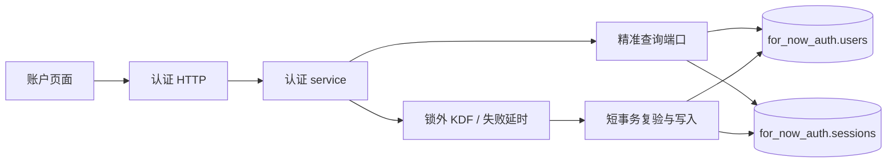
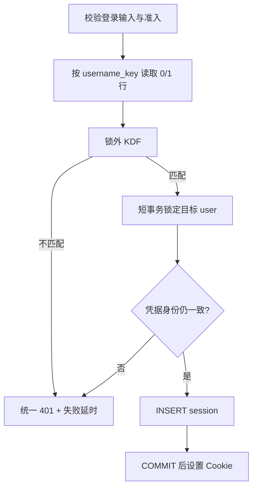
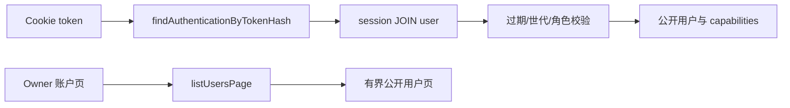

# reczz28ORRaxPAap 应新规修订 F1 认证精准查询 技术方案

|文档信息|内容|
|---|---|
|需求编号 / PRD|飞书需求 `reczz28ORRaxPAap`；修订 `reczz28NLb1qyuSM`|
|Owner / 协作角色|Owner；认证、PostgreSQL、HTTP、前端账户页、测试与运维负责角色|
|文档状态 / 版本 / 日期|研发准入处置稿；1.2；2026-10-17|
|设计范围 / 预估规模|PostgreSQL 精准认证查询、条件更新、有界账户列表及无认证应用模式退役；保留锁外 KDF 与全会话撤销语义|

## 评审摘要

推荐把认证 repository 从“读/写完整认证文档”改为显式端口：按规范化用户名读凭据、按 token 摘要读会话及用户、按用户 ID 条件更新、按用户 ID 撤销会话、Owner 有界分页列账户。登录先精准读凭据并在锁外执行 KDF，成功后在短事务中锁定目标用户、复验完整凭据身份并插入会话；改密同样锁外计算，事务内复验目标用户、递增 `sessionVersion` 并删除该用户全部会话。普通认证路径不得回退全表装配。

正常业务运行时同时退役 `AUTH_REQUIRED=0` 无认证本机模式。需要本地评估真实账户模式时，从线上导出脱敏、有界快照，恢复到隔离的账户模式 PostgreSQL 和测试身份后运行；离线导入、迁移、恢复 CLI 可在没有 HTTP 登录的环境工作，但不得启动一套绕过认证的业务应用。现有 `LOCAL_TEST_MODE` 保留为非生产、上游鉴权、隔离 JSON 的测试能力，不作为 PostgreSQL 认证或性能验收依据。

|决策编号|Owner 决策事项|Owner 结论及方案落实|排除的选择及代价|受影响章节 / 负责角色|
|---|---|---|---|---|
|D1|无认证本机业务模式是否保留|已确认退役 `AUTH_REQUIRED=0` 应用运行时；本地评估改为脱敏线上快照恢复到隔离账户模式 PG，离线迁移/恢复工具保留|继续支持会长期维护第二套账户、目录、初始化和权限语义|1.1、2.1、3.1、5.2；认证、测试与运维角色|
|D2|Owner 账户列表默认页大小|已确认默认 50、最大 100，由统一配置/常量约束|无界 `listUsers` 会重新引入规模问题|3.5、3.8；Owner 与前端|
|D3|`LOCAL_TEST_MODE` 是否随 F1 删除|已确认本需求不删除；继续受非生产、上游只读 hydration 和 JSON 隔离约束，但不能替代隔离 PG 验收|本次一并删除会扩大为测试平台迁移，且超出 Owner 对 `AUTH_REQUIRED=0` 的确认范围|1.1、2.1、3.1、5.2；测试平台与认证角色|

## 资料来源与前提

|证据编号|资料 / 代码位置|版本或读取时间|支持的事实|可访问与核实状态|
|---|---|---|---|---|
|E-001|[设计契约](../../knowledge/design-contracts.md)|2026-10-17 生效|认证必须按令牌精准查询必要用户和会话|已读取|
|E-002|[认证服务](../../src/modules/auth/index.mjs)|HEAD `f7bd64`；2026-10-17|`authenticate/login/me/listUsers` 当前调用 `repository.read()` 后内存查找|已读取|
|E-003|[认证 repository](../../src/shared/persistence/auth-repository.mjs)|HEAD `f7bd64`；2026-10-17|PG 端只暴露 read/update 完整文档外观|已读取|
|E-004|[PostgreSQL 文档映射](../../src/shared/persistence/postgres-documents.mjs)|HEAD `f7bd64`；2026-10-17|底层已有 users/sessions 表，但 readAuthDocument 读取全部表，writeAuthDocument 清表重写|已读取|
|E-005|[PostgreSQL schema](../../src/shared/persistence/postgres-schema.sql)|HEAD `f7bd64`；2026-10-17|users 与 sessions 已有业务键及 session user 索引|已读取|
|E-006|[旧 F1 方案](F1-认证跨账户阻塞治理-技术方案.md)|2026-10-16 实施回填|锁外 KDF、快照复验、改密全会话撤销已设计并局部实现|已读取；历史保留|
|E-007|[运行配置](../../src/config/index.mjs)、[认证服务](../../src/modules/auth/index.mjs)、[账户生命周期](../../src/app/account-lifecycle.mjs)|工作区 HEAD `f7bd64`；2026-10-17|`AUTH_REQUIRED=0` 合成本地 Owner/`local` 账户、使用根数据目录、允许空库初始化并跳过登录注册与账户管理|已读取|
|E-008|[本地测试运行时](../../src/app/local-test-runtime.mjs)、[本地测试 HTTP](../../src/http/local-test.mjs)|工作区 HEAD `f7bd64`；2026-10-17|`LOCAL_TEST_MODE` 是另一套上游鉴权、隔离 JSON 工作区及只读线上 hydration；PG 当前拒绝该模式，本需求保留其现有边界|已读取|

|前提编号|假设、建议或待确认内容|采用依据|不成立的影响|核对方式 / 负责角色|
|---|---|---|---|---|
|A-001|密码哈希、角色、sessionVersion 可提升为 users 明确列|这些字段参与条件查询与更新|若继续只存 payload，SQL 条件和约束更弱|schema 迁移 round-trip；持久化角色|
|A-002|认证请求峰值与生产 PG 延迟基线未知|没有可信现网负载证据|只能先给查询复杂度硬门，不能承诺固定毫秒值|隔离负载与生产灰度采样|

## 需求追踪

|需求点|设计章节|接口 / 实体 / 代码落点|验收用例|观测指标|
|---|---|---|---|---|
|用户名精准读凭据|3.1、3.5|`findCredentialByUsernameKey`|TC-01、TC-07|认证读行数|
|token 精准读会话与用户|3.1、3.5|`findAuthenticationByTokenHash`|TC-02|会话查询计划|
|锁外 KDF + 短事务复验|3.1、3.6|`issueSessionIfCredentialCurrent`|TC-03、TC-04|事务时长|
|改密只更新目标账户|3.1、3.8|`changePasswordAndRevokeSessions`|TC-05|写入/删除行数|
|账户列表有界分页|3.5|`listUsersPage`|TC-06|页载荷与查询行数|
|无认证应用模式退役|2.1、3.1、5.2|配置启动校验、隔离 PG 评估流程|TC-11|无认证应用启动数|
|认证行不维护连续 position|3.4、3.6|users/sessions 迁移、旧文档导出投影|TC-12|认证位置批量改写数|

## 名词解释

|名词|解释|语境|
|---|---|---|
|精准查询|使用用户名键、token 摘要或用户 ID 直接定位必要行，不先加载全部账户。|“按规范化用户名读凭据、按 token 摘要读会话及用户、按用户 ID 条件更新、按用户 ID 撤销会话、Owner 有界分页列账户”（评审摘要）|
|KDF|把密码和盐计算为难以反推的校验值的函数；计算耗时较高，应在数据库事务外执行。|“登录先精准读凭据并在锁外执行 KDF，成功后在短事务中锁定目标用户、复验完整凭据身份并插入会话；改密同样锁外计算，事务内复验目标用户、递增 `sessionVersion` 并删除该用户全部会话。”（评审摘要）|
|凭据身份|用户 ID、规范化用户名、完整密码哈希和 sessionVersion 的组合，用于判断计算期间凭据是否变化。|“登录先精准读凭据并在锁外执行 KDF，成功后在短事务中锁定目标用户、复验完整凭据身份并插入会话；改密同样锁外计算，事务内复验目标用户、递增 `sessionVersion` 并删除该用户全部会话。”（评审摘要）|
|sessionVersion|用户会话世代号；改密或权限变化后递增，使旧世代会话失效。|“事务内复验目标用户、递增 `sessionVersion` 并删除该用户全部会话。”（评审摘要）|
|条件更新|只有数据库中的版本和凭据仍等于读取快照时才写入，避免旧计算覆盖新状态。|“改密同样锁外计算，事务内复验目标用户、递增 `sessionVersion` 并删除该用户全部会话。”（评审摘要）|
|隔离账户模式评估|把脱敏线上快照恢复到与线上同类的 PostgreSQL schema，并使用专用测试身份登录；不是从线上读取后在本地 JSON 工作区运行。|“本地评估改为脱敏线上快照恢复到隔离账户模式 PG”（D1）|
|认证导出顺序|用户与会话在线事实按稳定业务键存储，不维护连续数组下标；只有旧认证文档导出时按 `created_at,id/token_hash` 排序并临时计算 position。|“旧文档导出只在边界计算序号”（3.6）|

## 评审记录

Owner 已确认 D1、D2、D3。旧 F1 关于锁外 KDF、改密撤销所有旧会话和权限独立的决定继续有效；本稿新增无认证应用模式退役、隔离 PG 评估、保留 `LOCAL_TEST_MODE` 及认证 position 退场边界。研发准入卡点已在设计上关闭，尚未实施。

# 1. 项目背景

## 1.1 背景（必填）

现有 PG schema 已把用户和会话映射到关系表，但 repository 仍在每次读取时查询并重建全部认证文档，更新时清空 sessions/users/document_fields 后整体写回。F1 已消除 KDF 长时间占写锁的问题，却没有消除认证请求随账户/会话总量增长的全量读取和清写。

当前 `AUTH_REQUIRED=0` 还会合成本地 Owner 和账户 ID `local`、直接使用根 `DATA_DIR`、允许空存储初始化，并跳过登录、注册及账户管理；它不是单纯的开发开关。`LOCAL_TEST_MODE` 是独立的非生产机制：使用上游鉴权、隔离 JSON 工作区和只读线上 hydration，且 PostgreSQL 当前明确拒绝该组合。前者退出正常业务运行时；后者保持测试用途，但不能证明账户模式 PG 的真实行为。本方案覆盖 PostgreSQL 普通在线认证和无认证应用模式退役；全量迁移、恢复和受控导出继续使用专用离线能力。

## 1.2 目标（必填）

|目标|基线与来源|目标值及状态|统计口径 / 窗口 / 样本|验收方式|
|---|---|---|---|---|
|单次认证只读必要行|当前全表装配，E-002/E-004|固定闭包，不随无关账户增长；已确认|EXPLAIN、返回/扫描行、SQL 次数|TC-01、TC-02、TC-07|
|KDF 不持 DB 锁|旧 F1 已设计|保持；已确认|KDF 阶段锁等待与事务区间|TC-03|
|改密不重写无关账户|当前完整文档重写|目标用户 1 行 + 该用户会话；已确认|写行与删除行|TC-05|
|性能不退化|生产基线未知|目标值待测|同数据与并发对照 P50/P95|灰度校准|

# 2. 总体方案设计

## 2.1 前期调研

`for_now_auth.users.username_key` 可支持用户名定位，`sessions.token_hash` 可支持 token 定位，`auth_sessions_user_idx` 可按用户撤销。需要把 `role/session_version/record_timezone/created_at` 从不透明 payload 提升为稳定列并增加约束；payload 只保留扩展字段。现有 admission、dummy hash、scrypt 和统一错误可直接复用。

账户模式真实性评估不再使用专用无认证业务后端。评估准备流程只负责导出脱敏且有界的线上快照、恢复到隔离 PostgreSQL、创建或映射测试身份并记录来源版本；应用本身仍走正常登录、账户目录和行级 repository。`LOCAL_TEST_MODE` 继续验证模拟、冷启动、只读 hydration 和工作区隔离，不参与 PG 行级认证结论。离线迁移/恢复 CLI 可以直接持有受控数据库权限，不因此开放无认证 HTTP。

## 2.2 系统架构

|系统 / 协作方|职责与边界|输入 / 输出|本次变更|负责角色 / 证据|
|---|---|---|---|---|
|C 端账户页|登录、改密、退出、Owner 列表|Cookie/表单、公开用户|仅列表分页可能新增 cursor|前端与 E-002|
|认证 HTTP|校验输入与 Cookie|服务端 token、统一错误|调用精准 service 端口|HTTP 角色|
|认证 service|准入、KDF、权限与快照复验|凭据/会话 DTO|不再读取完整文档|认证角色|
|认证 repository|目标行查询与短事务命令|参数化 SQL|新增显式端口|持久化角色|
|PostgreSQL|用户、会话事实源|行与约束|提升查询列和索引|E-004/E-005|
|AI/审核系统|不参与认证|不适用|不适用|范围边界|



### 2.2.1 业务新流程

登录、改密和退出的可见行为保持不变。Owner 打开账户列表时改为按页读取；角色变更后目标用户旧会话按既有规则失效。不存在用户仍执行 dummy KDF 并返回统一凭据错误。

### 2.2.2 技术新流程

登录按 `username_key` 取一条不可变凭据快照，锁外做 KDF；匹配后短事务 `SELECT ... FOR UPDATE` 目标用户，比较完整凭据身份，再插入 session。认证按 `token_hash` JOIN user 取最多一行并校验过期与世代。改密锁外计算新 hash，短事务复验 token 与用户后更新目标 user、删除其 sessions。

## 2.3 可选方案对比

|方案|满足目标程度|复杂度与成本|性能 / 稳定性|兼容 / 迁移 / 回滚|主要限制|
|---|---|---|---|---|---|
|显式行级 repository|完全满足|中等 schema/service 改造|固定查询闭包、约束强|可双读比对|推荐|
|保留完整文档并加进程缓存|不满足精准持久化|改动小|缓存失效与多实例风险|易回退|仍全量写|
|独立新认证服务|可满足但超范围|部署与迁移成本高|新增网络故障面|复杂|当前无必要|

# 3. 详细方案设计

## 3.1 详细设计（必填）

普通认证只使用行级端口；完整文档读写仅允许迁移、恢复和离线核验。service 不接触 SQL，也不接受“失败后全读文档”的 fallback。

正常业务应用启动必须启用认证；仅显式 `LOCAL_TEST_MODE=1` 的非生产测试运行时继续使用上游认证并保持现有隔离约束。普通运行时发现 `AUTH_REQUIRED=0` 时启动失败并给出隔离 PG 评估流程。离线 CLI 不启动业务 HTTP，权限和审计另行约束。

### 3.1.1 生产链路

|上游 / 触发入口|输入与协议|调用方式 / 频率|校验与转换|输出 / 状态 / 副作用|改动与证据|
|---|---|---|---|---|---|
|登录|用户名、密码、来源|同步|规范用户名、准入、dummy KDF|新 session 或统一 401|替换全读|
|注册|邀请码、用户名、密码|同步|唯一键、首 Owner 竞争|user + session|行级插入|
|改密|当前 token、旧/新密码|同步|精准 token、锁外双 KDF|更新 user、删除其 sessions|保留全撤销|
|角色/重命名/时区|Owner/本人命令|同步|权限、唯一键、版本|目标 user 条件更新|不重写无关账户|
|退出|token|同步|token 摘要|删除单 session|精准删除|



|处理动作|原所在事务|本次事务|事务粒度|事务内新增逻辑|事务外与提交后|
|---|---|---|---|---|---|
|凭据读取与 KDF|原 read 全认证文档；KDF 已在写锁外|只读查询无长事务；KDF 无事务|规范化用户名 0/1 user 行|只投影凭据字段|准入、KDF、失败延时均在写事务外|
|登录签发|完整 auth update/清表重写|短事务|目标 user 行锁 + 新 session 行|复验身份、插入 token 摘要|提交后才设置 Cookie|
|改密|完整 auth update|短事务|目标 user 行 + 该 user sessions|条件更新 hash/version，删除全部会话|旧/新 hash 计算在事务外；提交后清 Cookie|
|注册|完整文档更新|短事务|唯一 username + 新 user/session；首 Owner 用 bootstrap 锁|唯一约束、角色决定、账户初始化登记|密码 KDF 在事务外；账户业务存储初始化不得留下半成品|
|角色/重命名/退出|完整文档更新|短事务|目标 user 或单 session|权限/最后 Owner/唯一名校验|提交后刷新当前会话状态|

#### 3.1.1.1 处理阶段与新增配置

|配置键|类型 / 默认值|作用域 / 负责模块|读取与生效时机|配置依赖 / 关闭行为|依据|
|---|---|---|---|---|---|
|`AUTH_QUERY_MODE`|`document/row` / `document`|服务实例|启动读取|正式切 row 后 document 仅供回滚制品和迁移，不作静默 fallback|灰度需要|
|`AUTH_REQUIRED`|布尔 / `true`|普通业务应用实例|启动读取|非 `LOCAL_TEST_MODE` 只允许 `true`；离线工具不读取此开关|D1|
|`LOCAL_TEST_MODE`|布尔 / `false`，现有配置|非生产测试运行时|启动读取|保持现有上游认证、JSON 隔离和生产禁用；不作为 PG 验收|D3|

```json
{
  "auth": {
    "queryMode": "document",
    "required": true
  }
}
```

Owner 列表默认 50、硬上限 100 复用认证领域常量，不新增环境变量；不同列表规模若需调整，先以查询与载荷证据修改同一常量。

#### 3.1.1.2 接口与数据处理

所有用户名查询使用统一 Unicode 大小写规范函数生成 `username_key`。token 只在服务端计算 SHA-256 摘要；数据库和日志不接收明文。登录复验比较 `id/username_key/password_hash/session_version`，不能只比较版本。

### 3.1.2 消费链路



|处理动作|原所在事务|本次事务|事务粒度|事务内新增逻辑|事务外与提交后|
|---|---|---|---|---|---|
|请求认证|全认证文档只读|单条只读查询，无写事务|token_hash 对应 session + user|过期与世代过滤|返回公开用户；不缓存跨账户正文|
|Owner 用户列表|全认证文档只读|只读分页查询|稳定 `created_at,id` 页|权限在查询前确认|前端合并页，不保留密码字段|
|会话失效消费|内存从完整文档判断|精准 join|一条会话及用户|sessionVersion 不同返回 reauth|前端走完整退出清理|

#### 3.1.2.1 消费入口

|下游 / 消费面|入口与版本|读取字段 / 数据来源|转换 / 打包 / 缓存|本次改动与兼容性|验收用例|
|---|---|---|---|---|---|
|所有认证 HTTP|Cookie|session + public user|不缓存明文 token|响应语义不变|TC-02、TC-08|
|`/me`|当前用户 + 总数|精准用户；总数单独 count|公开投影|字段兼容|TC-08|
|Owner 账户页|拟扩展 cursor/limit|公开 user 页|有界前端列表|旧端可取首默认页|TC-06|
|后台账户上下文|受信 user ID|精准 user|请求生命周期内复用|无跨请求无限缓存|TC-09|

#### 3.1.2.2 协议、打包与改动边界

登录、改密、退出错误码保持旧契约。Owner 列表增加 optional `cursor` 和 `limit`，响应增加 optional `nextCursor`；旧客户端忽略未知字段。cursor 绑定排序字段，不是授权凭据，每次仍校验 Owner。

#### 3.1.2.3 消费验收

TC-02 覆盖正常、过期、撤销和世代变化；TC-06 覆盖分页稳定性；TC-08 验证 HTTP 字段不泄露 hash/token；TC-09 验证账户切换后旧认证结果不复用。

## 3.2 外部依赖

### 3.2.1 依赖方与诉求

|依赖方 / 负责角色|诉求与交付物|协议 / 版本|就绪条件 / 证据|联调与发布先后|失败或延期处置|
|---|---|---|---|---|---|
|PostgreSQL|提升列、索引和行级端口|schema vNext|round-trip 与查询计划通过|先部署|保持旧模式，不静默切换|
|账户前端|可选分页|HTTP v1 additive|旧新组合测试|服务端先|缺 nextCursor 时只显示已取页|
|账户恢复|精准错误归属|现有 F2 契约|隔离测试|与 row 模式联调|账户级错误不扩大为全站|

### 3.2.2 版本级复用与串行位置

本需求处于[版本级严格串行链](V0516-跨需求共用底座与串行开发-技术方案.md#322-有效需求复用组件与唯一串行位置)第 2 位。它在 AI 原子行审计完成后开始，只交付身份精准查询和认证存储边界，不提前实现 F2 的业务资格状态机。

|项目|本需求结论|
|---|---|
|消费组件|RC-01 schema/migration registry 与 typed config slice|
|提供组件|RC-02 `AccountIdentityPort`；按 username/token/userId 精准查询及认证 position 退场边界|
|唯一前驱|AI 请求原子行审计 `reczz28ORRaxSCBn` 已通过出口门|
|进入条件|阶段 1 audit/usage migration 稳定，schema 唯一写者可按序接入认证变更|
|出口交付|精准查询、锁外密码计算、会话撤销、普通无认证模式退役及旧新组合测试通过|
|解锁后继|F2 账户恢复故障隔离 `reczz28NLb1qzsCc`；F2 只能消费身份端口，不反向改认证私表|

## 3.3 异常处理（必填）

|异常点|处理策略|重试 / 幂等 / 补偿|持久化与用户影响|监控与恢复条件|
|---|---|---|---|---|
|用户不存在|dummy KDF + 统一 401|不自动重试|不创建 session|失败分类不泄露|
|凭据计算期间变化|短事务复验拒绝|用户重新提交|不签发旧 session|冲突率可观测|
|唯一用户名冲突|409|相同注册请求按幂等策略处理|不覆盖现有用户|唯一约束正常|
|DB 连接失败|503，不回退全读文件|只读可按基础设施策略有限重试|不签发/改密|PG 恢复后重试|
|改密提交未知|按 token 与 sessionVersion 重新认证|不盲目重复 KDF/写入|用户收到可恢复状态|回执/状态明确|
|分页 cursor 无效|400|从首 页重取|不影响认证|错误率调查|

## 3.4 数据实体（必填）

```ts
type AuthUserRow = {
  id: string;
  username: string;
  usernameKey: string;
  passwordHash: string;
  role: "user" | "owner";
  sessionVersion: number;
  recordTimezone: string;
  createdAt: string;
  updatedAt: string | null;
  payload: object;
};

type AuthSessionRow = {
  tokenHash: string;
  userId: string;
  sessionVersion: number;
  createdAt: string;
  expiresAt: string;
  payload: object;
};
```

|实体 / 字段路径|类型 / 必选性 / 默认值|含义 / 单位 / 枚举|生产方 / 消费方 / 事实源|存储、索引与生命周期|兼容 / 迁移|
|---|---|---|---|---|---|
|`users.username_key`|text / 必选|规范用户名|注册/登录；事实源|唯一索引|从现有列复用|
|`users.session_version`|int / 必选 / 1|会话世代|认证 service|条件更新|从 payload 回填并核对|
|`sessions.token_hash`|text / 必选|token SHA-256|签发/认证|主键|现有键复用|
|`sessions.user_id`|text / 必选|所属用户|签发/撤销|外键 + user 索引|现有列复用|
|`sessions.expires_at`|timestamptz / 必选|过期时间|认证 service|过期索引建议|从 payload 回填|
|旧 `users/sessions.position`|迁移后在线路径不再依赖|旧认证文档数组顺序|只由迁移/导出适配器消费|删除连续唯一约束或改为可空兼容列|导出时按 created_at+稳定键计算紧凑 position|

```json
{
  "id": "user-example",
  "username": "example",
  "usernameKey": "example",
  "role": "user",
  "sessionVersion": 3,
  "recordTimezone": "Asia/Shanghai",
  "createdAt": "2026-10-17T00:00:00.000Z"
}
```

## 3.5 接口定义（必填）

|接口 / 消息 / 回调|调用方 → 提供方|新增 / 修改 / 复用|协议版本与详细定义|
|---|---|---|---|
|`findCredentialByUsernameKey(key)`|service → repository|新增|返回 0/1 `CredentialSnapshot`|
|`findAuthenticationByTokenHash(hash)`|service → repository|新增|返回 session+user 或 null/reauth|
|`issueSessionIfCredentialCurrent(snapshot,input)`|service → repository|新增|短事务复验后插入 session|
|`changePasswordAndRevokeSessions(command)`|service → repository|新增|目标 user 条件更新 + 删除其 sessions|
|`listUsersPage(query)`|Owner HTTP → service|新增|limit≤100、opaque cursor|

所有 repository 入参来自已校验服务端值，SQL 使用参数绑定。写命令携带幂等/条件身份，未知提交结果不得用普通全量 read fallback。HTTP 鉴权、Cookie、安全属性与既有超时不变。

## 3.6 代码设计

### 3.6.1 代码落点

|文件 / 模块|改造点|复用边界 / 调用关系|证据或拟新增标记|
|---|---|---|---|
|[auth/index.mjs](../../src/modules/auth/index.mjs)|改用显式 query/command 端口|复用 admission、KDF、错误与公开用户|拟修改并渐进迁移 TS|
|[auth-repository.mjs](../../src/shared/persistence/auth-repository.mjs)|定义账户模式行级端口|不再只暴露 read/update；离线文档工具不作为在线 adapter|拟修改|
|[postgres-documents.mjs](../../src/shared/persistence/postgres-documents.mjs)、[document-mapping.mjs](../../src/shared/persistence/document-mapping.mjs)|保留迁移文档函数；旧导出按稳定键临时投影 position|普通路径不调用 clear/writeAuthDocument，不要求连续 position|拟修改|
|[postgres-schema.sql](../../src/shared/persistence/postgres-schema.sql)|提升列、索引、约束并退出 users/sessions 连续 position|复用 users/sessions 表|拟修改；由 schema 唯一写者串行接入|
|[auth HTTP](../../src/http/auth.mjs)|Owner 列表分页与兼容|其他响应保持|拟修改|
|[config/index.mjs](../../src/config/index.mjs)、[runtime-access.mjs](../../src/app/runtime-access.mjs)|普通运行时拒绝 `AUTH_REQUIRED=0`；显式 local-test 保持上游认证例外|不修改 local-test 业务语义；离线导入/恢复走专用 CLI|拟修改|
|[local-test-runtime.mjs](../../src/app/local-test-runtime.mjs)、[local-test HTTP](../../src/http/local-test.mjs)|保持现有能力和生产禁用边界|只补“不得作为 PG 验收”的测试断言，不删除入口|验证为主|
|`scripts/restore-sanitized-evaluation-snapshot.mts`|恢复脱敏有界快照并准备隔离测试账户|复用正式 PG schema/migration|拟新增|

### 3.6.2 核心伪代码

```python
async def login(username, password, source, signal):
    attempt = admission.reserve(source, normalize_username(username), signal)
    try:
        snapshot = await repository.find_credential_by_username_key(attempt.username_key)
        matched = await bounded_kdf_match(password, snapshot.password_hash if snapshot else dummy_hash)
        if snapshot is None or not matched:
            await reject_invalid_credentials(attempt)
        return await repository.issue_session_if_credential_current(snapshot)
    finally:
        attempt.settle()


async def change_password(token, current_password, new_password, signal):
    authentication = await repository.find_authentication_by_token_hash(hash_token(token))
    require_current_user(authentication)
    snapshot = credential_snapshot(authentication.user)
    matched = await bounded_kdf_match(current_password, snapshot.password_hash)
    if not matched:
        raise InvalidCredentials()
    new_hash = await bounded_password_hash(new_password)
    return await repository.change_password_and_revoke_sessions(
        token_hash=hash_token(token),
        snapshot=snapshot,
        new_hash=new_hash,
    )
```

#### 3.6.2.1 关键动作实现细节

|函数签名|输入|输出|复用逻辑|不直接复用|
|---|---|---|---|---|
|`findCredentialByUsernameKey`|规范用户名|快照/null|复用现有用户名规范|不复用 `readAuthDocument`|
|`findAuthenticationByTokenHash`|摘要|认证结果|复用 sessionVersion 规则|不在内存遍历 sessions|
|`issueSessionIfCredentialCurrent`|快照|user+token|复用随机 token 与 TTL|不复用完整 update|
|`listUsersPage`|cursor/limit|公开用户页|复用 publicUser|不返回 hash/payload|

### 3.6.3 关键实现约束

1. 普通认证 SQL 必须带 username_key、token_hash 或 user id，不允许无条件读取 users/sessions（TC-07）。
2. KDF 与失败延时不在数据库事务内（TC-03）。
3. 登录提交复验完整凭据身份，不能只复验 user id（TC-04）。
4. 改密原子递增世代并删除该用户全部 session，含当前设备（TC-05）。
5. 任何 PG 错误不得静默回退完整文档或 JSON（TC-10）。
6. 普通应用 HTTP 不得以 `AUTH_REQUIRED=0` 启动；账户模式评估必须使用隔离 PG（TC-11）。
7. user/session 行级插删不得维护或批量重排连续 position；旧文档导出只在边界计算序号（TC-12）。
8. `LOCAL_TEST_MODE` 保持上游认证、非生产和 JSON 隔离，不进入本需求的 PG 性能结论（TC-11）。

## 3.7 监控告警（必填）

|指标 / 告警|口径与单位|维度与基数限制|阈值 / 窗口 / 样本|严重度 / 负责角色|告警后动作 / 看板|
|---|---|---|---|---|---|
|`auth_query_rows`|每操作返回/扫描行|operation，不含用户|固定闭包超预期即失败验收|P1 / 认证|查查询计划|
|`auth_transaction_ms`|签发/改密事务 P95|operation|基线待测；不得包含 KDF|P2 / PG|定位锁与 IO|
|`auth_snapshot_conflict_total`|凭据复验冲突|operation|增长时查并发，不等同攻击|P2 / 认证|核对合法并发|
|`auth_full_document_fallback_total`|普通路径全读回退|operation|必须为 0|P1 / 认证|阻止放量|
|`auth_login_result_total`|成功/凭据错/忙/存储错|低基数结果|异常比例按基线校准|P1 / 运维|区分攻击与故障|

## 3.8 稳定性

### 3.8.1 容量与性能

登录固定读取 1 个用户、提交时锁 1 个用户并插 1 个会话；认证固定 join 1 个会话和 1 个用户；改密更新 1 个用户并删除该用户的 S 条会话，成本为 O(S)，不随其他账户增长。Owner 列表为 O(page size)。用 N=100/10k/100k 账户的合成 PG 数据比较执行计划、扫描行和 P95。

### 3.8.2 一致性与幂等

用户名唯一索引解决注册/重命名竞争；token_hash 主键解决会话冲突。登录线性化点是 session INSERT 的事务提交。改密线性化点是 user 更新与 sessions 删除共同提交。旧密码登录若先提交，其 session 会被改密删除；若后提交，凭据复验失败。

### 3.8.3 降级与回滚

row 模式异常时停止认证写或回退到已验证兼容制品；不得在同一请求内从 row 静默回退 document。回滚 schema 只在确认新列未被旧代码误读后进行，优先保留 additive 列。已撤销 session 不恢复。

### 3.8.4 安全与日志

token 明文只存在请求内存与 Cookie 响应，DB/日志仅用摘要。密码及 hash 不进入普通日志。不存在用户名和密码错误保持同一用户消息与近似计算路径。查询始终使用参数绑定，Owner 列表只返回公开字段。

## 3.9 实验方案

### 3.9.1 开关与灰度

先 schema additive 部署，再对测试账户双读结果（不双写会话）比较 document 与 row 投影；一致后按账户启用 row。启用期间 document 仅用于离线核对，不能处理同一在线请求。

### 3.9.2 核心验收指标

TC-01 至 TC-12 必须通过；`auth_full_document_fallback_total=0`、无认证普通应用启动数和认证 position 批量改写数均必须为 0。性能只在相同 KDF 参数和负载下比较，不能通过降低密码成本取得收益。

### 3.9.3 效果观测

按登录、认证、改密、退出、Owner 列表分开报告 SQL、行数、锁等待和端到端延迟。错误登录压力与正常其他账户并发执行，核对账户隔离；样本不足时保留 partial。

# 4. 开发测试

## 4.1 开发明细（必填；评审时留空，开发结束后填写）

实现日期：2026-10-18。实现基线：阶段 1 提交 `1bf34d` 之后的阶段 2 本地候选；尚未形成阶段提交、未部署、未启用生产 row 模式。

|实现项|代码落点与结果|验证证据|
|---|---|---|
|RC-02 身份端口|`auth-repository.mjs` 提供 document/row 同一显式端口；service 不再消费模糊 `read/update`，row 错误无文档或 JSON fallback|认证并发、角色与账户生命周期专项通过|
|精准 SQL 与短事务|新增 `postgres-auth.mts`；用户名、token、userId、首 Owner、count 和 keyset page 均为目标查询；普通 token 与列表不投影密码 hash；登录与改密复验完整凭据身份|PostgreSQL 16.14 全链通过；`F1_AUTH_ROW_METRICS={"scale":100000,"tracedStatements":4,"pageRows":200}`，username/token 执行计划使用索引|
|认证 schema|migration registry 新增 `auth-row-v1`；提升 role、sessionVersion、时区和时间列，users/sessions position 改为 nullable 并清空在线值|schema repeat、旧 bundle 导入/导出、独立库恢复及 position 空值断言通过|
|命令与审计|注册、签发、角色、改名、时区、改密和退出只写目标行；角色命令串行保护最后 Owner；改密更新一行并删除目标用户全部 session；审计由提交事件携带目标行|锁外 KDF、凭据竞争、提交失败、全会话撤销及原子注册回滚通过|
|账户分页与消费者|HTTP 支持默认 50、最大 100 的 opaque cursor；账户页提供“加载更多”；启动恢复、周期任务、附件扫描、平台快照和共享 Owner 配置均改为精准或有界分批读取|前端账户设置专项、服务生命周期、平台快照和 10 万账户双页无重复断言通过|
|运行边界|普通业务应用拒绝 `AUTH_REQUIRED=0`；`LOCAL_TEST_MODE` 显式固定 document/隔离 JSON；README 与 `启动.command` 同步新入口|普通无认证启动拒绝、local-test 全专项、主回归通过|
|隔离评估工具|新增 `restore:auth-evaluation`：默认 dry-run，要求脱敏 manifest、账户上限、零生产 session、回环 PG 和 env-only 测试凭据|评估快照 manifest、边界、session 剥离、目标映射与源 hash 专项通过|

验证限制：

- `AUTH_QUERY_MODE` 仍默认 `document`，本轮证明 row 制品和隔离 PostgreSQL 行为，不代表生产已放量。
- 未执行生产 PostgreSQL 延迟、共享 NAT 压力、移动端或生产观察；固定毫秒目标继续保留为发布阶段 partial。
- Volcengine 服务专项在当前 macOS 被既有 `sharp` 原生模块 Team ID 签名错误阻断，未改写为通过；该失败发生在业务断言前，与认证 SQL 结论分开保留。

## 4.2 测试方案（必填）

|用例编号 / 对应需求|环境与前置条件|输入 / 操作 / 故障注入|预期输出 / 持久化 / 用户行为|监控与通过标准|
|---|---|---|---|---|
|TC-01 用户名精准查|真实临时 PG，多账户|正确/错误用户名|每次最多 1 用户行；统一错误|无全表装配|
|TC-02 token 精准查|有效/过期/撤销 session|调用 me 与业务鉴权|只读目标 session/user；语义正确|行数固定|
|TC-03 锁外 KDF|暂停 scrypt|并发其他账户登录|DB 事务不被 KDF 占用|事务区间无 KDF|
|TC-04 凭据竞争|KDF 中改密/重命名/改角色|继续登录|旧快照不签发有效 session|冲突准确|
|TC-05 改密全撤销|多设备 session|成功改密|用户行+1 世代；全部 session 删除；当前需重登|无其他用户写入|
|TC-06 账户分页|>250 用户、并列时间|连续前后页|无重复遗漏，limit≤100|载荷有界|
|TC-07 规模复杂度|100/10k/100k 无关用户|固定账户认证|扫描/返回行不随 N 线性增长|EXPLAIN 合格|
|TC-08 HTTP 兼容|旧新前端|登录/me/改密/列表|旧行为保持；新字段 additive|无敏感字段|
|TC-09 生命周期|切账户且请求在途|迟到认证结果|不写入新账户 UI|跨账户为 0|
|TC-10 故障回退|PG 连接/查询失败|在线认证|503，不读 JSON/完整文档|fallback 指标 0|
|TC-11 本机模式边界|普通配置、local-test 配置与脱敏快照 fixture|普通 `AUTH_REQUIRED=0`、显式 local-test、隔离 PG 登录|普通模式拒绝；local-test 保持上游认证且非生产；PG 评估走正常账户认证|无绕过认证的普通 HTTP|
|TC-12 认证 position 退场|多用户、多会话及旧认证文档 fixture|中间创建/删除会话、改密全撤销、旧格式导出|在线只改目标行，无 position 批量重排；导出数组连续且内容一致|写行数与 round-trip 通过|

### 4.2.1 Mock测试方案

KDF 使用可暂停的真实算法 wrapper，不降低参数；repository mock 仅用于确定竞争时序。最终以临时 PostgreSQL 真 schema 验证查询计划、锁和唯一约束。Mock 不能证明生产 PG 延迟或共享 NAT 下负载。

# 5. 上线方案

## 5.1 上线CheckList（必填）

- [ ] 上线前：schema 回填、唯一约束、round-trip 和查询计划通过。
- [ ] 上线前：登录/改密/会话/Owner 列表兼容与权限负例通过。
- [ ] 上线前：全量 fallback 指标、锁等待、错误率和回滚制品就绪。
- [ ] 上线前：无认证普通运行用途盘点完成；local-test 保留边界、脱敏快照恢复、隔离测试身份和销毁流程通过。
- [ ] 上线前：users/sessions position 退场迁移、旧认证文档导出和回滚读取通过。
- [ ] 上线中：schema → 双读核对 → 测试账户 row → 逐步扩量。
- [ ] 上线后：核对跨账户压力、改密全撤销、行数和生产延迟。

## 5.2 上线依赖

本需求是版本串行阶段 2。下表只表示本需求内部部署顺序；F2 在本需求出口门通过前保持未开始。

|顺序 / 当前需求内部步骤|系统 / 负责角色|部署或配置动作|前置就绪条件与证据|兼容窗口 / 验证|
|---|---|---|---|---|
|1|PostgreSQL|additive 列、索引、回填|round-trip 通过|旧代码继续读 payload|
|2|认证 repository/service|部署 row 端口，开关关闭|TC-01 至 TC-10|无行为变化|
|3|HTTP/前端|账户分页 additive|服务端已支持|旧端首 页可用|
|4|本地评估迁移|普通模式停用无认证入口，启用隔离 PG 快照恢复；local-test 不变|TC-11、数据脱敏与销毁复核|离线工具和 local-test 继续可用，不开放无认证普通 HTTP|
|5|认证顺序兼容|退出在线 position 连续约束，启用边界导出投影|TC-12 与迁移 round-trip|旧备份/导出仍可读|
|6|测试账户到扩量|启用 row|双读一致|禁止静默 fallback|

## 5.3 观测方案

每阶段按操作族观察 3.7 指标、数据库锁与 HTTP 结果，至少覆盖错误登录压力、正常登录、改密和会话撤销。任何跨账户读取、旧密码签发、全量回退或最后 Owner 约束失效立即停止。

## 5.4 回滚方案

|对象|触发条件|负责角色 / 具体步骤|在途任务与数据处置|验证与恢复条件|
|---|---|---|---|---|
|服务 / 配置|row 查询错误率异常|关闭新流量或切已验证兼容制品|不恢复已撤销 session|旧新数据可读|
|代码 / 协议|HTTP 兼容缺陷|先回前端分页，再回 service|Cookie 继续按世代验证|认证专项通过|
|数据 / Schema|回填或约束错误|停认证写、保留 additive 列并修复|不清空 users/sessions|计数、唯一性、抽样一致|

## 5.5 放量计划

|阶段|入口 / 分桶范围 / 比例|前置条件|停留窗口 / 最小样本|继续 / 停止 / 回滚条件|负责角色|
|---|---|---|---|---|---|
|测试|临时 PG 与测试账户|全套 TC|覆盖全部竞争|硬门全过|认证/测试|
|白名单|Owner 指定账户|双读一致|建议 24 小时、样本不足延长|fallback=0、无语义差异|Owner|
|扩量|账户白名单逐步扩大|前阶段稳定|每阶段按真实流量确认|错误/锁/行数稳定|运维|
|全量|所有账户|Owner 批准|持续观察|无跨账户与凭据回归|Owner|
