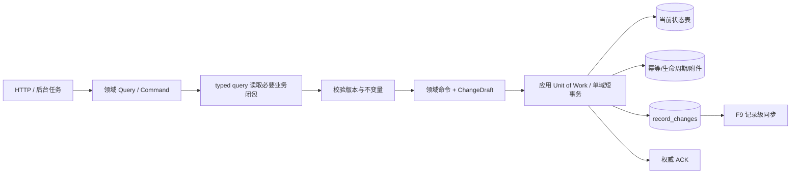
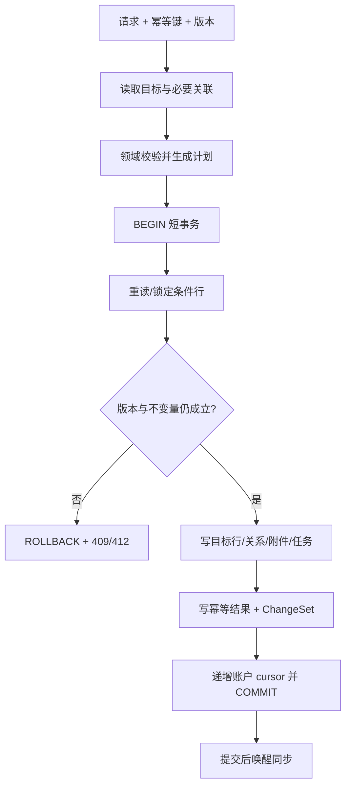
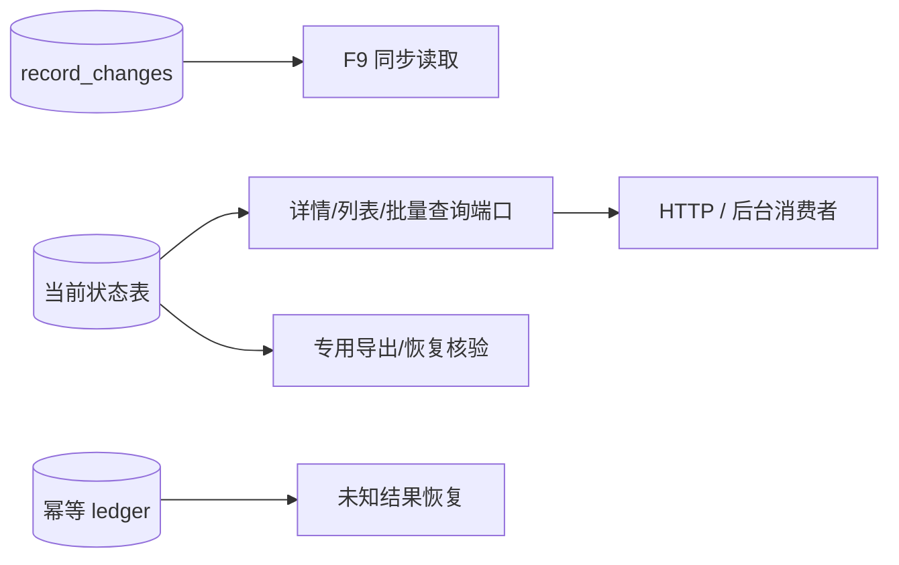

# reczz28ORRaxPiK3 应新规重做 F3 记录级持久化 技术方案

|文档信息|内容|
|---|---|
|需求编号 / PRD|飞书需求 `reczz28ORRaxPiK3`；重做 `reczz28NmXA3HYn6` 的后续边界|
|Owner / 协作角色|Owner；业务领域、PostgreSQL、同步、附件、AI 后台任务、测试与运维负责角色|
|文档状态 / 版本 / 日期|研发准入处置稿；1.2；2026-10-17|
|设计范围 / 预估规模|普通在线命令的记录级查询与写入、显式 ChangeSet、短事务和专用迁移边界；跨多个业务切片分阶段实施|

## 评审摘要

推荐废止普通在线路径的“完整 store → clone/mutator → 全量映射或快照差分”外观，建立领域 typed query/command 端口。领域拥有本领域不变量和命令 DTO；应用工作流只在目标记录、任务、通知、附件或回收等确需共同成败时，通过同一账户 Unit of Work 编排多个领域公开命令。persistence 只提供账户事务、条件行操作、幂等回执和同步 cursor/change 原语，不接收包含任务、附件、生命周期等业务语义的万能计划。变化由领域命令明确生成，不通过比较整账户前后快照推断。模型调用和上下文计算在事务外。旧全量导入、迁移、灾备恢复、导出核验与派生重建保留专用入口，不得成为普通命令失败后的回退。

|决策编号|Owner 决策事项|Owner 结论及方案落实|排除的选择及代价|受影响章节 / 负责角色|
|---|---|---|---|---|
|D1|首批迁移命令|已确认按“通知已读/任务状态 → 思绪编辑与删除 → 思绪创建及 AI 写回”推进，先低扇出再覆盖 F4/F9 主路径|一次迁完所有领域回归面过大；只迁低频命令又无法解决当前主路径|3.1、5.5；Owner 与领域角色|
|D2|旧 `position` 连续性|已确认在线路径不维护连续 position；各领域优先使用已有时间/ID tuple，只有真实手工排序需求才引入领域 `order_key`。store、生命周期、幂等分别迁移，旧导出边界临时计算序号|统一新增抽象 order_key 会制造无业务依据的字段；继续连续 position 会产生集合重写|2.1、3.4、5.2；领域与持久化角色|
|D3|跨领域原子命令如何复用|已确认采用“领域 typed command + 应用层 Unit of Work + persistence 原语”，删除万能 `CommandPlan`|让 shared persistence 解释 task/attachment/lifecycle 会形成新的巨型仓储并违反模块所有权|2.2、3.1、3.4、3.6；应用与持久化角色|
|D4|同步 cursor 是否复用账户 revision|已确认新增账户同步 head，仅在同事务写入一个或多个 `record_changes` 时递增；账户 revision 继续服务存量提交竞争|复用 revision 会在 legacy 写未产 change 时产生不可解释缺口，使 F9 跳过变化|3.1、3.4、3.8；F3/F9 与持久化角色|

## 资料来源与前提

|证据编号|资料 / 代码位置|版本或读取时间|支持的事实|可访问与核实状态|
|---|---|---|---|---|
|E-001|[设计契约](../../knowledge/design-contracts.md)|2026-10-17 生效|普通局部写禁止全读、清写或静默全量回退；命令需短事务|已读取|
|E-002|[PostgreSQL runtime](../../src/shared/persistence/postgres-runtime.mjs)|HEAD `f7bd64`；2026-10-17|当前 transact 先 readRaw 全账户，commit 时 clearStoreObjects 后完整写回|已读取|
|E-003|[对象映射](../../src/shared/persistence/postgres-objects.mjs)|HEAD `f7bd64`；2026-10-17|六类关系表支持行对象，但清理函数按账户删除全部|已读取|
|E-004|[PostgreSQL schema](../../src/shared/persistence/postgres-schema.sql)|HEAD `f7bd64`；2026-10-17|已有 object_key、版本、关系、附件、生命周期与幂等表|已读取|
|E-005|[旧 F3 方案](F3-PostgreSQL增量读写演进-技术方案.md)|2026-10-16 回填|阶段 A 已做同步窄读；旧 B 仍全读并允许 legacy 回退|已读取；历史保留|
|E-006|[思绪 service](../../src/modules/thoughts/index.mjs)|HEAD `f7bd64`；2026-10-17|当前思绪详情、列表与写入建立在完整 repository 文档上|已读取|
|E-007|对象映射、schema 与重建校验|工作区 HEAD `f7bd64`；2026-10-17|旧映射按数组下标写 `0..N-1`，唯一键包含父范围/字段/position，重建遇到空洞即报 `Non-contiguous positions`|已读取|

|前提编号|假设、建议或待确认内容|采用依据|不成立的影响|核对方式 / 负责角色|
|---|---|---|---|---|
|A-001|继续保留单实例与账户级 advisory lock 作为迁移期串行边界|当前运行契约与旧 F3|若要多实例，需另做锁和消息设计|控制面恢复开发前由 Owner 确认|
|A-002|业务命令峰值、单命令最大子项数尚无生产基线|当前无可信分位|批量上限只能先按现有产品输入给建议值|按命令采样闭包行数与事务耗时|

## 需求追踪

|需求点|设计章节|接口 / 实体 / 代码落点|验收用例|观测指标|
|---|---|---|---|---|
|普通命令不全读/清写|3.1、3.6|各领域 typed command/repository|TC-01、TC-08|读写行数、全量 fallback|
|必要状态原子提交|3.1、3.8|领域 typed command、`AccountUnitOfWork`、`ChangeSet`|TC-02、TC-03|事务失败与不变量|
|变化由命令明确提供|3.1、3.4|`RecordChange`|TC-04|变化缺失/重复|
|模型调用在事务外|3.1、3.6|来源版本条件写回|TC-05|事务时长|
|全量流程独立|3.1、5.4|migration/recovery/export 入口|TC-09|在线调用专用入口次数|
|模块职责不下沉到 persistence|2.2、3.4、3.6|typed command、`AccountUnitOfWork`|TC-12|跨域私有写入数|
|同步生产者覆盖后才开放 v2|3.1、3.5、5.2|`RecordChangeCoverage`|TC-13|未覆盖生产者数|

## 名词解释

|名词|解释|语境|
|---|---|---|
|业务闭包|完成一个命令必须读取和写入的目标记录、必要父子关系、幂等结果及任务，不包含无关历史。|“通过同一账户 Unit of Work 编排多个领域公开命令”（评审摘要）|
|ChangeSet|命令明确列出的创建、修改、删除记录集合，包含实体键、版本和变化字段。|“变化由领域命令明确生成，不通过比较整账户前后快照推断”（评审摘要）|
|短事务|只覆盖必要行校验与数据库写入的事务，不包含模型调用、完整上下文计算或用户等待。|“模型调用和上下文计算在事务外。”（评审摘要）|
|条件写入|更新时同时要求账户、实体键和期望版本匹配，防止迟到请求覆盖新数据。|“实体版本条件防迟到覆盖”（3.8）|
|position|旧文档数组的紧凑下标，不是业务 ID。数据库曾要求同一父范围和字段内从 0 连续，因而中间插删会连带改写后续兄弟。|“在线路径不维护连续 position”（D2）|
|领域排序 tuple|由领域已有的发生时间、创建时间和稳定 ID 等字段组成的唯一排序组合，不要求连续；只有产品存在手工拖动排序时才增加该领域自己的 `order_key`。|“各领域优先使用已有时间/ID tuple，只有真实手工排序需求才引入领域 `order_key`。”（D2）|
|Unit of Work|由应用工作流开启的一次账户短事务；事务内只调用已注入的 typed repository，保证确需共同成败的多个领域写入、幂等回执和变化一起提交。|“应用工作流只在目标记录、任务、通知、附件或回收等确需共同成败时，通过同一账户 Unit of Work 编排多个领域公开命令。”（评审摘要）|
|RecordChangeCoverage|列出一个同步实体类型的全部写入口及其 change 生产状态；只有所有入口覆盖且测试通过，该实体类型才允许进入 F9 v2。|“每个 v2 实体类型必须在 `RecordChangeCoverage` 中证明全部写入口已覆盖”（3.5）|
|专用全量流程|明确用于导入、迁移、恢复、导出或重建的受控入口，不能被普通请求自动调用。|“旧全量导入、迁移、灾备恢复、导出核验与派生重建保留专用入口，不得成为普通命令失败后的回退。”（评审摘要）|

## 评审记录

Owner 已确认 D1、D2；D3、D4 是按现行模块与同步规则完成的研发准入处置。本稿不否定旧 F3-A 的历史窄读交付，只替代旧 B/C 中仍依赖完整 store 或 legacy 普通回退的设计。研发准入卡点已在设计上关闭，尚未实施。

# 1. 项目背景

## 1.1 背景（必填）

当前数据已落到关系表，但在线仓储仍把它重建为一个账户文档；局部保存先读取全部对象，业务 mutator 修改内存，再清空六类账户行并完整写回。阶段 A 只减少同步读取，没有改变普通写。该模式造成读写、映射、WAL 和提交后投影成本随无关历史增长，也迫使审计和同步从 before/after 快照推断变化。

范围内为普通在线局部命令及其查询端口。全仓 ORM 重写、多实例调度和所有领域一次迁完不在本需求内；但任何新迁移命令必须满足同一记录级契约。

## 1.2 目标（必填）

|目标|基线与来源|目标值及状态|统计口径 / 窗口 / 样本|验收方式|
|---|---|---|---|---|
|固定闭包成本|当前每次完整 read/clear/write，E-002|目标记录操作不随无关 N 线性增长；已确认|SQL、扫描/返回/写行与 WAL|TC-01、TC-08|
|命令原子性|当前完整文档一次提交|保持必要业务事实共同成败；已确认|故障注入每个写阶段|TC-02、TC-03|
|变化准确|当前 before/after 同步元数据|命令 ChangeSet 与实际写一致；已确认|事务后查询目标键|TC-04|
|性能收益|真实生产基线待测|建议同负载 P95 不回退；具体收益待测|按命令、账户规模分组|灰度量测|

# 2. 总体方案设计

本需求是跨领域的分阶段持久化迁移。公共基础只提供查询、命令事务、变更和幂等机制；业务不变量仍归各领域。

## 2.1 前期调研

现有 `store_objects` 已具备账户+object_key 主键、版本、父键、内容列和 payload；关系、附件引用、生命周期、幂等也有独立表。这些可以作为记录级事实源，不需要先换 ORM。主要缺口是领域 typed 端口、事务作用域 repository、普通写 SQL、逐表 position 退场以及将 `_persistence.sync` 数组改成可查询变化表。

旧映射把每个数组元素的位置直接保存为 `position=0..N-1`，schema 在账户、父范围、字段和 position 上要求唯一，重建又拒绝任何空洞。因此删除第 3 项、在中间插入或移动项目时，旧实现必须重编号其后的兄弟；这只是为了还原数组顺序，不是业务要求。新路径按表分别处理：`store_objects` 使用领域已有稳定 tuple，生命周期和幂等按时间+业务主键查询，旧导出临时生成紧凑序号；没有真实手工排序需求时不新增通用 `order_key`。认证 users/sessions 的同类问题由 F1 方案负责，usage/settings 等账户文档由各自记录级迁移负责。

## 2.2 系统架构

|系统 / 协作方|职责与边界|输入 / 输出|本次变更|负责角色 / 证据|
|---|---|---|---|---|
|C 端|提交带幂等键与版本的命令|业务请求/权威 ACK|协议尽量兼容|前端|
|HTTP 应用层|鉴权、解析、调用领域 command|受信账户上下文|不直接操作表|HTTP 角色|
|领域 service|校验业务不变量并调用 typed repository|命令 DTO、领域结果、ChangeDraft|新增显式命令，不输出物理写计划|领域角色|
|应用工作流|只在跨领域结果必须共同成败时编排 Unit of Work|typed repositories、业务结果|复用现有跨域编排职责|应用角色|
|记录级 persistence|账户 Unit of Work、事务作用域 typed adapter、条件行原语|行/结果/同步 cursor|新增公共机制，不解释领域业务|持久化角色|
|PostgreSQL|当前状态与变化事实|对象、关系、附件、幂等、change|定向 SQL|E-004|
|同步消费者|读取 record_changes|记录变化页|由 F9 使用|同步角色|
|AI 模型服务端|事务外生成结果|来源版本/结果|协议不变|AI 角色|
|审核服务端/前端|无独立审核链路|不适用|不适用|范围边界|



### 2.2.1 业务新流程

用户保存、编辑和删除的界面语义不变。请求携带幂等键和已知版本；服务器只读取目标记录及必要父子项。冲突返回当前版本，不自动全量刷新。AI 结果在模型完成后以来源 ID/版本执行独立命令，来源已变化则保留任务失败/过期状态，不覆盖当前内容。

### 2.2.2 技术新流程

应用服务先调用领域 query 取得必要闭包，在事务外完成纯计算；单领域命令由该领域 typed repository 开启短事务。确需跨域共同成败时，应用服务调用 `AccountUnitOfWork.run`，取得绑定同一 transaction 的 typed repositories，各领域分别重读/锁定条件行并执行自己的规则。persistence 汇总各命令返回的 `RecordChangeDraft`，仅在 drafts 非空时锁定账户 sync head、递增独立 cursor、写 changes 与幂等回执后提交。提交后通知只唤醒同步，不承载正文。

## 2.3 可选方案对比

|方案|满足目标程度|复杂度与成本|性能 / 稳定性|兼容 / 迁移 / 回滚|主要限制|
|---|---|---|---|---|---|
|领域 typed command + 应用 Unit of Work|完全满足|分阶段改造较大|固定闭包、所有权清晰|可逐命令迁移|推荐|
|通用物理 `CommandPlan`|数据上可实现|短期少写 adapter|persistence 吸收任务、附件、生命周期等语义|容易形成永久万能仓储|不选|
|全读后内存 diff、只差量写|不满足读取和变化来源|改动较小|仍 O(N) 读/映射|容易回退|禁止作为目标方案|
|数据库触发器自动生成通用 diff|部分满足|业务语义隐藏在 DB|难表达父对象/摘要/审计字段|回滚复杂|不选|
|整体替换 ORM/微服务|可能满足|范围过大|新风险高|迁移周期长|当前不选|

# 3. 详细方案设计

## 3.1 详细设计（必填）

领域层拥有命令、不变量和 ChangeDraft；应用工作流只编排公开 typed command，事务作用域 repository 只实现对应领域端口并返回明确结果。任何普通路径调用完整 store 入口都由运行时断言与指标阻止。

### 3.1.1 生产链路

|上游 / 触发入口|输入与协议|调用方式 / 频率|校验与转换|输出 / 状态 / 副作用|改动与证据|
|---|---|---|---|---|---|
|用户创建/编辑/删除|ID、版本、幂等键、字段|同步|账户、归属、字段、不变量|目标记录、ACK、ChangeSet|逐领域迁移|
|后台任务状态|task ID、期望状态/版本|异步|合法状态转换|task 行与变化|首批 D1|
|AI 结果写回|来源 ID/版本、结果|异步|来源仍当前、任务幂等|结果记录与任务终态|事务外模型|
|附件关联变化|目标键、路径摘要|同步|归属与已验证 inventory|定向 refs 更新|不扫描全账户附件|
|导入/恢复/重建|完整受控批次|离线专用|范围、恢复点、摘要|专用全量写|不接普通入口|



|处理动作|原所在事务|本次事务|事务粒度|事务内新增逻辑|事务外与提交后|
|---|---|---|---|---|---|
|普通记录命令|账户锁下先全读，commit 清写全账户|短事务|单账户、目标实体与声明关联；账户锁迁移期保留|条件读/写目标、关系、附件、生命周期、幂等与 ChangeSet|输入解析和纯计算在外；提交后 ACK/唤醒|
|AI 结果写回|模型在外，写回仍完整 store|短事务|来源记录、任务、结果记录|来源版本复验、结果和任务终态、ChangeSet|模型调用和上下文编译在外|
|批量命令|完整文档 mutator|短批次事务|单账户、有上限 ID 集合|逐项版本与结果；全部/部分语义由命令声明|超过上限拆批，不持事务等待|
|导入/恢复/重建|专用流程已有事务|继续专用事务/分批|明确账户与批次|可使用全量映射，但记录恢复点和摘要|不从普通命令自动进入|

#### 3.1.1.1 处理阶段与新增配置

|配置键|类型 / 默认值|作用域 / 负责模块|读取与生效时机|配置依赖 / 关闭行为|依据|
|---|---|---|---|---|---|
|`RECORD_COMMAND_ALLOWLIST`|字符串数组 / 空数组|命令级|启动读取|空数组不启用新命令|分阶段 D1|

```json
{
  "recordCommands": {
    "allowlist": []
  }
}
```

不新增全局 batch limit：每个领域命令按自身输入与事务闭包定义硬上限并由领域校验。`RECORD_COMMAND_ALLOWLIST` 只在请求开始前选择已验证实现，不参与错误后的 fallback。

#### 3.1.1.2 接口与数据处理

每个领域命令定义自己的 DTO、必要读取、版本条件、写入和 `RecordChangeDraft`，不把物理表写集合暴露给业务层。实体 JSON payload 可继续保存完整业务字段，但账户、类型、ID、父键、版本、状态和查询排序字段必须有明确列。新记录优先使用领域已有稳定 tuple；只有明确的用户重排功能才引入该领域 `order_key`，并定义分配、冲突和有界重排规则。删除同时更新当前状态 tombstone 或删除业务行并写 change tombstone，具体按领域恢复契约统一。

### 3.1.2 消费链路



|处理动作|原所在事务|本次事务|事务粒度|事务内新增逻辑|事务外与提交后|
|---|---|---|---|---|---|
|详情/批量读取|完整 store 只读|只读短事务或单语句|账户+实体键/有界 ID 集|必要关联 join/批量查询|返回 DTO，不在内存全域查找|
|同步消费|读取 `_persistence.sync` 与域投影|只读分页|账户+cursor+limit|读取 ChangeSet 与当前必要投影|客户端应用成功后推进 cursor|
|幂等恢复|完整 store 查 ledger|精准查询|账户+scope+key|返回已提交结果|未知不盲重试不同请求|
|导出核验|完整 read|专用 repeatable-read 分批|单账户全量|内部游标分批读取并校验|不供普通 HTTP fallback|

#### 3.1.2.1 消费入口

|下游 / 消费面|入口与版本|读取字段 / 数据来源|转换 / 打包 / 缓存|本次改动与兼容性|验收用例|
|---|---|---|---|---|---|
|业务详情|既有 HTTP|目标行与声明关联|领域 DTO|响应尽量兼容|TC-06|
|业务列表|领域 query|DB 分页摘要|不全读|由各领域方案接入|TC-08|
|F9 同步|内部 `readChanges`|ChangeSet + 必要当前状态|记录级协议|新协议由 F9 定义|TC-04|
|后台任务|task/result 查询|精准 task/source|版本保护|逐任务迁移|TC-05|
|导出/恢复|专用 CLI/作业|分批全量|不缓存整账户|明确非在线入口|TC-09|

#### 3.1.2.2 协议、打包与改动边界

既有业务 HTTP 可保持字段兼容，但 repository 内部协议升级。新命令与 legacy 同一业务操作不能并行处理；切换前排空账户执行器。未知字段保留在 payload，显式列与 payload 重复字段必须同事务一致。

#### 3.1.2.3 消费验收

TC-04 证明 ChangeSet 与实际写集合一致；TC-06 验证详情/DTO 等价；TC-08 验证无隐藏全读；TC-09 证明专用全量流程仍可导出、恢复和核验。

## 3.2 外部依赖

### 3.2.1 依赖方与诉求

|依赖方 / 负责角色|诉求与交付物|协议 / 版本|就绪条件 / 证据|联调与发布先后|失败或延期处置|
|---|---|---|---|---|---|
|领域模块|每命令闭包、不变量与 DTO|Command v1|契约和用例齐全|按 D1 串行|未迁命令保持 legacy 并明确债务|
|PostgreSQL|定向 query/write、领域稳定排序列、sync head 与 change 表|schema vNext|迁移/回滚通过；schema 唯一写者已登记|公共基础先|不开 allowlist|
|F9 同步|读取 ChangeSet|record-change v1|事务原子性通过|F3 生产先于 F9 消费|旧同步保持，不混协议|
|附件/任务|目标键和状态命令|领域端口|交叉用例通过|随对应命令|不扫描全账户补偿|

### 3.2.2 版本级复用与串行位置

本需求处于[版本级严格串行链](V0516-跨需求共用底座与串行开发-技术方案.md#322-有效需求复用组件与唯一串行位置)第 5 位。它先建立记录级事实生产能力，只交付 F9 所需契约和 fixture，不在本阶段实现 F9 消费端。

|项目|本需求结论|
|---|---|
|消费组件|RC-01 migration/config registry；RC-02 账户执行 gate；RC-03 已稳定的 AI 调用与写回边界|
|提供组件|RC-04 `AccountUnitOfWork`、领域 typed repositories、幂等回执、`ChangeSet`、独立 sync head 与 producer coverage|
|唯一前驱|F5 AI 排队取消与超时 `reczz28NLb1qxhIC` 已通过出口门|
|进入条件|账户资格、AI 取消/审计/usage 语义稳定，schema 唯一写者可接入记录级表变更|
|出口交付|首批命令不全读清写、必要事实原子提交、无静默 legacy fallback、producer coverage 通过|
|解锁后继|新 F4 数据库游标分页 `reczz28ORRaxSFnV`；F4 只能基于已稳定的 thoughts command 和读模型生产者|

## 3.3 异常处理（必填）

|异常点|处理策略|重试 / 幂等 / 补偿|持久化与用户影响|监控与恢复条件|
|---|---|---|---|---|
|版本冲突|回滚并返回 409/412|重新读目标记录后由用户决定|无部分写|冲突分类|
|幂等键同请求|返回原结果|不重复执行|无新 change|回执一致|
|幂等键异请求|409|禁止覆盖|无写入|复用冲突指标|
|附件缺失/越权|事务前或内拒绝|重新上传/选择|业务行不提交|附件不变量|
|change 插入失败|整个命令回滚|同幂等键可重试|不能有“写成功但无同步变化”|事务失败|
|提交结果未知|查精准幂等回执|不得盲重跑不同 fingerprint|用户保持未知/可恢复|回执恢复|
|row 端口不支持该命令|调用前明确路由 legacy|不在失败后 fallback|未迁命令行为不变|allowlist 可见|

## 3.4 数据实体（必填）

```ts
type RecordChangeDraft = {
  entityType: string;
  entityId: string;
  parentType: string | null;
  parentId: string | null;
  version: number;
  operation: "create" | "update" | "delete";
  changedFields: string[];
  summary: object | null;
};

type RecordChange = {
  cursor: number;
  ordinal: number;
  entityType: string;
  entityId: string;
  parentType: string | null;
  parentId: string | null;
  version: number;
  operation: "create" | "update" | "delete";
  changedFields: string[];
  summary: object | null;
};
```

|实体 / 字段路径|类型 / 必选性 / 默认值|含义 / 单位 / 枚举|生产方 / 消费方 / 事实源|存储、索引与生命周期|兼容 / 迁移|
|---|---|---|---|---|---|
|`store_objects.object_key`|text / 必选|类型+父范围+ID 的稳定键|领域/repository；当前状态事实源|账户联合主键|复用现有|
|`store_objects.version`|int / 必选|记录版本|命令/F9|条件更新|复用现有|
|领域排序列|现有时间+ID tuple；仅实际手工排序领域新增 order_key|不要求连续的稳定顺序|领域 query|账户+集合+父键+排序索引|按旧 position 顺序回填必要字段；旧导出临时生成 position|
|`account_sync_heads`|账户一行 / 必选|仅 record change 提交时递增的同步 cursor|Unit of Work / F9|account 主键、行锁|不复用 accounts.revision|
|`record_changes`|行集合 / 必选|命令产生的投递索引|repository/F9|`account,cursor,ordinal` 主键；可裁剪|替代 sync changes 数组|
|`idempotency_ledger`|行 / 必选|操作指纹与结果|repository/恢复|现有业务键|改为定向读写|
|旧 lifecycle/idempotency position|迁移后在线路径不依赖|旧数组序列化顺序|仅迁移/导出适配器|删除连续唯一约束或改为可空兼容列|按 created_at+业务主键导出|

```json
{
  "command": "thought.update",
  "operationId": "operation-example",
  "fingerprint": "fingerprint-example",
  "changes": [
    {
      "cursor": 42,
      "ordinal": 0,
      "entityType": "thought",
      "entityId": "thought-example",
      "parentType": null,
      "parentId": null,
      "version": 3,
      "operation": "update",
      "changedFields": [
        "content",
        "updatedAt"
      ],
      "summary": {
        "title": "更新后的摘要"
      }
    }
  ]
}
```

## 3.5 接口定义（必填）

|接口 / 消息 / 回调|调用方 → 提供方|新增 / 修改 / 复用|协议版本与详细定义|
|---|---|---|---|
|领域 `query/detail/list` typed ports|应用/HTTP → 领域|新增/修改|账户隐式绑定；每个领域声明 DTO、错误和上限|
|领域 typed command ports|应用工作流 → 领域|新增/修改|目标键、期望版本、幂等键；领域返回结果与 ChangeDraft|
|`accountUnitOfWork.run(operation)`|应用工作流 → persistence|新增|向 operation 注入同事务 typed repositories；不接受物理写计划|
|`sync.readChanges(cursor, limit)`|F9 → repository|新增|记录变化分页；F9 定义外部协议|
|`maintenance.import/restore/rebuild`|运维 → persistence|明确专用|不得被普通 HTTP 调用|

typed command 使用 operationId+fingerprint 幂等；同 key 不同 fingerprint 返回冲突。超时后调用方只查精准回执。每个 v2 实体类型必须在 `RecordChangeCoverage` 中证明全部写入口已覆盖；覆盖表列出 HTTP、后台、恢复、删除、AI 写回和管理入口，任一未覆盖时 F9 不得声明支持该实体类型。

## 3.6 代码设计

### 3.6.1 代码落点

|文件 / 模块|改造点|复用边界 / 调用关系|证据或拟新增标记|
|---|---|---|---|
|`src/shared/persistence/account-unit-of-work.mts`|账户短事务、sync head、幂等与 change 汇总原语|复用连接、账户绑定、RLS、advisory lock；不含领域枚举|拟新增|
|各领域 typed repository adapter|目标行 query/command SQL|由组合入口注入领域；只实现本领域端口|按切片拟新增|
|[postgres-runtime.mjs](../../src/shared/persistence/postgres-runtime.mjs)|装配 Unit of Work；legacy 明确隔离|新命令不调用 readRaw/clearStoreObjects|拟修改；共享唯一写者|
|[postgres-objects.mjs](../../src/shared/persistence/postgres-objects.mjs)|定向行原语与旧全量专用入口隔离|不承载业务命令分派|拟修改|
|[postgres-schema.sql](../../src/shared/persistence/postgres-schema.sql)|逐表 position 退场、sync head、record_changes 及索引|不新增无需求的全局 order_key|拟修改；schema 唯一写者|
|各领域模块与应用工作流|mutator 改 typed command；跨域写由应用 Unit of Work 编排|业务规则仍归领域|分阶段修改|

### 3.6.2 核心伪代码

```python
async def execute_thought_update(command):
    require_allowed_command("thought.update")
    async def operation(repositories):
        replay = await repositories.idempotency.find(command.operation_id)
        if replay is not None:
            require_same_fingerprint(replay, command.fingerprint)
            return replay.response
        result = await repositories.thoughts.update(command)
        await repositories.idempotency.insert(command, result.response)
        return result
    return await account_unit_of_work.run(operation)


async def save_ai_result(source_id, source_version, result):
    async def operation(repositories):
        saved = await repositories.thoughts.save_ai_result(
            source_id,
            source_version,
            result,
        )
        await repositories.tasks.finish_for_result(saved.task_id, saved.result_id)
        return merge_change_drafts(saved.change_drafts)
    return await account_unit_of_work.run(operation)
```

#### 3.6.2.1 关键动作实现细节

|函数签名|输入|输出|复用逻辑|不直接复用|
|---|---|---|---|---|
|领域 typed command|领域 DTO|业务结果+ChangeDraft|复用现有 normalizer 与不变量|不输出通用物理写计划|
|`accountUnitOfWork.run`|应用 operation|结果+提交 cursor|复用账户绑定、事务、幂等和通知|不判断任务/附件/回收业务|
|typed repository write|目标命令|写行计数+ChangeDraft|复用映射字段与领域校验|不调用 clearStoreObjects|
|`insertRecordChanges`|ChangeDraft[]|同 cursor 行|复用实体版本；独立 sync head 分配 cursor|不比较 before/after store、不复用 account revision|
|`maintenanceRebuild`|受控快照|核验结果|可复用 map/write 全量函数|不暴露给在线请求|

### 3.6.3 关键实现约束

1. 新命令不得调用 `repository.read/readRaw/clearStoreObjects`（TC-01）。
2. ChangeSet 必须与实际目标写同事务，漏写 change 则整个命令失败（TC-04）。
3. 单记录命令不改写无关记录的排序字段、旧 position 或 payload；不得为维持连续序号批量重编号（TC-08）。
4. 模型和网络调用不进入事务；结果写回必须带来源版本（TC-05）。
5. legacy 只按命令白名单在调用前选择，异常后不得切换实现重试（TC-10）。
6. 当前状态表是事实源，record_changes 仅是可裁剪投递索引（TC-11）。
7. persistence 不接受带任务、附件、生命周期等业务语义的通用写计划；跨域共同提交只由应用工作流编排 typed repositories（TC-12）。
8. sync cursor 只从 `account_sync_heads` 分配；没有 ChangeDraft 的提交不推进 cursor（TC-13）。
9. 任一实体类型仍存在未登记的 legacy/后台/恢复写入口时，F9 v2 不得启用该类型（TC-13）。

## 3.7 监控告警（必填）

|指标 / 告警|口径与单位|维度与基数限制|阈值 / 窗口 / 样本|严重度 / 负责角色|告警后动作 / 看板|
|---|---|---|---|---|---|
|`record_command_read_rows`|每命令读取行|command|固定闭包随无关 N 增长即失败|P1 / 持久化|查隐藏全读|
|`record_command_write_rows`|每表写/删行|command|局部命令出现账户清写即阻止|P1|停 allowlist|
|`record_command_transaction_ms`|事务 P50/P95/P99|command|目标待基线校准|P2|查锁/WAL|
|`record_command_full_fallback_total`|在线 fallback 次数|command|必须为 0|P1|立即停止放量|
|`record_change_mismatch_total`|实际写与 ChangeSet 不一致|command|任何非零|P1|停写并核对|
|`record_change_uncovered_producers`|已启用实体类型中未登记或未接入的写入口数|entity_type；低基数|必须为 0|P1 / F3/F9|关闭该实体类型 v2|
|`account_sync_cursor_allocations`|实际写入 change 的事务分配 cursor 次数|command|无 ChangeDraft 时必须为 0|P1 / 持久化|停命令并核对 sync head|

## 3.8 稳定性

### 3.8.1 容量与性能

单命令成本为 `O(目标记录 + 必要关联 + 显式变化)`，不包含账户总记录 N。批量命令使用各领域协议声明并测试的硬上限，不设一个脱离业务语义的全局 `batchLimit`。变化表增长为 `每日变化行数 × 平均行 bytes × 保留窗口`，由 F9 定义裁剪与 rebase。压测对固定目标增加 10 倍无关历史，读取/写入行数应保持不变。

### 3.8.2 一致性与幂等

operationId+scope 为业务唯一键，fingerprint 防止异请求复用。实体版本条件防迟到覆盖。仅当事务包含一个或多个 ChangeDraft 时，锁定并递增 `account_sync_heads`；同一命令多条 change 使用相同 cursor 和稳定 ordinal。存量账户 revision 不参与 F9 cursor 分配。提交后通知失败不回滚 SQL，F9 下次按 cursor 恢复。

### 3.8.3 降级与回滚

按命令 allowlist 切换，不在同一请求中 fallback。回退前排空账户执行器并确认旧制品能读新写数据。新 schema 尽量 additive；出现错误先停对应命令，保留当前状态与变化证据，不能恢复旧账户快照覆盖合法新写。

### 3.8.4 安全与日志

账户由受信上下文绑定并应用 RLS；实体 ID、父 ID 和版本参数化。普通日志只记命令、行数、耗时、结果码与 traceId，不记正文。ChangeSet 中 summary 按同步公开投影裁剪，不自动复制完整业务 payload。

## 3.9 实验方案

### 3.9.1 开关与灰度

公共 schema 和 repository 先部署；每个命令独立加入 allowlist。相同 fixture 对 legacy 与 row 结果做离线深比较，但生产请求只执行一个写路径。未迁命令保留 legacy 并明确标记，不冒称全系统合规。

### 3.9.2 核心验收指标

每个迁移命令必须通过 TC-01 至 TC-13 的适用项；全量 fallback、ChangeSet mismatch、跨账户写、模块越界或生产者漏覆盖任一非零即失败。性能收益按实际 SQL/WAL/端到端测量，不用减少 JavaScript clone 单独宣称达标。

### 3.9.3 效果观测

按 D1 三阶段分别观察命令成功率、冲突、行数、WAL、事务和同步收敛。前后对照使用相同脱敏数据与固定候选；样本不足不合并阶段结论。

# 4. 开发测试

## 4.1 开发明细（必填；评审时留空，开发结束后填写）

实施日期：2026-10-18。开发分支为
`feat/v0.5.16-sync-latency`，审查基线为 `b1a62a`。本节记录当前工作树
的实际实现与验证，不回写两份审查报告所绑定的历史快照，也不代表发布 GO。

|实现项|实际落点与结果|
|---|---|
|记录级事务底座|`account-unit-of-work.mts` 实现账户短事务、目标对象/关系/附件/生命周期端口、幂等回执、独立 sync head 和显式 `record_changes`；业务写与 ChangeSet 同事务，空 ChangeSet 不推进 cursor。|
|schema 与运行时|`record-commands-v1` 迁移允许在线对象、生命周期和幂等记录不维护连续 position；`postgres-runtime.mjs` 装配 UoW，`RECORD_COMMAND_ALLOWLIST` 默认空，row 命令失败不回退 legacy。|
|首批领域命令|通知单条/全部已读、任务取消/输入绑定、思绪创建/更新/删除及 AI 写回接入记录级路径；模型调用和输入准备仍在事务外，写回使用账户 revision 与实体版本守卫。|
|同步生产事实|每次命令显式追加实体类型、ID、版本、操作、变化字段和 scope；思绪链删除同时记录被取消的任务和通知，不再只记录根删除。|
|查询闭包|任务取消和思绪 AI 写回通过 `notification -> task` 关系定位通知，只锁目标任务、目标通知和必要思绪闭包；通知“全部已读”保留集合读取，因为其业务目标就是全部可见通知。|
|排序与生命周期|重建允许删除后留下的稀疏 position，仍拒绝重复 position；混合空 position 使用稳定时间/ID tuple。思绪生命周期确保和删除均按完整 `resourceKey` 锁定，不再假设子 ID 跨父对象唯一。|
|审查返修|同时关闭阶段 1 用量恢复载荷、阶段 2 撤销会话改密与认证锁序、统计用户时区三类横切缺陷；旧 UTC 日额度聚合保持不变。|
|模块边界|通知、任务和思绪命令工厂经 `src/app/index.mjs` 公开；回归脚本不再深层导入 app 私有文件。|

两份审查报告的 8 项问题均已在当前候选关闭：

|问题|状态|实现与回归证据|
|---|---|---|
|F3-01 删除后记录不可读|已修复|重建按稀疏整数 position 排序；覆盖删除旧首项、中项、末项、混合空 position、元数据空洞和重复 position 拒绝。|
|F3-02 跨父生命周期误写|已修复|UoW 新增完整 `resourceKey` 查询；真实 PostgreSQL 中两条思绪链使用相同批注 ID，删除一条后另一条保持 active。|
|阶段 2 撤销会话仍可改密|已修复|document 与 row 提交均复验 session/user/snapshot 世代；旧会话配新凭据快照返回失败，密码不变。|
|阶段 1 用量失败后重启不恢复|已修复|DeepSeek 与通用 provider 在 usage pending 时写完整 `usageRecovery`；实际 producer 日志由新 runtime 恢复两次仍只记一条。数据库模式继续以 attempt 表和内存有限重试为事实源，不读取兼容文件。|
|F3-03 单任务扫描全部通知|已修复|通过关系索引取得通知 object key，再 `findMany(..., FOR UPDATE)`；SQL trace 证明取消和写回均无通知集合查询。|
|F3-04 删除 ChangeSet 漏任务/通知|已修复|按持久化前后版本与业务字段追加关联任务、通知 update；真实 PG 同 cursor 同时出现根 delete、task update、notification update。|
|阶段 2 并发改密死锁|已修复|认证命令统一先确定 userId、锁 user、再锁并复验 session；两个真实连接并发改密仅一个提交，另一个返回失效，无 `40P01`。|
|阶段 1 统计时区错位|已修复|统计 SQL、费用计划读取和看板分桶统一使用当前用户 `recordTimezone`；上海 00:00 边界 PG/HTTP 用例返回 1，UTC 对照返回 0；UTC 日额度路径未改。|

验证期间保留并关闭了以下失败，没有把旧失败直接改记为通过：

1. 稀疏 position 最小复现最初返回
   `Non-contiguous positions: captures`；修复后首/中/末删除与混合排序通过。
2. PostgreSQL 首轮在内容块删除后得到根版本 4、预期 3。领域契约明确一次
   `updateChainInStore` 只推进一次聚合版本；修复复用回收逻辑造成的重复推进后，
   保留预期 3。
3. PostgreSQL 次轮发现思绪来源 capture 被合法保留，后续并发写测试仍硬编码空基线
   12。断言改为“实际进入测试前基线 + 12”，未删除合法来源数据。
4. 新增认证并发夹具最初把两条带参数 SQL 放入同一 prepared statement；
   拆成两次插入后执行真实并发断言。

|验证|实际结果与边界|
|---|---|
|稳定 PostgreSQL|`npm run test:postgres:stable --silent` PASS，PostgreSQL 16.14、非 owner/NOSUPERUSER/NOBYPASSRLS；包含双连接改密、跨父同 ID 生命周期、通知精准闭包、删除 ChangeSet、上海午夜统计、重启、导出恢复、生命周期/幂等和压缩回滚。|
|静态与构建|`npm run check` PASS；129 个 active modules、243 条 owned routes，无深层导入或循环依赖；后端及运行时 TypeScript 构建通过，`git diff --check` PASS。|
|主回归|`npm test --silent` PASS。|
|专项|AI domain/runtime、认证 role/HTTP、思绪 service、reviews/chat、HTTP orchestration、persistence、record-command producer coverage 均 PASS。|
|生产者覆盖边界|`notification`、`aiTask`、`thoughtChain` 仍有 legacy/partial 写入口，`f9Ready=false`；本阶段只证明首批 allowlist 命令，不开放 F9 v2 消费。|

出口重新核定：

- 阶段 5 F3 当前实现与 8 项返修满足本地研发出口，可以形成隔离提交；这不是发布
  GO，`RECORD_COMMAND_ALLOWLIST` 仍默认空。
- 阶段 1 AI 审计和阶段 2 认证在当前候选上完成受影响失败路径复验；原
  `1bf34d`、`675408` 的历史审查快照不改写，当前修复随阶段 5 候选追溯。
- 阶段 5 不解锁 F9 v2：生产者覆盖门仍明确为 false。新 F4 仅可在本提交及控制面
  登记完成后按严格串行规则进入准备。
- 未执行生产部署、生产数据写入、真实付费 provider、Safari/PWA/iOS 真机或生产
  容量观测；这些限制不得由本地 PostgreSQL 与 mock 回归外推。

## 4.2 测试方案（必填）

|用例编号 / 对应需求|环境与前置条件|输入 / 操作 / 故障注入|预期输出 / 持久化 / 用户行为|监控与通过标准|
|---|---|---|---|---|
|TC-01 禁止全读清写|真实 PG、row 命令|执行每个 allowlist 命令|无 readRaw/clearStoreObjects；只改目标行|fallback=0|
|TC-02 原子写|各写步骤注入失败|记录/关系/附件/幂等/change|全部回滚，无半状态|不变量通过|
|TC-03 并发版本|两请求同版本|交错提交|至多一个成功，另一个冲突|不覆盖新状态|
|TC-04 ChangeSet|create/update/delete 与多子项|核对实际行与变化|实体键、版本、操作、字段一致|mismatch=0|
|TC-05 AI 迟到|模型期间编辑来源|迟到结果写回|拒绝覆盖；任务状态可解释|事务无模型等待|
|TC-06 DTO 等价|legacy 与 row 固定 fixture|详情/ACK/错误|业务响应等价或版本化说明|消费者通过|
|TC-07 幂等未知|提交后断链|同 operation/fingerprint 重试|返回原结果，无重复 change|副作用一次|
|TC-08 规模复杂度|无关记录 ×10；首/中/尾插删与移动|同一目标命令|读写行数稳定，无 position 批量重写；旧导出序号仍连续|复杂度门通过|
|TC-09 专用全量流程|导入/导出/恢复 fixture|执行专用入口|摘要与关系完整；普通入口不可调用|恢复点可核对|
|TC-10 路由与回滚|切 allowlist、注入 row 错误|在途并发请求|请求开始前固定路径；不异常 fallback|模式可追踪|
|TC-11 当前状态事实源|裁剪 record_changes|读取详情和 rebase|当前状态完整，不依赖远古增量重放|F9 联调用例通过|
|TC-12 模块边界|单域与跨域命令 fixture|检查领域、应用工作流、persistence 调用图与失败注入|领域拥有规则；应用只编排公开端口；persistence 不解释任务/附件/回收语义|无跨域私有写入或万能物理计划|
|TC-13 cursor 与生产者覆盖|枚举目标实体全部 HTTP/后台/AI/删除/恢复入口|逐入口写入、无变化提交、legacy 混行与并发提交|每次真实变化恰有 change；无 ChangeDraft 不推进独立 cursor；存在未覆盖入口时实体类型不可开启 v2|coverage=complete；cursor 无缺口误判|

### 4.2.1 Mock测试方案

领域 service 用固定 typed repository fixture 验证领域命令；应用工作流用同一事务注入的多领域 adapter fixture 验证原子编排。最终必须在真实临时 PostgreSQL 运行 schema、RLS、锁、约束、WAL 与故障注入。provider 只 mock 模型结果，真实来源版本和 DB 写回保持。Mock 不能证明生产负载或真实附件存储可用。

# 5. 上线方案

## 5.1 上线CheckList（必填）

- [ ] 上线前：公共 schema、RLS、备份、迁移和专用恢复入口通过。
- [ ] 上线前：schema 变更由登记的唯一写者合并；各领域只通过 typed adapter 接入。
- [ ] 上线前：每个 allowlist 命令的闭包、ChangeSet、幂等、消费者和模块边界用例通过。
- [ ] 上线前：准备开放 v2 的每个实体类型 `RecordChangeCoverage=complete`，不存在旁路生产者。
- [ ] 上线前：fallback/mismatch、SQL/WAL/锁与回滚看板就绪。
- [ ] 上线中：按 D1 串行启用命令，F3 生产先于 F9 消费。
- [ ] 上线后：核对当前状态、同步、导出、附件和任务，无隐藏全读。

## 5.2 上线依赖

本需求是版本串行阶段 5。下表只表示本需求内部迁移顺序；新 F4 和新 F9 在本需求出口门通过前均保持未开始。

|顺序 / 当前需求内部步骤|系统 / 负责角色|部署或配置动作|前置就绪条件与证据|兼容窗口 / 验证|
|---|---|---|---|---|
|1|PostgreSQL（schema 唯一写者）|additive schema、索引、逐表 position 退场；仅按领域需求回填稳定排序列|迁移/回滚与旧格式导出适配通过|旧代码可继续读取；旧导出边界临时计算 position|
|2|Unit of Work 与领域 typed adapters|部署事务原语、sync head/change 和 adapter，allowlist 空|TC-02、TC-12、TC-13 公共部分|无行为变化|
|3|低扇出命令|通知/任务状态|领域用例通过|逐命令对照|
|4|思绪编辑/删除|接入 row|F4/F9 契约就绪|客户端兼容|
|5|思绪创建/AI 写回|接入 row|附件/任务/同步联调|完成主路径|
|6|F9 契约 fixture|只固化 record-change 契约、producer coverage 清单和消费 fixture，不实现 F9 transport/state|该类型 `RecordChangeCoverage=complete` 且生产稳定|F9 到版本阶段 11 才开始消费|

## 5.3 观测方案

每个命令至少覆盖正常、冲突、幂等重试、故障回滚和同步到另一前台。值守角色观察 3.7 指标、WAL、锁、数据库 CPU 与端到端保存；任何清写账户、ChangeSet 漏失或跨账户访问立即停止该命令。

## 5.4 回滚方案

|对象|触发条件|负责角色 / 具体步骤|在途任务与数据处置|验证与恢复条件|
|---|---|---|---|---|
|服务 / 配置|单命令错误或性能回退|从 allowlist 移除并排空账户执行器|在途请求保持原选定路径|旧制品读新数据通过|
|代码 / 协议|公共 repository 缺陷|回兼容制品，保留 additive schema|不重放未知写，先查幂等|专项与导出通过|
|数据 / Schema|目标行或 change 错误|停写、保留 WAL/审计、按实体修复|禁止恢复旧全账户快照|实体/关系/游标核对一致|

## 5.5 放量计划

|阶段|入口 / 分桶范围 / 比例|前置条件|停留窗口 / 最小样本|继续 / 停止 / 回滚条件|负责角色|
|---|---|---|---|---|---|
|基础测试|临时 PG|公共 TC 通过|覆盖全部故障|硬门全过|持久化/测试|
|低扇出白名单|测试账户|阶段 3 就绪|建议每命令 ≥100 次，不足延长|fallback/mismatch=0|领域角色|
|思绪白名单|Owner 指定账户|F4/F9 联调|建议 24 小时并覆盖 AI 写回|完整性与同步稳定|Owner|
|逐命令扩量|账户/命令白名单|前阶段稳定|每阶段按真实流量|SQL/WAL/延迟不退化|运维|
|全量迁移|仅已验收命令|Owner 批准|持续观察|未迁命令仍明确列出|Owner|
