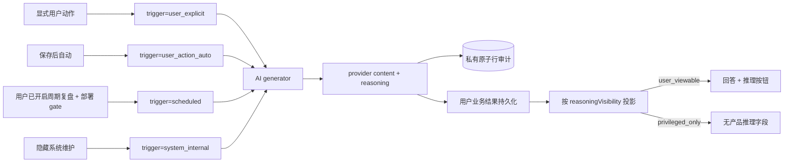
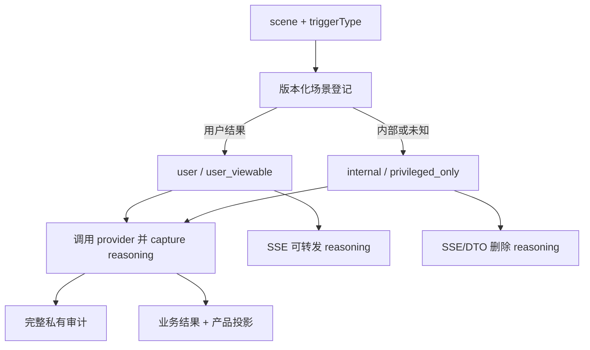
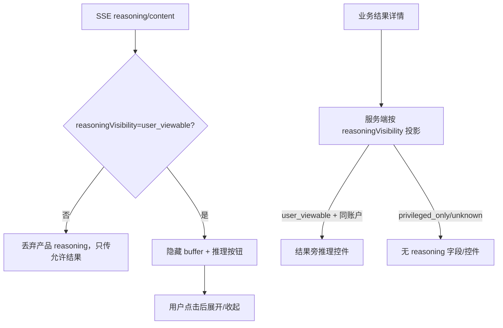

# reczz28ORRaxQBcy 应新规修订 AI 推理可见性边界 技术方案

|文档信息|内容|
|---|---|
|需求编号 / PRD|飞书需求 `reczz28ORRaxQBcy`；修订历史需求 `reczz28HhA5XPcTX`|
|Owner / 协作角色|Owner；AI 工作流、Prompt、HTTP 投影、前端回答组件、审计、隐私、测试负责角色|
|文档状态 / 版本 / 日期|研发准入处置稿；1.2；2026-10-17|
|设计范围 / 预估规模|调用意图分类、推理采集/持久化/投影、流式与回看 UI、系统任务隐藏和私有审计补齐|

## 评审摘要

推荐在服务端场景登记中分别确定 `triggerType`、`resultAudience`、`reasoningVisibility` 和 `persistenceMode`。触发方式不直接决定可见性：保存思绪后自动生成的回答，以及用户明确开启后由调度器自动产生的周期性认知复盘，标记为 `resultAudience=user`、`reasoningVisibility=user_viewable`；部署级 `PERIODIC_ANALYSIS_ENABLED` 只能作为 kill switch，不能替代账户用户同意。用户模型生成、感知抽取、记录压缩和重要性评分等隐藏系统行为标记为 `internal/privileged_only`，其中感知与压缩禁止普通用户 HTTP/UI 直接触发。未知调用默认内部且仅授权角色可见。

元数据与实际 SP、UP、history、result、reasoning 一起保存在同一私有原子审计行，不建独立可见性表；面向用户且有持久业务结果的场景由各领域保存可供产品读取的 `reasoningContent/reasoningVisibility`，产品只能读取业务结果 DTO，不得查询私有审计表。临时 draft/prompt/lead 等只做当前会话 live projection，不为了回看强制制造业务记录。请求 AI 回答不会自动打开推理：各领域页面通过 `features/ui` 的共享 `ReasoningDisclosure` 默认折叠组件展示，app runtime/kernel 不承载业务 UI。业务 reasoning 长度沿用对应领域正文上限，不新增全局 `AI_REASONING_TEXT_LIMIT`。`reasoningContent` 不混入回答、不进入后续上下文、默认导出或普通统计。

|决策编号|Owner 决策事项|Owner 结论及方案落实|排除的选择及代价|受影响章节 / 负责角色|
|---|---|---|---|---|
|D1|自动回答与周期性认知复盘是否展示推理|已确认：两者是面向用户的业务结果，推理可查看；自动触发不等于内部调用|按触发方式一律隐藏会误伤产品明确交付的 AI 结果|3.1、3.4；Owner/产品|
|D2|历史 reasoning 如何分类|已确认按场景登记迁移；用户结果场景可查看，隐藏系统场景仅授权角色可见，未知场景默认内部|按是否点击猜测既不稳定，也不能还原自动结果的产品受众|3.4、5.2；隐私/迁移角色|
|D3|产品展示与存储方式|已确认不建独立可见性表；调用契约元数据存在同一审计行，用户业务结果保存投影字段；UI 默认折叠，点击“推理”才展开|产品直读私有审计会破坏权限边界；自动展开会干扰回答阅读|2.2、3.4、3.5；产品/审计角色|
|D4|周期复盘的自动触发资格|已确认必须由账户用户明确开启；部署环境变量仅作全局 kill switch。用户关闭后停止新调度，不删除既有用户结果|仅凭服务端环境变量自动运行不能表达账户同意；每次手动触发又失去周期功能|3.1、3.5、5.2；设置/调度角色|
|D5|感知与压缩入口|已确认是系统级 `system_internal/privileged_only`，无普通用户 HTTP/UI 直接调用；只能由受控事件/调度入口触发|开放手动按钮或普通 API 会把内部维护误变成用户产品结果|3.1、3.5、3.6；AI 应用/HTTP|
|D6|临时结果与 UI 复用|已确认 draft/prompt/lead 等只 live projection，不强制持久化；共享折叠组件归 `features/ui`，领域拥有 DTO 与落点，app runtime 只接生命周期|为每个临时结果建表会制造无业务价值数据；把业务 UI 放 kernel/runtime 会形成巨型入口|3.1、3.6；领域/前端|

## 资料来源与前提

|证据编号|资料 / 代码位置|版本或读取时间|支持的事实|可访问与核实状态|
|---|---|---|---|---|
|E-001|[Prompt 可见性契约](../../knowledge/prompt-architecture.md#模型思考与系统调用的可见性)|2026-10-17|用户结果与隐藏系统行为按受众区分；自动回答/周期复盘可查看，内部调用隐藏|已读取并修订|
|E-002|[回答弹窗 runtime](../../public/frontend/app/runtime/answer-modal-runtime.mjs)|HEAD `f7bd64`；2026-10-17|当前 reasoning 事件只更新“正在整理回答”状态，不显示正文|已读取|
|E-003|[思绪公开投影](../../src/modules/thoughts/index.mjs)|HEAD `f7bd64`；2026-10-17|当前 publicThoughtValue 无条件剥离 reasoningContent|已读取|
|E-004|[模型生成实现](../../src/modules/ai/generation.mjs)|HEAD `f7bd64`；2026-10-17|provider 已分离 content/reasoning 事件与结果|已读取|
|E-005|[用户模型任务](../../src/app/user-model.mjs)、[感知任务](../../src/app/perception.mjs)、[重要性任务](../../src/shared/ai-context/importance-runtime.mts)|HEAD `f7bd64`；2026-10-17|三类系统任务显式 `auditPrompt:false`，未保存实际请求正文|已读取|
|E-006|[原子行审计方案](reczz28ORRaxSCBn-应新规修订AI请求原子行审计-技术方案.md)|2026-10-17|私有审计与产品可见性分离；所有调用完整入审计|已读取；依赖|
|E-007|[周期任务入口](../../src/app/server-lifecycle.mjs)、[配置](../../src/config/index.mjs)、[复盘工作流](../../src/app/review-chat-workflows.mjs)|工作区；2026-10-17|当前周期复盘只受部署级 `PERIODIC_ANALYSIS_ENABLED` 控制并以 `weekly-background` 保存，未见账户用户启用门禁|已读取；需修订|
|E-008|[AI 场景表](../../src/modules/ai/settings.mjs)、thought/journal/chat/review/annotation/recognition 工作流|工作区；2026-10-17|持久 owner、DTO 和 UI 分散在多个领域，临时 draft/prompt 与持久结果语义不同|已读取|
|E-009|[后台任务](../../src/app/background-ai.mjs)、[感知](../../src/app/perception.mjs)、[记录压缩](../../src/app/record-compressions.mjs)|工作区；2026-10-17|perceptionExtraction/recordCompression 是内部任务；应保持无普通产品直达入口|已读取|

|前提编号|假设、建议或待确认内容|采用依据|不成立的影响|核对方式 / 负责角色|
|---|---|---|---|---|
|A-001|供应商可能不返回 reasoning|DeepSeek effort/模型行为|UI 必须允许没有思考区|provider fixture 与真实获准调用|
|A-002|所有 AI scene 都能登记稳定的产品受众|现有场景常量可枚举，历史也有 scene|若存在语义混用场景，须先拆分场景再迁移历史|调用入口与历史样本清单审查；AI 角色|

## 需求追踪

|需求点|设计章节|接口 / 实体 / 代码落点|验收用例|观测指标|
|---|---|---|---|---|
|用户结果推理可按需查看|3.1、3.5|SSE `reasoning`、AnswerReasoningPanel|TC-01、TC-02|可见 reasoning 事件/渲染|
|结果旁可回看|3.1、3.4|`reasoningVisibility`、详情 DTO|TC-03|回看可用率|
|系统任务不泄露|3.1、3.5|场景登记、服务端投影|TC-04、TC-05|阻止的非法投影|
|所有调用完整私有审计|3.1、3.6|原子行 audit repository|TC-06|审计缺字段|
|推理不进上下文/默认导出|3.6、3.8|context/export 过滤|TC-07|上下文泄漏回归|
|周期复盘须用户启用|3.1、3.5|account setting + scheduler gate|TC-10|无同意调度数|
|感知/压缩无直接产品入口|3.1、3.5、3.6|internal handler allowlist|TC-11|公开路由/按钮数|
|每 scene 明确 owner/DTO/UI/持久策略|3.1、3.6|`AiSceneContract`|TC-12|未闭合 scene 数|
|临时结果 live-only|3.1、3.4|`persistenceMode=live_only`|TC-13|临时孤儿记录数|
|共享 UI 不进入 app runtime|3.6|`features/ui/ReasoningDisclosure`|TC-14|runtime 业务渲染数|
|按领域正文上限保存|3.1、3.4|scene `reasoningTextPolicy`|TC-15|全局 reasoning limit 配置数|

## 名词解释

|名词|解释|语境|
|---|---|---|
|触发类型|说明调用由显式请求、用户动作后的自动流程、周期任务或内部系统任务触发；它不单独决定结果或推理能否展示。|“触发方式不直接决定可见性”（评审摘要）|
|结果受众|`user/internal`；说明最终业务结果是否作为产品内容交付给账户用户。周期任务也可以产生 user 结果。|“标记为 `resultAudience=user`、`reasoningVisibility=user_viewable`”（评审摘要）|
|推理可见性|`user_viewable/privileged_only`；只控制供应商实际返回的 reasoning 产品投影，不改变完整私有审计。|“隐藏系统行为标记为 internal/privileged_only”（评审摘要）|
|私有原子行审计|按 callId 保存实际 SP、UP、推理和结果的一行敏感审计记录，只供授权治理用途。|“元数据与实际 SP、UP、history、result、reasoning 一起保存在同一私有原子审计行”（评审摘要）|
|服务端投影|服务端依据业务结果记录中的 `reasoningVisibility` 选择可以返回给产品端的字段，不依赖前端隐藏，也不读取私有审计表。|“详情 DTO 只读取业务结果记录”（2.2）|
|默认隐藏|未登记的新场景按 `internal/privileged_only` 处理；这不是仅用 CSS 隐藏。|“未知调用默认内部且仅授权角色可见。”（评审摘要）|
|persistenceMode|`business_result/live_only/audit_only`；决定用户结果 reasoning 保存到领域记录、只在当前会话展示，还是仅留私有审计。|“临时 draft/prompt/lead 等只做当前会话 live projection，不为了回看强制制造业务记录。”（评审摘要）|
|ReasoningDisclosure|由 `features/ui` 提供的默认折叠安全展示组件；领域 feature 决定放在哪个业务结果旁，组件不决定权限或读取审计。|“`features/ui` 的共享 `ReasoningDisclosure` 默认折叠组件展示”（评审摘要）|

## 评审记录

Owner 已确认 D1、D2、D3，并补充周期复盘、感知/压缩边界；D4 至 D6 按该确认与模块规则完成研发准入处置。本次纠正“自动触发即系统内部”和“部署开关等于用户同意”两类旧判断，补齐场景 owner/DTO/UI、临时结果、领域限额和共享 UI 边界。规则文本已经生效，但代码尚未满足；文档决策已闭合，不把历史“已实现模型思考”记录改写为本修订已完成。

# 1. 项目背景

## 1.1 背景（必填）

当前 provider 和业务记录能够采集/保存 `reasoningContent`，但用户主动回答弹窗没有渲染 reasoning 正文，思绪公开投影又无条件删除该字段；同时用户模型、感知和重要性评分为减少审计正文而设置 `auditPrompt:false`，与新的私有审计要求冲突。历史资料曾记录思考 UI，但当前代码证据不支持把它视为仍有效实现。

范围内是推理的产品可见性和私有审计完整性。不会要求模型生成隐藏 chain-of-thought，也不会伪造供应商未返回的 reasoning；产品可解释理由可由最终回答另行生成，不冒充原始 reasoning。

## 1.2 目标（必填）

|目标|基线与来源|目标值及状态|统计口径 / 窗口 / 样本|验收方式|
|---|---|---|---|---|
|用户结果 reasoning 可查看|当前流式正文不显示，E-002|供应商返回时可按需展开并持久回看；已确认|按 user_viewable 场景|TC-01 至 TC-03|
|内部任务正文不泄露|当前 UI 未见直接泄露，但无统一分类|所有 privileged_only/unknown 产品投影为 0 字段；已确认|HTTP/SSE/DOM/缓存/导出|TC-04、TC-05、TC-07|
|私有审计完整|三类 auditPrompt=false，E-005|适用调用完整入同一审计行；已确认|按调用入口与 callId|TC-06|
|交互可用性|真实设备基线未知|布局不跳动、默认折叠；具体性能待测|流式首片段与回看操作|浏览器/真机验证|

# 2. 总体方案设计

## 2.1 前期调研

`createAiGenerator` 已能按 `captureReasoning` 返回独立字段，DeepSeek transport 已发出 reasoning/content 两类事件。缺口在场景产品契约、持久化标记、服务端投影与前端展示。`scene` 是历史迁移和稳定默认的主键；触发方式另存为独立维度，避免把自动触发误判为内部。若一个 scene 同时承担用户结果和隐藏系统行为，必须先拆分 scene，不能让前端按按钮文本猜测。

## 2.2 系统架构

|系统 / 协作方|职责与边界|输入 / 输出|本次变更|负责角色 / 证据|
|---|---|---|---|---|
|领域 feature UI|发起或查看用户结果、决定业务落点|content/reasoning 分区|组合共享 `ReasoningDisclosure`|各领域前端|
|`features/ui`|提供默认折叠、安全渲染与可访问交互|reasoning text/state|新增共享无业务组件|前端 UI|
|工作流入口|提供 scene 与真实 trigger|版本化 invocation contract|新增场景登记|AI 应用层|
|AI generator/provider|采集实际 content/reasoning|独立事件/结果|不决定产品可见性|E-004|
|账户设置与 scheduler|用户启用周期复盘，部署开关只作 kill switch|account setting + schedule|新增双门校验|设置/调度|
|业务记录|按 scene contract 保存持久用户结果及产品投影|reasoningContent + reasoningVisibility|各领域拥有，不建通用结果表|领域|
|HTTP/SSE 投影|账户鉴权和字段裁剪|公开 DTO/事件|服务端强制|HTTP|
|私有审计 DB|保存所有调用实际请求/结果|同一原子行|补齐系统任务|E-006|
|导出/上下文|默认排除 reasoning|业务文本|保持并测试|数据治理|
|感知/压缩内部入口|只接事件/调度，不提供普通 HTTP/UI|internal task|保持 privileged_only|AI 应用|
|app runtime/kernel|页面生命周期与 feature 装配|无业务 reasoning 组件|不承载展示规则|应用壳|



### 2.2.1 业务新流程

用户请求回答后，界面默认只显示回答状态和正文，不自动打开推理。`user_viewable` 的 reasoning 到达时在独立 buffer 中接收；存在内容后由领域 feature 组合共享 `ReasoningDisclosure`，只有用户点击才展开实时或已完成内容，再次点击收起。没有 reasoning 时不显示空控件。保存后自动回答和已启用账户的周期性认知复盘在对应结果页同样提供按需查看；用户模型、感知、内部摘要、压缩和评分不返回推理按钮或字段。关闭周期复盘账户设置后不再生成新的 scheduled 结果，既有用户结果保留。

### 2.2.2 技术新流程

工作流调用 `resolveInvocationContract(scene, triggerType)` 得到不可变的 `triggerType/resultAudience/reasoningVisibility/persistenceMode/reasoningTextPolicy`，并同时传给 generator、业务结果和审计。元数据与调用正文同处一条审计行，不建独立表。scheduler 在创建 `analysis` 任务前同时验证部署 gate 和账户设置。SSE 适配器只对 `user_viewable` 转发 reasoning；`live_only` 仅在当前会话投影，`business_result` 由对应领域保存，`audit_only` 只写私有审计。详情 DTO 只读取业务结果记录，并在 `reasoningVisibility=user_viewable` 且当前账户有权读取时包含 reasoning。

## 2.3 可选方案对比

|方案|满足目标程度|复杂度与成本|性能 / 稳定性|兼容 / 迁移 / 回滚|主要限制|
|---|---|---|---|---|---|
|服务端场景登记 + 业务投影|完全满足|需贯穿工作流/存储/UI|权限边界明确|未知默认隐藏|推荐|
|前端自行按 scene 显隐|不满足安全边界|改动小|可被错误接口泄露|易回退|客户端不得升级可见性|
|所有 reasoning 都隐藏|不满足用户结果体验|最简单|最小泄露面|兼容|违反现行产品契约|
|所有 reasoning 都展示|不满足系统隐私|实现简单|泄露 SP/系统整理逻辑|不可接受|禁止|

# 3. 详细方案设计

## 3.1 详细设计（必填）

visibility 是业务场景契约。版本化登记明确每个 scene 的 `resultAudience/reasoningVisibility/persistenceMode/reasoningTextPolicy`，工作流只补充真实 `triggerType`；前端按钮和是否流式都不能升级权限。登记中未知 scene 在开发/启动测试中失败，运行时安全默认 `internal/privileged_only/audit_only`。同一 scene 若混用临时预览和持久业务结果，必须拆分 scene，不能靠调用方临时决定是否落库。

### 3.1.1 生产链路

|上游 / 触发入口|输入与协议|调用方式 / 频率|校验与转换|输出 / 状态 / 副作用|改动与证据|
|---|---|---|---|---|---|
|思考引子/草稿、日记辅助|当前会话输入、版本、用户动作|流式|`triggerType=user_explicit`|`user/user_viewable/live_only`|只 live projection，不强制持久化|
|回答/追问、长期对话、日记回望、神鸡|目标 ID、版本、用户动作|流式或后台可恢复|`triggerType=user_explicit`|`user/user_viewable/business_result`|领域业务结果旁查看|
|保存后自动回答|记录保存与设置|后台|`triggerType=user_action_auto`|`user/user_viewable/business_result`|结果旁按需查看 reasoning|
|周期性认知复盘 `analysis`|账户用户已启用、周期、证据范围、来源版本|定时|`triggerType=scheduled`；双门校验|`user/user_viewable/business_result`|复盘结果旁按需查看 reasoning|
|书目/健康/图片/捕念整理|用户材料、来源版本|同步/异步|显式或用户动作自动|`user/user_viewable`；按是否形成持久结果拆 scene|直接交付结果可查看 reasoning|
|用户模型、入门声明/感知抽取、记录压缩、重要性评分|来源与任务|后台/定时|`triggerType=system_internal`|`internal/privileged_only/audit_only`|内部正文隐藏，无普通 HTTP/UI 入口|
|未知新 scene|未登记|任意|开发门失败；运行时安全默认|`internal/privileged_only/audit_only`|防漏分类|



|处理动作|原所在事务|本次事务|事务粒度|事务内新增逻辑|事务外与提交后|
|---|---|---|---|---|---|
|调用分类与 provider|无 DB 事务|无 DB 事务|单次调用意图|无|分类在调用前固定；provider 调用与流式在事务外|
|业务结果保存|完整 store/领域现状事务|随 F3 迁移为短事务|目标用户结果记录|保存 reasoningContent、reasoningVisibility、sourceTaskId、版本|提交后同步记录变化|
|live-only 结果|不持久化|无 DB 事务|当前 task/session/generation|只保留 content/reasoning buffer|关闭/刷新后消失；审计仍完整|
|私有审计|当前文件双事件|按原子行方案两次短事务|单 callId|begin/finish 同一行，实际 SP/UP/reasoning/result 与 invocation contract|产品投影不得读取审计正文|
|周期调度资格|当前只有部署开关|账户设置精准读 + 任务幂等|单账户+period|部署 gate 与 `periodicReviews.analysisEnabled=true` 同时满足|关闭后不再排新任务|
|历史分类迁移|无|分批短事务|单账户、有界结果记录|按版本化 scene 映射 user/internal；未知 scene 默认内部|迁移报告不含正文|

#### 3.1.1.1 处理阶段与新增配置

|配置键|类型 / 默认值|作用域 / 负责模块|读取与生效时机|配置依赖 / 关闭行为|依据|
|---|---|---|---|---|---|
|`AI_REASONING_UI_ENABLED`|布尔 / `false`|前端发布配置|启动/构建|关闭只隐藏 user_viewable UI，不改变私有审计；privileged_only 始终隐藏|灰度|
|`PERIODIC_ANALYSIS_ENABLED`|布尔 / `false`|部署级 scheduler kill switch|启动读取|关闭停止全部新周期复盘；不能替代用户同意|E-007|
|`settings.periodicReviews.analysisEnabled`|账户布尔 / `false`|账户设置与 scheduler|用户保存后生效|必须与部署 gate 同时为 true；关闭不删历史|D4|

调用分类和 reasoning 长度不做可随环境任意改变的全局配置，使用版本化代码登记，避免误配置泄露。每个 `business_result` scene 引用其领域已有正文校验/长度 policy；`live_only` 使用对应输入/预览上限；私有审计仍遵循审计方案自己的安全上限。禁止新增 `AI_REASONING_TEXT_LIMIT`。

```json
{
  "aiReasoning": {
    "uiEnabled": false
  },
  "periodicReviews": {
    "deploymentEnabled": false,
    "accountEnabled": false
  }
}
```

#### 3.1.1.2 接口与数据处理

场景登记输出 `resultAudience/reasoningVisibility/persistenceMode/reasoningTextPolicy/schemaVersion`，工作流补充 `triggerType`。generator 总是把真实请求及元数据写入同一审计行；`captureReasoning` 只控制产品 live/business projection，不再控制审计正文。`privileged_only` 场景不把 reasoning 保存到业务结果，但审计行仍保存供应商返回值。产品持久化必须调用 scene 所属领域 command，不能写通用 AI result 表。

#### 3.1.1.3 场景所有权矩阵

|领域 / scenes|触发、受众、持久策略|业务持久化 Owner|公开 DTO / 投影 Owner|UI Owner 与展示|
|---|---|---|---|---|
|thoughts：`thoughtPrompt`、`thoughtDraft`|user_explicit；user_viewable；live_only|无业务结果记录|当前 SSE/task projection|`features/thoughts` 组合共享 disclosure；刷新后不回看|
|thoughts：`thoughtAnswer`、`followUpAnswer`|user_explicit 或 user_action_auto；user_viewable；business_result|thoughts answer/follow-up command|thought detail/SSE|`features/thoughts`；结果旁默认折叠|
|journals：`diaryLead/diaryStructure/diaryTopic`|user_explicit；user_viewable；live_only|无业务结果记录|当前 editor session projection|`features/capture-journal`；不建孤儿记录|
|journals：`diaryReflection`|user_explicit；user_viewable；business_result|journals reflection command|capture/journal detail DTO|`features/capture-journal`；reflection 旁展示|
|chats：`chat`|user_explicit；user_viewable；business_result|chats answer command|reviews/chat detail DTO|长期对话 feature；answer 旁展示|
|reviews：`analysis` manual|user_explicit；user_viewable；business_result|reviews analysis command|reviews/chat detail DTO|`features/review-insights` / personal-context|
|reviews：`analysis` scheduled|仅账户用户启用且部署 gate 开；user_viewable；business_result|reviews analysis command，reason=`weekly-background`|reviews/personal-context DTO|周期回望结果旁展示|
|annotations：`annotationShenji`|user_explicit；user_viewable；business_result|annotations exchange command|annotation DTO|`features/annotations`；回复旁展示|
|recognition：`bookRecognition`、`healthRecognition`|用户动作；user_viewable；持久结果与 preview 必须拆 scene/intent|books/health 领域 command|各自 recognition/result DTO|`features/library` / `features/health`|
|captures：`contentImageUnderstanding`、`capturePolish`|用户动作或其后台完成；user_viewable；business_result 或拆出的 live preview|content-attachments/captures command|父资源 detail/capture DTO|对应资源 feature / `features/capture-journal`|
|internal：`onboardingClaimExtraction`、`perceptionExtraction`、`recordCompression`、`importanceScoring`|system_internal；internal/privileged_only；audit_only|仅内部领域事实，绝不保存产品 reasoning|无普通产品 reasoning DTO|无普通 UI/HTTP 触发；仅治理审计|

矩阵中的每个 scene 必须有唯一 persistence owner、DTO owner 和 UI owner。识别类若同一现有 scene 同时承担“仅预览”和“确认保存”两种语义，实施前拆成稳定 scene/intent；不能用是否点击保存来回填历史可见性。

### 3.1.2 消费链路



|处理动作|原所在事务|本次事务|事务粒度|事务内新增逻辑|事务外与提交后|
|---|---|---|---|---|---|
|SSE 投影|无 DB 事务|无 DB 事务|单请求/session/generation|无|服务端过滤后传输；前端迟到事件再核 session|
|详情读取|当前 publicThoughtValue 无条件删除|只读查询/投影|账户+结果 ID|按业务记录 reasoningVisibility 选择字段|前端只渲染已返回字段|
|前端流式状态|浏览器内存|无 DB 事务|当前 modal taskId|reasoning 与 content 独立 buffer，一次状态更新|Markdown/LaTeX 渲染、滚动保护|
|默认导出/上下文|只读转换|无新增事务|单记录/导出批次|继续排除 reasoning|显式受控导出另走隐私选项|

#### 3.1.2.1 消费入口

|下游 / 消费面|入口与版本|读取字段 / 数据来源|转换 / 打包 / 缓存|本次改动与兼容性|验收用例|
|---|---|---|---|---|---|
|回答弹窗|现有 SSE|reasoning/content|独立 buffer|reasoning 事件 additive|TC-01、TC-02|
|用户结果详情|现有各场景详情 DTO|业务结果记录|服务端 reasoningVisibility 投影|user_viewable 记录新增 optional reasoningContent|TC-03|
|live-only 草稿/提示|当前 task/session SSE|内存 buffer|不写业务记录；关闭即释放|无跨设备回看承诺|TC-13|
|系统任务产品页|各公开 DTO|允许的最终结果|删除内部字段|保持无 reasoning|TC-04|
|默认导出/上下文|现有转换|业务正文|排除 reasoning|保持|TC-07|
|私有审计工具|受控 repository|完整原子行|与产品 UI 隔离|由审计方案交付|TC-06|

#### 3.1.2.2 协议、打包与改动边界

SSE `reasoning` 事件仅存在于 `user_viewable` 调用；旧客户端遇到未知事件会忽略。客户端收到事件后默认只缓冲，不自动展开。详情 `reasoningContent` 与 `reasoningVisibility` 为 optional，且只从该领域业务结果读取；`privileged_only/unknown` 不返回字段而不是返回隐藏 DOM。服务端不提供普通用户查询任意 callId 审计的接口，也不提供普通用户触发 perception/compression 的路由。

#### 3.1.2.3 消费验收

TC-01/02 验证流式与无 reasoning；TC-03 验证持久回看；TC-04/05 验证系统和跨账户不可见；TC-07 验证上下文和导出默认排除。

## 3.2 外部依赖

### 3.2.1 依赖方与诉求

|依赖方 / 负责角色|诉求与交付物|协议 / 版本|就绪条件 / 证据|联调与发布先后|失败或延期处置|
|---|---|---|---|---|---|
|原子行审计|所有调用完整私有留存|Audit v1|系统任务不再 omitted|先部署|不启用本需求为“审计已完整”|
|各 AI 工作流|scene/trigger 清单|Visibility v1|未知 scene 测试为 0|服务端先|默认 internal/privileged_only|
|账户设置/scheduler|用户级周期复盘启用状态|Settings vNext|双门与关闭用例通过|scheduled analysis 前|不开周期任务|
|业务记录/F3|reasoningVisibility 与 reasoning 原子保存|Result vNext|版本/同步用例通过|UI 前|缺字段默认隐藏|
|各领域 HTTP/DTO|只从领域业务结果投影 reasoning|DTO additive|产品无 audit repository 依赖|UI 前|字段默认省略|
|`features/ui` 共享组件|可访问折叠区|SSE/DTO additive|桌面/移动/读屏通过|最后启用|关闭 UI 开关|

### 3.2.2 版本级复用与串行位置

本需求处于[版本级严格串行链](V0516-跨需求共用底座与串行开发-技术方案.md#322-有效需求复用组件与唯一串行位置)第 10 位。它在 AI 审计、记录级业务结果和共享交互状态均稳定后接入可见性，避免产品 UI 读取私有审计或创建新的页面状态体系。

|项目|本需求结论|
|---|---|
|消费组件|RC-03 invocation/audit contract；RC-04 领域结果原子写；RC-06 focus/selection protection|
|提供组件|五类 scene visibility registry、领域 `reasoningVisibility` DTO、共享 `ReasoningDisclosure`|
|唯一前驱|F8 iOS PWA 选字批注 `recvxlWptXiRfk` 已通过出口门|
|进入条件|审计与产品数据隔离、业务结果持久化、桌面/移动交互保护均稳定|
|出口交付|五场景、周期 consent、unknown 安全默认、历史隐藏、DTO 权限和共享 UI 用例通过|
|解锁后继|新 F9 记录级同步 `reczz28ORRaxQJDJ`；F9 只同步领域 DTO，不读取 audit repository|

## 3.3 异常处理（必填）

|异常点|处理策略|重试 / 幂等 / 补偿|持久化与用户影响|监控与恢复条件|
|---|---|---|---|---|
|供应商无 reasoning|不显示空控件|不重试仅为获取 reasoning|最终回答正常|无空控件|
|未知 scene 分类|运行时按 internal/privileged_only；开发/测试失败|补登记后发布|不泄露|未知分类归零|
|迟到 SSE/账户切换|按 taskId/session/generation 丢弃|不写新页面|后台业务结果仍按来源保存|迟到丢弃可观测|
|业务保存失败|按原任务错误处理|同 sourceTaskId 幂等恢复|不把仅内存 reasoning 冒充已保存|任务状态明确|
|审计写失败|按原子行方案处理|不得通过关闭 auditPrompt 绕过|可能拒绝 provider dispatch|审计缺口告警|
|历史 scene 未登记|默认 internal/privileged_only|补充场景证据后重跑迁移，不按点击猜测|历史 reasoning 不展示|迁移未知数可核对|

## 3.4 数据实体（必填）

```ts
type AiInvocationMetadata = {
  schemaVersion: 1;
  scene: string;
  triggerType: "user_explicit" | "user_action_auto" | "scheduled" | "system_internal";
  resultAudience: "user" | "internal";
  reasoningVisibility: "user_viewable" | "privileged_only";
  persistenceMode: "business_result" | "live_only" | "audit_only";
  reasoningTextPolicy: string;
};

type AiSceneContract = {
  scene: string;
  allowedTriggers: AiInvocationMetadata["triggerType"][];
  resultAudience: AiInvocationMetadata["resultAudience"];
  reasoningVisibility: AiInvocationMetadata["reasoningVisibility"];
  persistenceMode: AiInvocationMetadata["persistenceMode"];
  reasoningTextPolicy: string;
  persistenceOwner: string | null;
  dtoOwner: string | null;
  uiOwner: string | null;
};

type VisibleAiResult = {
  id: string;
  content: string;
  reasoningContent: string | null;
  reasoningVisibility: "user_viewable";
  sourceTaskId: string;
  version: number;
};
```

|实体 / 字段路径|类型 / 必选性 / 默认值|含义 / 单位 / 枚举|生产方 / 消费方 / 事实源|存储、索引与生命周期|兼容 / 迁移|
|---|---|---|---|---|---|
|审计行 `trigger_type`|枚举 / 必选|调用真实触发方式|工作流 / 私有审计|与 SP/UP/result/reasoning 同一行|历史按可证实来源或 scene 回填|
|审计行 `result_audience`|user/internal / internal|最终业务结果受众|场景登记 / 私有审计|同一行普通列|未知默认 internal|
|审计行 `reasoning_visibility`|user_viewable/privileged_only / privileged_only|推理产品权限|场景登记 / 私有审计|同一行普通列，不另建表|未知默认 privileged_only|
|审计行 `persistence_mode`|business_result/live_only/audit_only / audit_only|产品持久策略|场景登记 / 私有审计|同一行普通列|未知默认 audit_only|
|业务结果 `reasoningVisibility`|user_viewable / 缺失|产品投影依据|领域记录 / HTTP|随对应结果原子保存|内部结果不建产品记录或不含字段|
|`reasoningContent`|string/null|供应商实际返回推理|provider / user DTO 或私有审计|业务结果遵循 scene 指向的领域正文 policy；审计上限独立|privileged_only 不存业务结果|
|`sourceTaskId`|string / 必选|结果与任务绑定|工作流/幂等|索引|复用现有|
|账户 `periodicReviews.analysisEnabled`|boolean / false|用户是否同意自动周期复盘|设置/scheduler|账户设置精准读|关闭不删既有 analysis|

```json
{
  "id": "answer-example",
  "content": "最终回答",
  "reasoningContent": "供应商实际返回的思考",
  "reasoningVisibility": "user_viewable",
  "sourceTaskId": "task-example",
  "version": 1
}
```

## 3.5 接口定义（必填）

|接口 / 消息 / 回调|调用方 → 提供方|新增 / 修改 / 复用|协议版本与详细定义|
|---|---|---|---|
|`resolveInvocationContract(scene, triggerType)`|工作流 → scene registry|新增|返回不可变 contract；未知=internal/privileged_only/audit_only|
|SSE `reasoning`|服务端 → 用户结果前端|受控复用|仅 user_viewable；`delta:string`，客户端默认不展开|
|业务详情 DTO|HTTP → 当前账户|修改|optional `reasoningContent/reasoningVisibility`，privileged_only 不返回|
|私有 audit row|AI runtime → 审计 DB|依赖|所有调用同一行含调用契约元数据、实际请求与结果|
|`setPeriodicReviewPreference`|账户设置 → settings command|新增|当前账户布尔 setting；显式用户操作|
|`maybeRunPeriodicAnalysis`|scheduler → reviews workflow|修改|部署 gate + 账户 setting + 周期幂等；缺一不排任务|
|perception/compression handlers|内部事件/调度 → app workflow|收紧|无普通 HTTP route 或用户 feature action|

SSE 仍沿用现有请求超时、取消和 session 鉴权；contract 在服务端生成，客户端请求不能自报 `resultAudience=user`、`reasoningVisibility=user_viewable` 或 `persistenceMode=business_result`。同一任务重试保持原 scene 与 invocation contract，每次 callId 独立审计。

## 3.6 代码设计

### 3.6.1 代码落点

|文件 / 模块|改造点|复用边界 / 调用关系|证据或拟新增标记|
|---|---|---|---|
|`src/modules/ai/invocation-visibility.mts`|版本化 scene 的受众、持久模式、领域 policy 与 owners|唯一分类来源；不是数据库表|拟新增；AI 契约唯一写者|
|各 `src/app/*workflows*`|传 scene/triggerType/metadata|不让 generator 或前端猜测|拟修改|
|[generation.mjs](../../src/modules/ai/generation.mjs)|审计始终完整，业务 reasoning 按 visibility 返回|复用 provider 分离事件|拟修改|
|thoughts/journals/chats/reviews/annotations/recognition/captures 领域|各自保存 `business_result`、执行正文 policy 并提供 DTO|不建通用 AI result repository|拟修改；按矩阵唯一 Owner|
|[server lifecycle](../../src/app/server-lifecycle.mjs)、[review workflow](../../src/app/review-chat-workflows.mjs)、设置模块|周期复盘部署 gate + 账户 consent 双门|用户关闭后不排新任务|拟修改|
|`public/frontend/features/ui/reasoning-disclosure.mts`|隐藏 buffer、推理按钮、展开/收起、读屏与安全渲染|无 scene/权限/业务位置判断|拟新增；共享 UI 唯一写者|
|各领域 `public/frontend/features/*`|把共享 disclosure 放在业务结果旁|只读取本领域 DTO/live state|拟修改|
|[answer-modal-runtime.mjs](../../public/frontend/app/runtime/answer-modal-runtime.mjs)|仅保留 modal/session 生命周期并委托 feature/UI|不实现 reasoning 业务组件|拟收窄|
|[exports 模块](../../src/modules/exports/index.mjs)|保留默认排除与显式权限|不扩大普通导出|验证为主|

### 3.6.2 核心伪代码

```python
async def run_ai_workflow(scene, trigger_type, request, session):
    contract = scene_registry.resolve(scene, trigger_type)
    result = await generator.generate(
        request,
        capture_reasoning=True,
        audit_prompt=True,
        invocation_metadata=contract,
    )
    if contract.persistence_mode == "audit_only":
        return project_allowed_final_result(result, contract)
    if contract.persistence_mode == "live_only":
        return project_live_result(result, contract, session)
    saved = await contract.persistence_owner.save_result(
        result,
        contract.reasoning_text_policy,
        request.source_version,
    )
    return contract.dto_owner.project(saved, session.account_id)


def project_result_for_account(result, account_id):
    require_same_account(result, account_id)
    projected = public_result_fields(result)
    if result.reasoning_visibility == "user_viewable":
        projected["reasoningContent"] = result.reasoning_content
    return projected
```

#### 3.6.2.1 关键动作实现细节

|函数签名|输入|输出|复用逻辑|不直接复用|
|---|---|---|---|---|
|`sceneRegistry.resolve`|scene+triggerType|完整 invocation contract|复用现有 scene/task kind 常量|不按是否点击推断受众|
|`projectResultForAccount`|记录+账户|公开 DTO|复用账户授权|不依赖 CSS/hidden|
|`ReasoningDisclosure`|reasoning buffer/state|可访问 details 区|复用 markdown/latex|不决定 scene 权限，不把 reasoning 拼入 answer|
|`auditAttempt`|实际 wire/结果|私有单行|复用原子行方案|不再支持 auditPrompt=false|

### 3.6.3 关键实现约束

1. 未登记/缺失 scene 一律 `internal/privileged_only`（TC-04）。
2. 前端和请求 body 不能把 `privileged_only` 升级为 `user_viewable`（TC-05）。
3. user_viewable reasoning 与 content 分字段、分区域，默认不展开，且 reasoning 不进入后续上下文（TC-01、TC-07）。
4. privileged_only 调用的产品 DTO/SSE/缓存/DOM 均无内部 reasoning/SP/UP（TC-04）。
5. 所有真实调用私有审计实际正文，不允许 auditPrompt=false（TC-06）。
6. 账户/session/generation 失效后迟到事件不得写入新页面（TC-08）。
7. 调用契约元数据必须在同一 audit row，产品只能读取业务结果投影，不得查询私有审计（TC-05、TC-06）。
8. scheduled analysis 必须同时满足部署 gate 和当前账户用户 setting；不得以全局配置代替 consent（TC-10）。
9. perceptionExtraction/recordCompression 无普通 HTTP route、菜单或按钮，只能由受控内部 handler 触发（TC-11）。
10. scene contract 必须闭合 persistence/DTO/UI owner；产品 DTO 只从该领域业务结果读取（TC-12）。
11. `live_only` 不建业务结果记录；关闭 session 后只保留私有审计，不提供伪回看（TC-13）。
12. reasoning 展示组件唯一实现在 `features/ui`；app runtime/kernel 与领域页面不得复制权限/渲染状态机（TC-14）。
13. 业务 reasoning 按 `reasoningTextPolicy` 指向的领域正文规则校验；不存在全局 `AI_REASONING_TEXT_LIMIT`（TC-15）。

## 3.7 监控告警（必填）

|指标 / 告警|口径与单位|维度与基数限制|阈值 / 窗口 / 样本|严重度 / 负责角色|告警后动作 / 看板|
|---|---|---|---|---|---|
|`ai_visibility_unknown_total`|未知 scene/trigger 次数|scene|必须为 0|P1 / AI 应用|默认隐藏并补登记|
|`ai_reasoning_projected_total`|user_viewable/privileged_only 投影结果|scene、visibility|privileged_only 投影 reasoning 必须 0|P1 / HTTP|停止 UI 放量|
|`ai_audit_prompt_omitted_total`|真实调用省略请求正文|workflow|必须为 0|P1 / 审计|阻止调用/修复|
|`ai_reasoning_render_error_total`|前端渲染错误|页面类型|持续增长调查|P2 / 前端|退回纯文本安全渲染|
|`ai_reasoning_bytes`|业务保存 bytes 分位|scene、领域 policy|不得超过对应领域正文上限；分位建基线|P2|检查领域校验|
|`periodic_analysis_without_consent_total`|无账户启用却创建 scheduled analysis|触发来源|必须为 0|P1 / 调度|停周期任务|
|`internal_ai_public_entry_total`|感知/压缩被普通 HTTP/UI 触发|scene、entry kind|必须为 0|P1 / AI 应用|关闭入口并调查|
|`ai_scene_contract_incomplete_total`|缺 persistence/DTO/UI owner 或 policy 的 scene|scene|必须为 0|P1 / AI|阻止发布|
|`reasoning_ui_outside_shared_component_total`|runtime/page 自行实现 reasoning 展示状态机|module；低基数|必须为 0|P1 / 前端|阻止发布|

## 3.8 稳定性

### 3.8.1 容量与性能

`business_result` 的 user_viewable 结果按各领域正文 policy 额外保存 reasoning bytes；`live_only` 只占当前会话内存；privileged_only 仅在私有审计保留。流式前端在隐藏 buffer 中使用字符串累积和 requestAnimationFrame 合并状态，用户展开后才渲染，稳定容器尺寸。容量公式按领域分别计算 `持久 user_viewable 调用数 × 平均 reasoning bytes × 业务记录保留期`；真实分布需灰度测量，不以一个全局上限掩盖差异。

### 3.8.2 一致性与幂等

scene 产品契约和 triggerType 在一次业务任务创建时固定，并随重试继承。用户业务结果、reasoningVisibility、sourceTaskId 和版本同事务提交；live-only 不进入该事务。scheduled analysis 在排队前精准读取账户 setting，并以账户+period 幂等。重复任务不创建第二结果；迟到结果仍经过来源版本校验。私有审计每次实际尝试独立 callId，不与业务结果行一一强绑重试次数。

### 3.8.3 降级与回滚

关闭 UI 开关只停止 user_viewable reasoning 展示，不关闭私有审计，也不改变 privileged_only 隐藏。前端回滚时服务端 optional 字段可被忽略。若服务端分类缺陷，立即全局强制 `reasoningVisibility=privileged_only`，保留最终回答；修复后按 scene 映射重跑受控迁移，未知历史仍不公开。

### 3.8.4 安全与日志

产品可见 reasoning 仍是账户私密正文，不进入普通日志、指标标签或错误通知。完整 SP/UP/privileged_only reasoning 仅在私有审计 DB，按账户与用途授权。产品端不查询审计 DB。Markdown 渲染沿用安全 renderer，禁止脚本执行。默认折叠或隐藏 DOM 不作为权限控制。

## 3.9 实验方案

### 3.9.1 开关与灰度

先部署 scene registry、审计同行元数据、业务结果持久化和服务端投影并保持 UI 关闭；用契约测试证明 privileged_only 字段为零。随后测试账户启用按需展开/回看 UI。审计补齐独立先完成，不因 UI 开关关闭而延后。

### 3.9.2 核心验收指标

TC-01 至 TC-15 全部通过；privileged_only reasoning 任一产品泄露、无 consent 周期调用、内部 scene 公开入口、owner 缺失、live-only 落业务表、全局 reasoning limit、runtime 重复 UI、audit omitted、产品直读审计或跨账户迟到写入均失败。没有 reasoning 的模型结果不显示空控件，且请求回答后默认不展开推理，是功能门。

### 3.9.3 效果观测

按显式回答、保存后自动回答、账户启用周期认知复盘、识别整理、用户模型、感知、内部压缩和评分逐 scene 核对 SSE、DTO、缓存、DOM、业务存储和审计。另按矩阵核对 persistence/DTO/UI owner 与领域正文 policy。移动端观察默认折叠、点击展开/收起、滚动、长文本和回答首片段；样本不足不宣称性能达标。

# 4. 开发测试

## 4.1 开发明细（必填；评审时留空，开发结束后填写）

## 4.2 测试方案（必填）

|用例编号 / 对应需求|环境与前置条件|输入 / 操作 / 故障注入|预期输出 / 持久化 / 用户行为|监控与通过标准|
|---|---|---|---|---|
|TC-01 显式流式 reasoning|provider fixture 分段返回|主动回答/追问/草稿/回望|默认只显示回答；推理按钮出现，点击后显示实时/已收内容并可收起|事件与 UI 正确|
|TC-02 无 reasoning|provider 只返回 content|同入口|无空思考控件，回答正常|不伪造|
|TC-03 持久回看|user_viewable 结果保存后重开详情|刷新/跨设备|对应结果旁可展开同一 reasoning|账户内可见|
|TC-04 场景边界|自动回答、已启用周期认知复盘；用户模型、感知、内部摘要/压缩、评分|检查 SSE/DTO/cache/DOM|前两类可按需查看；后五类无 SP/UP/reasoning|privileged_only 投影 0|
|TC-05 越权升级|body 自报 user_viewable、跨账户 ID、产品尝试读 callId|请求详情/流/审计|服务端拒绝或仍隐藏；产品无审计入口|权限负例通过|
|TC-06 私有审计|所有入口各一次|核对 callId 行|invocation contract、实际请求、result、reasoning 完整同一行，无可见性分表|omitted=0|
|TC-07 上下文/导出|user_viewable reasoning 已保存|追问、个性化、默认导出|输入/导出默认不含 reasoning|无泄漏|
|TC-08 生命周期|流式中切账户/关闭页面|迟到 reasoning/content|不写新账户/页面；业务后台按来源处理|旧事件丢弃|
|TC-09 历史迁移|含已登记用户/内部/未知 scene 的历史记录|分批迁移两次|按 scene 稳定映射；未知内部；不按点击或 trigger 猜测|幂等且未知数可核对|
|TC-10 周期复盘 consent|部署 gate 与两账户 setting 四种组合|运行 scheduler、关闭后再次扫描|仅双 true 账户创建幂等 scheduled analysis；关闭不删历史|without consent=0|
|TC-11 内部入口|perceptionExtraction/recordCompression|枚举路由、feature action、直接请求和内部事件|普通 HTTP/UI 无入口；受控事件/调度可运行且产品无 reasoning|public entry=0|
|TC-12 scene owner 矩阵|thought/journal/chat/review/annotation/recognition/capture 全 scene|生成并读取持久结果|每个 business_result 只由本领域保存/DTO/UI；产品不查 audit|contract incomplete=0|
|TC-13 live-only|thoughtDraft/prompt、diary lead/structure/topic|流式完成、刷新、跨设备、任务失败|当前会话可看；不建业务结果记录；刷新后不伪造回看；audit 完整|orphan result=0|
|TC-14 UI 模块边界|各领域页面、app runtime/kernel|静态依赖检查与浏览器交互|统一使用 `features/ui/ReasoningDisclosure`；领域决定位置；runtime 只管生命周期|duplicate UI=0|
|TC-15 领域限额|为各领域准备边界内/外 reasoning|保存 business_result 与 live-only|按领域正文 policy 接受/拒绝或规范化；无 `AI_REASONING_TEXT_LIMIT` 读取|策略一致|

### 4.2.1 Mock测试方案

provider mock 分别返回 reasoning+content、仅 content、长 reasoning、错误和乱序片段；工作流/HTTP/前端使用正式 visibility registry 和投影。私有审计测试使用真实临时 PostgreSQL。退出 Mock 后少量真实调用只证明供应商实际字段兼容，不用来推断所有模型都会返回 reasoning。

# 5. 上线方案

## 5.1 上线CheckList（必填）

- [ ] 上线前：scene/trigger 清单完整，unknown 测试为 0。
- [ ] 上线前：场景矩阵的 persistence/DTO/UI owner 与领域 reasoning policy 完整，无通用 AI 结果表。
- [ ] 上线前：周期复盘账户 consent 双门通过；感知/压缩无普通 HTTP/UI 入口。
- [ ] 上线前：privileged_only 产品投影负例、同行元数据与所有调用私有审计完整通过。
- [ ] 上线前：live-only 不落业务表；默认折叠、点击展开、持久回看、无 reasoning、跨账户和默认导出通过。
- [ ] 上线前：共享 `ReasoningDisclosure` 位于 `features/ui`，app runtime/kernel 无业务展示状态机。
- [ ] 上线中：审计补齐 → scene registry/账户设置 → 各领域持久化/DTO → 共享 UI → 测试账户。
- [ ] 上线后：观察 unknown、privileged_only 投影、render 错误、真实设备和历史 scene 迁移。

## 5.2 上线依赖

本需求是版本串行阶段 10。下表只表示本需求内部部署顺序；新 F9 在本需求出口门通过前保持未开始。

|顺序 / 当前需求内部步骤|系统 / 负责角色|部署或配置动作|前置就绪条件与证据|兼容窗口 / 验证|
|---|---|---|---|---|
|1|原子行审计|完整请求/结果与 invocation contract 同行写入|TC-06|产品 UI 无变化|
|2|scene registry + settings|所有工作流、持久策略/owners/policy 与周期 consent 登记|TC-10 至 TC-13、unknown=0|缺失默认 internal/privileged_only/audit_only|
|3|各领域存储/HTTP|reasoningVisibility、领域限额与受控 DTO|TC-12、TC-15、权限负例通过|旧端忽略 optional|
|4|`features/ui` + 各领域 feature|共享折叠组件与结果旁控件|TC-14、浏览器/读屏通过|开关关闭可回退|
|5|历史迁移|按 scene 映射业务结果|TC-09|unknown 保持隐藏|

## 5.3 观测方案

上线阶段逐 scene 检查 3.7 指标和受控契约日志，不采集正文。真实用户路径验证默认折叠、点击查看、回答流、关闭弹窗后台完成、自动回答/周期复盘和详情回看；privileged_only 场景用自动化负例持续核对。任何内部正文出现在普通响应或 DOM 立即强制 privileged_only 并停止放量。

## 5.4 回滚方案

|对象|触发条件|负责角色 / 具体步骤|在途任务与数据处置|验证与恢复条件|
|---|---|---|---|---|
|服务 / 配置|UI 渲染缺陷|关闭 `AI_REASONING_UI_ENABLED`|已保存 user_viewable reasoning 保留在领域记录|最终回答正常|
|服务 / 配置|周期任务 consent 缺陷|关闭部署 gate，停止新 scheduled analysis|既有复盘保留；不删除用户内容|双门与幂等修复|
|代码 / 协议|服务端分类/投影缺陷|强制所有 reasoningVisibility=privileged_only，回兼容制品|不公开历史 unknown|内部泄露为 0|
|数据 / Schema|错误 visibility 回填|停止展示，按版本化 scene 映射修复|不删除审计事实，不按点击猜测 user|抽样与负例通过|

## 5.5 放量计划

|阶段|入口 / 分桶范围 / 比例|前置条件|停留窗口 / 最小样本|继续 / 停止 / 回滚条件|负责角色|
|---|---|---|---|---|---|
|测试|全部工作流 fixture|TC 全过|每入口至少一组成功/失败|硬门全过|AI/测试|
|服务端暗启|全部调用，UI 关闭|audit/registry 就绪|建议 24 小时|unknown=0、privileged_only 投影=0|运维|
|UI 白名单|Owner 指定账户|浏览器/移动通过|每类 user_viewable scene 有真实样本|无泄露/渲染错误|Owner|
|扩量|账户白名单扩大|前阶段稳定|按真实使用量确认|3.7 稳定|Owner/前端|
|全量|全部账户|Owner 批准|持续观察|privileged_only 隐藏长期保持|Owner|
