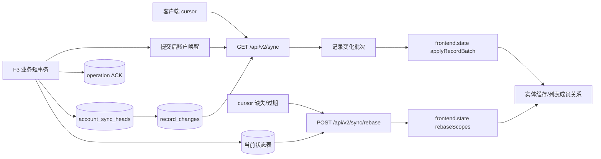
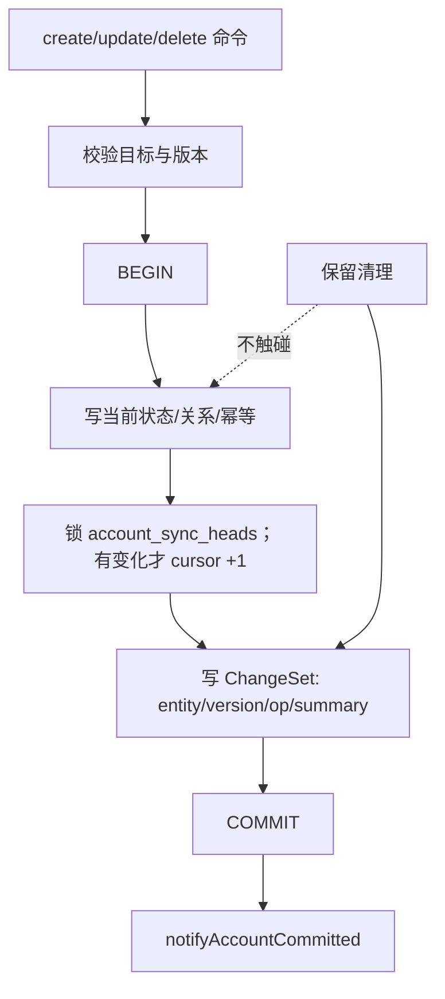
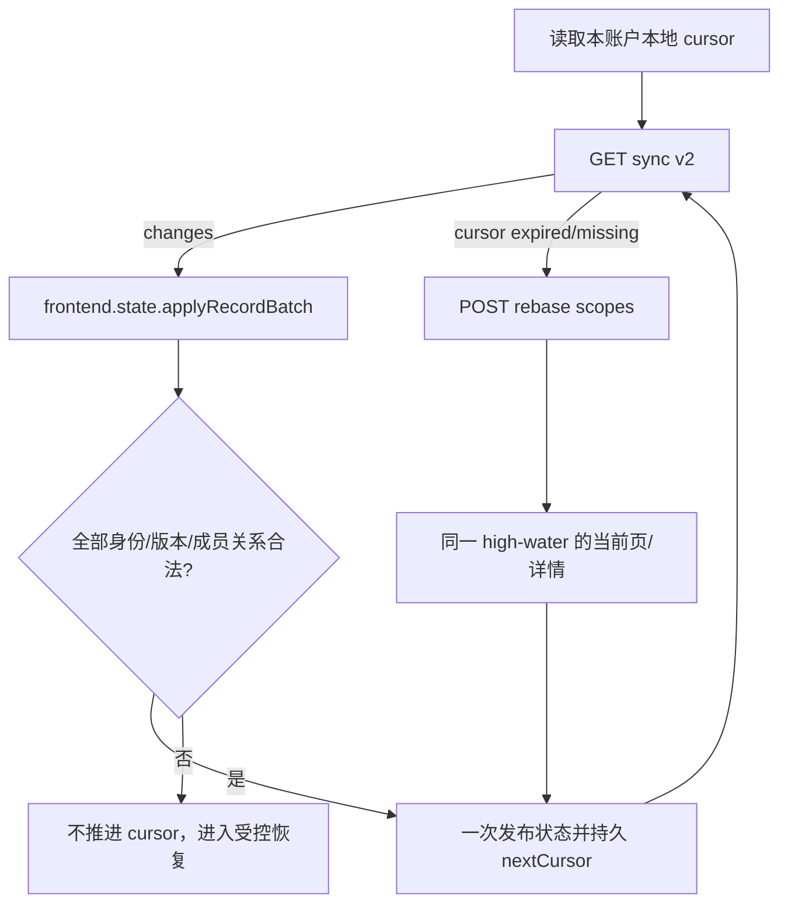

# reczz28ORRaxQJDJ 应新规重做 F9 记录级同步 技术方案

|文档信息|内容|
|---|---|
|需求编号 / PRD|飞书需求 `reczz28ORRaxQJDJ`；重做 `recvxyrQv7utyV` 的同步数据协议|
|Owner / 协作角色|Owner；F3 持久化、同步 HTTP、前端缓存与页面、各领域查询、测试与运维负责角色|
|文档状态 / 版本 / 日期|研发准入处置稿；1.2；2026-10-17|
|设计范围 / 预估规模|记录级变化协议、逻辑长连接、游标续传、有界 rebase、客户端幂等合并与旧 v1 迁移|

## 评审摘要

推荐建立 v2 记录级同步。F3 业务命令在写当前状态的同一事务中追加 `record_changes`，cursor 只从独立 `account_sync_heads` 分配；当前状态表始终是事实源，变化表只是可裁剪的投递索引。一个实体类型只有在 F3 `RecordChangeCoverage`、服务端投影/rebase 和前端实体 descriptor 全部 complete 后才能进入 v2 registry。首版沿用当前长轮询：每个 HTTP 请求最多等待约 1500ms，返回一批或超时后结束，客户端成功应用并持久游标后立即发起下一次，因此逻辑连接持续、物理连接轮换。SSE 未来可替换传输，但不改变记录级数据语义。

重连并携带有效游标时，服务端只读取该游标之后的变化，不从历史快照重新计算差分。游标缺失或过期时，不补“很久以前”的变化，也不返回整账户快照；客户端提交当前页、打开详情和受控首屏 scope，服务端在同一数据库快照读取最新状态及 high-water cursor，完成有界 rebase。create/update/delete 在写时由命令明确登记；`frontend.state` 以实体 Map 和 scope membership 为唯一 v2 客户端事实，通过公开 `applyRecordBatch/rebaseScopes` 按账户+实体类型+父对象+ID 和版本/tombstone 原子合并，必要时派生存量数组兼容视图。同步 controller 只管理传输、会话/generation、重试和 cursor 持久化，不能直接改页面数组。

|决策编号|Owner 决策事项|Owner 结论及方案落实|排除的选择及代价|受影响章节 / 负责角色|
|---|---|---|---|---|
|D1|首版传输|已确认继续长轮询，先替换数据协议；连接规模和代理/移动端证据证明需要时再单独评审 SSE|直接切 SSE 同时改变传输与数据，故障定位和回滚更复杂|2.3、3.5；Owner/同步角色|
|D2|变化保留窗口|已确认按“时间 + 每账户最大行数”双上限配置，初值上线前按断线分布和容量校准；只裁剪投递索引，不删除当前业务状态|仅时间可能被高频账户打爆；仅条数对低频账户过短|3.8、5.5；Owner/运维|
|D3|旧 v1 域快照兼容期|本轮只确认 v1/v2 独立运行且 v2 不回退 v1 snapshot；不预设 v0.6.0 硬退场。旧 PWA、Service Worker 缓存、启动能力协商和终止门槛延期到 v0.6 专项立项，以客户端分布和升级证据决策|本轮写死终止日期会把尚未评审的客户端升级策略伪装成既定结论；无限期双协议则增加维护成本|3.5、3.8、5.2；Owner/前端|
|D4|客户端合并职责|已确认 `frontend.state` 拥有实体 Map、scope membership、版本/tombstone 合并与 legacy array 投影；sync controller 只负责 transport/lifecycle/cursor|把实体规则留在 sync/data runtime 会形成第二状态层并使页面各自处理乱序|2.2、3.4、3.6；前端状态角色|
|D5|v2 实体开放门槛|已确认每种实体必须同时满足 producer coverage、服务端 descriptor/rebase 和前端 descriptor complete；独立 sync head 只在真实 ChangeDraft 提交时推进|全局打开 v2 但遗漏后台/legacy 写入口会永久漏变更；复用 account revision 会制造无 change 的缺口|3.1、3.4、5.2；F3/F9/领域角色|

## 资料来源与前提

|证据编号|资料 / 代码位置|版本或读取时间|支持的事实|可访问与核实状态|
|---|---|---|---|---|
|E-001|[设计契约](../../knowledge/design-contracts.md)|2026-10-17 生效|同步必须记录级；游标失效有界恢复；缓存键含账户、类型、父对象与 ID|已读取|
|E-002|[同步 HTTP](../../src/http/sync.mjs)|工作区未提交 F9 修改；2026-10-17|当前长轮询最多等待约 1500ms，可由账户提交唤醒，但响应仍按 domain 组装 snapshot，过期要求完整状态|已读取；未当作已交付|
|E-003|[同步投影](../../src/app/sync-projection.mts)|工作区 HEAD/未发布切片；2026-10-17|当前按变化域读取依赖闭包，未知域会全读|已读取|
|E-004|[PostgreSQL runtime](../../src/shared/persistence/postgres-runtime.mjs)|HEAD `f7bd64`；2026-10-17|当前 cursor/changes 位于元数据数组，阶段 A 只窄读域投影|已读取|
|E-005|[旧 F9 方案](F9-同步与交互延迟治理-技术方案.md)|2026-10-16 实施回填|账户唤醒、先订阅再复查、前台续接与阅读状态保护可复用|已读取；域 snapshot 被本稿替换|
|E-006|[F3 新方案](reczz28ORRaxPiK3-应新规重做F3记录级持久化-技术方案.md)|2026-10-17|命令可在同一事务产生记录级 ChangeSet，当前状态不依赖增量重放|已读取；前置依赖|
|E-007|[F4 新方案](reczz28ORRaxSFnV-应新规重做F4数据库游标分页-技术方案.md)|2026-10-17|当前思绪页与详情可通过有界查询 rebase|已读取；范围依赖|
|E-008|[前端状态](../../public/frontend/state/index.mjs)、[data runtime](../../public/frontend/app/runtime/data-runtime.mjs)、[现有同步 controller](../../public/frontend/shared/incremental-sync.mts)|工作区；2026-10-17|公共 state 当前只支持整状态 merge；域 snapshot 特例合并位于 data runtime，传输与状态职责混合|已读取|
|E-009|[PWA 注册](../../public/index.html)|工作区；2026-10-17|当前存在 Service Worker 注册；未见 v1/v2 能力协商、强制升级或旧缓存退场契约|已读取；支持 D3 延期|

|前提编号|假设、建议或待确认内容|采用依据|不成立的影响|核对方式 / 负责角色|
|---|---|---|---|---|
|A-001|客户端可以保存账户/工作区作用域 cursor，并在应用批次后原子推进|现有 IndexedDB 同步队列与 workspace scope|若不能原子推进，需每次启动 rebase，性能和离线能力下降|浏览器存储故障测试；前端角色|
|A-002|生产断线时长、变化率和平均 change bytes 未建立基线|现有证据只覆盖小样本|保留窗口和批大小不能先写死为容量承诺|灰度采样；运维角色|

## 需求追踪

|需求点|设计章节|接口 / 实体 / 代码落点|验收用例|观测指标|
|---|---|---|---|---|
|在线连续取得变化|2.2、3.5|`GET /api/v2/sync`、logical loop|TC-01、TC-02|续接间隙、变化可见延迟|
|有效游标重连续传|3.1、3.5|`readRecordChanges`|TC-03|resume/rebase 比例|
|过期游标有界最新状态恢复|3.1、3.5|`POST /api/v2/sync/rebase`|TC-04、TC-05|rebase scopes/rows/bytes|
|写时生成变化且不漂移|3.1、3.8|F3 `RecordChange`|TC-06、TC-07|change mismatch|
|客户端版本幂等合并|3.1、3.6|`frontend.state.applyRecordBatch`|TC-08、TC-09|旧响应丢弃、重复应用|
|当前状态不是增量重放结果|3.4、3.8|业务表、可裁剪 changes|TC-10|裁剪后详情/rebase 正确|
|实体类型覆盖后才开放|3.1、3.4、5.2|`SyncEntityRegistry`、`RecordChangeCoverage`|TC-13|未覆盖实体生产者数|
|前端状态唯一合并边界|3.4、3.6|`frontend.state.applyRecordBatch/rebaseScopes`|TC-14|sync/page 私有合并数|
|实体 Map、scope 与旧数组兼容|3.4、3.6|`EntityStateMap`、`ScopeMembership`、legacy selectors|TC-14|双权威/成员漂移|
|兼容退场不预判|3.5、5.2|v0.6 PWA/Service Worker follow-up|TC-15|未决项被误实现数|

## 名词解释

|名词|解释|语境|
|---|---|---|
|逻辑连接|客户端持续执行“取批次—应用—续接”的同步会话；底层可以是轮换的长轮询请求，不要求一条 TCP 永久不断。|“首版沿用当前长轮询：每个 HTTP 请求最多等待约 1500ms，返回一批或超时后结束，客户端成功应用并持久游标后立即发起下一次，因此逻辑连接持续、物理连接轮换。”（评审摘要）|
|SSE|Server-Sent Events；浏览器维持一条 HTTP 连接，由服务端持续单向推送事件。业务写仍使用普通 HTTP，需要额外处理连接上限、代理超时、休眠重连和多实例路由。|“未来可替换传输，但不改变记录级数据语义。”（评审摘要）|
|有效游标|仍位于服务端保留窗口内、未领先服务端且属于当前账户/协议的单调位置。|“重连并携带有效游标时，服务端只读取该游标之后的变化，不从历史快照重新计算差分。”（评审摘要）|
|rebase|不重放全部旧变化，而是在一个确定 high-water 下重新取得当前正在使用的有限范围最新状态。|“客户端提交当前页、打开详情和受控首屏 scope，服务端在同一数据库快照读取最新状态及 high-water cursor，完成有界 rebase。”（评审摘要）|
|high-water cursor|一次读取快照看到的最新同步位置；客户端应用该快照后从这里继续。|“客户端提交当前页、打开详情和受控首屏 scope，服务端在同一数据库快照读取最新状态及 high-water cursor，完成有界 rebase”（评审摘要）|
|tombstone|删除记录的最小标记，包含实体身份和版本，让客户端能删除缓存及列表成员关系。|“按账户+实体类型+父对象+ID 和版本/tombstone 原子合并”（评审摘要）|
|投递索引|为找出“哪些记录变了”保存的短期变化行，可裁剪；它不是业务当前状态本身。|“当前状态表始终是事实源，变化表只是可裁剪的投递索引。”（评审摘要）|
|变化保留|`record_changes` 为游标续传保留多久、每账户最多保留多少行；不等于业务记录或业务历史的保留期。超出窗口只会让旧游标改走有界 rebase。|“只裁剪投递索引，不删除当前业务状态”（D2）|
|同步漂移|服务端已提交状态与客户端缓存因漏消息、乱序、旧响应覆盖或错误推进游标而长期不一致。|“批次全部成功后才推进 cursor”（3.6）|
|SyncEntityRegistry|按实体类型登记 identity、父键规则、版本、公开投影、scope 影响、服务端 rebase reader、前端 normalizer/projector 和 producer coverage 状态；只有 complete 类型可进入 v2。|“一个实体类型只有在 F3 `RecordChangeCoverage`、服务端投影/rebase 和前端实体 descriptor 全部 complete 后才能进入 v2 registry。”（评审摘要）|
|scope membership|客户端对一个已加载页、详情或首屏 scope 保存的有序实体键集合及 stale/version 状态；增量只改已知实体或标 stale，rebase 才原子替换请求 scope 的成员集合。|“`frontend.state` 以实体 Map 和 scope membership 为唯一 v2 客户端事实”（评审摘要）|
|legacy array view|从 v2 实体 Map 和 scope membership 派生给现有页面的过渡数组；它不是第二事实源，也不能反向独立合并同步响应。|“必要时派生存量数组兼容视图。”（评审摘要）|

## 评审记录

Owner 已确认 D1、D2，并明确本轮不决定旧 PWA 在 v0.6.0 的策略；D3 按该边界修正，D4、D5 是研发准入审查后的模块与覆盖处置。当前结论是：首版长轮询；有效游标续传变化；失效游标有界 rebase 最新状态；变化在写时生成；当前状态不是增量重放结果；v1 退场另行立项。文档决策已闭合，尚未实施。

# 1. 项目背景

## 1.1 背景（必填）

当前同步已能用账户提交提示唤醒长轮询，且 PostgreSQL 阶段 A 可按变化域窄读；但 HTTP 仍返回 `changes + snapshot[domain]`，客户端按域替换/装配。一个小记录变化可能携带整个集合，游标过期时协议要求“重新读取完整状态”。这既造成传输/投影放大，也容易破坏未加载页面、草稿和阅读状态。

范围内为普通在线跨端同步和有界恢复。首次离线全量导入、灾备恢复、旧客户端明确兼容快照仍是专用流程，不是 v2 游标错误的 fallback。

## 1.2 目标（必填）

|目标|基线与来源|目标值及状态|统计口径 / 窗口 / 样本|验收方式|
|---|---|---|---|---|
|同步载荷按变化增长|当前按 domain snapshot，E-002|O(变化记录数 + 有界 rebase 行数)；已确认|服务端查询/返回行与 bytes|TC-06、TC-11|
|重连不丢更新|当前持久 cursor 已有，但返回域快照|有效 cursor 恰好覆盖断线区间；已确认|创建/修改/删除交错|TC-03|
|过期恢复有界|当前要求完整状态|只取声明 scope，数量有上限；已确认|scope 数、页数、详情数、bytes|TC-04、TC-05|
|普通在线传播|Owner 旧目标 P75≤500ms|目标保留，但当前基线已失败/partial|提交 COMMIT 到另一前台 paint，失败不剔除|TC-12 与真实设备|

# 2. 总体方案设计

## 2.1 前期调研

现有 `cursor` 和操作 ACK 可复用，账户 notifier 只承担低延迟唤醒也可复用。必须替换的是 `_persistence.sync.changes` 内存数组、按 domain 投影和过期全状态恢复。F3 新方案提供同事务 ChangeSet，F4 提供当前页/详情有界查询，形成 v2 所需生产和 rebase 基础。

## 2.2 系统架构

|系统 / 协作方|职责与边界|输入 / 输出|本次变更|负责角色 / 证据|
|---|---|---|---|---|
|业务领域/F3|写当前状态并登记 ChangeSet|记录行、独立 sync cursor、ACK|仅 coverage complete 类型进入 v2|F3|
|PostgreSQL|保存当前状态、`account_sync_heads` 与短期 changes|按 cursor 分页|新增变化表/保留清理|持久化|
|同步 HTTP|等待、续传、rebase|v2 batch/rebase|不组装域 snapshot|同步后端|
|前端同步 controller|逻辑续接、会话/generation、重试与 cursor 持久化|cursor、changes/rebase envelope|只调用 frontend.state 公共方法|前端 transport|
|`frontend.state`|实体 Map、scope membership、版本/tombstone 合并和 legacy view|版本化实体与有界 scope|唯一客户端合并边界|前端状态|
|页面|通过 state selector 读取摘要/详情/成员关系|legacy array 或新 selector|不直接消费 sync batch|各页面|
|F4 等查询服务|提供 rebase 当前页/详情|有界最新状态|被 rebase 装配复用|领域 query|
|AI 模型服务端|只通过业务命令写结果|不直接同步|不变|AI 角色|
|审核服务端/前端|无独立审核链路|不适用|不适用|范围边界|



### 2.2.1 业务新流程

在线前台在登录后建立逻辑同步循环。保存仍以业务 ACK 为“已落库”依据；另一页面收到对应记录变化后局部更新。断网/关闭后重开：

1. 本地 cursor 仍有效：补发断线后的变化批次。
2. cursor 缺失或已过期：当前页面提交有限 scope 做最新状态 rebase；未打开的旧页不预加载，用到时再查。
3. 待提交草稿和离线写队列不因 rebase 删除；它们按 operationId 与服务端 ACK 另行收敛。

### 2.2.2 技术新流程

服务器先订阅账户提交提示，再在只读快照中读取 `account_sync_heads.current_cursor` 与 oldestCursor。若有变化，按 cursor+ordinal 取有界批次，并在同一 high-water 下返回；无变化则事务外等待提示/超时后重读。客户端 transport 验证账户、session、generation 后把批次交给 `frontend.state.applyRecordBatch`；state 在候选副本完成实体与 scope 校验并一次发布，transport 收到成功结果后才持久化 `nextCursor`。

## 2.3 可选方案对比

|方案|满足目标程度|复杂度与成本|性能 / 稳定性|兼容 / 迁移 / 回滚|主要限制|
|---|---|---|---|---|---|
|长轮询 + v2 记录协议|完全满足首版|复用 notifier，改数据较集中|易度量和回滚|可与 v1 并存|推荐|
|SSE + v2 记录协议|满足|同时改连接管理|少轮询开销，需代理/多实例验证|客户端迁移更大|连接规模需要时再做|
|只传版本号，客户端逐条再取|部分满足|协议简单|N+1 请求，删除/成员关系复杂|可复用详情|不选为默认|
|域快照|不满足新契约|现状|载荷随集合增长|旧端兼容|仅 v1 过渡|

# 3. 详细方案设计

## 3.1 详细设计（必填）

服务端不在读取时计算“旧快照与新快照差异”。create/update/delete 的命令已经知道目标与变化字段，F3 在写事务中保存 ChangeSet；同步只查询这些 change 行并按需读取当前记录投影。

### 3.1.1 生产链路

|上游 / 触发入口|输入与协议|调用方式 / 频率|校验与转换|输出 / 状态 / 副作用|改动与证据|
|---|---|---|---|---|---|
|业务 create|目标实体与幂等键|同步|账户、唯一键、父归属、实体 coverage complete|当前行 v1 + create change|F3 同事务|
|业务 update|实体键、期望版本、字段|同步|版本与业务不变量|新版本 + update change|changedFields 明确|
|业务 delete|实体键、版本|同步|归属、生命周期|删除/逻辑删 + tombstone change|客户端删缓存/成员|
|AI/后台结果|来源 ID/版本|异步|迟到保护|目标记录与 change|不直接写同步|
|变化清理|截止 cursor/时间|后台批次|保留窗口与活跃 rebase 安全|删除旧 change|不删当前状态|



|处理动作|原所在事务|本次事务|事务粒度|事务内新增逻辑|事务外与提交后|
|---|---|---|---|---|---|
|业务变化登记|现有完整 store commit 内更新元数据数组|F3 短事务|单账户、单命令、多变化同 cursor|当前状态、幂等、ACK、ChangeSet 共同提交|提交后 notifier，只发提示|
|变化清理|元数据数组随完整 store 裁剪|短批次 DELETE|账户+截止 cursor/时间|只删投递索引|保留 current state；记录清理数|
|rebase 读取|当前全状态读取|只读 repeatable-read|单账户、最多允许 scope/页/详情|捕获 high-water 并读当前有界状态|不写业务数据|

#### 3.1.1.1 处理阶段与新增配置

|配置键|类型 / 默认值|作用域 / 负责模块|读取与生效时机|配置依赖 / 关闭行为|依据|
|---|---|---|---|---|---|
|`SYNC_V2_ENABLED`|布尔 / `false`|服务实例+账户白名单|启动读取|关闭 v2 不删除 cursor/change；不把 v2 错误回退 v1|灰度|
|`SYNC_V2_BATCH_LIMIT`|整数 / 建议 200、硬上限 500|HTTP/repository|启动读取|超过返回 hasMore，客户端续取|现有上限与载荷控制|
|`SYNC_V2_WAIT_MS_MAX`|整数 / 1500|长轮询|启动读取|0 为立即读取；等待事务外|现有行为|
|`SYNC_REBASE_MAX_SCOPES`|整数 / 建议 5|rebase|启动读取|超限 400，由客户端分批|首屏预算|
|`SYNC_CHANGE_RETENTION_DAYS/ROWS`|整数 / 待校准|清理任务|启动读取|不得低于已确认离线窗口；D2|容量未知|

```json
{
  "syncV2": {
    "enabled": false,
    "batchLimit": 200,
    "batchHardLimit": 500,
    "waitMsMax": 1500,
    "rebaseMaxScopes": 5,
    "retentionDays": null,
    "retentionRowsPerAccount": null
  }
}
```

#### 3.1.1.2 接口与数据处理

update change 可包含足够的最新摘要；若摘要过大或变化涉及详情，响应只给实体键/版本/changedFields 和 `refetch="detail"`。服务端可以在当前 high-water 下批量读取受影响实体最新投影并折叠同一实体多次变化，但 cursor 必须推进到已覆盖的最后 change，删除 tombstone 不能被丢掉。

每个进入 v2 的实体类型必须在 `SyncEntityRegistry` 登记：F3 全部生产者、服务端公开 change projection、rebase reader、客户端 key/parent/version 校验、scope 影响策略和 legacy projector。任何一项非 complete 时，服务端不得发送该实体类型，客户端也不得通过“忽略未知类型”推进 cursor。没有 ChangeDraft 的业务提交不锁定或推进 `account_sync_heads`；存量 account revision 不参与 v2 cursor。

### 3.1.2 消费链路



|处理动作|原所在事务|本次事务|事务粒度|事务内新增逻辑|事务外与提交后|
|---|---|---|---|---|---|
|变化读取/等待|当前 metadata + 域 snapshot 读取|短只读事务；等待在事务外|账户+cursor+limit|只读 change 与必要记录投影|HTTP 返回后物理连接结束|
|批次应用|前端按域替换|无 DB 事务；`frontend.state` 原子状态提交|owner+workspace+generation+一个 batch|实体 Map 版本比较、tombstone、scope stale/member 更新|派生 legacy view 后发布；成功才持 cursor|
|rebase|整账户重建|服务端 repeatable-read + `frontend.state` 一次状态提交|最多 5 个受控 scope|同一 high-water 读取 entities+ordered memberships|其他 scope 按需再取；保留草稿/离线队列|
|cursor 持久化|当前同步 controller|IndexedDB 单事务或等价原子写|账户+工作区|与已应用 generation 绑定|失败则下次重复批次，靠版本幂等|

#### 3.1.2.1 消费入口

|下游 / 消费面|入口与版本|读取字段 / 数据来源|转换 / 打包 / 缓存|本次改动与兼容性|验收用例|
|---|---|---|---|---|---|
|逻辑同步 loop|`GET /api/v2/sync`|change rows/current projection|记录批次|新 v2；v1 独立|TC-01、TC-03|
|当前页/详情恢复|`POST /api/v2/sync/rebase`|领域 query current state|有界 scope 包|新 v2|TC-04、TC-05|
|思绪窗口|F4 cache|root summary/detail/member|版本合并/stale|不整域替换|TC-08|
|通知/任务/统计|各实体摘要/概览|对应当前行|独立更新|不随思绪变化附带全量|TC-11|
|离线写队列|operation ACK|现有 coordinator|不被 rebase 删除|协议复用|TC-09|

#### 3.1.2.2 协议、打包与改动边界

v2 是新独立协议，旧 v1 不新增必填字段，且不把 v1 cursor 解释为 v2 cursor。本轮只允许对已知客户端制品/账户启用 v2，不定义 v1 终止版本。旧 PWA、Service Worker 缓存命中、启动 capability negotiation、强制刷新与协议退场门槛进入 v0.6 独立需求；该需求评审通过前不得删除 v1 endpoint。实体 identity 由 `accountId`（传输中隐式）、`entityType`、必要 `parentType/parentId` 和 `entityId` 构成；version 不属于 identity。未知 entityType 不推进 cursor，先升级或 rebase 支持范围，不能忽略后假装同步完成。

#### 3.1.2.3 消费验收

TC-03 验证有效 cursor 断线续传；TC-04/05 验证过期与首次启动仅恢复 active scopes；TC-08/09 验证重复乱序、账户切换和离线队列；TC-10 证明裁剪 changes 后当前状态仍完整。

## 3.2 外部依赖

### 3.2.1 依赖方与诉求

|依赖方 / 负责角色|诉求与交付物|协议 / 版本|就绪条件 / 证据|联调与发布先后|失败或延期处置|
|---|---|---|---|---|---|
|F3 命令|同事务 sync head + record_changes + ACK|RecordChange v1|目标类型 `RecordChangeCoverage=complete`|最先|该实体类型不启用 v2|
|F4/领域 query|有界 current page/detail|Query v1|rebase 上限与一致性通过|先于 rebase|只启用支持 scope|
|frontend.state|实体 registry/Map、scope membership、legacy projector|Sync v2|TC-14 批次/rebase 原子应用|服务端后|未迁实体继续 v1，禁止双权威|
|前端 transport/workspace store|长轮询、session/generation、cursor|Sync v2|不含实体业务规则|state API 后|停止 v2 不清状态事实|
|v0.6 客户端兼容专项|PWA/SW 启动协商、强制升级和 v1 退场门槛|待立项|不阻塞本轮 v2 验证，但阻止删除 v1|以后|保持 v1 独立|
|运维/容量|保留清理与监控|配置 v1|断线/变化分布基线|放量前|延长保留，不盲删|

### 3.2.2 版本级复用与串行位置

本需求处于[版本级严格串行链](V0516-跨需求共用底座与串行开发-技术方案.md#322-有效需求复用组件与唯一串行位置)第 11 位，也是最后一个开发阶段。它只在全部目标生产者、查询、DTO、批注投影和交互保护稳定后接入，不能通过同步 transport 反向定义领域状态。

|项目|本需求结论|
|---|---|
|消费组件|RC-04 ChangeSet/sync head/producer coverage；RC-05 rebase queries；RC-06 interaction state；RC-07 annotation projection；阶段 10 稳定 DTO|
|提供组件|RC-08 `SyncEntityRegistry`、长轮询 transport、cursor 生命周期、`RecordStateStore` 与按实体合并|
|唯一前驱|AI 推理可见性 `reczz28ORRaxQBcy` 已通过出口门|
|进入条件|所有拟启用实体 producer coverage 完整，current page/detail 有界，前端状态和 DTO 所有权稳定|
|出口交付|连续 batch、断线续传、失效 cursor 有界 rebase、账户切换、交互保护、性能和组合验收通过|
|解锁后继|不再解锁业务需求；进入固定候选的版本组合验收与独立发布授权|

## 3.3 异常处理（必填）

|异常点|处理策略|重试 / 幂等 / 补偿|持久化与用户影响|监控与恢复条件|
|---|---|---|---|---|
|cursor ahead|409，拒绝应用|核对账户/本地损坏后 rebase|保留草稿|错误归因|
|cursor expired/missing|返回 rebaseRequired 与 high-water 提示|客户端提交 active scopes|旧页成员标 stale，不整账户清空|rebase 成功|
|批次过大|分页返回 hasMore|立即取下一批，不绘制中间错误状态|cursor 分批推进|积压下降|
|重复/乱序 change|按 identity/version 幂等|重复可忽略；低版本丢弃|不重复计数|旧响应指标|
|未知 entityType|停止该批并不推进 cursor|升级支持或受控 rebase|避免漏更新漂移|未知类型归零|
|客户端应用失败|不推进 cursor|重取同批；连续失败转 rebase|旧页面保留并标状态|恢复成功|
|notifier 丢失/重复|超时重查持久 changes|提示不承载事实|只影响延迟|cursor 最终收敛|
|rebase scope 超限|400，客户端分批|不得升级整账户 snapshot|当前页优先|请求回到上限|

## 3.4 数据实体（必填）

```ts
type SyncEntityKey = {
  entityType: string;
  entityId: string;
  parentType: string | null;
  parentId: string | null;
};

type SyncChangeV2 = {
  cursor: number;
  ordinal: number;
  key: SyncEntityKey;
  version: number;
  operation: "create" | "update" | "delete";
  changedFields: string[];
  summary: object | null;
  tombstone: boolean;
  refetch: "none" | "detail" | "page";
};

type SyncBatchV2 = {
  fromCursor: number;
  nextCursor: number;
  highWaterCursor: number;
  hasMore: boolean;
  changes: SyncChangeV2[];
};

type EntityStateEntry = {
  key: SyncEntityKey;
  version: number;
  projection: object | null;
  tombstone: boolean;
};

type ScopeMembership = {
  scopeKey: string;
  descriptorVersion: number;
  orderedEntityKeys: string[];
  stale: boolean;
};

type RebaseScopeSnapshotV2 = {
  scopeKey: string;
  descriptorVersion: number;
  entities: EntityStateEntry[];
  orderedEntityKeys: string[];
};

type ClientRecordState = {
  accountId: string;
  entities: Record<string, EntityStateEntry>;
  scopes: Record<string, ScopeMembership>;
};
```

|实体 / 字段路径|类型 / 必选性 / 默认值|含义 / 单位 / 枚举|生产方 / 消费方 / 事实源|存储、索引与生命周期|兼容 / 迁移|
|---|---|---|---|---|---|
|当前业务行|领域实体 / 必选|最新状态|F3/业务查询；唯一事实源|按实体生命周期|不由 change 重放构建|
|`account_sync_heads`|账户一行 / 必选|只在真实 change 提交时递增的独立 cursor|F3/F9|account 主键、条件行锁|不复用 account revision|
|`record_changes.cursor,ordinal`|bigint+int / 必选|账户内单调位置|F3/F9|账户联合主键；可裁剪|替代元数据 changes 数组|
|`SyncEntityKey`|复合键 / 必选|传输身份；客户端 token 还包含 state context 的 accountId|服务端/客户端|账户+entityType+parentType/parentId+entityId 编码 Map key|旧 domain 无法直接复用|
|`version`|正整数 / 必选|同实体新旧判断|领域/客户端|不进身份键|旧无版本需迁移或 refetch|
|`tombstone`|boolean / false|删除标记|F3/客户端|随 change 保留|删除详情和成员关系|
|`RebaseScope`|版本化对象 / 必选|当前页/详情/首屏请求|客户端/领域 query|不持久化为业务事实；上限 5|新协议|
|`ClientRecordState.entities`|按完整 entity key 编码的 Map / 必选|v2 客户端实体事实|frontend.state / selectors|按账户+工作区生命周期|已迁实体不再以 legacy array 为权威|
|`ClientRecordState.scopes`|scopeKey→有序 key 集合 / 必选|页、详情、首屏成员与 stale 状态|frontend.state / pages|按 route/workspace 有界清理|rebase 原子替换指定 scope|
|legacy array view|派生数组 / 迁移期|供现有 `state.thoughts` 等页面读取|frontend.state selector/projector|只保留活跃 scope 投影|不得反向独立 merge|
|`SyncEntityRegistry`|descriptor 表 / 必选|生产者、投影、父键、scope、legacy 适配完整性|F3/F9/frontend.state|随协议版本发布|只发送 complete 类型|

```json
{
  "fromCursor": 40,
  "nextCursor": 42,
  "highWaterCursor": 45,
  "hasMore": true,
  "changes": [
    {
      "cursor": 41,
      "ordinal": 0,
      "key": {
        "entityType": "thought",
        "entityId": "thought-example",
        "parentType": null,
        "parentId": null
      },
      "version": 3,
      "operation": "update",
      "changedFields": [
        "content",
        "updatedAt"
      ],
      "summary": {
        "questionPreview": "最新摘要"
      },
      "tombstone": false,
      "refetch": "none"
    }
  ]
}
```

## 3.5 接口定义（必填）

|接口 / 消息 / 回调|调用方 → 提供方|新增 / 修改 / 复用|协议版本与详细定义|
|---|---|---|---|
|`GET /api/v2/sync`|客户端 → 同步 HTTP|新增|`cursor` 必选于 resume，`limit≤500`，`waitMs≤1500`；返回 `SyncBatchV2`|
|`POST /api/v2/sync/rebase`|客户端 → 同步 HTTP|新增|body 最多 5 个版本化 scope；返回同 high-water、entities 与 ordered memberships 的 `RebaseScopeSnapshotV2[]`|
|`readRecordChanges`|HTTP → repository|新增|账户隐式、cursor、limit、repeatable-read|
|`notifyAccountCommitted`|F3 → notifier|复用并收紧|只含账户/存储 scope/cursor 提示，不含正文|
|`frontend.state.applyRecordBatch`|sync transport → frontend.state|新增公开端口|验证 context/registry/identity/version；一次提交 entities+scope 状态；不持久 cursor|
|`frontend.state.rebaseScopes`|sync transport → frontend.state|新增公开端口|同一 high-water 下原子替换指定 memberships/entities；不清其他 scope/草稿/队列|
|`frontend.state.selectLegacyDomain`|页面 → frontend.state|迁移兼容|由 entities+active memberships 派生旧数组；不接受网络响应|

`GET /api/v2/sync` 错误：400 无效参数，401 会话失效，409 cursor ahead/协议冲突，410 cursor expired 并给 `currentCursor/oldestCursor/rebaseRequired=true`，503 存储不可用。GET 可安全重试；rebase 是只读 POST，可携带 requestId 去重日志但无业务副作用。二者都重新鉴权，不信任 body 账户 ID。

对已迁移实体，`ClientRecordState.entities/scopes` 是唯一权威，存量 `state.thoughts` 等数组只能由 descriptor projector 从活跃 membership 派生。未迁实体继续由 v1 数组负责；同一实体类型不得在同一账户/工作区同时接受 v1 snapshot merge 与 v2 record merge。增量 create 或影响排序/筛选的 update 不凭局部信息插入未加载位置，而是更新已知实体并把受影响 scope 标 stale；tombstone 可安全移除已知 member。只有 `rebaseScopes` 原子替换请求 scope 的有序成员。

`POST /api/v2/sync/rebase` 请求示例：

```json
{
  "scopes": [
    {
      "kind": "thoughtPage",
      "query": "",
      "tag": "",
      "sort": "occurred",
      "cursor": "",
      "direction": "next"
    },
    {
      "kind": "thoughtDetail",
      "id": "thought-example"
    }
  ]
}
```

## 3.6 代码设计

### 3.6.1 代码落点

|文件 / 模块|改造点|复用边界 / 调用关系|证据或拟新增标记|
|---|---|---|---|
|[sync.mjs](../../src/http/sync.mjs)|新增 v2 batch/rebase；v1 独立保留|复用先订阅再复查和错误鉴权|拟修改；当前未提交改动不算交付|
|`src/shared/persistence/record-sync-repository.mts`|从独立 sync head 读取高水位、change 分页与清理|消费 F3 account_sync_heads/record_changes|拟新增；schema 由 F3 唯一写者|
|`src/app/sync-rebase.mts`|装配领域有界 query|不复制业务查询|拟新增|
|[前端 sync transport](../../public/frontend/shared/incremental-sync.mts)|v2 loop、HTTP、重试、cursor 推进|复用 workspace/session/generation；不含实体 merge|拟修改；sync 唯一写者|
|`public/frontend/state/record-sync.mts` + [state index](../../public/frontend/state/index.mjs)|registry、entity Map、scope membership、`applyRecordBatch/rebaseScopes`、legacy selectors|唯一客户端记录合并边界|拟新增/修改；frontend state 唯一写者|
|[workspace sync store](../../public/frontend/shared/workspace-sync-store.mts)|按账户/工作区原子持久化 cursor 与 generation|不保存页面业务规则|拟修改|
|[config](../../src/config/index.mjs)|装配 sync v2 开关、批次/等待/rebase/保留上限|由共享配置唯一写者合并，不在 HTTP/state 重复默认值|拟修改|
|[data runtime](../../public/frontend/app/runtime/data-runtime.mjs)|删除 v2 实体合并特例，只订阅 state 发布结果|页面不得直接消费 batch|拟修改|
|各页面/feature|逐实体从 legacy view 迁向 selector|不实现版本/tombstone 合并|分阶段修改|

### 3.6.2 核心伪代码

```python
async def read_or_wait(account, after, limit, signal, deadline):
    subscription = subscribe_before_read(account)
    try:
        while True:
            batch = await repository.read_changes(account, after, limit)
            if batch.changes or batch.has_more or deadline.expired():
                return batch
            generation = subscription.generation()
            reason = await subscription.wait(generation, deadline, signal)
            if reason == "timeout":
                return await repository.read_changes(account, after, limit)
    finally:
        subscription.close()


async def apply_batch(batch, session):
    require_current_session(session)
    applied = frontend_state.apply_record_batch(
        batch,
        account_id=session.account_id,
        workspace=session.workspace,
        generation=session.generation,
    )
    require(applied.committed)
    await workspace_sync_store.persist_cursor(
        batch.nextCursor,
        session,
    )


async def rebase(scopes, account):
    require_bounded_scopes(scopes)
    async with repeatable_read_transaction():
        high_water = await repository.current_cursor(account)
        values = await query_services.read_current_scopes(account, scopes)
        return build_rebase_response(high_water, values)


async def apply_rebase(response, session):
    require_current_session(session)
    applied = frontend_state.rebase_scopes(response, session)
    require(applied.committed)
    await workspace_sync_store.persist_cursor(response.high_water_cursor, session)
```

#### 3.6.2.1 关键动作实现细节

|函数签名|输入|输出|复用逻辑|不直接复用|
|---|---|---|---|---|
|`readChanges`|cursor/limit|batch/high-water|复用账户 RLS 与 notifier|不组装 publicSnapshot(domain)|
|`frontend.state.applyRecordBatch`|batch+账户/工作区/generation|原子 state commit|复用 registry normalizer/legacy projector|transport/page 不自行 merge|
|`frontend.state.rebaseScopes`|scope snapshots+high-water context|原子替换指定 memberships|保留其他 scope、草稿、离线队列|不整账户 replaceState|
|`readCurrentScopes`|≤5 scopes|当前有限状态|调用 F4/各领域 query|不调用完整 publicState|
|`persistCursor`|cursor/session|持久游标|复用 workspace store|只在 state commit 成功后执行|

### 3.6.3 关键实现约束

1. 当前状态表是事实源，changes 裁剪后业务详情和 rebase 仍完整（TC-10）。
2. ChangeSet 与业务写、幂等 ACK 同事务；通知只是提示（TC-06）。
3. 有效 cursor 只读其后变化；过期 cursor 不计算全账户差分（TC-03、TC-04）。
4. rebase 必须在同一 high-water 快照读取所有请求 scope（TC-05）。
5. 客户端 identity 包含账户、类型、必要父对象和 ID；version 只判新旧（TC-08）。
6. 批次全部成功后才推进 cursor；未知类型或校验失败不得跳过（TC-07、TC-09）。
7. rebase 不清草稿、离线队列、焦点、滚动和展开态（TC-09）。
8. v2 registry 只允许 `RecordChangeCoverage + server descriptor + frontend descriptor` 全部 complete 的实体类型（TC-13）。
9. sync cursor 只来自 `account_sync_heads`；无 ChangeDraft 不推进，禁止复用 account revision（TC-13）。
10. 记录 merge/rebase 只发生在 `frontend.state`；sync、data runtime 与页面不得私自改实体 Map 或 legacy arrays（TC-14）。
11. legacy array 是派生兼容视图；同一实体类型不得同时以 v1 array 和 v2 Map 为权威（TC-14）。
12. 删除 v1 或加入 PWA/SW 启动协商不属于本需求，必须等待 v0.6 专项评审（TC-15）。

## 3.7 监控告警（必填）

|指标 / 告警|口径与单位|维度与基数限制|阈值 / 窗口 / 样本|严重度 / 负责角色|告警后动作 / 看板|
|---|---|---|---|---|---|
|`sync_v2_change_rows/bytes`|每批变化数/bytes|实体类型、结果|上限由配置；P95 建基线|P2 / 同步|查高扇出|
|`sync_v2_resume_result`|resume/rebase/ahead/error 次数|结果、客户端版本|rebase 异常增长调查|P2|查保留与 cursor 持久化|
|`sync_v2_apply_failed_total`|客户端批次拒绝|原因、实体类型|任何持续增长阻止扩量|P1 / 前端|不推进 cursor，收集低敏证据|
|`sync_v2_rebase_rows/bytes`|每次有界恢复规模|scope kind|超过硬上限拒绝|P1|检查 scope 装配|
|`sync_commit_to_paint_ms`|COMMIT 到另一在线前台 paint P50/P75/P95|设备/操作族|P75≤500ms 为旧 Owner 目标，样本不足不判过|P1|分段定位|
|`sync_change_mismatch_total`|当前写与变化不一致|command/entity type|任何非零|P1|停相关命令|
|`sync_v2_uncovered_entity_types`|registry 中 coverage 非 complete 的启用类型数|entity type；低基数|必须为 0|P1 / F3/F9|关闭该类型|
|`frontend_record_merge_outside_state_total`|sync/data/page 绕过 state API 的合并次数|module；低基数|必须为 0|P1 / 前端|阻止发布|
|`sync_scope_membership_mismatch_total`|实体 Map 与 scope/legacy view 不一致|scope kind|任何非零|P1 / 前端|停止 v2 并 rebase 诊断|

## 3.8 稳定性

### 3.8.1 容量与性能

正常增量查询复杂度为 O(C + E)，C 是游标后的变化行，E 是需读取最新投影的不同实体数；两者受 batch limit 限制。rebase 为 O(R)，R 是最多 5 个 scope 的页/详情行数，不含账户总历史 N。变化存储容量公式为 `每日变化行 × 平均 change bytes × 保留天数`，再受每账户行数上限约束。真实参数由灰度数据校准。

### 3.8.2 一致性与幂等

同一命令多变化共享由 `account_sync_heads` 分配的 cursor、ordinal 唯一。服务端在 repeatable-read 中确定 high-water 和批次，避免拼接不同提交状态。客户端对相同 identity 只接受更高 version；同版本同内容幂等，不同内容为协议错误。delete tombstone 清详情和已加载 scope member，但不删除更高版本的本地待提交草稿。state commit 成功而 cursor 持久化失败时，下次重复批次由版本规则幂等吸收。

防漂移链条为：写与 change 同事务 → 持久 cursor → 先订阅再读 → high-water 批次 → 客户端全批校验 → 原子发布并推进 cursor → 过期时有界 current-state rebase。任何一步失败都不伪报已同步。

### 3.8.3 降级与回滚

v2 失败时不在同请求返回 v1 snapshot。可按账户/已知客户端制品关闭 v2 入口并回到明确兼容版本；旧 v1 独立运行，终止时间本轮不定。关闭 v2 不删除 change/current state。若 changes 错误，先停相关 F3 命令与同步放量，按当前状态和审计修复，不恢复旧账户快照。PWA/Service Worker 能力协商、旧缓存强制刷新和 v1 退场只在后续 v0.6 专项中定义。

### 3.8.4 安全与日志

账户由会话绑定，body 不接受账户 ID。change summary 使用各领域公开投影，不能包含推理、私有审计、密钥或未授权引用。cursor、实体 ID 和账户 ID 不做指标高基数标签；受控日志仅记截短 traceId、实体类型、行数、bytes 和错误码。

## 3.9 实验方案

### 3.9.1 开关与灰度

先按实体类型完成 F3 change 生产与 `RecordChangeCoverage`，以内部核对消费者验证；再注册服务端/前端 descriptor、部署 v2 服务端，最后启用测试客户端。v1/v2 使用独立 endpoint 和 cursor 存储，不能交叉解释。每阶段保持业务写一次，不双写用户记录；同一实体类型只选择一种客户端权威状态。

### 3.9.2 核心验收指标

TC-01 至 TC-15 全部通过；change mismatch、跨账户、未覆盖类型启用、未知类型被跳过、state 外合并、双权威、cursor 先推进或 rebase 超界任一发生即失败。P75≤500ms 需按设备/操作族达到最小样本，不能由协议正确性推定。

### 3.9.3 效果观测

两个前台交错 create/update/delete，覆盖在线、断线、后台、休眠、进程重启、游标过期和变化清理。记录 COMMIT、唤醒、HTTP、应用、paint 分段；同时观察查询行、bytes、CPU 和客户端缓存数量。

# 4. 开发测试

## 4.1 开发明细（必填；评审时留空，开发结束后填写）

2026-10-19 已完成本地实现。新增独立 `record_changes/account_sync_heads` 读取仓储、同快照思绪 page/detail rebase、`GET /api/v2/sync` 与 `POST /api/v2/sync/rebase`；v1 保持独立。首批 registry 只在 PostgreSQL、思绪分页、五项必要记录命令、实际生产者装配和账户白名单同时成立时开放 `thoughtChain/thoughtBlock` 公开投影；通知、任务、证据等类型登记为 deferred，未登记类型拒绝整批。

前端 `state` 持有实体 Map、scope membership、版本/tombstone 与 legacy thoughts 投影；v2 transport 独立于 v1 续接，只在 state 成功后持久 cursor。create/delete、排序影响或服务端 `refetch` 会自动做 active scope rebase；刷新用本地 cursor 加当前有界 route snapshot 恢复 Map，不持久整账户正文。账户/工作区/generation、未知类型、同投递版本冲突和迟到响应均拒绝提交。

本地专项、完整回归、源码检查、隔离 PostgreSQL 16.14 和真实 Chrome 通过正确性出口。服务端 PG 长轮询 8 样本 P75 为 124.1ms，内存协议基线 P75 为 0.10ms；真实 Chrome 单样本从 HTTP 响应到可观察 paint 的工具上界约 1.1s，不能证明 P75≤500ms，因此 TC-12/发布性能门保持 partial。Safari、安装 PWA、真机和生产放量未执行。

## 4.2 测试方案（必填）

|用例编号 / 对应需求|环境与前置条件|输入 / 操作 / 故障注入|预期输出 / 持久化 / 用户行为|监控与通过标准|
|---|---|---|---|---|
|TC-01 逻辑连续连接|两前台、长轮询|多批变化与空等待|每批应用后立即续接；无忙轮询间隙|连接/请求数合理|
|TC-02 查询竞争|订阅前后交错提交|控制 notifier 时序|不丢唤醒，最终读到持久 change|cursor 收敛|
|TC-03 有效 cursor 重连|断开后 create/update/delete|携原 cursor 重开|只补断线变化，无全量 diff/snapshot|resume 成功|
|TC-04 过期 cursor|裁剪旧 changes|重连当前深页+详情|旧成员 stale；只 rebase 请求 scope|行/bytes 有界|
|TC-05 high-water 一致|rebase 读取中并发写|控制事务时序|响应所有 scope 属同 high-water；新写随后增量到达|无混合快照|
|TC-06 写/change 原子|每个 F3 写阶段故障|create/update/delete|业务与 change 同成败|mismatch=0|
|TC-07 客户端应用失败|未知类型/坏版本/坏父键|应用批次|拒绝整批、不推进 cursor、进入恢复|无静默跳过|
|TC-08 重复乱序|重复批、旧 HTTP 迟到|切账户/页面 generation|高版本不被覆盖，不重复计数|旧响应丢弃|
|TC-09 草稿与离线队列|有待提交草稿/operation|触发 rebase/删除|草稿和队列保留，ACK 后收敛|无用户输入丢失|
|TC-10 changes 可裁剪|删除全部过期 changes|读取详情与 rebase|当前状态完整，不靠重放历史|事实源正确|
|TC-11 领域隔离|思绪单记录变化|观察通知/任务/统计|只传必要实体/概览，不附无关集合|载荷符合|
|TC-12 端到端性能|真实设备/网络、足量样本|普通记录跨前台|P75≤500ms 或如实失败；慢/失败不剔除|分段完整|
|TC-13 实体覆盖与独立 head|逐实体枚举 HTTP/后台/AI/删除恢复/legacy 写入口；混合无变化提交|逐入口写入、并发命令、无 ChangeDraft 命令|只有三端 descriptor+producer complete 类型可启用；真实变化恰有 change；无变化不推进 sync head|uncovered=0；cursor 无伪缺口|
|TC-14 state/legacy 边界|实体 Map、多页 membership、存量数组页面|重复乱序 batch、create/order change、tombstone、rebase、账户切换|只由 state API 原子提交；排序影响标 stale；rebase 替换指定 scope；legacy view 与 Map 一致且无双权威|外部 merge=0；membership mismatch=0|
|TC-15 兼容未决保护|v1/v2 endpoint、旧 SW/PWA fixture|检查当前发布与退场脚本/文档|v1 仍独立可用；当前需求不删除 endpoint、不实现未评审强制升级；v0.6 follow-up 明确登记|无硬编码 v0.6 退场|

### 4.2.1 Mock测试方案

repository 使用真实临时 PostgreSQL；notifier 和网络 transport 可控以制造丢失、重复、乱序和断线。客户端使用真实缓存/IndexedDB adapter，页面渲染可在浏览器夹具验证。Mock 不能证明生产代理连接稳定、真实设备 P75 或多实例推送能力。

# 5. 上线方案

## 5.1 上线CheckList（必填）

- [ ] 上线前：F3 当前状态/change/ACK 原子性和保留清理通过。
- [ ] 上线前：准备开放的每个实体类型三端 registry/producer coverage complete，独立 sync head 通过。
- [ ] 上线前：v2 batch/rebase、frontend.state identity/version/tombstone/scope 与未知类型失败策略通过。
- [ ] 上线前：schema、config、frontend state 和 sync transport 的唯一写者已登记并串行合并。
- [ ] 上线前：当前页/详情各 scope 上限、权限、载荷和回滚制品就绪。
- [ ] 上线中：F3 生产 → v2 服务端 → 测试客户端 → 账户白名单；v1 独立保留。
- [ ] 上线后：观察 resume/rebase、change mismatch、端到端 P75、草稿与真实移动设备。
- [ ] 延期项：v0.6 专项评审 PWA/Service Worker 启动协商、旧缓存升级和 v1 退场，当前发布不得代做。

## 5.2 上线依赖

本需求是版本串行阶段 11。下表只表示本需求内部部署顺序；完成后只能进入版本组合验收，不自动获得发布授权。

|顺序 / 当前需求内部步骤|系统 / 负责角色|部署或配置动作|前置就绪条件与证据|兼容窗口 / 验证|
|---|---|---|---|---|
|1|PostgreSQL/F3（schema 唯一写者）|account_sync_heads、record_changes、命令生产、清理关闭|TC-06、TC-10、TC-13|v1 不消费新表|
|2|领域 query/F4|rebase scopes|有界查询通过|仅开放已支持 scope|
|3|frontend.state（唯一写者）|registry、entity Map、scope membership、legacy projector|TC-08、TC-09、TC-14|未迁类型维持 v1 权威|
|4|v2 服务端 + config 唯一写者|batch/rebase endpoint 与统一上限|TC-02 至 TC-07、TC-13|v1 独立|
|5|sync transport（唯一写者）|接入 state API、cursor/session 生命周期|旧新组合通过|按账户/已知制品白名单|
|6|保留清理|启用校准后的窗口|断线分布与容量已测|监控 rebase 比例|
|延期|v0.6 客户端兼容专项|能力协商、SW/PWA 升级、v1 退场|独立 Owner 评审|不纳入本次实施|

## 5.3 观测方案

每阶段用双前台真实操作观察 3.7，特别区分 ACK、COMMIT、唤醒、响应、应用和 paint。任何跨账户、change mismatch、cursor 错进或草稿丢失立即停止；延迟超标但正确性正常时维持 partial，不伪报完成。

## 5.4 回滚方案

|对象|触发条件|负责角色 / 具体步骤|在途任务与数据处置|验证与恢复条件|
|---|---|---|---|---|
|服务 / 配置|v2 错误率或客户端拒绝异常|停止 v2 白名单，回兼容客户端|保留 current state/change/cursor；不清队列|v1 明确可用且无跨协议 cursor|
|代码 / 协议|batch/rebase 缺陷|回到上一 v2 兼容制品或暂时停同步|业务 ACK 仍是写入事实|专项恢复|
|数据 / Schema|change 错误|停相关 F3 命令，保留证据并按 current state 修复|不恢复旧账户快照|mismatch 清零、rebase 正确|

## 5.5 放量计划

|阶段|入口 / 分桶范围 / 比例|前置条件|停留窗口 / 最小样本|继续 / 停止 / 回滚条件|负责角色|
|---|---|---|---|---|---|
|测试|临时 PG + 浏览器|TC-01 至 TC-15|覆盖所有故障时序|硬门全过|同步/测试|
|白名单|Owner 指定双前台|F3/F4 就绪|建议每实体类型 ≥100 change，不足延长|mismatch/apply failure=0|Owner|
|真实设备|移动/桌面|正确性稳定|各操作族满足统计样本|P75 如实裁定|前端/Owner|
|扩量|账户白名单逐步扩大|rebase/容量基线稳定|每阶段至少 24 小时建议值|错误、bytes、延迟稳定|运维|
|已支持类型扩量|全部三端 coverage complete 的账户/制品优先使用 v2|Owner 批准|持续观察|v1 仍独立可用，不作请求内 fallback|Owner|
|协议退场|不在本需求执行|等待 v0.6 客户端兼容专项|待定|不得提前终止 v1 或假设旧 PWA 已升级|Owner|
