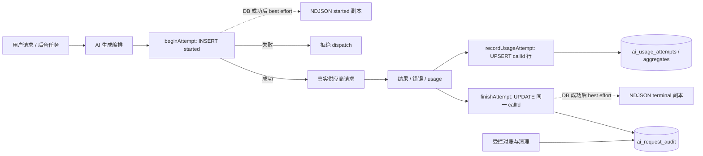
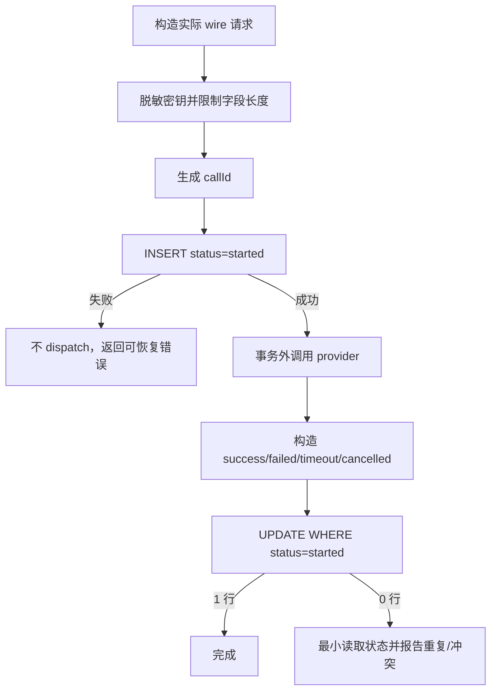
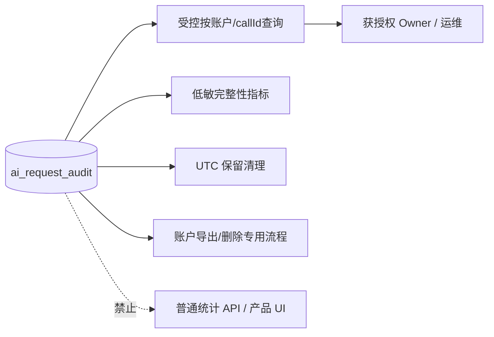

# reczz28ORRaxSCBn 应新规修订 AI 请求原子行审计 技术方案

|文档信息|内容|
|---|---|
|需求编号 / PRD|飞书需求 `reczz28ORRaxSCBn`；修订历史需求 `reczz28HhA5XQ4WK`|
|Owner / 协作角色|Owner；AI 运行时、PostgreSQL、隐私审计、测试与运维负责角色|
|文档状态 / 版本 / 日期|研发准入处置稿；1.2；2026-10-17|
|设计范围 / 预估规模|一次真实供应商尝试一行、行内完整请求与结果、调用可见性元数据、旧 NDJSON 迁移及兼容退役；不实现普通用户审计查看界面|

## 评审摘要

推荐新增账户隔离的 `ai_request_audit` 私有表：供应商调用前以 `callId` 插入一行 `started`，数据库提交成功是允许 dispatch 的唯一事实；供应商结束后只对该行做条件终态更新。实际 SP、UP、历史、参数、回答、推理、错误、usage、费用快照，以及完整 invocation contract（至少 `triggerType/resultAudience/reasoningVisibility/persistenceMode/contractSchemaVersion`）都保存在该行，不建正文或可见性分表，不追加终态事件，不通过事件重放还原最终内容。所有真实 provider 尝试，包括内部任务、非 LLM 服务和自动重试，都必须有这些字段；未知场景使用安全默认值，不能留空。

自动重试使用新的 `callId` 和新行。用量账本保持独立计费职责，但物理存储改为按 `callId` append/upsert 的 `ai_usage_attempts`，聚合按账户+周期+provider/model 小行条件 upsert，禁止为了记录一次 usage 读取、清空或重写账户文档；审计行只保留本次 usage/price 快照供对账。数据库启用后是唯一审计事实源；旧 NDJSON 只能在 DB begin/finish 成功后生成兼容副本，其失败不得影响 DB 事实或触发 provider 重试。全部 v0.5.x 继续兼容生成，v0.6.0 正式上线后按已确认决定停止并退役。

|决策编号|Owner 决策事项|Owner 结论及方案落实|排除的选择及代价|受影响章节 / 负责角色|
|---|---|---|---|---|
|D1|开始行插入失败时是否仍调用供应商|已确认：视为开发不完整或严重运行错误，显式失败并告警，供应商调用次数必须为 0|继续调用会产生不可追溯真实费用与正文，违反本需求硬约束|3.1、3.3、5.4；AI 运行时与 Owner|
|D2|旧 NDJSON 的兼容与退役时间|已确认：全部 v0.5.x 继续生成兼容副本，但不得作为事实源或 DB 失败降级；v0.6.0 正式上线后停止生成并正式退役|提前停止会缩短 0.5.x 兼容期；长期双事实源会造成冲突|3.8、3.9、5.2、5.4；隐私与运维角色|
|D3|usage 账本如何保持独立|已确认计费/额度逻辑继续独立，但每次调用必须写 `ai_usage_attempts` 记录行并按有限聚合键 upsert；禁止经账户 document 全量事务记录 usage|继续写账户 document 会使单次 AI 调用造成整账户读写，违背 F3 记录级契约；只依赖审计快照又会混淆隐私审计与计费职责|2.2、3.1、3.4、3.6；AI usage/持久化角色|
|D4|共享 schema 的接入方式|已确认 `postgres-schema.sql` 由发布批次登记的 schema 唯一写者串行合并；本需求提交 audit/usage migration，不与 F1/F3/F4/F9 并行改同一文件|多方案并行写共享 schema 容易产生顺序、索引和回滚冲突|3.2、3.6、5.2；持久化 migration owner|

## 资料来源与前提

|证据编号|资料 / 代码位置|版本或读取时间|支持的事实|可访问与核实状态|
|---|---|---|---|---|
|E-001|[日志与审计规则](../../knowledge/observability.md)|规则基线 `f7bd64` 后本次修订；2026-10-17|一次真实供应商尝试只允许一行，SP/UP/reasoning/result 不得拆分|已读取并修订|
|E-002|[AI 审计实现](../../src/modules/ai/audit.mjs)|工作区 HEAD `f7bd64`；2026-10-17|当前 `start` 与终态分别 append，失败时以内存 Map 等待恢复|已读取|
|E-003|[模型生成实现](../../src/modules/ai/generation.mjs)|工作区 HEAD `f7bd64`；2026-10-17|每个实际尝试生成独立 `callId`，可取得 SP、UP、历史、结果、推理与 usage|已读取|
|E-004|[AI 运行时装配](../../src/app/ai-runtime.mjs)|工作区 HEAD `f7bd64`；2026-10-17|当前审计落到按日 NDJSON；usage 为账户文档|已读取|
|E-005|[PostgreSQL schema](../../src/shared/persistence/postgres-schema.sql)|工作区 HEAD `f7bd64`；2026-10-17|当前没有原子行 AI 审计表；账户业务表已有账户隔离基础|已读取|
|E-006|[F3 记录级方案](reczz28ORRaxPiK3-应新规重做F3记录级持久化-技术方案.md)|2026-10-17|普通局部写禁止账户 document 全读/清写；共享 schema 需唯一写者|已读取；横向约束|
|E-007|[推理可见性方案](reczz28ORRaxQBcy-应新规修订AI推理可见性边界-技术方案.md)|2026-10-17|每次 invocation contract 包含受众、可见性和持久策略，内部/未知也必须有安全默认|已读取；字段依赖|

|前提编号|假设、建议或待确认内容|采用依据|不成立的影响|核对方式 / 负责角色|
|---|---|---|---|---|
|A-001|建议数据库保留期初值沿用 30 天|现行审计规则与清理配置|若法规或备份要求不同，清理任务与容量估算需调整|上线前由 Owner 与运维确认|
|A-002|真实峰值调用量与平均正文大小尚未量测|当前无可信生产分位证据|不能预先承诺固定磁盘容量|灰度记录行数、正文 bytes 与索引大小|

## 需求追踪

|需求点|设计章节|接口 / 实体 / 代码落点|验收用例|观测指标|
|---|---|---|---|---|
|一次真实尝试恰有一行|3.1、3.4|`AiAuditRepository.beginAttempt/finishAttempt`、`ai_request_audit`|TC-01、TC-02|`ai_audit_duplicate_call_id_total`|
|SP、UP、推理与结果同一行|3.4、3.5|`AiRequestAuditRow`|TC-03|`ai_audit_required_field_missing_total`|
|调用契约元数据同一行且覆盖全部尝试|3.4、3.5|`triggerType/resultAudience/reasoningVisibility/persistenceMode/contractSchemaVersion`|TC-03、TC-08、TC-11|契约字段缺失数|
|重试不覆盖前次|3.1、3.8|`callId`、`callGroupId`|TC-04|按组尝试数|
|崩溃与迟到终态不伪造|3.3、3.8|条件终态更新、对账任务|TC-05、TC-06|started 超龄数|
|旧 NDJSON 可核对迁移|3.1、5.2、5.4|拟新增迁移脚本|TC-07|迁移冲突与未知数|
|usage 物理写为记录级|3.1、3.4、3.6|`AiUsageRepository.recordAttempt/upsertAggregate`|TC-09、TC-12|账户 document 写入数|
|DB 事实先于兼容副本|3.1、3.6|DB repository → NDJSON projector|TC-02、TC-13|副本先写/放行数|

## 名词解释

|名词|解释|语境|
|---|---|---|
|原子行|一次真实供应商尝试的请求、结果和状态共同保存的一条数据库记录；不是“所有字段一次写完”，允许同一行从 started 更新到终态。|“供应商调用前以 `callId` 插入一行 `started`”（评审摘要）|
|callId|一次实际供应商请求尝试的唯一标识；重试必须换新值。|“自动重试使用新的 `callId` 和新行。”（评审摘要）|
|callGroupId|把同一业务模型任务的多次尝试关联起来的标识，不作为单行唯一键。|“共同 `callGroupId`、新 attempt”（3.1）|
|条件终态更新|只有当前状态仍允许变化时才更新，防止重复或迟到结果覆盖已确认终态。|“供应商结束后只对该行做条件终态更新。”（评审摘要）|
|usage|供应商返回的 Token 或计费单位，以及据此形成的标准化用量与价格快照。审计行保存尝试快照；独立 usage 账本按 callId 保存计费事实。|“审计行只保留本次 usage/price 快照供对账”（评审摘要）|
|记录级 usage 账本|一次尝试一行 usage fact，并按有限聚合键做条件 upsert；不得为一次调用加载或清写账户 document。|“禁止为了记录一次 usage 读取、清空或重写账户文档”（评审摘要）|
|NDJSON|每行一个 JSON 对象的文件格式；当前实现把开始和终态写成两行。数据库启用后它只是在 v0.5.x 继续生成的兼容副本。|“旧 NDJSON 只能在 DB begin/finish 成功后生成兼容副本”（评审摘要）|

## 评审记录

Owner 已确认 D1、D2 及“一次真实请求尝试的 SP、UP、reasoning、result 在同一原子行，不得分表”。D3、D4 按记录级设计契约和共享写集审查完成处置。本稿保留已确认的 v0.6.0 NDJSON 退役决定，并补齐全部 provider attempts 的 invocation contract、usage 记录级物理写和 DB 事实先于兼容副本；文档决策已闭合，尚未实施。

# 1. 项目背景

## 1.1 背景（必填）

当前 `createAiAudit` 对一次尝试先 append `started`，结束后再 append 终态；同一 `callId` 因而存在多行。`createAiGenerator` 已能取得实际 SP、UP、历史、参数、结果、推理和 usage，但三条系统任务还显式关闭正文审计。现行文件写入既不能用唯一约束保证一尝试一行，也不能在 SQL 中按状态安全更新。范围内是把私有审计迁为单行数据库事实；普通系统日志、聚合统计和产品展示不读取该正文。

## 1.2 目标（必填）

|目标|基线与来源|目标值及状态|统计口径 / 窗口 / 样本|验收方式|
|---|---|---|---|---|
|尝试与行一一对应|当前开始/终态双行，E-002|每个已 dispatch 的 `callId` 恰一行；已确认|按数据库唯一键全量检查测试数据|TC-01、TC-02|
|请求与结果同处一行|部分场景省略正文，E-003|适用字段完整或显式 N/A；已确认|按场景登记表逐项检查|TC-03|
|恢复不伪造|当前内存待恢复，重启丢失|超龄 started 保持未知或标记 interrupted；已确认|故障注入后检查状态及空值|TC-05|
|容量可控|生产基线未知|30 天保留为建议初值；容量目标待测|每日行数 × P95 行 bytes × 保留天数|灰度测量|

# 2. 总体方案设计

本需求是中等规模的存储与运行时协议迁移；核心边界是“外部调用不在数据库长事务中，但调用前必须已有唯一审计行”。

## 2.1 前期调研

当前模块已经统一生成 `callId/callGroupId/traceId`，并在终态构造完整请求与结果；可保留字段采集与脱敏逻辑。不能复用现有 append 接口，因为 append 的数据模型天然允许同一尝试多行。现有账户 usage document 的计费语义可以迁移复用，但物理读写不能保留：每次尝试改为精准插入/幂等 upsert `ai_usage_attempts`，额度/周期聚合只更新对应小行，既不能反向重建审计，也不能触发完整账户 document 提交。

## 2.2 系统架构

|系统 / 协作方|职责与边界|输入 / 输出|本次变更|负责角色 / 证据|
|---|---|---|---|---|
|C 端|发起用户回答或业务动作|业务请求与可见结果|不新增审计接口|前端；E-003|
|后台任务|发起系统级模型调用|场景、提示词、结果|必须同样写完整私有审计|AI 运行时|
|AI 模型服务端|处理真实请求|供应商响应、reasoning、usage|协议不变|供应商适配器|
|主应用 AI 运行时|生成标识、审计开始、调用、终结|`AiAuditAttempt`|替换 append 为 repository|E-002、E-003|
|PostgreSQL|保存单行审计事实|插入、条件更新、保留清理|新增私有表与索引|持久化角色|
|AI usage repository|保存 callId 计费事实与有界聚合|attempt row/aggregate upsert|从账户 document 迁出，逻辑仍独立|usage 角色|
|NDJSON compatibility projector|在 DB 事实后生成 0.5.x 兼容事件|started/terminal 副本|非事实源、best effort|运维兼容|
|治理/运维|按授权核对缺口与容量|脱敏元数据、受控账户查询|不提供公共正文接口|审计与运维角色|
|审核服务端/前端|本产品无独立内容审核系统|不适用|不适用，本需求不创建审核面|代码调研|



### 2.2.1 业务新流程

用户行为不新增步骤。调用可受理后，服务端先创建私有审计行；创建失败属于开发不完整或严重运行错误，明确返回“审计存储暂不可用”、触发 P1 告警且不产生供应商请求。成功时照常生成结果。审计终态更新失败不自动再调模型，用户结果按原业务契约处理，同时报告待修复的 started 行。

### 2.2.2 技术新流程

`beginAttempt` 在短事务中插入完整请求字段、invocation contract 与 `started`；事务提交后才可尝试兼容 NDJSON append，且无论副本成功与否都只以 DB begin 成功决定能否 dispatch。供应商结束后，运行时计算终态字段与 usage 快照，`finishAttempt` 使用 `WHERE call_id=? AND status='started'` 更新。usage repository 以同一 callId 幂等 upsert 尝试行并更新有限聚合行，不读取账户 document。两者状态可按 callId 对账但互不冒充。更新返回 0 行时读取最小状态判断重复、冲突或缺失，不创建第二行。进程重启后的对账只把超龄 `started` 更新为 `interrupted`，正文与费用未知字段保持 null。

## 2.3 可选方案对比

|方案|满足目标程度|复杂度与成本|性能 / 稳定性|兼容 / 迁移 / 回滚|主要限制|
|---|---|---|---|---|---|
|单表单行 + 条件更新|完全满足|新增表与 repository|每尝试两次短 SQL；唯一约束可靠|可双读核对后停旧写|推荐|
|开始/终态事件表 + 查询聚合|不满足同一行|写入简单，读取复杂|需重放并处理冲突|延续当前语义|被需求明确禁止|
|正文分表、主表存索引|不满足不分表|便于大字段拆分|跨表事务和删除更复杂|迁移成本更高|被需求明确禁止|

# 3. 详细方案设计

## 3.1 详细设计（必填）

唯一持久化边界是 `ai_request_audit.call_id`。请求正文与结果正文可以是 JSONB 内字段，但都属于同一物理行。外部供应商调用永远在数据库事务外。

### 3.1.1 生产链路

|上游 / 触发入口|输入与协议|调用方式 / 频率|校验与转换|输出 / 状态 / 副作用|改动与证据|
|---|---|---|---|---|---|
|用户主动回答|场景、SP、UP、history、参数、invocation contract|同步/流式|账户、场景、文本上限、contract 完整|started 行、供应商调用、终态行、usage 行|替换 E-003 审计端口|
|后台 AI 任务|任务来源版本、提示词、internal contract|异步|账户与来源版本|同上，普通用户不可见正文|补齐 `auditPrompt:false` 路径|
|自动重试|共同 `callGroupId`、新 attempt|最多按场景既有策略|每轮新 `callId`|独立新行|保留现有重试边界|
|非 LLM 供应商|动作、参数、响应摘要|同步/异步|N/A 字段标准化|同一表一行|统一 providerCall|
|迁移命令|旧 NDJSON|一次性、分账户分日|校验 callId 与状态|合并后的行或冲突报告|拟新增专用迁移|



|处理动作|原所在事务|本次事务|事务粒度|事务内新增逻辑|事务外与提交后|
|---|---|---|---|---|---|
|开始审计|文件 append，无数据库事务|新增短事务|单账户、单 `callId`；只持有 INSERT 时长|插入请求、状态、时间与唯一键|提交成功后才调用供应商|
|真实供应商调用|无数据库事务|无数据库事务，原因是外部调用不可持锁|单次实际尝试|无|流式消费结果，不能因终态写失败重试 provider|
|终态审计|文件 append，无数据库事务|新增短事务|单 `callId` 条件 UPDATE|更新结果、错误、usage、完成时间和状态|提交后写低敏系统完成日志|
|usage 账本|账户 document 事务|独立记录级短事务|单账户+callId；有限周期聚合键|幂等 insert/upsert attempt，条件累加/重算对应 aggregate 行|失败单独告警并按 callId 对账，不清写账户|
|NDJSON 兼容副本|事实写入口|DB 成功后的事务外 best effort|单 callId started/terminal projection|无 DB 状态变化|失败不回退、不阻断已持久 DB 事实、不重调 provider|
|旧数据迁移|文件读取与新库无共同事务|每批短事务|单账户、单日、建议每批 200 行|按 callId 合并并 upsert；冲突写迁移报告而非覆盖|批后核对计数与摘要|

#### 3.1.1.1 处理阶段与新增配置

|配置键|类型 / 默认值|作用域 / 负责模块|读取与生效时机|配置依赖 / 关闭行为|依据|
|---|---|---|---|---|---|
|`AI_AUDIT_RETENTION_DAYS`|整数 / 30，现有范围 1–3650|服务实例 / 审计清理|启动读取；重启生效|不得关闭写入；只控制过期清理|现行规则|
|`AI_AUDIT_TEXT_LIMIT`|整数 / 1000000，现有范围 10000–5000000|服务实例 / 字段裁剪|启动读取|不得省略字段，超限显式截断|现行规则|
|`AI_AUDIT_DB_ENABLED`|布尔 / `false`，建议迁移开关|服务实例|启动读取|关闭仅供迁移前旧制品；正式启用后不可回到双行作为合规状态|灰度需要|

```json
{
  "aiAudit": {
    "databaseEnabled": false,
    "retentionDays": 30,
    "textLimit": 1000000
  }
}
```

#### 3.1.1.2 接口与数据处理

`beginAttempt` 接收已经形成的实际 wire 请求和由服务端 scene/provider registry 解析的完整 invocation contract，不接收模板 ID 代替正文，也不允许调用方以 null 跳过可见性字段。`finishAttempt` 必须携带完整终态，不允许“先写 result、再写 reasoning”两次局部更新；流式片段只在内存聚合，终态一次提交。进程崩溃前未提交的片段视为未知。非 LLM provider 若没有用户业务结果，仍写 `internal/privileged_only/audit_only` 等明确值。

### 3.1.2 消费链路



|处理动作|原所在事务|本次事务|事务粒度|事务内新增逻辑|事务外与提交后|
|---|---|---|---|---|---|
|受控查询|按日文件读取，无 DB 事务|只读短事务|一个账户 + callId 或有界时间页|RLS/账户条件、字段投影|授权检查先于查询；正文不进入普通日志|
|保留清理|删除日文件|短批次 DELETE|UTC 截止日前有界批次|按 completed/started 时间删除|提交后记录低敏删除数|
|账户删除/导出|运维文件操作|专用账户事务/分批读取|单账户|与账户数据同一授权范围处理|备份副本另按数据删除 SOP 处理|

#### 3.1.2.1 消费入口

|下游 / 消费面|入口与版本|读取字段 / 数据来源|转换 / 打包 / 缓存|本次改动与兼容性|验收用例|
|---|---|---|---|---|---|
|受控审计工具|拟新增 repository/CLI，不开放 HTTP|单账户、有界时间、callId|默认元数据，显式授权才含正文|新入口|TC-03、TC-08|
|用量统计|`ai_usage_attempts` + 有界 aggregate rows|独立账本；审计 usage 仅对账|按账户+时间/provider/model 查询，不从正文表扫描聚合|逻辑兼容，物理改记录级|TC-09、TC-12|
|普通用户 UI|无|不读取审计表|不适用|保持不可见|TC-08|
|保留清理|后台任务|主键、时间、状态|按批删除|替代日文件删除|TC-10|
|NDJSON 兼容工具|0.5.x 文件消费者|仅 DB 成功后的兼容 projection|不得判断调用是否可 dispatch，不参与恢复 DB 状态|v0.6.0 按 D2 退役|TC-07、TC-13|

#### 3.1.2.2 协议、打包与改动边界

数据库内部新协议从版本 1 开始。旧代码不认识新表但仍可运行；切换写入前必须部署 schema。新代码在开关关闭时可读取旧实现用于迁移核对，但不能同时把两套写入都宣称事实源。未知 provider 字段放在同一行的 `request_payload/response_payload` JSONB 中。

#### 3.1.2.3 消费验收

TC-03 逐列穿行请求与结果；TC-08 验证普通用户和统计 API 无正文；TC-09 核对 usage 账本与审计行按 callId 可对账但职责独立；TC-10 验证清理只删过期账户行。

## 3.2 外部依赖

### 3.2.1 依赖方与诉求

|依赖方 / 负责角色|诉求与交付物|协议 / 版本|就绪条件 / 证据|联调与发布先后|失败或延期处置|
|---|---|---|---|---|---|
|PostgreSQL schema 唯一写者|audit/usage 表、索引、RLS 与 migration|schema v1|与 F1/F3/F4/F9 顺序及回滚演练通过|先于运行时开关|保持业务暂停，不调用 provider|
|AI 运行时|完整实际请求与终态|`AiAuditRepository` v1|场景测试通过|schema 后部署|begin 失败显式拒绝|
|AI usage 模块|记录级 attempt/aggregate repository|`AiUsageRepository` v1|旧 usage document 迁移与额度等价测试|与运行时同时|禁止回账户全量写|
|隐私/运维角色|授权查询、删除和备份边界|内部 CLI|权限负例通过|写入稳定后开放|不提供临时公共接口|

### 3.2.2 版本级复用与串行位置

本需求处于[版本级严格串行链](V0516-跨需求共用底座与串行开发-技术方案.md#322-有效需求复用组件与唯一串行位置)第 1 位。它不等待其他业务需求，但唯一进入条件是 Owner 已在控制面恢复开发并激活本阶段；当前暂停状态下不得实施。

|项目|本需求结论|
|---|---|
|消费组件|RC-01 的登记骨架；不得预先消费尚未交付的账户 gate、UoW 或同步组件|
|提供组件|RC-01 首批 schema/migration 登记规则；RC-03 `InvocationContractRegistry`、`AiAuditRepository`、`AiUsageRepository` 和审计 dispatch hard gate|
|唯一前驱|控制面恢复授权，不是旧分支、旧测试或本文通过评审|
|进入条件|`execution_enabled=true`、隔离 PostgreSQL 可用、schema 唯一写者已登记|
|出口交付|begin 失败时 provider 调用为 0；每次真实尝试独立一行；usage 记录级等价；兼容副本顺序通过|
|解锁后继|新 F1 认证精准查询 `reczz28ORRaxPAap`；出口门前禁止其编码或 migration|

## 3.3 异常处理（必填）

|异常点|处理策略|重试 / 幂等 / 补偿|持久化与用户影响|监控与恢复条件|
|---|---|---|---|---|
|begin INSERT 失败|不调用 provider|可由用户以新业务请求重试|无供应商费用；明确服务暂不可用|begin 失败率恢复|
|provider 超时/失败|更新同一行为对应终态|业务重试产生新 callId|保留错误与可证实 partial 内容|按场景错误率|
|finish UPDATE 失败|不重试 provider；有限重试同一 UPDATE|`callId` 幂等，状态条件保护|业务结果按原契约；审计行可能 started|超龄 started 告警|
|重复/迟到 finish|拒绝覆盖，报告冲突|读取最小状态确认|不产生新行|冲突计数|
|进程崩溃|started 保持未知，超龄标 interrupted|对账只更新状态和可证实元数据|不推测结果/usage|对账后超龄归零或有解释|
|迁移同 callId 冲突|停止该行自动合并|输出脱敏冲突清单，人工裁定|不覆盖较完整记录|迁移冲突全部处置|

## 3.4 数据实体（必填）

```ts
type AiRequestAuditRow = {
  callId: string;
  callGroupId: string;
  traceId: string;
  accountId: string;
  provider: string;
  service: string;
  scene: string;
  triggerType: "user_explicit" | "user_action_auto" | "scheduled" | "system_internal";
  resultAudience: "user" | "internal";
  reasoningVisibility: "user_viewable" | "privileged_only";
  persistenceMode: "business_result" | "live_only" | "audit_only";
  contractSchemaVersion: number;
  attempt: number;
  maxAttempts: number;
  status: "started" | "success" | "failed" | "timeout" | "cancelled" | "interrupted";
  startedAt: string;
  completedAt: string | null;
  requestPayload: {
    systemPrompt: string | null;
    userPrompt: string | null;
    history: object[];
    parameters: object;
    promptCatalog: object;
  };
  responsePayload: {
    content: string | null;
    reasoningContent: string | null;
    providerRequestId: string | null;
    model: string | null;
    finishReason: string | null;
  };
  errorPayload: object | null;
  usagePayload: object | null;
  truncation: object;
  schemaVersion: number;
};

type AiUsageAttemptRow = {
  accountId: string;
  callId: string;
  provider: string;
  model: string | null;
  usageKnown: boolean;
  usagePayload: object | null;
  priceSnapshot: object | null;
  occurredAt: string;
};
```

|实体 / 字段路径|类型 / 必选性 / 默认值|含义 / 单位 / 枚举|生产方 / 消费方 / 事实源|存储、索引与生命周期|兼容 / 迁移|
|---|---|---|---|---|---|
|`ai_request_audit.call_id`|text / 必选|每次尝试唯一标识|AI 运行时 / 对账；事实源|主键|旧行按 callId 合并|
|`account_id, started_at`|text+timestamptz / 必选|账户隔离与时间页|运行时 / 受控查询|组合索引、RLS|本机模式使用受控 local 账户键|
|`request_payload`|jsonb / 必选|SP、UP、history、参数同一行|运行时 / 审计|同表大字段、30 天建议保留|省略正文的旧记录保持 unknown|
|`response_payload`|jsonb / 必选|回答与推理同一行；started 时字段为 null|运行时 / 审计|同表|终态条件更新|
|`trigger_type,result_audience,reasoning_visibility`|枚举 / 必选|调用触发、业务结果受众、推理可见性|工作流 / 审计|同一行普通列；可做完整性统计|历史按场景迁移，未知默认内部/仅授权|
|`persistence_mode,contract_schema_version`|枚举+int / 必选|产品持久策略与契约版本|scene/provider registry / 审计|同一行普通列|未知默认 audit_only 并保留版本|
|`usage_payload`|jsonb / 可空|本次取得的原始/标准化 usage 与费用快照|运行时 / 对账|同表|N/A 与 unknown 分开|
|`status`|枚举 / started|尝试状态|repository / 监控|状态索引不含正文|合法单向转换|
|`ai_usage_attempts`|账户+callId 一行 / 必选|独立计费/额度事实|usage repository / 统计|唯一键 `(account_id,call_id)`；记录级 upsert|从 usage document 分批迁移|
|`ai_usage_aggregates`|账户+周期+provider+model 小行|查询加速与额度|usage repository / 统计|条件 upsert；可由 attempt rows 重建|不含请求正文|

```json
{
  "callId": "call-example",
  "callGroupId": "group-example",
  "traceId": "trace-example",
  "accountId": "account-example",
  "provider": "deepseek",
  "service": "chat-completions",
  "scene": "thoughtAnswer",
  "triggerType": "user_explicit",
  "resultAudience": "user",
  "reasoningVisibility": "user_viewable",
  "persistenceMode": "business_result",
  "contractSchemaVersion": 1,
  "attempt": 1,
  "maxAttempts": 2,
  "status": "success",
  "requestPayload": {
    "systemPrompt": "实际发送的 SP",
    "userPrompt": "实际发送的 UP",
    "history": [],
    "parameters": {
      "stream": true
    },
    "promptCatalog": {
      "version": "example"
    }
  },
  "responsePayload": {
    "content": "最终回答",
    "reasoningContent": "供应商实际返回的推理",
    "providerRequestId": "provider-example",
    "model": "deepseek-example",
    "finishReason": "stop"
  },
  "errorPayload": null,
  "usagePayload": {
    "known": true
  },
  "truncation": {},
  "schemaVersion": 1
}
```

## 3.5 接口定义（必填）

|接口 / 消息 / 回调|调用方 → 提供方|新增 / 修改 / 复用|协议版本与详细定义|
|---|---|---|---|
|`beginAttempt(row)`|AI 运行时 → 审计 repository|新增|v1；插入 started；重复 callId 返回冲突|
|`finishAttempt(callId, terminal)`|AI 运行时 → 审计 repository|新增|v1；仅从 started 条件更新至终态|
|`recordUsageAttempt(row)`|AI 运行时 → usage repository|修改|v1；账户+callId 幂等记录级 upsert，不读写账户 document|
|`upsertUsageAggregate(delta)`|usage repository → PostgreSQL|新增|v1；仅更新账户+周期+provider/model 对应小行，可由 attempts 重建|
|`appendCompatibilityProjection(stage,row)`|审计运行时 → NDJSON projector|迁移兼容|仅在对应 DB begin/finish 成功后 best effort；返回值不参与 dispatch 决策|
|`markInterrupted(cutoff)`|对账任务 → repository|新增|v1；有界批次更新超龄 started|
|`findAttempts(query)`|受控 CLI → repository|新增|v1；账户必选、时间与 limit 有上限|

这些是进程内端口，不新增公共 HTTP。数据库操作沿用受信账户上下文；运维跨账户查询使用独立只读角色和显式账户条件。`beginAttempt` 与 `finishAttempt` 单次 SQL 超时沿用数据库短查询预算，连接错误只重试尚未取得不确定结果的读或幂等写；`finishAttempt` 可用同一 callId 安全重放。

## 3.6 代码设计

### 3.6.1 代码落点

|文件 / 模块|改造点|复用边界 / 调用关系|证据或拟新增标记|
|---|---|---|---|
|[postgres-schema.sql](../../src/shared/persistence/postgres-schema.sql)|由 schema 唯一写者合并 audit/usage 表、索引、RLS|复用 PostgreSQL 迁移入口；与其他方案串行|拟修改|
|`src/shared/persistence/ai-audit-repository.mts`|单行 repository|不复用 account document 全量重写|拟新增|
|`src/shared/persistence/ai-usage-repository.mts`|attempt 行与有界 aggregate upsert|复用 usage 计费规则，不复用账户 document repository|拟新增|
|[audit.mjs](../../src/modules/ai/audit.mjs)|从 append 事件改为 begin/finish|复用裁剪、脱敏、usage 构造|拟修改并渐进迁移 TS|
|[generation.mjs](../../src/modules/ai/generation.mjs)|dispatch 前确认 begin 成功|复用 callId 与完整字段采集|拟修改|
|[ai-runtime.mjs](../../src/app/ai-runtime.mjs)|装配 audit/usage repositories 和 NDJSON compatibility projector|DB 是事实源；兼容副本不放行调用|拟修改|
|`scripts/migrate-ai-audit.mts`|旧 NDJSON 合并迁移与核对|专用迁移，不进入在线回退|拟新增|
|`scripts/migrate-ai-usage.mts`|旧 usage document 分批转 attempt/aggregate rows|专用迁移，不进入普通调用|拟新增|

### 3.6.2 核心伪代码

```python
async def execute_attempt(request, context):
    call_id = create_id()
    started = build_started_row(call_id, request, context)
    await audit_repository.begin_attempt(started)
    await ndjson_projector.append_started(started).catch(report_compatibility_failure)
    try:
        result = await provider_call(request)
        terminal = build_success_terminal(result)
    except TimeoutError as error:
        terminal = build_timeout_terminal(error)
        raise
    except Exception as error:
        terminal = build_failure_terminal(error)
        raise
    finally:
        if "terminal" in locals():
            audit_outcome = await finish_with_bounded_retry(call_id, terminal)
            await usage_repository.record_attempt(
                build_usage_attempt(call_id, terminal)
            )
            if audit_outcome == "committed":
                await ndjson_projector.append_terminal(
                    call_id,
                    terminal,
                ).catch(report_compatibility_failure)


async def finish_with_bounded_retry(call_id, terminal):
    for attempt in range(3):
        try:
            outcome = await audit_repository.finish_attempt(call_id, terminal)
            if outcome == "updated" or outcome == "already_same_terminal":
                return "committed"
            raise AuditStateConflict(call_id)
        except TransientDatabaseError:
            if attempt == 2:
                report_audit_gap(call_id)
                return "uncommitted"
            await sleep(backoff(attempt))
```

#### 3.6.2.1 关键动作实现细节

|函数签名|输入|输出|复用逻辑|不直接复用|
|---|---|---|---|---|
|`beginAttempt(row)`|完整 started 行|插入成功或冲突|复用现有 `text/message` 裁剪|不复用 `append`，其允许多行|
|`finishAttempt(callId, terminal)`|完整终态|updated/already/conflict|复用 usage 构造与错误分类|不复用 account document 写，避免全量 usage 文档事务|
|`recordUsageAttempt(row)`|callId+usage/price|inserted/already/conflict|复用现有计价与 quota 语义|不调用完整 store `read/update/clear`|
|`appendCompatibilityProjection`|已提交 DB row/stage|best-effort 状态|复用旧 NDJSON schema|不作为事实源、dispatch gate 或 DB fallback|
|`migrateAuditDay(file)`|单账户日文件|计数、冲突、未知|复用旧 schema 解析|不把迁移脚本作为在线 fallback|

### 3.6.3 关键实现约束

1. 一个 `callId` 永远至多一行，且只属于一个账户（TC-01）。
2. provider dispatch 前 started 行必须已经提交（TC-02）。
3. SP、UP、history、参数、回答与 reasoning 不得存入伴随正文表或第二事件行（TC-03）。
4. 终态更新失败不得触发新的 provider 调用（TC-06）。
5. unknown、N/A、空字符串语义分开，不把缺失 usage 当 0（TC-03、TC-05）。
6. 普通 API、指标和 stdout 不返回审计正文（TC-08）。
7. 每次真实 provider attempt 都必须有非空 invocation contract；内部和非 LLM 尝试同样适用（TC-11）。
8. usage attempt/aggregate 只能记录级写，禁止从 AI 调用链进入账户 document 全读、清写或完整 update（TC-12）。
9. NDJSON started/terminal 只能投影已提交 DB 事实；其失败不得放行缺 begin 的调用、改写 DB 状态或触发 provider 重试（TC-13）。
10. `postgres-schema.sql` 只由登记的 schema integration owner 合并本 migration（TC-14）。

## 3.7 监控告警（必填）

|指标 / 告警|口径与单位|维度与基数限制|阈值 / 窗口 / 样本|严重度 / 负责角色|告警后动作 / 看板|
|---|---|---|---|---|---|
|`ai_audit_begin_failed_total`|begin 失败次数|provider、scene，不含 callId|任何持续增长即暂停该场景；阈值上线校准|P1 / AI 运行时|检查 DB，不调用 provider|
|`ai_audit_finish_failed_total`|终态有限重试后失败|provider、scene|任何非零进入告警|P1 / 持久化|查 started 行与 DB|
|`ai_audit_started_stale`|超过调用超时上限仍 started 的行数|provider、scene|建议每 5 分钟扫描；阈值待测|P1 / 运维|运行对账并查进程异常|
|`ai_audit_row_bytes`|单行 JSONB bytes 的 P50/P95/P99|scene|无硬阈值，灰度建立容量基线|P2 / 持久化|调整文本上限需 Owner 决策|
|`ai_audit_state_conflict_total`|非法终态转换次数|scene|任何非零调查|P1 / AI 运行时|核对重复回调或代码缺陷|
|`ai_audit_contract_missing_total`|真实 provider attempt 缺 invocation contract 字段|provider、scene|必须为 0|P1 / AI 运行时|阻止 dispatch|
|`ai_usage_account_document_write_total`|AI 调用链触发账户 document 全量 usage 写|调用路径；低基数|必须为 0|P1 / usage|停场景并迁移到 row repository|
|`ai_usage_attempt_upsert_failed_total`|attempt 行有限重试后失败|provider、scene|任何非零告警|P1 / usage|按 callId 对账，不改审计事实|
|`ai_audit_compat_projection_failed_total`|DB 成功后 NDJSON 兼容投影失败|stage、scene|可告警但不得改变 dispatch/终态|P2 / 运维|修副本，不回退事实源|

## 3.8 稳定性

### 3.8.1 容量与性能

日增长量公式：`每日真实尝试数 × 平均行 bytes`；保留容量为该值乘保留天数并加索引与备份系数。调用峰值写 QPS 等于 provider 尝试峰值的约 2 倍短写操作。真实变量尚未量测，灰度必须采样行数与 `pg_column_size`，不能用文本上限当平均值。查询必须账户+时间分页，禁止无上限正文扫描。

### 3.8.2 一致性与幂等

主键 `call_id` 保证审计插入幂等；账户 ID 同时受 RLS 和行字段约束。状态只允许 `started → terminal`。相同终态重放可视为成功，不同终态返回冲突。usage attempt 以 `(account_id,call_id)` 幂等，aggregate 只更新对应周期小行并可从 attempts 重建。usage 账本写与审计终态不是同一事务时，以 callId 对账并分别报告状态，不把任一失败伪装成另一个已成功，也不回账户 document 重放整份数据。

### 3.8.3 降级与回滚

数据库审计启用后不可降级为“继续真实调用但不审计”。短时数据库故障应拒绝新 provider dispatch；已在途调用允许完成业务，但终态写失败留下 started 与告警。代码回滚到旧制品前关闭模型入口或使用仍支持新表单行写入的兼容制品，不能恢复双行作为长期状态。

### 3.8.4 安全与日志

表按账户隔离，应用账号只可访问当前受信账户；跨账户运维使用独立受控角色。API Key、Cookie、令牌、邀请码和密码在入库前脱敏。普通日志仅记录 callId、scene、状态和机器错误码，不记录正文。备份、导出、删除把该表视为与用户业务正文同等级的敏感数据。

## 3.9 实验方案

### 3.9.1 开关与灰度

由 schema 唯一写者先串行部署 audit/usage schema，再对隔离测试账户启用 DB 写；迁移期只允许“旧写 + 新影子写核对”作为短期验证，唯一事实仍标记清楚，且真实 provider 只调用一次。核对通过后切数据库为唯一审计事实源，并把 usage 切到 record-level repository；NDJSON 继续作为 v0.5.x DB 后兼容副本写入，但其失败不能阻断或替代数据库审计。最后迁移历史与旧 usage document；待 v0.6.0 正式上线后停止 append，并按备份、保留和删除流程退役旧文件。

### 3.9.2 核心验收指标

功能硬门槛是 TC-01 至 TC-14 全部通过；任何真实调用缺 begin 行/contract、同 callId 多行、正文拆表、usage 触发账户 document 写、兼容副本先于 DB 事实放行或普通用户可读正文均失败。性能只要求记录级短写不持有外部调用事务；延迟目标需测后由 Owner 确认。

### 3.9.3 效果观测

隔离账户对同一批 mock 和少量获准真实调用同时核对旧事件与新单行，比较 callId 集合、请求/结果摘要、状态和 usage。真实样本不足时只确认结构与一致性，不宣称容量达标。

# 4. 开发测试

## 4.1 开发明细（必填；评审时留空，开发结束后填写）

## 4.2 测试方案（必填）

|用例编号 / 对应需求|环境与前置条件|输入 / 操作 / 故障注入|预期输出 / 持久化 / 用户行为|监控与通过标准|
|---|---|---|---|---|
|TC-01 一尝试一行|临时 PG|同 callId 并发 begin|只一行；重复返回幂等或冲突|唯一键有效|
|TC-02 dispatch 顺序|provider spy|begin 成功/失败各一次|失败时 provider 调用 0；成功时 1|无漏审真实调用|
|TC-03 字段完整|文本、视觉、非 Token 服务|成功、失败、N/A|同一行字段齐全，未知与 N/A 分开|缺字段指标 0|
|TC-04 自动重试|首轮空正文，次轮成功|触发两次实际请求|两 callId、同 group、两行各自终态|首轮不被覆盖|
|TC-05 崩溃恢复|子进程|begin 后强杀|一行 started，后续标 interrupted；结果/费用不伪造|超龄状态可解释|
|TC-06 finish 故障|DB 注入暂时失败|provider 成功后 UPDATE 失败|provider 不重试；同 callId 有界重试并告警|调用次数仍 1|
|TC-07 NDJSON 迁移|固定 started/终态/冲突 fixture|分批迁移两次|结果幂等；冲突保持未知并报告|计数和摘要一致|
|TC-08 权限与泄露|普通用户、其他账户、运维角色|查询 UI/API/DB|普通用户与跨账户拒绝；日志无正文|权限负例全过|
|TC-09 usage 对账|usage 成功/失败组合|按 callId 核对|账本与审计各自状态准确，不互相伪造|差异有明确分类|
|TC-10 清理|跨截止日数据|运行批次清理|只删过期行，账户与账本不误删|删除数可复核|
|TC-11 全尝试 contract|用户、后台、自动重试、分割/识别等非 LLM provider、未知 scene|逐入口发起真实 provider spy|每个 attempt 的五类 contract 字段非空；未知安全默认；重试新行继承 contract|missing=0|
|TC-12 usage 记录级物理写|大账户 fixture、并发 callId、相同 callId 重放|记录已知/未知 usage 并更新周期 aggregate|只触碰 attempt 与对应 aggregate 小行；无 store read/clear/account document rewrite；聚合可重建|document write=0|
|TC-13 DB 与兼容副本顺序|分别注入 DB begin/finish、NDJSON started/terminal 失败|观察 provider spy、DB 与文件|begin DB 失败时 projector/provider 均不调用；DB 成功而副本失败仍按 DB 事实继续；终态副本不先于 DB finish|顺序与调用数正确|
|TC-14 schema 唯一写者|并行方案 migration fixture|按登记顺序合并/回滚 F1/F3/F4/F9/audit schema|单一集成者、顺序确定、索引/RLS 无覆盖；各方案不并行写同一文件|migration gate 通过|

### 4.2.1 Mock测试方案

provider mock 返回固定 content、reasoning、usage、错误和延迟；数据库使用真实临时 PostgreSQL，故障通过代理或 repository stub 注入。Mock 保留真实 schema、repository 与运行时顺序。退出 Mock 后只在既有费用授权内执行少量真实调用，不能用 Mock 证明供应商 usage 真实或生产容量。

# 5. 上线方案

## 5.1 上线CheckList（必填）

- [ ] 上线前：schema、RLS、repository、迁移 fixture 与权限负例通过。
- [ ] 上线前：schema 由登记唯一写者合并，audit/usage 与 F1/F3/F4/F9 migration 顺序已验证。
- [ ] 上线前：调用前审计失败的用户错误与恢复入口已确认。
- [ ] 上线前：全部 provider attempts invocation contract 完整；usage 已迁为 attempt/aggregate 记录级写，账户 document 写入为 0。
- [ ] 上线前：NDJSON 只投影已提交 DB 事实，兼容失败不影响 dispatch 或触发 provider 重试。
- [ ] 上线前：started 超龄、begin/finish 失败、容量指标与告警就绪。
- [ ] 上线中：先 schema，后影子核对，再切 DB 为唯一事实源；v0.5.x 保持 NDJSON 兼容 append。
- [ ] 上线后：核对 callId 集合、usage 差异、正文权限、保留清理与备份。
- [ ] v0.6.0 正式上线：停止 NDJSON append，并按数据保留与删除流程完成兼容副本退役。

## 5.2 上线依赖

本需求是版本串行阶段 1。下表只表示本需求内部部署顺序，不授权新 F1 或任何后续需求同时开发。

|顺序 / 当前需求内部步骤|系统 / 负责角色|部署或配置动作|前置就绪条件与证据|兼容窗口 / 验证|
|---|---|---|---|---|
|1|PostgreSQL schema 唯一写者|串行合并 audit/usage 表、索引、RLS|TC-14、迁移测试与回滚 SQL 评审|旧代码忽略新表|
|2|AI 运行时 + usage repository|部署 repositories，保持开关关闭|TC-01 至 TC-06、TC-11、TC-12|无行为变化|
|3|测试账户|影子写与对账|低敏指标就绪|短期双写，不双调 provider|
|4|应用全量|数据库成为唯一审计事实源，usage 使用记录级账本|差异归零、Owner 批准|v0.5.x 继续写 DB 后 NDJSON 兼容副本|
|5|v0.6.0 发布/运维|停止兼容 append，迁移核对并退役旧文件|v0.6.0 已正式上线、备份与抽查通过|按 D2 和数据删除流程执行|

## 5.3 观测方案

每阶段至少覆盖成功、失败、超时、自动重试和系统级任务。值守角色查看 3.7 指标、数据库写延迟、行大小和 started 年龄；出现漏 begin、跨账户读取或重复真实调用立即关闭模型入口并停止放量。观察窗口与最小样本由发布时按真实调用量确认。

## 5.4 回滚方案

|对象|触发条件|负责角色 / 具体步骤|在途任务与数据处置|验证与恢复条件|
|---|---|---|---|---|
|服务 / 流量 / 配置|begin 大量失败或权限异常|关闭模型入口，保留查询与对账|已 started 的在途调用允许终结|无新漏审调用|
|代码 / 协议版本|运行时缺陷|回到仍支持单行表的兼容制品|不得重新启用双行作为合规写入|TC-01 至 TC-06 复验|
|数据 / Schema / 缓存|错误更新或迁移冲突|停写、保留表和备份、按 callId 修复|不删除无法判断的行|抽样与计数一致后恢复|

## 5.5 放量计划

|阶段|入口 / 分桶范围 / 比例|前置条件|停留窗口 / 最小样本|继续 / 停止 / 回滚条件|负责角色|
|---|---|---|---|---|---|
|隔离测试|mock + 测试账户|schema 与 TC 通过|覆盖全部状态|任一不变量失败停止|测试/持久化|
|影子核对|Owner 指定账户|不重复 provider 调用|建议至少 100 次尝试，样本不足延长|callId/字段差异为 0|AI 运行时|
|唯一新写|受控账户逐步扩大|旧写已停止|建议 24 小时并覆盖重试|无漏行、权限或 started 异常|Owner/运维|
|全量|全部获准调用|前阶段稳定|按真实调用量确认|3.7 指标稳定|Owner|
