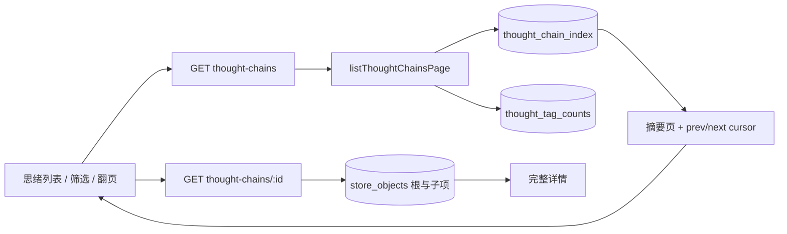
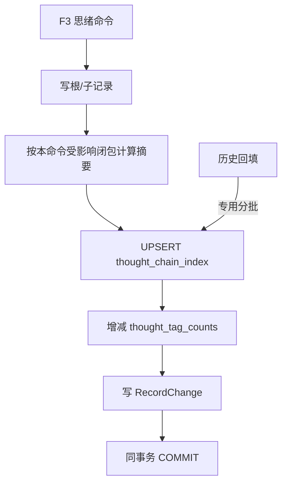
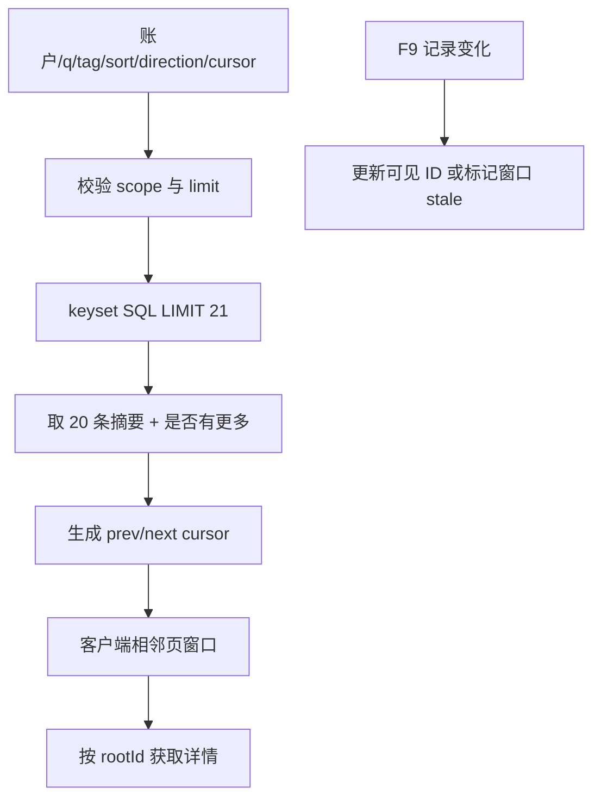

# reczz28ORRaxSFnV 应新规重做 F4 数据库游标分页 技术方案

|文档信息|内容|
|---|---|
|需求编号 / PRD|飞书需求 `reczz28ORRaxSFnV`；重做 `reczz28NLb1qxaIE` 的服务端分页边界|
|Owner / 协作角色|Owner；思绪领域、PostgreSQL、HTTP、前端阅读窗口、搜索、测试与运维负责角色|
|文档状态 / 版本 / 日期|开发回填稿；1.3；2026-10-19；实施阶段以唯一控制面为准|
|设计范围 / 预估规模|数据库 keyset 游标分页、轻量思绪读模型、详情按 ID 读取、前端有界窗口与旧入口迁移|

## 评审摘要

推荐由 thoughts 领域拥有按思绪根记录维护的 `thought_chain_index` 当前状态读模型，保存稳定排序键、标签、既有思绪列表 `q` 所需的搜索文档、轻量摘要、必要计数与投影版本；F3 思绪 typed command 在同一事务更新根/子记录和该索引。备注、追问、附件、批注、删除恢复、AI 写回和发现状态等所有可能影响投影的生产者必须登记并通过同一公开命令边界，跨域原子写由应用 Unit of Work 编排。索引只承载账户内既有思绪列表 `q/tag/sort/page`，不是全局搜索产品或第二份业务事实。discovery 必须复用 thoughts 公开候选查询；只有语义相同的部分才由该公开端口内部复用 index，不能读取私有表或另建重复思绪索引。

列表 SQL 必须带受信账户、筛选条件、稳定 tuple 与 `LIMIT pageSize+1`，直接返回摘要和前后游标；详情按账户+rootId 查询根及必要子项。分页容量与窗口继续复用现有 `shared/thought-pagination`，唯一开关继续使用 `THOUGHT_PAGING_ENABLED`，不新增 DB/page/window 平行配置。前端继续使用最多 5 页的相邻窗口和阅读状态保护。禁止 `repository.read()` 后内存过滤/排序/切页，也禁止旧 page 兼容累计读取前缀。

|决策编号|Owner 决策事项|Owner 结论及方案落实|排除的选择及代价|受影响章节 / 负责角色|
|---|---|---|---|---|
|D1|搜索索引能力与用途|已确认只承载既有账户内思绪列表 `q/tag` 筛选；中文方案在脱敏真实语料上比较 PG 全文与规范化索引匹配，必须以 `EXPLAIN`/正确率通过为准，不引入外部搜索服务|无索引 `%query%` 可能全表扫描；外部搜索会新增一致性与运维系统|2.1、3.4、3.8；搜索与 PG 角色|
|D2|旧 `page` 参数迁移|已确认仅 `page=1` 规范化为无 cursor 首 页，`page>1` 明确 400；不累计前缀|继续支持 page2..5 会重复多页读取并维护两套定位语义|3.1、3.5；Owner 与前端|
|D3|分页配置来源|已确认复用 `THOUGHT_PAGING_ENABLED` 与 `shared/thought-pagination` 的 `THOUGHT_PAGING`；搜索实现作为索引 schema 版本发布，不增加 `THOUGHT_DB_PAGING_ENABLED`、`THOUGHT_PAGE_SIZE`、`THOUGHT_WINDOW_MAX_PAGES` 或运行时搜索模式开关|平行配置会使前后端容量、游标与灰度行为漂移|3.1、3.6、5.2；配置与 thoughts 角色|
|D4|跨域生产者与查询复用|已确认 index owner 为 thoughts；跨域写必须调用 thoughts 公共 typed command 或由应用 Unit of Work 编排，discovery 通过 thoughts 公开 query 复用候选查询|由 annotation/discovery 直接改 thoughts 私有表或复制搜索逻辑会造成漏维护和多份索引|2.2、3.1、3.5、3.6；应用与领域角色|

## 资料来源与前提

|证据编号|资料 / 代码位置|版本或读取时间|支持的事实|可访问与核实状态|
|---|---|---|---|---|
|E-001|[设计契约](../../knowledge/design-contracts.md)|2026-10-17 生效|大量列表必须数据库阶段分页；列表摘要、详情按 ID|已读取|
|E-002|[思绪领域](../../src/modules/thoughts/index.mjs)|HEAD `f7bd64`；2026-10-17|当前 `listChains` 先 `repository.read()`，内存聚合、过滤、排序、切页|已读取|
|E-003|[思绪 HTTP](../../src/http/thoughts.mjs)|HEAD `f7bd64`；2026-10-17|当前 v1 已接受 cursor/direction，单页上限来自统一常量|已读取|
|E-004|[PostgreSQL schema](../../src/shared/persistence/postgres-schema.sql)|HEAD `f7bd64`；2026-10-17|当前状态按 store_objects 保存，尚无思绪根摘要索引|已读取|
|E-005|[旧 F4 方案](F4-思绪完整游标分页-技术方案.md)|2026-10-16 回填|双向游标、5 页窗口、路由与阅读状态已设计/局部实现；服务端仍允许全读|已读取；可复用客户端部分|
|E-006|[F3 新方案](reczz28ORRaxPiK3-应新规重做F3记录级持久化-技术方案.md)|2026-10-17|思绪命令可在同一事务维护当前状态读模型与 ChangeSet|已读取；前置依赖|
|E-007|[思绪列表搜索实现](../../src/modules/thoughts/index.mjs)|HEAD `f7bd64`；2026-10-17|现有 `q` 会把根内容/标签/备注/追问及子项内容/标签规范化后扫描全部根；本方案迁移既有查询，不新增全局搜索|已读取|
|E-008|[共享分页常量](../../src/shared/thought-pagination/index.mts)、[配置入口](../../src/config/index.mjs)|工作区；2026-10-17|`THOUGHT_PAGING` 已统一 pageSize=20、maxPages=5 等边界；现有开关名为 `THOUGHT_PAGING_ENABLED`|已读取|
|E-009|[批注应用服务](../../src/app/annotation-resources.mjs)、[回收站](../../src/app/trash.mjs)、[AI 写回](../../src/app/ai-task-targets.mjs)、[发现领域](../../src/modules/discovery/index.mjs)|工作区；2026-10-17|这些入口会读取或修改思绪根、子项、批注、追问、附件关联或状态，不能只覆盖 thoughts HTTP|已读取|

|前提编号|假设、建议或待确认内容|采用依据|不成立的影响|核对方式 / 负责角色|
|---|---|---|---|---|
|A-001|单页 20、窗口最多 5 页继续沿用共享常量|E-008，旧 F4 已落地且符合有界要求|若 Owner 调整，只改 `shared/thought-pagination` 并重建两端产物|共享契约测试与构建产物 diff|
|A-002|中文搜索基线与标签规模未知|未见真实分布证据|索引选型和目标延迟需压测校准|脱敏语料 explain/analyze；搜索角色|

## 需求追踪

|需求点|设计章节|接口 / 实体 / 代码落点|验收用例|观测指标|
|---|---|---|---|---|
|SQL 阶段有界分页|3.1、3.5|`listThoughtChainsPage`|TC-01、TC-07|查询/返回行、延迟|
|稳定前后游标|3.4、3.5|`ThoughtCursorV4`|TC-02、TC-03|无进展/无效游标|
|列表摘要、详情按 ID|3.1、3.4|`thought_chain_index`、`getThoughtChainDetail`|TC-04|载荷 bytes|
|搜索/标签不全读|3.4、3.8|GIN/标签索引、tag_counts|TC-05、TC-07|扫描行|
|客户端窗口与状态保持|3.1、3.6|现有 F4 窗口端口|TC-06|DOM 页数、恢复结果|
|所有写入口维护同一投影|3.1、3.6|`ThoughtIndexProducerCoverage`|TC-08、TC-10|未覆盖生产者数|
|跨域复用而非私有直连|2.2、3.5、3.6|thoughts public commands/queries、应用 UoW|TC-11|私有表直连数|
|共享配置唯一来源|3.1、5.2|`THOUGHT_PAGING_ENABLED`、`THOUGHT_PAGING`|TC-12|两端配置漂移|

## 名词解释

|名词|解释|语境|
|---|---|---|
|keyset 游标分页|用上一页边界记录的排序值继续查询，而不是用页码跳过前面所有行。|“列表 SQL 必须带受信账户、筛选条件、稳定 tuple 与 `LIMIT pageSize+1`，直接返回摘要和前后游标；详情按账户+rootId 查询根及必要子项。”（评审摘要）|
|稳定 tuple|由发生时间、创建时间和根 ID 组成的唯一排序组合；并列时间仍有确定顺序。|“列表 SQL 必须带受信账户、筛选条件、稳定 tuple 与 `LIMIT pageSize+1`，直接返回摘要和前后游标；详情按账户+rootId 查询根及必要子项。”（评审摘要）|
|读模型|为列表读取维护的一行当前摘要，来源仍是同事务写入的业务记录，不是历史快照。|“由 thoughts 领域拥有按思绪根记录维护的 `thought_chain_index` 当前状态读模型”（评审摘要）|
|搜索文档|把现有思绪列表允许搜索的根与子项文本按确定规则规范化后写入同一根索引行，使 PostgreSQL 能先筛选再分页；不包含其他产品域，也不提供跨账户或全局搜索。|“索引只承载账户内既有思绪列表 `q/tag/sort/page`”（评审摘要）|
|轻量摘要|列表展示所需的标题/预览、时间、标签、计数和版本，不含完整追问、批注、推理或正文链。|“保存稳定排序键、标签、既有思绪列表 `q` 所需的搜索文档、轻量摘要、必要计数与投影版本”（评审摘要）|
|scope|游标绑定的账户、查询、标签、排序方式、索引 schema 版本和搜索模式；任一变化后旧游标不可复用。|“cursor scope 覆盖账户、q、tag、sort、index schemaVersion、searchMode 和协议版本”（3.6）|
|ThoughtIndexProducerCoverage|列出所有会改变思绪正文、列表摘要、搜索文档、计数、排序或投影版本的 HTTP、后台、AI、删除恢复和跨域写入口；全部覆盖前不得启用 DB 分页。|“所有可能影响投影的生产者必须登记并通过同一公开命令边界”（评审摘要）|
|有界窗口|浏览器只保留当前页附近固定页数，避免历史越长内存和 DOM 越大。|“前端继续使用最多 5 页的相邻窗口和阅读状态保护。”（评审摘要）|

## 评审记录

Owner 已确认 D1、D2；D3、D4 是研发准入审查后按现行共享配置和模块所有权完成的处置。旧 F4 关于实时列表、双向浏览、窗口上限、锚点和账户隔离的决定继续有效；本稿替换其后端全读分页和旧 page 前缀兼容，并明确搜索索引只承载 thoughts 公开查询能力。文档决策已闭合，开发及验证见4.1，当前阶段以唯一控制面为准。

# 1. 项目背景

## 1.1 背景（必填）

当前 `thoughtChainListPage` 能生成稳定双向游标，但其输入是完整 `store.thoughts`。每次列表读取先重建账户 store，再扫描全部根/子项、聚合标签、搜索正文、排序后切 20 条。前端有界窗口只控制浏览器内存，无法限制数据库和服务端 CPU。数据增长后，这与“数据库分页、列表摘要、详情按需”的新契约冲突。

范围内为思绪列表及详情查询、读模型维护和客户端兼容。其他内容类型的列表分页应复用机制但分别立项，不在本方案一次改完。

## 1.2 目标（必填）

|目标|基线与来源|目标值及状态|统计口径 / 窗口 / 样本|验收方式|
|---|---|---|---|---|
|数据库直接返回一页|当前全 store + 内存分页，E-002|最多 pageSize+1 索引候选和必要 tag 行；已确认|EXPLAIN 扫描/返回行与 SQL 数|TC-01、TC-07|
|历史完整可达|旧 100 条边界已修订|静态 1001 条无重复遗漏；已确认|从首 页连续到末页|TC-02|
|详情按 ID|当前全 store 查找|目标根与必要子项；已确认|查询行和响应字段|TC-04|
|交互性能|目标环境基线待测|P95 不较同功能候选回退；目标值待测|服务端查询、网络、渲染分段|灰度校准|

# 2. 总体方案设计

## 2.1 前期调研

现有 cursor 已绑定账户/查询/标签/排序，并以发生时间、创建时间、ID 形成 tuple，可升级为 v4 而不改变用户心智。当前 `q` 已将根内容、标签、备注、追问以及子项内容和标签拼成规范化搜索文本，但会在内存扫描全部思绪根。真正缺口是数据库列表端口和可索引摘要；`thought_chain_index` 将这条既有查询所需的文本、标签、摘要和排序 tuple 预先维护为每根一行，使数据库能在筛选后直接 `LIMIT`。它不是新增搜索范围，也不取代业务正文。直接在 `store_objects.payload` 上每次聚合子项仍可能扫描整链，因此选择事务性读模型。

## 2.2 系统架构

|系统 / 协作方|职责与边界|输入 / 输出|本次变更|负责角色 / 证据|
|---|---|---|---|---|
|C 端思绪页|列表、筛选、前后加载、详情返回|摘要页、cursor、详情|复用 5 页窗口，删除旧 page 前缀|前端|
|思绪 HTTP|校验 scope、limit、direction|v1 envelope|调用数据库 query 端口|E-003|
|思绪 query service|生成 cursor 与 DTO，并向 discovery 提供受限候选查询|`ThoughtPage/ThoughtDetail/DiscoveryCandidatePage`|新增明确公开查询端口|思绪领域|
|F3 thoughts typed commands|写根/子项并维护读模型|记录、投影与 ChangeSet|覆盖所有生产者后启用|E-006、E-009|
|应用工作流|编排批注等跨域原子写|领域公开 commands + UoW|禁止跨域直接写 thoughts 私有表|D4|
|PostgreSQL|当前状态、读模型、标签计数|有界 SQL|新增表/索引|持久化|
|同步 F9|记录变化使页失效或局部更新|entity key/version|不传整列表|同步角色|
|AI/批注/回收/附件/发现|作为生产者或查询消费者接入 thoughts 公共端口|typed DTO|纳入覆盖矩阵，不拥有索引|D4|



### 2.2.1 业务新流程

用户首次进入取得最新 20 条摘要；向下加载更早、向上加载较新，前端最多保留 5 页。打开详情时再取完整链。搜索、标签和排序变化立即创建新 scope 并从首 页读取。相关记录变化到达时，当前可见 ID 按版本更新；影响排序/筛选或深页连续性时标记窗口过期，用户刷新当前页。

### 2.2.2 技术新流程

HTTP 解码并验证 cursor scope，repository 执行 keyset SQL。`next` 使用 tuple 小于当前末尾边界，`prev` 使用大于当前首部边界并反向限量后恢复统一降序。额外取一行判断是否还有下一页，不做 count(*)。详情查询 root object_key 及 parent_key=root 的子项；批注等必要关联按详情契约有界读取。

## 2.3 可选方案对比

|方案|满足目标程度|复杂度与成本|性能 / 稳定性|兼容 / 迁移 / 回滚|主要限制|
|---|---|---|---|---|---|
|事务性思绪读模型 + keyset|完全满足|需维护索引表|查询稳定、列表字段明确|可回填/双读核对|推荐|
|直接查询 store_objects 并每页聚合|部分满足|schema 改动小|搜索/标签/摘要可能重复聚合子项|较易回退|大链成本不稳|
|offset/page 分页|不满足稳定实时列表|实现简单|深页扫描大、并发插入易漂移|旧 URL 直观|不选|
|外部搜索服务|可扩展|系统与运维成本高|新增一致性故障面|迁移复杂|当前不选|

# 3. 详细方案设计

## 3.1 详细设计（必填）

`thought_chain_index` 是每个思绪根的一行当前摘要，由 F3 命令同事务维护；它不保存历史增量，也不取代完整业务记录。列表永远只查索引表，详情永远按实体键查当前状态。

### 3.1.1 生产链路

|上游 / 触发入口|输入与协议|调用方式 / 频率|校验与转换|输出 / 状态 / 副作用|改动与证据|
|---|---|---|---|---|---|
|创建/编辑根与子项|根、初想/回答、标签、版本|同步|归属、版本、摘要/search/tags|根/子记录 + index + tag count|F3 thoughts command 同事务|
|备注与追问|rootId、nestedId、版本、正文|同步/异步|限定 aggregate、重算本根 search/count|定向更新 index|不扫描无关思绪|
|附件关联与内容理解|rootId、目标键、附件摘要|同步/异步|归属、已验证 inventory、来源版本|更新计数/允许搜索的摘要|应用 UoW + thoughts command|
|批注创建/回复/转化/删除|resourceType=thought、rootId、targetKey|同步/异步|若嵌套则走 thoughts bounded aggregate；若独立表则应用 UoW 编排两领域|更新 annotation count/允许公开的摘要与版本|annotation 不直接写 index|
|删除/恢复|rootId/nestedId/version|同步|生命周期、依赖与可见性|删除/恢复 index、tag count 或本根摘要|trash 通过 thoughts command|
|AI 回答/追问回答/批注回应|来源 root/version、结果|异步|来源仍当前|新增或修改子项并刷新 index|模型在事务外|
|发现状态|rootId、状态版本|同步|thoughts 公开状态命令|若不影响列表字段则登记为 index no-op；影响时同事务更新|discovery 不直接写私有表|
|历史回填|账户分批 rootId|专用作业|按批读根及子项|upsert index|不供在线 fallback|



|处理动作|原所在事务|本次事务|事务粒度|事务内新增逻辑|事务外与提交后|
|---|---|---|---|---|---|
|维护读模型|原完整 store commit 间接重建，无独立表|复用 F3 命令短事务|单 root 及本次变化子项|upsert/delete index，更新涉及标签计数|搜索规范化纯计算可在事务前；提交后同步唤醒|
|历史回填|无|分批短事务|单账户、建议每批 100 root|按 root upsert，可重复|批间核对计数与摘要|
|游标查询|原 repository.read 后内存切页|只读单语句/短事务|单账户、scope、pageSize+1|无写入|HTTP 编码 cursor|

#### 3.1.1.1 处理阶段与新增配置

本方案不新增分页容量或搜索模式环境变量。只复用以下现有配置与共享契约：

|配置 / 契约|类型 / 当前值|作用域 / 负责模块|读取与生效时机|依赖 / 关闭行为|依据|
|---|---|---|---|---|---|
|`THOUGHT_PAGING_ENABLED`|布尔环境变量 / 非 `1` 为关闭|服务实例；配置模块|启动读取|关闭时只使用明确兼容制品/路径，不在失败请求中 fallback|E-008|
|`THOUGHT_PAGING`|编译期冻结对象；pageSize=20、maxPages=5 等|`shared/thought-pagination`；两端共享|服务构建与前端生成产物|任何修改必须同时通过领域、HTTP、窗口和生成产物测试|E-008|
|thought index schema descriptor|代码/迁移常量；`schemaVersion + searchMode`|thoughts 领域与 schema 唯一写者|发布时固定|变更即升级 schemaVersion、回填 index 并使旧 cursor 失效|D1、D3|

```json
{
  "thoughtPaging": {
    "enabled": false,
    "pageSize": 20,
    "maxPages": 5
  },
  "thoughtIndex": {
    "schemaVersion": 1,
    "searchMode": "selected-by-migration"
  }
}
```

上例只展示现有运行时投影和版本化 schema 描述，不代表新增 `THOUGHT_PAGE_SIZE`、`THOUGHT_WINDOW_MAX_PAGES` 或 `THOUGHT_SEARCH_MODE`。账户白名单若需要由既有发布控制面提供，不能再建立第二个分页开关。

#### 3.1.1.2 接口与数据处理

摘要计算只读本命令涉及的根与子项；添加回答时不重读其他根。搜索文档保持现有思绪 `q` 的产品范围，包含允许搜索的根正文、初步想法、回答、备注、追问及子项内容/标签，不含模型推理、私有上下文回执、其他产品域或已删内容。标签数组规范化后写 index；账户内标签候选通过 `thought_tag_counts` 取最多 100 条，不扫描全部根。

中文查询不预先承诺某一种分词实现。用脱敏真实语料比较 PostgreSQL 内置全文配置与可使用索引的规范化匹配，逐项验证召回、排序、`EXPLAIN (ANALYZE, BUFFERS)`、扫描行和延迟；只有通过门槛的模式才能上线。任何降级都必须有索引或扫描硬上限，不能退化为无界 `%query%`。

#### 3.1.1.3 生产者覆盖

`ThoughtIndexProducerCoverage` 是启用 DB 分页的硬门，不是文档性清单。每行必须登记公开 command、受影响字段、index/tag delta、ChangeDraft 和真实 PostgreSQL 用例。

|生产者族|入口示例|所有权与接入方式|必须维护的投影|开放条件|
|---|---|---|---|---|
|思绪根/子项|create、edit、answer|thoughts typed command|排序、preview、search、tags、counts、version|全部通过|
|备注/追问|remark、follow-up question/answer|thoughts bounded aggregate command|search、followUpCount、version|全部通过|
|附件/理解结果|attach、detach、image understanding|应用 UoW 调用 attachments + thoughts commands|attachmentCount、允许公开的摘要、version|全部通过|
|批注|create/reply/convert/remove、AI shenji|嵌套时 thoughts bounded aggregate；独立表时应用 UoW 编排 annotations + thoughts|annotationCount、允许公开的摘要、version|禁止 annotation 私有直写|
|回收与恢复|whole chain、nested item|trash 应用流程调用 thoughts command|delete/restore index、tag delta、search、counts|全部通过|
|AI 写回|thought answer、follow-up answer、annotation reply|事务外生成，应用 UoW/领域 command 条件写回|受影响摘要/search/count/version|全部通过|
|发现状态|mark read、snooze、clear|discovery 调用 thoughts 公开状态 command|按 schema 判定 index delta 或显式 no-op；不复制 index 逻辑|全部通过|
|迁移/修复|backfill、rebuild|专用维护入口|完整 index/tag row|不供在线 fallback|

### 3.1.2 消费链路



|处理动作|原所在事务|本次事务|事务粒度|事务内新增逻辑|事务外与提交后|
|---|---|---|---|---|---|
|列表页读取|完整 store 只读|单条参数化查询|账户+scope+21 行候选|无写入；稳定 tuple 条件|生成 cursor 与 DTO|
|详情读取|完整 store 只读|只读短事务|账户+rootId+必要子项|无写入|组装公开详情，推理按可见性契约另处理|
|前端页合并|无 DB 事务|无 DB 事务|owner+route+generation 的 5 页窗口|一次内存提交|DOM/锚点恢复在提交后|
|同步变化消费|整域 snapshot|无 DB 事务|实体键+版本|可见记录局部合并；排序变化标 stale|不把未加载记录判删除|

#### 3.1.2.1 消费入口

|下游 / 消费面|入口与版本|读取字段 / 数据来源|转换 / 打包 / 缓存|本次改动与兼容性|验收用例|
|---|---|---|---|---|---|
|思绪列表|`GET /api/v1/thought-chains`|index 摘要、tag counts|20 条页、双向 cursor|URL 参数保持 cursor/direction|TC-01、TC-02|
|思绪详情|`GET /api/v1/thought-chains/:id`|根与必要子项|公开详情 DTO|内部查询改变，HTTP 尽量兼容|TC-04|
|启动投影|route-state 思绪页|当前页摘要|只取一页|不重放前缀|TC-06|
|发现领域|thoughts public `queryDiscoveryCandidates`|有界思绪候选与状态 DTO|由 discovery 组合其他内容域结果|不得直读 `thought_chain_index` 或复制搜索 SQL|TC-11|
|F9 同步|record change|实体 ID/version/摘要|局部更新或 stale|不再传整 thoughts 集合|TC-09|

#### 3.1.2.2 协议、打包与改动边界

cursor v4 是 opaque token，包含 scope 哈希、方向边界 tuple 与协议版本，不包含正文。scope 哈希输入必须包含账户、规范化 q/tag/sort、index schemaVersion 和 searchMode，防止回填或搜索实现切换后沿用错误边界。旧 v3 可在确定语义等价时解码一次；无法等价则返回 `INVALID_CURSOR` 并由用户明确从首 页恢复。`page=1` 可映射首 页；其他 page 返回 `LEGACY_PAGE_UNSUPPORTED`。

#### 3.1.2.3 消费验收

TC-01/02 覆盖完整浏览；TC-04 验证列表无详情大字段且详情完整；TC-06 验证刷新/返回；TC-09 验证记录级变化不会替换整窗口或破坏阅读状态。

## 3.2 外部依赖

### 3.2.1 依赖方与诉求

|依赖方 / 负责角色|诉求与交付物|协议 / 版本|就绪条件 / 证据|联调与发布先后|失败或延期处置|
|---|---|---|---|---|---|
|F3 thoughts typed commands|事务性维护 index/tag/change|Command v1|`ThoughtIndexProducerCoverage=complete`|先于 DB 分页开关|不开新查询|
|PostgreSQL schema 唯一写者|表、索引、搜索能力|schema vNext|EXPLAIN、迁移与回填通过|先部署|保留旧查询但不静默 fallback|
|应用工作流与跨域模块|批注、附件、回收、发现只调用公开端口|typed command/query|TC-10、TC-11 通过|随生产者串行接入|禁止私有表直连|
|前端窗口|消费摘要页与 stale|HTTP v1 additive|旧 F4 回归通过|服务端先|缺新能力保持首 页|
|F9 同步|记录级摘要变化|record-change v1|F3/F9 联调|可后启用|先以刷新 current page 收敛|

### 3.2.2 版本级复用与串行位置

本需求处于[版本级严格串行链](V0516-跨需求共用底座与串行开发-技术方案.md#322-有效需求复用组件与唯一串行位置)第 6 位。它建立数据库有界读取与页面 scope，不提前实现 F7 的阅读状态或 F9 的记录合并。

|项目|本需求结论|
|---|---|
|消费组件|RC-01 schema registry；RC-04 thoughts typed command、UoW、ChangeSet 与 producer coverage|
|提供组件|RC-05 `KeysetPageContract`、数据库端单页上限、scope hash、`RebaseScopeReader`|
|唯一前驱|新 F3 记录级持久化 `reczz28ORRaxPiK3` 已通过出口门|
|进入条件|thoughts 命令、index/tag 生产者和记录级事务稳定|
|出口交付|数据库 keyset 分页、索引/回填、旧 page URL 退场、有界 current page/detail 查询通过|
|解锁后继|F7 追问批注阅读状态保持 `reczz28JmeyoL7D0`；F7 只消费 page/detail，不回到完整列表缓存|

## 3.3 异常处理（必填）

|异常点|处理策略|重试 / 幂等 / 补偿|持久化与用户影响|监控与恢复条件|
|---|---|---|---|---|
|cursor 损坏/scope 不符|400，不改成首页|用户明确刷新|保留当前可见页|无效率异常调查|
|索引行缺失/版本不符|返回受控 503/标记重建，不全读 fallback|专用回填修复|不伪装空列表|一致性告警归零|
|查询超时|保留旧页并显示可重试状态|GET 可有限重试|无数据写|查询恢复|
|动态插删改|窗口标 stale 或局部更新|刷新当前页|阅读位置与草稿保留|stale 收敛|
|搜索模式不可用|停止搜索或切已验证索引模式|不无界 `%query%` 扫描|基础无筛选列表仍可用|索引恢复|
|详情缺失|404|不从列表摘要伪造详情|列表项可移除/标 stale|同步后收敛|

## 3.4 数据实体（必填）

```ts
type ThoughtChainIndexRow = {
  accountId: string;
  rootId: string;
  sourceVersion: number;
  projectionVersion: number;
  indexSchemaVersion: number;
  searchMode: "pg_fts" | "normalized_index";
  occurredAt: string;
  createdAt: string;
  tags: string[];
  searchText: string;
  summary: {
    questionPreview: string;
    conclusionPreview: string;
    answerPreview: string;
    attachmentCount: number;
    annotationCount: number;
    followUpCount: number;
  };
  updatedAt: string;
};

type ThoughtCursorV4 = {
  version: 4;
  scopeHash: string;
  indexSchemaVersion: number;
  searchMode: "pg_fts" | "normalized_index";
  occurredAt: string;
  createdAt: string;
  rootId: string;
};
```

|实体 / 字段路径|类型 / 必选性 / 默认值|含义 / 单位 / 枚举|生产方 / 消费方 / 事实源|存储、索引与生命周期|兼容 / 迁移|
|---|---|---|---|---|---|
|`thought_chain_index`|一根一行 / 必选|列表当前摘要|F3 / F4；完整业务记录仍是内容事实源|账户+root 主键；排序/搜索/tag 索引|专用分批回填|
|`source_version,projection_version`|int / 必选|参与索引字段的来源版本与索引投影版本，不等同于任意根元数据版本|thoughts commands/F4/F9|条件 upsert 与一致性核对|跨域状态写必须产生 delta 或显式 no-op|
|`index_schema_version,search_mode`|int+enum / 必选|索引结构和已选择搜索实现|thoughts/schema writer/F4|参与 cursor scope|模式切换需回填并使旧 cursor 失效|
|`occurred_at,created_at,root_id`|时间+ID / 必选|稳定 tuple|F3/F4|组合索引|从根记录回填|
|`tags`|text[] / 空数组|规范标签|F3/F4|GIN 或等价索引|从根/子项规则计算|
|`search_text`|text/tsvector 来源 / 必选|既有思绪列表 q 允许搜索的内容|F3/F4|经基准确认的 PG 全文或规范化索引|不含 reasoning、其他产品域|
|`summary`|jsonb / 必选|列表小字段|F3/C 端|同一行|字段版本化|
|`thought_tag_counts`|账户+tag 一行|标签候选计数|F3/F4|账户+count/tag 索引|事务增减与重建核对|

```json
{
  "items": [
    {
      "id": "thought-example",
      "version": 3,
      "occurredAt": "2026-10-17T08:00:00.000Z",
      "questionPreview": "一个问题",
      "conclusionPreview": "我的结论",
      "tags": [
        "成长"
      ],
      "attachmentCount": 1,
      "annotationCount": 2,
      "followUpCount": 1
    }
  ],
  "nextCursor": "opaque-next",
  "prevCursor": "",
  "tags": [
    "成长"
  ]
}
```

## 3.5 接口定义（必填）

|接口 / 消息 / 回调|调用方 → 提供方|新增 / 修改 / 复用|协议版本与详细定义|
|---|---|---|---|
|`listThoughtChainsPage(query)`|HTTP → thought query|新增内部端口|账户隐式；q≤200、tag≤30、limit≤20、direction|
|`getThoughtChainDetail(rootId)`|HTTP → thought query|新增内部端口|账户+rootId；必要子项|
|`queryThoughtDiscoveryCandidates(query)`|discovery → thought query|新增公开领域端口|账户隐式；有界 limit/cursor；只返回 discovery 所需 DTO|
|thoughts typed mutation ports|HTTP/应用工作流 → thoughts|新增/修改|覆盖根/子项、remark/follow-up、projection touch、删除恢复与发现状态|
|`GET /api/v1/thought-chains`|C 端 → HTTP|保持并收紧|v1 envelope；cursor v4 opaque；page>1 明确 400|
|`GET /api/v1/thought-chains/:id`|C 端 → HTTP|内部查询修改|公开 DTO 兼容；ETag 为根版本|

GET 无写幂等键，可按同参数重试；实时列表不承诺字节级相同。鉴权每次执行，cursor 不能替代账户身份。查询超时沿用 HTTP 读取预算，禁止自动连续追页。

## 3.6 代码设计

### 3.6.1 代码落点

|文件 / 模块|改造点|复用边界 / 调用关系|证据或拟新增标记|
|---|---|---|---|
|`src/modules/thoughts/query.mts`|列表/详情 query 与 DTO|复用 cursor scope、summary 规则|拟新增|
|[thoughts/index.mjs](../../src/modules/thoughts/index.mjs)|移除 PG 路径 repository.read 列表|纯函数保留给 JSON adapter/测试|拟修改|
|`src/modules/thoughts/commands.mts`|统一思绪 aggregate 及 projection delta|供本域和应用 UoW 调用；index owner|拟新增|
|[annotation-resources.mjs](../../src/app/annotation-resources.mjs)、[trash.mjs](../../src/app/trash.mjs)、AI/附件工作流|改调 thoughts public commands 或应用 UoW|不得直接改 index 或 thoughts 私有 adapter|拟修改|
|[discovery/index.mjs](../../src/modules/discovery/index.mjs)|消费 thoughts public discovery query/status command|不复制搜索 SQL，不读取私有 index|拟修改|
|[thoughts HTTP](../../src/http/thoughts.mjs)|page 迁移、调用 query 端口|复用 v1 校验|拟修改|
|[thought-pagination](../../src/shared/thought-pagination/index.mts)、[config](../../src/config/index.mjs)|复用现有容量和开关|不新增平行配置|复用；共享配置唯一写者|
|[postgres-schema.sql](../../src/shared/persistence/postgres-schema.sql)|index/tag 表与索引|F3 同事务维护|拟修改；schema 唯一写者|
|前端 thoughts/state|复用窗口，改为记录级 stale|实体缓存和合并仍归 frontend.state|拟修改|

### 3.6.2 核心伪代码

```python
async def list_thought_page(query, account):
    scope = normalize_scope(account, query)
    cursor = decode_and_validate_cursor(query.cursor, scope)
    rows = await thought_repository.query_index_page(
        account_id=account.id,
        query=scope.query,
        tag=scope.tag,
        sort=scope.sort,
        direction=query.direction,
        boundary=cursor,
        limit=scope.page_size + 1,
    )
    items, has_more = trim_page(rows, scope.page_size, query.direction)
    return build_page(items, has_more, scope)


async def get_thought_detail(root_id, account):
    root = await thought_repository.get_root(account.id, root_id)
    if root is None:
        return None
    children = await thought_repository.get_children(account.id, root.object_key)
    return project_public_detail(root, children)
```

#### 3.6.2.1 关键动作实现细节

|函数签名|输入|输出|复用逻辑|不直接复用|
|---|---|---|---|---|
|`queryIndexPage`|scope+boundary+limit|≤21 索引行|复用稳定 tuple|不复用 `repository.read`|
|`maintainThoughtIndex`|受影响根闭包|upsert/delete 与 tag delta|复用摘要/标签规则|不扫描全部 thoughts|
|`decodeCursorV4`|opaque token+scope|tuple/错误|复用 scope hash|不依赖边界行仍存在|
|`getChildren`|账户+parent_key|有界详情子项|复用 public projection|不取其他根|

### 3.6.3 关键实现约束

1. 列表查询必须在 SQL 使用账户、筛选、tuple 和 limit（TC-01）。
2. 任何列表路径不得调用完整 `repository.read()` 或内存全域排序（TC-07）。
3. index 与根/子业务写同事务；版本不一致不得返回伪摘要（TC-08）。
4. 列表 DTO 不含完整追问、批注、reasoning、contextReceipt 或 modelDraft（TC-04）。
5. cursor scope 覆盖账户、q、tag、sort、index schemaVersion、searchMode 和协议版本（TC-03）。
6. 客户端最多 5 页，淘汰页不影响服务器历史可达（TC-06）。
7. 搜索索引只服务受信账户内思绪列表 `q/tag`；discovery 只能经 thoughts 公开查询复用语义相同的能力，不得扩展为跨账户全局搜索（TC-05、TC-11）。
8. DB 分页只在 `ThoughtIndexProducerCoverage=complete` 后启用；任一旁路写入口阻止放量（TC-10）。
9. index 归 thoughts 领域；annotation/trash/AI/attachments/discovery 不得直接写表，discovery 不得复制 query（TC-11）。
10. 只复用 `THOUGHT_PAGING_ENABLED` 与 `THOUGHT_PAGING`，前后端不得定义第二份 page/window 常量或 DB paging 开关（TC-12）。

## 3.7 监控告警（必填）

|指标 / 告警|口径与单位|维度与基数限制|阈值 / 窗口 / 样本|严重度 / 负责角色|告警后动作 / 看板|
|---|---|---|---|---|---|
|`thought_page_query_ms`|DB 与端到端 P50/P95/P99|sort、是否筛选|阈值待基线；同负载不回退|P2 / PG|查计划与索引|
|`thought_page_scanned_rows`|每页扫描行|查询类型|固定页随 N 线性增长即失败|P1|阻止放量|
|`thought_index_mismatch_total`|索引来源版本/投影与 index 不一致|不含账户 ID|任何非零|P1|停相关写并回填|
|`thought_cursor_invalid_total`|按原因计数|版本/scope/format|异常增长调查|P2|核对旧链接|
|`thought_window_pages`|前端保留页数|设备类型|必须≤5|P2|查内存状态|
|`thought_index_uncovered_producers`|未登记或未接入公开命令的写入口数|producer family；低基数|必须为 0|P1 / thoughts|禁止启用 DB 分页|
|`thought_paging_config_mismatch`|服务端/前端共享配置版本不一致|build version|任何非零|P1 / 配置|阻止发布|

## 3.8 稳定性

### 3.8.1 容量与性能

索引表每个思绪根一行，容量约为根数量 × 平均摘要/搜索字段 bytes；tag_counts 为账户唯一标签数。每页查询取 21 行，不执行总数 count。详情成本为 1 根 + 该根必要子项，超大单链需另设详情子项分页阈值并实测，不能退回全账户读取。

### 3.8.2 一致性与幂等

index 使用账户+rootId 主键，F3 命令对影响索引的字段同事务 upsert；不影响列表投影的跨域状态写必须在覆盖矩阵中登记为 no-op，而不是隐式漏维护。cursor 基于值而非行位置，边界行删除后仍可继续。实时列表在并发排序变更时不承诺冻结快照；F9 变化使窗口 stale，刷新建立新连续页。相同 ID/projectionVersion 重复变化幂等。

### 3.8.3 降级与回滚

索引异常时不自动全读作为在线 fallback；可关闭思绪列表入口或切已验证兼容制品并明确性能退化。回滚 UI 前保留 additive cursor 响应。索引可从当前状态专用分批重建，不恢复旧业务快照。

### 3.8.4 安全与日志

所有查询由受信账户绑定，cursor 不含正文且需 scope 校验。搜索词和 cursor 不做指标标签，受控日志只记长度/摘要和错误类型。读模型排除推理、上下文回执和未授权引用。

## 3.9 实验方案

### 3.9.1 开关与灰度

先回填 index 并离线比较旧纯函数摘要；F3 思绪写双维护但唯一业务写一次。测试账户启用 DB 查询后比较静态遍历、筛选和详情；一致后扩大白名单。禁止查询失败后请求内回旧全读。

### 3.9.2 核心验收指标

TC-01 至 TC-12 全部通过；扫描行随无关历史增长、index mismatch、生产者漏覆盖、私有表直连、配置漂移、跨账户结果或详情大字段进入列表均阻止放量。性能目标待真实基线，完整可达和有界查询是确定性硬门。

### 3.9.3 效果观测

使用 121、1001 和更大脱敏数据集，分别测无筛选、标签、搜索、前后翻页与深页恢复。浏览器同时记录窗口页数、DOM、锚点和交互；DB 记录计划、扫描/返回行和 bytes。

# 4. 开发测试

## 4.1 开发明细

2026-10-19：SQL keyset 列表/详情、同事务 index/tag/change、显式回填及必要跨域生产者已实施。三十公开修改命令和四类任务的创建/重试/认领/等待释放/取消中恢复/隔离清理通过真实 PG 成功与末尾故障矩阵；分页启用前核对实际命令和维护端口，兼容思绪旁路写前拒绝。个人上下文只读位于事务外，其他任务族与已删除回收清理仍是明确存量成本，不称全仓已迁移。

`f01f0f`（tree `d9a120`）修复自动回答等待、取消中重启、发现超限与块精准读取。末尾另补当前深页/详情刷新契约、正式启动时分页产物同源校验；缺失/不匹配在数据库连接前拒绝。摘要页保持20/窗口5两端同源，旧 page>1 明确400；详情、发现必要闭包超限显式拒绝。

94 脱敏真实样本的搜索分布与33组780命中证据复用；真实桌面浏览器八页、返回定位、异步详情后的草稿恢复、ACK和退出通过。最终 TC-01—12 的阶段适用范围、固定候选及退出码见[出口终审](../../reviews/2026-10-19-stage6-browser-remediation.md#固定候选与最终出口核对)和[回执](../../reviews/2026-10-19-stage6-browser-remediation-result.json#stage6Exit)。TC-09 本阶段仅固化有界当前页/详情 scope，阶段11消费实际记录变化；移动真机、生产查询/延迟及放量尚未执行，默认开关关闭。

## 4.2 测试方案（必填）

|用例编号 / 对应需求|环境与前置条件|输入 / 操作 / 故障注入|预期输出 / 持久化 / 用户行为|监控与通过标准|
|---|---|---|---|---|
|TC-01 SQL 一页|真实 PG，1001 根|读取首/中/末页|每次≤21 候选，无全 store|扫描行合格|
|TC-02 完整遍历|相同/并列时间数据|next 到底、prev 返回|1001 条恰一次，顺序稳定|无重复遗漏|
|TC-03 cursor scope|两账户、多 q/tag/sort|交叉复用/损坏 token|400，不串页/串账户|错误分类正确|
|TC-04 摘要与详情|含长链、批注、推理|列表后打开详情|列表无大字段；详情完整且授权正确|载荷有界|
|TC-05 搜索标签|大量标签、中文文本和其他产品域诱饵|组合筛选|结果与既有思绪 q/tag 语义一致，只返回当前账户思绪；走已验证索引|无全表内存扫描或范围扩大|
|TC-06 客户端窗口|连续浏览并返回详情|超过 5 页、刷新、后退|≤5 页，锚点/草稿/展开态保持|DOM 有界|
|TC-07 规模复杂度|无关根 ×10|相同页查询|返回/扫描行与载荷稳定|复杂度门通过|
|TC-08 index 原子性|F3 各写步骤故障|创建/编辑/删除/AI 写回|业务与 index 同成败|mismatch=0|
|TC-09 F9 变化|深页时更新可见/不可见记录|重复乱序 change|可见版本合并或窗口 stale，不整域替换|阅读状态保持|
|TC-10 生产者覆盖|枚举 roots/children/remarks/follow-ups/attachments/annotations/trash/AI/discovery/maintenance|逐入口 create/update/delete/restore 与故障注入|每次影响投影或版本的写都维护 index/tag/change；未覆盖时开关拒绝启用|coverage=complete|
|TC-11 模块所有权|跨域批注、附件、回收、AI、发现 fixture|检查调用图与数据库权限；执行 discovery 查询/状态写|只经 thoughts public command/query 或应用 UoW；结果有界且无重复搜索实现|私有直连=0|
|TC-12 配置唯一性|服务端、构建产物和前端|变更 `THOUGHT_PAGING`，构建并注入版本不匹配|两端同源；不出现第二组 page/window/DB 开关；不匹配阻止启动/发布|config mismatch=0|

### 4.2.1 Mock测试方案

cursor 编解码与前端窗口使用固定 seed 和 transport mock 控制乱序；列表/详情最终使用真实临时 PostgreSQL 和正式索引。搜索 fixture 包含中文、特殊字符、同时间与删除边界。Mock 不能证明生产分词质量或真实设备渲染性能。

# 5. 上线方案

## 5.1 上线CheckList（必填）

- [ ] 上线前：index/tag schema 由 schema 唯一写者合并；回填、F3 同事务维护和一致性检查通过。
- [ ] 上线前：`ThoughtIndexProducerCoverage=complete`，跨域调用图无私有表直连。
- [ ] 上线前：`THOUGHT_PAGING_ENABLED` 与 `shared.thought-pagination` 为唯一配置来源，两端生成物一致。
- [ ] 上线前：1001 条遍历、筛选、详情、窗口、账户隔离和查询计划通过。
- [ ] 上线前：查询/扫描/载荷、index mismatch、cursor 与回滚看板就绪。
- [ ] 上线中：schema → 关闭查询时部署同事务维护 → 分批回填 → 测试账户 DB 查询 → 前端启用。
- [ ] 上线后：核对动态 stale、真实移动端、深页恢复与生产查询计划。

## 5.2 上线依赖

本需求是版本串行阶段 6。下表只表示本需求内部部署顺序；F7、F6、F8 和 F9 在本需求出口门通过前均保持未开始。

|顺序 / 当前需求内部步骤|系统 / 负责角色|部署或配置动作|前置就绪条件与证据|兼容窗口 / 验证|
|---|---|---|---|---|
|1|PostgreSQL（schema 唯一写者）|建 index/tag 表与索引，登记 schema/search 版本|迁移回滚通过|旧代码忽略新表|
|2|F3 thoughts commands + 跨域 producers|关闭查询时先部署同事务维护，避免回填期间继续产生未索引写入|TC-08、TC-10、TC-11|旧查询仍可读|
|3|回填作业|每批最多 100 根，独立事务生成读模型，最后重建标签计数并提交就绪版本|摘要抽样一致；同事务维护已生效|未完成账户不开查询|
|4|服务端 query|通过现有 `THOUGHT_PAGING_ENABLED` 启用测试账户/制品|TC-01 至 TC-05、TC-12|HTTP 字段兼容|
|5|前端分页窗口与 F9 契约 fixture|启用摘要页窗口；只固化 F9 rebase scope fixture，不实现记录变化消费|服务端查询稳定|旧端仍首 页可用；F9 到阶段 11 才消费|

## 5.3 观测方案

按无筛选、标签、搜索、方向和设备分组观察 3.7。每阶段核对 index 版本、扫描/返回行、查询时间、响应 bytes 和窗口页数。跨账户、列表泄露推理、index 不一致或全读 fallback 立即停止。

## 5.4 回滚方案

|对象|触发条件|负责角色 / 具体步骤|在途任务与数据处置|验证与恢复条件|
|---|---|---|---|---|
|服务 / 配置|DB 查询错误/性能异常|关闭账户白名单并排空读取|保留 cursor，提示刷新|旧兼容查询可用且明确债务|
|代码 / 协议|前端窗口缺陷|先回前端，保留 additive 服务字段|取消旧 generation 请求|阅读专项通过|
|数据 / Schema|index 错误|停相关写/查，专用分批重建|业务当前状态不回滚|版本/摘要/计数一致|

## 5.5 放量计划

|阶段|入口 / 分桶范围 / 比例|前置条件|停留窗口 / 最小样本|继续 / 停止 / 回滚条件|负责角色|
|---|---|---|---|---|---|
|测试|临时 PG/浏览器|全套 TC|121/1001 固定数据|硬门全过|测试/PG|
|白名单|Owner 指定账户|回填和 F3 维护稳定|建议 ≥100 页请求、样本不足延长|mismatch/fallback=0|Owner|
|扩量|账户白名单逐步扩大|前阶段稳定|每阶段按真实流量|计划、延迟、载荷稳定|运维|
|全量|全部账户|Owner 批准|持续观察|完整可达与有界查询保持|Owner|


## 2026-10-19 首个数据库候选实现记录

首个数据库候选包含思绪所属的 SQL keyset 查询、索引/标签维护、显式回填、发现候选公开 query 与状态 command，以及 route-state/详情/朗读资产消费者接入。领域投影在记录事务、兼容提交、初始化和注册事务内执行；离线导入使就绪标记失效。首轮兼容提交的整账户成本没有改记为有界 command，后续必要生产者返修见4.1。

同一根内的嵌套修改按所属顶层对象回溯，正文、发现状态和朗读文本摘要共同参与投影身份；只更新版本时也刷新来源版本。列表只返回摘要，朗读校验使用当前来源文本摘要；详情按 rootId 读取，超过 5000 对象显式拒绝。

来源服务器使用 SELECT-only 备份角色和 REPEATABLE READ READ ONLY 事务，先设置每个账户的 RLS 上下文，再在来源进程内进行临时字符置换。仅输出匿名样本编号、置换后的检索文本与标签；不保存置换表、账户 ID、身份或原始正文。样本与临时日志留在忽略目录，正式回执只保留数量、哈希简称和聚合证据。

初次真实分布测试暴露 GIN pending list 使计划选择全表扫描。搜索词元索引使用 `fastupdate=off` 后重新验证；不能用强制关闭顺序扫描隐藏失败。字词置换验证子串相等关系与分布形态，不验证自然语言分词质量，也不证明生产延迟。

首轮候选与当时未关闭的问题见 [数据库候选评审](../../reviews/2026-10-19-stage6-db-paging-review.md)。历史候选结论保留；阶段出口以4.1所引最终回执与唯一控制面为准，不授权部署。

后续真实浏览器验收修复详情返回游标与追问草稿恢复，继而完成必要生产者有界闭包和出口补验，见[浏览器与生产者返修](../../reviews/2026-10-19-stage6-browser-remediation.md)。其各时刻的未执行/失败记录保留，不作为当前控制面状态。
