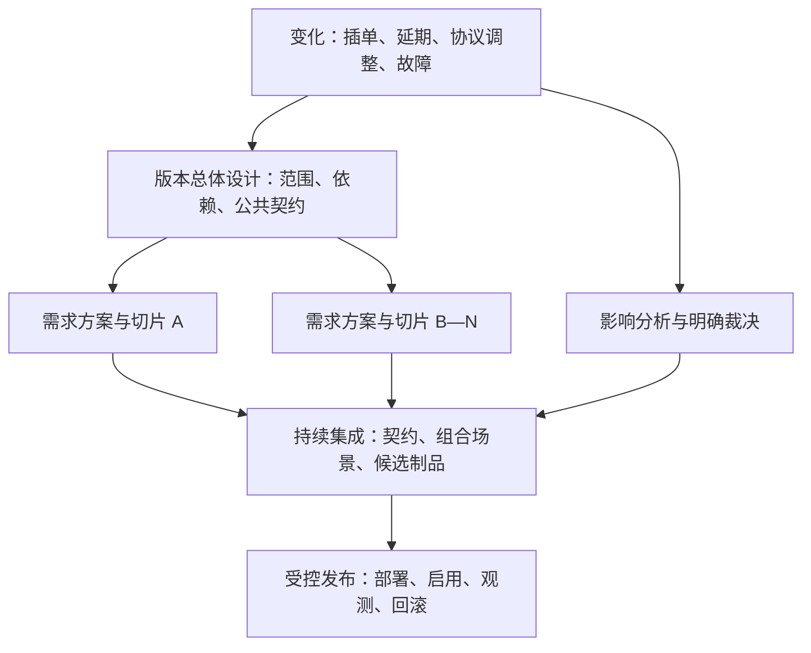

# 同版本多需求：版本级集成设计与协同执行说明

日期：2026-10-15。状态：方法分析与项目建议，待 Owner 评审。本文不代表人员、排期、技术参数或发布范围已经获得确认。

结论：一个版本包含多个需求时，应形成“一份版本总体集成设计 + 每个需求一份独立方案 + 一套持续更新的交付证据”。总体设计负责跨需求的约束和取舍；单项方案负责局部实现；执行记录负责证明实际进度。三者通过稳定编号关联，避免重复维护同一事实。

本文先按生命周期分析问题，再给出大型团队的运行方式，最后应用到当前 F1—F5。实践建议不存在脱离团队能力、产品风险和架构现状的唯一最优解；以下以降低等待、尽早暴露组合风险、保证可追溯为判断标准。

## 1. 先定义“同一个版本”

一个产品版本，可以包含多个服务制品、客户端版本、数据库变更和功能开启动作。应分别记录：

|层次|回答的问题|必须保存的事实|
|---|---|---|
|产品范围|本次承诺交付哪些用户能力？|需求与验收边界、必须交付项、可延期项|
|集成基线|哪些代码和协议已经一起验证？|源码 revision、契约版本、测试报告对应 revision|
|部署单元|哪些东西必须一起安装或升级？|制品摘要、运行配置、数据库版本、依赖版本|
|功能发布|何时向哪些用户开放？|开关、分桶、兼容前提、观察条件|

因此，同版本可以先部署兼容的服务端，再部署客户端，最后分批启用功能。当前项目受 PostgreSQL 应用级单实例锁约束，不能为了灰度同时启动两个业务写实例；这里适用的是同一进程的受控开关、测试环境和受控切换。大型多服务团队只有具备相应架构条件时，才能采用独立部署和实例级金丝雀。

## 2. 难点、卡点与逐项实践

|问题点|为何会卡住或失败|推荐实践|具体交付物与验收证据|
|---|---|---|---|
|1. 版本目标不一致|产品按功能数判断完成，研发按代码判断完成，测试按用例判断完成|定义版本用户目标、必须交付项、可拆项及非目标；每项明确最低可接受范围|版本范围表；需求→用户验收→技术护栏映射|
|2. 隐性依赖|看似独立的页面可能共享账户状态、事务、缓存、队列或预算|同时识别业务、契约、数据、代码、资源和发布依赖；区分硬依赖与可通过兼容层解除的依赖|带类型和交付条件的依赖图；不能只写“依赖后端”|
|3. 各自合理，组合矛盾|同一字段、错误码或状态在不同方案中含义不同|先定公共术语、状态机、不变量和错误语义；公共决策由一个负责角色维护|共享契约版本；生产者与消费者共同确认的示例和契约测试|
|4. 共享模块多人改动|Git 能合并文本，却发现不了锁顺序、调用时机、状态语义冲突|为共享模块指定维护责任；先交付小型公共改造，再按接口并行；必要时串行合入热点文件|模块影响矩阵、共享变更任务、评审路由和合入顺序|
|5. 责任空白或重复建设|每人负责一个需求，但无人负责跨需求正确性|需求负责端到端结果；模块负责接口与不变量；版本负责组合交付；每项决策只有一个最终裁决角色|责任表及替补角色；共同参与不等于共同兜底|
|6. 计划只统计编码时间|等待协议、环境、评审、数据迁移和联调的时间未纳入|排依赖图的关键路径，估计区间与不确定性；给共享稀缺资源单独排期；限制同时开工数|契约就绪、首次贯通、候选制品、发布就绪等可验证里程碑|
|7. 大需求无法并行|拆成“前端完、后端完”后，两边很久都没有可运行链路|按可演示的纵向切片拆分；先最小贯通，再覆盖异常、历史数据和性能|每个切片有输入、输出、契约版本与验收；Mock 与真实链路分别标记|
|8. 文档和实际实现漂移|评审后文档无人更新；群聊决定覆盖正式结论|规范与实施记录分开；PR 关联需求和决策；影响契约时同步更正文档；接受后的重要决策以新记录替代|文档版本、ADR 的替代关系、PR 和测试报告互链|
|9. “通知了”但没有对齐|消息被忽略，或对方收到后仍按旧版本开发|仅通知受影响方；要求返回接受、需修改或受阻，并说明所用版本及迁移时间|依赖回执；未确认项保持未就绪，不能把已读当同意|
|10. 变更多、计划失真|插单只增加任务，未调整范围、关键路径和资源|每次变更记录差异及影响；重新选择范围、日期或资源；只重评受影响部分|变更单、更新的依赖/测试/发布计划、被替代的承诺|
|11. 长分支晚集成|各分支都通过，末期合起来失败，定位范围大|短分支、小 PR、频繁合入共享主线；未完成能力通过兼容骨架或开关隔离；失败优先修复|合入前后检查、分支年龄、主线故障恢复时间|
|12. 契约与环境错位|本地 Mock 正确，联调环境却运行旧接口或错误配置|契约测试、明确版本的 Mock、隔离数据；环境清单展示实际制品、配置与依赖|可查询的环境清单；Mock 不冒充真实依赖已就绪|
|13. 测试组合爆炸|每项独立通过，不代表功能同时开启或混合版本通过|根据共享状态和故障传播选交叉用例；兼容矩阵、关键链路、并发/恢复/回滚必须验证|风险驱动测试矩阵；必要组合全测，低风险组合可用成对覆盖|
|14. 性能预算相互挤占|每项都增加一点读写、并发、日志，叠加超过连接池或预算|汇总同版本峰值、扇出、重试、线程池、队列与数据库预算；做组合压力验证|资源预算表与组合压测；单功能吞吐不能代表版本容量|
|15. Schema 和历史数据迁移|新代码能工作，旧数据、旧客户端或回滚代码不能读|先扩展兼容结构，再迁移和切换，最后独立删除旧结构；验证混合读写窗口|迁移前置条件、数据校验、恢复演练；删除动作单独设退出条件|
|16. 进度虚假精确|“完成 90%”可能还差所有联调和发布工作|按可证据化状态管理；显示剩余阻塞及等待时长，区分设计、实现、集成、发布就绪|状态必须附 PR、契约测试、制品或验收记录；没有证据标未知|
|17. 发布相互绑死|一个需求延期或故障，整个版本只能一起回退|明确最小发布集合；设计可独立启用/停用边界；不可分割项按依赖组发布|合法开关组合、部署 DAG、最小回滚单元与撤项演练|
|18. 回滚语义不完整|关闭开关后，新字段、在途任务和外部收费仍然存在|分别设计流量、代码、配置、数据、任务、第三方副作用的处置|回滚执行表；使用当前数据验证旧读者，不能恢复旧备份丢掉新增数据|
|19. 大团队信息过载|所有人参加所有会议，协调人变成瓶颈|领域团队自治，平台自助；跨团队仅同步公共边界、阻塞与决策；按事件订阅|服务/模块目录、责任索引、受影响人清单、自动状态聚合|
|20. 人员变化和关键人依赖|知识只在聊天或某个人脑中，新接手者无法判断|保存决策理由、运行手册、模块边界；设置评审和运维替补；交接用实际演练|新人能定位当前契约并完成一条测试/发布演练|
|21. 质量责任到最后才出现|安全、隐私、运维、数据团队上线前才提出硬要求|按实际风险在设计时引入相关角色，约定可执行验收；不把所有低风险改动都送统一委员会|设计阶段风险结论、必要的自动检查及责任人|
|22. 工具与流程越来越重|多处手填相同进度；流程本身吞掉交付时间|一个事实指定一个维护源，其他页面自动聚合；根据风险分级而非按团队规模无限加关卡|删除重复台账；观察等待时间、返工和变更失败情况|

“全部难点”应通过这类分层检查保持覆盖，再依据当前系统补充事实；无法预先穷举所有未来事件。若出现新依赖、新法规或新外部服务，应按相同机制补入影响分析。

## 3. 工程设计需要多出哪一层

### 3.1 版本总体集成设计

应回答以下问题，每条都对应可执行的结果：

1. 本版本交付目标、必须项、可延期项和撤项条件是什么？
2. 需求之间共享哪些模块、数据、线程池、连接池、队列和状态？
3. 哪些是硬依赖，哪些可以通过可选字段、能力协商或适配器解除？
4. 公共状态机、接口版本、幂等键、错误码和资源预算由谁维护？
5. 哪些能并行设计/编码，哪些必须按顺序合入/部署/启用？
6. 首次可运行链路是什么？谁负责证明跨需求的场景成立？
7. 一个需求延期、撤回或故障时，剩余集合还能否成立？
8. 发布制品的精确组成、开关组合、迁移顺序和回滚下限是什么？

总体设计保持精炼，引用单项方案细节。单项方案同时保留其需要的公共契约版本和关键行为，保证独立可读，不能只留下“见总体方案”。

### 3.2 依赖应是一份可验收的承诺

依赖至少包含：提供方、消费方、交付内容、契约版本、就绪证据、期望时间、承诺时间、阻塞类型、延期选项、最终负责角色。没有达成时间承诺时明确写“未承诺”。

以 F2/F5 为例：F2 提供账户运行资格检查，F5 在后台任务调度和调用模型前消费它。就绪标准是：被隔离账户不产生新模型调用；正在退出的任务仍可完成取消/账务终结；双方契约测试通过。“F2 后端已开发”不构成这项依赖就绪。

### 3.3 将方案拆成可以实际执行的工作包

每个工作包同时记录：输入基线、修改模块、负责人、依赖、交付制品、验收、回滚影响。按以下顺序逐步细化：

`公共契约与最小基础能力 → 最小端到端链路 → 各需求增量能力 → 故障与兼容验证 → 同版本组合验收 → 发布准备`

这是一条依赖原则，不要求所有需求等待全部公共工作完成。没有依赖的部分持续推进。高不确定性的技术点先做有退出条件的验证；验证结果改变设计时立即更新基线。

## 4. 大型团队如何分工与对齐

### 4.1 决策权应有边界

|角色|负责决定|不应成为的瓶颈|
|---|---|---|
|产品/版本 Owner|目标、优先级、范围或日期取舍|不替模块维护者决定实现细节|
|版本技术负责人|跨需求架构、不变量、集成风险裁决|不审每一行代码，不代替所有团队排任务|
|需求负责人|本需求从设计到用户验收的完整结果|不能把跨团队等待当作无人处理的外部问题|
|模块/契约维护者|共享接口、状态机、兼容窗口、合入边界|应有替补和约定响应规则，避免单点等待|
|交付协调角色/TPM|依赖、里程碑、阻塞升级、变更记录|负责组织决策，不越权替技术或产品拍板|
|测试与发布负责人|组合验证、环境、候选制品和发布操作证据|不承担替各团队修复质量问题的职责|

小团队可一人兼任多个角色；大型团队按领域拆开。只在跨领域决策上设裁决人，领域内部保持自治。长期反复协商同一个边界，通常需要调整模块或团队边界。

### 4.2 一个事实一个维护源

|事实|建议维护位置|变化如何传播|
|---|---|---|
|需求范围与验收|需求系统中的稳定编号|版本索引引用，变更关联影响需求|
|协议与 Schema|版本管理中的规范及可执行契约|兼容性检查、消费者订阅和确认|
|重要设计理由|ADR/技术方案|保留历史，新的决定标注替代旧决定|
|实际研发进度|PR、构建、测试、任务状态|自动汇总到版本视图|
|环境与发布组成|部署平台/发布清单|精确到制品、配置、Schema、开关|
|阻塞和风险|带责任人的问题记录|按影响依赖通知，按期限升级|

“统一入口”是一个可以导航到这些事实的索引，不要求把所有数据复制进同一个表。聊天用于提醒和讨论，结论回写维护源；不能让其他人考古聊天记录确定当前规范。

### 4.3 日常对齐以变化为中心

以下频率是建议初值，应按时区、版本节奏和风险调整：

- 异步日更新只写：新交付证据、依赖变化、阻塞、下一可验证结果。无变化无需重复长报。
- 跨团队短会聚焦未解决依赖和需要裁决的事项；相互独立的团队不必参加。
- 按周检查关键路径、实际集成状态和范围变化；临近发布按风险加密。
- 接口破坏、上线窗口变化、关键依赖延期、安全或数据不变量破坏，发生即通知受影响方。
- 关键变更要求明确回执；建议一个工作日内回应，紧急阻塞走约定升级渠道。响应期限由团队确认，沉默不视为同意。

跨时区场景在请求中写清决定内容、选项、推荐、影响和截止时间，让下一时区接手者可以直接判断。

## 5. 动态变化怎样闭环

### 5.1 固定已确认的基线，允许受控修订

基线是某时点已确认的范围、协议和计划。变更后产生新基线，并保存差异；不能直接覆盖旧承诺，制造“本来就是这样”的假象。

影响集合必须包含：需求、上下游、数据兼容、代码模块、测试、成本容量、关键路径、灰度、回滚。变化级别按影响范围判断，不能只按修改行数。

### 5.2 分级决策，控制等待

|变化|决策范围|推荐处理|
|---|---|---|
|模块内部调整，外部语义与承诺不变|模块负责人|常规 PR 评审；关联原方案，无需重开版本评审|
|增加兼容字段或改变依赖交付时间|提供方、受影响消费方、交付协调角色|更新契约/依赖，验证旧客户端及计划影响|
|破坏协议、改变共享状态机或权限|技术负责人及受影响维护者|形成新决策，给迁移窗口；重跑受影响兼容和集成测试|
|新增需求、关键路径变化、突破预算|产品/版本 Owner 联合技术负责人|明确选范围、日期、资源或分期；保留被替代承诺|
|生产故障紧急修复|当值故障负责人及发布角色|按已有紧急权限先止损，保留操作轨迹，事后补齐决策与回归|

固定日期又要求增加范围时，首先估算真实剩余容量和依赖。增加人员并不必然缩短关键路径，还会产生接入和协调成本。若无法同时满足，应明确删减、分期或调整日期，不能依靠默认加班弥补。

### 5.3 常见动态事件的处理

|事件|立即动作|继续执行的条件|
|---|---|---|
|依赖延期|公布影响路径；评估旧协议、适配器、Mock 和撤项选项|真实发布所需依赖已就绪，或范围正式调整；Mock 只能解除部分开发等待|
|接口字段变为必填|视为兼容性变化，枚举旧调用方|完成兼容过渡或版本切换，消费者明确接收|
|一个需求取消|检查共享代码、Schema、开关和测试是否仍被保留需求需要|剩余发布集合自洽；不要盲目撤回全部关联提交|
|人员调动|按模块契约、未结决策、演练步骤交接|替补能构建、验证并定位风险；依赖承诺重新确认|
|压测失败|区分局部问题与组合资源争抢|护栏恢复，或范围/配额正式降低并验证|
|上线前发现新缺陷|评估影响与回滚单元；生成新候选制品|对实际发布的 revision 和配置完成必要验证|

## 6. 集成和验收怎样防止“各自完成”

### 6.1 进度使用证据状态

`草案 → 可开工 → 已实现 → 已集成 → 发布就绪 → 已发布 → 已验证`

每个状态都需要证据：“可开工”有契约和验收；“已实现”有代码及局部测试；“已集成”是在共同基线上通过组合场景；“发布就绪”包含实际候选制品、兼容和回滚条件。“受阻”作为附加状态，记录起始时间、阻塞方及解除条件。

### 6.2 建立分层验证

1. 组件测试验证局部算法与状态转换。
2. 契约测试验证提供方和消费方理解一致，检测字段、默认值、错误语义与兼容性。
3. 集成测试验证数据库、队列、鉴权、恢复和任务终态。
4. 端到端测试验证实际用户目标以及升级、刷新、重试。
5. 组合压力与故障测试验证多个需求共享资源时的表现。
6. 发布演练验证真实制品、配置、历史数据、在途任务和回滚顺序。

不枚举所有开关的指数级组合。先限制合法组合，再围绕公共状态、共享资源、迁移和回滚覆盖高风险组合。成对组合不能代替关键路径的完整测试。

### 6.3 版本退出条件

版本发布前必须能够证明：必须需求通过验收、硬依赖就绪、公共不变量成立、实际候选制品测试有效、风险已明确裁决、容量护栏成立、回滚可执行、运行责任明确。

可延期项未完成时，只有在依赖闭包、开关和数据兼容都允许的情况下才能撤项。对候选制品做任意修改，都要依据影响范围重新验证；历史绿色流水线不能证明新制品成立。

### 6.4 少量有效指标

建议观察：依赖等待时长、阻塞年龄、首次端到端贯通时间、分支年龄、主线故障恢复时间、集成后返工、变更从提出到确认的时间、发布失败与恢复时间。指标用于改进系统，不按代码行数、关闭任务数或个人“完成率”排名。

## 7. 应用于当前 F1—F5

来源为用户指定的历史会话及 [工程审计报告](../audits/engineering-2026-10-14.md)，代码核对基线为 `de90dfe2421b01d30066131be44478773fd2da68`。历史记录将 F1、F2、F4、F5 放入 v0.5.16，F3 未指定版本。该范围是历史决策记录，未通过远端系统重新核实状态。

### 7.1 共享边界和责任建议

|需求关系|实际交叉点|建议协作规则|组合验收|
|---|---|---|---|
|F1 ↔ F2|认证后绑定账户；账户恢复状态|F1 维护认证与会话有效性；F2 维护运行资格；认证成功不等于业务存储已就绪|隔离账户可登录、查看自身状态并退出；业务接口仍被拦截|
|F2 ↔ F5|后台 AI 恢复、调度、取消与终结|共用账户运行资格及任务退出契约；恢复前不启动新工作；取消终结不被普通业务门禁阻断|坏账户不触发模型；已有取消/账务终结可安全收敛|
|F1 ↔ F5|限流、排队、事件循环与资源竞争|认证 KDF 门控与 AI 门控分开，不共享配额；共同验证资源争抢|错误登录压力下已准入用户可登录，AI 取消仍及时响应|
|F2 ↔ F3|存储初始化、迁移、恢复与故障分类|F3 遵守恢复状态与数据保全约束；共享数据库故障保持全局失败|不能把数据库失联错误归类为某个坏账户|
|F3 ↔ F4|思绪读取与同步失效|F4 沿用现有仓储即可交付；F3 后续保持同一分页语义|当前和未来查询适配器对静态数据输出一致|
|F3 ↔ F5|任务状态、预算凭据和幂等提交|F5 先保持当前事务协议；F3 后续优化不得破坏终态与账务原子性|重复取消、崩溃恢复与重放不多退或多扣|

F2/F5 的任务终结须采用范围受限的清理路径：只允许针对已经校验可用的任务/预算记录做幂等终结，禁止领取新任务或调用模型。相关账本本身损坏时保留诊断与待对账状态，由恢复流程处理，不能为了“完成取消”绕过校验写入损坏数据。

### 7.2 推荐实施顺序

先确认公共契约：账户运行资格、任务退出、认证错误语义、分页兼容和公共监控字段。它们可以是短文档及小型基础变更，无需新建大型平台。

随后并行推进 F1、F4，以及 F2/F5 各自不依赖的部分。F2/F5 在共同后台任务边界尽早合入最小贯通切片。公共契约通过后再做完整交叉故障测试。

F3 按“观测与快速同步读取 → 兼容增量写入 → 高频资源命令/查询”独立分阶段评审，保留单实例锁。它的数据库性能收益不作为 F1/F2/F4/F5 的交付前提。

若 Owner 后续决定五项必须同版，需要形成新范围基线、补真实 PostgreSQL 测试环境与数据校验、重估关键路径和撤项条件；不能只把 F3 的版本号改成 v0.5.16。

### 7.3 版本组合验收建议

|编号|组合场景|必须成立的结果|
|---|---|---|
|IT-01|F1 + F2：A/C 正常、B 恢复损坏，同时有错误登录|A/C 可认证并读写；B 可鉴权及退出但业务 503；无跨账户泄漏|
|IT-02|F2 + F5：恢复任务、排队取消及重启交错|隔离账户不启动新模型请求；任务终态不被旧恢复覆盖；预算终结不遗漏|
|IT-03|F1 + F5：KDF 压力、AI 队列饱和|两类门控计数独立且有上界；已受理取消不等占用者释放|
|IT-04|F4 + 账户切换/同步|翻到 100 条以后刷新、进详情返回、切换账户|可继续访问完整历史；窗口有界；旧账户响应不进入新账户页面|
|IT-05|四项启用及按项停用|新旧客户端、在途任务、重启和回滚|合法配置组合成立；不能靠停用门禁绕过隔离|
|IT-06|F3 后续接入其他四项|同一业务数据与操作序列，比较旧/新仓储|分页、同步 cursor、任务终态、幂等回执和导出结果一致|

这些是测试计划，当前没有执行结果。研发、环境和发布权责仍待实际团队认领。

## 8. 最小可行落地

当前项目只需把以下内容放入本目录的总体说明和各需求文档，无需立即引入新的项目管理系统：

- 一份版本范围和依赖矩阵。
- 一个公共契约与重要决策索引。
- 每个需求的独立完整方案。
- 一份有证据链接的集成状态表。
- 一份组合测试、发布和回滚计划。

大型团队可在此基础上增加服务目录、自动契约检查、环境清单和发布清单聚合。先建立事实与责任，再自动化；不要同时在文档、表格和项目系统手动维护三套进度。

## 9. 参考依据与适用限制

以下材料于 2026-10-15 读取。它们支持相应实践方向；本文的角色划分、频率、当前需求关系和具体执行建议属于针对本项目的分析，不是来源中的统一强制标准。

- [DORA：Continuous integration](https://dora.dev/capabilities/continuous-integration/)：小批次、频繁集成、快速反馈和失败修复。其建议需要可维护的构建及自动测试支撑。
- [DORA：Loosely coupled teams](https://dora.dev/capabilities/loosely-coupled-teams/)：独立测试/部署、明确契约与降低跨团队细粒度协调。微服务名称本身不能保证团队独立。
- [Google SRE：Release Engineering](https://sre.google/sre-book/release-engineering/)：可重复制品、精确版本、配置管理、发布验证与角色协作。Google 的工具和规模不直接照搬。
- [AWS：Architectural decision record process](https://docs.aws.amazon.com/prescriptive-guidance/latest/architectural-decision-records/adr-process.html)：保存决策背景、责任和状态；新决定替代旧决定，保留历史原因。
