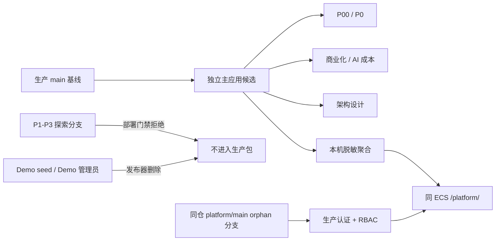

# 上线前确认：P00/P0、商业化/系统设计与独立中台

## 发布对象

### 主应用

- 发布前生产基线：`9c9c4d5b19129027046b8b5a91992d84e25baa59`
- 当前开发分支：`explore/nightly-p3-20260928`
- 当前 HEAD：`d33a53e`
- 发布分支：`release/p00-p0-commercial-system-20260928`
- 发布工作树：`/tmp/for-now-release-20260928`
- 功能发布提交：`5ae6a703516925cde778827f13b72e443353e624`
- 发布标签：`release-20260928-p00-p0-commercial-system`
- 风险等级：高

纳入范围：

- P00：全体裁回收站、误删恢复后的兼容、异步结果强绑定、用户原文优先、关键失败回归。
- P0：思绪内容时间线、后台生成与通知、移动端交互、回答风格与助手设置、冷启动、本地测试模式、此刻录入减负。
- 商业化：四类用户成本、四种经营模型、五阶段参数、真实账本校准和人民币口径。
- AI 成本：逐场景成本模拟与实测校准。
- 系统设计：五阶段架构设计页及配套知识文档。
- 上线流程、系统测试和本次发布证据。

明确排除：

- P1–P3 探索实验室页面、合成样例、OpenAPI/SQL 影子契约和探索截图。
- PostgreSQL、独立 Worker、Redis、消息队列、支付、社区、真实连接器、地图、多区域和其他尚未达到生产状态的探索能力。
- 任何硬编码万能密码或绕过正常认证的逻辑。

### 独立中台

- 路径：`platform-console/`
- 仓库：与主应用共享 Gitee remote，使用独立 orphan 分支与 worktree
- 当前分支：`platform/main`
- 当前提交：`d157537f7f4cec1e306494298c49a2d35f7fa984`
- 发布标签：`release-20260928-platform-mvp`
- 远端：`git@gitee.com:Liu_772021/for-now.git`
- 风险等级：高

纳入范围：

- 只读治理总览、用户、服务、存储、AI、商业化和日志看板。
- 生产管理员认证：scrypt 密码、持久安全会话、CSRF/同源保护、登录限速和密码轮换失效。
- RBAC：仅 `shenji` 主账户拥有全部 13 项权限及 `access.manage`，且不可降级或转移；本次不新增其他生产管理员。
- 前端入口显隐、后端 API 权限校验、角色变更审计。
- 主应用本机服务令牌保护的实时脱敏聚合；不返回用户正文、模型 Prompt/回复、附件内容或凭据。
- 同 ECS 的 HTTPS `/platform/`、独立 systemd 用户/服务/数据目录、不可变 release、健康检查、飞书监控和失败回滚。
- 高危动作只生成影响预览，不执行生产写入。

明确排除：

- 直接连接主应用生产库、OSS、Cookie、密钥或真实支付。
- 封禁、退款、配额修改等真实生产写操作。
- 使用演示身份会话作为公网生产认证。
- 万能密码、任意账户代登录或其他认证绕过。

## 初始阻断项

| ID | 阻断项 | 状态 | 当前证据 | 关闭条件 |
| --- | --- | --- | --- | --- |
| B1 | 主应用当前分支夹带 P1–P3 探索提交 | 已关闭 | 已从生产 `main` 组装独立候选；候选无 `public/explore*`、探索脚本和探索截图；部署器发现探索资源会直接失败 | 第二轮再次核对候选文件清单 |
| B2 | P0-03 真机验收未完成 | 本轮接受后移 | 用户明确后移到 P2-07；自动化移动模拟通过，但未声称真机通过 | P2 记录设备、系统、浏览器、截图和结果 |
| B3 | 中台没有首个 Git 提交和发布分支 | 已关闭 | `platform/main` 首个提交 `d157537f7f4c`、标签和远端分支均已创建；orphan tree 不继承主应用文件 | 远端、服务器 mirror 与活动 release 一致 |
| B4 | 中台没有生产管理员认证 | 已关闭 | 生产登录、持久会话、13 项权限、唯一管理员和退出失效冒烟通过；服务器只保存 scrypt 哈希 | 公网复验通过 |
| B5 | 中台没有生产部署目标 | 已关闭 | 同 ECS、现有公网 IPv4 HTTPS `/platform/`；独立用户、systemd、数据目录和 `0600` 环境文件均已启用 | 公网入口、静态资源和 readyz 通过 |
| B6 | 中台数据为虚构 seed | 已关闭 | 生产使用主应用本机服务令牌脱敏聚合；公网聚合路径返回 404，生产包不含 Demo 数据 | 实时聚合和隐私契约冒烟通过 |
| B7 | 外部邀请的隐私阻断项未关闭 | 本轮范围关闭 | 用户确认本次不扩大到项目成员以外；隐私草案缺口继续阻断未来外部邀请 | 本轮邀请范围不变；未来 P1-08 前补齐 |
| B8 | 同机内存余量有限 | 已观察关闭，继续监控 | 30 分钟观察中可用内存最低 417 MiB、Swap 为 0、无 OOM；主应用与中台重启次数均为 0 | 继续执行 `MemoryHigh=128M/MemoryMax=192M` 和 300 MiB 回滚线 |

## 验收矩阵

| 验收行为 | 自动化测试 | 人工测试 | 生产冒烟 | 关键失败路径 |
| --- | --- | --- | --- | --- |
| P00 删除、恢复、附件清理 | 主应用后端/认证回归 | 回收站逐类型操作 | 生产测试账户最小数据 | 取消、重复清理、附件删除失败、重启恢复 |
| P00/P0 持久 AI 任务 | 主应用后端/UI 回归 | 通知跳转、失败重试 | 真实慢任务 | 并发幂等、过期拒写、进程重启 |
| P0 移动端 | 移动平台/UI 回归 | 本轮后移 P2 | 公网桌面/移动浏览器基础入口 | 键盘、安全区、PWA、触觉保持未验证 |
| 冷启动与本地测试 | 本地模式/认证/UI 回归 | 新账户完整流程 | 生产新测试账户 | 线上写入拒绝、账户切换、空账户 |
| 商业化与 AI 成本 | 主回归/UI 回归 | 参数、单位和口径核对 | 生产只读账本 | 空样本、极值、错误盈利确认 |
| 架构设计 | UI 回归 | 五阶段内容和边界核对 | 静态页面 | 把规划误标为已上线 |
| 中台 RBAC | 中台 API 回归/UI 回归 | `shenji` 最高权限矩阵 | 生产登录、重启后会话、退出 | 越权、CSRF、伪造身份、降级主账户、登录爆破 |
| 中台只读边界 | 两仓 API 与部署回归 | 预演文案与操作范围 | 公网阻断聚合路径、真实脱敏看板 | 真实写入、读取正文/Prompt/附件/凭据、上游隐私契约异常 |

## 第一轮

- 规则读取：已逐份复读 `PROJECT_RULES.md`、`README.md`、`one-mistake-one-rule.md`、工程规则、上线清单、系统测试、架构、产品、商业化、AI 成本、指标、隐私、可观测性、容量运维、部署说明及中台全部源码/测试。
- 主应用测试：在 `/tmp/for-now-release-20260928` 运行 `npm run test:system`；后端 16 组、前端 2 组全部通过，最后一次有效结果总用时 `100513 ms`。按规则未执行 `test:load`。
- 中台测试：运行 `npm run check && npm test && npm run test:ui`；生产密码认证、持久会话、CSRF/同源、限速、owner 保护、实时上游隐私契约、部署回滚、`/platform/` base path、桌面与 390px 移动端均通过。
- 外部测试：未调用真实 DeepSeek、阿里云分割或 OSS，未产生供应商费用；未执行生产写入、真机测试或公网中台部署。
- 生产只读核对：主应用 release 与服务器 Gitee mirror `main` 均为 `9c9c4d5b1912...`；Nginx 配置有效；公网 `/now/` 返回 200；Snap Certbot 续期 timer active；40 GB 磁盘使用 42%；中台服务、用户、环境、路由、服务令牌和监控均尚未创建。

### 审查问题与处理

| No. | 严重度 | 问题 | 处理结论 | 主要证据 |
| --- | --- | --- | --- | --- |
| 1 | 高 | 失败 AI 任务并发重试会创建多个后继并重复计费 | 已修复：按 `retryOf` 原子查重，稳定重试标识；并发回归只调用一次供应商 | `server.mjs`、`scripts/regression.mjs` |
| 2 | 高 | 当前 P3 分支整仓归档会公开 P1–P3 探索资源 | 已修复候选：从 `main` 独立组装；部署器发现 `public/explore*` 立即失败 | `deploy/deploy.sh`、`scripts/deploy-regression.mjs` |
| 3 | 中 | 商业化 v2→v3 静默丢失旧调用参数 | 已修复：订阅参数等价映射到画像，并在 `legacyV2` 保留订阅/交付快照 | `server.mjs`、`scripts/regression.mjs` |
| 4 | 高 | 架构设计只有 JS 数据，没有可访问 HTML 页面 | 已修复：补齐“我的”入口、五阶段页面、术语和响应式布局 | `public/index.html`、`public/styles.css`、`scripts/ui-regression.mjs` |
| 5 | 中 | 架构页把当前实例写成 2C4G/80GB | 已修复：使用生产只读观测的 2 vCPU、1.57 GiB 可见内存、40 GB | `public/app.js`、`knowledge/operations-capacity.md` |
| 6 | 严重 | 中台硬编码共享万能密码，可选择主账户 | 已修复：删除密码与哈希；仅本机显式 Demo 会话；生产模式拒绝启动 | `platform-console/server.mjs` |
| 7 | 高 | 中台权限写入与审计跨文件，审计失败仍可能留下权限或会话 | 已修复：权限与审计同一原子 JSON 提交；审计成功后才签发会话 | `platform-console/server.mjs` |
| 8 | 高 | 中台请求体超限前全量缓冲，413 被转成 500 | 已修复：预检与流式累计 100 KB，保留 400/413 状态 | `platform-console/server.mjs`、`scripts/regression.mjs` |
| 9 | 中 | 中台从第三方 CDN 执行无完整性校验脚本 | 已修复：固定版本并增加 SHA-256 SRI 与 `crossorigin` | `platform-console/public/index.html` |
| 10 | 中 | 中台 API/UI 基线测试失败 | 已修复：审计按事件查找，UI 先建立演示会话；完整测试通过 | `platform-console/scripts/` |
| 11 | 严重 | 用户选择真实公网中台后，原候选只有 Demo 认证与虚构 seed | 已修复：独立生产认证、实时脱敏聚合、服务令牌和严格隐私契约；Demo 仅允许直连本机 | 两仓 `server.mjs`、`admin-snapshot.mjs` |
| 12 | 高 | 前端部署到 `/platform/` 后仍请求站点根 `/api/` | 已修复：API 自动继承页面 base path；UI 测试用真实 `/platform/` 代理场景 | `platform-console/public/app.js`、`scripts/ui-smoke.mjs` |
| 13 | 高 | 中台无 systemd、不可变发布、回滚和持续健康监控 | 已修复：独立运行用户、资源上限、发布器、失败回滚，并纳入现有飞书监控 | `platform-console/deploy/`、主应用监控脚本 |
| 14 | 高 | 独立中台生产归档会夹带虚构用户与演示管理员数据 | 已修复：部署候选强制删除 `data/seed.json` 与 Demo access 文件，只保留单一 `shenji` 生产模板 | `platform-console/deploy/deploy.sh`、部署回归 |
| 15 | 中 | 登录失败和限速没有可定位的安全日志 | 已修复：记录不含用户名、密码和 IP 明文的事件与来源摘要 | `platform-console/server.mjs`、认证回归 |

两名独立复核员逐项交叉验证上述问题：除第 2 项仍要求以独立候选和部署门禁持续约束外，其余原问题均确认关闭；第 5 项按复核意见进一步改为精确生产观测口径。

- 结论：公网中台扩展范围后的第一轮实现、完整测试、代码审查与生产只读核对通过；当前仍为 `NO-GO`，必须完成下列人工配置决策并取得人工预确认。

## 人工介入

| 项目 | 状态 | 责任人 | 脱敏证据 |
| --- | --- | --- | --- |
| 主应用真实 iOS/Android 验收 | 已后移 P2-07，不作为本轮阻断 | 人工 | 用户于 2026-09-28 明确后移 |
| 中台上线形态 | 已确认：真实公网只读控制面 | 人工 | 用户于 2026-09-28 明确选择 B |
| 中台 Git 组织方式 | 已确认并落地 | Agent | 同一 Gitee remote；`platform/main` orphan 分支；`platform-console/` 注册为独立 worktree |
| 本机 Gitee push 身份 | 已配置并验证 | Agent | 绑定项目专用 `.secrets/for-now-gitee`；账户认证成功，主仓/中台读取通过，新分支 push dry-run 通过且未写远端 |
| 中台入口、TLS 与主机 | 已确认 | 人工 | 同 ECS、`https://123.57.140.24/platform/`、现有 IP TLS |
| `shenji` 管理员密码 | 已生成并配置 | Agent | 随机明文仅在本机 `.secrets`、权限 `0600`；服务器仅保存 scrypt 哈希，未输出到聊天或日志 |
| 主应用/中台配对服务令牌 | 已生成并配置 | Agent | 明文与 SHA-256 已分别进入两份服务器 `0600` 环境文件，监控开关保持 `0` |
| 中台服务器首次初始化 | 已完成 | Agent | 创建 `for-now-platform` 用户、systemd 和数据目录；部署器复用主应用现有 mirror 与只读 Deploy Key |
| 本次维护窗口与可接受中断 | 已确认 | 人工 | 窗口 30 分钟、连续中断不超过 5 分钟、部署后观察至少 30 分钟 |
| 同机内存风险与回滚线 | 已接受 | 人工 | 128M/192M 中台上限；可用内存 <300 MiB、Swap 增长、OOM 或中台 readyz 失败即回滚 |
| 是否扩大到项目成员以外的邀请用户 | 已确认：本次不扩大 | 人工 | 用户于 2026-09-28 明确选择 A |
| 隐私运营主体、联系人、导出/删除路径 | 本轮 N/A；未来外部邀请前阻断 | 人工 | 邀请范围不变 |
| 主应用发布前最新备份与隔离恢复演练 | 已完成 | Agent | 17:52 新快照约 6.85 MB；备份 2 秒、隔离恢复 3 秒；3 账户、135 项总记录、8 个附件引用，附件 HTTP 校验通过 |

- 人工预确认：已取得。用户于 2026-09-28 17:47 明确“现在，开始”，同意按已确认范围、维护参数和风险线继续；可进入第二轮。

## 第二轮

- 冻结候选：主应用 tree `ae91a5dd59b861bb7b11d842fd6c33a7720a2d7e`；中台 tree `1ff9f945b4bd9a985a9c87fc93de75c0fabc4788`。两者均为未提交 Git tree，不代表已发布。
- 规则复核：重新读取项目规则、错误规则、工程规则、上线清单和上线流程，并保存本轮 SHA-256 读取证据；未发现与当前范围冲突的规则。
- 干净候选测试：分别从上述 tree 执行 `git archive` 解包。主应用在解包目录执行 `npm ci`，安装并审计 130 个包，0 个已知漏洞；随后 `npm run test:system` 的后端 16 组、前端 2 组全部通过，总用时 `103304 ms`。中台执行 `npm run check && npm test && npm run test:ui` 全部通过。
- 对抗性检查：主候选没有 `public/explore*`、运行数据或凭据；中台 tree 只有 20 个受控文件，生产模板仅 `shenji`，不含 `.secrets`。服务器共享 Git mirror/key、环境键、目录和文件权限均正确，中台保持 inactive；Nginx 和当前主服务健康。
- 回滚兼容：生产旧版 v12 读取新版 store 时会保留未知 v14 字段；代码回退不会删除回收站、通知或任务数据。最新一致性备份及隔离恢复已通过。
- 已知依赖提示：npm 11 提示 `@alicloud/openapi-core@1.0.8` 存在既有 postinstall；锁定依赖安装成功且审计为 0 漏洞，本轮没有新增或升级该依赖。
- 结论：第二轮通过。此后如修改代码、依赖、部署脚本、迁移或生产配置，第二轮立即失效并返回第一轮。

## 文档

- 已更新：README、TODO、架构、可观测性、容量、部署说明、迭代历史、中台 README 和本报告。
- 冲突检查：`git diff --check` 通过；生产、候选、探索版和真机未验证状态已分开表述。

## 最终 GO

- 执行结果：主应用与中台 commit、原子 push、标签、生产部署、冒烟和 30 分钟观察均已完成。
- 已接受风险：真机验收后移 P2-07；同机内存按 128M/192M 中台限制及 300 MiB 可用内存回滚线管理；本轮使用公网 IP 路径而非命名域名。
- 回滚版本：主应用 `9c9c4d5b1912`；中台首次发布如需回滚则停止中台并恢复发布前 Nginx 配置
- 人工授权：已取得。用户于 2026-09-28 18:04 明确回复“最终GO”。

## 中文版本说明

- 发布目标：上线 P00/P0 数据安全与核心体验、商业化和 AI 成本能力、五阶段系统设计，以及仅供 `shenji` 使用的公网只读中台。
- 用户可见变化：全体裁删除进入可恢复回收站；思绪支持多回答、用户记录、追问与备注时间线；AI 根回答/追问/批注进入持久后台任务与通知；增加冷启动问卷、本地模拟/冷启测试、商业化四模型、AI 成本模拟和架构设计页；移动端完成 Chromium 多设备适配。
- 技术与数据变化：store 升级至 v14，旧数据迁移前自动备份；任务结果按资源版本、输入哈希和幂等标识绑定，运行中断任务不盲目重放；附件永久清理失败可持久重试；新增只含计数、状态、耗时、成本和脱敏事件的本机管理员聚合接口。
- 中台与权限：中台位于同仓 `platform/main` orphan 分支，仅 `shenji` 是 owner 并拥有全部 13 项权限和 `access.manage`；生产认证使用 scrypt、8 小时安全会话、CSRF/同源保护和登录限速；业务治理动作仍只预演，不执行生产写入。
- 配置与迁移：主应用新增服务令牌摘要和中台监控配置；中台新增独立 `0600` 环境文件、systemd 用户/服务、`/srv/for-now-platform/data` 和 `/platform/` HTTPS 路由。服务令牌明文与摘要分离保存，生产包删除 Demo seed 与 Demo 管理员文件。
- 测试与生产验证：两轮完整测试通过；第二轮主应用 18 组共 `103304 ms`，中台认证/回滚/UI 全通过；最新备份、隔离恢复、生产部署、登录/RBAC/只读边界冒烟和 30 分钟观察均通过。
- 已知限制与回滚：iOS Safari/PWA、Android Chrome 真机和触觉后移 P2；商业化无真实支付流水时显示 0；中台使用现有 IP TLS。主应用失败自动恢复 `9c9c4d5b1912`；中台首次失败则停止服务，若中台部署失败或内存触线，同时恢复主应用旧 release 和 Nginx 配置。数据不随代码回滚，使用发布前快照作为灾难恢复点。

## 部署与观察

- Git 发布：主应用功能提交 `5ae6a703516925cde778827f13b72e443353e624` 已推送至 `origin/main` 并创建标签 `release-20260928-p00-p0-commercial-system`；中台提交 `d157537f7f4cec1e306494298c49a2d35f7fa984` 已推送至 `origin/platform/main` 并创建标签 `release-20260928-platform-mvp`。
- 生产部署：主应用于 18:06:42 CST 启动，活动 release 为 `5ae6a7035169`；中台于 18:07:14 CST 启动，活动 release 为 `d157537f7f4c`。服务器 mirror、远端分支与活动 release 一致。
- 公网冒烟：`/now/`、`/platform/` 和中台静态资源均返回 200；公网 `/api/admin/v1/snapshot` 返回 404。`shenji` 登录后拥有全部 13 项权限，9 个模块均返回 200，数据源为 `live-aggregate`，生产 principal 仅 `shenji`；只读动作预演成功，退出后原会话返回 401。
- 观察窗口：18:07:52–18:38:11 CST，共 30 分 19 秒。期间两服务始终 active、readyz 始终 200、`NRestarts=0`；可用内存最低 417 MiB，Swap 始终为 0，磁盘使用率 42%，无 warning/OOM，定时监控持续返回 `issues: []`。
- 日志对账：发布后未出现 `storage.*_failed`、`logging.failed`、`ai.log_failed`、失败 AI 调用或无终态 AI 调用；本轮观察未主动触发外部供应商调用。
- 文档关闭：本报告所在后继提交仅更新 Markdown 发布状态，不改变已审计的业务代码、依赖、配置或迁移。
- 最终结论：`GO`，本次发布已关闭；继续按既有 5 分钟监控和回滚阈值运行。
