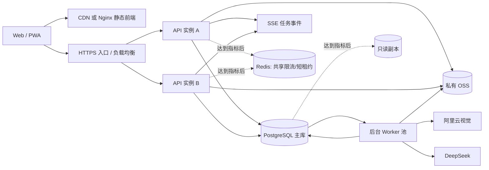

# 2026-09-30 架构演进原方案

2026-10-17 从活跃正文分离。以下为原方案/当时事实，不代表当前批准范围、运行状态或强制门槛。现行入口见[架构演进](../scalable-architecture-design.md)。

# 可扩展架构与数据底座设计

状态：目标架构设计稿；阶段 A1 已随 v0.1.0 生产上线并由 v0.1.1 继承，阶段 A2 与 PostgreSQL 阶段 B 已在 v0.2.0 工作区完成 G2 R4 本地验收，但尚未发布。
约束：生产系统仍运行现有 Node.js 单体与 JSON 数据源；本地探索和验收不等于架构迁移或生产发布。

## 当前实施位置（2026-09-30）

- 当前生产应用为 `v0.1.1`、提交 `54a6326f14ca`；上轮 P00/P0 生产提交为 `5ae6a7035169`，独立只读治理中台提交为 `d157537f7f4c`。生产仍使用 Node.js 单体与 JSON 正式数据源。
- P00/P0 历史固定验收基线为 `d61f457`（`4183`），收口工作区入口为 `http://127.0.0.1:4194/`；发布、治理中台与观察证据保持在原报告中。
- 阶段 A1 的回收站、用户原文分层、根回答/追问/批注持久任务、失败回归、思绪时间线、后台通知和冷启动已上线；生产误删思绪也已按授权恢复。
- v0.2.0 工作区已完成全领域 Store v15 映射、50 个模块与 201 条拥有路由、60 条 OpenAPI 路径与 104 个操作，并在 G2 R4 使用真实 PostgreSQL 16.14 验证关系重建、RLS、并发/回滚、旧表升级、完整恢复和持久幂等；生产切换、正式部署与观察关闭仍未执行。
- 2026-09-28 的生产只读快照 dry-run 保留为早期证据；2026-09-30 的 R4 证据是当前本地数据库验收结果，两者不互相覆盖。
- P0 移动端已完成 iPhone SE/15、Pixel 7 与 Android 横屏强化模拟；真实 iOS WebKit、已安装 PWA、Android Chrome 真机和触觉仍待实体设备，不阻塞 A1 数据正确性退出条件。
- P1-P3 本地探索版只验证交互和契约，不作为 A2、PostgreSQL、独立 Worker、向量服务、分片或多区域已实施的证据。

逐项状态和验收证据见 [`README-TODO.md`](../../README-TODO.md)、[`../docs/versions/v0.1.0/README.md`](../../docs/versions/v0.1.0/README.md)、[`../docs/versions/v0.2.0/README.md`](../../docs/versions/v0.2.0/README.md) 与 [`../docs/versions/v0.2.0/evidence/g2-r4-postgres.json`](../../docs/versions/v0.2.0/evidence/g2-r4-postgres.json)。模块化和数据库迁移在同一轮渐进推进，但正式数据源切换仍必须等待生产恢复演练与发布授权；边界、影响矩阵和迁移门禁统一见 [`modularization-design.md`](../modularization-design.md)。

## 1. 决策摘要

目标不是建设“先进架构”，而是在不牺牲个人数据安全和 AI 可解释性的前提下，让系统可以从当前邀请制 MVP 平滑增长。

采用：

- 静态前端与 API 独立构建、独立发布。
- 继续使用 Node.js 的模块化单体 API，不拆微服务；TypeScript、HTTP 框架和构建工具通过独立 ADR 决策，不作为数据迁移前提。
- 独立 worker 承担 AI、图片处理、索引和周期任务。
- 托管 PostgreSQL 作为唯一结构化数据源，保留当前已上线的私有 OSS 与应用鉴权读取，后续只调整上传协议和引用元数据。
- PostgreSQL 全文检索作为基线；只有检索评测证明语义召回有增益后才启用 `pgvector`，初期不引入独立向量数据库。
- PostgreSQL 事务内写业务数据和内部任务；只有确需向外部系统可靠发布事件时才增加 outbox。worker 至少一次执行，外部副作用幂等。
- 每条用户数据保留来源、版本、删除状态和账户归属；AI 产物始终是可追溯的派生数据。
- 按实际指标纵向扩容，达到明确门槛后再增加 Redis、只读副本、消息队列或分片。

不采用：

- 不从单体直接跳到微服务。
- 不使用 Kubernetes、Kafka、独立搜索集群或独立向量库作为第一阶段前提。
- 不提前分库分表。账户 ID 从第一天作为路由键，但只有单库指标证明需要时才分片。
- 不以 Event Sourcing 取代业务表；只保留版本历史和事务 outbox。
- 不把用户全部原文直接塞入每次模型上下文，也不让滚动 AI 摘要成为新的事实源。

## 2. 当前瓶颈

在尚未完成负载、内存峰值和延迟压测前，当前只采用 5～10 名低并发邀请用户作为保守运营范围；这不是实测容量结论。现有实现不适合作为长期 C 端底座：

- `server.mjs` 同时承担认证、API、持久化、统计、AI、图片处理和静态文件服务。
- `public/app.js` 直接维护页面、网络和异步状态，单个活动回答弹窗共享全局状态。
- 每个账户的 `store.json` 在每次写入时整文件读取、克隆和原子替换；同一账户写入只能在单进程队列中串行。
- `/api/state` 每次返回账户完整数据，数据量和渲染成本随使用年限线性增长。
- DeepSeek、图片分割、日志和业务数据尚未处在同一事务边界；进程退出可留下只有开始态的调用。
- 限流、幂等和任务状态主要在单进程内存中，多实例会失效。
- 附件由 API 接收 Base64，图片请求同时占用浏览器、Node 和网络内存。
- 个人上下文按固定条数拼接最近原文，无法表达来源权重、时间尺度、用户确认和删除传播。

这些问题要求演进，但不要求现在拆服务。先稳定契约和数据，再移动运行边界。

## 3. 目标架构



### 3.1 前端

- 构建产物只包含 HTML/CSS/JavaScript 和公开资源，不携带服务端配置。
- Vite、TypeScript 和前端框架均为候选方案，须以独立 ADR、迁移成本和构建收益决定。前后端分离不等于必须重写 UI 框架。
- API 统一走同站点 `/api/v1`，减少 CORS 和 Cookie 风险；生产可由 CDN/Nginx 分发前端，由负载均衡转发 API。
- 远端状态使用按领域、游标分页和 ETag 的查询，不再依赖全量 `/api/state`。
- 编辑草稿、上传队列和待发送命令可进入 IndexedDB；正式数据仍以服务端提交成功为准。
- 所有异步 UI 状态以 `taskId + targetId + inputVersion` 绑定，不以当前 DOM 焦点或全局弹窗作为业务身份。

### 3.2 API

- 继续使用 Node.js；TypeScript 和 Fastify 一类 schema 驱动框架仅作为候选，不与 API 契约化、PostgreSQL 切换同时强制实施。
- 保持模块化单体：`auth`、`records`、`thoughts`、`media`、`ai`、`memory`、`notifications`、`admin` 是代码模块，不是独立服务。
- OpenAPI 作为请求、响应和错误码的单一事实来源；前端类型由契约生成。
- 创建接口接受 `Idempotency-Key`；更新接口使用记录 `version` 或 ETag 做乐观并发控制。
- 列表使用稳定游标，不使用随数据变化漂移的 offset。
- AI 创建接口先持久化任务并返回 `202 + taskId`；任务状态查询是可靠基线。只有持久事件日志、单调事件 ID、保留期和跨实例分发完成后，SSE 才承诺凭 `Last-Event-ID` 续传。
- 认证继续使用 HttpOnly、Secure、SameSite Cookie；API 层和数据库层都校验账户归属。

### 3.3 Worker

- AI 回答、图片识别/分割、Embedding、个人上下文更新、通知和定时聚合都由 worker 执行。
- worker 从 PostgreSQL 任务表领取带租约的任务，采用有限重试、指数退避和死信状态。
- 供应商调用没有可核对幂等键时，进程在“供应商成功、终态未提交”之间退出属于结果不确定；不得盲目重放，必须标记人工重试或先完成供应商侧幂等协议。
- 业务写入和内部任务在同一数据库事务提交。向外部系统发布事件时，事件意图再与业务写入一同进入 outbox；outbox 不作为内部 worker 的重复任务队列。
- 初期使用 PostgreSQL 任务表，减少 Redis/消息中间件运维面。只有任务积压、锁竞争或跨区域吞吐达到门槛后才迁移到托管队列。

## 4. 数据底座

### 4.1 核心原则

1. 原始用户内容不可变丢失：编辑形成版本，删除先形成 tombstone。
2. 用户原文与 AI 派生内容分开：`author_type=user` 的内容拥有最高事实权重；`author_type=ai` 默认只是建议。
3. 所有派生内容都记录证据：摘要、画像、关联、标签和向量必须能追溯到源记录版本。
4. `account_id` 出现在所有用户数据表和索引中，是权限边界，也是未来分区/分片键。
5. 关系型字段保存稳定业务语义，开放变化的内容属性才进入 JSONB。
6. 附件数据库只保存元数据、校验和、引用与 OSS object key，不保存 Base64。

### 4.2 建议表

| 表 | 主要职责 |
| --- | --- |
| `accounts` / `sessions` / `consents` | 身份、会话、隐私版本和同意记录 |
| `entries` | 捕念、日记、思绪、对话、书目、善言、小物等根对象的公共字段 |
| `entry_blocks` | 问题、初步想法、用户记录、AI 回答、追问、备注等平铺内容块 |
| `entry_revisions` | 每次编辑前后的不可变版本、操作者、时间和恢复信息 |
| `health_observations` | 状态、睡眠、心率、体重、运动及原始/校正字段 |
| `tags` / `entry_tags` | 账户内规范化标签和关联 |
| `attachments` / `attachment_refs` | OSS 对象、MIME、尺寸、字节、SHA-256、引用和删除状态 |
| `annotations` | 基于内容版本的评论、划线、上下文锚点和漂流状态 |
| `tasks` / `task_links` | 可选 Todo、优先级、状态、到期时间及与记录的关系 |
| `locations` / `entry_locations` | 明确授权的位置文本、精度、来源和坐标 |
| `ai_runs` / `ai_attempts` | 一次业务生成及各供应商尝试、参数、用量和结果 |
| `memory_items` / `memory_evidence` | 可审阅的长期记忆及其证据关系 |
| `context_snapshots` | 3/7/30 日和长周期上下文快照、版本和生成策略 |
| `notifications` | 生成任务、导入、恢复等面向用户的状态消息 |
| `jobs` | 可恢复后台任务、租约、重试、取消和死信 |
| `outbox_events` | 仅在需要向外部系统可靠发布事件时保存发布意图 |

### 4.3 思绪内容模型

思绪不再假设“一个问题只有一个初步想法和一个回答”：

```text
entry(kind=thought)
  metadata: question title, occurred_at, tags, status
  blocks:
    user_question
    user_idea
    ai_answer generation=1
    user_note
    user_follow_up
    ai_answer generation=2
    user_record
```

每个 block 包含：

- `id`、`entry_id`、`account_id`
- `kind`、`author_type`、`author_id`
- `content`、`content_format`
- `created_at`、`occurred_at`、`updated_at`
- `generation_id`、`model_id`、`source_run_id`
- `position` 或单调递增序号
- `version`、`deleted_at`、`purge_after`

展示可按时间倒序，但存储顺序不可依赖数组位置。AI 标识由 `author_type/source_run_id` 决定，不从文案猜测。

### 4.4 删除、恢复和附件清理

- 用户删除只设置 `deleted_at`，默认进入 30 天回收站。
- 恢复时恢复根对象、内容块、批注和附件引用；不重新触发 AI。
- 最终清理前计算附件有效引用；引用数为 0 且超过保留期才删除 OSS 对象。
- 删除源记录后，对应向量、摘要和画像证据标记失效；不允许派生记忆继续引用已删除内容。
- 管理员硬删除和账户删除使用独立受审计流程，支持 dry-run 和清理清单。
- 上传采用“临时对象 -> 校验 SHA-256/MIME/尺寸 -> 数据库提交正式引用 -> 生命周期清理未绑定对象”的两阶段协议；账户前缀在 API 与 OSS policy 两层校验。OSS 对象版本、孤儿扫描和删除重试必须纳入恢复演练。
