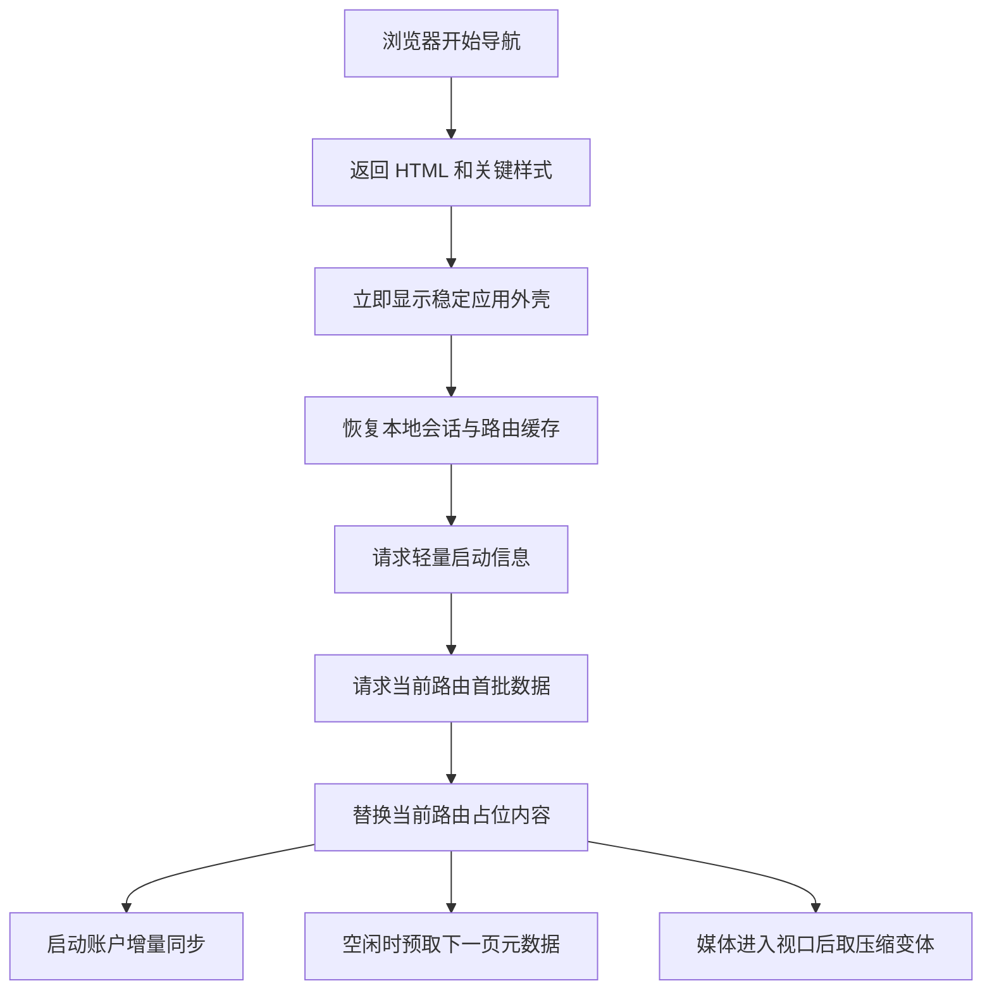
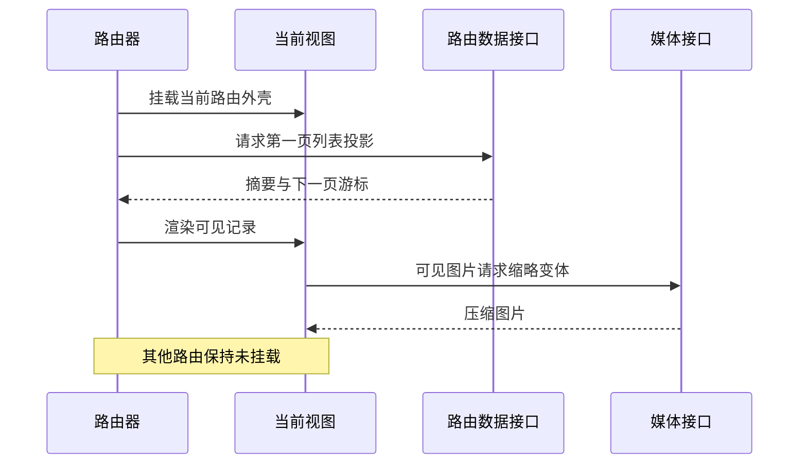
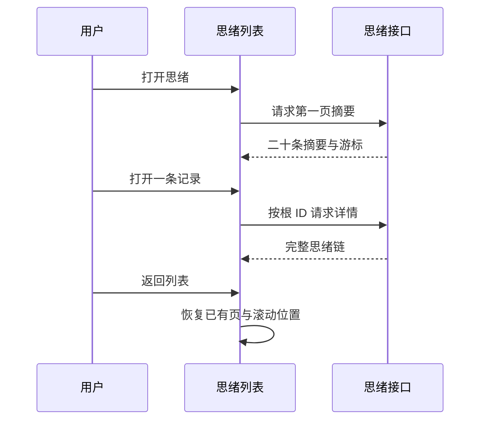
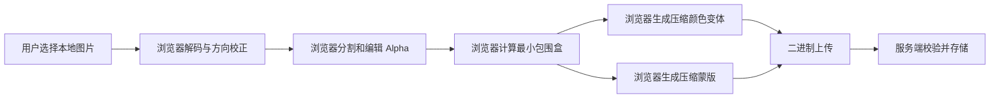
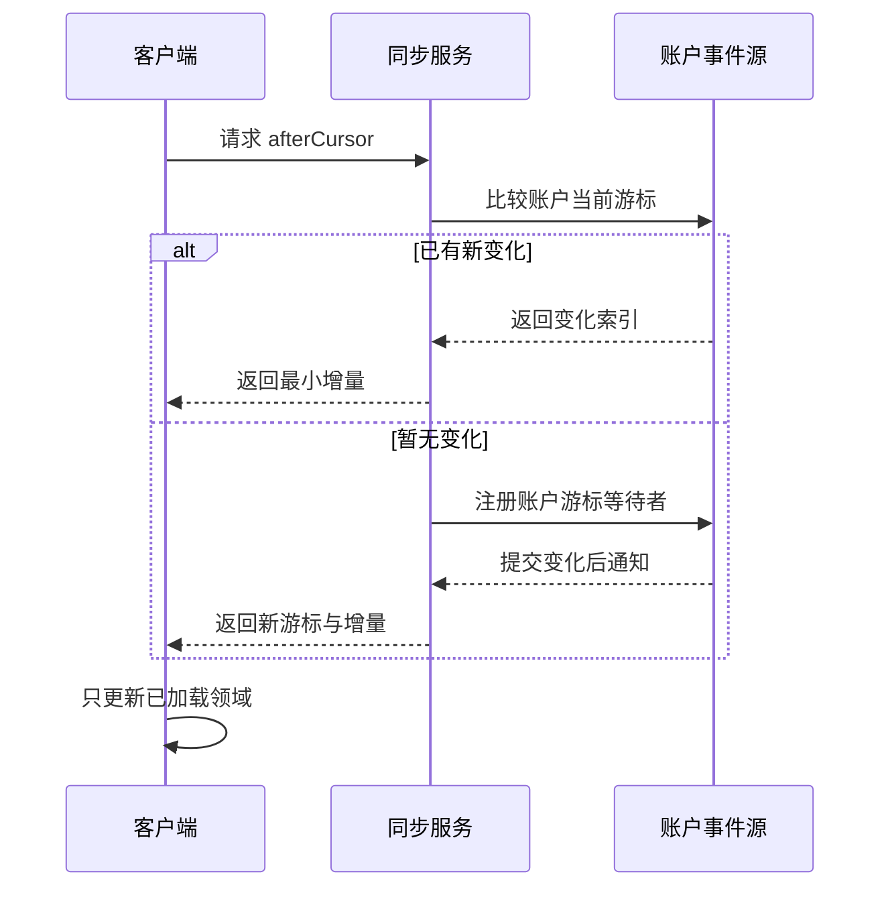

# 77liu.top 启动数据、媒体与同步技术说明

> 日期：2026-10-04
>
> 关联证据：`knowledge/long-term/outdated/design/startup-performance-analysis-2026-10-04.md`
>
> 状态：问题与目标设计已记录，尚未实施
>
> 适用范围：Web 与后续原生壳的启动、路由数据、媒体读取、跨端同步

## 1. 目标

用户目标不是让所有账户数据在 `0.5 s` 内下载完，而是：

1. 页面在约 `0.5 s` 内出现稳定、可理解、不会跳变的应用外壳。
2. 当前路由只等待当前首屏需要的数据。
3. 其他路由、详情、历史页和媒体在真正查看时再增量读取。
4. 媒体状态先表达“是否存在”，不在全局状态中携带媒体内容，也不因隐藏 DOM 自动下载。
5. 列表和常规详情不传原始 PNG；需要 Alpha 处理时优先在用户设备完成。
6. 同步使用账户级变化游标，未变化时不重复构造和读取完整账户状态。

`0.5 s` 应定义为“可见外壳目标”，不能在没有统一设备、网络和样本分位数的前提下写成已达成指标。

建议的初始体验目标：

| 指标 | 建议目标 | 说明 |
| --- | ---: | --- |
| 可见应用外壳 | P75 <= 500 ms | 导航、标题、稳定占位和当前路由框架可见 |
| 暖缓存首屏数据 | P75 <= 1,000 ms | 当前路由首批真实内容可读 |
| 冷缓存首屏数据 | P75 <= 1,500 ms | 在约定测试网络下评估 |
| 非当前路由媒体 | 0 B | 首屏期间不得请求 |
| 音频播放前媒体正文 | 0 B | 不因 metadata 预载取内容 |

这些数值是验收目标，不是本次分析结论。

## 2. 术语边界

本文区分三个容易混淆的“状态”：

| 术语 | 含义 |
| --- | --- |
| `/api/state` | 当前实现中的完整应用公共状态快照 |
| 状态记录 | 用户的情绪、精力、压力、睡眠等 `checkins` 数据 |
| `_sync.status` | 客户端乐观更新中的待同步、同步中等瞬时标识 |

用户提出的“status、thoughts 中只有显示在外面的才需要直接传来”，在设计上同时适用于：

- 状态记录列表和趋势页只取当前画面所需记录及聚合。
- 思绪列表只取列表投影，详情字段按需读取。
- 瞬时同步状态由客户端维护，不应依赖全量账户快照刷新。

## 3. 核心原则

### 3.1 启动不是账户导出

启动接口只负责建立会话、导航能力和当前路由首屏，不负责一次性恢复所有业务域。

### 3.2 列表不是详情

任何可增长集合都至少拆成：

- 列表投影：摘要、计数、排序字段、外显状态。
- 详情投影：正文、批注、追问、推理、附件描述。
- 分页游标：继续获取下一段。

### 3.3 媒体描述不是媒体正文

JSON 可以携带 `hasMedia`、数量、尺寸、时长和媒体 ID；图片或音频字节由独立请求在真正显示或播放时读取。

### 3.4 当前路由决定工作量

隐藏页面不构造图片、音频、Canvas 或大型列表。路由切换时再挂载对应视图，并取消已经失去意义的请求。

### 3.5 压缩是基础能力，不代替投影

gzip 或 Brotli 可以显著降低文本传输量，但不能解决：

- 浏览器仍需解析完整 JSON。
- 服务端仍需构造完整对象。
- 内存中仍保留无关字段。
- 无分页数据仍会随使用时间持续增长。

所以顺序应是“先限定数据边界，再压缩文本响应”。

## 4. 目标启动流程



### 4.1 第一层：静态外壳

第一层不依赖私有状态，包含：

- 固定导航结构。
- 当前 URL 对应的页面标题和布局骨架。
- 与最终内容尺寸接近的占位。
- 登录失效时可替换的认证区域。

不得用全屏空白等待 `/api/state`。

### 4.2 第二层：轻量启动信息

建议只包含：

- 当前用户的最小身份摘要。
- 能力和功能开关。
- 应用与协议版本。
- 未读数量等全局角标。
- 账户级同步游标。
- 当前路由数据版本或 ETag。

不包含 `thoughts`、`clusters`、完整状态历史和附件数组。

### 4.3 第三层：当前路由首批数据

路由加载器根据 URL 请求独立投影。例如进入 `/thoughts` 时只取：

- 第一页思绪列表。
- 当前筛选和排序所需元数据。
- 列表外显的媒体存在标识。

进入具体思绪详情 URL 时，可以直接取该详情，不必先取完整列表。

### 4.4 第四层：增量与按需资源

- 下一页在接近列表底部时预取。
- 详情在打开时读取。
- 图片缩略图只在卡片进入预取边界时读取。
- 音频只在用户点击播放后建立 `src` 并发起 Range 请求。
- 回顾聚类只在进入回顾页时读取。

## 5. 路由渲染

当前实现已经有 `renderVisibleRoute()`，但二级配置完成后又执行全量 `render()`。目标模型应让路由渲染成为唯一入口：

1. 应用壳只挂载导航和当前路由容器。
2. 每个路由声明自己的数据依赖。
3. 路由加载器只更新对应领域。
4. 未访问路由不创建媒体元素。
5. 二级配置完成后只更新受影响的小组件，不重新渲染全部页面。
6. 路由离开时通过 `AbortController` 取消未完成的非共享请求。



## 6. 数据投影

下面的字段是语义建议，不代表 API 名称已经冻结。

### 6.1 启动投影

```json
{
  "protocolVersion": 1,
  "releaseVersion": "0.5.5",
  "accountCursor": 1234,
  "user": {
    "id": "user-id",
    "displayName": "展示名称"
  },
  "capabilities": ["thoughts", "captures"],
  "badges": {
    "notificationUnread": 2
  },
  "route": {
    "name": "thoughts",
    "revision": "etag-or-version"
  }
}
```

启动投影不应携带任何完整集合。

### 6.2 思绪列表投影

首屏每条根思绪只需要：

| 字段 | 用途 |
| --- | --- |
| `id`、`version` | 打开详情与并发控制 |
| `occurredAt`、`createdAt` | 排序和显示时间 |
| `tags` | 外显标签与筛选 |
| `disposition` | 保留、舍弃、未处理 |
| `questionPreview` | 问题摘要 |
| `ideaPreview` | 最新或合并后的想法摘要 |
| `answerPreview` | 最新回答摘要 |
| `annotationCount` | 是否展示批注数量 |
| `followUpCount` | 是否有追问 |
| `hasAttachments` | 是否显示媒体标记 |
| `syncVersion` | 增量更新判断 |

首屏不直接返回：

- `annotations` 正文
- `annotationDrift`
- `reasoningContent`
- `modelDraft`
- `followUps` 全文
- `contextReceipt`
- 所有子记录全文
- 原始附件路径和二进制内容

### 6.3 思绪详情投影

打开详情后按根 ID 获取：

- 根问题全文。
- 想法、记录和回答的完整时间线。
- 追问及回答。
- 批注和漂移信息。
- 上下文回执。
- 可显示附件的描述清单。
- 当前版本、ETag 或修订号。

详情可以一次返回完整链，也可以将批注等更重模块继续按标签页拆分。第一阶段没有必要过度拆细，关键是先阻止详情字段进入列表启动。

### 6.4 状态记录投影

“此刻状态”当前画面通常只需要：

- 当前日期已有记录。
- 各指标最近一次有效值。
- 最近 30 次平均值。
- 自定义指标定义。
- 当前画面图表所需的有限时间窗。

完整历史应使用游标分页。长期趋势可以由服务端返回按日或按周聚合，避免为了画一条趋势线传全部原始记录。

### 6.5 其他列表

相同规则适用于捕念、日记、阅读、小物和拾句：

| 页面 | 首屏直接取 | 延后读取 |
| --- | --- | --- |
| 捕念 | 文本摘要、标签、音频存在与时长 | 音频正文、完整转写层 |
| 日记 | 标题、日期、摘要、标签 | 全文、回望内容 |
| 阅读 | 书目摘要、封面缩略描述 | 笔记全文、原图 |
| 小物 | 名称、标签、缩略变体描述 | 展示图、编辑图、蒙版、归档原图 |
| 拾句 | 句子、来源、标签 | 独立附件与批注 |

## 7. 分页与搜索

### 7.1 当前问题

服务端已经存在 `GET /api/v1/thought-chains` 游标分页接口，但页面仍基于完整 `state.thoughts`：

- 在浏览器中寻找根记录和全部子记录。
- 在浏览器中对全部字段搜索。
- 在浏览器中构造所有列表卡片。

这意味着记录数量增长时，下载、解析、分组、搜索和 DOM 构造都会线性增长。

### 7.2 目标语义

- 默认每页建议 20 条根思绪。
- 游标由稳定排序键组成，例如 `occurredAt + id`，不使用易漂移的 offset。
- 下一页只返回列表投影。
- 打开详情按根 ID 读取完整链。
- 新增或更新后，把受影响条目合并到当前页，而不是刷新完整账户。

### 7.3 搜索

当前模糊搜索依赖浏览器持有全部详情字段。分页后应明确搜索边界：

- 普通列表搜索由服务端完成，返回匹配列表投影。
- 搜索索引可以覆盖全文，但响应仍只返回摘要。
- 搜索结果打开后再获取详情。
- URL 保留查询词、排序和筛选，返回列表时可恢复。



## 8. `clusters` 记录

### 8.1 产品含义

`clusters` 用于回顾页，把根思绪按主题归组并展示：

- 主题名称。
- 思绪数量。
- 保留、舍弃和未处理数量。
- 少量代表性摘要。

它不是启动必需数据，也不是思绪原始数据的第二份存储。

### 8.2 当前技术问题

当前 `clusters.items` 放入完整根思绪对象。HAR 中：

- `clusters` 共 `632,097 B`。
- `clusters.items` 为 `630,965 B`。
- 回顾 UI 只展示每组前三条内容摘要。

当任一洞察相关领域变化时，当前同步投影还会再次携带完整 `clusters`。

### 8.3 目标边界

聚类摘要建议只包含：

```json
{
  "clusterId": "stable-id",
  "algorithmVersion": 1,
  "theme": "身心状态",
  "counts": {
    "total": 12,
    "kept": 4,
    "discarded": 2,
    "unreviewed": 6
  },
  "examples": [
    {
      "thoughtId": "thought-id",
      "preview": "最多一段受限摘要"
    }
  ]
}
```

### 8.4 尚待产品确认

- 聚类是否只是回顾页的阅读辅助，还是可编辑的长期主题。
- 用户是否能合并、拆分、重命名主题。
- 示例摘要固定取最近记录，还是取更具代表性的记录。
- 算法升级后旧主题是否重算。

这些问题先记录，不阻塞“移除完整对象重复传输”这一数据边界判断。

## 9. 媒体按需读取

### 9.1 三层状态

媒体需要区分：

1. **存在状态**：是否有图片或音频、数量、时长等轻量信息。
2. **变体描述**：媒体 ID、格式、尺寸、字节数、版本和访问地址。
3. **媒体正文**：图片、音频实际字节。

启动投影只需要第一层。列表中真正可见的项目可以获取缩略变体描述，再由浏览器按视口请求正文。

### 9.2 建议描述结构

```json
{
  "present": true,
  "mediaId": "media-id",
  "kind": "image",
  "variants": {
    "thumb": {
      "format": "webp",
      "width": 720,
      "height": 540,
      "byteLength": 82341,
      "revision": "content-hash"
    }
  }
}
```

实际访问地址可以按媒体 ID 解析，也可以包含在变体描述中；关键要求是 JSON 不内嵌 Base64 媒体正文。

### 9.3 图片读取

固定规则：

- 列表只使用高压缩缩略变体。
- 常规详情使用高压缩展示变体。
- 编辑器按需读取编辑变体和蒙版。
- 归档原图不进入列表或常规详情路径。
- 派生图缺失时显示占位并异步补齐，不回退到多 MB 原始 PNG。
- 图片只在进入视口预取边界时设置 `src`。

格式建议：

- WebP 作为当前兼容性基线。
- AVIF 可在真实设备解码成本测试后用于无损失明显的照片型内容。
- 已压缩的 JPEG、WebP、AVIF 不再做 HTTP gzip。
- 透明展示优先使用带 Alpha 的 WebP，而不是 PNG。

### 9.4 Alpha 在用户设备处理

当前浏览器已经通过 Canvas 编辑 Alpha，并在保存时生成 PNG Data URL；服务端随后再次合成并生成 WebP。

目标流程应调整为：



传输要求：

- 不用 Base64 JSON 传图片和蒙版，改用二进制上传。
- 不传原始 PNG 作为列表、详情或编辑的默认资源。
- 浏览器生成 WebP 颜色变体。
- 若采用分离蒙版，蒙版可用高压缩灰度 WebP；浏览器通过 Canvas 或 CSS mask 合成。
- 若浏览器能直接生成带 Alpha 的 WebP，也可以传单一透明 WebP。
- 服务端仍需校验 MIME、尺寸、像素上限、字节上限和内容签名。

“原始文件是否长期归档”是独立产品决策。即使保留归档原件，它也不得被普通展示路径自动下载；显式“下载原件”才可访问。

### 9.5 音频流式读取

目标行为：

1. 列表只返回 `hasAudio`、`durationMs` 和可选波形摘要。
2. `<audio>` 初始使用 `preload="none"`，且在未播放前不设置真实媒体地址。
3. 用户点击播放后请求媒体。
4. 服务端支持标准 Range、`206`、`Content-Range` 和 `Accept-Ranges`。
5. 存储适配器直接读取请求范围或返回流，不先把完整文件读入 Buffer。
6. 暂停、跳转和断线续传遵循浏览器原生媒体行为。

图片的“按需”主要是延迟请求压缩变体；音视频的“流式”才需要严格的 Range 和存储层分段读取。

### 9.6 私有媒体缓存

当前附件响应使用 `private, no-store`，导致同一私有媒体反复读取。派生媒体若使用内容哈希版本，可以考虑：

- `Cache-Control: private, max-age=..., immutable`
- `ETag` 或内容哈希
- 账户退出时清理应用控制的本地索引
- 权限撤销时使访问令牌或媒体版本失效

原件、短期签名 URL 和高度敏感内容可以保持更严格策略。缓存策略必须与权限模型一起评审，不能只为了速度改成公共缓存。

## 10. JSON 压缩

### 10.1 当前事实

- 浏览器请求声明支持压缩。
- `/api/state` 响应没有 `Content-Encoding`。
- Nginx 开启了 gzip，但默认类型不包含 `application/json`。
- 应用 `sendJson` 直接执行 `JSON.stringify` 并写入响应。

### 10.2 目标

- 所有超过阈值的 JSON 响应至少支持 gzip。
- 支持 Brotli 的边缘层可以优先返回 `br`。
- 返回 `Vary: Accept-Encoding`。
- 媒体和已经压缩的格式不重复压缩。
- 压缩应在应用或反向代理中的一个明确层负责，避免双重压缩。

离线结果表明当前状态 gzip 后可从 `2,194,661 B` 降至 `538,067 B`。但长期目标仍应是压缩后的路由首屏投影，而不是压缩后的完整账户快照。

## 11. 账户级增量同步

### 11.1 用户提出的“跨端号”

该概念适合定义为**账户级单调游标**：

- 同一账户的每次已提交变化使游标递增。
- 所有设备读取同一逻辑游标序列。
- 客户端提交自己已应用的 `afterCursor`。
- 服务端游标相同则不读取和返回完整业务状态。

一个账户可以共享逻辑游标，但不能只维护一条跨所有设备共用的物理网络连接。每个在线设备仍需要自己的通知通道；同一浏览器的多个标签页可以通过 leader 选举共享一条连接。

### 11.2 当前基础

当前实现已经具备：

- `cursor`
- 变化记录 `changes`
- 按变化领域生成 `snapshot`
- 游标过期和重新快照错误
- 最大增量数量保护

主要问题是服务端在长轮询等待期间每 `100 ms` 调用一次 `readSyncSnapshot()`。

### 11.3 推荐的事件驱动长轮询



关键规则：

- 每个设备最多一个未完成同步请求，不按页面或领域各开一个。
- 服务器内存中按账户登记等待者，变更提交后主动唤醒。
- 多实例部署可用 PostgreSQL `LISTEN/NOTIFY`、Redis Pub/Sub 或消息总线传播唤醒事件。
- 超时返回空结果，客户端加少量随机抖动后重连。
- 页面隐藏或应用进入后台时降低频率或暂停。
- 同一浏览器多标签页使用 `BroadcastChannel` 选出一个同步 leader。

### 11.4 增量内容

变化记录优先返回：

- `domain`
- `resourceId`
- `operation`
- `version`
- `cursor`

若列表卡片需要立即更新，可附带该资源的轻量列表投影。只有当前客户端已经打开相应详情时，才请求详情增量。

当游标过期时，不应默认回退到完整 `/api/state`；应按当前路由或受影响领域重新快照。

### 11.5 长轮询与 SSE 的选择

| 方案 | 优点 | 代价 |
| --- | --- | --- |
| 事件驱动长轮询 | 与当前协议接近，断线恢复简单 | 每次变化或超时需重建 HTTP 请求 |
| SSE | 单连接持续下发，服务端事件模型直接 | 移动后台、代理超时和连接治理更复杂 |
| WebSocket | 双向实时能力强 | 对当前低频状态同步过重 |

第一阶段建议保留长轮询协议，只把内部 100 ms 存储轮询替换为事件唤醒。SSE 可以在连接规模和实时需求明确后再评估。

## 12. 本地缓存与增量恢复

为了让重复打开更接近 0.5 秒：

1. 浏览器先从 IndexedDB 读取“当前路由最近一次投影”。
2. 立即渲染并明确保持旧数据的稳定布局。
3. 带本地 `accountCursor` 请求增量。
4. 游标一致时不替换 DOM。
5. 有变化时只更新受影响卡片。
6. 权限、账户或协议版本变化时清空对应缓存。

缓存键至少包含：

- 用户 ID
- 路由
- 查询与筛选
- 投影版本
- 最后一条游标

本地缓存不能跨用户复用，也不能绕过服务端权限判断。

## 13. 迁移顺序

本次不实施，后续建议按以下顺序拆分：

| 阶段 | 内容 | 独立收益 |
| --- | --- | --- |
| 1 | 去掉启动后的全量 `render()`，隐藏路由不挂载媒体 | 立即消除非当前路由媒体 |
| 2 | 为 JSON 启用 gzip，补充压缩监控 | 直接降低文本传输 |
| 3 | 建立启动投影与思绪列表投影 | 移除大部分首屏状态 |
| 4 | 思绪列表接入游标分页和服务端搜索 | 阻止长期线性增长 |
| 5 | 迁移历史小物派生图，禁止原图回退 | 消除多 MB PNG |
| 6 | 浏览器 Alpha 处理和二进制压缩上传 | 统一媒体边界 |
| 7 | 音频按播放加载，存储层 Range 流式读取 | 降低无效请求和内存 |
| 8 | 同步等待改为账户事件唤醒 | 降低持续存储压力 |
| 9 | 聚类改为回顾页轻量投影 | 移除重复数据 |

每个阶段都应单独采集 HAR 和 Performance trace，避免多个改动同时上线后无法归因。

## 14. 验收矩阵

### 14.1 必测场景

| 场景 | 缓存 | 会话 | 起点 |
| --- | --- | --- | --- |
| 冷缓存完整导航 | 清空站点数据与 Service Worker | 未登录或新会话 | 浏览器地址栏 |
| 暖缓存完整导航 | 保留静态缓存 | 已登录 | 浏览器地址栏 |
| 登录后首次数据启动 | 禁用缓存 | 从登录提交开始 | 登录页 |
| 同会话路由切换 | 保留内存状态 | 已登录 | 其他业务页 |
| 返回列表 | 保留列表页缓存 | 已打开详情 | 浏览器返回 |
| 第二设备变化同步 | 各自独立缓存 | 同一账户 | 设备 A 写入，设备 B 等待 |

### 14.2 网络断言

- 启动不再请求完整 `/api/state`。
- 首屏 API 的压缩后总量有明确预算，初始建议不超过 `200 KiB`。
- 思绪首批最多返回约 20 条根记录的列表投影。
- 首屏不请求非当前路由媒体。
- 小物列表和常规详情不出现原始 PNG 请求。
- 音频点击播放前没有音频正文传输。
- 媒体 Range 请求不导致服务端读取完整对象。
- 无变化的长轮询不每 100 ms 访问持久层。

### 14.3 体验断言

- 外壳出现前不存在数秒白屏。
- 占位尺寸与真实内容接近，数据到达时不发生大幅跳动。
- 详情返回后列表滚动位置、分页和搜索词保持。
- 弱网下媒体失败不阻止文字列表使用。
- 同步失败只标记受影响记录，不触发整页清空。

## 15. 决策与待确认项

已经明确：

- 启动不传全量账户状态。
- 当前路由只传首屏必要字段。
- 思绪和状态历史必须分页或按时间窗读取。
- 详情字段在打开时增量读取。
- 媒体先传存在状态，正文按显示或播放需求读取。
- 普通展示路径不传原始 PNG。
- Alpha 处理优先在用户设备完成。
- `clusters` 不应复制完整思绪对象，也不属于全局启动。
- 同步游标属于账户级逻辑序列。

仍需在实施前确认：

- 归档原件是否长期保留，以及显式下载原件的入口。
- WebP 单文件 Alpha 与“颜色图 + 蒙版”两种方案的设备性能对比。
- 聚类是否允许用户编辑及其版本迁移策略。
- 首屏条数、时间窗和各路由字节预算。
- 0.5 秒目标使用的标准设备、网络条件和 P75/P95 口径。

## 16. 本文不包含

- 业务代码改动。
- 数据迁移执行。
- Nginx 或服务端配置修改。
- API 合同冻结。
- 上线排期与版本承诺。

本文的作用是把问题、证据、数据边界和技术方向完整记录，供后续实现评审使用。
