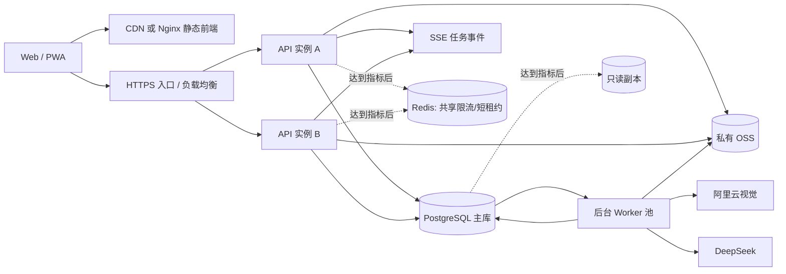

# 可扩展架构与数据底座设计

状态：目标架构设计稿；阶段 A1 已在当前工作区满足退出条件，但相关代码尚未提交或部署。
约束：生产系统仍运行现有 Node.js 单体与 JSON 数据源；本地探索和验收不等于架构迁移或生产发布。

## 当前实施位置（2026-09-28）

- 生产版本仍为 `9c9c4d5b1912`，未因本设计或本地探索发生架构切换。
- P00-P0 固定验收基线为 `d61f457`（`4183`）；当前未提交收口工作区可在 `http://127.0.0.1:4194/` 使用 `/tmp` 隔离空数据验收。
- 阶段 A1 已完成回收站、用户原文分层、根回答/追问/批注持久任务、失败回归、思绪内容时间线、后台通知和冷启动；生产误删思绪也已按授权恢复。
- P0 移动端已完成 iPhone SE/15、Pixel 7 与 Android 横屏强化模拟；真实 iOS WebKit、已安装 PWA、Android Chrome 真机和触觉仍待实体设备，不阻塞 A1 数据正确性退出条件。
- P1-P3 本地探索版只验证交互和契约，不作为 A2、PostgreSQL、独立 Worker、向量服务、分片或多区域已实施的证据。

逐项状态和验收证据见 [`README-TODO.md`](../README-TODO.md) 与 [`reports/p00-p0-acceptance-2026-09-28.md`](../reports/p00-p0-acceptance-2026-09-28.md)。

## 1. 决策摘要

目标不是建设“先进架构”，而是在不牺牲个人数据安全和 AI 可解释性的前提下，让系统可以从当前邀请制 MVP 平滑增长。

采用：

- 静态前端与 API 独立构建、独立发布。
- 继续使用 Node.js 的模块化单体 API，不拆微服务；TypeScript、HTTP 框架和构建工具通过独立 ADR 决策，不作为数据迁移前提。
- 独立 worker 承担 AI、图片处理、索引和周期任务。
- 托管 PostgreSQL 作为唯一结构化数据源，保留当前已上线的私有 OSS 与应用鉴权读取，后续只调整上传协议和引用元数据。
- PostgreSQL 全文检索作为基线；只有检索评测证明语义召回有增益后才启用 `pgvector`，初期不引入独立向量数据库。
- PostgreSQL 事务内写业务数据和内部任务；只有确需向外部系统可靠发布事件时才增加 outbox。worker 至少一次执行，外部副作用幂等。
- 每条用户数据保留来源、版本、删除状态和账户归属；AI 产物始终是可追溯的派生数据。
- 按实际指标纵向扩容，达到明确门槛后再增加 Redis、只读副本、消息队列或分片。

不采用：

- 不从单体直接跳到微服务。
- 不使用 Kubernetes、Kafka、独立搜索集群或独立向量库作为第一阶段前提。
- 不提前分库分表。账户 ID 从第一天作为路由键，但只有单库指标证明需要时才分片。
- 不以 Event Sourcing 取代业务表；只保留版本历史和事务 outbox。
- 不把用户全部原文直接塞入每次模型上下文，也不让滚动 AI 摘要成为新的事实源。

## 2. 当前瓶颈

在尚未完成负载、内存峰值和延迟压测前，当前只采用 5～10 名低并发邀请用户作为保守运营范围；这不是实测容量结论。现有实现不适合作为长期 C 端底座：

- `server.mjs` 同时承担认证、API、持久化、统计、AI、图片处理和静态文件服务。
- `public/app.js` 直接维护页面、网络和异步状态，单个活动回答弹窗共享全局状态。
- 每个账户的 `store.json` 在每次写入时整文件读取、克隆和原子替换；同一账户写入只能在单进程队列中串行。
- `/api/state` 每次返回账户完整数据，数据量和渲染成本随使用年限线性增长。
- DeepSeek、图片分割、日志和业务数据尚未处在同一事务边界；进程退出可留下只有开始态的调用。
- 限流、幂等和任务状态主要在单进程内存中，多实例会失效。
- 附件由 API 接收 Base64，图片请求同时占用浏览器、Node 和网络内存。
- 个人上下文按固定条数拼接最近原文，无法表达来源权重、时间尺度、用户确认和删除传播。

这些问题要求演进，但不要求现在拆服务。先稳定契约和数据，再移动运行边界。

## 3. 目标架构



### 3.1 前端

- 构建产物只包含 HTML/CSS/JavaScript 和公开资源，不携带服务端配置。
- Vite、TypeScript 和前端框架均为候选方案，须以独立 ADR、迁移成本和构建收益决定。前后端分离不等于必须重写 UI 框架。
- API 统一走同站点 `/api/v1`，减少 CORS 和 Cookie 风险；生产可由 CDN/Nginx 分发前端，由负载均衡转发 API。
- 远端状态使用按领域、游标分页和 ETag 的查询，不再依赖全量 `/api/state`。
- 编辑草稿、上传队列和待发送命令可进入 IndexedDB；正式数据仍以服务端提交成功为准。
- 所有异步 UI 状态以 `taskId + targetId + inputVersion` 绑定，不以当前 DOM 焦点或全局弹窗作为业务身份。

### 3.2 API

- 继续使用 Node.js；TypeScript 和 Fastify 一类 schema 驱动框架仅作为候选，不与 API 契约化、PostgreSQL 切换同时强制实施。
- 保持模块化单体：`auth`、`records`、`thoughts`、`media`、`ai`、`memory`、`notifications`、`admin` 是代码模块，不是独立服务。
- OpenAPI 作为请求、响应和错误码的单一事实来源；前端类型由契约生成。
- 创建接口接受 `Idempotency-Key`；更新接口使用记录 `version` 或 ETag 做乐观并发控制。
- 列表使用稳定游标，不使用随数据变化漂移的 offset。
- AI 创建接口先持久化任务并返回 `202 + taskId`；任务状态查询是可靠基线。只有持久事件日志、单调事件 ID、保留期和跨实例分发完成后，SSE 才承诺凭 `Last-Event-ID` 续传。
- 认证继续使用 HttpOnly、Secure、SameSite Cookie；API 层和数据库层都校验账户归属。

### 3.3 Worker

- AI 回答、图片识别/分割、Embedding、个人上下文更新、通知和定时聚合都由 worker 执行。
- worker 从 PostgreSQL 任务表领取带租约的任务，采用有限重试、指数退避和死信状态。
- 供应商调用没有可核对幂等键时，进程在“供应商成功、终态未提交”之间退出属于结果不确定；不得盲目重放，必须标记人工重试或先完成供应商侧幂等协议。
- 业务写入和内部任务在同一数据库事务提交。向外部系统发布事件时，事件意图再与业务写入一同进入 outbox；outbox 不作为内部 worker 的重复任务队列。
- 初期使用 PostgreSQL 任务表，减少 Redis/消息中间件运维面。只有任务积压、锁竞争或跨区域吞吐达到门槛后才迁移到托管队列。

## 4. 数据底座

### 4.1 核心原则

1. 原始用户内容不可变丢失：编辑形成版本，删除先形成 tombstone。
2. 用户原文与 AI 派生内容分开：`author_type=user` 的内容拥有最高事实权重；`author_type=ai` 默认只是建议。
3. 所有派生内容都记录证据：摘要、画像、关联、标签和向量必须能追溯到源记录版本。
4. `account_id` 出现在所有用户数据表和索引中，是权限边界，也是未来分区/分片键。
5. 关系型字段保存稳定业务语义，开放变化的内容属性才进入 JSONB。
6. 附件数据库只保存元数据、校验和、引用与 OSS object key，不保存 Base64。

### 4.2 建议表

| 表 | 主要职责 |
| --- | --- |
| `accounts` / `sessions` / `consents` | 身份、会话、隐私版本和同意记录 |
| `entries` | 捕念、日记、思绪、对话、书目、善言、小物等根对象的公共字段 |
| `entry_blocks` | 问题、初步想法、用户记录、AI 回答、追问、备注等平铺内容块 |
| `entry_revisions` | 每次编辑前后的不可变版本、操作者、时间和恢复信息 |
| `health_observations` | 状态、睡眠、心率、体重、运动及原始/校正字段 |
| `tags` / `entry_tags` | 账户内规范化标签和关联 |
| `attachments` / `attachment_refs` | OSS 对象、MIME、尺寸、字节、SHA-256、引用和删除状态 |
| `annotations` | 基于内容版本的评论、划线、上下文锚点和漂流状态 |
| `tasks` / `task_links` | 可选 Todo、优先级、状态、到期时间及与记录的关系 |
| `locations` / `entry_locations` | 明确授权的位置文本、精度、来源和坐标 |
| `ai_runs` / `ai_attempts` | 一次业务生成及各供应商尝试、参数、用量和结果 |
| `memory_items` / `memory_evidence` | 可审阅的长期记忆及其证据关系 |
| `context_snapshots` | 3/7/30 日和长周期上下文快照、版本和生成策略 |
| `notifications` | 生成任务、导入、恢复等面向用户的状态消息 |
| `jobs` | 可恢复后台任务、租约、重试、取消和死信 |
| `outbox_events` | 仅在需要向外部系统可靠发布事件时保存发布意图 |

### 4.3 思绪内容模型

思绪不再假设“一个问题只有一个初步想法和一个回答”：

```text
entry(kind=thought)
  metadata: question title, occurred_at, tags, status
  blocks:
    user_question
    user_idea
    ai_answer generation=1
    user_note
    user_follow_up
    ai_answer generation=2
    user_record
```

每个 block 包含：

- `id`、`entry_id`、`account_id`
- `kind`、`author_type`、`author_id`
- `content`、`content_format`
- `created_at`、`occurred_at`、`updated_at`
- `generation_id`、`model_id`、`source_run_id`
- `position` 或单调递增序号
- `version`、`deleted_at`、`purge_after`

展示可按时间倒序，但存储顺序不可依赖数组位置。AI 标识由 `author_type/source_run_id` 决定，不从文案猜测。

### 4.4 删除、恢复和附件清理

- 用户删除只设置 `deleted_at`，默认进入 30 天回收站。
- 恢复时恢复根对象、内容块、批注和附件引用；不重新触发 AI。
- 最终清理前计算附件有效引用；引用数为 0 且超过保留期才删除 OSS 对象。
- 删除源记录后，对应向量、摘要和画像证据标记失效；不允许派生记忆继续引用已删除内容。
- 管理员硬删除和账户删除使用独立受审计流程，支持 dry-run 和清理清单。
- 上传采用“临时对象 -> 校验 SHA-256/MIME/尺寸 -> 数据库提交正式引用 -> 生命周期清理未绑定对象”的两阶段协议；账户前缀在 API 与 OSS policy 两层校验。OSS 对象版本、孤儿扫描和删除重试必须纳入恢复演练。

## 5. 个人上下文设计

### 5.1 来源权重

| 层级 | 内容 | 默认权重 |
| --- | --- | --- |
| L0 | 用户明确写下或确认的事实、偏好、目标、纠正 | 最高 |
| L1 | 用户行为与结构化记录 | 高，但必须保留时间和场景 |
| L2 | AI 提取的主题、候选关系和摘要 | 中，仅作派生索引 |
| L3 | AI 回答、推理和未确认画像 | 低，只可作为对话历史或候选，不代表用户 |

AI 回答即使被“保留”，也不自动升级为用户观点；只有用户编辑、引用、批注确认或显式接受后，才记录相应反馈。

### 5.2 四层上下文

1. **当前任务**：用户本次输入、当前思绪完整链和页面状态。
2. **近期状态**：3 日原始事件、7 日和 30 日结构化趋势。
3. **长期记忆**：3 个月、3～12 个月、1 年以上的主题、偏好、目标、关系和关键转折。
4. **证据检索**：从原始记录和历史版本中检索与当前问题最相关的片段。

时间窗口不是简单把旧文本压短。每个长期记忆项保存：

- 类型：事实、偏好、目标、假设、叙事主题、风险或待确认问题。
- 状态：候选、用户确认、用户否定、已过期、被替代。
- 有效期、置信度、生成策略版本。
- 支持与反对证据的记录 ID、版本和时间。
- 用户修订历史。

OpenAI 的 Memory 将保存记忆与原始聊天区分，并提供审阅、更正、删除和来源入口；Mem 强调“可见、可塑造的记忆”。本产品采用同一原则，但进一步要求每个记忆项有证据和有效期。

### 5.3 检索流程

```text
权限和时间过滤
  -> 关键词全文检索
  -> 语义向量检索
  -> 合并与重排
  -> 来源多样性/新旧证据约束
  -> Token 预算装配
  -> 回答中保留可查看的来源引用
```

- 先用 PostgreSQL 全文检索建立评测基线；语义检索证明增益后，再用 `pgvector` 并以 Reciprocal Rank Fusion 合并结果。
- 小数据阶段先做精确向量检索；数据和延迟证明需要后再建 HNSW。
- 检索必须先按 `account_id`、删除状态、隐私范围和记录类型过滤。
- 同一主题避免只取同一天或同一种体裁；保留至少一个反证或旧版本候选。
- Embedding 和摘要都是缓存，可重建，不是事实源。
- 每次回答记录实际使用的源记录 ID 和版本，便于解释、纠正和删除传播。

### 5.4 加密取舍

Day One 证明了个人日记产品可以把端到端加密作为核心承诺；Mem 则明确说明，为了在服务端处理知识提供 AI，它采用传输和静态加密而非端到端加密。这两种取舍不能同时假装成立。

当前产品依赖服务端 AI，因此近期选择：

- TLS 传输、磁盘/数据库/OSS 静态加密。
- 账户级访问控制、PostgreSQL Row-Level Security 和最小权限运维。
- 明确列出发送给 DeepSeek/阿里云的字段和触发时机。
- 支持完整导出、删除和“本次不使用个人上下文”。

RLS 实施必须满足：

- 请求使用的数据库角色不得拥有 `BYPASSRLS`，表 owner 不承载线上请求；所有租户表同时 `ENABLE ROW LEVEL SECURITY` 与 `FORCE ROW LEVEL SECURITY`。
- 每个事务显式设置账户上下文，提交或回滚后清除；连接归还池前再次校验清理，禁止账户上下文泄漏到复用连接。
- API 查询仍显式携带 `account_id`，RLS 是第二道边界，不替代应用层校验。
- 随机复用连接、并发切换账户和故障回滚的自动化测试必须保持跨账户读取为 0。

未来可研究“端到端加密的纯记录空间”和“明确授权给 AI 的空间”分区，但不在当前架构迁移中承诺。

## 6. 并发与一致性

### 6.1 同步写

- 单条记录及其版本、附件引用和内部任务在一个 PostgreSQL 事务内提交；需要外部发布时才在同一事务追加 outbox。
- 用唯一约束实现幂等，例如 `(account_id, operation, idempotency_key)`。
- 更新携带 `expected_version`；版本冲突返回 `409`，前端展示差异并允许重试，不能后写静默覆盖先写。
- 批量导入按批次 ID 和行号幂等，可暂停、续跑和回滚。

### 6.2 异步 AI

- `ai_run` 在收到请求时绑定目标记录和目标版本。
- 同一目标允许多次回答，但每次是独立 generation；重复网络请求只返回同一 generation。
- 结果只能追加到请求时绑定的 `entry_id`，不能根据完成时的当前表单决定归属。
- 用户删除或修改目标后，完成结果进入“已过期/可查看”状态，不覆盖新版本。
- 供应商超时、取消和进程重启后，任务状态可查询；重试次数和成本独立记账。

### 6.3 限流

- 全局供应商限流、账户日额度和高成本端点并发必须使用共享状态后才能启用多 API 实例。
- 第一阶段可用 PostgreSQL advisory lock/计数表；并发升高后再使用 Redis token bucket。
- API 入口、登录、上传、AI 和导出分别设限，不用一个全局数字覆盖所有风险。

## 7. 稳定性目标

初始目标，不等同于当前承诺：

| 指标 | 目标 |
| --- | --- |
| 核心 API 月可用性 | 99.9% |
| 非 AI 读取 P95 | 小于 300 ms |
| 非 AI 写入 P95 | 小于 500 ms |
| AI 任务受理 P95 | 小于 300 ms |
| 跨账户数据泄漏 | 0，任何一次均为最高级事故 |
| 数据库 RPO | 小于等于 5 分钟 |
| 单区恢复 RTO | 小于等于 60 分钟 |
| 任务可追踪率 | 100% 有 taskId、状态和最终结果 |

监控覆盖 Google SRE 的四个黄金信号：延迟、流量、错误和饱和度。AI 另看队列深度、排队时长、供应商失败率、重试率、Token、费用和无终态任务；附件另看上传失败、对象缺失、孤立对象和带宽。

上述 SLO 以滚动 28 天为统计窗口，计划维护是否剔除须在上线前固定；超时、5xx、依赖失败和错误响应均计入失败。数据库采用托管 PITR/WAL，附件开启 OSS 版本或等价恢复能力；数据库与对象引用要有可核对的一致恢复点。每月自动恢复、每季度人工计时演练，只有实测后才对外承诺 `RPO <= 5 分钟 / RTO <= 60 分钟`。

## 8. 演进顺序

### 阶段 A0：设计与样本冻结

- 冻结现有行为样本、数据域清单、迁移风险和回退条件；生产运行架构不变。

### 阶段 A1：现有架构正确性

- 先完成回收站、异步目标绑定、用户原文分层和失败回归。
- 退出条件：P00 自动化通过，恢复演练成功，跨账户测试 0 泄漏。
- 当前状态：P00 本地自动化、恢复和跨账户边界已验证，P00-02 生产数据恢复完成，A1 工作区退出条件已满足。由于代码尚未提交、部署和完成生产冒烟，不得据此直接启动生产存储迁移。

### 阶段 A2：契约与边界

- 并行提供 `/api/v1`，补齐 OpenAPI、错误码、幂等和并发测试，不同时替换语言、框架和存储。
- 抽出数据访问接口，但仍由现有 JSON 实现。
- 异步任务先具备持久状态和目标绑定。
- 退出条件：生产使用端点全部纳入契约，旧/新客户端兼容测试通过，P95 回归不超过 10%。

### 阶段 B：PostgreSQL

- 建表、RLS、索引、迁移器和逐表校验器；迁移范围包含业务记录、认证/会话、模型设置、用量账本与审计保留边界。
- 至少使用 3 份真实快照 dry-run；逐账户核对数量、ID、时间、版本、引用、附件 SHA-256 和孤儿引用，再在短维护窗口切换。
- 当前数据量很小，优先一次性可验证迁移；不使用脆弱的跨存储直接双写。
- JSON 只作为切换前恢复点。切换后默认前滚；只有反向导出已经演练通过，才可把它称为回滚路径。

### 阶段 C：前后端分离与 worker

- 前端独立构建发布，API 保持同域版本化路径。
- 先迁移 AI 和图片任务；任务领取使用 `SKIP LOCKED` 或等价机制，并具备租约、心跳、fencing token、超时回收、有限重试、死信、取消、幂等副作用和优雅停机。
- 用 1000 个混合任务执行 kill/restart 测试，要求丢失 0、重复外部副作用 0、无终态 0、死信可重放。
- 前端独立发布后再无状态化 API。双实例前必须完成共享会话、限流、任务领取、单实例调度、真实 readiness 和持久任务事件；任一实例退出时错误率不超过 1%。

### 阶段 D：按指标扩容

- 连接池饱和或锁等待升高：增加 PgBouncer/托管连接池。
- 读流量显著高于写流量且主库读 CPU 成为瓶颈：增加只读副本。
- 任务积压和数据库轮询成为瓶颈：引入托管消息队列或 Redis。
- 向量规模和检索延迟超过 PostgreSQL 目标：再评估独立向量服务。
- 单库经纵向扩容、索引和归档后仍接近容量边界：按 `account_id` 分片。

## 9. 明确触发门槛

不得仅凭“未来可能高并发”增加基础设施。每个组件使用独立进入条件，不以任一指标触发整套架构跳级：

- **连接池**：利用率或锁等待连续 15 分钟超过 70%，经压测复现后评估 PgBouncer/托管连接池。
- **API 实例**：单实例 CPU 连续 15 分钟超过 70%，或事件循环延迟 P95 超过 100 ms；先优化热点，再以近 14 日峰值 5 倍压测验证双实例。
- **任务队列**：最老任务等待超过 30 秒，或积压超过正常 5 分钟吞吐量；先优化领取与并发，再评估托管队列或 Redis。
- **只读副本**：读流量显著高于写流量，且主库读 CPU 已成为可复现瓶颈。
- **向量索引**：语义检索已证明业务增益，向量超过百万级且精确检索不满足 SLO 后再启用 HNSW；定期与精确检索对比召回率。
- **分片**：单库经纵向扩容、索引和归档后仍逼近容量、维护窗口或合规边界；`100` 个账户本身不是分片理由。

## 10. 行业实践取舍

| 参考 | 可采用的原则 | 不照搬的部分 |
| --- | --- | --- |
| Day One | 私密内容、端到端加密、用户拥有数据、可导出 | 当前服务端 AI 与纯 E2EE 冲突，先诚实披露 |
| Mem | 低摩擦捕捉、可见记忆、语义检索、版本历史；AI 场景明确采用静态/传输加密 | 不把自动代理写操作作为当前默认 |
| OpenAI Memory | 记忆与原始来源分离，可查看、更正、删除和限制使用范围 | 不使用不可解释的单一记忆摘要 |
| Notion | PostgreSQL 长期作为核心；以 workspace/account 作为局部性和未来分片键 | 不在当前规模预建数百分片、Kafka 或数据湖 |
| pgvector | 向量与关系数据同库、支持精确/近似和混合检索 | 不在小数据阶段盲目上 ANN 索引 |
| Google SRE | 黄金信号、黑盒与白盒结合、低噪音告警、SLO | 不复制大团队运维流程 |
| Transactional outbox | 业务写入与事件意图同事务、消费者幂等 | 不因采用 outbox 就拆微服务 |

## 11. 参考资料

- Day One Privacy & Security FAQ: <https://dayoneapp.com/privacy-faqs/>
- Mem privacy and export: <https://get.mem.ai/pricing>
- OpenAI Memory FAQ: <https://help.openai.com/en/articles/8590148-memory-faq>
- Notion, Sharding Postgres: <https://www.notion.com/blog/sharding-postgres-at-notion>
- pgvector: <https://github.com/pgvector/pgvector>
- PostgreSQL Row Security: <https://www.postgresql.org/docs/current/ddl-rowsecurity.html>
- AWS Transactional Outbox: <https://docs.aws.amazon.com/prescriptive-guidance/latest/cloud-design-patterns/transactional-outbox.html>
- Google SRE Monitoring Distributed Systems: <https://landing.google.com/sre/book/chapters/monitoring-distributed-systems.html>
