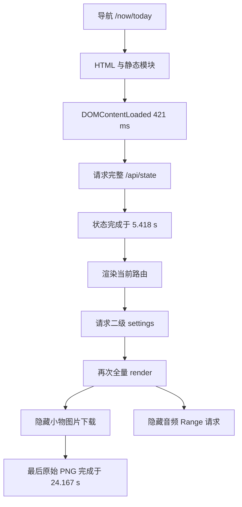
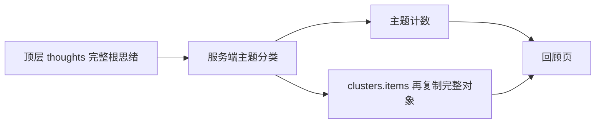
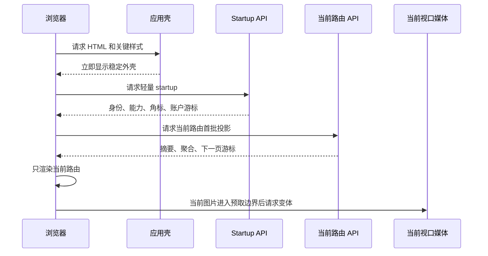
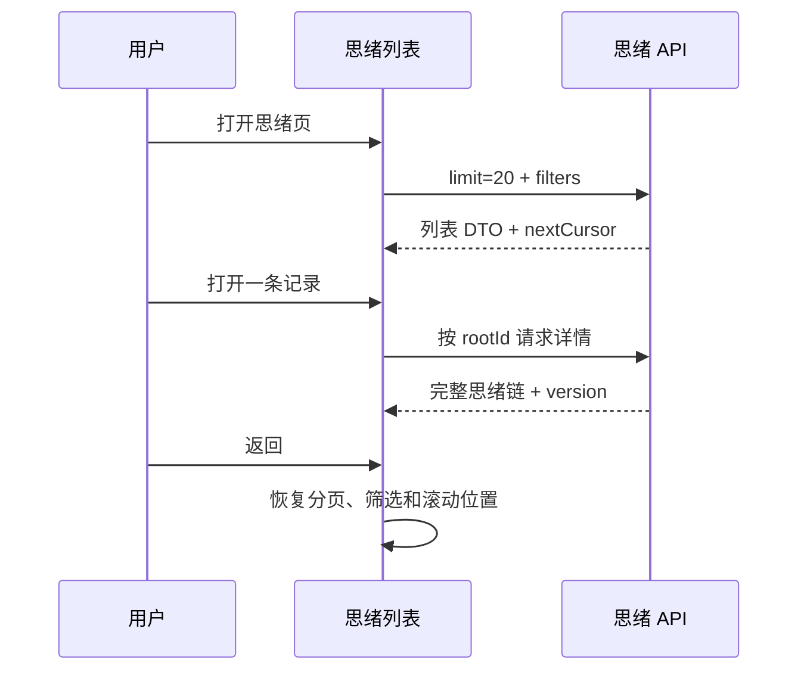
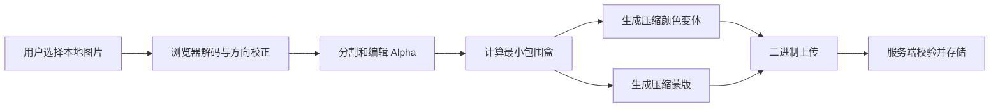
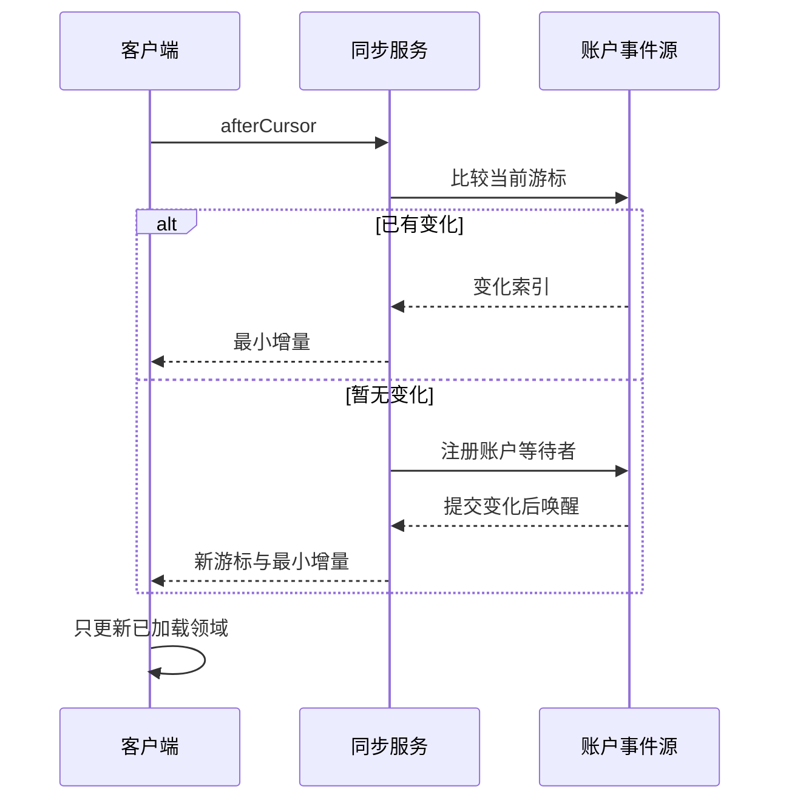

# 77liu.top 启动性能分析与工程整改方案

> 分析日期：2026-10-04
>
> 覆盖页面：`/now/today`、`/now/thoughts`
>
> 部署版本：`v0.5.5`，commit `fed30539d3d6`
>
> 证据：3 份 HAR、部署提交代码、离线压缩与数据投影模拟
>
> 文档用途：直接用于开发拆解、技术评审、灰度发布和性能验收

## 0. 交付结论

当前启动慢不是 HTML 文档慢，也不能归因于单一“服务器冷启”。核心问题是启动边界错误：

1. `/now/today` 在 `421 ms` 完成 `DOMContentLoaded`，但必须等到 `5.418 s` 的完整 `/api/state` 返回后才具备私有内容。
2. `/today` 不需要完整思绪与回顾聚类，却接收了 `thoughts + clusters = 2,240,078 B`，占状态正文 `93.59%`。
3. `/api/state` 本次耗时 `4.940 s`，其中等待首字节约 `370 ms`，接收未压缩正文约 `4.568 s`。主要时间消耗在大正文传输，不是后端首字节等待。
4. 当前路由首次渲染后，二级配置完成又执行全量 `render()`；隐藏的小物、捕念等路由因此创建图片和音频节点。
5. 冷缓存完整导航传输了 `6,649,650 B` 业务媒体，其中 3 张历史原始 PNG 为 `5,804,445 B`。最后一张 PNG 到 `24.167 s` 才完成。
6. `/api/state` 未压缩；同一正文离线 Brotli quality 5 可由 `2,393,627 B` 降至 `325,878 B`。
7. 仅压缩全量状态不是最终方案。移除列表详情字段并将 `clusters.items` 改为 ID 后，同一份数据的模拟结果为 `411,166 B`；再 Brotli 后为 `134,950 B`。

开发应按以下顺序处理：

`P00 路由级启动与媒体止血` -> `P0 列表/详情/分页与媒体边界` -> `P1 本地缓存和全模块投影` -> `P2 同步与静态加载优化` -> `P3 自适应编码和物化探索`

本报告建议的发布门槛是：

- 启动期间不再请求完整 `/api/state`。
- 非当前路由媒体传输为 `0 B`。
- 列表和常规详情中的原始 PNG 请求为 `0`。
- 启动与当前路由首批 JSON 压缩后合计不超过 `200 KiB`。
- 标准条件下应用外壳 P75 不超过 `500 ms`，冷缓存首批真实内容 P75 不超过 `1,500 ms`。

这些数值是待实现后的验收预算，不是当前已经达到的结果。

## 1. 优先级定义

| 优先级 | 含义 | 发布规则 |
| --- | --- | --- |
| P00 | 当前版本的紧急性能阻断项 | 下一次 Preview 性能验收前完成，不允许以“后续优化”延期 |
| P0 | 主链路结构性改造 | P00 稳定后紧接上线，未完成不得宣称启动问题解决 |
| P1 | 近期扩展性与重复访问体验 | 在核心路由稳定后完成，阻止数据继续线性退化 |
| P2 | 服务端持续成本和工程效率 | 不阻塞首轮体验修复，但应进入明确版本 |
| P3 | 收益依赖真实数据的探索项 | 先监控和实验，不进入首轮承诺 |

## 2. HAR 样本口径

### 2.1 样本定义

| 样本 | 文件 | 起点 | 缓存与会话 | 可证明 | 不能证明 |
| --- | --- | --- | --- | --- | --- |
| HAR A | `77liu.top.har` | `/now/thoughts` document | 已登录、36 个磁盘缓存命中 | 暖缓存完整导航 | 冷缓存静态资源成本 |
| HAR B | `77liu.top.har.261004-1941.har` | `POST /api/auth/login` | 禁用缓存、无 page/document | 登录后的数据与媒体启动片段 | DOMContentLoaded、load、完整导航 |
| HAR C | `77liu.top.har.261004-2205.har` | `/now/today` document | 已登录、冷缓存、无缓存和 Service Worker 命中 | 冷缓存完整页面导航 | 全新浏览器的 DNS/TCP/TLS 冷连接 |

HAR C 是本轮最完整的“已登录冷缓存导航”证据，但不是严格的“全新连接冷启动”：document 的 `dns`、`connect`、`ssl` 为 `-1`，表示浏览器复用了既有连接。

HAR C 中后续出现的 `/now/` 和 `/now/index.html` 是 `9.185 s` 发起的 `fetch`，不是导航 document。唯一导航 document 是 `/now/today`。

### 2.2 三份 HAR 对比

| 指标 | HAR A：暖缓存 `/thoughts` | HAR B：无缓存登录片段 | HAR C：冷缓存 `/today` |
| --- | ---: | ---: | ---: |
| HAR pages | 1 | 0 | 1 |
| 请求数 | 70 | 33 | 120 |
| 缓存命中数 | 36 | 0 | 0 |
| 总传输量 | 8,324,780 B | 10,190,393 B | 10,151,985 B |
| 记录跨度 | 47.396 s | 27.036 s | 31.529 s |
| DOMContentLoaded | 634 ms | 不具备 | 421 ms |
| load | 653 ms | 不具备 | 438 ms |
| `/api/state` 传输量 | 2,199,691 B | 2,199,690 B | 2,399,098 B |
| `/api/state` 解码正文 | 2,194,661 B | 2,194,661 B | 2,393,627 B |
| `/api/state` 耗时 | 5.288 s | 4.846 s | 4.940 s |
| `/api/state` 内容编码 | 无 | 无 | 无 |
| 业务媒体 | 6,066,598 B | 7,800,113 B | 6,649,650 B |
| 业务媒体占总传输 | 72.87% | 76.54% | 65.50% |

HAR A 与 B 的状态正文 SHA-256 相同：

`ffec0602260320df5cf703b2de6104e22de1a3d2cef160347f77d0d9dc642c2e`

HAR C 的状态正文 SHA-256 为：

`5238be7d36b1fd838ac9dff3637725c1112c5757b1d2e3d92a5d7cd7b664983e`

两轮采集之间，状态正文从 `2,194,661 B` 增至 `2,393,627 B`，增加 `198,966 B`，即 `9.07%`。这说明全量快照会随长期使用继续增长，浏览器缓存不能解决其结构性成本。

## 3. 当前启动关键路径

### 3.1 HAR C 时间线

| 相对时间 | 事件 | 判断 |
| ---: | --- | --- |
| 0.000 s | 请求 `/now/today` document | 已复用网络连接 |
| 0.058 s | HTML 请求完成 | HTML 不是 5 秒等待来源 |
| 0.421 s | DOMContentLoaded | 静态壳生命周期正常 |
| 0.438 s | load | 浏览器 load 不代表业务数据可读 |
| 0.478 s | 并行请求 `/api/state` 与 `/api/meta` | 完整状态进入关键路径 |
| 0.507 s | `/api/meta` 完成 | meta 不是瓶颈 |
| 5.418 s | `/api/state` 完成 | 私有内容主要门槛 |
| 5.971 s | 第一张历史 PNG 发起 | 来自状态完成后的渲染 |
| 6.009 s | 请求二级 settings | 完成后触发全量 render |
| 7.137 s | 其余小物图片集中发起 | 隐藏路由媒体开始抢占网络 |
| 7.171 s | 音频 Range 请求发起 | 播放前已传媒体正文 |
| 24.167 s | 最后一张历史 PNG 完成 | 页面网络稳定显著滞后 |



### 3.2 `/api/state` 耗时构成

| 阶段 | HAR C 时间 | 占接口总耗时 |
| --- | ---: | ---: |
| blocked | 1.534 ms | 0.03% |
| send | 0.102 ms | < 0.01% |
| wait / TTFB | 369.900 ms | 7.49% |
| receive | 4,568.106 ms | 92.48% |
| 合计 | 4,939.642 ms | 100% |

浏览器请求已声明支持 `gzip, deflate, br, zstd`，响应却没有 `Content-Encoding`。因此，本次 5 秒级等待主要是未压缩大正文的接收时间；“服务进程冷启”不是现有证据支持的首要结论。

### 3.3 冷缓存静态资源

HAR C 首次导航展开了：

| 类型 | 请求数 | 传输量 |
| --- | ---: | ---: |
| JavaScript | 55 | 565,829 B |
| CSS | 6 | 107,760 B |
| HTML | 1 个导航 document | 30,797 B |

静态模块请求较多，但总量明显小于状态与业务媒体，且 HTML 生命周期在 `438 ms` 内完成。静态模块合并和路由拆包应放在 P2，不应抢占 P00 的数据边界修复。

## 4. 状态正文证据

### 4.1 HAR C 顶层构成

原始 JSON 为 `2,393,627 B`。

| 顶层字段 | 数量 | JSON 字节 | 状态占比 |
| --- | ---: | ---: | ---: |
| `thoughts` | 123 | 1,567,856 B | 65.50% |
| `clusters` | 12 | 672,222 B | 28.08% |
| `analyses` | 2 | 59,352 B | 2.48% |
| `dailyRecords` | 15 | 24,285 B | 1.01% |
| `captures` | 33 | 20,625 B | 0.86% |
| 其他字段与 JSON 结构 | - | 49,287 B | 2.06% |

`/today` 首屏接收 `thoughts` 和 `clusters` 是最直接的数据边界错误。这两项合计 `2,240,078 B`，占正文 `93.59%`，但当前路由不需要它们才能显示今日状态。

### 4.2 `thoughts` 中的详情字段

| 字段 | 出现记录数 | 序列化字节 | 首屏列表需求 |
| --- | ---: | ---: | --- |
| `annotations` | 123 | 523,480 B | 只需数量，不需正文 |
| `reasoningContent` | 34 | 365,369 B | 不需要 |
| `content` | 123 | 199,100 B | 只需受限摘要 |
| `modelDraft` | 44 | 169,619 B | 不需要 |
| `followUps` | 123 | 127,256 B | 只需数量 |
| `contextReceipt` | 5 | 127,707 B | 不需要 |

除 `content` 外，五类详情字段在顶层 `thoughts` 中合计 `1,313,431 B`。列表只需要问题、想法和回答摘要、时间、标签、处置状态及计数；详情正文应在打开记录后读取。

### 4.3 `clusters` 的重复

`clusters` 用于回顾页主题统计。当前 `clusters.items` 包含 44 个完整根思绪对象：

| 指标 | 数值 |
| --- | ---: |
| `clusters` 总字节 | 672,222 B |
| `clusters.items` 字节 | 671,207 B |
| `items` 占 `clusters` | 99.85% |

回顾 UI 只需要主题、统计和最多 3 条受限摘要。完整根对象已存在于顶层 `thoughts`，当前结构属于重复投影。



### 4.4 压缩与精简投影模拟

对 HAR C 的同一状态正文做离线模拟：

| 方案 | 字节 | 相对当前正文 |
| --- | ---: | ---: |
| 当前未压缩 JSON | 2,393,627 B | 基线 |
| gzip level 6 | 589,449 B | 减少 75.37% |
| Brotli quality 5 | 325,878 B | 减少 86.39% |
| 精简投影，未压缩 | 411,166 B | 减少 82.82% |
| 精简投影 + gzip | 154,255 B | 减少 93.56% |
| 精简投影 + Brotli | 134,950 B | 减少 94.36% |

精简模拟执行了两项保守变换：

1. 从思绪列表删除 `annotations`、`reasoningContent`、`modelDraft`、`followUps`、`contextReceipt`。
2. 将 `clusters.items` 的完整对象替换为思绪 ID。

这不是改造后的真实性能实测，也不表示应删除持久化数据。它只证明“投影 + 压缩”的容量上限远好于继续传全量账户快照。

## 5. 媒体证据

### 5.1 HAR C 业务媒体

| 类型 | 数量 | 传输量 | 是否应在 `/today` 启动自动请求 |
| --- | ---: | ---: | --- |
| 历史原始 PNG | 3 | 5,804,445 B | 否 |
| WebP 派生图 | 4 | 675,187 B | 仅当前视口项目可请求 |
| audio/mp4 | 2 个 Range | 71,709 B | 播放前否 |
| audio/mpeg | 1 个 Range | 98,309 B | 播放前否 |
| 业务媒体合计 | 10 个请求 | 6,649,650 B | 当前存在明显越界 |

页面背景 AVIF 和应用图标不计入业务媒体。3 张历史 PNG 分别在 `12.887 s`、`20.927 s`、`24.167 s` 完成。

### 5.2 图片根因

新小物已有 WebP 派生规则：

| 变体 | 最大边 | 大小上限 | 用途 |
| --- | ---: | ---: | --- |
| `thumb` | 720 px | 160 KiB | 列表 |
| `display` | 1600 px | 400 KiB | 详情 |
| `edit` | 1600 px | 450 KiB | 编辑 |
| `alphaMask` | 1600 px | 120 KiB | 透明蒙版 |

但历史数据仍允许 `thumbPath -> cutoutPath -> previewPath` 回退，最终会取原始 PNG。`loading="lazy"` 不能修复这一问题，因为：

- 隐藏路由仍被挂载到 DOM。
- 首批小物中还有前 4 项 `loading="eager"`。
- 派生图缺失时仍会落到多 MB 原图。

正确策略是“派生图未就绪时显示占位并后台补齐”，不是“缺缩略图就下载原件”。

### 5.3 音频根因

当前音频元素使用 `preload="metadata"`，浏览器仍可立即发起 Range。附件接口虽然返回 `206`，但存储层先读取完整对象到 Buffer，再切片返回，导致：

- 用户未播放也发生媒体传输。
- Range 没有减少服务端对象存储读取和内存占用。

目标必须同时满足：

1. 播放前不设置真实 `src`，使用 `preload="none"`。
2. 用户点击后才发起媒体请求。
3. 存储适配器提供 `readRange` 或流式接口，不先读取完整对象。

## 6. 代码证据

以下位置基于部署代码 `fed30539d3d6`：

| 事实 | 代码位置 |
| --- | --- |
| 启动等待 `/api/state` 与 `/api/meta` | `public/frontend/app/runtime.mjs:3545-3555` |
| 首次只渲染当前路由 | `public/frontend/app/runtime.mjs:3511-3531`、`3556-3560` |
| 二级配置后执行全量 `render()` | `public/frontend/app/runtime.mjs:3562-3575` |
| `render()` 包含所有页面 | `public/frontend/app/runtime.mjs:3507` |
| 思绪页读取全部 `state.thoughts` | `public/frontend/app/runtime.mjs:1757-1759`、`1838-1870` |
| 小物前 4 项强制 eager | `public/frontend/app/runtime.mjs:2581-2595` |
| 音频使用 metadata 预载 | `public/frontend/app/runtime.mjs:1765-1769`、`1878-1895` |
| `/api/state` 返回完整公共状态 | `server.mjs:993-1018`、`2995-2996` |
| `clusters.items` 放入完整根对象 | `server.mjs:2036-2051` |
| JSON 直接序列化且应用层不压缩 | `src/http/json.mjs:11-18` |
| Nginx gzip 类型未包含 JSON | `deploy/nginx-for-now.conf:43-57` |
| 服务端已有思绪游标分页接口 | `src/http/thoughts.mjs:37-42` |
| 同步已按变化领域返回快照 | `src/http/sync.mjs:49-70`、`108-120` |
| 同步等待每 100 ms 读取快照 | `src/http/sync.mjs:78-85` |
| 附件支持 Range，但先整体读取 | `src/http/attachments.mjs:85-118` |

## 7. P00-P3 工程执行总表

### 7.1 P00：下一次 Preview 验收前

| ID | 工程项 | 主责 | 实施范围 | 预期收益 | 验收 | 依赖 |
| --- | --- | --- | --- | --- | --- | --- |
| P00-1 | 路由渲染成为唯一入口 | 前端 | 删除 settings 完成后的全量 `render()`；未访问路由不挂载 DOM；路由离开取消请求 | 立即消除隐藏图片、音频和大型列表 | `/today` 启动中非当前路由媒体 `0 B` | 无 |
| P00-2 | 为 JSON 开启 gzip，能力允许时启用 Brotli | 运维/后端 | Nginx 压缩 `application/json`；设置阈值与 `Vary`；禁止双重压缩 | 当前全量状态可先降低约 75% 至 86% 传输 | `curl` 和 HAR 均出现 `Content-Encoding`；JSON 可正常解码 | Nginx 模块确认 |
| P00-3 | 新增轻量 startup 与当前路由投影 | 后端 + 前端 | 启动只取身份、能力、角标、账户游标；随后只取 `/today` 或 `/thoughts` 首屏 | 从关键路径移除全量账户状态 | 首屏不再请求 `/api/state`；首批压缩 JSON 合计 <= 200 KiB | API 合同、功能开关 |
| P00-4 | 历史小物派生图回填并禁止原图回退 | 后端 + 数据 | 幂等生成 thumb/display/edit/mask；派生缺失时占位，不回退原图 | 冷缓存样本可直接减少 5.8 MB 原始 PNG | 列表与常规详情原始 PNG 请求数为 0 | 回填任务、记录状态字段 |

### 7.2 P0：主链路结构化

| ID | 工程项 | 主责 | 实施范围 | 预期收益 | 验收 | 依赖 |
| --- | --- | --- | --- | --- | --- | --- |
| P0-1 | 思绪列表/详情 DTO、游标分页和服务端搜索 | 后端 + 前端 | 复用现有游标接口；列表只返回摘要；详情按根 ID；默认 20 条 | 去除 1.3 MB 详情字段并阻止线性增长 | 首屏最多 20 个根思绪；搜索结果仍为列表 DTO | P00-3 |
| P0-2 | 状态记录按时间窗与聚合读取 | 后端 + 前端 | `/today` 只取当天、最近值和有限趋势点；历史游标分页 | 不为今日页下载全部历史 | API 合同测试证明时间窗和上限生效 | P00-3 |
| P0-3 | 统一媒体 manifest 与视口加载 | 后端 + 前端 | JSON 只返回存在状态和变体描述；图片进入预取边界才设置 `src` | 防止 JSON/DOM 触发无关媒体 | 只有当前视口压缩变体可请求 | P00-1、P00-4 |
| P0-4 | 音频按播放加载与端到端 Range | 前端 + 存储 | `preload="none"`；点击后设置 `src`；存储层分段或流式读取 | 播放前 0 B；降低内存与存储读放大 | 点击前无音频请求；Range 仅读对应字节 | 存储适配器能力 |
| P0-5 | `clusters` 改为回顾页轻量投影 | 后端 + 前端 | 从启动移除；仅返回计数和最多 3 条受限摘要/ID | 移除当前 672 KB 重复结构 | `/today`、`/thoughts` 不返回 clusters；回顾摘要受预算限制 | P00-3 |
| P0-6 | 建立性能门禁与埋点 | QA + 前端 + 后端 | 固定 HAR/trace 流程；记录 API 字节、TTFB、路由可读时间和媒体越界 | 防止后续回归 | CI 合同测试 + 发布前 10 次样本 + 线上 P75/P95 | 指标定义 |

### 7.3 P1：近期扩展性与重复访问

| ID | 工程项 | 主责 | 实施范围 | 预期收益 | 验收 | 依赖 |
| --- | --- | --- | --- | --- | --- | --- |
| P1-1 | 浏览器 Alpha 处理与二进制上传 | 前端 + 后端 | 客户端裁剪和压缩 WebP/蒙版；用 multipart 或二进制上传替代 Base64 JSON | 降低上传体积和服务端重复处理 | 不再以 Base64 JSON 上传图片；服务端校验尺寸/MIME/签名 | 媒体合同 |
| P1-2 | IndexedDB 路由投影缓存 | 前端 | 按用户、路由、查询、投影版本、游标隔离；先显示旧投影再增量校验 | 暖启动更接近 500 ms | 登出/换账号/协议升级会清理；无跨用户泄漏 | P00-3、同步游标 |
| P1-3 | 其余可增长列表全面投影化 | 前端 + 后端 | 捕念、日记、阅读、小物、拾句统一 list/detail/cursor 模式 | 避免其他页面复制同类问题 | 每个列表都有条数和压缩字节预算 | P0-1 模式稳定 |
| P1-4 | 私有派生媒体缓存策略 | 安全 + 后端 | 内容哈希版本、`private` 缓存、ETag；原件继续严格限制 | 减少重复打开的媒体传输 | 权限撤销和登出场景通过；绝不使用 public cache | 媒体鉴权评审 |

### 7.4 P2：服务端成本与加载效率

| ID | 工程项 | 主责 | 实施范围 | 预期收益 | 验收 | 依赖 |
| --- | --- | --- | --- | --- | --- | --- |
| P2-1 | 同步等待改为账户事件唤醒 | 后端/基础设施 | 保留账户游标；单实例 waiter，跨实例用 PostgreSQL/Redis 通知；移除 100 ms 存储轮询 | 降低空闲连接持续读压力 | 无变化等待期间不重复读持久层 | 运行拓扑确认 |
| P2-2 | 同浏览器多标签页同步 leader | 前端 | `BroadcastChannel` 选主，一个浏览器只保留一条同步连接 | 降低重复连接和增量处理 | 3 个标签页仍只有 1 条长轮询 | P2-1 |
| P2-3 | 静态模块路由拆分与请求收敛 | 前端 | 分析 55 个 JS 请求；只保留首屏模块，次路由动态导入 | 降低冷缓存 CPU、请求调度和解析 | trace 证明主线程和首屏资源下降 | P00/P0 已完成 |
| P2-4 | 有预算的空闲预取 | 前端 | 只预取下一页元数据；检查网络和省流量模式；可取消 | 改善连续浏览且不抢首屏 | 首屏关键请求未完成前不预取 | 路由加载器 |

### 7.5 P3：观察和实验

| ID | 工程项 | 主责 | 实施范围 | 决策依据 | 退出条件 |
| --- | --- | --- | --- | --- | --- |
| P3-1 | AVIF 自适应派生 | 前端 + 后端 | 对照片型内容试验 AVIF，WebP 保底 | 真实设备解码时间、体积和视觉质量 | P75 解码变差或收益不足则不推广 |
| P3-2 | 聚类异步物化 | 后端/产品 | 评估按写入增量维护或后台重建 | 回顾访问频率、计算成本、算法版本需求 | 请求时轻投影已足够时不做 |
| P3-3 | SSE 替代长轮询 | 后端/基础设施 | 仅在连接规模和实时需求明确后试验 | 代理稳定性、移动后台、连接成本 | 事件驱动长轮询已满足时不迁移 |

## 8. P00 详细工程方案

### 8.1 启动壳与路由加载器

目标流程：



前端改造要求：

1. 应用启动先渲染导航、标题、当前路由容器和稳定占位，不等待业务状态。
2. 将 `renderVisibleRoute()` 设为唯一页面渲染入口。
3. 删除二级 settings 完成后的全量 `render()`；settings 只更新依赖它的局部组件。
4. 路由表声明 `loader`、`render`、`dispose`，未访问页面不构造 DOM。
5. 每次路由加载创建 `AbortController`；路由离开时取消非共享请求。
6. 路由数据按领域存储，禁止把所有列表重新拼成一个全局 `state`。
7. 登录失效只替换认证区，不先清空整个外壳。

建议用功能开关分离：

- `ROUTE_RENDER_ONLY`
- `STARTUP_PROJECTION_V2`
- `MEDIA_VARIANT_REQUIRED`

三项可独立灰度和回滚，避免一个大开关掩盖具体问题。

### 8.2 Startup API

建议新增轻量接口，名称可按现有路由规范调整：

`GET /api/v2/startup?route=today`

```json
{
  "protocolVersion": 2,
  "releaseVersion": "0.5.5",
  "accountCursor": 1234,
  "user": {
    "id": "user-id",
    "displayName": "展示名称"
  },
  "capabilities": ["today", "thoughts", "captures"],
  "badges": {
    "notificationUnread": 2
  },
  "route": {
    "name": "today",
    "revision": "etag-or-version"
  }
}
```

约束：

- 压缩后目标 `<= 25 KiB`。
- 不包含任何完整集合、媒体路径、思绪、聚类或历史状态。
- 返回账户级游标和协议版本，供本地缓存与增量同步使用。
- 使用 ETag 可以减少重复正文，但不能用 `304` 代替权限校验。

### 8.3 当前路由接口

| 路由 | 建议接口 | 首批内容 | 明确排除 |
| --- | --- | --- | --- |
| `/today` | `GET /api/v2/status/today` | 今日记录、最近有效值、有限趋势点、自定义指标定义、当前可见小物描述 | thoughts、clusters、完整状态历史、原始媒体 |
| `/thoughts` | 扩展现有 `GET /api/v1/thought-chains` | 最多 20 条根思绪列表 DTO、筛选元数据、nextCursor | 批注正文、推理、草稿、追问全文、上下文回执 |
| 思绪详情 | `GET /api/v1/thought-chains/:rootId` | 完整思绪链、批注、追问、回执、附件描述、版本 | 其他思绪 |
| `/review` | `GET /api/v2/review/clusters` | 主题统计、最多 3 条示例摘要 | 完整根思绪对象 |

思绪列表 DTO 至少包含：

| 字段 | 用途 |
| --- | --- |
| `id`、`version`、`syncVersion` | 详情导航、并发和增量合并 |
| `occurredAt`、`createdAt` | 稳定排序和展示时间 |
| `tags`、`disposition` | 外显标签和处置状态 |
| `questionPreview`、`ideaPreview`、`answerPreview` | 受长度限制的列表摘要 |
| `annotationCount`、`followUpCount` | 外显计数 |
| `hasAttachments` | 只表达媒体是否存在 |

服务端必须建立 DTO 映射白名单，不能通过“完整对象减几个字段”的黑名单长期维护。

### 8.4 JSON 压缩

当前 Nginx 已启用 gzip，但类型未覆盖 JSON。建议在代理层统一负责压缩：

```nginx
gzip on;
gzip_min_length 1024;
gzip_comp_level 5;
gzip_vary on;
gzip_proxied any;
gzip_types application/json application/problem+json;
```

若当前 Nginx 已编译 Brotli 模块，再增加：

```nginx
brotli on;
brotli_comp_level 5;
brotli_types application/json application/problem+json;
```

要求：

- 响应包含 `Vary: Accept-Encoding`。
- 小于阈值的 JSON 不压缩。
- JPEG、PNG、WebP、AVIF、音频等已压缩媒体不再 gzip。
- 应用层与 Nginx 只选择一层负责压缩。
- 上线后分别验证支持 `br`、仅支持 `gzip` 和不支持压缩的客户端。
- 监控压缩前字节、压缩后字节和压缩 CPU，不只看接口耗时。

### 8.5 历史小物迁移

回填任务必须幂等：

1. 扫描缺少 `thumb`、`display`、`edit` 或 `alphaMask` 的小物。
2. 每个原件只读取一次，校验 MIME、像素、EXIF 方向和字节上限。
3. 按现有规则生成 WebP 派生图及蒙版。
4. 写入内容哈希、宽高、字节数和生成版本。
5. 所有变体成功后原子标记 `variantState=ready`。
6. 失败记录原因和重试次数，不覆盖原件。
7. 输出扫描数、成功数、跳过数、失败数和节省字节。

前端读取规则：

| `variantState` | 列表行为 | 详情行为 |
| --- | --- | --- |
| `ready` | 使用 `thumb` | 使用 `display` 或按需 `edit` |
| `pending` | 占位并可触发后台补齐 | 显示处理中，不请求原件 |
| `failed` | 占位和可重试状态 | 显式错误，不自动请求原件 |

原件如果需要保留，只能通过显式“下载原件”能力访问，不得出现在普通展示 fallback 链。

## 9. P0-P2 详细工程方案

### 9.1 游标分页与搜索

复用现有思绪游标接口，避免再建一套分页协议：

- 默认 `limit=20`，服务端设置硬上限。
- 游标使用稳定排序键，例如 `occurredAt + id`，对客户端保持 opaque。
- 禁止使用会因插入和删除漂移的 offset。
- 列表响应只返回白名单 DTO 和 `nextCursor`。
- 服务端搜索可覆盖全文，但响应仍返回列表 DTO。
- 客户端按 `id + version` 去重和覆盖，避免翻页期间新增记录造成重复。
- 返回详情后保留已加载页、筛选、搜索词和滚动位置。



### 9.2 媒体 manifest

JSON 只返回存在状态和变体描述：

```json
{
  "present": true,
  "mediaId": "media-id",
  "kind": "image",
  "variantState": "ready",
  "variants": {
    "thumb": {
      "format": "webp",
      "width": 720,
      "height": 540,
      "byteLength": 82341,
      "revision": "content-hash"
    }
  }
}
```

要求：

- 列表只能解析 `thumb`，详情默认只能解析 `display`。
- 编辑器显式进入后才能请求 `edit` 和 `alphaMask`。
- 图片进入 `IntersectionObserver` 预取边界后才赋真实 `src`。
- 切走路由后取消仍在排队且不再可见的请求。
- 私有访问 URL 不能跨用户复用；缓存策略必须和鉴权一起评审。

### 9.3 音频端到端 Range

前端：

- 初始 `<audio preload="none">`，不设置真实 `src`。
- 点击播放后获取授权媒体地址并设置 `src`。
- 列表只保留 `hasAudio`、`durationMs` 和可选波形摘要。

后端：

- 解析并校验单段 Range。
- 返回正确的 `206`、`Content-Range`、`Content-Length`、`Accept-Ranges`。
- 存储接口提供 `stat(key)` 和 `createReadStream(key, { start, end })`，或云存储原生 Range。
- 客户端断开时中止上游流。
- 对非法或超界 Range 返回标准错误，不读取完整对象。

验收不能只看 HTTP 状态码；还要记录对象存储实际读取字节和进程内存峰值。

### 9.4 浏览器 Alpha 与二进制上传

目标流程：



要求：

- 用 multipart 或二进制请求替代 `canvas.toDataURL()` 后的 Base64 JSON。
- 浏览器优先生成 WebP 颜色变体；蒙版可用灰度 WebP，或直接生成带 Alpha WebP。
- 服务端继续校验真实 MIME、尺寸、像素上限、字节上限和内容签名。
- 对不支持目标编码的设备提供受控服务端转换，不把原始 PNG 重新引入展示路径。

### 9.5 本地路由缓存

IndexedDB 缓存键至少包含：

- 用户 ID
- 路由
- 查询、筛选和排序
- 投影协议版本
- 路由 revision
- 最后账户游标

恢复流程：

1. 先读取当前用户的最近路由投影。
2. 立即渲染稳定的旧数据并标记为待校验。
3. 带 `accountCursor` 和 revision 请求增量。
4. 游标一致时不重建 DOM。
5. 有变化时只合并受影响记录。
6. 登出、换账号、权限变化或协议升级时删除对应缓存。

禁止把完整 `/api/state` 搬进 localStorage；这会保留解析、内存、版本和跨用户隔离问题。

### 9.6 账户事件驱动同步

当前已有账户游标和领域增量，可以保留协议，只替换服务端等待机制：



实现规则：

- 每个设备最多一个未完成同步请求。
- 单实例可用按账户分组的内存 waiter；连接结束必须清理。
- 多实例使用 PostgreSQL `LISTEN/NOTIFY`、Redis Pub/Sub 或既有消息设施传播唤醒。
- 超时返回空增量，客户端加随机抖动重连。
- 页面隐藏时降低频率或暂停。
- 游标过期后按当前路由/领域重新快照，不回退完整 `/api/state`。
- 多标签页使用 `BroadcastChannel` 选出一个 leader。

## 10. 发布、迁移与回滚

### 10.1 推荐发布顺序

| 阶段 | 服务端 | 前端/数据 | 可独立验证的收益 |
| --- | --- | --- | --- |
| 0 | 增加 API 字节、压缩、TTFB、媒体读取监控 | 固化 HAR/trace 基线 | 保留改造前证据 |
| 1 | 开启 JSON gzip/Brotli | 无 | 立即降低文本传输 |
| 2 | 上线 startup、路由 DTO，保留旧接口 | 仅内部/测试账户调用 | 验证合同和字节预算 |
| 3 | 无 | 灰度 route-only render 和当前路由加载器 | 消除隐藏路由网络 |
| 4 | 提供派生状态和回填能力 | 执行历史小物幂等回填 | 消除原始 PNG |
| 5 | 上线列表/详情/搜索/Range | 灰度分页、按需媒体 | 阻止长期增长 |
| 6 | 上线事件等待机制 | 接入 IndexedDB 与多标签 leader | 改善复访并降低持续成本 |
| 7 | 停止旧 `/api/state` 启动用途 | 删除旧前端路径 | 收敛维护面 |

### 10.2 兼容和灰度

- 服务端新接口先向后兼容上线，再发布前端。
- 功能开关按账户灰度，Preview owner 先行，随后扩大到测试账户。
- 新旧接口同时存在期间，日志标记调用方协议版本。
- 当新启动链路达到 100% 且连续两个发布周期无回退，再移除旧启动调用。
- 历史媒体迁移是添加派生资源，不修改原件；回滚前端不需要回滚数据。

### 10.3 回滚规则

| 故障 | 回滚动作 | 不应做 |
| --- | --- | --- |
| Startup API 缺字段 | 关闭 `STARTUP_PROJECTION_V2`，恢复旧数据链路并记录缺口 | 静默拼接不受控字段 |
| Route-only 渲染出错 | 关闭具体路由开关 | 永久恢复所有隐藏路由挂载 |
| 派生图异常 | 回退到占位或上一版本派生图 | 自动下载原始 PNG |
| 分页重复/漏项 | 关闭分页 UI，保留新接口日志 | 删除或改写用户数据 |
| 压缩兼容异常 | 关闭 Brotli，保留 gzip；必要时关闭代理压缩 | 在应用和代理重复压缩 |
| 事件同步异常 | 回到较低频长轮询 | 恢复每 100 ms 持久层读取 |

## 11. 验收方案

### 11.1 固定测试场景

| 场景 | 缓存 | 会话 | 起点 | 次数 |
| --- | --- | --- | --- | ---: |
| 冷缓存完整导航 | 清空站点数据和 Service Worker | 已登录 | 地址栏直达 `/today`、`/thoughts` | 各 10 |
| 新连接冷启动 | 新浏览器 profile/关闭既有连接 | 已登录 | 地址栏直达 | 各 5 |
| 暖缓存完整导航 | 保留静态与路由缓存 | 已登录 | 地址栏直达 | 各 10 |
| 登录后首次启动 | 禁用缓存 | 未登录 | 登录页提交 | 10 |
| 同会话路由切换 | 保留内存状态 | 已登录 | 其他业务页 | 各 10 |
| 详情返回列表 | 保留分页缓存 | 已打开详情 | 浏览器返回 | 10 |
| 第二设备同步 | 两个独立会话 | 同一账户 | A 写入、B 等待 | 10 |

每次同时保存：

- HAR
- Performance trace
- Web Vitals 和自定义“外壳可见”“首批数据可读”时间
- 服务端请求 ID、响应原始/压缩字节、TTFB、构造耗时
- 媒体实际存储读取字节

所有 P75/P95 必须基于同一设备、浏览器、CPU 和网络条件，不混用手工体感。

### 11.2 发布硬门槛

| 指标 | 当前证据 | 目标/预算 | 数据源 |
| --- | ---: | ---: | --- |
| 应用外壳可见 P75 | 未单独埋点 | <= 500 ms | Performance mark |
| 冷缓存当前路由首批数据可读 P75 | `/state` 完成 5.418 s | <= 1,500 ms | Performance mark |
| 暖缓存当前路由首批数据可读 P75 | `/state` 完成 5.961 s | <= 1,000 ms | Performance mark |
| 启动 `/api/state` 请求数 | 1 | 0 | HAR |
| startup 压缩正文 | 当前无独立接口 | <= 25 KiB | 服务端日志/HAR |
| 启动 + 当前路由首批 JSON | 当前 2.399 MB 传输 | <= 200 KiB | HAR |
| 首批稳定前总传输 | HAR C 10.152 MB 全窗口 | <= 1.2 MiB | HAR + 自定义时间点 |
| 非当前路由媒体 | 大量图片和音频 | 0 B | HAR |
| 列表/常规详情原始 PNG | 3 张，5.804 MB | 0 个请求 | HAR |
| 音频播放前正文 | 170,018 B | 0 B | HAR |
| 思绪首批根记录 | 123 条全量 | <= 20 条 | API 合同测试 |
| `clusters` 在非回顾路由 | 672,222 B | 0 B | API 合同测试 |
| CLS | 未采集 | <= 0.1 | Performance trace/RUM |

### 11.3 自动化断言

最低限度增加以下测试：

1. Startup DTO 不能出现 `thoughts`、`clusters`、媒体路径和任意可增长集合。
2. 思绪 list DTO 出现详情字段时测试失败。
3. `limit` 超过服务端硬上限时被截断或拒绝。
4. 游标在并发插入、删除、更新时间变化时不重复、不漏项。
5. `/today` 合同只允许有限时间窗和聚合点数。
6. 非当前路由未挂载图片、音频、Canvas。
7. `variantState != ready` 时不产生原图 URL。
8. 音频点击前没有媒体请求。
9. Range 集成测试校验上游实际读取范围。
10. gzip/Brotli 响应可解码，并包含正确 `Vary`。
11. IndexedDB 缓存不能跨用户读取。
12. 游标过期只重取当前路由，不调用全量状态。

## 12. 风险与控制

| 风险 | 触发方式 | 控制 |
| --- | --- | --- |
| DTO 漏字段造成 UI 缺失 | 从完整对象改为白名单投影 | 按路由建立字段读取清单和契约快照测试 |
| 游标分页重复或漏项 | 翻页期间新增/更新记录 | 稳定复合游标、ID 去重、版本覆盖测试 |
| 服务端搜索与旧本地搜索结果不同 | 分词或匹配范围变化 | 固定搜索样例；只改变返回投影，不擅自改变产品语义 |
| 压缩增加 CPU | 高并发压缩大 JSON | 代理层压缩、合理级别、阈值和 CPU 监控 |
| 派生迁移失败 | 历史格式或损坏文件 | 幂等、可重试、失败隔离、原件只读 |
| 私有媒体缓存泄漏 | 缓存键或授权错误 | `private`、用户隔离、内容版本、登出与撤权测试 |
| IndexedDB 跨账号残留 | 同浏览器切换用户 | key 包含用户 ID，登出和协议升级清理 |
| 多实例事件丢失 | 只使用进程内 waiter | 采用数据库/Redis 通知，保留游标补偿 |
| 客户端 Alpha 兼容差异 | 浏览器编码能力不同 | 能力检测和受控服务端转换 |
| 0.5 秒目标失真 | 测试条件不统一 | 固定实验条件，区分 P75/P95 和冷/暖连接 |

## 13. 明确不采用的“伪优化”

| 做法 | 不采用原因 |
| --- | --- |
| 只给完整 `/api/state` 开 gzip 就结束 | 仍会构造、解析并持有全部数据，且继续线性增长 |
| 只给隐藏图片加 `loading="lazy"` | 隐藏路由仍挂载，eager 项和媒体元素仍可能请求 |
| 派生图缺失时回退原图 | 把迁移缺口直接转化为多 MB 前端流量 |
| 音频只设置 `preload="metadata"` | 浏览器仍可能在播放前请求 Range |
| 使用 offset 分页 | 并发新增、删除时容易重复和漏项 |
| 游标过期时回退完整账户状态 | 再次把全量快照放回正常路径 |
| 把完整状态缓存到 localStorage | 没有解决解析、内存、版本和跨用户隔离 |
| 首轮直接改 WebSocket | 当前低频同步不需要其复杂度 |
| 先优化 55 个 JS 请求 | 静态资源不是本轮 5 秒等待和 6.65 MB 媒体的主因 |

## 14. 开发拆单建议

建议按可独立发布的任务拆分：

| 任务 | 产物 | 完成定义 |
| --- | --- | --- |
| T1 路由渲染收敛 | route loader、局部 settings 更新、AbortController | `/today` 不挂载其他页面 DOM |
| T2 JSON 压缩 | Nginx 配置和压缩监控 | gzip/br 三类客户端测试通过 |
| T3 Startup V2 | DTO、接口、前端接入、功能开关 | 不调用 `/api/state` |
| T4 Today 投影 | 今日状态和有限趋势接口 | 非相关领域字节为 0 |
| T5 Thoughts 投影 | list/detail、cursor、search | 首批 <= 20，详情按需 |
| T6 历史媒体回填 | 幂等任务、审计报告、variant 状态 | 原图 fallback 为 0 |
| T7 媒体按需 | manifest、视口图片、播放后音频、Range stream | 媒体网络断言通过 |
| T8 Clusters 投影 | 回顾摘要 DTO | 非回顾路由不返回 clusters |
| T9 本地缓存 | IndexedDB、revision、账户隔离 | 暖启动和退出测试通过 |
| T10 事件同步 | waiter、跨实例通知、多标签 leader | 空闲期无 100 ms 存储读 |
| T11 性能门禁 | 自动合同测试、HAR/trace 脚本、RUM | 发布报告包含 P75/P95 |

## 15. 证据边界

当前证据可以确认：

- 已登录冷缓存导航的静态生命周期。
- 完整状态的体积、字段构成、压缩潜力和传输耗时。
- 非当前路由媒体请求及历史原始 PNG 回退。
- 当前渲染、状态、媒体、分页和同步代码路径。

当前证据不能确认：

- 全新浏览器连接下的 DNS、TCP、TLS 成本。
- 真实用户 P75/P95。
- JavaScript 执行、JSON 解析、布局和绘制各自的主线程占用。
- 移动弱网和低端设备上的 LCP、INP、内存峰值。
- 改造后一定达到 500 ms；该数值必须由统一条件下的实现后样本验证。

## 16. 最终判定

HAR C 已足以否定“只是 HTML 慢”或“只是冷启”的判断：document 在 `58 ms` 完成，TTFB 约 `370 ms`，而未压缩完整账户状态的接收耗时为 `4.568 s`。状态完成后，隐藏路由又触发 `6.650 MB` 业务媒体，说明问题同时存在于 API 数据边界和前端渲染生命周期。

P00 的目标不是微调，而是把启动定义改为：

`稳定应用壳 + 轻量账户信息 + 当前路由首批投影 + 当前视口压缩媒体`

只有当 `/api/state`、隐藏路由媒体和原始 PNG 全部退出首屏路径后，才应继续用本地缓存、事件同步、静态拆包或 AVIF 做第二阶段优化。

配套的数据、媒体和同步设计背景见：

`reports/77liu-top-startup-data-media-design-2026-10-04.md`
