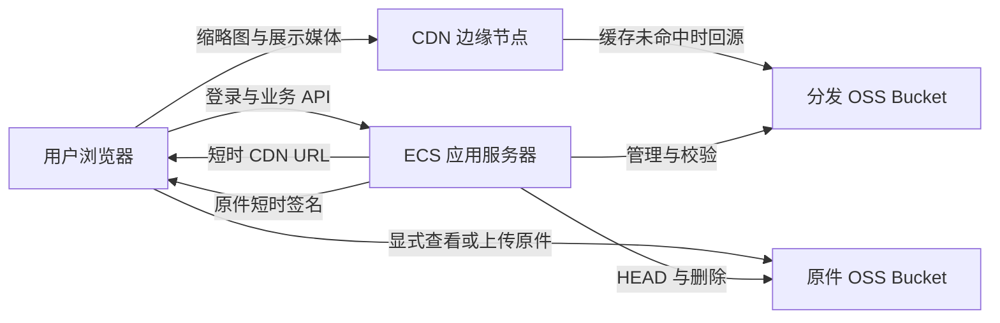
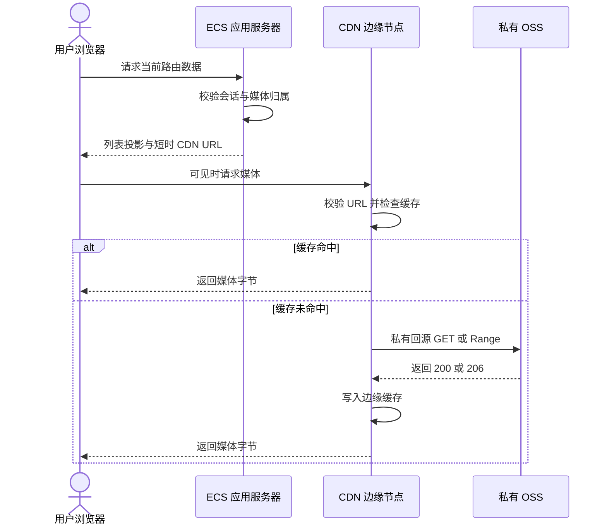
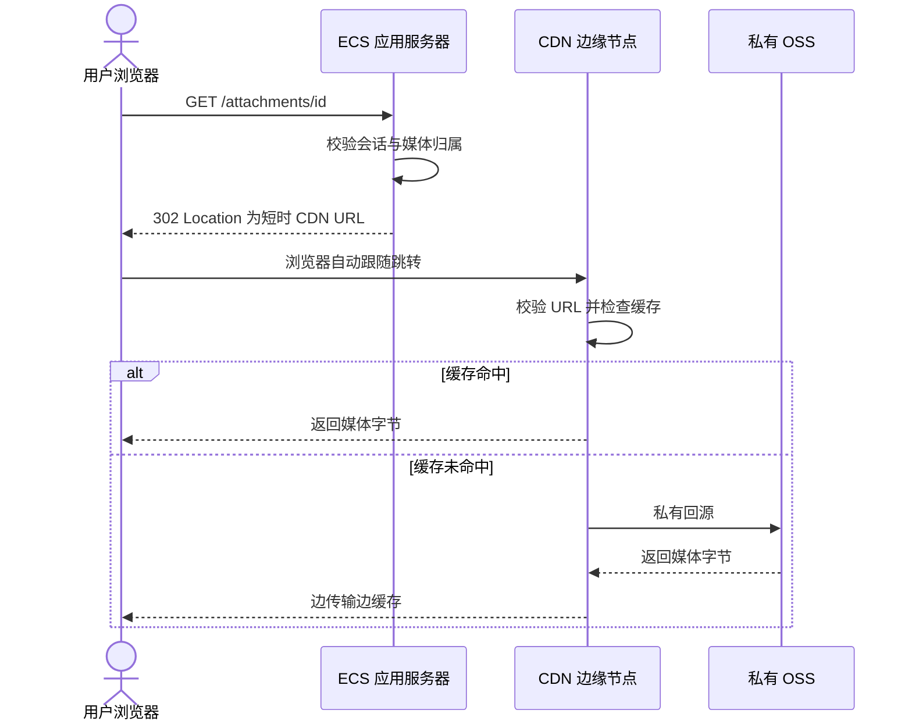
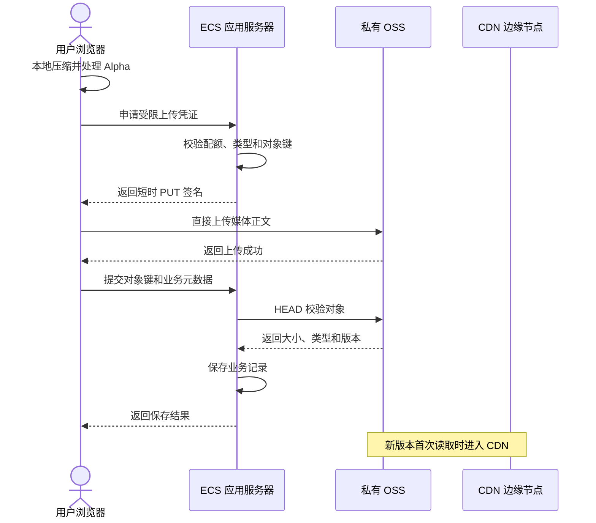

# 77liu.top 私有 OSS 与 CDN 媒体分发设计

> 日期：2026-10-05
>
> 状态：开发交接方案，尚未实施
>
> 关联文档：
> - `reports/77liu-top-performance-analysis-2026-10-04.md`
> - `reports/77liu-top-startup-data-media-design-2026-10-04.md`

## 1. 决策摘要

当前服务器公网带宽为 `5 Mbps`，而 HAR 中单次启动包含约 `7.80 MB` 业务媒体。仅媒体传输的理论带宽下限约为：

`7.80 MB × 8 ÷ 5 Mbps = 12.48 s`

现有生产设计虽已将附件存入私有 OSS，但读取链路仍是：

`浏览器 -> ECS -> OSS -> ECS -> 浏览器`

应用服务器会把 OSS 对象完整读入内存，再通过自身 `5 Mbps` 出口发送。因此，OSS 当前解决了存储容量和可靠性问题，没有解决媒体分发带宽问题。

本方案确定：

1. OSS Bucket 保持私有，禁止公共读。
2. 应用服务器保留身份认证、对象归属校验和 URL 签发。
3. 媒体正文不再经过 ECS，由浏览器直接从 CDN 或 OSS 获取。
4. 新增 `media.77liu.top` 子域名，无需购买新域名。
5. 目标架构使用“原件桶”和“分发桶”隔离。
6. CDN 只回源分发桶，不管理原始图片、Alpha 编辑源和备份。
7. 第一阶段允许通过现有附件接口返回 `302`，降低迁移风险。
8. 稳定后改为可见媒体批量获取短时 CDN URL，减少额外往返。
9. 图片列表只分发压缩后的 WebP/AVIF 变体，不回退到原始 PNG。
10. CDN 不能替代 `/api/state` 的投影、分页和 gzip 优化。

## 2. 当前实现

### 2.1 存储

生产配置模板已经定义：

```text
ATTACHMENT_STORAGE=oss
OSS_ATTACHMENT_BUCKET=for-now
OSS_ATTACHMENT_PREFIX=for-now-attachments
OSS_ENDPOINT=https://oss-cn-beijing-internal.aliyuncs.com
OSS_REGION=cn-beijing
```

当前 OSS endpoint 是北京地域内网地址，适合 ECS 访问，不能直接提供给公网浏览器。

### 2.2 读取链路

当前实现：

1. 浏览器请求 `/now/attachments/{name}`。
2. 应用完成登录态和账户上下文校验。
3. `storage.get()` 从 OSS 下载完整对象。
4. Node 将对象保存为 Buffer。
5. 应用再把 Buffer 发送给浏览器。
6. 即使请求带 Range，应用仍先读取完整对象，再在内存中切片。

相关代码：

- `src/shared/attachments/storage.mjs:27-62`
- `src/http/attachments.mjs:78-119`
- `deploy/for-now.env.example:65-72`

### 2.3 当前问题

| 问题 | 结果 |
| --- | --- |
| 媒体正文经过 ECS | 受 `5 Mbps` 出口限制 |
| OSS 对象先完整读入 Buffer | 内存和 OSS 读取量被放大 |
| 附件响应为 `private, no-store` | 同一媒体反复下载 |
| 历史缩略图可回退到原始 PNG | 单张可达 1.5 至 2.6 MB |
| 隐藏路由创建媒体元素 | 用户未查看也会消耗流量 |

## 3. 目标架构



核心边界：

- **控制面**经过 ECS：登录、权限、配额、媒体归属、URL 签发、业务记录。
- **数据面**绕过 ECS：图片、音频和其他大对象的正文。
- CDN 命中时不会访问 OSS。
- CDN 未命中时由 CDN 直接访问私有 OSS，仍不经过 ECS。

## 4. Bucket 与对象分类

### 4.1 为什么建议拆成两个 Bucket

阿里云 CDN 开启私有 Bucket 回源后，CDN 获得该 Bucket 的读取能力；官方说明不能在 CDN 侧只授权 Bucket 内部分对象。

只靠路径约定可以控制哪些 URL 被应用签发，但不能形成强存储权限隔离。对私人数据，更稳妥的目标是拆分：

| Bucket | 内容 | CDN |
| --- | --- | --- |
| 原件桶 | 原始图片、编辑源、Alpha 蒙版、用户原始录音 | 不接入 |
| 分发桶 | 缩略图、展示图、可分发音频派生物 | 接入 |
| 备份桶 | 数据库与附件备份 | 不接入 |

建议名称仅作说明：

```text
for-now-private-originals
for-now-media-delivery
for-now-backups
```

### 4.2 对象规则

| 类型 | 默认读取路径 | 缓存策略 |
| --- | --- | --- |
| `thumb.webp` | CDN | 长缓存 |
| `display.webp` | CDN | 长缓存 |
| 带 Alpha 的展示 WebP | CDN | 长缓存 |
| 生成式语音 | CDN 或直连 OSS | 按复用率决定 |
| 用户原始录音 | 私有 OSS 短签名 | 默认不进入 CDN |
| 编辑底图 | 私有 OSS 短签名 | 短时访问 |
| Alpha 蒙版 | 私有 OSS 短签名 | 仅编辑时访问 |
| 原始 PNG/JPEG/HEIC | 私有 OSS 短签名 | 仅显式查看或下载 |
| 数据库与备份 | 不提供浏览器访问 | 不缓存 |

### 4.3 版本化路径

分发对象必须使用不可变路径，例如：

```text
delivery/{accountHash}/{mediaId}/thumb-v3.webp
delivery/{accountHash}/{mediaId}/display-v3.webp
delivery/{accountHash}/{mediaId}/speech-v2.mp3
```

媒体变化时生成新版本路径，不覆盖旧对象。这样：

- CDN 可以设置长缓存。
- 不需要依赖全网刷新才能看到新内容。
- 老页面的短时 URL 过期后自然失效。
- 可在观察期后异步清理旧版本。

路径不得包含用户名、邮箱或其他可识别信息。

## 5. 域名与 DNS

不需要购买新域名。使用现有 `77liu.top` 新增一个子域名：

```text
应用与 API：https://77liu.top/now/
媒体分发：https://media.77liu.top/
```

选择独立子域名的原因：

- DNS 和 CDN 以域名为入口，不能只对 `/now/attachments/` 路径创建 CNAME。
- API、HTML 与媒体可以采用完全不同的缓存规则。
- 避免误缓存登录响应或私有 JSON。
- 可独立配置 HTTPS、CORS、Range、URL 鉴权和告警。

控制台配置步骤：

1. 在阿里云 CDN 添加加速域名 `media.77liu.top`。
2. 业务类型选择图片小文件；若音频占比提高，再检查音视频配置。
3. 源站选择分发 OSS Bucket。
4. 开启同账号私有 Bucket 回源。
5. DNS 添加 `media` 的 CNAME，指向 CDN 分配地址。
6. 配置 `media.77liu.top` 的 HTTPS 证书并强制 HTTPS。
7. 若加速区域包含中国内地，确认 `77liu.top` 的 ICP 备案状态满足 CDN 校验。

不建议把整个 `77liu.top` 直接切到 CDN；这样必须额外保证 API、登录和动态 HTML 永不被缓存，风险和排障复杂度都更高。

## 6. 私有权限模型

### 6.1 两层鉴权

CDN 模式存在两层独立权限：

1. **用户访问 CDN 的权限**：由 CDN URL 鉴权控制。
2. **CDN 访问 OSS 的权限**：由私有 Bucket 回源授权控制。

私有 Bucket 回源只证明 CDN 可以读 OSS，不代表任意用户可以读 CDN。必须同时开启 CDN URL 鉴权。

### 6.2 签名规则

- 签名只能由服务端生成。
- 使用 CDN 主、备密钥轮换，不把密钥下发给浏览器。
- 默认有效期建议 `120 s`，可配置为 `60–300 s`。
- URL 是 bearer credential，获得 URL 的人在过期前可能访问对象。
- 禁止将完整签名查询参数写入应用日志、分析事件或错误上报。
- 浏览器收到 `403` 且确认是过期时，最多自动重新签发一次。

### 6.3 CDN 与 OSS 签名不能混用

- **直连 OSS**：客户端使用 OSS V4 预签名 URL。
- **经过 CDN**：客户端使用 CDN URL 鉴权地址。
- CDN 再使用私有回源授权访问 OSS。

开启私有 Bucket 回源后，不应把 OSS 的 `Expires`、`Signature` 等签名参数放进 CDN URL，否则可能产生签名冲突和 `403`。

### 6.4 CORS

前端需要通过 Canvas 读取图片像素时：

- CDN 响应设置 `Access-Control-Allow-Origin: https://77liu.top`。
- 仅开放实际需要的方法，下载路径通常为 `GET, HEAD`。
- 图片元素在设置 `src` 前设置 `crossorigin="anonymous"`。
- 如前端读取 Range 相关信息，暴露 `Content-Range`、`Accept-Ranges` 等必要响应头。
- 不建议对私人媒体使用无条件 `*`，除非确认不携带凭证且 URL 鉴权足够。

## 7. 读取方式

### 7.1 方案 A：列表或批量接口返回 CDN URL



优点：

- 无额外附件重定向 RTT。
- 图片进入视口后可直接请求 CDN。
- 可以按一屏记录批量签发 URL。

缺点：

- URL 在返回后立即开始过期。
- 一次返回过多 URL 会浪费签发结果。
- 长列表滚动时需要补签。

目标做法是列表只返回媒体存在标识；当记录进入预取边界时，前端批量请求当前可见项目的 CDN URL。

### 7.2 方案 B：现有附件接口返回 `302`



完整链路确实是：

`浏览器 -> ECS -> 浏览器 -> CDN -> 私有 OSS`

但 ECS 返回的只是很小的 `302` 响应，不承载媒体正文。CDN 命中时最后的 OSS 步骤也不存在。

优点：

- 前端现有 `/attachments/...` 地址可以保持不变。
- 服务端仍在每次首次访问时做权限校验。
- 容易灰度和回滚。

缺点：

- 每个媒体比方案 A 多一次浏览器到 ECS 的网络往返。
- 大量图片会形成多个附件鉴权请求。
- 需要避免浏览器或 Service Worker 错误缓存过期的重定向。

### 7.3 建议选择

- 第一阶段：使用 `302`，验证安全、CDN 和回源配置。
- 第二阶段：增加批量媒体访问接口，为即将可见的 8 至 20 个媒体签发 URL。
- 保留 `302` 作为旧客户端兼容和故障回退。

## 8. 上传与更新

CDN 不用于上传。阿里云官方也不建议通过 CDN 域名向 OSS 写入。



上传凭证必须限制：

- 固定账户前缀和单一对象键。
- 固定 HTTP 方法。
- 最大字节数。
- 允许的 MIME 类型。
- 很短的有效期。
- 每次上传唯一 request ID。

应用在写业务记录前必须通过 `HEAD` 或等效机制确认对象存在、大小合理且属于当前账户。

## 9. 缓存策略

### 9.1 CDN 不会主动缓存全部 OSS

CDN 不会扫描或预先复制整个 Bucket：

- 只有通过 `media.77liu.top` 请求的对象才进入 CDN。
- 从未被请求的对象没有 CDN 下行费，也不占用可见缓存。
- 第一次请求通常为 MISS，随后才可能 HIT。
- 边缘对象按 TTL、容量和热度自动过期或淘汰。

标准 CDN 没有单独的“缓存磁盘容量费”。费用来自流量、请求和可选增值服务。

### 9.2 推荐缓存规则

| 路径或类型 | CDN TTL | 浏览器策略 | 说明 |
| --- | ---: | --- | --- |
| 版本化缩略图 | 30 天至 1 年 | 可长缓存 | URL 变化代表新内容 |
| 版本化展示图 | 30 天至 1 年 | 可长缓存 | 不覆盖旧路径 |
| 生成式语音 | 7 至 30 天 | 私有缓存 | 仅不可变结果 |
| 用户原始录音 | 不进入 CDN | 短时 OSS URL | 用户点击播放后获取 |
| 原图和编辑源 | 不进入 CDN | 不缓存或短缓存 | 显式操作才访问 |
| API、HTML、JSON | 不使用媒体 CDN | `no-store` 或业务策略 | 防止私有状态误缓存 |

### 9.3 缓存键

必须验证不同短时签名 URL 是否能命中同一对象缓存：

- 鉴权参数先被 CDN 校验。
- 缓存键不应因每次变化的签名参数而碎片化。
- 业务版本或内容哈希必须参与缓存键。
- OSS 图片处理参数如 `x-oss-process` 需要按实际使用保留。

这一项必须在 Preview 环境通过两个不同签名 URL 检查 `X-Cache` 后再确认配置。

## 10. Range 与音频

音频和较大文件应启用 Range 回源：

1. 浏览器播放前不设置真实 `src`，或使用 `preload="none"`。
2. 点击播放后获取短时地址。
3. 浏览器向 CDN 发送 Range。
4. CDN 命中对应分片时直接返回 `206`。
5. CDN 未命中时按 Range 向 OSS 回源。
6. ECS 不再读取完整音频 Buffer。

需要验证：

- `Accept-Ranges: bytes`
- `206 Partial Content`
- `Content-Range`
- 拖动进度后的请求范围
- 暂停后是否继续无效下载

## 11. 应用改造范围

### 11.1 配置

建议新增：

```text
MEDIA_DELIVERY_MODE=proxy|oss-signed|cdn-signed
MEDIA_CDN_BASE_URL=https://media.77liu.top
MEDIA_CDN_AUTH_PRIMARY_KEY=
MEDIA_CDN_AUTH_BACKUP_KEY=
MEDIA_URL_TTL_SECONDS=120
OSS_PUBLIC_ENDPOINT=https://oss-cn-beijing.aliyuncs.com
OSS_ORIGINAL_BUCKET=
OSS_DELIVERY_BUCKET=
```

所有密钥只存在于服务器环境变量或密钥管理服务，不写入仓库。

### 11.2 存储接口

现有附件存储除 `put/get/remove` 外，需要具备：

- `head()`：验证对象存在、大小、类型和版本。
- `presignGet()`：生成私有 OSS 读取地址。
- `presignPut()`：生成受限上传地址。
- `copy()` 或派生写入：把确认后的派生物放入分发桶。
- `deleteVersion()`：观察期后清理旧版本。

### 11.3 媒体访问接口

建议提供批量接口，具体名称可按现有 v1 规范调整：

```text
POST /api/v1/media/access
```

请求：

```json
{
  "items": [
    {
      "mediaId": "media-id",
      "variant": "thumb"
    }
  ]
}
```

响应：

```json
{
  "items": [
    {
      "mediaId": "media-id",
      "variant": "thumb",
      "url": "https://media.77liu.top/...",
      "expiresAt": "2026-10-05T12:00:00Z"
    }
  ]
}
```

限制：

- 每批最多 20 个。
- 只能签发调用者拥有的媒体。
- 服务端根据业务记录决定真实对象键，不能信任客户端传入路径。
- 不返回原件地址，除非请求来自明确的“查看原件”操作。

### 11.4 前端

- 状态和列表只保存媒体 ID、存在标识、尺寸和时长。
- `IntersectionObserver` 进入预取边界时批量申请缩略图 URL。
- 音频点击播放时申请 URL。
- URL 过期后最多刷新一次，避免无限重试。
- 登出时清除未过期 URL 和媒体 Blob。
- Canvas 场景设置正确 CORS。

## 12. 费用模型

以下使用阿里云公开按量示例价，只用于技术比较；上线前以账户控制台、地域和资源包报价为准。

### 12.1 主要计费项

| 项目 | 参考价 | 发生条件 |
| --- | ---: | --- |
| CDN 中国内地下行，0 至 10 TB | `¥0.24/GB` | CDN 向用户发送内容 |
| CDN 静态 HTTPS 请求 | `¥0.05/万次` | 使用 HTTPS CDN 域名 |
| OSS 公网下行 | `¥0.50/GB` | 用户直接从 OSS 下载 |
| OSS 到 CDN 回源 | `¥0.15/GB` | CDN 缓存未命中 |
| OSS GET | 参考 `¥0.01/万次` | 直接读取或 CDN 回源 |
| CDN 缓存存储容量 | 无独立计费项 | 包含在 CDN 服务中 |

存储容量费在直连 OSS 和 CDN 方案中都会发生，因此不计入两种分发方式的差额。

### 12.2 每交付 1 GB 的估算

设 CDN 命中率为 `h`：

`CDN 成本约为 0.24 + (1 - h) × 0.15 元/GB`

| 方案 | 估算流量费 |
| --- | ---: |
| OSS 公网直连 | `¥0.50/GB` |
| CDN 命中率 0% | `¥0.39/GB` |
| CDN 命中率 50% | `¥0.315/GB` |
| CDN 命中率 80% | `¥0.27/GB` |
| CDN 命中率 100% | `¥0.24/GB` |

### 12.3 当前 ECS 代理的特殊性

如果 ECS 与 OSS 同地域并使用内网 endpoint：

- OSS 到 ECS 内网流量可以免费。
- ECS 固定公网带宽费用已经包含在服务器套餐中。
- 但所有用户共享 `5 Mbps`，性能上限固定。
- 增加 ECS 带宽只能缓解症状，不能消除应用中转、内存 Buffer 和扩容问题。

### 12.4 成本风险

- URL 被盗用会产生 CDN 下行费用。
- 大量随机、从不重复的对象会降低命中率。
- 过短 TTL 或签名参数进入缓存键会造成缓存碎片。
- 频繁覆盖同一路径会增加刷新和回源。
- 预热整个 Bucket 会主动制造流量和请求，不应执行。

必须配置日流量、小时带宽、状态码和费用告警。

## 13. 优势与代价

| 维度 | OSS 直连 | CDN + 私有 OSS |
| --- | --- | --- |
| 绕过 ECS 5 Mbps | 是 | 是 |
| 首次访问 | 链路简单 | MISS 时多一层 CDN |
| 重复访问 | 每次走 OSS | HIT 时边缘直接返回 |
| 费用 | OSS 公网下行较高 | 命中率越高越便宜 |
| Range | OSS 原生支持 | CDN 与 OSS 都需正确配置 |
| 权限 | OSS V4 短签名 | CDN URL 鉴权 + 私有回源 |
| 撤销 | 签名到期前仍可用 | 签名到期前仍可用，缓存还需治理 |
| 运维 | 较简单 | 域名、证书、缓存和安全配置更多 |
| 适用对象 | 私有、低复用、原件 | 高频、不可变、展示型派生物 |

CDN 的主要代价不是缓存容量费，而是：

- 多一套配置和安全边界。
- 缓存一致性与版本治理。
- CDN 下行和 HTTPS 请求费。
- 未命中时的 OSS 回源费。
- 盗刷与异常流量风险。
- 首次 MISS 不一定比 OSS 直连更快。

## 14. 灰度实施

### 阶段 0：确认现状

- 确认生产实际 `ATTACHMENT_STORAGE=oss`。
- 确认 Bucket、region、RAM role 与对象前缀。
- 导出附件类型、数量、大小和访问频率。
- 确认 `77liu.top` 备案与证书条件。

### 阶段 1：准备分发基础设施

- 创建私有分发 Bucket。
- 创建 `media.77liu.top` CDN 域名。
- 配置 CNAME、HTTPS、私有回源和 URL 鉴权。
- 配置 Range、CORS、缓存规则和告警。
- 不切换生产流量。

### 阶段 2：Preview 使用 `302`

- 在附件接口增加 feature flag。
- 用户鉴权成功后，对允许分发的变体返回 `302`。
- 原件仍走 OSS 短签名或旧代理。
- 验证 CDN HIT/MISS、Range、CORS 和过期处理。

### 阶段 3：批量签发

- 列表只返回媒体存在标识。
- 可见媒体批量申请 CDN URL。
- 去掉每个图片一次 `302` 的额外 RTT。
- 保留旧附件接口作为兼容回退。

### 阶段 4：直传 OSS

- 浏览器完成压缩和 Alpha 处理。
- 服务端签发受限 PUT。
- 浏览器直传原件桶或分发桶。
- 服务端 HEAD 校验后提交业务记录。

### 阶段 5：生产灰度

- 先对 Preview 账户开启。
- 再按用户哈希灰度少量生产账户。
- 观察 24 小时以上的错误率、费用和命中率。
- 逐步扩大比例。

## 15. 回滚

必须保留：

```text
MEDIA_DELIVERY_MODE=proxy
```

回滚时：

1. 停止签发新 CDN URL。
2. 恢复 `/attachments/...` 由应用代理。
3. 不立即删除 OSS 原件或旧派生物。
4. 保留 CDN 日志和错误样本。
5. 等待已签发 URL 自然过期。

CDN 与 OSS 配置问题不得通过把 Bucket 改为公共读来临时绕过。

## 16. 验收标准

### 16.1 安全

- 匿名访问 OSS 对象返回 `403`。
- 无效或过期 CDN URL 返回 `403`。
- 用户不能为其他账户的媒体取得 URL。
- CDN 只能回源分发 Bucket。
- 原件 Bucket 未绑定 CDN。
- Bucket 列表访问被拒绝。
- 日志不记录完整签名 URL。
- 密钥可轮换且未进入 Git。

### 16.2 功能

- 图片列表正常显示 WebP 缩略图。
- 详情只读取展示变体。
- 原件仅在显式操作时读取。
- 音频播放和拖动返回正确 `206`。
- URL 过期后只刷新一次。
- 媒体更新立即使用新版本路径。
- 删除后的记录无法重新取得有效 URL。

### 16.3 性能

- HAR 中业务媒体 Host 为 `media.77liu.top` 或 OSS 公网域名。
- ECS 不再返回大体积图片和音频正文。
- 当前路由之外的媒体传输为 `0 B`。
- CDN 第二次访问出现 HIT。
- CDN MISS 不经过 ECS。
- 音频播放前正文传输为 `0 B`。
- 原始 PNG 不出现在列表和常规详情。

### 16.4 成本

- CDN 日流量和小时带宽有告警。
- OSS `NetworkOut` 与 `CdnOut` 分开监控。
- 记录 CDN 命中率、回源率和每 GB 有效成本。
- 配置防盗链、URL 鉴权和异常流量封禁。
- 上线前设置费用预警与可接受上限。

## 17. 开发任务拆分

| 优先级 | 任务 | 交付 |
| --- | --- | --- |
| P0 | 媒体交付配置抽象 | `proxy / oss-signed / cdn-signed` 可切换 |
| P0 | CDN URL 签发器 | 短 TTL、主备密钥、单元测试 |
| P0 | 附件 `302` 灰度 | 鉴权后跳转，保留代理回退 |
| P0 | CDN 与 OSS 配置 | 私有回源、URL 鉴权、HTTPS、Range、CORS |
| P0 | 安全与性能回归 | 匿名、越权、过期、HIT/MISS、206 |
| P1 | 分发 Bucket | 原件和派生物权限隔离 |
| P1 | 批量访问接口 | 可见媒体批量签发 |
| P1 | 前端按需加载 | IntersectionObserver 与播放时加载 |
| P1 | 历史媒体迁移 | 生成 WebP，不回退原始 PNG |
| P2 | 浏览器直传 | 压缩、Alpha、受限 PUT、提交确认 |
| P2 | 成本治理 | 告警、报表、异常流量阻断 |

## 18. 不在本次范围

- 不直接修改生产配置。
- 不执行 Bucket 迁移。
- 不改变生产 DNS。
- 不删除历史原件。
- 不承诺未经实测的时延。
- 不用 CDN 代替状态投影、分页和 JSON 压缩。

## 19. 官方参考

- 阿里云 OSS V4 预签名 URL：`https://help.aliyun.com/zh/oss/developer-reference/add-signatures-to-urls`
- 阿里云 CDN 加速 OSS：`https://help.aliyun.com/zh/oss/cdn-acceleration`
- 阿里云 CDN 私有 Bucket 回源：`https://help.aliyun.com/zh/cdn/user-guide/grant-alibaba-cloud-cdn-access-permissions-on-private-oss-buckets`
- 阿里云 CDN 价格：`https://www.aliyun.com/price/detail/cdn`
- 阿里云 OSS 计费示例：`https://help.aliyun.com/en/oss/billing-examples`

文档中的价格是公开页面的参考值，开发与上线审批必须以实际阿里云账号控制台报价和账单项为准。
