# V0.5.8 大入口拆分：只读架构分析与执行计划

计划日期：2026-10-05
分析工作树：`docs/v0.5.8-entrypoint-decomposition`
分析基线：`cf914a88f6d618baba2951ff6335e626c2576ce7`
目标对象：`server.mjs`、`public/frontend/app/runtime.mjs`
文档性质：只读架构分析；不代表 V0.5.8 已开始实现、验证、发布或写入 Base

## 0. 结论摘要

V0.5.8 应当是纯结构重构，冻结用户行为、API、持久化、权限、提示词、费用、
路由和发布方式。完成标准不是把两个文件切成更多文件，而是让每项规则拥有唯一
领域归属、显式公开 API、单向依赖和对应测试，最终使：

- `server.mjs` 只创建并启动服务运行时，不包含路由判断、数据归一化、业务计算、
  文件读写、供应商调用或定时任务实现。
- `public/frontend/app/runtime.mjs` 只声明浏览器应用组合和按需功能加载，不包含
  DOM presenter、API 路径、领域可变状态、事件处理器或业务分支。
- 后端逻辑分别落入现有 `src/modules`、`src/app`、`src/http`、`src/shared` 和
  `src/infrastructure` 边界；前端逻辑落入 `frontend/features`、`pages` 和已有
  共享模块，不建立新的万能 `utils`、万能上下文或第二套状态系统。
- 每批按完整领域职责迁移，旧入口实现与新模块实现不在运行时双轨共存。
- 行数门只用于防止热点复发，不能替代公开契约、依赖方向、所有权和行为测试。

当前基线不是 V0.5.7 最终集成结果。V0.5.7 计划已明确把两个入口、HTML、
附件层、Nginx、旅程矩阵和版本文件列为共享热点，并有四个实现工作树从同一
`cf914a8` 基线启动。因此 V0.5.8 的 G0 必须等待 V0.5.7 串行集成结束，再重新
盘点行数、路由、DTO、媒体和首屏闭包；本文估算用于排期，不得直接当作届时事实。

## 1. 证据基线

### 1.1 已读取的约束

本次完整读取并以其为约束：

- `PROJECT_RULES.md`
- `one-mistake-one-rule.md`
- `SOP/iteration-planning.md`
- `knowledge/modularization-design.md`
- `knowledge/engineering-rules.md`
- `knowledge/module-boundaries.json`

同时只读核对了 `README.md`、`package.json`、当前模块目录、相关静态门禁和
系统测试入口。未读取或修改 Base，未修改 README、代码或 V0.5.7 计划。

### 1.2 量化现状

| 项目 | `server.mjs` | `runtime.mjs` |
| --- | ---: | ---: |
| 行数 | 3,217 | 4,820 |
| 原始字节 | 159,879 | 551,047 |
| gzip `-9` 字节 | 不适用 | 138,302 |
| 行首命名函数声明 | 67 | 426 |
| import 声明起始行 | 45 | 9 |
| 事件绑定调用 | 不适用 | 271 次，分布在 255 行 |
| `querySelector` / `querySelectorAll` | 不适用 | 190 / 47 次 |
| 直接或封装请求调用 | 服务端路由与适配器装配 | `request` 74、`requestV1` 46、流式 5 |
| 集中可变状态 | 进程级服务与队列实例 | 仅 122-141 行已列出至少 111 个可变槽位 |
| 当前分支历史提交数 | 39 | 69 |
| 历史增删 churn | 11,883 行 | 7,472 行 |

两文件在当前 HEAD 历史中合计被 95 个不同提交触及，其中 13 个提交同时修改
两者。`runtime.mjs` 最近仍持续承接首页、思绪、语音、批注、同步和移动端修复，
不是已经稳定的纯入口。

机器边界登记当前包含 54 个模块、231 条拥有路由、0 个迁移例外。登记已经说明
领域边界，但大入口仍直接装配并实现大量规则，形成“登记上已模块化，入口仍是
事实耦合中心”的落差。

### 1.3 当前职责分布

#### `server.mjs`

| 行区间 | 当前职责 | 应迁往 |
| --- | --- | --- |
| 1-118 | 45 个直接 import、根目录、配置、日志和存储实例 | `src/app` 组合根，只给入口暴露一个运行时工厂 |
| 119-612 | Store v16、商业化默认值、时间修复、全 Store 归一化 | 所属领域归一化 + `shared/persistence` 兼容聚合 |
| 613-1024 | JSON 原子读写、本地测试代理/水合/工作区、公开状态投影 | 持久化公开 API + `app` 本地测试运行时 |
| 1025-1219 | PostgreSQL、AI 预算、设置、用量、审计、DeepSeek 装配 | `app` AI 运行时，调用 `ai` 与 provider 公开入口 |
| 1220-1703 | 回收、附件、媒体、领域 repository 适配、各记录服务 | 已有领域、共享附件和应用工作流 |
| 1704-1870 | 管理快照、上游代理、认证 repository 和账户初始化 | `http` 管理/代理适配 + `app` 账户生命周期 |
| 1871-2206 | 图片识别、聚类、洞察和内容判定 | health/library/reviews 领域与对应应用工作流 |
| 2207-2527 | 内容附件、ASR、后台 AI、任务目标、思绪工作流 | captures/AI/tasks/app 已有公开边界 |
| 2528-2900 | 20 余组 HTTP 适配器、导出、删除、统计和 v1 注册 | `http` 组合入口与领域路由模块 |
| 2901-3093 | 周期分析、操作日志读取、旧 API 分发、静态 MIME/权限 | 调度器、observability 查询和 HTTP 应用 |
| 3094-3217 | 请求主链、静态文件、启动恢复、定时器、关闭和 listen | `createServerRuntime` 生命周期；入口只调用 |

#### `public/frontend/app/runtime.mjs`

| 行区间 | 当前职责 | 应迁往 |
| --- | --- | --- |
| 1-165 | 共享依赖、启动标记、API/sync 实例、全局状态 | `frontend/app` 内部应用壳与显式依赖对象 |
| 166-415 | 批注锚点、评论面板、神鸡任务和草稿 | `frontend/features/annotations` |
| 416-953 | 通用内容图片、录音、图片查看器、发生时间、书图输入 | `media` + captures/library 功能控制器 |
| 954-1341 | 健康图片批次、识别、表单、图表和卡片 | `frontend/features/health` |
| 1342-1710 | 请求协调、乐观投影、增量同步、回收站和通知 | app sync 协调器 + trash/notifications 功能 |
| 1711-1910 | 标签、思绪聚合、详情、渲染和路由 | `frontend/features/thoughts` |
| 1911-2055 | 捕念、语音层、日记和回望 | captures/journals 功能 |
| 2056-2245 | 状态、趋势、回顾、书籍和笔记 | checkins/reviews/library 功能 |
| 2246-2715 | 小物画布/蒙版/批次/陈列、善言 | keepsakes/quotes 功能 |
| 2716-3058 | TTS 设置、统计、AI 成本、预算、架构和商业化 | settings/statistics/owner 功能 |
| 3059-3547 | onboarding、首页、账户、发现、行动、反馈、导出 | 对应现有或新增功能控制器 |
| 3548-3795 | 全量 render、可见路由、加载、认证、会话和页面副作用 | 浏览器应用壳与 feature registry |
| 3796-4747 | 绝大部分事件绑定和各领域提交/恢复路径 | 各功能的 `mount/unmount` |
| 4748-4820 | 跨午夜、前后台、认证、角色、退出和唯一 export | app/session 生命周期；入口保留 export |

### 1.4 现状与目标依赖图

本计划只维护这一张 Mermaid 总图，左侧是当前事实，右侧是目标方向。

```mermaid
flowchart LR
  subgraph NOW["当前：入口是实现与组合的共同热点"]
    S0["server.mjs<br/>3217 行"]
    SD["24 个领域模块"]
    SA["src/app 工作流"]
    SH["src/http 适配"]
    SS["shared / persistence"]
    SI["provider infrastructure"]
    SF["文件、静态资源、定时器、进程生命周期"]
    S0 --> SD
    S0 --> SA
    S0 --> SH
    S0 --> SS
    S0 --> SI
    S0 --> SF

    R0["runtime.mjs<br/>4820 行"]
    RA["api / session / state / sync"]
    RP["pages 路由"]
    RF["少量 headless features"]
    RD["DOM presenter、255 行事件绑定、111+ 可变槽位"]
    R0 --> RA
    R0 --> RP
    R0 --> RF
    R0 --> RD
  end

  subgraph TARGET["目标：入口只组合，规则回到唯一所有者"]
    SE["server.mjs<br/>创建 + start"]
    SR["src/app createServerRuntime"]
    HC["src/http createHttpApplication"]
    AW["app 跨领域工作流"]
    DM["domain public entries"]
    SP["shared ports / persistence"]
    IA["infrastructure adapters"]
    SE --> SR
    SR --> HC
    SR --> AW
    SR --> DM
    SR --> SP
    SR --> IA
    HC --> AW
    HC --> DM
    AW --> DM
    AW --> SP
    DM --> SP

    RE["runtime.mjs<br/>依赖声明 + startApplication"]
    BA["createBrowserApplication"]
    PR["page descriptors + lazy feature registry"]
    FF["domain feature controllers"]
    FS["api / state / session / sync / media / content / time"]
    RE --> BA
    BA --> PR
    PR --> FF
    FF --> FS
  end

  S0 -. "按领域迁移并删除旧实现" .-> SR
  R0 -. "按页面/功能迁移并删除旧实现" .-> PR
```



## 2. 问题诊断

### 2.1 `server.mjs` 的真实耦合

1. **组合根直接知道所有实现细节**：入口直接导入领域、HTTP、共享、provider、
   PostgreSQL 和前端页面模块，任何构造参数变化都回到同一文件。
2. **数据兼容与业务默认值混在入口**：Store 归一化同时知道 onboarding、
   商业化、AI 任务、附件、语音缓存和所有集合，领域规则没有唯一所有者。
3. **适配与业务分支混在路由主链**：`api()` 仍包含 owner surface、
   commercialization、`/api/state` 和图片识别分支，HTTP 模块登记不能证明
   路由实现已离开入口。
4. **生命周期与账户遍历重复**：本地测试、无认证、认证账户分别执行同组
   ensure/resume，启动恢复规则容易新增遗漏。
5. **不可独立测试的闭包依赖**：大量工厂依赖入口局部函数，测试只能启动整个
   `server.mjs`，难以证明组合变化没有改变某一领域。

### 2.2 `runtime.mjs` 的真实耦合

1. **一个模块拥有全应用可变状态**：至少 111 个可变槽位覆盖认证、同步、健康、
   思绪、书籍、小物、设置、owner 页面和草稿，账户切换必须手工逐项清理。
2. **render、命令与传输交错**：同一功能的 view model、HTML、事件、API、
   乐观投影、恢复和 toast 分散在多个远距离区段。
3. **生命周期不可回收**：271 次事件绑定多数直接挂在 `document/window`，
   没有统一 disposer；拆出模块时若只复制绑定，会产生重复监听和跨页面副作用。
4. **页面按需加载只是数据层按需**：运行时代码仍作为 551 KB 单体下载；
   机械静态拆分会把一个延迟请求变成大量 ESM 请求。
5. **测试绑定文本位置**：`frontend-shell-regression.mjs` 直接在
   `runtime.mjs` 搜索认证、权限、异步序号和文案片段。职责迁移后必须把断言
   移到所属模块或改为行为测试，不能为保住正则把逻辑留在入口。

### 2.3 为什么“拆文件”不等于解耦

以下做法均不满足 V0.5.8：

- 把连续行复制到 `server-runtime.mjs` 或 `application.mjs`，但仍传入整个
  Store、整个 DOM 或一个万能 `context`。
- 新文件只做同名转发，业务规则仍在入口或出现两份实现。
- 让前端 feature 互相深层导入、查询对方 DOM 或共享可变对象。
- 只用行数阈值验收，不检查路由/事件/数据所有权。
- 为降低 `runtime.mjs` 行数把全部功能改成 eager static import，造成首屏请求
  和压缩字节回归。
- 按“前端文件”“后端文件”横切并行，而不是迁移可独立验收的领域闭环。

## 3. 目标架构与公开 API

### 3.1 后端组合根

`server.mjs` 最终只允许保留等价于以下动作：

1. 从 `src/app/index.mjs` 导入 `createServerRuntime`。
2. 以 `import.meta.url` 创建运行时。
3. 调用 `runtime.start()`。

Owner 于 2026-10-06 再次确认该目标为本轮硬验收：`server.mjs` 只负责启动，
必须不超过 100 行，继续以不超过 40 行为目标。减少 import 行数本身不算完成；
不得用无边界 `export *`、目录扫描或动态自注册掩盖依赖，公共 barrel、显式
registry、runner、`server.mjs` 和 `runtime.mjs` 继续由集成负责人单写。

目标公开契约：

```text
createServerRuntime({ rootUrl, processRef? })
  -> {
       start(): Promise<{ port, version }>,
       ready(): Promise<void>,
       stop({ signal? }): Promise<void>
     }
```

`createServerRuntime` 是组合 API，不是业务服务。它只通过各模块公开入口构造：

- 不可变 config 和 prompt catalog；
- observability、persistence、attachments 与 provider adapter；
- 领域服务和跨领域 app workflow；
- `createHttpApplication`；
- startup recovery、scheduler 和 shutdown 生命周期。

`src/app` 内部文件可以互相引用，因为它们属于同一登记模块，但每个内部文件仍须
围绕一个职责。禁止把 3,000 行原样搬到一个 `server-runtime.mjs`。

### 3.2 后端模块间契约

| 所有者 | 公开 API 方向 | 约束 |
| --- | --- | --- |
| `config` | `loadAppConfig({ rootDir }) -> frozen config` | 只有 config 读取环境变量 |
| `shared.persistence` | repository、账户文档、Store 兼容归一化与 runtime | 不包含领域 Prompt、HTTP 或供应商判断 |
| `infrastructure.ai-providers` | DeepSeek、阿里、火山 transport | 只负责传输/响应校验，不决定业务重试与保存 |
| `domain.*` | 现有 `create*Service/create*Records` 等领域 API | 不接收 HTTP 对象、全 Store、DOM 或 SDK |
| `app` workflow | 显式 repository/领域/provider port | 负责跨领域事务，不拥有 HTTP 响应 |
| `http` | `createHttpApplication(deps) -> { handle, routeIds }` | 解析、认证、包络、静态资源和错误映射 |
| `app` runtime | `createServerRuntime` | 唯一可依赖全部下层公开入口的组合根 |

`createHttpApplication` 应聚合现有 `create*Http`，并把 legacy、v1、admin、
health/readiness、local-test、attachment 和 static handler 组成有序处理链。
处理顺序是公开行为，必须有契约测试；不得用“遍历所有 handler，谁先返回算谁”
掩盖路由冲突。

### 3.3 前端组合根

兼容入口保持不变：

```text
public/app.js
  -> frontend/app/index.mjs
  -> bootstrap.mjs
  -> dynamic import runtime.mjs
  -> startApplication(initial)
```

`runtime.mjs` 继续导出：

```text
startApplication(initial = null): Promise<void>
```

但其内容只允许：

- 构造共享 app services；
- 声明页面到 feature 的 lazy loader；
- 调用 `createBrowserApplication(...).start(initial)`。

建议的 app 内部契约：

```text
createBrowserApplication({
  api, session, state, sync, router, featureRegistry, shell
})
  -> {
       start(initial): Promise<void>,
       resetSession(): Promise<void>,
       stop(): Promise<void>
     }

createFeatureRegistry({ descriptors })
  -> {
       enter(view, route): Promise<void>,
       leave(view): Promise<void>,
       notifyState(snapshot, changedDomains): void,
       resetSession(): Promise<void>
     }
```

每个有 DOM 与副作用的领域 feature 统一使用：

```text
createXFeature(explicitDependencies)
  -> {
       mount({ root, route, signal }): Promise<void> | void,
       render({ snapshot, changedDomains }): void,
       unmount(): Promise<void> | void,
       resetSession(): Promise<void> | void
     }
```

`signal` 由 feature registry 创建的 `AbortController` 提供，事件监听、请求、
observer、animation frame 和 timer 必须随 unmount 或账户切换释放。纯函数型
feature 保持现有函数 API，不为形式强加 controller。

### 3.4 前端依赖边界

允许方向：

```text
frontend.app
  -> frontend.pages / frontend.feature.*
  -> frontend.api / state / session / sync / media / content / time
```

强制限制：

- feature 之间不直接 import。跨领域动作通过 app 提供的窄命令口，例如
  `navigate(ref)`、`refreshDomains(names)`、`showToast(message)`。
- 不提供包含 api、state、DOM、所有 feature 的万能 service locator。
- feature 只查询自己 `root` 下的 DOM；全局弹层、认证壳和一级导航归 app shell。
- API 路径由消费它的 feature/service 拥有，`runtime.mjs` 不出现 `/api/`。
- feature-local 草稿、序号、timer、observer 和编辑态封装在实例闭包中；
  账户级公开快照继续由 `frontend.state` 管理，不建立第二套全局 Store。
- `pages` 只维护路由、权限、页面描述和 lazy loader，不承载领域 presenter。

### 3.5 页面和功能目标归属

| 功能族 | 目标所有者 |
| --- | --- |
| 认证、账户切换、一级导航、前后台、跨午夜 | `frontend/app` shell/session runtime |
| 请求、乐观投影、增量同步、冲突恢复 | `frontend/api`、`state`、`sync` + app coordinator |
| 批注、划线、漂流、评论面板、神鸡 | 新 `frontend.feature.annotations` |
| 后台任务结果与通知 | `frontend.feature.background-ai`、现有 notifications |
| 状态、健康图片、批量体重 | checkins/health features；复用现有 weight batch 纯函数 |
| 思绪、追问、备注、详情路由、TTS | thoughts feature |
| 捕念、音频、转写 | captures feature；媒体原语继续在 `frontend.media` |
| 日记、草稿、辅助、回望 | journals feature |
| 阅读和书图识别 | library feature |
| 小物编辑、批次、详情和陈列 | keepsakes feature；复用现有 media/placement |
| 善言、回顾和统计 | quotes/reviews/statistics features |
| 设置、AI 成本、预算、架构、商业化 | settings/owner features |
| onboarding、行动、发现、反馈、导出、首页 | 扩展现有 feature 的生命周期，不复制其纯逻辑 |

## 4. 迁移策略

### 4.1 原子迁移规则

每个领域批次使用固定顺序：

1. 冻结旧行为样本、公开输入输出、失败和恢复路径。
2. 在目标模块建立公开 API 和模块级测试；此时生产入口仍走旧实现。
3. 集成负责人单独接线，使用相同输入做差分核对。
4. 在同一接线提交删除入口旧实现，不保留运行时双实现。
5. 运行领域专项、影响矩阵测试和入口静态门。
6. 记录兼容 façade 的负责人和删除条件；能同批删除时不新增 façade。

表中“迁移源 LOC”是从入口移出的有效实现估算，不是净新增。文件移动在 Git diff
中通常同时计入删除和新增，因此每批必须拆为 2-4 个可验证提交，单提交目标控制
在约 450 行增删，不能用“只是移动”绕过 500 行提交拆分线。

### 4.2 后端领域批次

| 批次 | 领域闭环与目标 | 迁移源 LOC | 预计文件 | 预计提交 | 主要专项 |
| --- | --- | ---: | ---: | ---: | --- |
| B0 | 入口策略、路由顺序快照、Store/API 差分夹具 | 新增 180-260 | 4-6 | 2 | `check:modules`、新 `check:entrypoints` |
| B1 | Store v16 默认值、领域归一化聚合、公开状态投影 | 430-560 | 6-8 | 3 | persistence、restore、regression |
| B2 | 本地测试工作区、上游只读水合、账户初始化/恢复 | 500-650 | 7-10 | 3 | local-mode、auth、runtime-infrastructure |
| B3 | AI 设置/用量/预算/provider 装配和调用审计 | 350-480 | 6-9 | 2 | ai-budget、ai-provider、observability |
| B4 | 附件、图片识别、健康/书目、语音/视觉传输 | 400-550 | 7-11 | 3 | storage、records、library、volcengine |
| B5 | thoughts/captures/journals/reviews、后台任务和个人语境 | 350-480 | 7-10 | 2 | 对应领域专项、tasks、personal-context |
| B6 | owner surfaces、统计、商业化、admin 与旧 API handler | 260-360 | 5-8 | 2 | auth、reviews-chat、frontend-shell |
| B7 | HTTP 应用、静态资源、scheduler、startup/shutdown 和组合根 | 360-500 | 7-10 | 3 | backend、deploy、memory-soak regression |

依赖顺序：

```text
B0 -> B1 -> B2
B1 -> B3 -> B4 -> B5
B2 + B5 -> B6 -> B7
```

B3-B5 属于高耦合链，只能串行接线。B1/B2 稳定后，B3 的模块实现与 B6 的纯
owner handler 可以在不同工作树准备，但进入 `server.mjs` 必须由同一集成负责人
按顺序完成。

### 4.3 前端领域批次

| 批次 | 领域闭环与目标 | 迁移源 LOC | 预计文件 | 预计提交 | 主要专项 |
| --- | --- | ---: | ---: | ---: | --- |
| F0 | feature lifecycle、DOM root、lazy loader 和事件回收契约 | 新增 220-320 | 5-8 | 2 | frontend-contract、frontend-shell |
| F1 | app shell、session、state/sync coordinator、路由可见壳 | 400-540 | 8-12 | 3 | auth、sync、URL history、startup budget |
| F2 | 发现、行动、反馈、导出、首页等既有 headless feature 接入生命周期 | 320-440 | 7-11 | 2 | g2、frontend-shell、journey smoke |
| F3 | 批注、后台任务结果、通知和跨内容定位 | 500-680 | 8-12 | 3 | collaboration、notifications、UI |
| F4 | 状态、健康图片、批量体重、首页情绪 | 500-680 | 7-11 | 3 | records、records-v1、frontend shared、UI |
| F5 | 思绪列表/详情、追问、备注、TTS 和路由恢复 | 480-640 | 6-10 | 3 | thoughts、speech-cache、URL history、UI |
| F6 | 捕念、音频/转写、日记草稿/辅助/回望、内容图片 | 430-580 | 7-11 | 3 | captures-journals、transcription、media |
| F7 | 书籍/笔记、善言、回顾和统计 | 400-540 | 7-11 | 3 | library、reviews-chat、UI |
| F8 | 小物画布、批次、派生、详情和陈列 | 620-820 | 8-12 | 4 | keepsake-media、placement、UI |
| F9 | 设置、AI 成本/预算、owner、onboarding、账户、回收站 | 420-580 | 7-11 | 3 | onboarding、auth、trash、ai-budget |
| F10 | 删除剩余 presenter/handler/state，收敛 `runtime.mjs` | 240-340 | 5-8 | 2 | 全 frontend、首屏预算、PWA、deploy |

依赖与串行要求：

```text
F0 -> F1 -> F2
F1 -> F3 -> F5
F1 -> F4
F1 -> F6 -> F7
F1 -> F8
F2 + F3 + F4 + F5 + F6 + F7 + F8 + F9 -> F10
```

F3 与 F5 共享批注/思绪/任务定位，F6 与 F5 共享内容图片和语音，必须串行接线。
F4、F7、F8 的模块实现可在公开 app ports 冻结后最多两路并行准备。

## 5. 热点消除与静态门禁

### 5.1 入口完成指标

最终候选同时满足以下条件才叫“入口已拆”：

| 指标 | `server.mjs` | `runtime.mjs` |
| --- | --- | --- |
| 目标行数 | 目标不超过 20；硬上限 40 | 目标不超过 120；硬上限 180 |
| 允许 import | `src/app` 唯一公开入口 | app 内部组合 API及 feature 公共入口/lazy loader |
| 函数实现 | 0 个业务/适配函数 | 只允许 `startApplication` 和无业务判断的 loader 声明 |
| 禁止内容 | `/api/`、route predicate、Store 字段、fs/http/crypto、timer、provider | `/api/`、DOM selector、事件绑定、timer、领域 state、HTML 模板 |
| 直接依赖 | 不直接依赖 domain/http/shared/infrastructure | 不直接依赖 feature 内部文件，不深层 import |
| 行为所有者 | 无 | 无 |

硬行数上限是复发报警器。即使低于上限，只要仍有一项业务判断或私有状态，门禁
仍失败。

### 5.2 新增 `check:entrypoints`

在实现阶段扩展 `knowledge/module-boundaries.json` 的机器策略，或新增由其引用的
结构化 entrypoint policy，至少登记：

- 入口路径、允许 import、允许 export、软/硬行数；
- 禁止 AST/词法节点或字面量类别；
- 后端 handler 注册清单；
- 前端 page -> lazy feature descriptor；
- 每个入口对应测试。

`scripts/entrypoint-boundary-regression.mjs` 应使用词法/结构化解析而非脆弱的整段
字符串匹配，并纳入 `npm run check`。至少检查：

1. 两入口只依赖允许的公开入口。
2. 两入口没有深层 import、动态非字面量 import 或循环依赖。
3. `server.mjs` 没有路由、文件、网络、Store、provider 和 timer 逻辑。
4. `runtime.mjs` 没有 API 路径、DOM 查询、事件绑定、模板和领域可变状态。
5. 所有新增源码属于已登记模块，公开入口和测试真实存在。
6. 后端注册 handler 的路由与 231 条路由所有权无重复、无遗失。
7. 前端消费的 API 路由能映射到后端拥有路由；兼容旧路径显式登记。
8. shared 不反向依赖 domain/feature/page，feature 不互相依赖。
9. migration exception 必须有 owner、删除条件和最晚 G 门；G7 必须重新归零。

### 5.3 防止新热点替代旧热点

- 新建实现文件软上限 500 行、硬上限 800 行。超过软上限必须说明为什么职责仍
  单一；超过硬上限阻断。测试夹具和声明式 schema 可单独说明。
- `src/app/server-runtime.mjs` 和 `frontend/app/application.mjs` 不得接收全量
  Store/DOM service locator，也不得超过 500 行。
- 同一 API 路径、错误码、字段默认值、选择器或业务文案只能有一个所有者。
- feature 事件必须绑定 `AbortSignal` 或由 disposer 统一记录；重复 mount 的
  监听数、timer 数和 observer 数必须保持不变。
- 账户切换测试应通过 feature registry 的 `resetSession` 清理，不再维护一个
  100 项手写重置函数。

### 5.4 性能门

拆分不得让原生 ESM 数量失控：

- `bootstrap.mjs` 仍在认证与核心快照后动态加载运行时。
- 当前可见页面 feature 才进入首次 lazy closure；其他页面不请求、不执行。
- 共享首屏闭包、当前路由闭包分别设置请求数与 raw/gzip 字节预算。
- `web-first-screen-budget-regression.mjs` 从只检查整体 deferred runtime 扩展为：
  shell closure、默认路由 closure、切换单个页面新增 closure、隐藏页面零请求。
- 部署/Preview 门递归核对所有新增 `.mjs` 的语法和 gzip，而不是只断言
  `runtime.mjs.gz`。
- PWA 只预缓存稳定 shell；lazy feature 使用版本一致的运行时缓存策略，不能把
  所有页面重新塞进首屏 precache。

## 6. 兼容、回滚与失败恢复

### 6.1 必须保持的兼容面

- `node server.mjs` 启动方式、`APP_BASE_PATH`、health/readiness 和信号关闭语义。
- 所有 legacy `/api/*`、`/api/v1/*`、附件、SSE、错误码、包络、ETag、
  Idempotency-Key、Cookie、权限和 base path。
- `public/app.js -> bootstrap -> runtime.startApplication(initial)`。
- 当前路由 URL、浏览器前进后退、滚动恢复、账户遮罩和 onboarding 阻断。
- 用户原文、ID、发生/创建时间、版本、附件引用、AI 归属、任务状态与通知。
- V0.5.7 最终形成的启动 DTO、思绪分页/详情、媒体 Range/变体、gzip 和性能埋点。

### 6.2 明确非目标

- 不改 Store/schema、PostgreSQL 映射、数据迁移或生产数据。
- 不改产品文案、交互、样式、页面结构、Prompt、模型参数、预算和供应商。
- 不引入前端框架、TypeScript、bundler、微服务或新第三方依赖。
- 不以本轮重构删除 legacy API；删除另立兼容版本。

### 6.3 回滚单位

- 每个 B/F 批次的“目标模块 + 接线 + 删除旧实现 + 测试”形成独立提交组。
- 没有数据迁移，因此回滚只允许回滚完整提交组；不能把新前端与旧后端、或新
  组合根与旧领域模块混成运行版本。
- 结构迁移默认不用 feature flag，不建立长期双实现。确需短暂 façade 时只转发
  到唯一实现，并在当批或下一 G 门删除。
- 批次失败先回滚接线提交，目标模块未被运行时引用时可以保留在任务分支继续
  修复；主集成分支不得保留失效半接线。
- 发布回滚仍使用同一 SHA 的完整 release 目录和现有原子切换；不单独替换某个
  `.mjs`。

### 6.4 高风险失败路径

| 风险 | 必测恢复 |
| --- | --- |
| 事件重复绑定 | 同页面 enter/leave 20 次，监听与副作用只执行一次 |
| 账户切换迟到响应 | 旧 session、旧 request serial 和旧后台结果均不得写入新账户 |
| feature lazy import 失败 | 当前页显示可重试失败态，其他页面与退出仍可用 |
| 后端启动恢复部分失败 | 与当前规则相同地阻止启动或记录受控失败，不吞错继续写 |
| handler 顺序变化 | auth、owner、v1、legacy、attachment、static 的状态码保持 |
| 拆分导致 ESM 瀑布 | 首屏预算阻断，不靠提高预算掩盖 |
| 文本正则测试失效 | 迁移为模块行为断言，不把实现复制回入口 |

## 7. 测试矩阵

### 7.1 每批最低门

| 批次 | 静态门 | 专项 | 旅程/集成 |
| --- | --- | --- | --- |
| B0/F0 | `npm run check` + `check:entrypoints` | 新边界脚本自身回归 | 不改变行为 |
| B1 | check + route/store snapshot diff | `test:persistence`、`test:restore` | `npm test` |
| B2 | check | `test:local-mode`、`test:auth`、runtime infrastructure | backend |
| B3 | check | `test:ai-budget`、AI provider、observability | backend |
| B4 | check | storage、records、library、volcengine server | backend |
| B5 | check | thoughts、captures-journals、reviews-chat、tasks | backend |
| B6 | check + route inventory | auth、reviews-chat、frontend-shell | backend |
| B7 | check | deploy、preview-deploy、boundaries、memory-soak regression | `test:backend` |
| F1/F2 | check + closure budget | frontend-contract、sync、frontend-shell、g2 | journey smoke |
| F3 | check + listener leak | collaboration、notifications、UI 定向 | journey smoke |
| F4 | check | records、records-v1、frontend-shared、UI 定向 | journey smoke |
| F5 | check | thoughts、speech-cache、URL history、UI 定向 | journey smoke |
| F6 | check | captures-journals、transcription、content attachments | journey smoke |
| F7 | check | library、reviews-chat、UI 定向 | journey smoke |
| F8 | check + route closure budget | keepsake-media、placement、UI 定向 | journey smoke |
| F9 | check | onboarding、auth、trash、ai-budget、UI 定向 | journey smoke |
| F10 | 全部静态门 | `npm run test:frontend`、PWA、web budget | `test:system` |

“UI 定向”必须覆盖成功、失败、恢复、异步失效和局部状态保留，不是只截图。

### 7.2 里程碑与候选门

- G2、G3、G5、G6 结束：运行受影响专项和 `npm run test:system`。
- G4 服务端入口收口：追加真实临时 PostgreSQL 读写/重启验证。虽然不改 schema，
  组合根改变 repository 启动与账户恢复，不能只用 mock 证明。
- G6 前端入口收口：桌面、390 px、320 px，路由返回、账户切换、离线待同步、
  feature lazy 失败、事件回收和首屏预算全部通过。
- G7 冻结候选：`npm run test:journeys:release`，并完成相同输入的迁移前后差分。
  本轮不需要真实付费供应商调用；若候选改变 provider 装配行为，则另取授权执行。

### 7.3 差分基线

G0 固定以下机器证据，G7 用同一夹具重跑：

- legacy/v1 路由、状态码、响应摘要和错误码；
- 公开 State/DTO、OpenAPI 路径与操作数量；
- Store 归一化后的字段、ID、版本、时间与附件摘要；
- 23 个当前视图及 V0.5.7 新增路由的可见 DOM 语义；
- 页面切换新增请求、监听器、timer、observer 和模块 closure；
- 认证、账户切换、本地测试、后台任务、回收恢复和静态资源；
- 冷/暖首屏分段、请求数、压缩字节和稳定首页时间。

## 8. 并行所有权

### 8.1 固定角色

| 角色 | 独占范围 | 禁止范围 |
| --- | --- | --- |
| 集成负责人 I | 两入口、`src/app/index.mjs`、`src/http/index.mjs`、`features/index.mjs`、`module-boundaries.json`、共享门禁、package scripts | 不在接线时顺改领域行为 |
| 后端领域负责人 B | 当前批次的 `src/modules/*`、`src/app` 工作流内部文件、对应专项 | 不改入口、公共 barrel、根 OpenAPI、持久化 schema |
| 前端领域负责人 F | 当前批次的独立 feature/page 内部文件和专项 | 不改 runtime、公共 feature barrel、HTML/CSS |
| 验证负责人 T | 独立差分夹具和当前批次专项 | 不放宽生产断言，不改业务实现 |

单人可以兼任，但 Git 所有权仍按表执行。

### 8.2 并行上限

- 最多两条模块实现线 + 一条只读验证线。
- 集成负责人任一时刻只接线一个批次。
- `server.mjs` 和 `runtime.mjs` 从 G1 起只有集成负责人可写。
- 公共 API、module registry、根 barrel、system-test、journey matrix 和首屏预算
  都由集成负责人串行修改。
- 两个任务需要同一 feature、同一 handler、同一领域状态或同一测试夹具时，
  视为同一所有权，不能因目录不同并行。

### 8.3 工作树交付契约

每条实现线必须带：

1. 基线 SHA、批次 ID、公开 API 版本和允许目录。
2. 新模块、模块级测试、迁移源符号清单和消费者清单。
3. 明确未接线声明；支线不得私改两个入口。
4. 失败/恢复用例和待集成差分样本。
5. 不含生产凭据、真实供应商调用、数据迁移和发布动作。

集成顺序固定为：目标模块测试 -> 公共 barrel/登记 -> 入口接线并删除旧实现 ->
影响回归 -> 提交。发现 API 缺口时停止接线，回到唯一 API owner 修订并重新冻结。

## 9. G0-G7 退出条件

### G0：V0.5.7 后基线冻结

- V0.5.7 纳入切片已串行集成到一个明确 SHA，所有相关工作树状态已核对。
- 两入口、路由、DTO、媒体、首屏 closure、模块登记和测试耗时重新盘点。
- `git status` 干净；没有借 V0.5.8 修改 V0.5.7 计划或未关闭实现。
- 固定第 7.3 节差分证据。

未满足即 NO-GO，不从当前 `cf914a8` 直接开始搬代码。

### G1：目标契约与门禁冻结

- `createServerRuntime`、`createHttpApplication`、`createBrowserApplication`、
  feature lifecycle 和 app command ports 完成契约测试。
- `check:entrypoints` 先以当前例外登记运行，例外均有 owner、删除批次和 G 门。
- B/F 批次、工作树、公共文件 owner、集成顺序和提交上限已登记。
- 首屏 shell/route closure 预算固定。

### G2：后端低耦合底座完成

- B0-B2 完成，Store 归一化、本地测试、账户初始化已离开入口。
- JSON 与 PostgreSQL 相同夹具公开投影一致。
- local-mode、auth、persistence、restore 和系统门通过。
- `server.mjs` 不再拥有数据默认值、原子文件读写或本地测试业务分支。

### G3：后端领域与供应商链完成

- B3-B6 完成，AI、媒体、内容工作流、owner/statistics 和 legacy handler 均有
  唯一所有者。
- `server.mjs` 不含 provider 调用、领域 repository wrapper、图片/语音解析、
  聚类/洞察或 API 分支。
- 高耦合任务、通知、回收、附件、账户和迟到结果测试通过。
- 模块登记、路由所有权和实际 import 图一致。

### G4：服务端入口收口

- B7 完成，`server.mjs` 达到第 5.1 节全部语义门，而非仅达到行数门。
- startup、scheduler、ready、shutdown、静态资源与错误映射均由目标模块测试。
- `test:backend`、`test:system` 和获准本地 PostgreSQL 稳定门通过。
- server 迁移例外归零，可完整回滚到 G3 固定提交。

### G5：前端中低耦合功能完成

- F0-F2、F7、F9 完成；既有 headless feature 接入生命周期，书籍/善言/回顾和
  设置/owner/account 不再依赖 runtime 私有变量。
- 页面 enter/leave、账户 reset、lazy import 失败和路由返回测试通过。
- 非当前页面代码不进入默认路由首次 closure。
- `runtime.mjs` 不再拥有这些领域的 presenter、请求和事件。

### G6：前端高耦合功能与入口收口

- F3-F6、F8、F10 完成。
- 批注/思绪/任务、媒体/捕念/日记、健康、书籍和小物的跨域命令都经显式 ports。
- `runtime.mjs` 达到第 5.1 节全部语义门，迁移例外归零。
- 账户切换无旧内容泄露，重复 mount 无监听泄露，异步结果不覆盖新目标。
- `test:frontend`、UI、移动端、PWA、URL history、web budget 和 journey smoke
  全部通过。

### G7：候选冻结与交付关闭

- B0-B7、F0-F10 的提交、测试和差分证据可追溯，工作树干净。
- 54 个当前模块和新增模块的登记、公开入口、依赖、路由消费与测试一致。
- 完整 `npm run test:journeys:release` 通过；候选 SHA 后无代码、测试桩、依赖、
  配置或版本漂移。
- API/OpenAPI/Store/用户数据/权限/Prompt/费用无未批准变化。
- 形成中文变更说明和同 SHA 回滚步骤；是否 push、tag、Release、Preview、
  部署和生产观察仍逐次取得人工授权。

## 10. 预计规模与排期边界

按当前 `cf914a8` 估算：

- 后端从入口迁移约 2,650-3,620 行有效实现，B0-B7 约 19 个提交。
- 前端从入口迁移约 4,320-5,940 行有效实现，F0-F10 约 29 个提交。
- 新增/修改约 45-70 个实现与测试文件；大量是迁移和专项，不代表净代码增长。
- 目标执行量约 35-55 小时，包括差分夹具、分批集成、浏览器回归和返工；
  不是通过压缩测试维持的承诺。

估算置信度为中低。V0.5.7 会直接改变启动、思绪、媒体、TTS、念起、善言和
性能测试，G0 后必须按实际 diff 重估 F1、F4-F6、F8 及首屏门。

## 11. 最终完成定义

V0.5.8 只有在以下条件同时成立时才可关闭：

- 两入口只组装且通过语义静态门。
- 每项被迁移规则有唯一所有者、最小公开 API 和行为测试。
- 不存在入口旧实现、新模块实现或 compatibility façade 的长期重复。
- 依赖方向、模块登记、路由所有权和 API 消费关系可自动检查。
- 当前页面按需加载，不以更多首屏请求换取文件变小。
- 认证、账户切换、AI 任务、批注、回收、附件、时间、同步和异步失效链完整。
- 迁移前后差分、系统门、真实 PostgreSQL、桌面/移动和 Release 旅程均有证据。
- 没有混入产品功能、数据迁移、文案/样式调整或 V0.5.7 收尾。

任何一项不满足，都只能描述为“部分职责已迁移”，不能描述为“大入口拆分完成”。

## 12. 后续纳入 V0.5.8 总计划

2026-10-05，本专项已作为
[`V0.5.8-ARCH-P00-1`](iteration-plan-v0.5.8-2026-10-05.md)
纳入完整迭代计划，需求池记录为 `reczz28JPK4rO6LI`。总计划同时包含系统协作
与任务化提示词 P0，并明确先关闭本专项 P00、再开始 P0，避免功能变化与大规模
入口迁移同时发生。

本文第 1.1 节“未读取或修改 Base”仍是最初只读分析阶段的历史事实；后续 Base
写入、完整范围、门禁和状态以总计划为准。

2026-10-05 后续重排：需求池新增移动端、费用、同步开屏和媒体分发等高优项。
这些会改变现有入口行为的 P00 先以小切片修复并固定回归，再执行本文的结构
迁移；图片旋转、媒体分发、开屏设置和系统协作 P0 在入口契约上继续推进。
本文的 B/F 拆分、静态门、差分和回退设计保持有效，执行顺序以总计划为准。

## 13. 2026-10-05 实施检查点

- `f3724c4` 完成 B1a；`47d5a39` 完成 B1b/B1c。Store v16 归一化、派生
  统计、用户留痕判定与角色化公开 Store 投影均由 `src/app` 唯一实现。
- legacy state、route-state、sync 和本地测试水合使用同一公开 projector；
  B1 入口旧实现已同批删除，`server.mjs` 从 3283 行降至 2668 行。
- B1b/B1c 专项、check、startup、sync、persistence、restore、主 regression、
  auth 和 backend `326672 ms` 通过；两个独立 reviewer 均 GO，
  blocker/P0/P1=`0/0/0`。
- 当前仍是 G3 部分职责迁移。10 条 server 例外继续在 G4 到期，未放宽
  `server.mjs <= 40`、唯一 runtime factory、真实系统门或 PostgreSQL 条件。
- 前端 F1a/F1b 已由 `e7d99d6`、`6d74383`、`208cba7`、`48e5d6b`
  建立 application lifecycle、可回收 router 和 session/state/sync/shell
  ports；frontend `77626 ms`、Journey Smoke `14/14`、固定 web budget
  `24 modules / 819195 B` 通过，独立 reviewer blocker/P0/P1=`0/0/0`。
- F2 slice 1 由 `c3c4033`、`4ee0921` 完成 export、feedback、discovery
  controller 与真实 descriptors；application、feature registry 及
  state/sync/shell ports 已同批接入 runtime，旧实现和监听已删除。
- 其余 22 页经显式 legacy adapter 过渡，不再把 25 页全部登记到共享
  `features/index.mjs`。F2 slice 2 由 `afcf95b`、`60b317c`、`06854ce`、
  `eca9576` 完成 actions headless coordinator、按需 workspace controller
  与 runtime 单轨接线；完整 home 仍延至 F10，未冒充完整 F2 或 G5。
- actions coordinator 已固定离线 projection、operation 终态、409/412、
  A→B→A、分域 incremental/full-load 合并、双域累计确认、连续刷新追随和
  pending→committed/load 竞态；最终 reviewer blocker/P0/P1=`0/0/0`。
- Service Worker install 排除 4 个 lazy feature，访问后 cache-on-use；固定 shell
  预算未放宽，最终为 `23 modules / 819147 B`，默认路由增量
  `2 / 12000 B`，actions workspace `1 / 28365 B`，首页隐藏 feature 请求为 0。
- 最终 web budget 冷启动 firstReadable P75/P95 `736.5/756.5 ms`、暖启动
  `734.7/750.2 ms`；frontend `76840 ms`、Journey Smoke `15/15`
  `62736 ms` 通过。
- B2 由 `a35dad8..9ba9f64` 完成本地测试 control/workspace、GET-only 上游
  水合、隔离会话、账户初始化和逐账户启动恢复迁移；`server.mjs` 进一步降至
  2295 行，拥有路由由 233 增至 236 条，旧入口实现已删除。
- workspace reset 使用 staging + repository 独占换目录，hydrate 使用 Store
  commit 后 pending-control 恢复；注册失败回收未持久目录，JSON/PG 认证提交
  均执行账户归属审计。Range/If-Range、HEAD、206/416 保持兼容。
- check、B2 专项、local-mode、auth、persistence、restore、主 regression 和
  backend 通过；最终 reviewer blocker/P0/P1=`0/0/0`。真实 PostgreSQL 16
  因本机缺少 `postgres/initdb/pg_ctl` 未运行，未冒充通过。
- 当前达到 entrypoint-G2；10 条 server 例外绑定 SHA
  `057b6fa80a6bca478c41367ada48eb237de2b520b4e8b7e868e56163b664c99f`，
  行数上限收紧为 2295，G4 条件未放宽。browser 例外由 10 降至 6，绑定
  `runtime.mjs` SHA
  `a236da9d26cff0aaaa2e47ab39ffac12b1c9212fe12be5b855edd5961587e087`，
  行数上限 5136；全库例外由 20 降至 16。下一步进入 B3 AI runtime；
  home 继续随 F4-F8 迁移并在 F10 收口。

### B3 AI runtime 检查点

- `280887c` 新增 `createAiRuntime()` 与独立专项，`855200c` 完成 app barrel、
  `server.mjs`、模块登记、package 和 backend runner 串行接线；旧 AI
  provider/gate/settings/usage/cost/budget/audit/generator 装配与审计恢复已
  从入口删除，无双轨。
- budget recovery 在工厂返回前完成；损坏账本 fail-fast，单 reservation
  恢复失败记录后继续。Owner 设置继承通过 auth 初始化后的 late-bound reader
  注入；站点预算、账户额度、gate/stage、provider I/O、usage/audit 和 settle
  顺序保持不变，未知费用不伪造金额。
- `npm run check`、AI runtime/budget/domain/provider、observability、auth、
  local-runtime、segmentation 均通过；完整 backend `82/82`、`278032 ms`
  通过，包含隔离 Node 下 Volcengine server。独立 reviewer GO，
  blocker/P0/P1=`0/0/0`。
- `server.mjs` 由 2295 行降至 2120 行，10 条 G4 例外绑定 SHA
  `beac6a755b4a1712e0fb38c9f7ee3ff46e332dbf2ad7cb7f371fd6427563eb20`；
  DeepSeek provider 入口例外已删除，G4 到期条件与 `<=40` 目标未放宽。
- 当前继续进入 B4；该检查点未执行 push、Preview、部署、真实供应商调用或
  生产写入。

### B4 媒体 runtime 检查点

- `947c5da` 新增 legacy 图片识别 HTTP adapter；`00087be` 新增
  `createMediaRuntime()`、附件/视觉/ASR/语音子装配和独立专项；`6eee683`
  完成 app/http barrel、`server.mjs`、模块登记、package 与 backend runner
  的串行接线。入口中的旧实现已同批删除，无运行时双轨。
- 附件账户隔离、上传幂等与陈旧回放、持久补偿清理、OCR 配置/降级、预算
  stage、ASR 派生物、TTS cache/sweep、健康与书目识别保持原契约；后台任务
  入队与去重继续留在 B5，不把任务编排混入媒体层。
- `server.mjs` 由 2120 行降至 1473 行，SHA 为
  `3c1202bae77ae2bd4d6668e6744adf683c197261e30c4d5776961f441554de29`；
  拥有路由 237 条，G4 迁移例外 15 条，provider 入口例外已删除。
- `npm run check`、媒体/附件/records/library/transcription/speech cache、
  Volcengine provider、auth、observability、AI budget 与主 regression
  均通过；完整 backend `83/83`、`281838 ms` 通过，包含隔离 Node 下
  Volcengine server。独立 reviewer GO，blocker/P0/P1=`0/0/0`。
- 下一步进入 B5；仍未执行 push、Preview、部署、真实供应商调用、Base 写入
  或生产写入。

### B5 内容 runtime 检查点

- `cac2496` 新增 `createContentRuntime()` 与独立专项，内部按
  `content/resources.mjs`、`content/background.mjs` 和
  `content/workflows.mjs` 分责；`342571d` 完成 app barrel、`server.mjs`、
  模块登记、package 与 backend runner 的串行接线。
- 领域 repository adapter、记录服务、批注/回收、内容附件、媒体子运行时、
  后台任务、ASR 入队、thought/capture/journal/review/chat 工作流、用户模型
  提取和个人语境投影均由单一组合工厂创建；入口旧实现已删除，无运行时双轨，
  也未引入动态扫描、自注册或无边界 barrel。
- `server.mjs` 由 1473 行降至 1162 行，SHA 为
  `8d6c6d0bf4de8d35aaf9c0e463f612dd395a1062046798edccf5cc9cb483f66e`；
  拥有路由 237 条，G4 迁移例外 15 条，行数门继续收紧。
- `npm run check`、content runtime、thoughts、captures/journals、reviews/chat、
  tasks、personal-context、user-model、content-attachments 与 media 影响门
  全部通过；完整 backend `83/83` 通过。新 content runtime 专项已加入后续
  backend runner，当前清单为 84 阶段。
- 独立 reviewer GO，blocker/P0/P1=`0/0/0`。下一步进入 B6；仍未执行
  push、Preview、部署、真实供应商调用、Base 写入或生产写入。

### B6 HTTP 编排检查点

- `5bc5a80` 新增统计 runtime、admin、Owner、upstream proxy、legacy API 与
  V1 显式注册表及独立专项；`2320d1a` 完成 app/http barrel、`server.mjs`、
  模块登记、package 与 backend runner 串行接线。
- 平台快照继续执行本机来源与恒定时间凭据校验；上游代理保持 body 上限、
  Cookie 改写、Range/缓存响应头和流式背压；Owner 能力检查、商业化预览/
  写入、统计权限降级、V1 注册次序和 legacy handler 次序均保持原契约。
- `server.mjs` 由 1162 行降至 1048 行，SHA 为
  `19b6eab6f353d6086222a8c4730b6b4bb770f760a2ac008bd636e9e691ab987c`；
  API 路由字面量例外由 25 降至 7，65 个模块、237 条拥有路由和 15 条迁移
  例外不变。
- `npm run check`、HTTP 编排专项、reviews/chat、auth、frontend-shell
  影响门全部通过；完整 backend `90/90` 通过。独立 reviewer GO，
  blocker/P0/P1=`0/0/0`。
- 下一步进入 B7，建立 `createHttpApplication()` 与 `createServerRuntime()`，
  删除全部 server 迁移例外并将入口收口到 `<=40` 行；仍未执行 push、
  Preview、部署、真实供应商调用、Base 写入或生产写入。

### B7 服务端入口收口检查点

- `17fca0d` 新增 `createServerRuntime()`、`createHttpApplication()` 与
  `start/ready/stop` 生命周期；配置/持久化 foundation、账户/auth/local-test、
  平台 HTTP、内容 HTTP、显式 V1/legacy wiring、静态资源和 scheduler 分文件
  装配。所有新增生产文件均不超过 500 行，没有目录扫描、隐式自注册或双轨实现。
- `server.mjs` 由 1048 行降至 4 行，SHA 为
  `450a346e773297ac3caa76716e621e797dbfe75be7c9892e6f58f22080e26d0f`；
  只从 `src/app/index.mjs` 导入 `createServerRuntime`，以 `import.meta.url`
  构造并启动。9 条 server 迁移例外全部删除，当前仅剩 6 条 browser G6
  例外；65 个模块、237 条拥有路由不变，`check:entrypoints:g4` 通过。
- 新增 server runtime 专项并纳入 backend runner，固定 9 段处理顺序、静态
  fallback、base path、启动恢复和生命周期契约。`npm run check`、HTTP/
  auth/local-mode/API v1/容量边界、deploy/preview 模拟与隔离 memory soak
  通过；完整 `test:system` 全通过，耗时 `416224 ms`，其中 backend 为
  `91/91`。独立 reviewer GO，blocker/P0/P1=`0/0/0`。
- memory soak 首次与两个 deploy 模拟并行时在 cold start 超时，未调整阈值；
  资源隔离后原命令通过。真实 PostgreSQL 16 稳定门因本机缺少
  `postgres/initdb/pg_ctl` 未运行，未冒充通过。
- 当前达到 `iteration-G3 / entrypoint-G4-code`；完整 G4 仍待具备工具后的
  PostgreSQL stable 证据。下一步进入 F3.1 与后续 F3-F10；本检查点未执行
  push、tag、Release、真实 Preview/生产部署、Base 写入、云资源修改、
  真实付费调用或生产写入。

### F3.1 通知页 lifecycle 检查点

- `a45cba7` 新增 notifications presenter/controller 与独立专项，
  `dfbcaf5` 完成 runtime、显式 descriptor、legacy adapter、模块登记、
  runner、PWA 和首屏预算串行接线；通知页由路由按需加载，入口旧 presenter
  与事件绑定已删除，无双轨。
- controller 公开 `mount/render/unmount/resetSession`，只在页面 root 上绑定
  click。直接通知深链会等待 session ready 后加载；同账户重试已被服务端接受
  后，即使用户离页仍继续刷新全局通知并启动 poll；账户 reset 后迟到响应不再
  写 DOM、跳转或提示。
- `runtime.mjs` 由 5136 行降至 5130 行，SHA
  `7639dc9a63d4f904ab727c3d0afbf76075ebf37d8cec65cff355d30c8674447f`；
  API 字面量 70→69、事件绑定 268→266、模板 774→772，其余 6 条 browser
  G6 例外继续精确绑定。
- `npm run check`、F3 专项、PWA、web budget、完整 frontend `21/21`
  `81488 ms` 与 Journey Smoke `15/15` 通过；通知 lazy closure 为
  `3 modules / 16954 B`，首页隐藏 feature 请求为 0，预算未放宽。
- 一次独立复审先发现直接深链与离页接管两个 P1，修复并补反例后最终 reviewer
  GO，blocker/P0/P1=`0/0/0`。下一步进入 F3.2 批注 lifecycle；未执行
  push、tag、Release、真实 Preview/生产部署、Base 写入、云资源修改、
  真实付费调用或生产写入。
