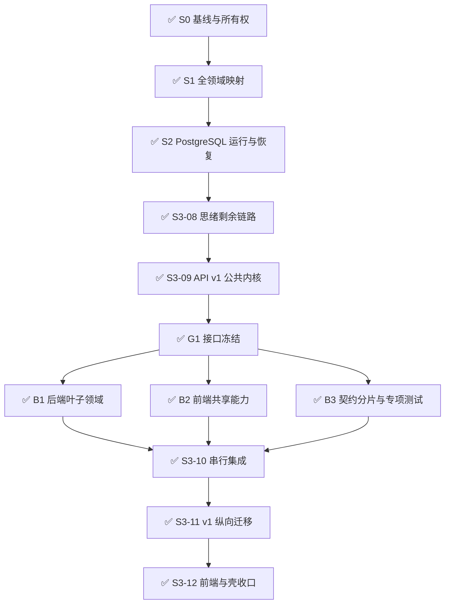
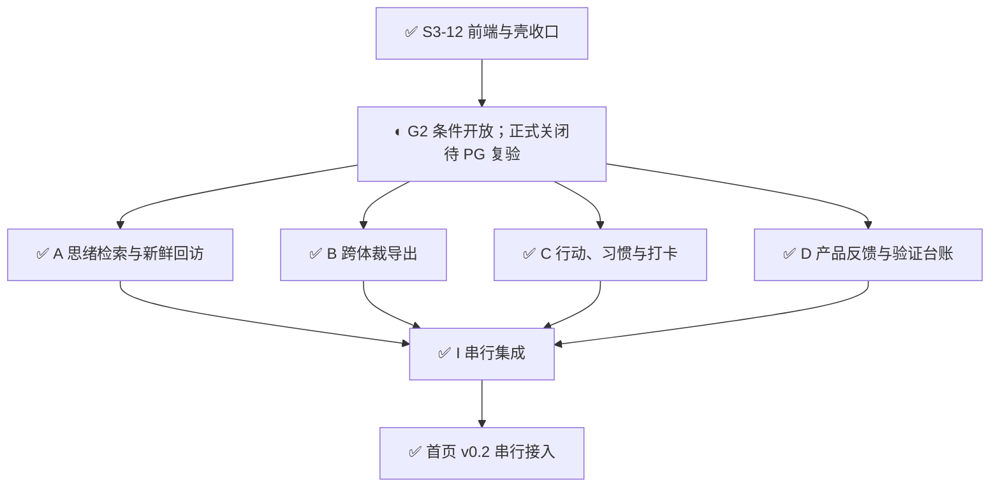
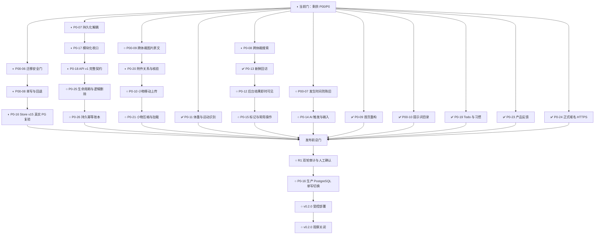
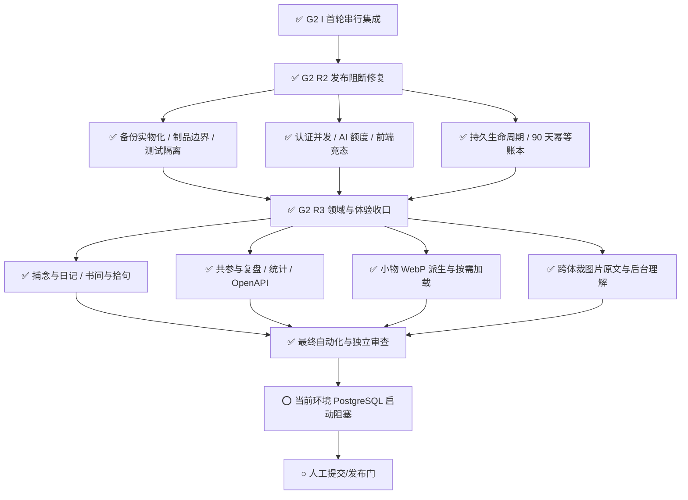
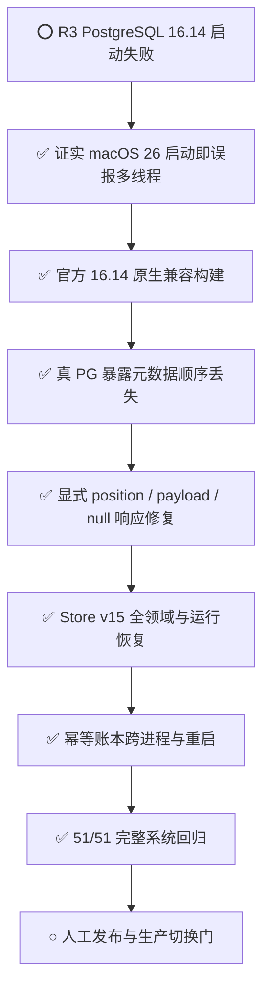
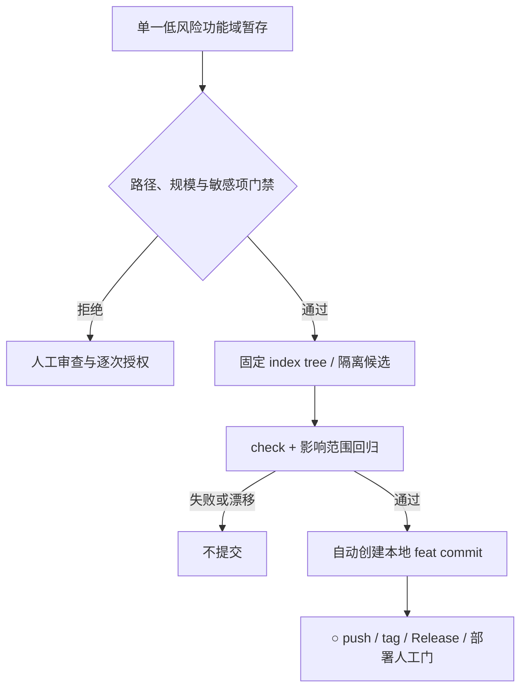

# v0.2.0 迭代计划：数据底座与思绪回访

## 版本

- 上轮：`v0.1.0`，对应生产提交 `5ae6a7035169` 与标签 `release-20260928-p00-p0-commercial-system`。该版本完成回收站、持久 AI 任务、思绪时间线、冷启动、本地测试模式、商业化和系统设计。
- 生产补丁：`v0.1.1`，提交 `54a6326f14ca` 与标签 `hotfix-v0.1.1-thought-answer`，修复收集页创建思绪时调用已删除任务工厂导致的 HTTP 500。
- 本轮：`v0.2.0`；G2 已形成以 `origin/main@54a6326f14ca` 为父提交、可继续修改的本地中间检查点，未 push 或部署。`77liu.top` 正式域名 HTTPS 作为本轮运维交付，已于 2026-09-29 通过独立 Nginx 变更上线，不改变生产应用版本。
- 采用次版本升级，是因为本轮增加数据库迁移能力和领域模块边界，但保持现有 HTTP 契约与用户数据兼容，不构成破坏性主版本变更。

## 审阅证据

2026-09-28 19:00（Asia/Shanghai）再次通过 SSH 只读检查生产主账户；当时 `store.json` 为 v14。20:40 已部署 v0.1.1，随后 `/readyz` 返回 `54a6326f14ca`。审阅只采用用户原文、捕念、初步想法、追问和批注，不把 AI 回答、推理或认知复盘视为用户意见。

同一只读快照的迁移 dry-run 结果：SHA-256 为 `30d3fa2433a9471f1784dd0f51c778a8f8f33affffa57395af23fca58ebb20e0`；25 条捕念、33 个思绪根对象、89 个思绪内容块、5 个追问、1 个备注、54 个批注，未发现孤儿思绪内容块。快照会随用户继续记录而变化，真实迁移前必须重新冻结并计算。

最新且直接影响产品排序的原文信号：

1. “搜索功能，急需！筛选：可多选-问题/思考/回答。”
2. 小物需要批量选择图片后逐项编辑。
3. 思绪需要“新鲜”数量与条目标记、按条免打扰、新鲜筛选和当前筛选内随机跳转。
4. `@神鸡` 完成后不刷新页面看不到回答；刷新后希望保留原标签、展开层级和滚动位置，并减少重复加载。
5. 发生时间需要明确选择“现在”或手动指定，避免长时间编辑后沿用旧时间。
6. 自动回答应可配置且上线默认关闭；标签输入、回车提交和复制操作需要统一。
7. 标记系统需要绿色划线、红色加重、评论互转和按引文位置排序，同时避免递归评论。
8. 后续方向包括写作建议、课程内化、习惯支持、离线安装、外部上下文、知识图谱、社区订阅和权限。

19:00 增量审阅新增：

1. 明确标记为 `P00`：评论、捕念、思绪及其内容块允许插入图片，允许仅图片记录，并接入图片理解。
2. 明确标记为 `P0`：运动记录允许上传运动软件截图，结构化字段完整提取，非结构化信息作描述性记录。
3. 首页首屏必须重构：不再让滑块占据首屏，改为紧凑按钮展开和气泡式选择；小物拍照快捷入口方向得到确认。
4. 小物移动端默认不展示可误触的大图和蒙版编辑，点击放大后才编辑；蒙版未修改时应由服务端直接保存，避免重复上传。

既有 TODO 中的数据安全、个人上下文、Todo、附件、Worker、连接器、位置与社区方向仍有效。新记录改变的是顺序：跨体裁图片原文进入 P00；搜索、首屏、小物移动端和运动截图进入本轮 P0；社区、Harness 和复杂分发继续后置。

## 本次排序变化

| 事项 | 原位置 | 新位置 | 原因 |
| --- | --- | --- | --- |
| 评论/捕念/思绪图片与仅图片记录 | P1 插图能力 | P00 首项 | 用户明确标记 P00，且涉及原始证据能否被完整保存、恢复与迁移 |
| 跨体裁搜索 | P0 | P0 前列，保持 | 最新记录仍明确使用“急需” |
| 首页首屏状态入口 | 未单列 | P0 | 用户明确“必须优化”，直接影响最高频启动体验 |
| 小物移动端编辑与免重复上传 | P1 性能项的一部分 | P0 | 已出现误触风险与不必要上传，影响移动端主流程和附件一致性 |
| 运动截图识别 | 健康记录后续增强 | P0 | 用户明确标记 P0，并可复用现有健康图片识别链路 |
| 小物批量上传 | 未单列 | P1 | 有明确价值，但需先完成单张上传、编辑和附件事务边界 |
| PostgreSQL 全领域正式切换、模块化收口、v1 契约 | P1 | P0-16～18 | 用户最新明确要求本轮完成，作为串行底座 |
| Todo/习惯、附件导出、小物存储、反馈 | P1 | P0-19～21、P0-23 | 用户最新明确提升；底座契约验收后再启动独立功能并行 |
| 小圈验证 | P1 → P0-22 | P2-09 | 2026-09-29 调整：保留已完成的验证台账底座，本轮不开展真实招募、试用、反馈收集或补偿 |
| 提示词独立跨版本管理 | 代码内常量 | P00-10 | 用户要求提示词不再写入代码；版本、激活选择、审计和回滚必须独立于应用代码版本 |
| 正式域名与 HTTPS 入口 | 独立运维修复 | P0-24 | 修复域名访问证书名称不匹配；统一正式入口并防止后续应用部署覆盖 Nginx 域名配置 |
| 统一生命周期与持久幂等 | R1 后续修复队列 | P0-25～26 | 用户要求本轮全部 P0 关闭；逻辑删除和独立幂等账本不能继续留在“下轮” |

## 优先级判断

复选框只表示当前是否已经取得对应层级的完成证据；`[x]` 不等于已经随
v0.2.0 应用发布。所有 P00/P0 均属于本轮范围，未勾选项必须在版本关闭前
完成，不得顺延到下一版本。

### P00

- [x] **P00-09 跨体裁图片原文（工作区已验证未部署）**：评论、捕念、思绪根及内容块支持最多两张原图和仅图片记录；账户 inventory、删除恢复、后台理解、陈旧结果、导出与关系映射均有专项，AI 派生不覆盖原文。
- [ ] **P00-06 PostgreSQL 迁移安全门（本地真实 PG 已通过，生产恢复演练待 R 门）**：Store v15 全领域样本已完成 SHA-256、引用检查、逐账户数量校验、整批事务回滚、旧表升级和第二数据库完整恢复；生产冻结快照与隔离恢复仍在发布阶段执行。
- [x] **P00-07 发生时间防陈旧（工作区已验证未部署）**：所有录入明确选择“现在 / 手动指定”；跨分钟、跨午夜、编辑回填及 Cmd/Ctrl+Enter 语义有专项和双端回归。
- [ ] **P00-08 迁移期间单写与可回退（本地真实 PG 已通过，生产切换待 R 门）**：本地已验证 PostgreSQL-only 写入、JSON 回切拒绝、停写导出和第二数据库启动；生产切换后回退仍必须先保全并核验 PostgreSQL 新写入。
- [x] **P00-10 提示词独立跨版本管理（工作区已验证未部署）**：55 个提示已进入不可变版本目录；当前激活 `2026.09.29.2`，保留 `2026.09.29.1`，摘要、占位符、启动、部署和审计校验通过。

### P0

- [x] **P0-07 持久化与构思服务解耦（工作区已验证未部署）**：领域服务、应用工作流与 JSON/PostgreSQL repository 分层完成，模块门禁无深层导入或循环。
- [x] **P0-08 跨体裁搜索（工作区已验证未部署）**：寻迹覆盖思绪、捕念、日记、书摘和善言，组合筛选、稳定游标、来源定位和账户隔离通过。
- [x] **P0-09 首屏与快捷记录重构（工作区已验证未部署）**：首页真实内容回看、按需录入、小物入口和轻状态参考已完成双端回归。
- [x] **P0-10 小物移动端与上传优化（工作区已验证未部署）**：列表/默认详情使用派生图，编辑按需加载编辑图与蒙版，原图仅由显式查看接口返回。
- [x] **P0-11 体重/运动截图识别（工作区已验证未部署）**：结构化字段、缺失容忍、用户核对、异步防串写及合成模型回归已完成。
- [x] **P0-12 后台结果即时可见（工作区已验证未部署）**：根回答、追问、批注神鸡与图片理解只合并目标节点，并保留草稿、展开层级和滚动位置。
- [x] **P0-13 思绪“新鲜”回访（工作区已验证未部署）**：未留痕、已读、免打扰、新鲜筛选和当前筛选内任意门已接入。
- [x] **P0-14 AI 触发与输入一致性（工作区已验证未部署）**：自动回答成为默认关闭的账户设置；标签回车、普通 Enter、Cmd/Ctrl+Enter 和输入法组合态语义已固定。
- [x] **P0-15 标记与常用操作收口（工作区已验证未部署）**：绿色划线、红色加重、评论互转、引文排序、复制、图片评论和低频菜单已接入。
- [ ] **P0-16 PostgreSQL 全领域映射与正式切换（本地真实 PG 已通过，生产待发布）**：Store v15 全领域、认证/设置/用量、附件、生命周期和幂等账本已通过真实数据库、重启及独立恢复；仍需生产迁移与单写切换。
- [x] **P0-17 模块化单体收口（工作区已验证未部署）**：50 个模块、201 条拥有路由；目标领域内联路由和死 helper 已删除，`migrationExceptions` 清零。
- [x] **P0-18 `/api/v1` 契约（工作区已验证未部署）**：60 条路径、104 个操作；包络、游标、ETag/If-Match、幂等键、TraceID、base path 和内容附件分片通过。
- [x] **P0-19 Todo 与习惯支持（工作区已验证未部署）**：行动、习惯、打卡、来源、幂等和父子回收恢复已接入。
- [ ] **P0-20 附件关系化与内部核验导出（工作区已验证；生产 OSS 待 R 门）**：本地/模拟 inventory、共享引用、删除恢复、孤儿和备份物化通过；生产 OSS 快照仍须在发布门核验。
- [x] **P0-21 小物加载与存储优化（工作区已验证未部署）**：WebP 缩略/详情/编辑/Alpha 派生、尺寸质量硬上限、失败补偿、列表免原图和编辑按需加载通过。
- [x] **P0-23 产品反馈入口（工作区已验证未部署）**：反馈提交、状态历史、版本关联和主动上下文授权已接入。
- [x] **P0-24 正式域名与 HTTPS 入口（生产已上线）**：域名证书、HTTP/IP 308 跳转、续期和部署门禁已验证。
- [x] **P0-25 统一生命周期与逻辑删除（工作区已验证未部署）**：草稿/正式生命周期、tombstone、删除/恢复/正式化/永久清理及关联解除事件已进入元数据与 PostgreSQL 映射。
- [x] **P0-26 持久幂等账本（工作区已验证未部署）**：90 天保留、响应重放、`null` 响应、过期复用和永久清理后防重复已接入；JSON 与 PostgreSQL 重启/跨进程专项通过，元数据顺序和未知扩展无损往返。

### P1

- [ ] **P1-04 个人上下文 V1**：建立可追溯、可修正、可失效的用户事实与 Token 硬预算。
- [ ] **P1-05 独立 Worker**：数据库与模块边界稳定后拆出 AI、图片、索引和周期任务。
- [ ] **P1-10 小物批量录入**：多图选择后逐项编辑、取消和重试。

### P2

- [ ] **P2-01 主题写作与表达教练**
- [ ] **P2-02 课程内化**
- [ ] **P2-03 外部上下文连接器**
- [ ] **P2-04 自动关联与知识图谱**
- [ ] **P2-05 离线捕捉与可安装应用**
- [ ] **P2-06 地图与定位**
- [ ] **P2-07 真机与触觉验收**
- [ ] **P2-08 评论反馈信号**
- [ ] **P2-09 小圈验证（原 P0-22；v0.2.0 取消）**：基于已完成的验证台账底座，在后续版本开展真实招募、同意/退出、试用、反馈、补偿和奖励记录。

### P3

- [ ] **P3-01 Harness 与受控自动探索**
- [ ] **P3-02 社区、订阅与选择性分享**
- [ ] **P3-03 内容订阅与商业化**
- [ ] **P3-04 独立搜索/向量服务**：只在规模指标触发后建设。
- [ ] **P3-05 分片与多区域**：只在容量或合规边界触发后建设。

## 串行、并行开发安排

工程调度约束以 [`knowledge/modularization-design.md` 第 11 节](../knowledge/modularization-design.md#11-v020-串行底座与并行准入) 为准，状态只在 `README-TODO.md` 维护。

状态标记：`✅` 已取得当前阶段要求的验收证据；`◐` 正在进行；`○` 尚未开始。以下已完成流程图作为阶段记录永久保留，后续流程不得与其合并覆盖；当前状态另用新图表达。

### 已完成流程留痕一：G1 后三路重构并行

### 已完成流程留痕二：G2 后四路功能并行

### 历史计划留痕：当时的剩余 P00/P0 收口

以下图保留 R2/R3 开始前的规划状态，不代表 2026-09-30 当前进度；后续实际结果见“追加留痕三/四”。所有当前 P00/P0 均须在 v0.2.0 关闭前完成；已移至 P2-09 的小圈验证不再属于本轮发布门。

P0-16 横跨“发布前真实数据库复验”和“发布窗口生产单写切换”两个节点。
除此之外，任何未勾选的 P00/P0 都必须在进入发布前总门前关闭。原 P0-22
已于 2026-09-29 调整为 P2-09；验证台账能力继续保留，但真实小圈验证不再
阻断 v0.2.0。

### 追加留痕三：G2 R2/R3 收口

以下流程追加在既有 G1、G2 图之后，表示后续实际执行批次；不替代或合并上方历史图。

R2/R3 收口后的当前规模为 **50 个模块、201 条拥有路由、60 条 OpenAPI
路径、104 个操作和 23 个视图**。P00-09 新增最多两张原图、仅图片记录、
账户 inventory 校验、正文更新时同事务回收、统一后台图片理解、陈旧结果
拒绝及局部前端合并；提示词目录追加不可变版本 `2026.09.29.2`，当前共
55 个提示。真实供应商未调用，生产写源仍为 JSON。

2026-09-29 本轮再次执行 `npm run test:postgres` 与
`persistence-ledger-postgres-regression.mjs`，两者均在任何业务断言前因
`postmaster became multithreaded during startup` 失败；`LC_ALL=C`、
`LANG=C` 以及 `OBJC_DISABLE_INITIALIZE_FORK_SAFETY=YES` 均未解除。
因此 P0-16 的生产单写切换、P0-20 的生产 OSS 快照和 P0-26 的最新真实
PostgreSQL 运行证据继续保留在人工发布门，不以旧基线替代本轮结果。

### 追加留痕四：G2 R4 真实 PostgreSQL 解阻

以下流程追加记录 2026-09-30 的实际解阻与复验，不修改上方 R3 的历史失败节点。

原嵌入式二进制在 macOS 26.6.2 上仍于业务断言前失败；最小原生 C
进程在执行应用逻辑前即返回 `pthread_is_threaded_np()=1`，确认该环境中的
探测结果不能区分实际多线程。使用官方 PostgreSQL 16.14 源码、原生 arm64、
不链接 LDAP/ICU 且在构建配置中禁用该失真探测的临时二进制后，真实数据库
门禁进入全部业务断言。

复验先发现并修复生命周期数组未保存位置的问题，随后补齐生命周期/幂等
元数据原始 payload、JSON `null` 响应、旧表依据账户快照精确回填，以及
Store v15 五个新增领域、设置并发、自动回答默认关闭、小物四类派生路径和
恢复前后完整关系快照断言。`npm run test:postgres` 已包含独立幂等账本专项
并全部通过；生产数据、生产 OSS 和正式写源均未触碰。机器证据见
[`g2-r4-postgres-2026-09-30.json`](g2-r4-postgres-2026-09-30.json)。

### 追加留痕五：局部 feat 自动提交门禁

2026-09-30 起，开发阶段不再要求每个低风险本地提交逐次取得人工授权。
Agent 可将单一功能域的代码、对应测试和说明文档精确暂存后，运行
`npm run commit:feat -- --message "feat(scope): 摘要"`。门禁固定暂存区
tree，在隔离候选目录执行 `npm run check` 与后端、前端或门禁自身的影响
范围回归；测试完成后再次核对 HEAD、分支、tree 和暂存文件工作区状态。

自动范围不含 `main`、`release/*`、`hotfix/*`，也不含门禁自身、工程治理
规则、包清单/依赖锁、认证、持久化、共享入口、配置、外部供应商、部署/
迁移、生产/私有数据、二进制、探索资产或跨功能域变更。门禁本身的首次
引入和后续修改均走人工提交授权，避免自修改后自批准。自动提交写入已验证
tree 与实际命令 trailer，但不代表 G2 发布审计通过，不授权 push、tag、
Gitee Release、生产切换或真实付费服务调用。权威规则见
`knowledge/engineering-rules.md`。

### 前侧串行：先交付可替换、可验证的底座

1. **S0 基线**：保留 v0.1.1 热修和所有现有改动，记录运行/接口/数据样本；集成负责人独占热点和共享文件。
2. **S1 映射**：补齐所有业务集合与嵌套对象，保留用户原文、AI 归属、版本、时间及数组顺序；盘点认证/会话、配置、用量和附件引用。验收为关系数据往返重建一致，不能只存一份完整 JSON 快照。
3. **S2 运行**：实现 PostgreSQL repository、事务和 RLS，使用真实 PostgreSQL 验证两账户、并发更新、失败回滚、重启和恢复；先切换本地隔离环境，JSON/数据库禁止双写。
4. **S3 契约**：按高耦合链路逐项拆后端和前端共享能力，再统一 v1 的请求/响应、错误、分页、版本和幂等；为原客户端保留明确兼容行为。
5. **G 准入**：schema、公开服务接口、OpenAPI 和前端 API/状态接口验收后冻结，任务列明基线、依赖、目录、测试与完成条件，才开放功能并行。

当前已完成 **✅ G2 A-D 功能轮与 I 串行集成**。四路隔离工作树交付思绪检索/回访、跨体裁导出、行动/习惯和反馈/验证台账，主线接入 Store v15、34 个新增 v1 操作与三个新视图；随后首页 v0.2 作为第 43 个模块接入。当前模块门禁登记 43 个模块、116 条路由，完整系统 43/43 阶段通过（156460 ms）。因本轮持久化映射已变化且当前环境的真实 PostgreSQL 在业务断言前启动失败，G2 正式关闭仍待获准环境复验；生产仍为 JSON 单写。

2026-09-29 用户指定提前实现体重/运动截图识别：P0-11 扩展为体重/体成分与运动，集成负责人串行复用现有识别和附件链路。此项单独验收，不开启后侧功能并行；调度约束与模块登记已同步。

### 后侧并行：最多四路，按领域独立

| 工作流 | 包含任务 | 内部顺序与依赖 |
| --- | --- | --- |
| A 思绪与检索 | 搜索、后台结果、新鲜回访、标记 | 依赖内容版本、检索和任务通知契约；同一思绪链保持单一负责人 |
| B 附件与媒体 | P00 图片原文、附件导出、小物移动端/存储、运动截图 | 先统一引用与图片记录，再优化小物和识别；多个媒体子项内部串行 |
| C Todo/习惯 | 行动、习惯、打卡、来源关联 | 依赖已冻结的对象版本、软删除、引用和幂等接口 |
| D 产品反馈 | 功能反馈、同意/退出、验证工具 | 依赖身份、版本和导出接口；参与者实际试用留在发布验证阶段 |

各路使用独立工作树、端口、数据目录和测试；共享 schema、依赖锁、模块登记、入口文件、全局 CSS 只能由集成负责人修改。首屏、全局时间/输入、AI 自动触发设置由集成负责人依次处理；功能分支交付挂载模块后逐路集成。发现公共契约缺口时先回到串行底座修订，再同步受影响分支。

### S3 后续开发节点

| 节点 | 状态 | 交付 | 退出条件 |
| --- | --- | --- | --- |
| S3-08 思绪剩余链路 | ✅ | 整套思绪创建/编辑/删除、草稿、冷启引子、前台流式根回答已迁入领域、应用与 HTTP；入口重复实现已删除 | 幂等、版本竞态、完整追问链、流断开、删除恢复和账户隔离通过 |
| S3-09 v1 公共内核 | ✅ | OpenAPI 根结构、统一成功/错误结构、游标、ETag/If-Match、Idempotency-Key、TraceID 和路由注册方式已实现 | 公共契约测试覆盖校验、认证、冲突、重复请求、SSE 和 base path；G1 后支线不得私改 |
| G1 接口冻结 | ✅ 本地验收 | 已冻结领域服务输入输出、v1 `1.0.0` 公共结构、模块挂载和测试夹具接口；只开放重构并行，不开放产品功能并行 | 三路任务已从同一 G1 工作区基线创建隔离分支/工作树并完成 |
| B1 后端叶子领域 | ✅ 已集成 | `checkins/health` 记录服务、HTTP 适配与专项测试 | 领域只接收所属集合；公共入口由集成负责人接入 |
| B2 前端共享能力 | ✅ 已集成 | `content/media/time` 无业务共享能力与专项测试 | 不直接 fetch，不持有跨领域业务状态；页面壳行为保持兼容 |
| B3 契约分片与专项测试 | ✅ 已集成 | 思绪 OpenAPI 分片、闭合引用、运行覆盖与写入头专项 | 根 OpenAPI 只组合分片，公共错误定义未变 |
| S3-10 小批次串行集成 | ✅ | 已按 B1 → B2 → B3 接入入口、模块登记、根契约和系统测试，并清除 health 内部循环依赖 | 31 模块/72 路由、关键专项和 36 阶段系统测试通过 |
| S3-11 v1 纵向迁移 | ✅ | 状态与健康记录新增列表/详情、幂等创建、ETag/If-Match 更新和删除；旧 `/api/*` 继续调用同一领域服务 | 新旧接口、base path、账户隔离、游标、幂等重试、版本冲突和回收站兼容通过 |
| S3-12 前端与壳收口 | ✅ | 根 `app.js`/`styles.css` 成为薄入口；`frontend/app/pages/features` 接管启动、20 视图注册及页面进入/离开生命周期 | HTML 无内联业务逻辑；浏览器运行、桌面/移动、部署与模块门禁通过 |
| G2 正式 G | ✅ 本地验收通过 | A-D 与 I 本地集成、Store v15 真实 PostgreSQL、OpenAPI、桌面/移动及回滚回归均完成 | 进入发布前双轮检查与人工 R 门；不等同于生产切换 |
| A-D 功能并行 | ✅ 已集成 | A 思绪检索/回访；B 跨体裁导出；C 行动/习惯/打卡；D 反馈/验证台账 | 四工作树专项、隐私、账户隔离、幂等、版本与失败回滚通过 |
| I 串行集成 | ✅ 本地验收 | 按 A → B → C → D 接入 Store v15、HTTP/OpenAPI、前端页面和公共入口，R2-R4 完成后关闭本地阻断 | 50 模块/201 路由、104 个 OpenAPI 操作、23 个视图及 51/51 系统阶段通过 |

### G 并行准入检查

- ✅ S1 全领域关系映射、哈希、事务与独立恢复。
- ✅ S2 PostgreSQL 运行、RLS、并发、断连、重启和单写保护。
- ✅ 当前 PostgreSQL 40 项专项与可复用验收路径。
- ✅ P00-10 提示词独立版本、启动/部署校验与审计引用。
- ✅ S3-08 思绪剩余链路完成并通过完整系统复验。
- ✅ G1：`/api/v1` 公共内核、思绪纵向样板与领域服务接口冻结。
- ✅ 三路重构并行完成并按 B1 → B2 → B3 串行集成。
- ✅ 剩余后端领域及 HTTP 迁移例外清零。
- ✅ `/api/v1` OpenAPI、错误、分页、版本和幂等公共契约完成。
- ✅ 前端应用入口、页面路由、feature 生命周期和样式入口模块化。
- ✅ G2 A-D 四路产品功能及 I 串行集成，最终完整系统 51/51 阶段通过。
- ✅ Store v15 已在兼容当前 macOS 26 的本地 PostgreSQL 16.14 完成真实复验；G2 本地正式门关闭。

### 发布与验证

全部 P00/P0 实现后，串行集成、功能稳定性测试、数据库差分与恢复演练、双轮审计依次完成；按本轮发布授权短暂停写、冻结 JSON、切换生产 PostgreSQL 并观察。数据库接受新正式写入后默认前滚，回退前必须保全并校验新增数据。真实小圈验证已移至 P2-09，不在 v0.2.0 发布或观察关闭范围内。

## 本次实际开发交付

- 新增领域对象、嵌套所有权、任务/来源关系、附件路径映射；从关系行重建完整业务 store，保留用户原文、模型归属、时间、版本、顺序、空值与未知扩展。
- 迁移器从仅比较思绪数量升级为逐行字段、关系、附件清单和内容哈希校验；源文本与对象不一致、重复 ID、孤儿所有权和必要任务目标缺失均拒绝。
- 同一快照重复导入先验真再复用，目标不同须提供旧哈希；有数据但缺少迁移证据时拒绝覆盖。建表与导入角色分离，导入禁止 superuser、BYPASSRLS 及表 owner。
- 新增可复现的真实 PostgreSQL 集成脚本，覆盖事务失败/断连、跨账户隔离、并发幂等和不依赖快照表的关系导出恢复。
- 已补齐认证/会话独立 schema、配置/秘密分区、逐次用量、逐场景成本和附件大小/哈希清单；完整批次单事务导入，源文件或附件漂移拒绝提交。合成双账户已完成跨独立数据库恢复。
- S2 已接入正式关系行运行读写，移除早期思绪投影；原子注册、配置/用量事务、账户锁和 revision、附件预留/验真/清理、唯一写源与旧快照覆盖保护均已实现。当前兼容适配器按账户提交，只支持每数据库一个应用实例。
- 新增停写导出命令与 PG 备份分支，逐文件核对附件，再用新目录/数据库恢复；部署器拒绝自动回滚到不支持数据库的旧代码。映射、权限、命令和未完成边界统一见 [`knowledge/postgres-migration.md`](../knowledge/postgres-migration.md)。
- P0-11 新增体重/运动字段契约及健康领域模块：缺总重体成分记录、运动项目/秒级时长/两类热量/心率区间、描述及核对说明，支持图片上传、粘贴、拖放、回填、保存编辑和原图核对。数据口径统一见 [`knowledge/metrics.md`](../knowledge/metrics.md)。
- P0-24 已完成独立生产运维变更：仓库与生产 Nginx 均以 `77liu.top` 作为正式 HTTPS 入口，保留可信的 IP HTTPS 入口仅作 308 跳转；部署脚本要求域名/IP 两套证书齐备后才安装该站点配置。本次未重启 Node、未修改数据、未发布 v0.2.0 应用代码。

## 当前验证

- `npm run test:commit-gate` 通过：覆盖隔离候选、本地提交、受保护分支与高风险/自修改路径拒绝、同路径未暂存内容拒绝、测试失败不提交，以及验证期间暂存 tree 漂移拒绝；纳入后端系统矩阵后 `npm run test:backend` 47/47 通过（`144074 ms`）。
- `npm run check` 通过；当前已登记 50 个模块、201 条拥有路由，无深层导入或循环依赖；应用运行环境读取收敛到配置入口，提示词目录另有版本、摘要、必需 ID 与占位符检查。
- 持久化回归通过（已纳入 `test:persistence` 和系统测试）；覆盖 JSON 串行写、业务及独立文件往返、秘密分区、引用、源内容与损坏保护、构思服务。
- `npm run test:postgres` 通过：PostgreSQL 16.14，非 owner / NOSUPERUSER / NOBYPASSRLS；当前统一入口同时执行全领域集成和持久幂等账本专项。Store v15、RLS、认证 schema 授权、旧元数据表升级、源漂移、篡改/失败回滚及第二数据库完整恢复均通过。
- PostgreSQL 测试二进制仅位于 `/tmp` 或忽略目录，不改变应用依赖。macOS 26 对 `pthread_is_threaded_np()` 的启动期失真与隔离测试构建方式见 `knowledge/system-testing.md`；该兼容构建不得用于生产。
- S1 收口后 `npm run check`、`git diff --check` 和完整 `npm run test:system` 通过；后端与前端共 22 个阶段，总用时 `103965 ms`，本地日志在忽略目录 `data/s1-system-test.log`。
- S2 真实 PostgreSQL 16.14 专项通过：新建 HTTP 应用验证注册、会话、账户隔离、并发配置、回收站、附件上传/永久清理/中断恢复、重启后原会话有效、无业务 JSON 落盘、旧 JSON 回切拒绝、只读角色停写导出及第二数据库启动。跨连接写入、revision 冲突、断连、多次 commit 和扩展保留均有独立断言，日志 `data/s2-postgres.log`。
- S2 完整系统 22 阶段通过（`103533 ms`），含原有后端、认证、部署失败回滚、桌面与移动回归，日志 `data/s2-system-test.log`。真实云端 PG 备份/OSS 和生产切换尚未执行，不将本地证据替代生产验收。
- S3 第二段 PostgreSQL 专项通过：并发创建任务与批注对话持久化、结果/任务/通知同事务、通知账户隔离与已读、重启只恢复 queued，以及导出到新数据库后终态不重放。模块契约另覆盖重复引文、漂流上下文/回复保留、两套批注 URL、模拟提交失败后的结果回滚、单一重试后继和双账户同 ID 并行任务。日志 `data/s3-collaboration-postgres.log`。
- S3 第二段完整系统 24 阶段通过（`107816 ms`），包括认证、后端、可观测性、部署回滚、前端传输/状态和桌面/移动 UI；日志 `data/s3-collaboration-system.log`。通用 AI、剩余领域、前端页面/功能与 v1 尚未完成，未开放 G。
- S3 删除恢复段：新增整记录/嵌套恢复、批注回附、共享引用、两次提交失败及调度账户隔离专项；完整系统 25 阶段通过（`105440 ms`），`npm test`、模块/语法检查通过，日志 `data/s3-trash-system.log`、`data/s3-trash-backend.log`、`data/s3-trash-check.log`。先复现后修复批注任务删除恢复后误收旧结果的问题；旧版无版本排队任务保守过期，认证重启回归覆盖该兼容行为。
- 本段 `npm run test:postgres` 未通过：应用启动前 PostgreSQL 16.14 报 `postmaster became multithreaded during startup`；动态库路径已补齐，固定 locale/时区和直接启动仍失败。日志 `data/s3-trash-postgres.log`；已加入的恢复版本、清理实物失败与重启恢复断言尚未执行，保留验收缺口，继续独立模块工作。
- S3 附件段：上传/存储/临时文件/配额/清单恢复迁入 `shared/attachments`，HTTP 上传与 GET/HEAD 迁入 `http`；5 个脚本消费者和部署语法检查同步，旧根入口删除。先复现后修复 mock 本地回退失效及清理后旧本地副本仍可读；清理提交失败时保留持久本地实物供恢复。
- 新上传专项验证两账户配额竞态、批量部分失败、清单写入顺序/故障与恢复；认证补齐附件 HEAD/私有缓存/越权。`npm test`、`npm run check`、部署专项及完整系统 26 阶段通过（`119962 ms`），日志 `data/s3-attachments-backend.log`、`data/s3-attachments-check.log`、`data/s3-attachments-system.log`。清单接口桩不替代真实 PG，本段数据库专项仍有上述环境缺口；未调用真实 OSS。
- S3 配置/日志段：统一启动配置快照与模式校验，迁出异步上下文、提交后摘要、HTTP 追踪和请求完成/异常审计；删除根日志入口，所有附件脚本显式传入配置，模块门禁禁止应用绕过配置读取环境。新增账户交错、后台追踪、SSE/断连、配置兼容、保留边界与日志故障恢复断言。
- 本段 `npm run check`、独立基础设施/可观测性专项、`npm test` 和完整系统 26 阶段通过（`121082 ms`）；日志 `data/s3-config-backend.log`、`data/s3-config-system.log`。日志目录故障期间业务仍成功保存，恢复后继续审计。部署回归覆盖新目录，部署说明补充旧部署器升级条件；AI 场景/供应商/费用规则仍待迁移，真实 PG 缺口未关闭。
- S3 AI 设置/用量/审计段：新增 AI 领域、账户文档 repository 与设置 HTTP 适配，保留四档/13 场景、旧版本迁移、峰谷单价快照、未知 usage 和额度语义；先复现再修复 JSON 设置并发局部修改互相覆盖。模块门禁追加禁止领域直接网络/文件/SDK I/O。
- 本段 `npm run check`（19 模块/40 路由）、AI 专项、`npm test` 与完整系统 27 阶段通过（`124594 ms`），日志 `data/s3-ai-settings-backend.log`、`data/s3-ai-settings-system.log`。HTTP 故障注入确认模型已成功时账本或审计写失败不重复调用，领域专项覆盖账户隔离、回滚/恢复、备份和额度释放。再次执行真实 PG 专项仍在启动时遇到 `postmaster became multithreaded during startup`，日志 `data/s3-ai-settings-postgres.log`；新文档运行适配的数据库证据待补验，接口桩不能替代。
- S3 AI 成本/DeepSeek 边界段：成本归一化/统计、通用 SP/场景契约、模型参数及调用/重试策略迁入 `ai`；DeepSeek HTTP/SSE/图片编码迁入独立基础设施。成本接口归 HTTP，本地日期和数值原语迁入共享模块。移除服务入口 587 行，保留具体业务 Prompt 和阿里云分割的迁移例外。
- 本段新旧差分核对成本/统计和全部场景×风格提示词一致；供应商专项覆盖 JSON/SSE、逐字节拆包、断流/过滤/截断、额度耗尽、超时、双账户与图片摘要。`npm run check`（21 模块/42 路由）、`npm test` 与完整系统 28 阶段通过（`124376 ms`），日志 `data/s3-ai-provider-check.log`、`data/s3-ai-provider-backend.log`、`data/s3-ai-provider-system.log`。成本专项验证整份替换、账户隔离及归一化失败发生在提交前；真实 PG 增加成本双账户/重启/导出恢复断言，但仍在数据库启动阶段失败，日志 `data/s3-ai-provider-postgres.log`。
- 当前本地数据只读 dry-run 通过：20 个字段、56 个业务/嵌套对象、15 条引用、4 个附件引用。原文件 SHA-256 为 `39a7e872a70e07154848be216a7d9959c37a9d6ab37d0ada9a7515fcfacc1108`，内容 SHA-256 为 `05064fa3173d8e743936c214fbec42123ef1eed8216f3977b23c98350a6f2444`。
- S3 阿里云分割段：SDK/轮询/PNG 下载与供应商错误迁入基础设施，小物流程/临时文件归领域，路由归 HTTP；限流队列与图片读取/摘要迁入共享模块。服务入口减少 166 行，真实冒烟复用供应商公开入口。
- 本段 SDK/传输替身验证同步/异步、失败状态、无重试、PNG 大小/格式/超时、同组审计、双账户/队列、上传失败释放和临时清理。`npm run check`（23 模块/43 路由）、分割专项、完整系统 29 阶段通过（`126045 ms`，包含后端基线、认证和前端），`git diff --check` 通过。日志 `data/s3-segmentation-check.log`、`data/s3-segmentation-system.log`；未运行真实阿里云冒烟，PG 环境缺口未关闭。
- S3 小物保存/发生时间段：载荷、旧记录归一化、创建/编辑归小物领域，仓储仅接收小物集合，删除沿用应用回收事务；严格日期、本地时分合成与发生时间输入解析归共享时间。迁移前对照旧实现核对 64 组载荷及时间输入，未改变旧 PATCH/日期解析兼容语义，服务入口再减少 90 行至 2246 行。
- 本段新增 UTC/上海/纽约和夏令时、旧字段/扩展保留、提交失败、真实 HTTP 跨账户编辑与删除恢复断言。`npm run check`（23 模块/46 路由）、专项和完整系统 30 阶段通过（`130175 ms`，包含后端基线、认证与桌面/移动），日志 `data/s3-keepsake-time-check.log`、`data/s3-keepsake-time-system.log`。PG 增加小物隔离/编辑断言；显式 arm64 启动临时 PostgreSQL 仍报原多线程错误，数据库业务断言待补验。
- 2026-09-29 在 Codex 获准的本机执行环境复用原 EDB PostgreSQL 16.14 与原测试脚本，完整通过现有 40 项数据库检查（退出码 0），包括此前待补的账户文档/成本隔离、版本化恢复、持久附件清理失败与重启恢复；脚本及二进制哈希、执行方式和结果见 `reports/postgres-validation-2026-09-29.json`。Trae 内线程来源仍未定位，但不再阻塞当前验收路径；未修改业务代码或数据库保护检查。
- P00-10 提示词目录：53 个系统提示词、场景契约、业务任务和模型可见模板迁入 `prompts/versions/2026.09.29.1.json`，manifest 固定激活版本、SHA-256、必需 ID 与占位符契约；`PROMPT_CATALOG_VERSION` 可独立固定历史版本。启动与部署候选均校验目录，每次 DeepSeek 审计记录目录版本及摘要。专项、主回归、认证、可观测性、部署回滚及完整系统 32 阶段通过（`144123 ms`），日志 `data/p00-prompt-catalog-system.log`；未调用真实供应商，未部署。
- S3-08 思绪剩余链路：整套思绪创建/编辑规则和回答保存进入 `modules/thoughts`，创建链/后台任务原子事务、草稿/引子、前台流式回答与并发幂等进入 `app/thought-workflows`，新旧路由由 `http/thoughts` 统一适配；`server.mjs` 删除 110 行重复业务。原主回归继续覆盖完整追问链、流断开后落盘、版本竞态、删除恢复和自动回答幂等。
- S3-09/G1：新增 v1 `1.0.0` 公共内核和 OpenAPI 根结构，思绪链列表/详情/创建/修改/删除/流式回答成为首个纵向样板；固定统一 `data/error/meta`、TraceID、opaque cursor、ETag/If-Match、Idempotency-Key 与模块注册。专项覆盖 base path、认证、非法 JSON、分页、重复键、前置条件、SSE、旧接口共用数据、恢复和账户隔离；模块门禁为 27 个模块、66 条路由，完整系统 33 阶段通过（`133137 ms`），文件摘要和启动单见 `reports/g1-contract-freeze-2026-09-29.json`。
- S3-10：创建 `refactor/v020-b1-backend`、`refactor/v020-b2-frontend-shared`、`refactor/v020-b3-contract-tests` 三条分支及 `/private/tmp/for-now-v020-b1|b2|b3` 独立工作树。B1 交付状态/健康记录领域与 HTTP，B2 交付前端内容/时间/媒体共享模块，B3 交付思绪 OpenAPI 分片；主工作区按 B1 → B2 → B3 串行集成。三组新增专项、API v1、主回归、`npm run check` 和完整系统 36 阶段通过（`137115 ms`），门禁为 31 个模块、72 条路由；机器可读证据见 `reports/s3-10-integration-2026-09-29.json`。
- S3-10 后单次真实 PostgreSQL 复验仍在当前执行环境启动阶段报 `postmaster became multithreaded during startup`，未进入业务断言；本轮未修改 schema、映射或 repository，数据库依据仍为同日已通过的 40 项真实 PostgreSQL 证据。
- S3-11/12：状态与健康记录新增 `/api/v1/checkins*`、`/api/v1/daily-records*` 共 10 个操作，旧接口复用同一 records 服务；重复幂等键在省略发生时间时继续稳定复用首次结果。前端根入口缩为 3 行，20 个视图和页面副作用分别进入 `frontend/pages` 与 `frontend/features`，完整运行时进入 `frontend/app`，根 CSS 只加载模块样式。模块门禁为 34 个模块、82 条路由，完整系统 38 阶段通过（`165661 ms`）；机器可读证据见 `reports/s3-11-12-completion-2026-09-29.json`。
- G2/I：四个隔离工作树分别交付思绪检索/回访、跨体裁导出、行动/习惯与反馈/验证台账，主线依次完成契约审查和公共入口接线。Store 升至 v15，新增行动来源与习惯打卡父子关系；OpenAPI 达 32 条路径/51 个操作，前端达 23 个视图。`npm run test:system` 43/43 阶段通过（`151709 ms`）；单次真实 PostgreSQL 复验在断言前触发 macOS `postmaster became multithreaded during startup`，因本轮改动映射，旧基线不作为通过证据。机器结果见 `reports/g2-i-integration-2026-09-29.json`。
- 生产主账户的先前思绪 dry-run 证据保留；本次未重新读取生产，也未将生产数据导入 PostgreSQL，正式写源仍为 JSON。
- 按功能开发规则未运行 `npm run test:load`。
- P0-11 接入后重新通过完整系统 21 阶段（`102628 ms`），隐藏字段清理追加前端回归；覆盖体重空值、衣物旧记录、运动时长/零值、部分编辑、删除恢复、失败附件清理、重启和异步防覆盖。使用合成模型结果，未对用户两张截图调用真实供应商；生产数据库状态未变。
- P0-24 生产验证：`https://77liu.top/now/` 返回 200 且 TLS 名称校验通过；`http://77liu.top/now/` 与 `https://123.57.140.24/now/` 均 308 跳转到域名。`certbot renew --dry-run` 成功，自动续期 timer 已启用；部署专项新增域名配置安装断言，完整系统 43/43 阶段通过（`156460 ms`）。变更前 Nginx 备份为 `/etc/nginx/sites-available/dysf.before-domain-20260929-175523`，完整记录见 [`domain-https-cutover-2026-09-29.md`](domain-https-cutover-2026-09-29.md)。
- G2 R2/R3 最终自动化：模块门禁为 50 个模块、201 条拥有路由，提示词目录 55 项，OpenAPI 为 60 条路径/104 个操作；`npm run test:backend` 45/45 通过（`153901 ms`），冻结工作区的 `npm run test:system` 50/50 通过（`198684 ms`）。P00-09 覆盖两图幂等上传、失败补偿、四类仅图片记录、同事务图片回收、任务取消、非破坏性图片理解、局部结果合并与双端布局；第二轮独立审查的“孤儿上传”和“删除后继续计费”两项均经两名验证者复核修复。真实 PostgreSQL 两个专项仍在启动阶段失败，未进入业务断言；未调用真实供应商，未提交、推送或部署。机器结果见 [`g2-r3-integration-2026-09-29.json`](g2-r3-integration-2026-09-29.json)。
- G2 R4 真实数据库收口：真实 PostgreSQL 16.14 先暴露并修复 `_persistence` 顺序未关系化问题，再补齐 metadata 扩展字段、JSON `null` 幂等响应和旧表快照回填；Store v15 五个新增领域、完整关系恢复、默认关闭自动回答、并发设置、治理中台 PostgreSQL 快照与四类小物派生路径均进入专项。统一 `npm run test:postgres` 的 42 项集成检查和持久幂等账本专项通过；基于 `origin/main` 的合并工作区 `npm run test:system` 51/51 通过（`187993 ms`），固定提交独立候选 51/51 通过（`188825 ms`），依赖审计 0 漏洞。已获准创建可继续修改的本地中间检查点提交；未读取或修改生产数据，未调用真实供应商，未 push 或部署。机器结果见 [`g2-r4-postgres-2026-09-30.json`](g2-r4-postgres-2026-09-30.json)。

## 完成条件

- JSON 与 PostgreSQL 冻结快照的账户数、对象 ID、版本、时间、关系、附件引用和 SHA-256 校验通过。
- 已迁移接口与 `v0.1.1` 的成功、失败和并发行为兼容，且保留自动回答热修回归。
- `npm run check`、`npm run test:backend`、`npm run test:frontend` 和 `npm run test:system` 通过。
- 功能开发阶段不运行 `npm run test:load`。
- 完成恢复演练和双轮发布审计后，才允许切换正式数据源或部署。
- 正式发布前重新只读核对域名证书有效期、HTTP/IP 跳转、Certbot timer 与 `nginx -t`；已上线的域名基础设施不替代应用候选发布验收。
- 全领域 PostgreSQL 正式切换、模块化例外清零、v1 契约一致，以及当前全部 P0 的验收证据齐全。

## 本轮不做

- 不拆微服务，不引入 Kubernetes、Kafka、Redis 或独立向量数据库。
- 不长期双写 JSON 与 PostgreSQL。
- 不把 AI 内容提升为用户事实。
- 不在本轮实现社区、支付、真实 Harness、位置采集或跨区域。
- 不在本轮开展真实小圈招募、试用、反馈收集或补偿发放；验证台账底座保留，执行工作进入 P2-09。
