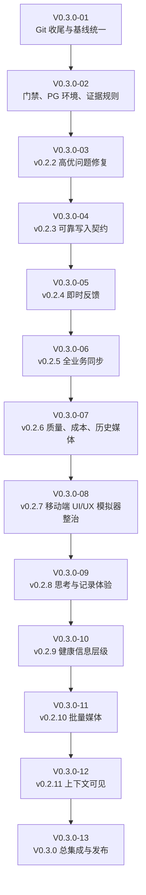
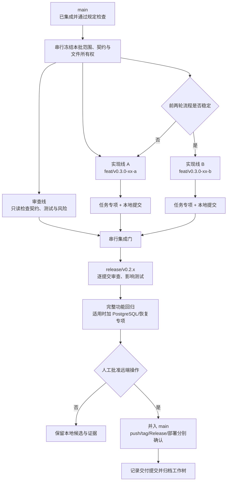

# V0.3.0 迭代计划：可靠记录、持续同步与个人上下文可见

计划日期：2026-09-30

生产基线：`v0.2.1 / 6adff978e5febcbbafad53d88cf3d4fa7b9de4e1`

Git 基线：`main@653e53f147754e29afd35e46f3a2f369101875fd`

需求来源：飞书 Base“需求池”与“研发交付记录”、飞书文档“开发记录”中
“0.3.0版本开始前复盘”的正文及评论、当前仓库和生产发布证据。

## 1. 版本目标

V0.3.0 不是单功能版本。它要完成：

1. 当前需求池中所有未完成的 P00。
2. 当前需求池中所有未完成的 P0。
3. 一组直接改善早期产品完整度的 P1。
4. 可重复使用的 Git、测试、候选和发布流程。

“个人上下文·可见”是本轮选定的 P1 能力之一，不是 V0.3.0 的唯一交付。

## 2. 编号与版本规则

- 迭代任务统一使用 `V0.3.0-01`、`V0.3.0-02` 形式。
- 禁止使用 `V030-01`、`V03-01` 等省略小数点的编号。
- 开发成果按 `v0.2.2`、`v0.2.3`、`v0.2.4` 等可验收功能版本逐批进入
  `main`；不等待全部 V0.3.0 范围完成后一次性提交。
- `v0.3.0` 是本轮全部必交付范围关闭后的正式集成版本。
- 任务分支使用 `feat/v0.3.0-xx-short-name`；修复、测试和文档提交使用真实的
  Conventional Commit 类型，不把 `fix`、`test` 或 `docs` 伪装成 `feat`。
- 不建立长期增长的 `develop` 或 `v0.3` 大分支。

## 3. 范围基线

需求池读取时共有 123 条记录；新增“个人上下文·可见”和 PWA 静态预缓存后
为 125 条；2026-09-30 20:51 又新增小物保存、语音捕念和 iOS 安装包三条
P00；23:07 新增音频上传、ASR 与 TTS 一条 P0，后续补录两条需求，当前共
131 条。首次读取时
未完成范围如下：

| 优先级 | 未完成 | 本轮处理 |
| --- | ---: | --- |
| P00 | 9 | 全部完成，其中开发过程报告先完成验收与归档 |
| P0 | 原 12 项，加本轮新增 1 项 | 全部完成 |
| P1 | 原 18 项，加本轮新增 1 项 | 选择 15 项产品体验需求；4 项继续后置 |

需求状态和验收结果继续以飞书 Base 为业务清单，仓库内
[`README-TODO.md`](../README-TODO.md) 维护工程执行状态，两者通过记录 ID、
任务编号、版本和交付证据互相核对。

## 4. P00 与 P0 全量交付

### v0.2.2：已报告高优问题

| 优先级 | 需求 |
| --- | --- |
| P00 | 图片识别期间切后台再返回不应报服务器连接失败 |
| P00 | 横屏首页“共参、每日”入口必须可见 |
| P00 | 小物图片不得显示异常水印 |
| P00 | 长时间闲置、切换页面后提交不得丢失内容 |
| P00 | AI 应答合并文字和图片且只生成一条回答 |
| P00 | P00-13 PWA 静态预缓存与 Safari 主屏快速启动 |
| P0 | 首页背景在展开和移动滚动时保持稳定构图 |
| P0 | “记下此刻”保存延迟与反馈优化 |

P00-13 使用现有 PWA 清单和 iOS 全屏配置，补齐 180/192/512px 图标与
Service Worker。静态 CSS、JavaScript、字体和背景图使用版本化
`cache-first`；页面导航使用 `network-first`，网络失败时只回退到应用外壳。
`/api/**`、认证响应、用户记录、附件正文和 AI 响应始终联网且不得进入
Cache Storage。断网只保证打开应用外壳，不承诺登录、数据读取、AI 或业务
写入可用。`v0.2.1` 标签保持不可变，本能力由 `v0.2.2` 新版本交付。

### v0.2.3：可靠写入契约

| 优先级 | 需求 |
| --- | --- |
| P00 | P00-11 客户端操作日志与持久同步队列 |
| P00 | P00-12 服务端快速确认与幂等收敛 |
| P0 | R1-09 统一资源请求协调器 |

### v0.2.4：移动端即时反馈

| 优先级 | 需求 |
| --- | --- |
| P00 | P00-14 高分辨率原图与编辑蒙版尺寸不同导致的小物保存失败 |
| P0 | P0-27 移动端即时反馈与异步同步总目标 |
| P0 | P0-28 乐观投影与列表即时更新 |
| P0 | P0-29 媒体上传与 AI 任务双阶段反馈 |

### v0.2.5：全业务同步与观测

| 优先级 | 需求 |
| --- | --- |
| P00 | P00-15 语音捕念、可恢复转写与 AI 分层整理 |
| P0 | P0-32 音频上传、ASR 原文/修复稿与 TTS 朗读；ASR 与 P00-15 共用一套转写链路 |
| P0 | P0-30 全业务写链路分批接入 |
| P0 | R1-10 跨标签页与服务端实时同步 |
| P0 | P0-31 性能基线、同步可观测性与灰度门禁 |

### v0.2.6：原生交付、质量与成本

| 优先级 | 需求 |
| --- | --- |
| P00 | P00-16 iOS 原生安装包与分发 |
| P0 | 端到端视觉评测与评测门禁 |
| P0 | AI 成本门控 |
| P0 | 历史小物媒体迁移 |

### v0.2.7：P0-33 移动端 UI/UX 模拟器整治门

该阶段在全部 P00/P0 功能完成后、任何 P1 开发前执行，不与功能补齐混做。
以 iOS 模拟器中的原生容器为主验收环境，Web 响应式自动化只作为补充：

- 紧凑、标准和大屏三档 iPhone；当前 Xcode 运行时缺少旧 SE 机型时，使用
  可用设备中的最窄尺寸并记录实际逻辑分辨率。
- 首页、捕念、状态、思绪、健康、小物、今日、寻迹、我的和登录核心路径。
- 竖屏与横屏、软键盘打开/收起、前后台恢复、四向安全区和动态视口。
- 所有主要触控目标不小于 44pt；输入字号不小于 16px；无横向溢出、文字
  截断、按钮挤压、遮挡、跳动或不可达操作。
- 为每档设备保留固定路径截图和失败截图；使用截图像素检查排除空白、纯色
  错页和严重裁切，并记录基线差异。
- 核心记录路径在模拟器中完成登录、录入、即时投影、同步确认、冲突提示与
  恢复验证后，移动端整治门才可关闭并进入 P1。

V0.2 开发流程报告属于 `V0.3.0-01` 的启动验收，不混入产品功能版本。

## 5. 本轮选定的 P1

### v0.2.8：思考与记录可追溯

- 点击“记录思考”后可选择保存为念起或思绪。
- 念起展开为思考后显示“已展为思考”并可跳转。
- “AI 回答/AI 派生”收敛为低噪音“应答”标识。
- 记录支持按发生时间或提交时间排序。

### v0.2.9：健康记录信息层级

- 运动描述拆分为“记下感受”和“AI 解析描述”。
- 体重列表默认折叠，仅显示体重和两个关键指标。
- 体重趋势默认展示体重并可切换指标。
- 心率分析默认隐藏。
- 睡眠、心率、体重、运动趋势区位置统一。
- 重设计四类健康可视化，明确坐标、缺失值和移动端规则。

### v0.2.10：批量媒体与查看

- 体重页支持多图，每张图明确对应一天。
- 小物支持多图逐项编辑、取消和重试。
- 已提交图片支持账户鉴权下的清晰大图查看。
- 当前进度：鉴权大图查看已完成；体重多图与小物批量仍待开发，不将本版本
  标记为完成。

### v0.2.11：个人上下文可见与治理入口

- 新增 `P1-04a｜个人上下文·可见：个人概要与回答来源`。
- 有治理权限的用户可从“我的”进入只读中台。

本轮不关闭以下 P1：

- P1-04 中“可控、可纠正、长期记忆自动学习”的剩余部分。
- P1-05 独立 Worker；只有运行指标达到拆分阈值后启动。
- R1-06 本地代理会话续接与隔离；继续等待能力决策。
- R1-07 统一认证状态机与跨标签页协调；继续等待能力决策。

## 6. 个人上下文·可见的边界

本切片先回答两个问题：

1. 系统目前如何依据用户自己的记录描述这个人？
2. 本次 AI 回答实际使用了哪些记录？

最小输出包括：

- 一份只读、结构化的个人概要。
- 概要的生成时间、版本、时间窗和 Token 预算。
- 每条结论对应的用户原始记录来源。
- 用户事实、用户观点、模型摘要三类信息的明确区分。
- AI 回答中的“本次参考”入口，展示记录类型、发生时间、来源定位和必要摘录。

本切片不包括：

- 自动形成长期记忆。
- 用户逐项排除或调整上下文预算。
- 对概要进行人工纠正并回写派生记忆。
- 知识图谱、向量服务和外部上下文连接器。

删除、回收、越权或不允许进入上下文的记录不得被采用，这是既有数据安全
边界，不因“可纠正”后置而放宽。

## 7. 启动任务

| 编号 | 任务 | 状态 | 完成标准 |
| --- | --- | --- | --- |
| V0.3.0-01 | Git 收尾与基线统一 | 已完成 | 四个旧工作树有可恢复归档并退出；探索 stash 有命名归档；本地 `main` 与核实后的 `origin/main` 一致；开发过程报告独立提交 |
| V0.3.0-02 | 开发门禁与稳定 PostgreSQL 验收环境 | 已完成 | 任务分支可按真实类型创建低风险本地提交；高风险边界不变；PG 预检先验证版本、二进制和隔离条件，再启动业务测试 |
| V0.3.0-03 | v0.2.2 P00/P0 修复批次 | 本地候选已验证 | 八项需求逐项专项通过；按人工授权跳过 Xcode 相关提交门禁后形成本地提交，不含推送、标签或部署 |
| V0.3.0-04 | v0.2.3 可靠写入契约 | 本地已提交 | `69106ac`；操作日志、服务端确认和协调器契约冻结 |
| V0.3.0-05 | v0.2.4 即时反馈 | 进行中 | 先修复 P00-14，再完成乐观投影、媒体与 AI 双阶段反馈 |
| V0.3.0-06 | v0.2.5 全业务同步与音频 | 进行中 | 语音真实链路完成；账户变更游标、跨标签同步、挂起投影恢复和 A 批写入已实现，B/C/D 批与完整观测门待完成 |
| V0.3.0-07 | v0.2.6 原生交付、质量与成本 | 进行中 | P00-16 已完成模拟器、未签名设备构建和开发签名真机安装；分发、E2E、费用门控和历史媒体迁移待完成 |
| V0.3.0-08 | v0.2.7 移动端 UI/UX 模拟器整治 | 已完成，待提交 | 三档 iPhone 横竖屏、键盘、安全区、登录、核心页面、真实捕念确认与重启恢复均有原生证据 |
| V0.3.0-09 | v0.2.8 思考与记录体验 | 已完成，待提交 | 保存为念起/思绪、持久来源关系与跳转、“应答”标识、发生/提交时间排序均已完成 |
| V0.3.0-10 | v0.2.9 健康信息层级 | 已完成，待提交 | 感受/AI 解析分层、体重摘要与指标切换、心率收起、四类同位趋势及缺失值规则均已完成 |
| V0.3.0-11 | v0.2.10 批量媒体 | 进行中 | 鉴权大图查看已完成；体重多图与小物批量仍待开发 |
| V0.3.0-12 | v0.2.11 上下文可见 | 已完成，待提交 | 个人上下文可见与中台入口完成 |
| V0.3.0-13 | V0.3.0 总集成与发布 | 待开始 | 全部 P00/P0、移动端整治门、选定 P1、双轮检查和生产观察关闭 |

启动阶段证据：

- 开发过程报告提交：`1c49eee5632a9f462c8fb15d0ed75507c3a3d93a`。
- 迭代计划与 Git 归档记录提交：`06d5281a822fe5f4c70e28061362a24ec08a7b76`。
- 门禁与 PostgreSQL 稳定入口提交：`a450a825bdc8285e1d9b91ab12a84ff6ccf042a5`。
- `npm run check` 通过。
- `npm run test:commit-gate` 通过。
- `npm run test:postgres-preflight` 通过。
- `npm run test:postgres:stable` 通过 PostgreSQL 16.14 的 42 项检查及持久幂等专项。
- `npm run test:backend` 48/48 通过，耗时 `154504 ms`。
- 合并到本地 `main@350aca238d613ff0ec0a58d7ca1675abd2092a50` 后，
  `npm run test:system` 53/53 通过，耗时 `202724 ms`。

V0.3.0-03 开发证据（2026-09-30）：

- 八项修复已进入 `0.2.2` 工作树：前台恢复安全重试、横屏入口、小物单层展示、
  会话级账户隔离草稿、图文合并单答、PWA 静态壳、首页固定背景和“记下此刻”
  保存后即时确认。
- `npm run check`、`npm run test:frontend`、`node scripts/regression.mjs`、
  `npm run test:content-attachments`、`npm run test:records` 与
  `npm audit --audit-level=high` 通过；前端套件 6/6，依赖漏洞 0。
- Owner 明确授权本小版本跳过 Xcode 及相关检查。环境隔离探针与其余 46 项
  后端检查通过，耗时 `136690 ms`；前端 6/6 通过，耗时 `48961 ms`；
  隔离负载回归通过。仅跳过依赖临时 Git 仓库的 `commit-gate-regression`。
- exploration 分组引用的 `scripts/exploration-regression.mjs` 在当前仓库中
  不存在，作为既有测试清单缺口记录，不纳入本修复批次。
- 本批次仅获授权创建本地提交；未授权推送、标签、Release、部署或生产写入。

### 7.1 目标排期

历史参照：

- `v0.1.1@54a6326` 创建于 2026-09-28 20:39，`v0.2.1` 发布关闭记录
  `653e53f` 创建于 2026-09-30 15:41，连续跨度约 43 小时。
- V0.3.0 启动准备从 2026-09-30 17:35 至 18:33，约 58 分钟。
- 当前完整系统测试约 3 分 23 秒，后端矩阵约 2 分 35 秒，固定
  PostgreSQL 专项约 19 秒；真正的不确定性主要来自需求实现、浏览器复核和
  集成返工，而不是测试命令本身。

原目标窗口为 2026-09-30 20:00 至 2026-10-02 12:00。2026-09-30 23:07
根据 Owner 要求新增独立移动端 UI/UX 模拟器整治门后，计划目标调整为
2026-10-02 15:30；原 12:00 不再作为可通过压缩验证维持的承诺。

| 任务 | 计划开始 | 计划结束 | 时长 | 并行说明 |
| --- | --- | --- | ---: | --- |
| V0.3.0-03 / v0.2.2 | 09-30 20:00 | 10-01 02:00 | 6 h | 缺陷修复与 PWA 静态资产可两线并行，最终串行集成 |
| V0.3.0-04 / v0.2.3 | 10-01 02:00 | 10-01 07:00 | 5 h | 高耦合写入契约，单线串行 |
| V0.3.0-05 / v0.2.4 | 09-30 23:10 | 10-01 02:30 | 3 h 20 m | 冲突切片先提交，再串行完成可逆投影与 Blob 恢复 |
| V0.3.0-06 / v0.2.5 | 10-01 02:30 | 10-01 09:30 | 7 h | 音频与全业务接入串行，观测测试并行 |
| V0.3.0-07 / v0.2.6 | 10-01 09:30 | 10-01 16:30 | 7 h | 原生分发、测试、成本、媒体迁移最多两线 |
| V0.3.0-08 / v0.2.7 | 10-01 16:30 | 10-01 22:30 | 6 h | iOS 模拟器矩阵串行验收并按页面分批修复 |
| V0.3.0-09 / v0.2.8 | 10-01 22:30 | 10-02 03:00 | 4.5 h | 与 V0.3.0-10 分域并行 |
| V0.3.0-10 / v0.2.9 | 10-01 22:30 | 10-02 05:00 | 6.5 h | 与 V0.3.0-09 分域并行，合入串行 |
| V0.3.0-11 / v0.2.10 | 10-02 03:00 | 10-02 07:00 | 4 h | V0.3.0-09 释放实现线后启动 |
| V0.3.0-12 / v0.2.11 | 10-02 05:00 | 10-02 09:00 | 4 h | V0.3.0-10 释放实现线后启动 |
| V0.3.0-13 / v0.3.0 | 10-02 09:00 | 10-02 15:30 | 6.5 h | 冻结、两轮检查、发布与观察全部串行 |

这是无停顿、最多两条实现线的压缩目标，置信度低于 v0.2.x 历史交付。以下
情况任一发生时，10 月 2 日 15:30 自动从“承诺时间”降为“目标时间”，不得
通过跳过门禁维持日期：

- P00 复现或数据恢复失败。
- 公共写入契约在支线开发期间再次变化。
- PostgreSQL、附件恢复、完整系统测试或真机关键路径失败。
- 发布候选 SHA 在第二轮审计后变化。
- 人工发布授权未在计划窗口内取得。

## 8. 总体流程



## 9. 串并行开发流程

默认采用一个实现任务加一个独立审查角色。连续两轮交付都能在无返工合并、
无工作树遗留的情况下关闭后，才允许同时运行两个实现任务。



并行边界：

- 同一共享契约、schema、模块登记、根入口、全局样式或依赖锁只有一个负责人。
- 两条实现线必须有不同的模块所有权、端口、数据目录和测试资源。
- PostgreSQL 工作树必须使用独立临时集群或独立数据库，不能只换 HTTP 端口。
- 发现公共契约缺口时暂停支线，回到串行任务修订并重新冻结。
- 每个工作树只承载一个任务；提交后记录 SHA，合并后立即归档。

## 10. 小版本合入流程


每个 `v0.2.x` 批次必须满足：

1. 范围、依赖、允许修改目录和共享文件负责人已经写明。
2. 每项需求有验收标准、专项测试和失败恢复路径。
3. 功能分支从已提交的 `main` 基线创建，不复制未提交工作区。
4. 合并按依赖顺序逐个执行，每次合并后运行影响矩阵命中的测试。
5. 固定候选 SHA 后再运行全量回归；测试报告引用该 SHA。
6. 文档或证据更新是否导致重跑，由其对候选代码和运行配置的影响决定。
7. push、tag、Gitee Release、部署和生产写入逐次取得人工授权。

## 11. 分层验证

| 阶段 | 最低验证 |
| --- | --- |
| 开发调试 | 当前功能专项；失败先保留可复现断言 |
| 任务交付 | `npm run check` 加影响矩阵命中的后端或前端测试 |
| 合并批次 | 合并后相关集成测试；共享契约变化扩大到完整一侧 |
| 小版本候选 | 干净候选 `npm run test:system`；持久化变化追加 `npm run test:postgres:stable` |
| 恢复相关候选 | PostgreSQL、备份、逻辑恢复和数据库级恢复专项 |
| 上线后 | 运行版本、核心操作、错误日志、资源和观察窗口 |

不因没有代码变化重复调查同一环境问题。候选 SHA、依赖、测试脚本或环境没有
变化时复用有效证据；任一项变化时只重跑受影响层级。发布候选最终仍必须从
干净目录执行规定的完整检查。

## 12. Git 规则

1. 一个任务一个短分支；需要并行时再创建独立工作树。
2. 所有任务从已提交基线开始。
3. 完成一个可验收切片就提交。
4. 多任务始终串行合并，并验证合并后的结果。
5. 任务结束记录交付提交并归档工作树。
6. 本地低风险提交只允许在明确任务范围内执行；新增依赖、公共契约、数据库
   迁移、认证、部署和生产相关变化先说明。
7. 任何远端 push、tag、Release、部署和生产写入仍需本次人工明确授权。

每次交付固定报告：

```text
任务：
分支与工作目录：
交付提交：
已运行验证：
未提交内容及原因：
是否已合并：
工作树保留或归档：
下一步需要 Owner 决定什么：
```

## 13. 完成条件

- [ ] 当前未完成 P00 全部达到“已完成”，且发布证据可追溯。
- [ ] 当前未完成 P0 全部达到“已完成”，且发布证据可追溯。
- [ ] iOS 模拟器移动端 UI/UX 门通过，三档设备核心路径截图和异常证据齐全。
- [ ] 本计划选定的 15 项 P1 完成；后置 4 项保留原因和启动条件。
- [ ] 每个 `v0.2.x` 批次均从短任务分支串行进入 `main`，无遗留脏工作树。
- [ ] 固定 PostgreSQL 验收入口可重复执行，不再重复尝试已知失败路径。
- [ ] “个人上下文·可见”能展示个人概要和本次回答来源，但不越权、不把模型
  内容当成用户事实。
- [ ] V0.3.0 冻结候选通过两轮检查、发布说明、恢复验证和人工发布闸门。
- [ ] 发布后观察关闭，需求池和研发交付记录均回填真实证据。

## 14. V0.3.0-04 本地实施记录（2026-09-30）

状态：`v0.2.3` 已形成允许范围内的本地提交 `69106ac`；尚未推送、打标签、
创建 Release 或部署。

- P00-11：新增账户隔离的 IndexedDB 操作日志。v1 写请求先持久化再发送，
  网络、`429` 和 `5xx` 保持待同步，`409/412` 标记冲突，其余 `4xx`
  标记失败；成功后删除请求正文，仅保留最小确认审计。
- P00-12：v1 成功写响应对合法 `X-Client-Operation-Id` 返回
  `meta.operation.status=committed` 和同名响应头；错误响应与读取响应不确认。
- R1-09：统一协调器稳定复用 operation/idempotency key，同资源串行、不同
  资源并行；账户激活时恢复待同步操作，显式登出时清除该账户本地队列。
- 范围边界：本批只接入 `requestV1` 写请求；乐观投影、媒体/AI 双阶段反馈、
  legacy 全业务写链路及跨标签页同步仍分别留在 `v0.2.4`、`v0.2.5`。

验证证据：

- `npm run check`：通过，51 个模块、201 条拥有路由。
- `npm run test:frontend`：7/7 通过，包含新增同步协调器专项、桌面响应式 UI
  与移动平台模拟。
- `PATH=/Library/Developer/CommandLineTools/usr/bin:$PATH npm run test:backend`：
  47/47 通过；仅绕开系统 Git 的 Xcode License，不执行 Xcode 流程。
- `npm run test:load`：通过；读 200、写 80、混合 160、AI 任务 24，零失败。
- 本批无数据库 schema 或 repository 变化，未重复执行 PostgreSQL 专项。

## 15. V0.3.0 新增 P00 与 v0.2.4 启动（2026-09-30）

- 需求池新增 `P00-14` 小物保存失败、`P00-15` 语音捕念与 AI 整理、
  `P00-16` iOS 原生安装包与分发；字段、验收标准、依赖和计划版本已补齐。
- `P00-14` 进入 `v0.2.4` 第一顺位。用户复现附件显示服务端返回
  `ALPHA_MASK_DIMENSION_MISMATCH`；已确认前端编辑轮廓限制为 1600px，
  而服务端按冷存原图像素尺寸做完全相等校验，高分辨率手机照片因此无法保存。
- `P00-15` 排入 `v0.2.5`，依赖可靠写入、乐观投影与双阶段任务反馈。
- `P00-16` 排入 `v0.2.6`，优先评估 Capacitor；真实安装包和分发仍需确认
  Apple Developer Team、签名证书与本机调试/Ad Hoc/TestFlight/App Store
  目标，原生签名资产不进入默认提交授权。
- `P00-14` 已修复：服务端允许方向归一后与原图等比例的低分辨率编辑蒙版，
  继续拒绝比例错误输入。小物媒体专项、静态检查、主回归及真实 Sharp
  `2400x1800` 原图配 `1600x1200` 蒙版通过，本地提交 `46d9469`。
- P0-27/P0-28 已完成捕念首个纵向切片：操作持久化后立即插入临时卡片，
  服务端确认后收敛为权威记录；网络失败保留“待同步”，校验或冲突失败回滚
  临时卡片并保留表单。P0-29 已区分图片上传与记录同步两个阶段。
- 当前切片通过 `npm run check`、`npm run test:api-v1` 和
  `npm run test:frontend` 7/7；全业务接入及媒体/AI 完整双阶段反馈仍在进行。

### 15.1 v0.2.4 状态记录与后台任务反馈扩展

- “记下此刻”创建已迁移到 v1 幂等接口和持久同步协调器。操作先写入
  IndexedDB，再在状态历史与首页趋势中投影临时记录；服务端确认后替换为正式
  记录，网络失败则保留“待同步”状态并清空已经可靠保存的表单。
- 临时状态记录在确认前禁用编辑和删除。即时模式显式补齐本地
  `occurredAt/occurredOn`，避免临时记录因缺少日期而从趋势和历史中消失。
- 图片理解回归已固定三个阶段：请求未确认时显示“正在加入后台队列”，持久
  任务返回后显示“正在后台理解”，完成后由既有通知轮询和
  `backgroundResultController` 局部合并结果；失败继续由通知中心展示和重试。
- 验证通过：`npm run check`、`npm run test:sync`、`npm run test:api-v1`、
  `npm run test:frontend` 7/7。前端回归覆盖延迟确认、断网待同步、临时项
  禁止编辑，以及图片理解入队、处理中和完成状态。
- P0-27/P0-28/P0-29 仍标为“进行中”：尚需性能 P95 门槛、刷新后恢复挂起
  投影，以及待上传 Blob 跨重启恢复，不以本轮纵向切片冒充整项需求完成。

### 15.2 v0.2.4 冲突可见性

- API 客户端保留 v1 错误响应中的 `details`，`412 PRECONDITION_FAILED`
  可读取服务端 `currentVersion`，不再在前端边界丢失冲突证据。
- 行动更新发生 `409/412` 时先刷新权威列表，再同时显示本地提交版本、提交
  内容、服务器当前版本与服务器当前内容，用户核对后再重试。
- 捕念和状态创建发生幂等冲突时撤回临时投影，但不清空本地表单；界面明确
  提示刷新后重试，不把冲突误报为成功或普通网络失败。
- `scripts/frontend-contract-regression.mjs` 固定错误详情透传契约；
  `scripts/ui-regression.mjs` 覆盖行动版本冲突和状态创建幂等冲突。
- 验证通过：前端契约、同步协调器、API v1 契约及 `npm run test:frontend`
  7/7。

### 15.3 v0.2.4 行动与习惯可逆投影

- 行动修改、状态切换、完成/撤销和软删除，以及习惯启停、调整、删除和撤销
  打卡，在操作写入 IndexedDB 后立即更新工作区。
- 同一行动或习惯使用稳定资源键串行发送；同步中隐藏重复操作入口并展示
  “正在同步”，网络故障后保留“待同步”状态。
- 服务端业务校验失败时恢复操作前快照；`409/412` 冲突继续读取服务端权威
  状态并展示本地/服务器版本对照；服务端已保存但列表刷新失败时保留已保存
  投影，不误回滚。
- 纯函数回归覆盖更新、完成、撤销、行动删除、习惯启停与级联删除；UI 回归
  覆盖即时跨列、确认收敛和删除失败恢复。
- 验证通过：`npm run check`、行动域专项、同步协调器专项及
  `npm run test:frontend` 7/7。

### 15.4 v0.2.4 待上传图片恢复与失败隔离

- 捕念与思绪根图片在选择后写入账户隔离的 IndexedDB 草稿库；提交前再次
  确认落盘，刷新或重新打开页面后恢复本地预览与待上传提示。
- 每张图片使用独立且持久的幂等键。批量中单图失败不会阻止其他图片上传；
  重试时复用已成功的附件，只重新发送失败项。
- 业务记录提交失败时按各图片的幂等键清理未引用附件；主动移除、重置表单
  和显式登出也清理对应本地草稿，账户之间不可读取彼此 Blob。
- 回归覆盖内存存储隔离、失败序号、部分成功后的续传、真实 IndexedDB
  写入/删除、登出清理和页面重载恢复。
- 当前仍保留“进行中”：评论、思绪内容块等依赖弹窗目标上下文的图片草稿，
  以及健康、小物等独立媒体工作流，需要在 P0-30 分域接入时统一。

### 15.5 v0.2.5 语音捕念底座

- 捕念支持浏览器录音和音频文件导入；Safari/Chrome 常见的 M4A、WebM、
  Ogg、WAV 经过 MIME、文件签名、16 MB 和 10 分钟双端校验。
- 未提交音频 Blob、上传幂等键和失败状态写入账户隔离的 IndexedDB；刷新后
  可恢复，显式登出清除，切后台时停止录音，避免后台意外持续采集。
- 音频上传使用独立幂等账本和现有账户附件配额；读取保持鉴权与
  `private, no-store`。捕念可仅含语音，替换或移除语音会进入回收站，永久
  清理后才删除二进制。
- 数据模型独立保存语音原件、ASR 原文和 AI 整理稿；当前 ASR 状态明确为
  `ASR_NOT_CONFIGURED`，不使用浏览器临时识别冒充可靠转写。TTS 使用设备的
  `speechSynthesis` 朗读已有文字，不产生新的权威内容。
- 已通过静态检查、捕念/日记专项、附件上传专项、认证隔离与真实 HTTP
  附件读取、PWA、移动平台及桌面响应式 UI 回归；`npm run test:system`
  全量通过，耗时 `209961 ms`；PostgreSQL 16.14 的 42 项检查与持久幂等
  专项通过。
- 未关闭项：选择并接入满足隐私与数据保留要求的 ASR 供应商、转写任务恢复、
  AI 整理稿生成及其版本/失败重试。P00-15 与 P0-32 因此仍为“进行中”。

### 15.6 2026-10-01 火山语音与视觉接入

- 新增火山豆包语音服务端适配：捕念朗读使用单向 HTTP TTS，默认
  “少年梓辛 2.0”，音调 `0`、语速 `-10`、音量 `0`；另提供云舟、Vivi、
  知性灿灿三种音色。异步长文本提交/查询协议也已封装。
- 捕念转写使用服务端双向 WebSocket ASR，直接从账户隔离附件存储读取音频，
  不生成公开 URL。任务纳入原有持久后台队列，覆盖排队、运行、失败、重试、
  重启中断和结果合并；先保存 ASR 原文，再独立尝试生成 AI 整理稿。
- 火山录音文件 ASR 的提交/查询协议已封装，但因该接口要求外部 HTTPS URL，
  不用于应用私有附件；仅允许通过显式测试 URL 执行冒烟。
- 新增火山视觉 V4 签名、通用 OCR 与智能文档解析适配。配置后健康截图和
  书目信息先经 OCR 提取文字，再由 DeepSeek 做结构化；未配置时保留原路径。
  OCR 与文档解析分别限制为 `10 QPS/10 在途`、`2 QPS/2 在途`。
- 敏感字段及真实冒烟入口见 `knowledge/volcengine-integration.md`。工作树内
  已创建 Git 忽略且权限为 `0600` 的 `.secrets/for-now.env` 空模板；当前未
  配置真实凭据，因此只完成本地协议替身与完整服务集成测试，真实调用待填值。
- 同日后续凭据已由用户本地填入：通用 OCR 与智能文档解析真实调用成功，
  录音文件 ASR `volc.seedasr.auc` 提交鉴权成功；TTS `seed-tts-2.0` 与
  流式 ASR 两种资源返回 `requested resource not granted`。这表明语音 Key
  格式有效，但对应资源尚未开通或未绑定；实际值未写入文档或日志。
- 资源开通生效后再次验证：四种 TTS 音色、流式 ASR、录音文件 ASR 的
  提交/查询闭环、异步长文本 TTS 的提交/查询闭环均真实通过；同时修正流式
  ASR 结束包过早和异步接口不接受 `post_process` 对象的线上协议差异。
- 最终本地验证通过：`npm run test:system` 全量 58 项（`211842 ms`）、
  PostgreSQL 16.14 共 42 项、隔离负载回归及 `npm audit --omit=dev`
  0 漏洞。浏览器自动化成功加载本地应用；受沙箱对 Chrome Crashpad 路径
  的限制，独立 agent-browser 会话未用于写入业务数据。

### 15.7 v0.2.5 增量同步与十小时执行窗口

- 2026-10-01 重新完整读取飞书需求池和研发交付记录；需求池现为 131 条。
  本轮依赖顺序、并行审计和十小时任务窗口见
  `reports/v0.3.0-10h-execution-2026-10-01.md`。
- 持久化元数据新增账户级有界变更账本。JSON 与 PostgreSQL repository
  在业务提交内追加单调 cursor、domain、resourceId、operationId、version、
  changeType 与 committedAt；账本不保存用户正文。
- 新增 `/api/v1/sync` 断点增量读取和
  `/api/v1/sync/operations/:operationId` 终态查询。客户端使用 1.5 秒短轮询，
  BroadcastChannel 只发送失效通知；权威数据仍从服务端按 cursor 拉取。
- 同一浏览器使用 Web Locks 避免多个标签同时恢复队列；不支持 Web Locks
  时由服务端幂等约束兜底。网络恢复、回到前台和 pageshow 都会触发恢复。
- IndexedDB 操作记录保存最小投影描述。启动顺序调整为先读取权威快照，再
  恢复捕念、状态、行动/习惯及 A 批纯文本记录的挂起投影，最后重放请求。
- P0-30 A 批新增已接入此刻、念起、日录、日记、思绪、拾句、行动和习惯；
  编辑、删除、恢复、嵌套内容、媒体和 AI 的 B/C/D 批继续保留。
- 同步健康在“我的”中展示待确认数量、超过 30 秒的卡住操作和最近耗时；
  本地记录队列深度、冲突、失败及入队到确认 P95，成功审计最多保留 200 条。
- 第一轮专项通过：持久化映射、同步协调器、API v1 契约、模块边界和桌面/
  响应式 UI；完整系统、PostgreSQL 和负载复验在本批代码冻结后执行。

### 15.8 v0.2.5 P0-29 / P0-31 收口

- 评论与思绪内容块图片草稿增加目标上下文和稳定请求 ID；恢复前重新核对
  账户、根记录、子目标及选中文字，失效目标不自动挂接。两类新增操作在服务端
  使用持久幂等账本，避免响应丢失后的重复创建。
- 健康截图先通过原图接口幂等上传，再按当前账户私有附件路径执行 OCR/结构化
  识别；选择中的 Blob、逐图上传键、已上传路径和识别结果写入 IndexedDB。
  替换、移除、确定失败和日录提交完成均走引用保护清理，挂起日录保留图片直至
  服务端确认。
- 同步健康拆分最近拉取耗时与最近 200 条成功写的入队到确认 P95。可重试
  状态采用有上限指数退避，支持 `Retry-After`，第 8 次失败转可见终态；
  `409/412` 冲突、确定性 4xx、成功与失败记录保留上限均有专项断言。
- 全局回退开关关闭时不拉取 cursor，但仍恢复持久写并使用完整快照；重新开启
  后从原 cursor 继续收敛。该开关是全局回退，不表述为按账户百分比灰度。

### 15.9 v0.2.5 最终验证与 P0-33 首轮

- 完整系统 58 阶段通过（`214610 ms`），PostgreSQL 16.14 共 42 项通过，
  `npm audit --omit=dev` 为 0 漏洞。
- 隔离负载 P95：读 `5.4 ms`、写 `62.6 ms`、混合 `105 ms`、AI 任务
  `287 ms`，全部低于既定本地门槛。
- iOS 27 的 iPhone SE（第 3 代）、iPhone 17、iPhone 18 Pro Max 均完成
  安装、冷启动和纵向截图；修复启动自动聚焦导致键盘占半屏。iPhone 17
  完成 accessibility-extra-large 检查与 Safari 前后台往返，应用 PID 未变。
- 当前命令行 Xcode 缺少 `Simulator.app`，`simctl` 无旋转命令，仓库也没有
  XCUITest target；原生横屏、键盘输入和深层交互证据未完成，P0-33 不关闭，
  P1 继续保持未启动。

### 15.10 v0.2.7 P0-33 第二轮关闭

- 发现 Xcode 27 已将方向控制迁入 `devicectl device orientation`，据此完成
  SE 3、iPhone 17、18 Pro Max 三档横竖屏矩阵；历史 `simctl` 阻塞结论保留，
  不再作为当前阻塞。
- 新增 `AppUITests` target、共享 Scheme 和旋转/键盘/前后台/核心导航用例；
  `build-for-testing` 通过。Agent 沙箱内运行测试时，Apple `dtarbiter` 因
  客户端代码身份校验 `-67050` 拒绝连接，故以 `devicectl` 加仅 Debug 的
  白名单场景完成同范围原生证据，不把该环境限制误报为产品失败。
- 原生容器覆盖登录、今日、状态、思考编辑、每日健康、捕念、小物、思绪、
  寻迹和我的；状态栏安全区、键盘活动输入、44pt 触控目标、16px 输入、
  accessibility-extra-large 和前后台恢复均无阻断问题。
- 隔离认证数据目录中的正式登录表单通过；隔离无认证数据目录中的真实捕念
  提交得到单条 `confirmed` 记录，并在终止后新 PID 重启时恢复。P0-33 与
  V0.3.0-08 更新为“已完成，待提交”，允许后续 P1 切片开始开发。

### 15.11 P1-04a 个人上下文可见与低风险体验增量

- 新增账户隔离的 `GET /api/v1/personal-context` 只读契约。概要明确区分
  用户事实、用户观点和模型摘要，并展示投影版本、生成时间、来源时间窗、
  来源数量和保守 Token 硬预算。
- “我的”新增“个人概要”入口。每条结论可展开查看必要原文摘录并跳转至当前
  账户的原记录；页面不提供纠正、排除或自动学习写入，避免越过 P1-04 后续
  切片。
- 主应用仅在中台服务令牌已配置时展示 `/platform/` 入口；中台继续使用自身
  认证与 RBAC 判断访问权限，主应用不复制管理员名单或伪造授权状态。
- 思绪根应答、追问、批注、共参、日记回望和认知复盘保存实际调用时的上下文
  收据。持久收据只保存来源类型、记录 ID、版本、发生时间和 Prompt 哈希，
  必要摘录在查看时从仍有效的当前记录解析；删除后显示来源失效，不保留正文
  副本。保存前重新核对完整 Prompt 哈希，后台任务在来源新增、修改、舍弃或
  删除后拒绝迟到结果。
- Token 预算采用 UTF-8 字节数作为模型 Token 数的保守上界，不把字符估算
  表述为精确 Token；超限时按固定优先级移除最旧上下文。
- AI 调用审计升级为 schema v2，开始态与终态保存同一份上下文收据；模型
  推理、AI 既有回答、回收站内容、`disposition=discarded` 和显式禁用记录
  不进入新上下文投影。
- 用户界面中的“AI 回答 / AI 派生”收敛为既定名称“应答”；内部
  `ai_derived` 边界值保持不变。思绪页新增“发生时间 / 提交时间”排序，
  默认仍按发生时间展示。
- v0.2.9 的独立低风险项“心率分析默认隐藏”同步完成：心率数值保持首层，
  趋势原文进入默认收起且触控高度不小于 44px 的“查看当天趋势”区域。
- 最终验证通过完整系统 58 阶段（`221696 ms`）、PostgreSQL 16.14 的
  42 项检查及持久幂等专项、移动平台、PWA 与生产依赖审计（0 漏洞）。

## 16. V0.3.0 最终发布关闭（2026-10-01）

本节追加记录本计划的最终实际结果，不改写上方各阶段当时的计划、失败、
NO-GO 和中间状态。

### 16.1 最终对象与时间

- 发布提交：`e3a7da5c7a66d0f1c3d86b565b90832b5ffaa616`。
- 发布标签：`v0.3.0`，peel 后指向同一提交。
- Gitee Release：
  `https://gitee.com/Liu_772021/for-now/releases/tag/v0.3.0`。
- 发布关闭文档提交：
  `2ff285ca663ef9c986b40f3e2f62ad2329ff3268`；不移动标签或生产版本。
- 生产部署：2026-10-01 21:26:04～21:26:27 CST。
- 观察关闭：2026-10-01 22:10:36 CST，共 44 分钟 32 秒。
- 实际上线比修订后的 2026-10-02 15:30 目标时间提前约 18 小时。

### 16.2 最终范围

- 调整后范围内的 P00、P0 和选定 P1 已随 v0.3.0 上线。
- P2、P3 经 Owner 决定整体暂停，恢复前需重新确认。
- 完整物理 iPhone E2E、Apple Team/签名/Provisioning/Archive/分发和
  AI 金额硬预算移入 V0.4.0；本轮没有将这些能力表述为已完成。
- 历史小物媒体迁移只交付 dry-run/apply 工具，未执行生产 apply。

### 16.3 最终门禁

- 功能冻结提交：`655ea51d22fc96ff5f8c706d3ea0fc28ede61171`。
- 第二轮审计收口提交：
  `f0db0197aaf8543f363a83b695426fcc1a1eb3d2`。
- 版本元数据统一为 `0.3.0` 后，最终
  `npm run test:journeys:release` 通过：
  - 完整系统 58 阶段：`194192 ms`；
  - PostgreSQL 16.14 的 42 项及持久幂等：`12732 ms`；
  - 生产依赖审计：0 漏洞，`1498 ms`；
  - 总计：`208422 ms`。
- 发布前即时备份与逻辑恢复通过：3 个账户、185 条导出记录、37 个附件引用、
  41 个本地附件。

### 16.4 生产关闭证据

- `/readyz` 返回 `e3a7da5c7a66`。
- DeepSeek、豆包语音、火山视觉、阿里图片分割和私有 OSS 真实冒烟 5/5
  通过。
- 现有主账号认证、捕念列表、统计、个人概要和增量同步接口返回 200；公网
  管理快照返回 404，Service Worker 返回 200。
- PostgreSQL 运行角色绑定一个账户后只见该账户，查询另一账户返回 0 行。
- 观察期进程重启 0、应用 error 0、4xx/5xx 0、队列 0，监控持续成功；
  最终可用内存 644 MiB、根盘 44%，备份与监控 timer active。
- 最终结论：继续运行，回滚目标保留为 `v0.2.1`。

### 16.5 原完成条件的实际结论

| 原完成条件 | 最终结论 |
| --- | --- |
| 未完成 P00 全部关闭 | 调整后范围已上线；P00-16 的完整物理机/分发部分经 Owner 明确移入 V0.4.0 |
| 未完成 P0 全部关闭 | 调整后范围已上线；P0-33 的完整物理 iPhone E2E 经 Owner 明确移入 V0.4.0 |
| 选定 P1 完成 | 已上线；详细映射以 `README-TODO.md` 为准 |
| P2/P3 有明确处理 | 已暂停，保留证据和重新启动门 |
| 固定候选、双轮检查与发布 | 已完成 |
| 生产观察与证据回填 | 已完成 |

### 16.6 发布后 Git 收尾

- 2026-10-01 复盘执行时，本地根工作树已从已合入的
  `feat/v0.3.0-05-checkin-optimism` 切回并同步
  `main@2ff285ca663ef9c986b40f3e2f62ad2329ff3268`；旧分支已安全删除。
- 随后按 Owner 授权形成 SOP、V0.4.0 起规则、复盘、ignore、研究和归档
  记录等本地整理提交；因未授权 push，当前本地 `main` 合理领先
  `origin/main`，不把“尚未 push”误写为主线同步失败。
- `.worktrees/v0.2.5-voice` 的 V0.4.0 待确认计划归档为
  `archive/v0.4.0-plan-20261001@b158b08872840255f4f14769b8ba57d1731df6e3`；
  `.worktrees/ios-v0.2.4` 的 Team 配置与 plist 调整归档为
  `archive/v0.3.0-ios-package-20261001@d6291b4fa68a140efa75719a60fbd828fdeef001`。
  两个开发服务已停止、工作树已移除，归档分支继续保留。
- 完整过程、问题和行动项见
  `reports/v0.3.0-retrospective-2026-10-01.md`。
