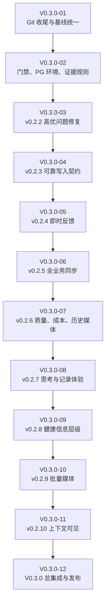
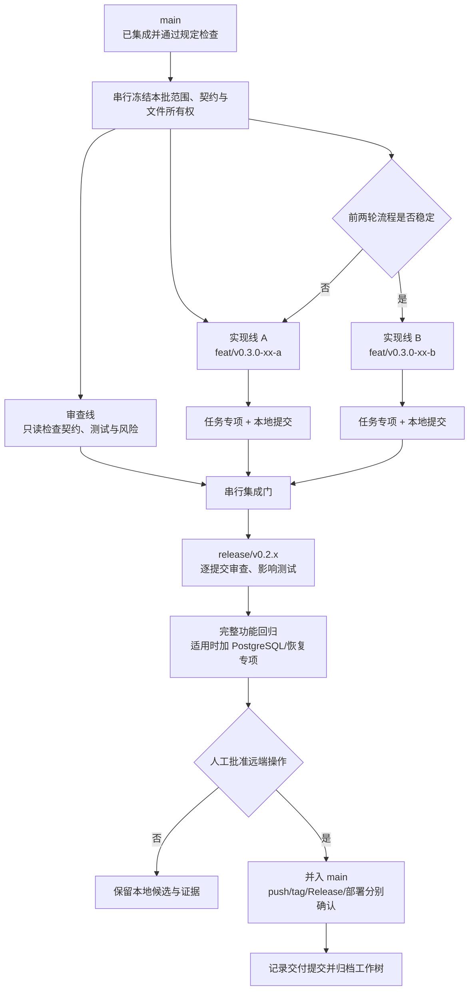

# V0.3.0 迭代计划：可靠记录、持续同步与个人上下文可见

计划日期：2026-09-30

生产基线：`v0.2.1 / 6adff978e5febcbbafad53d88cf3d4fa7b9de4e1`

Git 基线：`main@653e53f147754e29afd35e46f3a2f369101875fd`

需求来源：飞书 Base“需求池”与“研发交付记录”、飞书文档“开发记录”中
“0.3.0版本开始前复盘”的正文及评论、当前仓库和生产发布证据。

## 1. 版本目标

V0.3.0 不是单功能版本。它要完成：

1. 当前需求池中所有未完成的 P00。
2. 当前需求池中所有未完成的 P0。
3. 一组直接改善早期产品完整度的 P1。
4. 可重复使用的 Git、测试、候选和发布流程。

“个人上下文·可见”是本轮选定的 P1 能力之一，不是 V0.3.0 的唯一交付。

## 2. 编号与版本规则

- 迭代任务统一使用 `V0.3.0-01`、`V0.3.0-02` 形式。
- 禁止使用 `V030-01`、`V03-01` 等省略小数点的编号。
- 开发成果按 `v0.2.2`、`v0.2.3`、`v0.2.4` 等可验收功能版本逐批进入
  `main`；不等待全部 V0.3.0 范围完成后一次性提交。
- `v0.3.0` 是本轮全部必交付范围关闭后的正式集成版本。
- 任务分支使用 `feat/v0.3.0-xx-short-name`；修复、测试和文档提交使用真实的
  Conventional Commit 类型，不把 `fix`、`test` 或 `docs` 伪装成 `feat`。
- 不建立长期增长的 `develop` 或 `v0.3` 大分支。

## 3. 范围基线

需求池读取时共有 123 条记录；新增“个人上下文·可见”后为 124 条。读取时
未完成范围如下：

| 优先级 | 未完成 | 本轮处理 |
| --- | ---: | --- |
| P00 | 8 | 全部完成，其中开发过程报告先完成验收与归档 |
| P0 | 12 | 全部完成 |
| P1 | 原 18 项，加本轮新增 1 项 | 选择 15 项产品体验需求；4 项继续后置 |

需求状态和验收结果继续以飞书 Base 为业务清单，仓库内
[`README-TODO.md`](../README-TODO.md) 维护工程执行状态，两者通过记录 ID、
任务编号、版本和交付证据互相核对。

## 4. P00 与 P0 全量交付

### v0.2.2：已报告高优问题

| 优先级 | 需求 |
| --- | --- |
| P00 | 图片识别期间切后台再返回不应报服务器连接失败 |
| P00 | 横屏首页“共参、每日”入口必须可见 |
| P00 | 小物图片不得显示异常水印 |
| P00 | 长时间闲置、切换页面后提交不得丢失内容 |
| P00 | AI 应答合并文字和图片且只生成一条回答 |
| P0 | 首页背景在展开和移动滚动时保持稳定构图 |
| P0 | “记下此刻”保存延迟与反馈优化 |

### v0.2.3：可靠写入契约

| 优先级 | 需求 |
| --- | --- |
| P00 | P00-11 客户端操作日志与持久同步队列 |
| P00 | P00-12 服务端快速确认与幂等收敛 |
| P0 | R1-09 统一资源请求协调器 |

### v0.2.4：移动端即时反馈

| 优先级 | 需求 |
| --- | --- |
| P0 | P0-27 移动端即时反馈与异步同步总目标 |
| P0 | P0-28 乐观投影与列表即时更新 |
| P0 | P0-29 媒体上传与 AI 任务双阶段反馈 |

### v0.2.5：全业务同步与观测

| 优先级 | 需求 |
| --- | --- |
| P0 | P0-30 全业务写链路分批接入 |
| P0 | R1-10 跨标签页与服务端实时同步 |
| P0 | P0-31 性能基线、同步可观测性与灰度门禁 |

### v0.2.6：质量、成本与历史媒体

| 优先级 | 需求 |
| --- | --- |
| P0 | 基于真实用户行为的端到端视觉评测 |
| P0 | AI 成本门控 |
| P0 | 历史小物大 PNG 的可恢复派生图迁移 |

V0.2 开发流程报告属于 `V0.3.0-01` 的启动验收，不混入产品功能版本。

## 5. 本轮选定的 P1

### v0.2.7：思考与记录可追溯

- 点击“记录思考”后可选择保存为念起或思绪。
- 念起展开为思考后显示“已展为思考”并可跳转。
- “AI 回答/AI 派生”收敛为低噪音“应答”标识。
- 记录支持按发生时间或提交时间排序。

### v0.2.8：健康记录信息层级

- 运动描述拆分为“记下感受”和“AI 解析描述”。
- 体重列表默认折叠，仅显示体重和两个关键指标。
- 体重趋势默认展示体重并可切换指标。
- 心率分析默认隐藏。
- 睡眠、心率、体重、运动趋势区位置统一。
- 重设计四类健康可视化，明确坐标、缺失值和移动端规则。

### v0.2.9：批量媒体与查看

- 体重页支持多图，每张图明确对应一天。
- 小物支持多图逐项编辑、取消和重试。
- 已提交图片支持账户鉴权下的清晰大图查看。

### v0.2.10：个人上下文可见与治理入口

- 新增 `P1-04a｜个人上下文·可见：个人概要与回答来源`。
- 有治理权限的用户可从“我的”进入只读中台。

本轮不关闭以下 P1：

- P1-04 中“可控、可纠正、长期记忆自动学习”的剩余部分。
- P1-05 独立 Worker；只有运行指标达到拆分阈值后启动。
- R1-06 本地代理会话续接与隔离；继续等待能力决策。
- R1-07 统一认证状态机与跨标签页协调；继续等待能力决策。

## 6. 个人上下文·可见的边界

本切片先回答两个问题：

1. 系统目前如何依据用户自己的记录描述这个人？
2. 本次 AI 回答实际使用了哪些记录？

最小输出包括：

- 一份只读、结构化的个人概要。
- 概要的生成时间、版本、时间窗和 Token 预算。
- 每条结论对应的用户原始记录来源。
- 用户事实、用户观点、模型摘要三类信息的明确区分。
- AI 回答中的“本次参考”入口，展示记录类型、发生时间、来源定位和必要摘录。

本切片不包括：

- 自动形成长期记忆。
- 用户逐项排除或调整上下文预算。
- 对概要进行人工纠正并回写派生记忆。
- 知识图谱、向量服务和外部上下文连接器。

删除、回收、越权或不允许进入上下文的记录不得被采用，这是既有数据安全
边界，不因“可纠正”后置而放宽。

## 7. 启动任务

| 编号 | 任务 | 状态 | 完成标准 |
| --- | --- | --- | --- |
| V0.3.0-01 | Git 收尾与基线统一 | 已完成 | 四个旧工作树有可恢复归档并退出；探索 stash 有命名归档；本地 `main` 与核实后的 `origin/main` 一致；开发过程报告独立提交 |
| V0.3.0-02 | 开发门禁与稳定 PostgreSQL 验收环境 | 已完成 | 任务分支可按真实类型创建低风险本地提交；高风险边界不变；PG 预检先验证版本、二进制和隔离条件，再启动业务测试 |
| V0.3.0-03 | v0.2.2 P00/P0 修复批次 | 待开始 | 七项需求逐项专项通过，合并后完整回归通过，形成固定候选 |
| V0.3.0-04 | v0.2.3 可靠写入契约 | 待开始 | 操作日志、服务端确认和协调器契约冻结 |
| V0.3.0-05 | v0.2.4 即时反馈 | 待开始 | 乐观投影、媒体与 AI 双阶段反馈通过 |
| V0.3.0-06 | v0.2.5 全业务同步 | 待开始 | 分批接入、跨标签页同步和观测门禁通过 |
| V0.3.0-07 | v0.2.6 质量与成本 | 待开始 | E2E、费用门控和历史媒体迁移完成 |
| V0.3.0-08 | v0.2.7 思考与记录体验 | 待开始 | 四项 P1 体验完成 |
| V0.3.0-09 | v0.2.8 健康信息层级 | 待开始 | 六项健康 P1 完成 |
| V0.3.0-10 | v0.2.9 批量媒体 | 待开始 | 三项媒体 P1 完成 |
| V0.3.0-11 | v0.2.10 上下文可见 | 待开始 | 个人上下文可见与中台入口完成 |
| V0.3.0-12 | V0.3.0 总集成与发布 | 待开始 | 全部 P00/P0、选定 P1、双轮检查和生产观察关闭 |

启动阶段证据：

- 开发过程报告提交：`1c49eee5632a9f462c8fb15d0ed75507c3a3d93a`。
- 迭代计划与 Git 归档记录提交：`06d5281a822fe5f4c70e28061362a24ec08a7b76`。
- 门禁与 PostgreSQL 稳定入口提交：`a450a825bdc8285e1d9b91ab12a84ff6ccf042a5`。
- `npm run check` 通过。
- `npm run test:commit-gate` 通过。
- `npm run test:postgres-preflight` 通过。
- `npm run test:postgres:stable` 通过 PostgreSQL 16.14 的 42 项检查及持久幂等专项。
- `npm run test:backend` 48/48 通过，耗时 `154504 ms`。
- 合并到本地 `main@350aca238d613ff0ec0a58d7ca1675abd2092a50` 后，
  `npm run test:system` 53/53 通过，耗时 `202724 ms`。

### 7.1 目标排期

历史参照：

- `v0.1.1@54a6326` 创建于 2026-09-28 20:39，`v0.2.1` 发布关闭记录
  `653e53f` 创建于 2026-09-30 15:41，连续跨度约 43 小时。
- V0.3.0 启动准备从 2026-09-30 17:35 至 18:33，约 58 分钟。
- 当前完整系统测试约 3 分 23 秒，后端矩阵约 2 分 35 秒，固定
  PostgreSQL 专项约 19 秒；真正的不确定性主要来自需求实现、浏览器复核和
  集成返工，而不是测试命令本身。

本轮目标窗口为 2026-09-30 20:00 至 2026-10-02 12:00，共 40 小时。

| 任务 | 计划开始 | 计划结束 | 时长 | 并行说明 |
| --- | --- | --- | ---: | --- |
| V0.3.0-03 / v0.2.2 | 09-30 20:00 | 10-01 02:00 | 6 h | 缺陷复现与 UI 修复可两线并行，最终串行集成 |
| V0.3.0-04 / v0.2.3 | 10-01 02:00 | 10-01 07:00 | 5 h | 高耦合写入契约，单线串行 |
| V0.3.0-05 / v0.2.4 | 10-01 07:00 | 10-01 11:00 | 4 h | 客户端投影与媒体任务最多两线 |
| V0.3.0-06 / v0.2.5 | 10-01 11:00 | 10-01 16:00 | 5 h | 全业务接入串行，观测测试并行 |
| V0.3.0-07 / v0.2.6 | 10-01 16:00 | 10-01 20:00 | 4 h | 测试、成本、媒体迁移最多两线 |
| V0.3.0-08 / v0.2.7 | 10-01 20:00 | 10-02 00:30 | 4.5 h | 与 V0.3.0-09 分域并行 |
| V0.3.0-09 / v0.2.8 | 10-01 20:00 | 10-02 02:30 | 6.5 h | 与 V0.3.0-08 分域并行，合入串行 |
| V0.3.0-10 / v0.2.9 | 10-02 00:30 | 10-02 04:30 | 4 h | V0.3.0-08 释放实现线后启动 |
| V0.3.0-11 / v0.2.10 | 10-02 02:30 | 10-02 06:30 | 4 h | V0.3.0-09 释放实现线后启动 |
| V0.3.0-12 / v0.3.0 | 10-02 06:30 | 10-02 12:00 | 5.5 h | 冻结、两轮检查、发布与观察全部串行 |

这是无停顿、最多两条实现线的压缩目标，置信度低于 v0.2.x 历史交付。以下
情况任一发生时，10 月 2 日 12:00 自动从“承诺时间”降为“目标时间”，不得
通过跳过门禁维持日期：

- P00 复现或数据恢复失败。
- 公共写入契约在支线开发期间再次变化。
- PostgreSQL、附件恢复、完整系统测试或真机关键路径失败。
- 发布候选 SHA 在第二轮审计后变化。
- 人工发布授权未在计划窗口内取得。

## 8. 总体流程



## 9. 串并行开发流程

默认采用一个实现任务加一个独立审查角色。连续两轮交付都能在无返工合并、
无工作树遗留的情况下关闭后，才允许同时运行两个实现任务。



并行边界：

- 同一共享契约、schema、模块登记、根入口、全局样式或依赖锁只有一个负责人。
- 两条实现线必须有不同的模块所有权、端口、数据目录和测试资源。
- PostgreSQL 工作树必须使用独立临时集群或独立数据库，不能只换 HTTP 端口。
- 发现公共契约缺口时暂停支线，回到串行任务修订并重新冻结。
- 每个工作树只承载一个任务；提交后记录 SHA，合并后立即归档。

## 10. 小版本合入流程


每个 `v0.2.x` 批次必须满足：

1. 范围、依赖、允许修改目录和共享文件负责人已经写明。
2. 每项需求有验收标准、专项测试和失败恢复路径。
3. 功能分支从已提交的 `main` 基线创建，不复制未提交工作区。
4. 合并按依赖顺序逐个执行，每次合并后运行影响矩阵命中的测试。
5. 固定候选 SHA 后再运行全量回归；测试报告引用该 SHA。
6. 文档或证据更新是否导致重跑，由其对候选代码和运行配置的影响决定。
7. push、tag、Gitee Release、部署和生产写入逐次取得人工授权。

## 11. 分层验证

| 阶段 | 最低验证 |
| --- | --- |
| 开发调试 | 当前功能专项；失败先保留可复现断言 |
| 任务交付 | `npm run check` 加影响矩阵命中的后端或前端测试 |
| 合并批次 | 合并后相关集成测试；共享契约变化扩大到完整一侧 |
| 小版本候选 | 干净候选 `npm run test:system`；持久化变化追加 `npm run test:postgres:stable` |
| 恢复相关候选 | PostgreSQL、备份、逻辑恢复和数据库级恢复专项 |
| 上线后 | 运行版本、核心操作、错误日志、资源和观察窗口 |

不因没有代码变化重复调查同一环境问题。候选 SHA、依赖、测试脚本或环境没有
变化时复用有效证据；任一项变化时只重跑受影响层级。发布候选最终仍必须从
干净目录执行规定的完整检查。

## 12. Git 规则

1. 一个任务一个短分支；需要并行时再创建独立工作树。
2. 所有任务从已提交基线开始。
3. 完成一个可验收切片就提交。
4. 多任务始终串行合并，并验证合并后的结果。
5. 任务结束记录交付提交并归档工作树。
6. 本地低风险提交只允许在明确任务范围内执行；新增依赖、公共契约、数据库
   迁移、认证、部署和生产相关变化先说明。
7. 任何远端 push、tag、Release、部署和生产写入仍需本次人工明确授权。

每次交付固定报告：

```text
任务：
分支与工作目录：
交付提交：
已运行验证：
未提交内容及原因：
是否已合并：
工作树保留或归档：
下一步需要 Owner 决定什么：
```

## 13. 完成条件

- [ ] 当前未完成 P00 全部达到“已完成”，且发布证据可追溯。
- [ ] 当前未完成 P0 全部达到“已完成”，且发布证据可追溯。
- [ ] 本计划选定的 15 项 P1 完成；后置 4 项保留原因和启动条件。
- [ ] 每个 `v0.2.x` 批次均从短任务分支串行进入 `main`，无遗留脏工作树。
- [ ] 固定 PostgreSQL 验收入口可重复执行，不再重复尝试已知失败路径。
- [ ] “个人上下文·可见”能展示个人概要和本次回答来源，但不越权、不把模型
  内容当成用户事实。
- [ ] V0.3.0 冻结候选通过两轮检查、发布说明、恢复验证和人工发布闸门。
- [ ] 发布后观察关闭，需求池和研发交付记录均回填真实证据。
