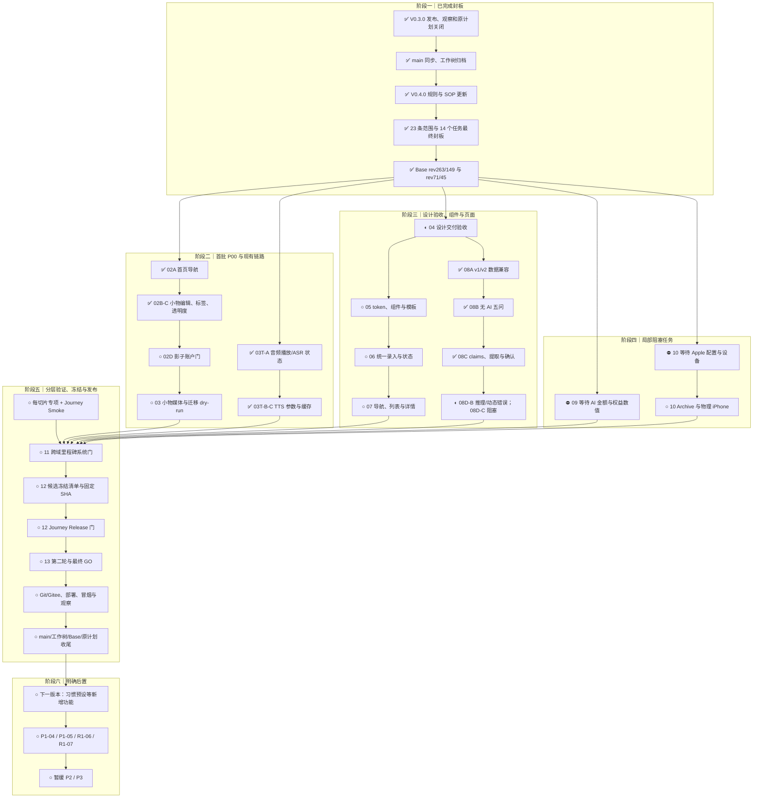

# V0.4.0 迭代计划：收敛功能链路与统一 UI/UX

计划日期：2026-10-01

计划状态：**最终封板；未阻塞切片允许启动本地开发**

生产基线：`v0.3.0 / e3a7da5c7a66d0f1c3d86b565b90832b5ffaa616`

远端关闭基线：`origin/main@2ff285ca663ef9c986b40f3e2f62ad2329ff3268`

本地计划基线：`main@6a3710e`；包含远端关闭提交及 6 笔尚未获准 push 的
SOP、规则、复盘、ignore、研究和工作树归档提交。

需求来源：

- Owner 指令：“收敛新功能。非必要功能不添加，以优化现有功能的链路、
  业务流程为主”“已有功能的 UI/UX 优化”。
- 飞书 Base“需求池”与“研发交付记录”。
- [`../knowledge/ui-ux-v0.4.0.md`](../knowledge/ui-ux-v0.4.0.md)。
- [`../knowledge/cold-start-v2-prd.md`](../knowledge/cold-start-v2-prd.md)
  与
  [`../knowledge/minimum-viable-user-model-v1.md`](../knowledge/minimum-viable-user-model-v1.md)。
- Base 中 2026-10-02 人工新增的首页导航、音频播放和 TTS 生命周期需求。
- [`../knowledge/user-journey-testing.md`](../knowledge/user-journey-testing.md)
  与 [`../knowledge/user-journey-matrix.json`](../knowledge/user-journey-matrix.json)。
- [`../reports/v0.3.0-retrospective-2026-10-01.md`](v0.3.0-retrospective-2026-10-01.md)
  中的行动项和延期项。
- `SOP/iteration-planning.md` 与 `SOP/ui-ux-optimization.md`。

## 1. 版本目标

V0.4.0 不以增加产品能力数量为目标。它必须交付以下可验收结果：

1. 关闭首页组内导航闪退、音频播放状态误报，以及当前小物编辑、标签、背景
   透明度、图片理解、派生媒体等待和测试数据污染问题。
2. 将现有页面从“功能与字段平铺”重构为围绕用户任务组织的连续链路。
3. 建立统一的信息架构、录入器、状态语言、视觉 token、组件和内容设计规则，
   并按纵向任务迁移主要页面。
4. 将首次使用定稿为“五个生活问题 → 回看原文 → 可选整理与逐项确认 →
   开始使用”，兼容旧数据并形成带来源、时间、版本和修正关系的最小模型。
5. 补齐 TTS 生成默认、播放倍速、设置开关和账户私有缓存生命周期。
6. 对 V0.3.0 延期的物理 iPhone、Apple 分发、AI 费用硬门和历史媒体迁移
   分别取得明确做/不做决定，不沿用模糊延期。
7. 每个功能切片同步完成受影响 Journey Smoke；跨域里程碑通过系统门；
   只有冻结候选运行完整 Journey Release 门。
8. 候选冻结、第二轮审计、发布、观察、Git 收尾和原计划最终关闭形成一条
   可追溯链路。

版本关闭不以“页面已改样式”或“全量测试曾通过”为标准。用户任务、业务结果、
刷新持久化、失败恢复、账户边界、组件几何、候选一致性和生产观察都必须成立。

## 2. 非目标与局部阻塞边界

本轮不做：

- 新增社区、公开内容流、课程、主题写作、地图、连接器、知识图谱或 Harness。
- 开发“习惯功能冷启动：预设习惯表、难易度/成长维度”等新增功能。
- 开发 P1-04 中超出冷启动 v2 最小 claims/来源/修正闭环的自动长期记忆，
  或开发 P1-05 独立 Worker。
- 恢复任何 P2/P3 开发、真实招募、外部授权或生产验证。
- 重命名已确认的一级导航，或改变用户原文、AI 派生和发生时间的数据含义。
- 为视觉统一复制平行业务 API、持久化模型或页面专用组件体系。
- 用复杂动效、3D、游戏化、分数、连续打卡或装饰性古文代替任务优化。
- 自动取得 push、tag、Gitee Release、部署、生产写入或真实迁移授权。

本计划整体已封板，但以下人工输入或高风险操作仍只阻塞对应切片：

- A1 供应商 Secret 轮换：必须由 Owner 明确决定是否立即执行。
- A2 自动化版本一致性检查：本轮候选冻结仍执行人工/脚本现有检查，但不在
  未批准时新增治理脚本。
- A3 iOS 环境预检脚本：先使用现有命令核对；新增脚本需另行确认。
- A12 物理 iPhone、Apple 分发和 AI 金额门已保留在 V0.4.0，但任务 09/10
  在具体数值、配置和设备时段补齐前保持阻塞，不阻断其他任务。

## 3. 启动基线与准入

### 3.1 生产与 Git

- 公网 `/readyz` 与 `/healthz` 返回 `e3a7da5c7a66`。
- `v0.3.0` 标签及 Gitee Release 指向生产提交 `e3a7da5...`。
- `origin/main@2ff285c...` 是标签后的发布关闭文档提交。
- 本地 `main@6a3710e` 包含 `origin/main`，当前领先 6 个本地提交；这些提交
  没有 push 授权，不得自行推送。
- V0.3.0 原计划已经追加最终发布关闭段；复盘和发布后 Git 收尾已经完成。
- 旧语音/总集成工作树归档为
  `archive/v0.4.0-plan-20261001@b158b08`，iOS 工作树归档为
  `archive/v0.3.0-ios-package-20261001@d6291b4`；工作树已移除，归档保留。
- 当前只保留根 `main` 和独立 `platform/main` 工作树。

V0.4.0 任务分支从最终确认的本地 `main` 创建。若本计划和台账形成新的本地
提交，基线随提交前移；远端仍保持 `2ff285c...`，直到另行取得 push 授权。

### 3.2 Base 状态

本次重新授权后已完成实时全量读取：

| 维度 | 数量 |
| --- | ---: |
| 需求总数 | 149 |
| P00 / P0 / P1 / P2 / P3 | 34 / 66 / 33 / 10 / 6 |
| 已完成 / 待开始 / 待规划 / 待评估 / 待验收 / 暂缓 | 105 / 23 / 1 / 3 / 1 / 16 |
| 必需字段缺失 | 0 |
| 研发交付记录 | 45 |

- 需求表：`rev=263`，149 条，`has_more=false`。
- 交付表：`rev=71`，45 条，`has_more=false`。
- 必需字段缺失为 0；14 个 V0.4.0 顶层任务已建立。
- V0.4.0 最终范围为 23 条：7 条 P00、13 条 P0、3 条 P1。
- 影子账户需求新增说明：使用主账户获准复制的全量业务快照初始化独立账户；
  密码、会话、密钥、供应商凭据和私有 AI 审计正文不复制。

### 3.3 启动闸门

V0.4.0 整体开发准入已经通过。每个切片启动时仍必须满足：

1. 从最终本地 `main` 建立独立分支/工作树，先核对未提交设计与 iOS 配置，
   不覆盖 `DEVELOPMENT_TEAM=Y4C56M94J3` 等现有改动。
2. 实现前补齐该切片的 Journey Matrix 项、专项测试和影响范围；首页、音频和
   冷启动三个新旅程必须与实现同切片落地。
3. 任务 09 在 AI 金额与权益数值确认前保持阻塞；任务 10 在 Apple 配置和
   物理设备时段确认前保持阻塞。
4. A1 Secret 轮换、影子账户私有快照、历史媒体 apply、真实费用调用、
   push/tag/Release、部署和生产写入仍需各自当次授权。
5. 同时最多两条实现线；共享导航、持久化、依赖锁、iOS、候选和发布串行。

## 4. 最终封板范围

### 4.1 本轮范围

| 优先级 | 数量 | 处理 |
| --- | ---: | --- |
| P00 | 7 | 全部给出关闭路径；P00-16 与任务 10 受 Apple/设备人工门约束 |
| P0 | 13 | 全部给出关闭路径；AI 金额门、物理设备和迁移受人工门约束 |
| P1 | 3 | 仅纳入现有阅读、首次使用和全站文案优化 |
| P2/P3 | 16 | 继续暂缓，不进入实现 |

7 条 P00：

1. P00-16 iOS 原生包的可重复 Archive、签名和分发。
2. 首页稳定保留组内“此刻｜共参｜每日”，不在首屏或 hydration 后消失。
3. 音频提交后播放控件绑定正确资源，不误报“转写未完成”。
4. 小物编辑按钮恢复可用。
5. 小物标签取消预设，允许创建并复用已有标签。
6. 小物默认显示 15% 背景透明度，并提供低干扰自定义入口。
7. 线上自动化只在主账户的隔离影子账户执行。

13 条 P0：

1. P0-33 完整物理 iPhone E2E 的未关闭部分。
2. 端到端视觉评测的物理设备与人工部分。
3. AI 成本硬预算、预警、拒绝与未知费用策略。
4. 历史小物大 PNG 的可恢复派生媒体迁移。
5. 小物图片理解生成可编辑名称、类型、标签和描述。
6. 小物即时显示可用媒体，缩略图后台生成并替换。
7. P0-35 全端信息架构与导航重构。
8. P0-36 统一录入器。
9. P0-37 统一视觉语言与组件系统。
10. P0-38 保存、同步与 AI 后台任务状态反馈。
11. P0-39 响应式、可访问性与视觉验收门。
12. TTS 生成默认、0.5～2 倍速播放、默认生成设置与私有缓存生命周期。
13. P0-40 冷启动 v2 数据兼容与最小可用用户模型。

3 条 P1：

- P1-09 内容列表、详情与回望阅读体验。
- P1-11 五问冷启动、原文回看、可选整理与渐进引导。
- P1-12 全站内容设计与用户文案重审。

### 4.2 后置范围

| 需求 | 处理 | 原因 |
| --- | --- | --- |
| 习惯预设、难易度与成长维度 | 后置下一版本评估 | 属于新增功能 |
| P1-04 个人上下文后续 | 保留待规划 | 改变长期记忆和纠正写回边界 |
| P1-05 独立 Worker | 按指标启动 | 当前未达到拆分阈值 |
| R1-06 / R1-07 | 保留待评估 | 尚无明确能力决策 |
| P2/P3 | 继续暂缓 | 恢复需新的明确指令 |

本次封板后新增需求默认进入下一版本。只有数据损失、越权、错误计费或阻断当前
目标的必要修复可以申请插入，并重新计算旅程、依赖、排期和证据。

## 5. 顶层交付任务

| 编号 | 交付 | 状态 | 完成条件 |
| --- | --- | --- | --- |
| V0.4.0-01 | 计划与事实基线 | 已完成 | 新 SOP、Base 实时复核、计划、TODO、启动说明和最终封板一致 |
| V0.4.0-02 | P00 现有缺陷与测试隔离 | 进行中 | 首页导航、编辑、标签、透明度已本地验证；影子账户待授权 |
| V0.4.0-03 | 小物媒体链路收口 | 进行中 | AI 候选、即时显示、后台派生及本地零写 dry-run 已验证；生产 dry-run/apply 待授权窗口 |
| V0.4.0-03T | 音频播放与 TTS 生命周期 | 工作区已验证未部署 | 播放/ASR、播放倍速、账户默认生成语速和账户私有可恢复缓存已验证；保留期仍待真实成本/存储/命中率测量后冻结 |
| V0.4.0-04 | 信息架构与内容审计 | 待验收 | 已交付设计资料；产品事实、结构和实现映射验收通过 |
| V0.4.0-05 | 视觉系统与组件底座 | 待开始 | token、模板、组件、状态和视觉基线可复用 |
| V0.4.0-06 | 统一录入与状态闭环 | 待开始 | 文字/图片/语音/混合录入及保存、同步、恢复闭合 |
| V0.4.0-07 | 导航、列表与详情迁移 | 待开始 | 主要任务两步内可达，返回上下文不丢失 |
| V0.4.0-08 | 首次使用与全站文案 | 进行中 | 08A 数据兼容、08B 无 AI 五问与 08C claims/可选提取/逐项确认已验证；08D 全站空错状态和文案待继续 |
| V0.4.0-09 | AI 费用硬门 | 阻塞 | Owner 数值确认，新旅程与拒绝/恢复/计费闭环通过 |
| V0.4.0-10 | 物理 iPhone 与 Apple 分发 | 阻塞 | 指定渠道可重复构建安装，物理设备旅程通过 |
| V0.4.0-11 | 全端里程碑验收 | 待开始 | 影响矩阵、系统门、适用 PostgreSQL 和人工视觉通过 |
| V0.4.0-12 | 候选冻结与 Release 门 | 待开始 | 冻结记录完整，固定 SHA 的 Journey Release 通过 |
| V0.4.0-13 | 发布、观察与 Git/计划收尾 | 待开始 | Release、生产、观察、main/工作树和原计划关闭完成 |

V0.4.0-12 与 V0.4.0-13 必须分开。候选冻结和 Release 通过不等于取得远端或
生产授权，也不等于发布观察完成。

## 6. 切片执行契约

### 6.1 旅程与验证层级

| 任务 | 旅程 ID 与当前状态 | 切片验证 | 里程碑/人工补验 |
| --- | --- | --- | --- |
| 01 | N/A，计划任务 | 文档一致性与 Base 全量复核 | 已完成最终封板 |
| 02 | 新增 `home-group-navigation-stability`；`keepsake-batch-library` automated；`auth-session-boundary` automated；`local-online-snapshot` partial | 首页/小物专项 + 受影响 Journey Smoke | 全量业务快照影子初始化、线上拒写门和隐私边界人工核对 |
| 03 | `keepsake-batch-library` automated；`delete-trash-restore` automated | 媒体专项 + Journey Smoke | 迁移 dry-run 进入系统门；apply 需生产授权 |
| 03T | `capture-audio` automated；新增 `audio-tts-playback` | 音频/TTS 专项 + Journey Smoke | 缓存成本/命中率测量；真实费用调用另行授权 |
| 04 | `responsive-visual-accessibility` partial | 已交付 G0-G4 设计资料，执行设计一致性验收 | 产品事实、结构和内容评审 |
| 05 | `responsive-visual-accessibility` partial；按迁移页面追加对应旅程 | 组件专项 + 页面 Journey Smoke | 组件里程碑运行系统门和人工视觉 |
| 06 | `capture-text-image` automated；`capture-audio` automated；`offline-sync-recovery` automated | 每个输入子切片专项 + Smoke | 共享状态契约冻结后运行系统门 |
| 07 | `thought-source-answer` automated；`keepsake-batch-library` automated；`personal-context-governance` automated | 每组页面专项 + Smoke | 导航/页面里程碑系统门 |
| 08 | 新增 `onboarding-v2-minimum-model`；`auth-session-boundary` automated；`local-online-snapshot` partial；`responsive-visual-accessibility` partial | 数据兼容、无 AI 五问、claims、文案专项 + Smoke | 快照、冲突、来源、视觉、读屏和理解性人工验收 |
| 09 | 新增 `ai-budget-rejection`，初始 blocked | 先补矩阵、费用专项、拒绝与恢复 Smoke | 数值未确认或旅程未自动化时不得自动提交 |
| 10 | `responsive-visual-accessibility` partial | 现有 iOS 构建与设备专项 | 物理设备、签名和分发人工证据 |
| 11 | 全部受影响 automated 旅程 | 影响矩阵 + `test:system`；适用时 PG | 两条 partial 旅程人工补验 |
| 12 | Journey Matrix 全量旅程，包含本轮新增首页、音频、冷启动和费用旅程 | 固定 SHA 的 `test:journeys:release` | 恢复、真机和已授权第三方验证 |
| 13 | 生产冒烟清单 | 不创建功能提交 | push/tag/Release/deploy/迁移逐项授权 |

`partial` / `blocked` 旅程不能作为自动本地提交的唯一证据。没有匹配旅程时，
矩阵、证据锚点和自动化必须与功能同一切片完成。

### 6.2 规模、提交拆分与检查点

| 任务 | 预计规模 | 提交单元 | 检查点 |
| --- | --- | --- | --- |
| 01 | 规则/计划约 4～6 文件，合计超过 500 行 | SOP 与计划/路由分开；治理提交需人工授权 | 每次事实源同步后记录 HEAD、Base rev 和 NO-GO |
| 02 | 约 10～14 文件、500～900 行 | 02A 首页导航；02B 编辑/标签；02C 透明度；02D 影子账户门 | 每 2～3 小时追加复现、测试和待办 |
| 03 | 约 10～14 文件、800～1400 行 | 03A AI 候选；03B 即时预览/派生；03C 迁移 dry-run | 每个子切片独立专项和 Smoke |
| 03T | 约 8～12 文件、600～1100 行 | 03T-A 播放/ASR 状态；03T-B 生成与播放参数；03T-C 缓存/清理 | 每个子切片独立专项和 Smoke，缓存策略保留测量证据 |
| 04 | 约 2～5 个设计文档 | 任务地图/IA 与文案 inventory 分开评审 | G0-G4 每个闸门记录结论 |
| 05 | 全站组件预计超过 15 文件 | 05A token/基础控件；05B 媒体/状态；05C 按页面批次迁移 | 每个组件批次不超过阈值；超限写明不可拆原因 |
| 06 | 约 10～15 文件、1000～1600 行 | 06A 文字/图片；06B 音频；06C 同步/后台状态 | 每个输入闭环后记录 Smoke 和 NO-GO |
| 07 | 约 10～15 文件、1200～2000 行 | 07A 导航壳；07B 短内容；07C 长内容/详情 | 按页面组形成可恢复提交 |
| 08 | 约 12～18 文件、1200～2200 行 | 08A v2 数据兼容；08B 无 AI 五问；08C 可选提取/claims；08D 文案与空错状态 | 每个子切片独立提交；每个用户阶段完成后记录证据 |
| 09 | 约 8～12 文件、700～1200 行 | 09A 预算域；09B 用户反馈；09C 旅程/审计 | 费用决策前保持 NO-GO |
| 10 | Xcode 生成工程可能超过 15 文件 | 代码/配置/测试分开；生成工程无法拆分时记录来源和 SHA | 构建、安装、设备旅程各一检查点 |
| 11 | 测试和报告 | 按失败域修复，不形成“总修复”大提交 | 每轮系统门后记录候选和失效证据 |
| 12 | 冻结记录和版本元数据 | 版本修正必须在冻结前独立完成 | 冻结后任何变化立即记录证据失效 |
| 13 | 发布和关闭文档 | 代码发布提交与关闭文档提交分开 | GO、部署、观察、Git 收尾各一检查点 |

单个提交超过 500 行增删或 15 个文件时必须继续拆分。强依赖、生成工程或原子
迁移无法拆分时，提交正文记录原因、模块、风险和实际验证，不使用“集成提交”
作为唯一解释。

## 7. 关键验收边界

### 7.1 小物与测试隔离

- 编辑进入真实编辑态；取消不写，保存后刷新和重登仍存在。
- 标签不预置固定值，可创建、选择、移除、去重并保持账户隔离。
- 默认背景透明度为 15%；自定义不修改原图、蒙版或派生文件。
- 图片理解只生成可编辑候选；迟到结果不覆盖人工修改。
- 原始内容先安全保存；派生失败不阻断保存并可幂等重试。
- 历史媒体先 dry-run，核对对象数、原图哈希、计划哈希、费用和恢复点；
  apply 另行取得生产授权。
- 影子账户使用主账户获准复制的全量业务记录与附件引用初始化，逐集合数量和
  内容摘要一致；身份、认证、附件前缀、日志和用量独立。
- 密码、会话、密钥、供应商凭据和私有 AI 审计正文不复制。
- 线上写入、通知、供应商调用和行为日志只使用影子账户；主账户摘要前后不变；
  快照复制/刷新属于私有数据操作，执行前取得当次授权。

### 7.2 首页、音频与 TTS

- 首页稳定保留“此刻｜共参｜每日”；首屏、鉴权恢复、数据 hydration、刷新和
  前后台恢复均不闪退、不重复，活动项与旧 URL 回退正确。
- 音频控件按稳定记录、附件和任务 ID 绑定；上传可播放与 ASR 转写状态分离，
  刷新、重试、迟到结果和跨标签页不串记录或账户。
- TTS 生成速度、播放倍速和账户默认设置职责分离；播放候选覆盖
  0.5、0.7、0.8、0.9、1.0、1.1、1.2、1.3、1.5、2.0。
- TTS 缓存按账户和源版本隔离，源删除触发可恢复清理；先测生成成本、存储量和
  命中率再确定保留期，不把 30 天写死为产品规则。

### 7.3 UI/UX 与冷启动

- 每页一个默认主要任务，主要任务在所属一级入口内不超过两次操作可达。
- 页面区段默认无外层卡片；同类组件只有一套结构和语义 token。
- 用户原文、识别/转写原文、AI 整理/回答保持固定层级和来源。
- 明确区分编辑中、本地已保存、待同步、处理中、已完成、冲突和失败。
- 状态或模板切换的共享几何非预期差异不超过 1px。
- 覆盖 320、390、768、1440px，200% 缩放、键盘、焦点、读屏和减少动效。
- 截图不能替代业务、持久化、权限和异常恢复断言。
- 冷启动固定为欢迎、五问、原文回看、可选整理/逐项确认和首次行动；每题可
  跳过，全跳过、无 AI 或提取失败都能开始使用。
- 八域不要求首次填满；原文、claim 和 unknown 保存来源、时间、版本及修正
  关系，未确认候选不成为事实，旧版已完成用户不强制重做。

### 7.4 AI 费用

- 复用现有多供应商用量账本，不新建平行计费来源。
- 预算、预警、拒绝、未知/迟到费用和权益数值由 Owner 确认。
- 预留、结算、重试、并发和取消可对账，不重复扣减。
- 拒绝 AI 时，用户原始内容仍可保存并说明恢复条件。

### 7.5 原生与设备

- Apple Team、证书、Provisioning Profile 和分发渠道进入人工清单。
- 物理 iPhone 覆盖登录、录入、图片、音频、健康、小物、前后台、键盘、
  权限拒绝、弱网、恢复和升级旧数据。
- 自动化无法控制的系统权限、触觉和分发保留人工证据。
- Android 真机仍属于暂停的 P2-07，不因 iPhone 验收自动关闭。

## 8. 依赖与所有权

| 热点 | 单一负责人 | 并行边界 |
| --- | --- | --- |
| 页面路由、一级/组内导航、旧 URL | 02/04/07 | 02 只修复冻结的首页组内导航；其余共享导航等待设计验收 |
| token、基础组件、全局样式 | 05 | 页面只能消费，不复制后局部改造 |
| 保存、同步、后台状态契约 | 06 | 文案与组件等待状态模型冻结 |
| 小物媒体、迁移、附件引用 | 02/03 | 同一契约串行合入 |
| 音频播放、ASR/TTS 状态与缓存 | 03T | 与 06 共享状态契约时串行合入，不复制音频状态机 |
| 冷启动会话、claims 与来源 | 08 | 08A 持久化契约先行；personal-context 共享模块串行修改 |
| AI 账本与拒绝门 | 09 | 复用现有账本，不与 UI 并行修改同一设置入口 |
| iOS 工程、版本和签名 | 10 | 原生资产、版本和依赖锁由单一任务修改 |
| 版本元数据和冻结记录 | 12 | 候选冻结前独占 |
| Release、部署与关闭文档 | 13 | 固定候选后独占 |

最多两条实现线。启动时优先运行“02A 首页导航”与“03T-A 音频播放”两条 P00
修复线；小物任务可在其中一条关闭后接入。页面代码等待 04 设计验收及状态/组件
契约冻结。公共入口、依赖锁、持久化、iOS、迁移、候选和发布始终串行。

每个任务使用独立工作树、端口和测试数据。多任务不得共享同一 PostgreSQL 测试
数据库。检查点记录在本计划的实施追加段和 Base 交付证据中，不跨无关任务。

## 9. 目标排期

目标窗口：**2026-10-02 至 2026-10-13**。这是包含设计闸门、检查点、返工、
物理设备、候选冻结、两轮检查、发布和观察的目标时间，不是承诺时间。

| 任务 | 目标时间 | 说明 |
| --- | --- | --- |
| 01 | 10-01～10-02 | 已完成 SOP、最终范围、Base 和启动说明封板 |
| 02 | 10-02～10-03 | 首页导航优先，随后小物与获准的影子账户 |
| 03 | 10-03～10-05 | 迁移只先 dry-run；apply 单独授权 |
| 03T | 10-02～10-04 | 播放状态先修复，再做参数与缓存测量 |
| 04 | 10-02～10-04 | 设计资料已交付，完成验收和实现映射 |
| 05 | 10-04～10-06 | 按组件和页面批次提交 |
| 06 | 10-06～10-08 | 三个录入/状态子切片 |
| 07 | 10-07～10-10 | 页面分组迁移，最多两线 |
| 08 | 10-04～10-11 | 08A 数据兼容先行，随后五问、claims 和文案 |
| 09 | 10-04～10-06 | Owner 数值未确认时保持阻塞 |
| 10 | 10-09～10-11 | Apple/设备未确认时保持阻塞 |
| 11 | 10-11～10-12 | 里程碑系统门和人工补验 |
| 12 | 10-12 | 候选冻结记录和固定 SHA Release 门 |
| 13 | 10-12～10-13 | 第二轮、授权、发布、观察和收尾 |

任一情况发生时，10 月 13 日自动只保留为目标：

- P00 复现不稳定，或仍可能丢内容、串账户、污染主账户。
- AI 数值、Apple 配置或设备时段未确认。
- 信息架构、状态或组件契约在页面迁移期间变化。
- 历史媒体数量、哈希、费用或恢复检查不一致。
- partial/blocked 旅程没有人工结论。
- 候选冻结后 SHA、依赖、测试桩、配置或版本元数据变化。
- 远端操作和生产写入授权未取得。

## 10. 单一总体流程

### 阶段一：收尾与范围

上一版本关闭、复盘、main 同步和工作树归档已经完成。本轮新增规则/SOP 已写入
工作区，Base 已实时全量复核并同步执行契约。23 条范围和 14 个顶层任务已经
最终封板，未阻塞切片可启动本地开发；AI、Apple、Secret 和生产操作保留局部门。

### 阶段二：P00 与小物链路

首页导航和音频播放两条 P00 先行，最多两线；任一关闭后接入小物链路。历史媒体只先 dry-run；
对象数、哈希、费用、备份和恢复均通过并取得生产授权后才 apply。

### 阶段三：结构、组件与页面

G0-G4 设计物料已经交付待验收。08A 冷启动 v1/v2 数据兼容、08B 无 AI 五问、
08C claims/可选提取/逐项确认和 08D-A 首批核心空错状态已经完成。08D-B 已完成
普通 DOM 推理移除、错误基础契约、捕念/内容图片及日记/音频首批迁移；G2 决定
角色 capability 和 URL/history 后，才启动 08D-C、05A 和 07A。每个子切片
同步运行 Smoke，不在总集成时补用户任务。

### 阶段四：费用与原生

AI 费用值和 Apple/物理设备具体输入尚未齐备。任务 09/10 保持阻塞，不以历史
延期或现有代码默认值代替业务决策，也不阻断其他切片。

### 阶段五：验证、冻结与发布

切片 Smoke、里程碑系统门、冻结候选 Release 门是三个独立节点。V0.4.0-12
先产出冻结记录，再运行 Release；V0.4.0-13 才进入第二轮、授权、远端和生产。
观察关闭后同步 main、处理工作树并在本计划追加最终关闭段。

### 阶段六：后置

新增产品能力继续保留，不因本轮不做而删除。P2/P3 仍需新的明确启动指令。

### 当前执行快照与继续开发顺序（2026-10-02）

| 项目 | 当前状态 | 下一退出条件 |
| --- | --- | --- |
| 08D-A 首批空错状态 | **修复后复验通过** | 保持 `cf2946b` 行为与回归，不扩大首批范围 |
| 08D-B 推理与动态错误 | **进行中；B4-P0、B1、B2A、B2B 已完成** | 下一步 B2C；迁移思绪、批注与日录错误 |
| 任务 04 / G2 | **待 Owner 决策** | 冻结角色 capability 来源、默认/撤销规则、直接 URL 拒绝及 canonical URL/history |
| 08D-C Owner 隔离 | **严重阻断** | 服务端 capability、账户切换、刷新和直接 URL 测试成立 |
| 05A / 07A | **只保留基线准备** | G2 通过后再实现组件与导航迁移 |
| 09 / 10 | **局部阻塞** | 分别补齐 AI 数值与 Apple/物理设备输入 |

继续开发按以下顺序串行推进；`public/frontend/app/runtime.mjs` 属于共享热点，
08D-B 完成前不并行启动另一条共享前端实现线：

1. **✅ 08D-B4-P0｜移除普通 DOM 内部推理。**
   `740b9f0` 已删除普通思绪、共参、日记回望、分析与即时回答结果中的 reasoning
   渲染；服务端审计数据保留，普通 DOM、复制、查找、读屏和无障碍树均不可访问。
2. **✅ 08D-B1｜建立结构化错误展示契约。**
   `2f6b504` 已统一字段错误、对象错误、网络错误、权限错误与恢复动作；普通展示
   默认不透传 `error.message`，诊断码保留于独立 diagnostic。
3. **◐ 08D-B2｜迁移核心记录与媒体错误。**
   `8f0b8cd` 已完成 B2A：捕念创建/更新、内容图片选择/上传、原图读取和图片
   理解排队不再透传底层 message；待同步、响应丢失恢复和幂等键保持不变。
   `8654861` 已完成 B2B：日记草稿/保存/刷新、录音权限、原音上传、转写排队
   和文字朗读均使用安全文案，历史音频草稿原始错误也会在恢复时归一化。
   下一步 B2C 处理思绪、批注与日录，再按对象推进其余记录和媒体。
4. **08D-B3｜迁移后台、认证与账户摘要。**
   覆盖通知、后台任务、同步、登录、导出与个人概要；失败状态在重绘、切页和
   重试成功前持续，且不重复创建对象或费用。
5. **08D-B4-P1｜收敛来源层级并关闭 08D-B。**
   “用户原文”只在可能混淆时显示；回答保留必要来源与收据。完成普通 DOM
   sentinel、320/390/768/1440 浏览器复验、键盘/200% 缩放和 Journey Smoke。
6. **G2 决策后继续 08D-C → 05A → 07A。**
   先实现服务端 capability 与拒绝路径，再实现 scoped token/基础组件，最后
   迁移 AppShell、URL/history、列表与详情；不得用 CSS、用户名或难猜 URL
   代替授权。

每个 08D-B 子切片至少运行 `npm run check`、对应专项、`npm run test:frontend`
和 `npm run test:journeys:smoke`。触及共享 API 错误契约、认证或 capability
时升级到完整系统门；固定候选前不运行 Release 门。

## 11. 分层验证与证据

| 层级 | 触发 | 最低要求 |
| --- | --- | --- |
| 设计闸门 | 04/05/08 | 任务简报、现状、任务地图、文案、状态、双端线框、原型和 Owner 结论 |
| 功能切片 | 每个 feat/fix | `npm run check`、领域专项、受影响 `npm run test:journeys:smoke` |
| 里程碑系统门 | 共享契约、跨域、持久化合入 | 影响矩阵、`npm run test:system`，适用时 `test:postgres:stable` |
| 候选冻结 | 第二轮前 | Git、版本、制品、调试资产、旅程、配置、延期项和完整 SHA |
| Release 门 | 冻结候选 | `npm run test:journeys:release`，加获准恢复、真机和第三方验证 |
| 生产关闭 | 最终授权后 | 版本、影子账户、RLS、附件、供应商、费用、告警、观察和回滚 |

本轮不新增供应商，第三方三层冒烟要求为 N/A；继续复用已有 plan-only 和
`npm run test:third-party -- --live`。真实调用继续遵守受保护凭据、合成样例、
3 元预算和生产授权边界。

候选未发生行为、依赖、测试桩或环境变化时可复用仍有效的下层证据。任何业务
代码、依赖、测试桩、配置、迁移、签名、部署脚本或版本元数据变化，都按证据
失效范围退回对应阶段。

## 12. 检查点与候选冻结

连续执行超过 2 小时的任务每 2～3 小时追加检查点，记录：

- 当前分支、完整 HEAD、工作树和暂存状态；
- 已完成的可验证行为和实际命令；
- 当前 NO-GO、未覆盖旅程和人工依赖；
- 下一步、证据路径和是否达到提交拆分阈值。

V0.4.0-12 的冻结记录至少包含：

- 候选分支、基线、完整提交/tree、未提交和未跟踪文件；
- `package.json`、lockfile、展示版本、iOS 版本、Prompt 和部署版本；
- Web/PWA/iOS 制品来源及适用 SHA-256；
- debug route、临时日志、profile、截图、本地数据和生成资产边界；
- Journey Matrix 状态、系统门、partial/blocked 人工结论；
- 生产必需配置、证书、权限和供应商资源的存在性，不记录值；
- 延期项、已接受风险和第二轮准入结论。

冻结后变更上述对象时，旧 Release 结果失效，不在同一“冻结点”继续追加修复。

## 13. Git 与发布路径

- 一个任务一个短分支和工作树，分支从最终确认的本地 `main` 创建。
- 本地 `main@f4c0d851637d2d793ca28c1cddce019518adcc98` 当前领先远端
  46 个本地提交；只记录，不自行 push。
- 顶层任务按第 6.2 节拆成独立可验收提交单元，串行合入。
- 可自动提交的低风险切片必须满足 journey 状态和 Smoke 条件。
- SOP、治理、认证、持久化、依赖锁、供应商、迁移、iOS 签名和发布整合仍按
  工程规则取得人工提交授权。
- V0.4.0-12 固定候选后再运行 Release 门。
- V0.4.0-13 的 push、tag、Gitee Release、部署、迁移和生产写入逐项授权。
- 每个远端标签必须有对应 Gitee Release，说明保留“新功能”“Bug 修复”
  “架构调整”三栏。
- 观察关闭后，原计划追加最终关闭段，本地 main 同步，旧工作树仅在干净且
  已合入/归档时移除。

## 14. 完成条件

- [x] Base 实时全量读取、缺失字段和双向关联复核完成。
- [x] 7 条 P00、13 条 P0、3 条 P1 及后置范围最终封板。
- [x] 未阻塞切片开发准入完成，空白上下文启动说明已建立。
- [ ] A1、AI/Apple/迁移等局部人工项在进入对应操作前取得明确结论。
- [ ] 每个实现切片有旅程 ID、状态、专项、Smoke 和失败恢复证据。
- [x] `home-group-navigation-stability`、`audio-tts-playback` 和
  `onboarding-v2-minimum-model` 与各自首个实现切片同时进入矩阵。
- [x] 08A～08C 与 08D-A 首批范围完成并有固定提交、前端系统门、Smoke 和
  真实 HTTP 复验证据。
- [x] 08D-B4-P0 普通 DOM 推理泄露关闭，服务端审计数据保持不变。
- [x] 08D-B1 安全错误展示纯函数、稳定网络 code 和专项回归完成。
- [x] 08D-B2A 捕念保存、内容图片、原图读取与图片理解排队完成安全错误迁移。
- [x] 08D-B2B 日记保存、录音、转写和文字朗读完成安全错误迁移。
- [ ] 08D-B2C 及后续 B2/B3 动态错误和 B4-P1 来源层级完成；08D-C 服务端
  capability 缺口保持阻断直到 G2 决策。
- [ ] 超限任务已拆分，或记录不可拆原因、风险和验证。
- [ ] 7 条 P00 和 13 条 P0 按封板范围关闭。
- [ ] 3 条 P1 UI/UX 需求完成；后置项保持真实状态。
- [ ] 所有主要页面通过 UI/UX SOP G0-G9。
- [ ] 影子账户门能阻止线上自动化写入主账户。
- [ ] 历史媒体 dry-run 通过；apply 是否执行以人工授权为准。
- [ ] AI 费用拒绝旅程、预留/结算和恢复通过。
- [ ] 指定 Apple 渠道和物理 iPhone 旅程按确认范围通过。
- [ ] V0.4.0-11 里程碑系统门通过。
- [ ] V0.4.0-12 冻结记录完整，固定 SHA Release 门通过。
- [ ] 两轮检查、标签、Release、生产冒烟和观察关闭。
- [ ] Base、README-TODO、迭代历史和本计划完成事实回填。
- [ ] 本地 main、旧工作树和原计划最终关闭完成。

## 15. 局部人工输入与操作授权

以下事项不阻断其他本地开发，但进入对应任务或操作前必须确认：

1. A1：是否立即轮换曾进入 IDE/Agent 上下文的供应商 Secret。
2. 任务 09：AI 日/月预算、预警、拒绝、未知费用、恢复权限和用户权益数值。
3. 任务 10：Apple Developer Team、证书、Provisioning Profile、分发渠道
   和物理设备时段。
4. 任务 02D：当次影子账户私有快照复制/刷新授权。
5. 任务 03：历史媒体仅做 dry-run；apply 在候选通过后单独申请生产授权。
6. 任务 03T：真实 TTS 成本调用授权；缓存保留期基于测量另行冻结。

本计划封板只允许未阻塞切片启动本地开发，不授权 commit、push、tag、Release、
部署、真实费用调用、生产迁移或生产写入；提交仍遵守工程规则的风险分级。

## 16. 实施状态与最终关闭追加记录

- 2026-10-01：从归档分支恢复 V0.4.0 待确认计划；按新项目规则补充上一版本
  收尾准入、旅程 ID/状态、三级验证、规模拆分、2～3 小时检查点、候选冻结和
  发布后 Git/原计划收尾。生产仍为 `v0.3.0@e3a7da5...`，未开发、未调用真实
  供应商、未 push 或部署。
- 飞书重新授权后完成需求 `rev=257 / 145 条`、交付 `rev=67 / 44 条` 的实时
  全量复核；13 个 V0.4 顶层任务已同步旅程、验证层级、拆分与检查点。
- 2026-10-02：吸收冷启动 v2 定稿与 Base 三条人工新增需求，更新 P1-11，
  新增 P0-40 和 `V0.4.0-03T`。最终范围为 7 条 P00、13 条 P0、3 条 P1；
  设计交付转待验收，计划任务关闭，未阻塞切片允许启动开发。
- 最终 Base 回读为需求 `rev=263 / 149 条`、交付 `rev=71 / 45 条`，
  `has_more=false`，必需字段缺失 0，14 个 V0.4 顶层任务双向关联正确。
- 当前局部 NO-GO：A1 Secret 轮换、任务 09 的 AI 数值、任务 10 的
  Apple/物理设备、影子账户私有快照、真实费用调用和生产迁移/发布操作。
- 2026-10-02 首个夜间检查点：本地 `main` 从 `6a3710e` 前移至
  `9df8f167ef45e4167087e33f4b59616fba6fb535`，新增
  `4e777d5`（首页导航）、`3fefe67`（音频播放/转写绑定）、
  `76dd461`（首批串行集成）和 `9df8f16`（小物编辑/标签/背景透明度）。
  `home-group-navigation-stability`、`audio-tts-playback` 及扩展后的
  `keepsake-batch-library` 均为 automated；切片 Journey Smoke 通过，
  合并树完整系统门 59 阶段通过，后续小物树完整后端通过且前端系统 7 阶段
  单独复跑通过。当前根工作区仍保留计划、设计和 iOS 的既有未提交改动；
  无 push、真实供应商调用、私有快照、迁移 apply、部署或生产写入。下一步
  为 03T-B 播放/生成参数与 03 小物媒体链路，02D 继续等待当次授权。
- 2026-10-02 第二个夜间检查点：本地 `main` 前移至
  `389a34e5d494953636473d7e4f06c3d740fb20bb`，新增 `8427c83`
  （0.5～2.0 倍播放）、`8d3f104`（账户默认生成语速与设置 v8）和
  `389a34e`（设置 UI 与旅程证据）。生成语速限制在火山官方 `[-50, 100]`
  范围并由服务端按账户读取；播放倍速不进入 TTS 请求。完整系统门 59 阶段
  `198488 ms` 通过，Journey Smoke 8/8、`49115 ms` 通过，桌面与 390px
  设置页截图已检查。03T-B 已完成，03T-C 私有缓存仍需按账户、源版本、音色
  和生成参数隔离；保留期继续等待成本、存储量和命中率测量，不写死 30 天。
  无真实费用调用、push、私有快照、迁移 apply、部署或生产写入。
- 2026-10-02 第三个夜间检查点：本地 `main` 前移至
  `e4f039fc190f7f9204fc74da7257012cfa83604c`，新增 `7ed563d`
  （小物图片字段候选、Prompt Catalog `2026.10.02.1` 与服务端契约）和
  `e4f039f`（可编辑候选、批次恢复与迟到结果保护）。名称、类型、标签和描述
  仅填入仍为空或默认的字段；人工输入、换图、切账户和编辑器关闭后拒收旧
  结果，模型候选不单独落库。完整系统门 59 阶段 `190179 ms` 通过，
  Journey Smoke 8/8、`49280 ms` 通过，桌面与 390px 批次截图已检查。
  任务 03 转进行中，下一步为 03B 即时预览/后台派生；历史媒体仍只允许
  dry-run。无真实费用调用、push、私有快照、迁移 apply、部署或生产写入。
- 2026-10-02 第四个夜间检查点：本地 `main` 前移至
  `7c1b86cefebc6e5f47e6de5eb52882212cfcb172`，新增 `40a6955`
  （原图/源蒙版两文件原子保存、可恢复后台派生、失败重试与启动恢复）和
  `7c1b86c`（pending 原图展示、状态反馈、短轮询自动替换）。派生失败不再
  阻断小物保存；重复重试按账户与记录收敛，原图/媒体版本变化拒绝旧结果，
  源蒙版在派生提交后进入持久清理。完整系统门 59 阶段 `190107 ms` 通过，
  Journey Smoke 8/8、`50469 ms` 通过，并留存直接可见“正在生成清晰图”的
  桌面截图。03B 已完成，任务 03 只剩历史媒体 dry-run 与单独授权后的 apply。
  无真实费用调用、push、私有快照、迁移 apply、部署或生产写入。
- 2026-10-02 03C 本地 dry-run：对本地 canonical JSON 数据执行
  `migrate:keepsake-media -- --dry-run`，结果为 1 个账户、0 个 legacy 计划项、
  0 个阻断项，聚合计划哈希
  `68f9e127dc3485ee5fc9624f63e4e15f679711c25945cd83de908352918c2d38`。
  `data/store.json` 前后 SHA-256 均为
  `d95a1c6a5ee3ef6715e5153c30943625a2b322486d832281b8d641098a428cbb`，
  权限仍为 `0600`，5 个本地附件摘要未变化。未执行 apply、未访问生产；
  生产只读 dry-run 与 apply 继续等待对应操作窗口和单独授权。
- 2026-10-02 第五个夜间检查点：本地 `main` 前移至
  `08ed52898f1b26959cf45ebbd3f19dfa4c4ed071`，新增 `08ed528`
  （账户私有 capture TTS 缓存）。缓存键纳入账户哈希、源记录/版本/正文哈希、
  音色和固定生成 profile/账户生成语速；播放倍速仍只作用于本地播放器。
  同键并发只调用一次供应商，命中发生在速率门和费用审计之前；缓存音频进入
  既有账户附件配额与 inventory。capture 移入回收站时缓存引用可恢复，永久
  删除复用持久附件清理队列，恢复升版和正文升版均拒绝旧缓存；内部缓存元数据
  不进入公开 capture/sync 投影。保留期未写死，专项验证跨 400 天仍可命中，
  等真实成本、存储量和命中率测量后再冻结策略。`npm run check`、缓存专项、
  火山服务器本地 mock 集成均通过；完整系统门 59 阶段 `196560 ms` 通过，
  Journey Smoke 8/8、`50296 ms` 通过。未调用真实供应商，未 push、私有
  快照、迁移 apply、部署或生产写入。
- 2026-10-02 第六个夜间检查点：本地 `main` 前移至
  `8c20361a4c652e3397047f86b06ea5fdde1055f7`，新增 `068fcc6`
  （真实 PostgreSQL 小物异步派生契约回归）和 `8c20361`（08A 冷启动 v2
  数据兼容）。新增账户内 `onboardingV2` 关系化单例，会话状态、模型准备度
  和 v1 迁移入口彼此分离；旧 v1 原答案与 `model_summary` 保留，旧完成用户
  显式免重做，旧 pending 保持继续旧版或选择五问。v2 原文按题保存版本、时间
  和 `contextAllowed`，部分原文可进入个人上下文；系统默认协作策略标记为
  `system_default`，不冒充用户选择。个人上下文投影升级为 `2026.10.02.1`，
  来源变化会使旧收据失效。`onboarding-v2-minimum-model` 已进入 Journey
  Matrix，但因五问 UI、写 API、无网恢复与冲突合并尚未实现，状态保持
  `partial`。`npm run check`、08A/旧 v1/上下文/持久化专项、完整系统门
  60 阶段 `194496 ms`、Journey Smoke `49875 ms` 及隔离 PostgreSQL 16
  全门均通过。未调用真实 AI 提取，未 push、私有快照、迁移 apply、部署或
  生产写入；Base 更新因用户跳过飞书授权而未执行。
- 2026-10-02 第七个夜间检查点：本地 `main` 前移至
  `bfb7fa8c78a301e56b4c4fea9ff756c1d13b2624`，新增 `25cda06`
  （五问 schema/session API、OpenAPI、ETag/If-Match、持久幂等、409 冲突
  与字段级 422）、`e524939`（欢迎、五问逐屏、全跳过/部分回答、暂停恢复、
  原文回看、许可、首次行动、旧问卷显式入口、账户隔离草稿/outbox 与逐项
  冲突合并）和 `bfb7fa8`（iPhone/Pixel 首屏移动回归）。08B 无 AI 五问
  完成，`onboarding-v2-minimum-model` 从 `partial` 转为 `automated`，
  Journey Matrix 现为 12/14 automated。`npm run check`、前端系统 7 阶段
  `55387 ms`、Journey Smoke 9/9 `52759 ms`、PostgreSQL 16.14 全门 42 项
  均通过；390px/320px 首屏和完整浏览器流程已目检。功能分支已纯
  fast-forward 并入 main，临时工作树和分支已清理，根目录既有计划、设计和
  iOS 未提交改动保持不变。下一步为 08C 可选 claims 或不触碰局部 NO-GO
  的安全本地切片。未调用真实 AI/供应商，未 push、私有快照、迁移 apply、
  部署或生产写入；Base 保持不变，不重试授权。
- 2026-10-02 第八个夜间检查点：本地 `main` 前移至
  `3c052262049ecbf120b31a19c955e0eef6bc7f4f`，新增 `2fdefea`
  （八域 `userClaims/modelUnknowns`、candidate/active/disputed/superseded/
  retracted/stale 生命周期、来源版本/哈希/span、确认/修正/拒绝/撤回及
  个人上下文投影）、`edc3281`（`GET /api/v1/user-model`、claim PATCH、
  ETag/If-Match、OpenAPI 和 sync）、`fdad64e`（领域/API 专项）及
  `3c05226`（PostgreSQL fixture、个人上下文收据 `2026.10.02.2`）。
  只有 `active + contextAllowed` claim 进入回答上下文；候选未确认不进入，
  原文版本或内容哈希变化时候选转 stale 并以 409 拒绝确认；修正创建
  `supersedes` 新版本，撤回后立即退出后续上下文。完整后端系统门 62 阶段
  `143533 ms`、前端系统门 7 阶段 `59227 ms`、Journey Smoke 9/9
  `52371 ms`、PostgreSQL 16.14 全门 42 项均通过；PostgreSQL fixture
  覆盖 30 字段、40 对象、20 关系和 29 生命周期记录。08C-A 已完成并纯
  fast-forward 并入 main，工作树/分支已清理；08C-B 可选提取任务与逐项
  确认 UI 尚未开始。未调用真实 AI/供应商，未 push、私有快照、迁移 apply、
  部署或生产写入；Base 保持不变，不重试授权。
- 2026-10-02 第九个夜间检查点：本地 `main` 前移至
  `fa88f045f28a7162a8bd37102bd3fdac88bc70d3`，新增 `7b9437d`
  （Prompt Catalog `2026.10.02.2`、LLM settings v9、提取场景费用画像与
  原文/完整 Prompt 审计省略）、`1f40dbc`（可恢复提取/查询/取消任务、
  8000 字与 20 候选上限、严格 JSON/source span、原文版本失效、幂等和
  PostgreSQL 关系）、`16c886f`（整理中/失败/空结果降级、逐项编辑确认/
  不用、unknown 提示及 390px 响应式 UI）和 `fa88f04`（任务恢复、取消、
  失败隔离、OpenAPI 与迁移专项）。未确认候选不进入上下文；取消只结束整理，
  不删除原文；失败、全跳过或无可靠候选仍可直接开始。完整后端系统门 63 阶段
  `151683 ms`、前端系统门 7 阶段 `54928 ms`、Journey Smoke 9/9
  `51781 ms`、PostgreSQL 16.14 全门 42 项均通过；PostgreSQL fixture
  覆盖 30 字段、41 对象、23 关系和 29 生命周期记录。候选页 390px 截图已
  目检，复选框与操作区无溢出。08C-B 已完成并纯 fast-forward 并入 main，
  临时工作树/分支已清理。未执行真实 AI/供应商调用，未 push、私有快照、
  迁移 apply、部署或生产写入；Base 保持不变，不重试授权。
- 2026-10-02 第十个夜间检查点：连续开发已超过 10 小时，本地 `main` 前移至
  `f9dcd07cbb5e927a42cc1f7bf9e5cabb49d0c05a`，新增 `f9dcd07`
  （24 视图内容 inventory、七类状态词表、普通/专业/Owner 可见边界、分批
  实施与理解性验收脚本）。08D-A 候选保留在
  `feat/v0.4.0-08d-content-states@fa88f04` 的独立工作树：统一“现状、正常性、
  一个下一步”的空状态，补齐寻迹/通知/回收站/反馈/导出/个人概要读取失败与
  重试，清理“图片原文”“语音原件”“内容时间线”“最新在前”和普通路径模型
  供应商/档位。候选 `npm run check`、前端系统门 7 阶段 `55647 ms`、Journey
  Smoke 9/9 `52025 ms` 均通过；390px 截图
  `/tmp/growth-content-state-mobile.png` 已目检，且注入内部错误后页面与 toast
  均未泄漏。项目提交门把 4 个共享前端表面判定为需人工授权，未绕过门禁，
  因而候选仍为已暂存未提交，main 只包含审计报告。未执行真实 AI/供应商调用、
  push、Base 写回、私有快照、迁移 apply、部署或生产写入。下一步先取得该
  本地提交授权，再并入 main；随后继续 08D-B 动态错误/推理可见性，08D-C
  Owner 信息隔离等待任务 04/07 的 capability 与页面职责验收。
- 2026-10-02 第十一个夜间检查点：本地 `main` 前移至
  `733167add4fa2ee83a1e72164438a1c2f03e0572`，新增 `46244d0`
  （任务 04 的 G0-G4 逐门结论、任务 05 组件 inventory、05A scoped token
  映射/首批切片/禁止全局重构和固定截图矩阵）及 `733167a`（08D-B 动态错误、
  来源标签和推理可见性审计）。任务 04 当前为 G0 通过，G1/G3 资料可评审但
  未通过，G2 等待 Owner 确认页面职责、角色范围、后移项与旧 URL，G4 部分
  闭合；任务 05 仍为待开始，只完成 05A 基线准备，未迁移生产页面。08D-A
  候选仍原样保留在 `feat/v0.4.0-08d-content-states@fa88f04`，暂存树
  `13b188f20c11056a534e65309abf3854541c10d5`、6 文件、230 行新增/64 行
  删除；没有追加、重排或绕过共享前端提交门。08D-B 基线识别出 142 处动态
  message 引用、7 个保存态推理表面、1 个实时推理表面和 6 处“用户原文”
  标签，并拆为错误契约、核心记录/媒体、后台/认证、推理/来源四批。两笔均由
  低风险文档门禁验证后纯 fast-forward，未改业务代码，因而未重复运行功能
  测试；08D-A 固定暂存树上的既有 `check`、前端 7 阶段和 Smoke 9/9 证据
  保持不变。未 push、Base 写回、私有快照、迁移 apply、真实供应商调用、部署
  或生产写入。下一步仍先取得 08D-A 本地提交授权；08D-C 与生产导航迁移继续
  等待 G2 Owner 结论。
- 2026-10-02 第十二个夜间检查点：本地 `main` 前移至
  `b5b5beb1eb24ac5b6a0bfe968080f3a33dc7f520`，新增 `56a5a8c`
  （08D-A 实际浏览器补验）和 `b5b5beb`（扩展四视口矩阵）。在隔离本机账户
  和数据目录上，以 Chrome engine 验证 320×700、390×844、768×1024 和
  1440×900：反馈、导出、个人概要、通知的读取失败均持续为 `role=alert`，
  明确已有数据未删除/修改并提供单一重试；解除网络中止后恢复为空态或真实
  清单，toast 和浏览器控制台无残留，四个 Web 视口横向溢出均为 0。Tab 顺序
  可从主导航进入页面操作并循环返回，无焦点陷阱。发现两项不混入 08D-A 的
  后续缺口：移动返回和页头操作低于 44px；个人概要同时出现两个指向记录的
  空态动作，分别归入 05A/07A 与 G2/G3。7 张 `/tmp` 截图已记录尺寸和摘要，
  但未进入 Git，不冒充固定候选或 Release 证据。08D-A 候选 HEAD、暂存树和
  6 文件差异在补验前后保持不变；未重复运行功能测试，未 push、Base 写回、
  私有快照、迁移 apply、真实供应商调用、部署或生产写入。下一步仍需人工授权
  08D-A 本地提交；G1/G2/G4 缺口保持未关闭。
- 2026-10-02 第十三个夜间检查点：本地 `main` 前移至
  `5c805259634785920bb36feb373c94dbadf76c8a`，新增 `5c80525`
  （G2-D3/D6 路由与 capability 代码事实）。当前 24 个视图只使用
  `data-view/currentView` 内存切换，地址栏不变、无 `popstate/hashchange`，
  普通切页重置滚动，刷新回到 `today`；现有测试只验证未知 view 回退，不是
  旧 URL 映射。认证公开用户只有 `id/username/createdAt`，session 和业务 API
  没有普通/专业/Owner capability。`/api/admin/v1/snapshot` 是仅回环直连、
  Bearer 服务令牌保护的中台机器接口，浏览器普通 session 不可复用。因此 G2
  需要 Owner 首次决定用户能力来源、默认/迁移/撤销规则、直接 URL 拒绝行为，
  以及 canonical URL、history、筛选/滚动恢复契约；不得采用 CSS 隐藏、用户名
  白名单、首账户特权或难猜 URL。08D-C、07A 和生产页面迁移继续等待该结论。
  本检查点只提交文档事实，08D-A 候选暂存树保持
  `13b188f20c11056a534e65309abf3854541c10d5`。未 push、Base 写回、私有
  快照、迁移 apply、真实供应商调用、部署或生产写入。
- 2026-10-02 第十四个夜间检查点：Owner 评审结论为“08D-A 通过，但任务
  04/05 不通过关闭”。按评审要求将“全站空状态”修正为“首批核心空状态”，
  “术语与首层文案”修正为“首批术语与模型标签清理”；08D-B、Owner
  capability、URL/history、移动触控和个人概要重复动作继续保留真实状态。
  获得本地提交与 fast-forward 授权后，08D-A 以 `8c7b52f` 固定并入 main，
  6 文件、230 行新增/64 行删除；功能工作树和分支已清理。固定提交
  `npm run check`、前端系统门 7/7（55.789 秒）和 Journey Smoke 9/9
  （51.614 秒）通过。Smoke 复验前两次在行动表单和体重批次的既有长链时序
  断言上出现不同位置的非确定性失败；同一代码的前端系统门、单独 UI 回归和
  后续完整 Smoke 均通过，该风险如实记录，不归因于 08D-A。Owner 评审与
  过期状态修正以 `3317b05` 提交，本地 `main` 最终前移至
  `3317b0551993025767dd3d1a3da355bfcad14573`，领先远端 39 笔。4174 普通
  预览和 4175 本地测试预览均已从 main 重启；4175 保持“使用模拟”，线上
  数据只读、本地写入。任务 04 仍为 G0 通过、G1/G3 未通过、G2 待决策、
  G4 部分闭合；任务 05 只保留 05A 基线准备。未 push、Base 写回、私有
  快照、迁移 apply、真实供应商调用、部署或生产写入。
- 2026-10-02 第十五个夜间检查点：真实 HTTP 复评以 `2f8ec57` 固定 HBR-01
  至 HBR-08，原“08D-A 已关闭”结论重新打开。`cf2946b` 补齐寻迹搜索框 ID，
  建立全局 `[hidden]` 显隐契约，并将移动返回与“全部已读”触控尺寸补到
  44px；`20c1967` 合并初评反证与修复后复验证据。本轮 `npm run check`
  通过，前端系统门 7/7（54.004 秒）、Journey Smoke 9/9（51.244 秒）
  通过；390×844 定点复验中返回为 44×44px、“全部已读”为 52.89×44px，
  无横向溢出，寻迹空态动作聚焦 `#discovery-query`，治理入口、反馈上下文字段
  和无效分页均为 `display:none`。单独 UI 回归前两次在行动表单与读书草稿的
  既有长链时序断言上不同位置失败，第三次完整通过，继续记录为测试稳定性风险。
  08D-A 现为修复后复验通过；08D-B 普通 DOM 推理泄露和 08D-C 服务端
  capability 仍为严重阻断。任务 04/05 状态不变。`main` 前移至
  `20c19675dee94ef42f2bcecfa9307410028b18c5`，领先远端 42 笔；未 push、
  Base 写回、私有快照、迁移 apply、真实供应商调用、部署或生产写入。
- 2026-10-02 第十六个计划检查点：将继续开发主线固定为
  `08D-B4-P0 → 08D-B1 → 08D-B2 → 08D-B3 → 08D-B4-P1`。第一步优先移除
  普通 DOM 内部 reasoning；随后建立结构化错误契约，并按核心记录/媒体、
  后台/认证和来源层级分批迁移。任务 04/G2 在代码实现前必须决定服务端
  capability 与 URL/history 契约；08D-C、05A 和 07A 在该决策前不得启动
  生产实现。任务 09/10、影子账户私有快照、历史媒体 apply、push、Release、
  部署、生产写入和真实费用调用继续保持原授权边界。本检查点仅更新计划，
  未开始新代码切片、未改变 `main@20c19675dee94ef42f2bcecfa9307410028b18c5`。
- 2026-10-02 第十七个开发检查点：`740b9f0` 完成 08D-B4-P0，删除 7 个
  普通页面 reasoning 渲染点和即时回答 reasoning 面板，同时保留 API、
  持久化及审计数据；`b5ccad3` 回填 Owner 与动态错误审计。`npm run check`
  通过，前端系统门 7/7（54.067 秒）、Journey Smoke 9/9（51.435 秒）
  通过；390×844、1440×900 隔离浏览器复验 reasoning 节点均为 0、无横向
  溢出。单独 UI 首次在既有行动表单长链时序断言失败，第二次完整通过。
  HBR-04 已关闭，08D-B 尚未关闭；下一切片为 B1 结构化错误展示契约。
  HBR-05 capability、08D-C、05A、07A、任务 09/10 及全部生产/远端授权边界
  保持不变。`main` 前移至 `b5ccad3251a69b644804ad48f3373dfde49fb448`，
  领先远端 44 笔；未 push、部署、生产写入、真实供应商调用或迁移 apply。
- 2026-10-02 第十八个开发检查点：`2f6b504` 完成 08D-B1，新增严格要求
  operation/object/retained 的 `presentError(...)`，覆盖九类稳定错误族，
  默认隔离原始 message/details，并独立保留 code/status/requestId/
  retryAfterMs；API 网络失败统一附加 `NETWORK_ERROR`。`f4c0d85` 回填动态
  错误审计。`npm run check` 通过，前端系统门 7/7（55.570 秒）、Journey
  Smoke 9/9（51.765 秒）通过。B1 不改 DOM/视觉，未新增截图；现有页面 sink
  尚未迁移，08D-B 未关闭。下一切片为 B2 核心记录与媒体错误迁移。`main`
  前移至 `f4c0d851637d2d793ca28c1cddce019518adcc98`，领先远端 46 笔；
  未 push、部署、生产写入、真实供应商调用或迁移 apply。
- 2026-10-02 第十九个开发检查点：`8f0b8cd` 完成 08D-B2A，捕念创建/更新、
  内容图片选择与上传、原图读取及图片理解排队统一接入安全错误展示；无效图片
  不再提前释放已有预览。内部 sentinel 未进入页面或 toast，已保存但刷新失败
  明确保留保存结论。`npm run check`、专项与 UI 回归通过，前端系统门 7/7
  （54.190 秒）、Journey Smoke 9/9（51.560 秒）通过；1440×900 和
  390×844 复验无横向溢出或导航遮挡。`4db767f` 回填审计，`main` 前移至
  `4db767f`、领先远端 48 笔。B2 未关闭，下一子切片为日记保存与捕念音频/
  转写；未 push、部署、生产写入、真实供应商调用或迁移 apply。
- 2026-10-02 第二十个开发检查点：`8654861` 完成 08D-B2B，日记草稿/保存/
  刷新、麦克风权限、原音上传、转写排队和文字朗读完成安全错误迁移；音频失败
  只持久化安全文案，旧版原始 `lastError` 刷新后不进入 DOM，连续失败复用同一
  上传键。`npm run check`、共享、捕念/日记专项和最终 UI 回归通过；串行前端
  系统门 7/7（56.624 秒）、Journey Smoke 9/9（54.478 秒）通过。首次并发
  运行两门时，既有思绪后台回答数量断言因迟到内容块从 9 增至 10 而失败；
  冲突临时记录实际已移除，检查后串行复跑通过，未修改该非本切片断言。
  1440×900 日记断网和 390×844 麦克风权限状态无溢出或导航遮挡。`4eb5de7`
  回填审计，`main` 前移至 `4eb5de7`、领先远端 50 笔。B2 未关闭，下一子切片
  为思绪、批注与日录；未 push、部署、生产写入、真实供应商调用或迁移 apply。

## 13. 最终发布关闭（2026-10-03）

本节是发布后的事实回写，覆盖此前“待开始”“阻塞”“未部署”等阶段状态，但
不删除这些历史检查点。

### 13.1 最终对象与门禁

- 运行代码候选：
  `9e258b4c406a0ef163cadf636667208c600195f7`。
- 最终发布提交与标签目标：
  `8cb4d93105779d3afd00f20eba319fa5f34150fd` / `v0.4.0`。
- 最终标签候选在 detached 干净工作树执行统一 Release 门，完整系统
  `189588 ms`、PostgreSQL stable `13743 ms`、生产依赖审计
  `1590 ms / 0 漏洞`，总计 `204921 ms`。
- 第二轮审计发现的离线五问覆盖、PWA 模块闭包、并发转写预算复用和恢复遗漏
  AI 预算四项 Major 已在最终候选关闭；iOS 启动指标缺失也改为明确失败。
- 真机冷启动 `4.437s` 未达到 `<3s`，未改写为通过。Owner 接受其进入
  V0.5.0 P00，并授权完成 V0.4.0 发布。

### 13.2 发布、恢复与观察

- `main`、annotated tag `v0.4.0` 和 Gitee Release 已发布；Release：
  <https://gitee.com/Liu_772021/for-now/releases/tag/v0.4.0>。
- 部署前后即时备份均完成 OSS 上传和隔离恢复；新版恢复门校验
  `ai-budget.json`、关系导出清单、哈希、4 个账户、193 条记录、
  41 个附件引用和 45 个附件。
- 生产按“后端先行 → 新 API/认证 → 网页 → 原生兼容”顺序完成；
  `/now/readyz` 与 `/now/healthz` 返回 `8cb4d9310577`。
- DeepSeek、火山语音/视觉、阿里分割和私有 OSS 的合成数据矩阵 5/5 通过。
- 2026-10-03 02:16:11–02:56:16 CST 完成 40 个分钟样本观察：服务重启、
  5xx、应用 error、AI/任务失败、Swap 和 OOM 均为 0，结论为
  `RELEASED / CONTINUE RUNNING`。

### 13.3 计划完成条件实际结论

| 完成条件 | 结论 | 证据或去向 |
| --- | --- | --- |
| P00/P0 核心链路、权限、预算、恢复和版本兼容 | 已关闭并发布 | `reports/pre-launch-2026-10-03-v0.4.0.md` |
| P1 五问、原文回看、候选确认与内容设计 | 已关闭并发布 | 最终 Release 门与生产兼容冒烟 |
| 物理 iPhone 与启动性能 | 功能通过，性能未通过 | `4.437s`；转 V0.5.0 P00 |
| 历史媒体生产 apply | 未执行 | 保持独立生产授权门 |
| 两轮审计、候选冻结、标签、Release、部署和观察 | 已关闭 | `v0.4.0@8cb4d93` |
| Git 收尾 | 已关闭到主线，保留受保护现场 | `main@24b4ecf`；根脏分支和两个未裁决工作树未删除 |

V0.4.0 至此关闭。观察期新增的 RSS 增长、操作指纹 400、备份 ready 等待和
Fontconfig 警告，以及发布后影子账户体验发现的性能与交互问题，统一进入
V0.5.0，不回开本计划。
