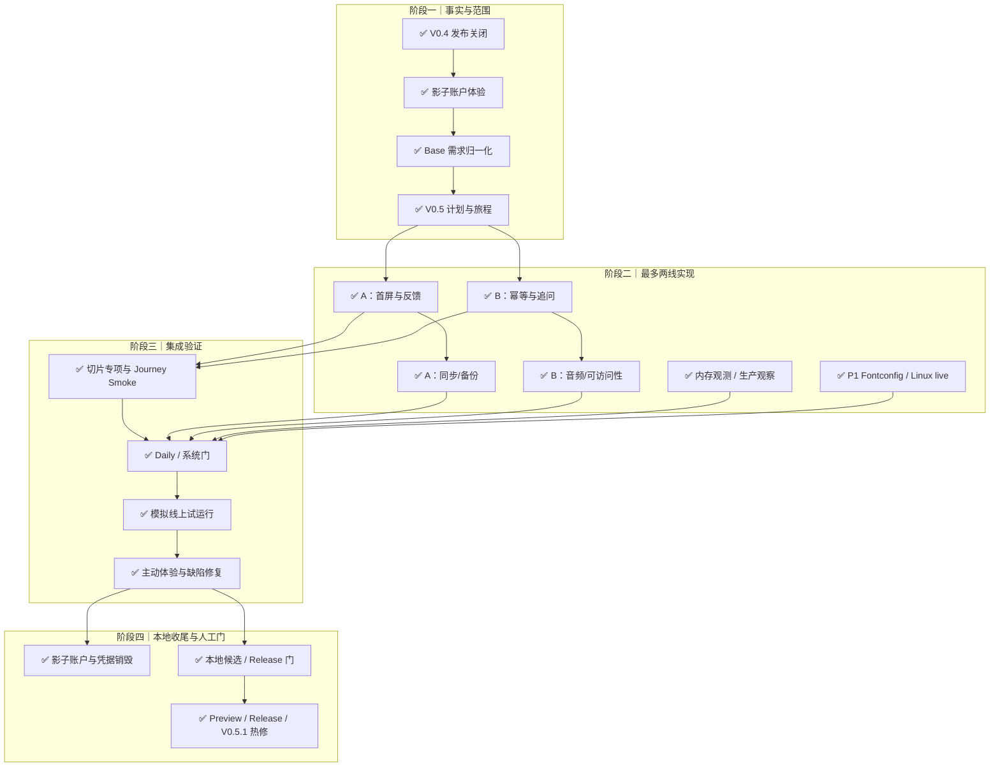

# V0.5.0 迭代计划：即时响应与现有链路收敛

计划日期：2026-10-03

计划状态：**V0.5.0 功能范围已由 V0.5.1 生产上线并完成观察**

生产版本：`v0.5.1 / 810a8a694fbd4f88fee4ffc98b28061e5f6c6096`

远端关闭基线：`origin/main@24b4ecf54e51ced1afdfeb9ab2bdd69c23b93237`

集成分支：`v0.5.0-integration@810a8a694fbd4f88fee4ffc98b28061e5f6c6096`

目标执行窗口：2026-10-03 03:00–13:00 CST，共 10 小时；这是持续推进目标，
不是跳过验证或承诺发布的时间。

## 1. 输入与事实

需求来源：

- Owner 指令：只优化已有功能的 UI/UX、业务链路和性能；网页端 0.5 秒内
  有页面反馈，1 秒内首屏。
- 2026-10-03 02:27:22–02:57:45 的生产影子账户全功能体验。
- V0.4.0 发布观察和遗留项。
- 飞书 Base“需求池”与“研发交付记录”全量回读。
- [`v0.4.0-retrospective-2026-10-03.md`](v0.4.0-retrospective-2026-10-03.md)。

影子体验证据：

- 持续 `30m23s`，覆盖冷启、五问、捕念、思绪、追问、日记、聊天、复盘、
  健康 OCR、小物分割/理解、ASR 和 TTS。
- 23 次真实供应商调用全部成功；已知费用 `¥0.18658848`，12 次供应商账单
  尚未知，低于 Owner 授权的 `¥5` 上限。
- 首次导航 DCL `5434ms`；0.5 秒手机截图仍全白；55 个资源、约 2.59MB、
  约 2006 个 DOM 节点。
- 捕念与思绪请求约 15/11ms、日记保存约 359ms、行动列表约 0.9s，说明首屏
  瓶颈主要位于前端加载、全量水合与渲染。
- 发现候选重复提取、追问草稿/编辑态残留、TTS 无稳定播放源、移动触控和
  滑杆读屏问题。

Base 回读：

| 对象 | 修订 | 数量 | 结论 |
| --- | ---: | ---: | --- |
| 需求池 | 275 | 160 | V0.4 为 23 条已完成已发布、1 条 P2 暂缓 |
| V0.5 需求 | 同上 | 11 | 5 P00、5 P0（其中 1 重复）、1 P1 |
| 研发交付 | 73 | 54 | 16 个 V0.4 交付已关闭，新增 9 个 V0.5 交付 |

V0.5 的 10 条有效需求不存在用户故事、优先级、状态、验收或阻塞字段缺失。

## 2. 版本目标与非目标

### 2.1 必须达到

1. 已登录网页在 `0.5s` 内显示非空且可理解的当前页面反馈，首屏 P95 `<1s`；
   真机先恢复 `<3s` 门，再向 `<1s` 收紧。
2. 保存、添加想法、追问和请求回答在 `0.5s` 内进入明确状态，不等待完整
   数据刷新或模型结果才解除操作。
3. 同一五问来源输入的刷新、重入、并发和重试只产生一次模型调用与一组
   claims，避免重复付费。
4. 追问提交/编辑成功后消费草稿并关闭表单，失败时输入仍可恢复。
5. 已有原音和新生成 TTS 都有稳定、可继续操作的播放器。
6. 为 RSS 增长建立分段证据和可执行告警；修复操作指纹兼容及备份 ready
   等待。
7. 当前功能在 320/390px、键盘和读屏下保持 44px 触控目标及正确语义。

### 2.2 本轮不做

- 不新增新的内容体裁、社区、推荐、课程、游戏化或国际化。
- 不重做已确认的一级导航和文化命名。
- 不把前端拆分升级为框架迁移、构建系统替换或服务端大规模重构。
- 不在生产抓取包含用户数据的 heap snapshot，不直接对生产执行压测。
- 不执行历史媒体生产 apply。
- 不自动 push、tag、创建 Release、部署或写主账户；这些操作继续保留人工门。

版本号为次版本 `0.5.0`，因为包含用户可感知的启动架构与交互行为调整，同时
保持业务对象、主要导航和 API 主版本不变。

## 3. 冻结范围

### 3.1 P00

| ID | 需求 | 完成结果 |
| --- | --- | --- |
| P00-01 | 网页首屏、基础操作与提交反馈性能 | 0.5 秒反馈、网页 P95 `<1s`、真机阶段目标 `<3s` |
| P00-02 | 五问候选提取按来源输入语义幂等 | 同输入一次调用、一组 claims、一次费用结算 |
| P00-03 | 追问提交与编辑状态收敛 | 成功清空/关闭，失败保留，切页不复活 |
| P00-04 | 已有音频与 TTS 稳定播放 | 可见稳定 source、手动恢复、设置集中、不串音 |
| P00-05 | Node RSS 分段可观测与平台期 | heap/native 分段、告警、soak 和平台期证据 |

### 3.2 P0

| ID | 需求 | 完成结果 |
| --- | --- | --- |
| P0-01 | 旧队列 operation fingerprint 兼容 | 分阶段诊断、重算、一次有界重试、不重复写 |
| P0-02 | 备份成功等待主服务 ready | 成功标记晚于 ready；失败恢复且不误报 |
| P0-03 | 生产影子账户生命周期 | 隔离、预算、凭据保护、结束销毁 |
| P0-04 | 移动触控与 TTS 读屏语义 | 44×44、稳定名称、语义化倍速 |

### 3.3 P1

| ID | 需求 | 处理 |
| --- | --- | --- |
| P1-01 | 消除 Fontconfig 缓存警告 | P00/P0 完成后推进；Linux 冒烟零警告 |

P2/P3 保持既有暂缓状态。新发现只有数据损失、越权、错误计费、重复调用或
阻断本版目标时才插入当前范围。

## 4. 顶层交付

| 编号 | 优先级 | 交付 | 状态 | 预计规模 |
| --- | --- | --- | --- | --- |
| V0.5.0-01 | P00 | 事实基线、需求归一化与计划 | 已完成 | 文档 4～6 文件 |
| V0.5.0-02 | P00 | 即时首屏与基础操作反馈 | 生产已上线 | 每子片 3～8 文件、<500 行 |
| V0.5.0-03 | P00 | 提取幂等与追问状态 | 生产已上线 | 每子片 2～6 文件、<500 行 |
| V0.5.0-04 | P00 | 音频与 TTS 稳定播放器 | 生产已上线 | 3～6 文件、<500 行 |
| V0.5.0-05 | P00 | 运行时内存可观测与长稳 | 生产已上线 | 每子片 3～8 文件、<500 行 |
| V0.5.0-06 | P0 | 同步兼容与备份恢复可靠性 | 生产已验证 | 两个独立提交，各 2～4 文件 |
| V0.5.0-07 | P0 | 移动触控、读屏与控件 UI | 生产已上线 | 2～4 文件、<300 行 |
| V0.5.0-08 | P0 | 模拟线上试运行与问题修复 | 生产已上线 | 测试/证据；修复按问题拆分 |
| V0.5.0-09 | P0 | 影子账户销毁与本轮收尾 | 已完成 | 运维清理和文档 |
| V0.5.0-10 | P1 | Fontconfig 运行缓存收敛 | 生产已上线 | 3～6 文件、<300 行 |

## 5. 切片与依赖

### 5.1 V0.5.0-02：即时首屏

1. `02A` 核心状态返回后立即提交当前路由和可见壳；设置、行动、草稿与同步
   恢复移到首帧后。
2. `02B` 移除首页无关阻塞资源：KaTeX 按需加载、CSS 请求瀑布消除、背景按
   设备下载并压缩、指纹静态资源长期缓存。
3. `02C` 将认证、状态、meta 和首页最小渲染从 515KB 完整运行时分层，
   完整功能在首屏后动态导入；不得重复请求或初始化事件。

每片先测量再改动。若 `02A/02B` 已达到 `<1s`，`02C` 仍执行最小拆分以降低
首屏闭包，但不扩大为框架重写。

### 5.2 V0.5.0-03：正确性

1. `03A` 在任务事务中按 `kind + targetId + inputHash` 复用 queued、
   running、succeeded 的五问提取；失败、取消、过期或输入变化才新建。
2. `03B` 按 `rootId + form kind + followUpId` 消费今日/思绪双 DOM 草稿；
   新建、手写回答和编辑成功后关闭，失败仍保留。

`03A` 涉及任务/AI/持久化共享边界，由单一负责人修改；`03B` 与 `02` 都会触及
`runtime.mjs`，必须在 `02A` 合入后串行执行。

### 5.3 V0.5.0-04～07

- `04`：文字 TTS 绑定真实 `<audio>`；自动播放拒绝时保留 source；销毁时机
  只发生在停止、替换或离开目标记录。
- `05A`：低敏 runtime memory 样本；`05B`：监控阈值；`05C`：本地 soak
  和同规格 Linux 长稳。
- `06A`：指纹失败阶段与旧队列重算；`06B`：备份 ready 有界等待和失败恢复。
- `07`：组内导航最小触控尺寸、滑杆 `aria-label/aria-valuetext` 和
  320/390px 视觉复核。

## 6. 旅程与验证

| 切片 | 旅程 | 层级 | 关键断言 |
| --- | --- | --- | --- |
| 02 | 新增 `fast-visible-shell`；`home-group-navigation-stability` | 专项 + Smoke；里程碑前端门 | 0.5 秒非空、P95 `<1s`、深链/登录/草稿不回归 |
| 03A | 扩展 `onboarding-v2-minimum-model` | 专项 + Smoke + AI 预算专项 | 同输入一次调用/claims/结算 |
| 03B | `thought-source-answer` | 专项 + Smoke | 成功消费、失败保留、切页不复活 |
| 04 | `audio-tts-playback`、`capture-audio` | 专项 + Smoke | currentSrc、播放恢复、资源清理 |
| 05 | 系统质量，不单列用户旅程 | observability/monitor/load 专项 | 分段、告警、平台期 |
| 06A | `offline-sync-recovery` | sync/API 专项 + Daily | 旧队列有界收敛、零重复写 |
| 06B | 恢复/部署系统门 | backup/deploy/restore 专项 | ready 后才成功 |
| 07 | `responsive-visual-accessibility`（partial） | UI/mobile + 人工截图 | 44px、读屏语义、无溢出 |
| 08 | 全部受影响旅程 | Daily + 系统门 | 业务、持久化、恢复、副作用 |

切片最低运行 `npm run check`、领域专项和 `npm run test:journeys:smoke`。
共享 API、任务、持久化或跨域里程碑追加 `npm run test:system`；涉及真实
PostgreSQL 时追加 `npm run test:postgres:stable`。只有固定候选才运行
`npm run test:journeys:release`。

真实供应商体验已经完成，开发阶段默认只用模拟供应商。剩余真实费用额度不是
自动调用授权；需要补验时仍先核对累计费用不超过 `¥5`。

## 7. 十小时执行编排

最多两条实现线：

| 时段 | 实现线 A | 实现线 B | 串行检查点 |
| --- | --- | --- | --- |
| 03:00–04:00 | V0.4 关闭、Base、计划 | 代码探索与切片设计 | 计划/Base 一致性 |
| 04:00–07:00 | 02A/02B 首屏 | 03A 幂等 | 各自专项与 Smoke |
| 07:00–09:00 | 06B 备份 ready、06A 指纹 | 03B 追问、04 TTS | 共享 runtime 串行 |
| 09:00–10:30 | 05A/05B 内存观测 | 07 移动/读屏 | 前端与后端里程碑 |
| 10:30–12:30 | 02C 或剩余 P0 | P1 Fontconfig 或缺陷修复 | Daily、系统门、模拟线上 |
| 12:30–13:00 | 影子清理与台账 | 证据复核 | 可恢复检查点 |

时间不足时不牺牲 P00/P0 验证。P1 只有在 P00/P0 无阻断、共享热点文件已释放
且系统门时间可用时进入。

## 8. 总体流程

Owner 已要求 Preview 通过后继续正式发布；`P` 已完成最终 Release 门、
main/tag、Gitee Release、生产部署、V0.5.1 热修和观察。

## 9. Git 与多智能体规则

- 集成工作树：
  `.worktrees/v0.5.0-integration` / `v0.5.0-integration`。
- 每个实现切片使用短分支和独立工作树；Agent 只修改其声明文件。
- `runtime.mjs`、`server.mjs`、任务/持久化公共模块、旅程矩阵和依赖锁为
  共享热点，同一时间只有一个写入者。
- 探索 Agent 只读；实现 Agent 必须先补失败回归，再做最小修复。
- 低风险单域切片在专项与旅程通过后可按工程规则创建本地提交。
- 认证、持久化、部署、监控和跨域提交先报告，再决定提交方式。
- 不合并根脏分支的未提交文件，不强制删除两个待裁决 V0.4 工作树或 stash。

## 10. 试运行与退出条件

P00/P0 进入模拟线上试运行前必须满足：

1. 所有对应专项和 Journey Smoke 通过。
2. 共享契约执行系统门；数据库变化执行 PostgreSQL stable。
3. 本地生产模式使用隔离目录、模拟供应商和独立端口。
4. 覆盖首次/再次打开、深链、移动 320/390px、断网恢复、重复点击、刷新、
   账户切换和失败重试。
5. 发现缺陷先按风险归入当前切片或需求池，再修复和重验。

完成定义：

- [x] 5 个 P00 全部完成本地与线上 Preview 验证并形成可恢复提交。
- [x] 4 个 P0 全部完成本地与线上 Preview 验证。
- [x] P1 Fontconfig 已完成，并通过 Linux Preview 真实分割链路。
- [x] 网页 0.5 秒反馈与 1 秒首屏有本地 Fast 4G 和公网 Preview 机器证据。
- [x] Preview 试运行无数据损失、越权、重复付费或恢复阻断。
- [ ] Base、TODO、计划和 Git 状态一致。
- [x] 原生产影子账户、浏览器会话与凭据完成删除；Preview 使用独立测试账户。
- [x] Owner 已授权 Preview 通过后执行 push、tag、Release 和生产部署。

## 11. 当前发布门

- 已取得 Preview 通过后的 V0.5.0 push、tag、Gitee Release 和生产部署授权。
- V0.5.1 最终干净 Release 门和生产部署已通过。
- 未取得主账户写入或历史媒体生产 apply 授权。
- 根目录和两个 V0.4 工作树的保留现场不得清理或并入本版本。

## 12. 2026-10-03 本地开发检查点

- 当时的本地检查点：`v0.5.0-integration@6cf1a57`；该时点未 push、tag
  或部署，后续线上 Preview 状态见第 13 节。
- Fast 4G 仿真：DCL `176.1ms`、当前屏反馈 `273.0ms`、稳定首页
  `672.8ms`；本地冷缓存反馈 `93.6ms`、稳定首页 `180.0ms`。
- 同步入口为 6 个模块 / 27,779B；延迟运行时为 21 个模块 / 725,488B。
  公开文本部署时预生成 gzip；HTML 和静态资源保持 `no-store`，API 与私有
  附件不进入静态压缩 location。
- 完整系统门第二轮 `232868ms` 全绿；第一次仅因旧测试仍期待空默认音色而
  失败，修正为服务端白名单回退后从头通过。
- PostgreSQL 16.14 stable 通过；Journey Daily `64510ms` 通过。
- Journey Release 第三次 `261455ms` 全绿：完整系统 `242992ms`、
  PostgreSQL `15924ms`、依赖审计 `2539ms / 0 漏洞`。前两次分别在临时
  URL/history 服务启动和 UI 浏览器阶段间歇失败，对应专项单独复跑通过。
- 两轮隔离浏览器试运行验证捕念持久化、追问新增/编辑、草稿不复活、设置读屏
  和 320/390px。首轮发现的底栏遮挡与重复 local-test 请求已修复，定向复验
  通过。
- 生产影子账户、2 个会话、9 个附件及 11 类租户表数据已删除；二次只读核验
  全部为 0。本地凭据和完整影子导出已删除。
- RSS 本地分段、告警和 soak 已完成；同规格 Linux 长稳、真机性能及 Linux
  Fontconfig live 继续是候选前人工/环境补验，不改写为已通过。
- Base 最后一批状态回写因重新授权被用户跳过而未执行；不重试授权，待后续
  会话补齐。

## 13. 线上 Preview 检查点

- 新增 `preview/v0.5.0`、只读 deploy key、独立 systemd/Nginx/env/data 和
  `https://77liu.top/preview/`；生产 `v0.4.0` 服务与数据未复用、未变更。
- 运行代码候选 `3fd511c` 已完成双账户隔离、核心记录、图片/音频、小物、
  健康 OCR、DeepSeek 回答、统计与刷新恢复；运行时异常为 0。
- 公网真实供应商链路包含 DeepSeek、豆包 ASR/TTS、火山视觉/OCR 和阿里分割，
  最终统计失败均为 0。
- 首次公网性能审计发现 Service Worker 预缓存 KaTeX 与首屏争抢带宽；延迟
  注册后，公网当前屏反馈 `430.5ms`、stableHome `786.8ms`，320/390px
  无溢出，console/network/runtime 异常均为 0。
- 发布前生产备份 `for-now-20261003T051335Z.tar.gz` 已上传 OSS；隔离恢复
  校验 4 个账户、193 条总记录、41 个附件引用、45 个附件和附件 HTTP 读取。
- 运行代码候选 Release 门总计 `328413ms` 全绿：完整系统 `310008ms`、
  PostgreSQL 16.14 `16773ms`、依赖审计 `1632ms / 0 漏洞`。
- 完整上线门与中文发行说明：
  [`pre-launch-2026-10-03-v0.5.0.md`](pre-launch-2026-10-03-v0.5.0.md)。

## 14. 正式发布与热修

- V0.5.0 最终提交 `b7b8eb6` 的 Release 门总计 `323872ms`，随后完成
  `main`、tag 与 Gitee Release ID `1181137`。
- 生产切换后发现 Nginx 静态 alias 无法遍历 0700 release 根目录，JS、CSS
  与 `.mjs` 返回 403；HTML、API 和 ready 未受影响。人工恢复目录权限后
  静态资源立即恢复 200。
- V0.5.1 将 mirror 保持 `for-now:for-now 0700`，候选和回滚 release 改为
  `root:root 0755`，并新增部署回归。最终提交 `810a8a6` 的 Release 门总计
  `329334ms`，依赖漏洞为 0。
- 发布时 `origin/main`、`v0.5.1`、Gitee Release ID `1181158` 和
  `preview/v0.5.1` 均指向 `810a8a6`；生产也运行同一提交。发布后只允许
  文档收口提交推进 `main`，不重打标签或部署。
- 部署后新版备份器生成 66,413,277 字节归档，只有在服务 ready 后才返回；
  隔离恢复 4 个账户、193 条总记录、41 个附件引用和 45 个附件通过。
- V0.5.1 公网保留 `596.2ms / 912.7ms` 和 `481.3ms / 967.4ms` 两次冷加载
  样本；前者未通过 500ms 反馈门。物理 iPhone 离线，未重跑真机 WKWebView。
- 30 分钟生产观察共 31 个样本：PID 不变、重启 0、ready 失败 0、`/now/`
  5xx 为 0，RSS 为 70.2–145.5 MiB、可用内存最低 750.8 MiB、磁盘 48%；
  监控返回 `issues: []`。一次既有录音的后台 ASR 上游失败未影响 HTTP 或
  服务健康，保留为可重试外部失败。
