# V0.5.6 R8 首页与思绪阅读体验迭代计划

计划日期：2026-10-04

状态：执行中

执行依据：`SOP/iteration-planning.md`、`SOP/ui-ux-optimization.md`、
`knowledge/pre-launch-confirmation.md`

## 1. 目标与基线

本版把已完成的 R8 设计落到现有产品，不新增内容体裁、数据 schema 或 AI
能力：

1. 此刻首页在指定桌面和手机视口的默认未展开状态无需滚动，同时保留三类
   内容、小物、情绪和行动入口。
2. 横版、竖版山水背景成为整页环境；思绪列表和详情使用更低浓度的同一背景。
3. 思绪列表以问题和用户自己的有效内容为主，AI 应答不冒充“我的结论”。
4. 思绪详情按发生时间阅读，明确区分想法、经历、我的结论与 AI 应答，并收敛
   手机主要操作。
5. 提交 V0.5.5 复盘行动项 A1：恢复校验使用候选公开投影和当前默认字段。

| 基线 | 值 |
| --- | --- |
| Git 主线 | `main@668b6f7830fec09fba1189af822bed40f2957401` |
| 生产与 Preview 运行 | `v0.5.5@fed30539d3d67841ba06881e0fe5c8b661ba3fd0` |
| 候选分支 | `feat/v0.5.6-r8` |
| 隔离工作树 | `.worktrees/v0.5.6-r8` |
| 恢复修正提交 | `381314b` |
| 需求池 | `MwUibJRQKaae9hsY9lMceQBYnAh / tblHW2FjQpyJlSck` |
| 研发交付记录 | `MwUibJRQKaae9hsY9lMceQBYnAh / tblsidvvCyB8Ty9M` |

## 2. 需求范围

| 需求 | Base 记录 | 优先级 | 结果 |
| --- | --- | --- | --- |
| V0.5.6-01 首页 R8 全页山水与默认单屏 | `reczz28JK7twpn5z` | P0 | 指定六个视口默认未展开不滚动，真实入口完整可达 |
| V0.5.6-02 思绪时间线 R8 阅读层级 | `reczz28JK7twpvew` | P0 | 问题、身份化预览、标签和打开入口可快速扫描 |
| V0.5.6-03 思绪详情 R8 内容身份与移动操作 | `reczz28JK7twpepW` | P0 | 正序阅读、身份清楚、移动主要操作可达 |

交付记录：`reczz28JK8AlF9Gb`。

需求池完整读取为 196 条，缺少关键字段 0 条。启动时另有 4 条未关闭 P00/P0：

- V0.2.1 开发流程复盘待 Owner 独立验收；
- V0.5.0 首屏性能处于长期治理；
- V0.5.0 RSS 长稳等待同规格 Linux 平台期；
- V0.5.0 影子账户生命周期记录仍显示进行中，但仓库已有销毁证据。

这些历史治理项不并入本 UI 代码范围，也不得因本次发布发生回归。

## 3. 非目标与事实边界

- 不新增“修改历史”持久化模型。当前生产只有并发版本号和回收恢复，原型中的
  本机历史恢复不作为已上线能力。
- 不新增响应级追问外键；既有追问继续关联思绪根对象。
- 不改变思绪、批注、评论、任务、附件、同步、回收和 API 数据契约。
- 不隐藏仍没有独立找回入口的“已舍弃”思绪；继续显示状态并允许重新保留。
- 不修改 R8 之外的页面信息架构，不增加积分、签到、画像或推荐栏。
- 不执行历史小物媒体迁移，不调用真实收费供应商。

## 4. 执行切片

| 切片 | 所有权与范围 | 进入条件 | 完成条件 |
| --- | --- | --- | --- |
| V0.5.6-00 恢复门修正 | `deploy/restore-drill.sh`、恢复校验与专项 | V0.5.5 复盘 A1 | 旧捕念私有缓存和缺省凝练字段 fixture 通过 |
| V0.5.6-01 背景与首页 | R8 资产、首页 DOM/CSS、home 派生、PWA | 00 已提交 | 六个视口默认未展开单屏；三类内容和现有操作均可用 |
| V0.5.6-02 思绪列表 | 列表派生、身份预览、月份与响应式 | 01 稳定 | AI 不冒充结论；搜索、标签、排序、详情路由不回归 |
| V0.5.6-03 思绪详情 | 详情标题、正序内容、身份、手机操作 | 02 稳定 | 批注、评论、编辑、追问、回答、回收和同步继续可用 |
| V0.5.6-04 候选与发布 | 版本、测试、Preview、Release、生产 | 01–03 关闭 | 同一 SHA 通过发布门、备份恢复、部署冒烟与观察 |

`runtime.mjs`、`index.html`、共享 CSS、PWA 与旅程矩阵由集成负责人单写。并行
Agent 只做代码映射与验收设计，不直接修改热点文件。

## 5. 流程与依赖

```mermaid
flowchart LR
  A[668b6f7 基线] --> B[V0.5.6-00 恢复校验]
  B --> C[R8 资产与全页背景]
  C --> D[首页默认单屏]
  D --> E[思绪时间线]
  E --> F[思绪详情]
  F --> G[专项与 Journey Smoke]
  G --> H[系统门]
  H --> I[候选冻结与独立审查]
  I --> J[Release 门]
  J --> K[Preview 多视口验收]
  K --> L[Git 标签与 Gitee Release]
  L --> M[生产备份与隔离恢复]
  M --> N[部署、冒烟与观察]
  N --> O[Base、README 与计划关闭]
```

## 6. 受影响旅程

| 旅程 | 影响 | 自动化补充 |
| --- | --- | --- |
| `home-group-navigation-stability` | 首屏布局、背景、三类内容和行动入口 | 六个视口高度、三类内容可见、背景不拦截 |
| `url-history-restoration` | 列表进入详情与返回来源 | 标签、排序、滚动和首页来源恢复 |
| `thought-source-answer` | 思绪身份、追问和应答入口 | 用户结论优先、AI 来源、任务增量更新 |
| `keepsake-batch-library` | 首页小物安全槽与详情入口 | 缺图、透明图、极端宽高与点击可达 |
| `responsive-visual-accessibility` | 桌面/手机阅读与固定操作 | 1440、1280、390、375、320；44px、焦点、无重叠 |
| `delete-trash-restore` | 详情删除与现有回收入口 | 删除后安全返回，恢复后详情可重新打开 |

## 7. 验证矩阵

| 验收行为 | 自动化 | 人工浏览器 | 失败与恢复 |
| --- | --- | --- | --- |
| 首页默认单屏 | `test:ui` 六视口几何断言 | 桌面、短屏、390/375/320 截图 | 长文、缺数据、缺图时可读，不用 overflow 隐藏 |
| 背景和 PWA | `test:pwa`、`test:web-budget` | 首次与刷新后资源可见 | AVIF/WebP 失败回退 PNG/纸白 |
| 思绪列表 | `test:ui`、前端 helper 专项 | 搜索、标签、两种排序 | AI/未知来源不晋升为用户结论 |
| 思绪详情 | `test:ui`、`test:url-history` | 补充、追问、回答、批注、返回 | 草稿、展开和滚动不因局部更新丢失 |
| 移动操作 | `test:mobile`、`test:ui` | 390×844、375×667、320×568 | 键盘、safe-area、长标题和放大字不遮挡 |
| 恢复门 | `test:restore`、正式隔离恢复 | 不适用 | 私有字段、默认字段和附件差异准确区分 |

里程碑运行 `npm run test:system`；冻结候选运行
`npm run test:journeys:release`。外部供应商 live、物理设备和历史媒体迁移
不在本次默认自动化范围。

## 8. Git 与发布

1. `fix(restore)` 独立提交。
2. R8 设计、资产与计划独立提交。
3. 首页、思绪列表/详情及对应测试按可验收单元提交；共享热点串行集成。
4. 更新 `package.json`、锁文件、页面版本、运行时版本、PWA cache；本版为
   Web 发布，iOS 原生版本不递增并在发布记录标记 N/A。
5. 第一轮完整性检查后固定候选；第二轮从固定 SHA 重新运行 Release 门。
6. 先发布 Preview 并做真实浏览器多视口验收，再创建不可变 `v0.5.6` 标签和
   对应 Gitee Release。
7. 生产发布前执行即时备份和隔离恢复；部署后核对 `/readyz`、服务、日志、
   数据库、静态资产、桌面/移动端和回滚点，并完成至少 30 分钟观察。

## 9. 完成条件

- 三条 Base 需求与交付记录均有提交、测试、Preview、Release、部署和观察证据。
- 生产运行提交与 `v0.5.6` 标签 peel 后提交一致。
- 首页六个指定视口、思绪列表和详情通过自动化及截图审阅。
- 生产即时备份与隔离恢复通过，服务零异常重启且无新增 5xx/OOM。
- README、TODO、迭代历史、发布报告和本计划追加最终关闭事实。
