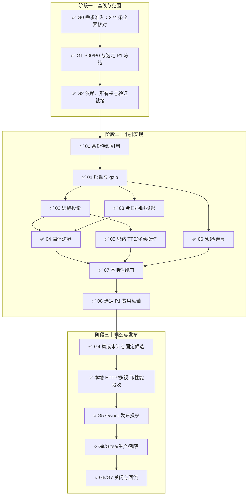

# V0.5.7 迭代计划：当前页面快速可用

计划日期：2026-10-04

状态：G0–G5 Preview 已通过；生产发布授权待执行

执行依据：更新后的 `STD-DEV-001`、`SOP/requirement-intake.md`、
`SOP/iteration-planning.md`、`SOP/feature-development.md`、
`SOP/integration-audit.md`、`SOP/release-and-observation.md`、
`SOP/ui-ux-optimization.md` 与 `SOP/http-browser-review.md`

## 1. 版本目标

V0.5.7 的主要结果是：已登录用户只为当前页面付出启动、数据和媒体成本，并能
在手机端清楚完成思绪、念起和标签等高频操作。

本轮必须：

1. 关闭 7 条 P00：路由唯一渲染、JSON gzip、轻量启动、历史小物派生与禁止
   原图回退、备份活动引用、思绪整链朗读、思绪移动操作收敛。
2. 关闭 8 条 P0：思绪列表/详情、今日状态、媒体清单、音频按需 Range、
   回顾聚类、性能门禁、念起独立录入层、善言多标签。
3. 在 P00/P0 无阻断后完成低风险 P1“费用图纵轴按实际峰值”。
4. 维持现有数据、权限、回收、同步、批注、TTS 费用审计和本地测试模式。

## 2. 基线与证据

| 项目 | 基线 |
| --- | --- |
| 生产运行代码 | `v0.5.6@780d279f3b36431430b421f9c72136cc48e90c75` |
| 主线 | `main@9c2450e1868dea78bd7e9db9560115c49d38913a` |
| 分支 / 工作树 | `feat/v0.5.7-performance` / `.worktrees/v0.5.7-performance` |
| 数据写源 | PostgreSQL 16.15 |
| 性能证据 | `/Users/bytedance/Documents/Codex/个人成长追踪/reports/77liu-top-performance-analysis-2026-10-04.md` |
| 需求池 | `MwUibJRQKaae9hsY9lMceQBYnAh / tblHW2FjQpyJlSck`，V0.5.7 冻结时 224 条；后续新增 V0.5.8 P00 |
| 研发交付 | `MwUibJRQKaae9hsY9lMceQBYnAh / tblsidvvCyB8Ty9M`，rev 91，59 条 |

HAR 基线：

- `/api/state` 解码正文 2,393,627 B，传输 2,399,098 B，耗时 4.940s；
- `thoughts + clusters` 占状态正文 93.59%；
- 冷缓存业务媒体 6,649,650 B，其中历史原始 PNG 5,804,445 B；
- 当前 Nginx 支持 gzip，没有 Brotli 模块；
- `ali-oss@6.23.0` 提供 `getStream`、`getObjectMeta` 和 Range 请求头能力。

V0.5.6 已于 23:37:12 CST 关闭观察；Gitee Release 1183270 已转正式。首次
备份暴露的幂等回放附件误引用已进入本轮 P00。

## 3. 范围冻结

### P00

| 需求 | Base ID | 本轮结果 |
| --- | --- | --- |
| 当前路由成为唯一渲染入口 | `reczz28JNp7RT4UD` | 隐藏路由不挂载媒体 DOM，离开取消失效请求 |
| JSON 响应压缩与协商 | `reczz28JNp7RRLtm` | Nginx gzip JSON，`Vary` 与兼容测试通过 |
| 轻量启动与当前路由首批投影 | `recvwSdWFYXYi8` | 启动不再请求 `/api/state`，首批压缩 JSON 不超过 200 KiB |
| 历史小物派生回填并禁止原图回退 | `recvwGUXdgeX9J` | 普通列表/详情原始 PNG 请求为 0 |
| 备份只校验活动附件引用 | `reczz28JNp7RTFVj` | 幂等回放旧路径不阻断备份，真实引用仍严格校验 |
| 思绪详情移动操作单行收敛 | `recvx5I0yL3Zfk` | 320/375/390px 主要操作单行、44px、无遮挡 |
| 思绪整链朗读与列表播放 | `recvx5JsayELAl` | 问题、最新我的结论、最新 AI 回答按存在性拼接并版本化缓存 |

### P0

| 需求 | Base ID | 本轮结果 |
| --- | --- | --- |
| 思绪列表 DTO、详情与游标搜索 | `reczz28JNp7RRz77` | 首批最多 20 条，详情按需，返回恢复 |
| 今日状态时间窗与聚合投影 | `reczz28JNp7RT8uk` | 当前日、最近值和有限趋势，不传完整历史 |
| 媒体清单与视口按需加载 | `reczz28JNp7RQfUM` | 当前视口只请求合适变体 |
| 音频点击后加载与存储层 Range | `reczz28JNp7RS8rA` | 点击前 0 B，OSS/本地只读请求范围 |
| 回顾聚类轻量投影 | `reczz28JNp7RRgAf` | 非回顾路由无 clusters，回顾只含受限摘要 |
| 启动性能合同与发布门禁 | `reczz28JNp7RS1gL` | 字节、请求、媒体和 P75/P95 均有机器证据 |
| 念起时间线优先与独立录入层 | `recvx5IxtSen1a` | 默认先见时间线，录入进入独立编辑层 |
| 善言多标签候选与可创建输入 | `recvx5KluDK9SK` | 创建/编辑/正文收藏统一多选与过滤 |

### P1

本轮只选择 `recvx5JKM1bczZ`“费用图纵轴按 0 到实际峰值”，原因是独立、
低风险且可随统计回归关闭。以下性能 P1 保留待规划：

- `reczz28JNp7RTwQl` 浏览器 Alpha 处理与二进制上传；
- `reczz28JNp7RRTV1` 账户隔离的路由投影缓存；
- `reczz28JNp7RSdPa` 其余可增长列表全面投影化；
- `reczz28JNp7RQkgz` 私有派生媒体缓存。

P2/P3 全部保留为后续，不进入本轮承诺。

### 历史未关闭项

- `reczz28IewItQGB5` Node RSS 平台期：并入 V0.5.7 Preview 长窗口性能验收；
  不在生产抓 heap snapshot。
- `reczz28HafaPuHiF` V0.2 开发流程报告：实现方报告已完成，只等待 Owner
  独立验收，作为局部人工阻塞，不扩大本轮代码范围。

## 4. 非目标

- 不实施 IndexedDB 路由缓存、全模块列表投影、私有派生媒体长期缓存。
- 不实施事件驱动同步、多标签 leader、静态模块拆包或空闲预取。
- 不实施 AVIF 媒体实验、聚类异步物化或 SSE。
- 不改变思绪、状态、捕念、善言的持久化业务语义。
- 不把历史媒体生产 apply、push、tag、Release、部署或生产写入视为开发授权；
  这些动作仍需对应门禁与当次明确授权。
- 不复制或提交 `docs/development-standard-20261004` 工作树中的未提交规则改动。

## 5. 实施切片

| 切片 | 优先级 | 范围与所有权 | 进入条件 | 完成条件 |
| --- | --- | --- | --- | --- |
| V0.5.7-00 | P00 | `shared/attachments` 备份引用与专项 | 当前生产事件已固定 | **G3 已通过**：`cf914a8`，幂等回放不阻断，活动/回收附件仍严格 |
| V0.5.7-01 | P00 | 启动 DTO、路由投影、路由唯一渲染、Nginx gzip | 00 已提交；API 契约固定 | **G3 已通过**：启动不请求 `/api/state`，隐藏路由内容卸载，gzip 可协商 |
| V0.5.7-02 | P0 | 思绪列表 DTO、分页/搜索、详情按需 | 01 的启动契约稳定 | **G3 已通过**：首批 20 条内；详情、返回、增量更新完整 |
| V0.5.7-03 | P0 | 今日时间窗、回顾聚类轻量投影 | 01 稳定 | **G3 已通过**：当前页字段/点数有上限，非回顾无 clusters |
| V0.5.7-04 | P00/P0 | 小物变体、迁移、媒体 manifest、图片视口、音频 Range | 路由投影稳定 | **G3 已通过**：普通展示无原图；点击前无音频；存储按 Range 读 |
| V0.5.7-05 | P00 | 思绪整链 TTS、移动操作栏 | 思绪详情契约稳定 | **G3 已通过**：双入口、版本失效、单行移动操作和异常恢复通过 |
| V0.5.7-06 | P0 | 念起独立录入层、善言标签组件 | 路由生命周期稳定 | **G3 已通过**：主任务清楚，草稿/编辑/键盘/移动端不回归 |
| V0.5.7-07 | P0 | 性能埋点、合同预算、HAR/trace、Linux RSS | 01–06 完成 | **G5 通过**：固定条件与三轮公网门通过；Linux 15 分钟 RSS 平台化且零重启/5xx/OOM |
| V0.5.7-08 | P1 | AI 费用图纵轴 | P00/P0 无阻断 | **G3 已通过**：0 到实际峰值，全零/单点/小额稳定 |
| V0.5.7-09 | 发布 | 集成审计、候选、Preview 与发布交接 | 所有纳入切片 G3 | **G5 Preview 通过**：`5e80659` 已部署并验收，生产动作另取授权 |

`server.mjs`、`public/frontend/app/runtime.mjs`、`public/index.html`、Nginx
配置、旅程矩阵和版本文件由主线单一负责人串行修改。其余任务按所有权拆为独立
工作树并行开发；每条并行线只提交自己的文件，主线逐条审阅和 cherry-pick，
候选冻结后停止并行写入。

当前并行线：

| 并行线 | 工作树 / 分支 | 独占范围 | 禁止修改 |
| --- | --- | --- | --- |
| 主线启动与投影 | `.worktrees/v0.5.7-performance` / `feat/v0.5.7-performance` | `server.mjs`、`runtime.mjs`、startup/route 投影、Nginx | 不吸收未审阅并行提交 |
| 后端媒体 Range | `.worktrees/v0.5.7-media-range` / `feat/v0.5.7-media-range` | attachment storage/http 与专项 | `server.mjs`、`runtime.mjs`、版本/发布文件 |
| 思绪整链 TTS 领域 | `.worktrees/v0.5.7-thought-chain-tts` / `feat/v0.5.7-thought-chain-tts` | speech-cache 应用层与专项 | `server.mjs`、`runtime.mjs`、页面 |
| 标签组件 | `.worktrees/v0.5.7-tag-component` / `feat/v0.5.7-tag-component` | 独立 tag component 与专项 | `runtime.mjs`、`index.html`、共享 CSS |
| V0.5.8 架构计划 | `.worktrees/v0.5.8-entrypoint-plan` / `docs/v0.5.8-entrypoint-decomposition` | 单独报告 | 任何代码与 V0.5.7 文件 |

## 6. 任务契约与验证

### V0.5.7-00 备份边界

- 修改：`src/shared/attachments/backup.mjs`、恢复/备份专项。
- 不做：删除幂等账本、放宽真实附件缺失检查。
- 失败/恢复：活动引用缺失继续失败；历史回放路径忽略；备份失败不改源数据。
- 验证：`npm run check`、`npm run test:restore`、`npm run test:backup`。
- 旅程：`delete-trash-restore`，状态 `automated`。
- 估算：3–5 文件，100–250 行，低于提交拆分阈值。

### V0.5.7-01 启动边界

- 修改：启动/路由 HTTP、前端 bootstrap/runtime/pages、Nginx 与部署回归。
- 不做：缓存完整账户状态或一次性迁移全部列表。
- 失败/恢复：启动接口缺字段时显示可恢复错误；灰度开关可回旧路径，但发布
  验收必须证明新路径不请求 `/api/state`。
- 验证：API 合同、frontend shell、web budget、UI startup、deploy。
- 旅程：`auth-session-boundary`、`fast-visible-shell`、
  `home-group-navigation-stability`。
- 估算：8–12 文件，500–900 行；按后端合同、前端接入、部署压缩拆提交。

### V0.5.7-02/03 数据投影

- 修改：thought/checkin/review 领域与 HTTP、前端路由加载和对应 OpenAPI。
- 不做：改变原记录 schema、搜索语义或聚类产品定义。
- 失败/恢复：游标无效、详情删除、筛选返回、跨午夜、低样本均有测试。
- 验证：thought/api-v1/records/reviews、URL history、Journey Smoke、system。
- 旅程：`thought-r8-reading`、`url-history-restoration`、
  `home-r8-single-screen`、`thought-source-answer`。
- 估算：每切片 6–10 文件、350–800 行，分开提交。

### V0.5.7-04 媒体边界

- 修改：keepsake 公开投影/迁移、attachments storage/http、媒体前端与专项。
- 不做：删除原件或修改长期归档政策。
- 失败/恢复：派生 pending/failed 显式占位；迁移计划哈希和竞态保护；
  Range 越界 416，客户端断开停止上游。
- 验证：keepsake media、attachment storage/upload、auth、restore、
  Journey Smoke；Preview dry-run，生产 apply 另行授权。
- 旅程：`keepsake-batch-library`、`capture-audio`、
  `audio-tts-playback`、`delete-trash-restore`。
- 估算：8–12 文件、500–900 行，按图片与音频拆提交。

### V0.5.7-05/06/08 用户界面

- 修改：既有思绪、念起、标签和 ChartFrame；不新增页面体系。
- 设计：移动主要动作保持补充/追问/回答，低频操作进入更多菜单；念起表单进入
  独立对话层；善言复用可创建标签语义；费用图只调整数值域。
- 失败/恢复：TTS 失败保留正文；录入取消零写；草稿、焦点、标签和编辑状态
  恢复；零费用图不出现 NaN。
- 验证：speech cache、Volcengine server 桩、library、UI、mobile、
  Journey Smoke 与固定 320/390/768/1440 截图。
- 旅程：`thought-r8-reading`、`audio-tts-playback`、`capture-text-image`、
  `capture-audio`、`responsive-visual-accessibility`。
- 估算：每切片 4–8 文件、200–600 行。

### V0.5.7-07 性能门

- 固定冷/暖缓存、登录后启动、路由切换、详情返回和第二设备同步场景。
- 自动断言 startup 禁止字段、列表 DTO、窗口上限、媒体请求、Range、gzip
  与账户隔离。
- 同一设备/网络至少 10 次采样，报告 P75/P95；不混用 HAR 全窗口与首批可读。
- Preview Linux 运行长窗口核对 RSS 分段、重启、OOM、5xx 和告警回滞。

## 7. 依赖与预验证

- Nginx 1.18 已编译 gzip，未编译 Brotli；本轮承诺 gzip，Brotli 为不适用。
- `ali-oss@6.23.0` 已确认存在 `getStream`、`getObjectMeta` 和自定义 headers，
  可实现 OSS Range 流；本地存储使用 `fs.createReadStream`。
- 思绪、状态、健康、捕念、日记、阅读和回顾已有 v1 分页服务或领域读取入口；
  本轮复用，不新增第二套分页协议。
- 历史小物迁移已有 dry-run、计划哈希、竞态和派生回滚框架；本轮补齐前端
  禁止原图回退及生产数据执行门。
- TTS 已有账户隔离、30 天缓存、音色、费用审计与版本失效；本轮新增
  `thoughtChain` 来源，不复制供应商调用链。

## 8. 排期与检查点

目标执行量为 12–18 小时，不作为跳过测试或发布门的承诺：

| 阶段 | 目标用时 |
| --- | ---: |
| 00–01 数据安全与启动底座 | 3–4 h |
| 02–04 路由数据与媒体主链 | 5–8 h |
| 05–06 用户操作收口 | 2–3 h |
| 07–08 性能验收与选定 P1 | 2–3 h |
| G4 候选与 Preview | 1–2 h |

每 2–3 小时记录 HEAD、工作树、已完成、NO-GO、下一步和证据。候选冻结后停止
并行写入。完整 Release 门历史约 5–6 分钟，生产观察至少 30 分钟。

## 9. 总体流程

## 10. G1 / G2 结论

### G1 范围已冻结：通过

- Owner 已明确要求完成性能与线上人工需求中的 P00/P0，并按工作量选择 P1。
- 做、不做、后置、验收、兼容和生产迁移边界已写明。
- 范围冻结后新增需求默认进入下一批；只允许阻断当前目标的数据、安全或兼容
  修复插入。

### G2 开发已就绪：通过

- 工作树、基线、共享文件所有权、切片顺序和提交边界明确。
- Nginx gzip 与 OSS Range 能力已预验证；数据库、供应商、费用和生产写入
  不属于未授权开发动作。
- 每个切片有成功、失败、恢复、旅程和命令；共享契约由单一负责人串行修改。
- V0.2 过程报告 Owner 验收是局部人工阻塞，不影响 V0.5.7 代码任务。

## 11. 完成条件

- 所有本轮 P00/P0 具有代码、专项、Journey、系统门和 Preview 证据。
- 启动不请求完整 `/api/state`，非当前路由媒体为 0 B，普通小物路径不请求
  原始 PNG，音频播放前正文为 0 B。
- startup <=25 KiB，启动与当前路由首批压缩 JSON <=200 KiB；固定条件
  P75/P95 达标或明确 NO-GO，不通过放宽阈值关闭。
- 本轮选定 P1 只在 P00/P0 无阻断后进入。
- 需求池、交付记录、README-TODO、计划和候选报告状态一致。
- G4 后向 Owner 提交 Preview 结果；push、tag、Release、生产迁移和部署继续
  等待 G5 明确授权。

## 12. 执行记录

### 2026-10-04 23:52 CST

- `V0.5.7-00` 通过 G3，本地提交
  `cf914a88f6d618baba2951ff6335e626c2576ce7`。
- 备份与恢复校验共用 `collectBackupAttachmentPaths`；只忽略
  `_persistence.idempotency[*].response` 中的历史回放路径，在线记录、回收站
  与其他活动引用仍严格校验。
- `npm run check`、`npm run test:restore`、`npm run test:backup` 通过。
- 当前未 push、未部署、未修改生产数据；下一步进入 `V0.5.7-01`。

### 2026-10-05 并行开发调整

- Owner 明确授权本轮按独立所有权尽量并行；主线继续独占
  `server.mjs` / `runtime.mjs` 等热点。
- 已建立后端媒体 Range、思绪整链 TTS 领域、标签组件三个独立实现工作树，
  以及一个只写 V0.5.8 架构报告的工作树；各线不 push，由主线审阅后串行集成。
- 下一版本新增 P00 `reczz28JPK4rO6LI`：把 `server.mjs` 与
  `public/frontend/app/runtime.mjs` 拆为纯组装入口。该项本轮只登记和规划，
  不夹带到 V0.5.7。

### 2026-10-05 V0.5.7-01

- 后端启动/路由投影提交 `362f707`，前端当前路由加载提交 `1efcd92`，
  Nginx JSON 压缩提交 `f854aa7`。
- 书目路由卸载保留静态骨架；跨刷新图片草稿先恢复到内存，到所属页面后再
  激活，避免未加载页面被误判为失效并删除。
- `npm run check`、`npm test`、`npm run test:startup`、
  `npm run test:api-v1`、`npm run test:frontend-shell`、
  `npm run test:sync`、`npm run test:url-history`、`npm run test:ui`、
  `npm run test:web-budget`、两套部署回归均通过。
- Fast 4G 本地门：可理解反馈 267.3ms、可见壳 266.8ms、稳定首页 686.5ms；
  启动与当前路由 JSON 预算通过。当前未 push、未部署。

### 2026-10-05 V0.5.7-02–08 与独立审计

- 思绪分页/搜索/详情、今日与回顾投影、小物安全媒体清单、音频存储 Range、
  思绪整链 TTS、念起独立录入层、善言多标签和费用图实际峰值均已集成。
- 独立审计发现的 7 项缺口已在 `b423362` 关闭：回顾分析继续分页、首页小物
  保留媒体清单、OSS 流打开 404 回退本地、思绪游标绑定账户、详情打开指标
  使用真实交互、当前屏反馈要求路由标题、捕念编辑关闭串行化并取消过期请求。
- `11611a7` 补齐 PWA 对标签组件的离线缓存；`49d17a4` 让 PostgreSQL 集成门
  按当前公开媒体清单断言，不再期待原图回退字段。
- `d2de3d3` 把应用 base 固定在首个静态资源之前，并由服务端按 `/`、`/now/`
  或 `/preview/` 注入，冷直达详情不再产生嵌套静态资源 404。

### 2026-10-05 G4 本地候选

- 运行代码候选：`d2de3d30c253033e3d87616fbc8c61510027f653`；
  tree：`842c3d4da94aea4b4a65c2bbe0924493032acf5e`。
- 最终 `npm run test:journeys:release` 通过，总计 `369979 ms`：
  完整隔离系统套件 `349658 ms`、PostgreSQL 16.14 stable `18247 ms`、
  生产依赖审计 `2074 ms` 且漏洞为 0。
- 固定 Fast 4G、1280×800、10 次采样：冷启动首个可读
  P75/P95 `702.1/786.6 ms`，暖启动 `696.4/700.1 ms`，路由切换
  `65.4/66.6 ms`，思绪详情打开 `54.5/68.7 ms`，详情返回
  `60.9/67.5 ms`，第二设备同步 `67.4/67.9 ms`；点击前媒体传输 `0 B`。
- 本地隔离 HTTP 验收覆盖 1440×900、390×844、320×568；思绪创建、详情
  来源返回、念起独立录入与自动收起、可创建双标签、冷直达及多视口均通过。
  320/390px 主要操作同一行且高 44px，无横向溢出；控制台无错误。
- 证据见 `reports/pre-launch-2026-10-05-v0.5.7.md` 与忽略目录
  `artifacts/v0.5.7/`。当前只通过 G4 本地候选；远端 Preview、Linux 长窗口
  RSS、真实供应商、物理设备、生产媒体 apply、push、tag、Gitee Release 和
  部署均未执行，等待 G5 明确授权。

### 2026-10-05 G5 远端 Preview

- 最终运行代码候选 `5e806598eac2bb0384a9fc6c966a57e311d82d68` 已推送
  `preview/v0.5.7` 并部署到隔离 Preview；生产继续运行 `780d279f3b36`。
- 最终统一 Release 门 `334216 ms`：系统 `318303 ms`、PostgreSQL 16.14
  `14379 ms`、依赖审计 `1534 ms` 且漏洞为 0。
- 三轮公网冷缓存当前屏反馈 `320.7 / 410.2 / 302.8 ms`，稳定首页
  `871.5 / 852.2 / 833.4 ms`；网络、控制台、运行时异常均为 0，
  320/390px 无横向溢出。
- Preview Linux 15 分钟 31 个样本 RSS `82.79–84.52 MiB`，末 10 个样本
  `84.50–84.52 MiB`；服务零重启，最终部署后 356 个 Preview 请求 5xx 为 0，
  应用 warning/error 与内核 OOM 为 0。
- Preview 未配置真实供应商凭据，DeepSeek、火山与阿里云 live 测试为 N/A，
  未借用生产凭据。tag、Gitee Release、生产媒体 apply、生产部署与观察仍需
  Owner 另行授权。
