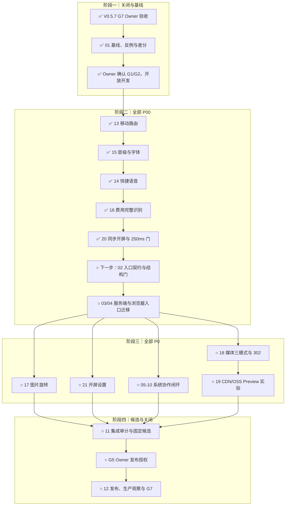

# V0.5.8 迭代计划：高优体验、媒体分发与系统协作

计划日期：2026-10-05

状态：`G0-G2` 已通过；Owner 已验收 V0.5.7 `G7` 并允许进入 V0.5.8
本地开发。`V0.5.8-13/15/14/16/20/02` 已完成工作区验证，`03/04`
已完成 B1-B7、F1、F2 slice 1 及 actions lifecycle slice；服务端入口
G4 代码与本地系统门已通过，真实 PostgreSQL 稳定门待具备工具后复验。
F3.1 通知页、F3.2 批注 lifecycle、F3.3 后台结果/跨内容定位及 F4.1
状态趋势/历史/首页情绪均已完成，下一步进入 F4.2 健康媒体草稿与批量体重；
尚未进入 Preview 或发布。

执行依据：`SOP/iteration-planning.md`、`SOP/iteration-retrospective.md`、
`knowledge/engineering-rules.md`、`knowledge/pre-launch-confirmation.md`、
`knowledge/development-release-checklist.md` 与当前需求池事实。

## 1. 版本目标

V0.5.8 必须完整关闭当前需求池中的 6 条 P00 和 8 条 P0，形成四个可验收结果：

1. 移动端记录、思绪阅读和快捷语音路径正确，第三方费用不再静默未知。
2. 冷启动在导航开始后 250 ms 内显示同步、可中断的 R9.4-F1 开屏反馈。
3. 私有媒体正文绕过 ECS 5 Mbps 出口，权限、Range、缓存、费用和回滚可控。
4. 回答按当前任务选择可追溯材料，持续感知、纠正、撤回和回放形成闭环。

`server.mjs` 与 `public/frontend/app/runtime.mjs` 的纯组装化是并行交付和长期
可维护性的 P00 前置，不是独立产品主题。先关闭会改变行为基线的用户可见 P00，
再冻结入口契约并迁移，避免在结构迁移中同时猜测旧缺陷与新行为。

V0.5.8 关闭时，以上结果必须同时具备本地候选、Preview、发布、生产冒烟和
观察证据；“代码已写”不等于需求完成。

## 2. 当前基线

| 项目 | 当前事实 |
| --- | --- |
| 生产运行 | `hotfix-v0.5.7-audio-on-demand@2c395c0295404a6c7bd5a076bb66b11c6e72c3f2` |
| 远端主线 | `origin/main@1e8b9f8716faed0bef34d47fd1e537f939433ea6` |
| 本轮工作树 | `.worktrees/v0.5.8-p00-p0`，分支 `feat/v0.5.8-p00-p0` |
| 规划前本地 HEAD | `2c20f1822b155e2dcaebecd23cd14a565b74794e` |
| 数据写源 | PostgreSQL 16.15 |
| 需求池 | `MwUibJRQKaae9hsY9lMceQBYnAh / tblHW2FjQpyJlSck`，`rev=359 / 238` |
| 研发交付 | `MwUibJRQKaae9hsY9lMceQBYnAh / tblsidvvCyB8Ty9M`，`rev=115 / 92` |
| 服务端入口 | `server.mjs` 3,283 行 |
| 浏览器入口 | `public/frontend/app/runtime.mjs` 5,291 行 |
| V0.5.7 过程报告 | [`V0.5.7 开发过程与复盘`](v0.5.7-development-process-2026-10-05.md) |
| 入口拆分设计 | [`V0.5.8 大入口拆分`](entrypoint-decomposition-v0.5.8-2026-10-05.md) |
| 媒体分发设计 | [`私有 OSS 与 CDN 媒体分发`](77liu-top-private-oss-cdn-delivery-design-2026-10-05.md) |
| 系统协作设计 | [`个性化回答与感知系统`](个性化回答与感知系统-理想设计-2026-10-04.md) |
| 开屏冻结配置 | [`R9.4-F1 JSON`](../knowledge/rain-config-confirmed-r9.4-f1.json) |

`2c395c0..1e8b9f8` 只有 6 个发布与状态文档发生变化，产品代码无差异。因此本轮
从 `origin/main@1e8b9f8` 建立的工作树继承当前生产代码行为，不需要再次搬运
V0.5.7 功能提交。

V0.5.7 已完成发布和 30 分钟观察；其 G7 事实审计已在 `2c20f18` 提交。
Owner 于 2026-10-05 14:45 +0800 验收 G7，并确认按本计划进入本地开发。
该确认不包含 push、云资源修改、真实付费调用、部署或生产写入。

## 3. 需求池全量结论

本次全表读取均为 `has_more=false`。238 条需求的优先级总量为：

| 优先级 | 总量 | 当前未关闭 | 本轮处理 |
| --- | ---: | ---: | --- |
| P00 | 52 | 7 | 6 条进入 V0.5.8；1 条 V0.2.1 过程报告继续待 Owner 独立验收 |
| P0 | 113 | 8 | 8 条进入 V0.5.8；另有 1 条重复记录保持“重复” |
| P1 | 50 | 8 | 4 待规划、3 待评估、1 暂缓，本轮不选 |
| P2 | 14 | 13 | 全部继续暂缓 |
| P3 | 9 | 9 | 全部继续暂缓 |

V0.5.8 的 14 条需求均关联版本记录 `reczz28JaO7yXu1K`，发布状态为“未发布”。

### 3.1 P00：本轮必须先关闭

| Base ID | 需求 | 主要验收 |
| --- | --- | --- |
| `recvx6EafCbAHL` | 移动端首页/思绪渲染与创建入口不跳错页 | 五档视口；思绪页创建不切回今日；返回保持上下文 |
| `recvx6EOEgzAZm` | 首页快捷语音记录 | 同一手势启动录音；失败保留草稿；无重复上传或转写 |
| `recvx6FocTDnVX` | 思绪卡片层级与字体渲染修复 | 列表/详情不重复；200% 字体无截断、重叠或横溢 |
| `reczz28JaV0zzUiE` | 第三方能力费用完整识别与治理 | 七类能力有金额或明确账单缺口；重试不重复计费 |
| `reczz28Jd7mMoWFW` | 250 ms 内同步开屏雨景 | P75/P95 <=250 ms；ready 后 <=140 ms 退出 |
| `reczz28JPK4rO6LI` | 拆分 server/runtime 为纯组装入口 | 结构门、差分门、系统门和 Release 门通过 |

### 3.2 P0：本轮必须关闭

| Base ID | 需求 | 主要验收 |
| --- | --- | --- |
| `reczz28JaWpeVkS6` | 上传图片按 90 度连续旋转 | 多图独立；预览、上传、识别和派生方向一致 |
| `reczz28Jd7mMnP8U` | 私有 OSS 与 CDN 媒体绕过 ECS 分发 | 短签名、302、Range、安全、HIT/MISS、费用和 proxy 回滚 |
| `reczz28Jd7mMnxJU` | 主账户开屏与氛围设置 | 服务端权限、修订冲突、草稿恢复和账户缓存隔离 |
| `reczz28HgtICoG29` | 按任务选材的工作上下文与个性化回答 | 当前原文快路径、硬门、相关性与依据可见 |
| `reczz28JPbOch6n9` | 持续感知与跨来源时序证据 | 来源版本、时间、幂等、候选和账户隔离 |
| `reczz28JPbOce5sZ` | 提示词职责化编排与注入边界 | 六类模板、结构化编译、注入与越权负例 |
| `reczz28JPbOcgPNP` | 纠正、许可撤回与派生失效闭环 | 删除/撤回立即停用，晚到任务不复活 |
| `reczz28JPbOceGif` | 个性化回答回放评测与依据可见 | 16 类固定回放和通用/旧/新方案对照 |

## 4. 明确不做与授权边界

- 本轮不选 P1/P2/P3，不把现有 14 条高优需求静默延期。
- CDN P0 只实现 `proxy | oss-signed | cdn-signed`、短签名、现有附件接口
  `302`、安全/Range/缓存/费用验证。批量签发、历史媒体迁移属于 P1。
- 浏览器受限 `PUT` 直传属于 P2，不借“媒体直传”标题混入本轮。
- 可以准备私有分发 Bucket 与合成 Preview 对象，但不迁移或删除历史原件。
- 不把 Bucket 改为公共读，不让 CDN 私有回源代替终端用户 URL 鉴权。
- 不引入前端框架、微服务、独立向量数据库或新的模型供应商。
- 不自动把 AI 候选升级为用户事实，不以点击和停留推断稳定人格。
- 真实 CDN/OSS/DNS/证书/费用告警、真实模型付费调用、私人数据回放、push、
  tag、Gitee Release、部署、生产写入和迁移均需对应阶段的单独 Owner 授权。

## 5. 交付切片与任务契约

### 5.1 基线与 P00

| 顺序 | 交付 ID | 状态 | 目标与完成条件 |
| ---: | --- | --- | --- |
| 00 | `reczz28JPdCVUk42` | 已完成 | 初版需求归一化、设计归档和计划；本次重排补入新增 8 条高优需求 |
| 01 | `reczz28JPdCVVj0K` | 已完成 | 固定生产/Git/Base/入口规模、缺陷反例和差分边界 |
| 13 | `reczz28Jd8F4nop8` | 工作区已验证未部署 | `a6a442b`、证据 `372201d`：修复移动布局和思绪创建路由；不重做首页信息架构 |
| 15 | `reczz28Jd8F4pPqK` | 工作区已验证未部署 | `41b30d8`：列表/详情只渲染各自层级，200% 字体等效视口通过；不改正文含义 |
| 14 | `reczz28Jd8F4pTH2` | 工作区已验证未部署 | `75e37d9`：首页麦克风在同一手势复用现有捕念录音链；不建立第二套录音状态机 |
| 16 | `reczz28Jd8F4nPjw` | 工作区已验证未部署 | `1eb61c9`、`a4150e9`、`56337a9`：七类能力统一用量、官方价格版本、预算和明确账单缺口；独立复审无新增问题 |
| 20 | `reczz28Jd8F4oH1y` | 工作区已验证未部署 | `91a10b7..88d37e1`：同步 HTML 开屏、雨景生命周期、真实 paint 性能门、FCP 后入口、退出/失败/清理、watchdog 锁存及 PWA 升级预算通过 |
| 02 | `reczz28JPdCVUwBD` | 工作区已验证未部署 | `6730597`：三类真实入口、组合 API/import binding/factory 链、G4/G6 例外和 feature lifecycle 已机器冻结；最终独立复审 GO |
| 03 | `reczz28JPdCVWPzV` | 工作区已验证未部署 | `f3724c4`、`47d5a39`、`a35dad8..9ba9f64`、`280887c`、`855200c`、`947c5da`、`00087be`、`6eee683`、`cac2496`、`342571d`、`5bc5a80`、`2320d1a`、`17fca0d`：B1-B7 已迁出 Store/投影、本地测试/账户、AI、媒体/内容 runtime、HTTP 编排和服务生命周期；`server.mjs` 3283→4 行，entrypoint-G4 代码门通过，PG stable 待环境 |
| 04 | `reczz28JPdCVXtsA` | 进行中 | `e7d99d6..5505d29`：F1-F3 与 F4.1 状态趋势/历史/首页情绪 lifecycle 已接入；完整 home 延至 F10，后续进入 F4.2-F10 |

13、15、14、16、20 都是行为修复，已在现有入口上完成并固定自动化反例；
共享热点由集成负责人串行接线。02 已冻结结构契约；03 已完成 B1-B7，
04 已完成 F1、F2 slice 1、actions lifecycle 与 F3；完整 F2/G5 尚未完成，
下一步进入 F4 状态/健康前端拆分，剩余浏览器入口仍只允许单写集成。Owner 于 2026-10-06
重申 `server.mjs` 只能负责启动，硬上限 100 行、目标不超过 40 行；不得用
无边界 barrel 或动态目录扫描制造表面瘦身。

### 5.2 独立 P0

| 顺序 | 交付 ID | 状态 | 依赖与完成条件 |
| ---: | --- | --- | --- |
| 17 | `reczz28Jd8F4mRw6` | 待开始 | 依赖 04 的图片 feature 边界；0/90/180/270、多图、刷新和识别通过 |
| 18 | `reczz28Jd8F4oncz` | 待开始 | 依赖 02/03 的媒体端口；本地三模式、签发、302 与 proxy 回滚通过 |
| 19 | `reczz28Jd8F4nDzn` | 外部阻塞 | 依赖 18 和云资源授权；Preview 安全、HIT/MISS、206/416、CORS 与费用通过 |
| 21 | `reczz28Jd8F4nVqe` | 待开始 | 依赖 20/04；账户偏好、服务端 capability、revision 和草稿恢复通过 |

18 的本地实现不等待云配置；19 不能用 mock 或本地签名冒充真实 CDN 验收。
未取得云资源授权时，其他切片继续推进，但 V0.5.8 不得宣告全部 P0 完成。

### 5.3 系统协作 P0

| 顺序 | 交付 ID | 依赖 | 完成条件 |
| ---: | --- | --- | --- |
| 05 | `reczz28JPdCVUk3q` | 03/04 | 事件、证据、时间、许可、关系、model revision 的 JSON/PG 对等 |
| 06 | `reczz28JPdamM6cR` | 05 | task/scene/current material、硬门、检索重排和当前原文快路径 |
| 07 | `reczz28JPdamLRQl` | 06 | 六类版本化模板、schema、结构化编译和注入防线 |
| 08 | `reczz28JPdamMSzd` | 05/07 | 保存先行、持续感知、幂等 worker、候选校验与版本拒写 |
| 09 | `reczz28JPdamMVJF` | 08 | 确认/修改/拒绝/撤回、派生失效和允许为空的周期综合 |
| 10 | `reczz28JPdamJwvB` | 06-09 | 本次参考、16 类固定回放和质量对照门 |

### 5.4 候选与关闭

| 顺序 | 交付 ID | 状态 | 完成条件 |
| ---: | --- | --- | --- |
| 11 | `reczz28JPdamLqYH` | 待开始 | 14 条需求全部达到 G3，固定候选并通过 G4/Preview |
| 12 | `reczz28JPdamMe1C` | 待开始 | 获得 G5 授权后完成 Git/Gitee、生产、观察、回填和 G7 |

## 6. 关键能力边界

### 6.1 250 ms 同步开屏

- 开屏壳、纸白、品牌和最早可见标记必须随 HTML 同步存在，不等待
  `runtime.mjs`、动态 CSS、背景图、账户偏好或业务请求。
- 默认严格读取 `R9.4-F1`：`density=3.5`、`trailPercent=60`、
  `dropSize=7.5`、`trailWidth=12`、`speed=85`、`bend=80`、
  `splash=5`、`trailLife=4`、`beadLife=9`、`contrast=119`、
  `slideDelay=50`、`slideLength=145`、`protectBrand=false`、
  `showBrand=true`。
- 动画控制器只接受 `start/ready/fail/dispose`，不自己发认证或业务请求。
- 安全页面 ready 后 140 ms 内退出，不强制播放；深链进入目标页，不跳首页。
- `prefers-reduced-motion` 优先；退出、失败、重试、pagehide 和账户切换清理
  rAF、timer、监听与 Canvas。
- 冷启动 P75/P95 都必须 <=250 ms；只测 DOM 存在不能关闭性能门。

### 6.2 私有媒体数据面

- ECS 保留登录、对象归属、模式选择和短时 URL 签发；媒体正文由 OSS/CDN
  发送。签名 TTL 为 60-300 秒，默认 120 秒。
- `oss-signed` 用 OSS V4 URL；`cdn-signed` 用 CDN URL 鉴权，二者不混用。
- `proxy` 是灰度与故障回滚，不删除现有 Range 行为。
- 原件、编辑源和原始录音默认不进入 CDN；CDN 只服务允许的版本化派生对象。
- P0 允许创建空的私有分发 Bucket 和合成 Preview 对象验证配置，不搬迁历史
  用户媒体；历史 WebP 生成、批量签发与媒体迁移继续属于 P1。
- 日志、分析和错误上报不得记录完整签名 URL；过期只自动补签一次。

### 6.3 费用完整性

- DeepSeek 文本/视觉、TTS、ASR、OCR、文档解析和阿里分割统一进入用量账本。
- 官方价格快照负责版本与来源；运行路径不得继续无条件写
  `costKnown:false`。
- 无法由公开价确定的资源包、阶梯或账号折扣必须显示“估算”或“待账单”，
  不记为零，也不阻断原业务。
- 请求未发出不计费；已发出后的失败按供应商实际计费规则结算；同一重试不能
  重复写账。

### 6.4 系统协作

- 当前用户指令和当前原文走快路径；账户、许可、删除和来源版本先作为硬门。
- 历史文本、OCR、外部材料和模型摘要都是数据，不能提升为系统指令。
- 程序负责身份、权限、版本、哈希、时间、单位、去重、提交和失效；AI 负责
  语义候选、关系提案、重排和解释。
- AI 输出保持 candidate/hypothesis；纠正、删除和撤回许可后，旧来源立即
  停止检索，晚到任务拒绝写回。

## 7. 单一总体流程

图中 18 的本地代码可先完成；19 必须等待云资源授权。所有箭头表示最晚依赖，
不表示共享入口允许并行修改。

## 8. 所有权、分支与回退

| 所有者 | 独占范围 |
| --- | --- |
| 集成负责人 | `server.mjs`、`runtime.mjs`、`bootstrap.mjs`、`public/index.html`、公共 barrel、模块登记、OpenAPI、Journey matrix |
| 前端体验线 | 当前切片对应 feature/page 内部文件、共享字体和图片草稿 |
| 媒体线 | 附件存储公开端口、签发器、媒体 HTTP 内部模块和专项 |
| 协作数据线 | event/evidence/claim schema、持久化映射、失效图 |
| 协作编排线 | task planner、working context、prompt catalog、回放 |
| 独立验证线 | 只读差分、权限负例、浏览器矩形、性能、Preview 证据 |

最大并行为两条实现线加一条只读验证线。共享契约与热点文件只由集成负责人
串行接线。每个切片形成独立本地提交；超过 500 行增删或 15 个文件前继续拆分。

回退以完整切片提交为单位：

- UI/开屏关闭 feature flag 或回退提交，不保留长期双 DOM/双状态机。
- 媒体切回 `MEDIA_DELIVERY_MODE=proxy`，不公开 Bucket、不删除原件。
- 数据 schema 先备份并保持旧读兼容；失败时停止新写，按迁移版本恢复。
- CDN 回滚停止新签发并等待旧 URL 过期，保留日志和费用证据。

## 9. 分层验证

### 功能切片

- UI：`home-group-navigation-stability`、`home-r8-single-screen`、
  `thought-r8-reading`，补思绪页创建不跳转和 200% 字体断言。
- 语音：`capture-audio`、`audio-tts-playback`，补用户手势、权限拒绝、
  切后台和重复提交。
- 图片：`capture-text-image`，补逐图旋转、识别方向和失败恢复。
- 开屏：新增同步首帧、ready/fail/dispose、减少动态效果和五档视口专项。
- 媒体：附件存储、Range、匿名/越权/过期、签名脱敏和 proxy 回滚专项。
- 费用：`npm run test:pricing`、AI budget/audit/observability 与所有调用入口。
- 协作：`personal-context-governance`、`thought-source-answer`，新增 task
  selection、invalidation、prompt injection 和 personalization replay。

### 跨域里程碑

- 每批运行 `npm run check`、影响矩阵专项、受影响 Journey Smoke。
- P00 行为冻结后执行 `npm run test:system`、恢复和临时 PostgreSQL 16 门。
- 入口迁移前后比较 legacy/v1 路由、Store、DOM、请求、启动与路由 closure。
- 数据底座验证 JSON/PostgreSQL、导出、删除恢复、账户隔离、并发与晚到任务。

### 固定候选与 Preview

- 固定 SHA 后运行完整 `npm run test:journeys:release`、依赖审计、恢复、
  1440/768/390/375/320 px、200% 字体与真实 HTTP。
- 开屏在 Fast 4G 与无缓存条件测量最早非空像素/标记 P75/P95，不以 DCL 代替。
- 获准后在 Preview 验证 CDN 匿名/越权/过期、两个不同签名的 MISS/HIT、
  206/416、CORS、原图不回退、当前路由外 0 B 和费用上限。
- 真实用户文本、真实模型费用、云资源和生产数据只在当次授权范围内使用。

## 10. 目标排期

以下为工程目标量级，不是发布日期承诺：

| 阶段 | 目标用时 | 置信度 |
| --- | ---: | --- |
| G7、基线、反例与计划关闭 | 3-5 h | 高 |
| 用户可见 P00：13/15/14/16/20 | 20-34 h | 中 |
| 入口契约与 03/04 迁移 | 35-55 h | 中低 |
| 独立 P0：17/18/21 | 20-34 h | 中 |
| 系统协作 05-10 | 49-78 h | 低 |
| 集成、Preview、发布与观察 | 10-18 h | 中低；受外部授权影响 |

合计约 137-224 小时。新 P00/P0、关键契约变化、云资源不可用、候选 SHA 变化、
真实价格口径冲突或固定回放未改善都会使排期失效，必须回到 G1/G2 重排。

连续工作每 2-3 小时记录 HEAD、工作树、已完成、NO-GO、下一步和证据路径。
不得通过跳过恢复、PostgreSQL、移动端、性能、费用或发布门维持日期。

## 11. G0 / G1 / G2

### G0：已完成

- 全量读取需求与交付；新旧高优项已查重、补齐字段并关联 V0.5.8。
- CDN、开屏和系统协作设计均有来源、边界和可验证验收。
- 需求、交付任务和证据没有混写。

### G1：通过

- 本轮冻结 6 P00、8 P0；P1/P2/P3 后置。
- P00 先修行为，再拆入口；独立 P0 与协作 P0 按依赖推进。
- CDN P0、P1、P2 边界和外部授权点已经拆开。
- 排期是目标量级，不是日期承诺。
- Owner 于 2026-10-05 14:45 +0800 确认范围。

### G2：通过

- 生产、Git、Base、入口规模和既有反例已经固定。
- 工作树从已发布主线创建；G2 放行时不含产品代码改动。
- 任务编号、依赖、所有权、回退、Journey 和分层测试已定义。
- CDN 云资源只局部阻塞 19，不阻止本地 P00 和 18 的本地实现。
- Owner 已明确接受 V0.5.7 G7，并确认按本计划进入 V0.5.8 开发；01 关闭，
  13 进入进行中。
- 该确认不包含任何 push、云资源修改、真实付费调用、部署或生产写入授权。

## 12. 当前状态与完成定义

当前本地事实与证据：

- V0.5.7 事实审计与规则回流提交 `2c20f18`。
- Base 中 14 条 V0.5.8 需求和 22 条交付的关联与字段回读。
- CDN 设计、R9.4-F1 配置、开屏 PRD 和原型归档到本工作树。
- 本计划按生产 `2c395c0` 和当前入口规模重排；Base 当前为需求
  `rev=359 / 238`、交付 `rev=115 / 92`。
- `V0.5.8-13@a6a442b` 已通过 Journey Smoke 13/13、浏览器 UI、
  URL/history、frontend shell、mobile platform 与语法检查；思绪页创建、
  取消和提交保持 `/thoughts` 与列表上下文；证据提交为 `372201d`。
- `V0.5.8-15@41b30d8` 已移除详情中的重复列表摘要，只保留一套详情层级；
  200% 字体等效视口、320/375/390 px 操作区与无横溢断言通过。
- `V0.5.8-14@75e37d9` 已让首页麦克风在同一用户手势进入现有捕念录音链；
  权限拒绝、权限等待时关闭、重复点击、草稿恢复和移动布局断言通过。
- `V0.5.8-16` 已由预算修复 `1eb61c9`、核心计价 `a4150e9` 和统计 UI
  `56337a9` 完成本地验证；实际未知费用按未知调用结算，独立复审无新增问题。
- `V0.5.8-20` 已由 `91a10b7`、`6384c7c`、`9830564`、`0f163aa`、
  `b24722b`、`8607cc6` 和 `88d37e1` 完成工作区验证。最终 Fast 4G web gate
  使用原生 Paint Timing：cold FCP P75/P95 `60/64 ms`，warm `56/60 ms`；
  cold firstReadable `704.0/704.5 ms`，warm `701.0/716.5 ms`；深链 FCP
  `84 ms`，`app.js` 请求从 `90.8 ms` 开始，ready 到实际绘制 `114.8 ms`。
- 最终 `npm run test:system` 在 `88d37e1` 上以 `406996 ms` 全通过；
  `check`、opening、frontend-shell、PWA、mobile/UI、性能门和 PostgreSQL
  16.14 兼容门均有通过证据。
- 性能验证曾有一次环境尾部失败；该失败样本未被隐去，也未计为通过。随后
  独立重跑收敛；随后复审发现的 FCP 后入口、超时锁存与 secondary 失败覆盖
  已由 `88d37e1` 关闭。最终独立 reviewer 无 blocker/P0/P1/P2。
- `V0.5.8-20` 代码与测试截止 SHA 为 `88d37e1`，活跃工作树 `5 / 6`。需求
  `reczz28Jd7mMoWFW` 与交付 `reczz28Jd8F4oH1y` 均已回填“待验收 /
  未发布”。完整调度证据见
  [`V0.5.8-20 多 Agent 调度记录`](multi-agent-coordination-v0.5.8-20-2026-10-05.md)。
- `V0.5.8-02@6730597` 已登记 57 个模块、233 条拥有路由和 20 条精确迁移例外；
  服务端例外在 G4、浏览器例外在 G6 失效。registry 保持独立未接线，
  runtime 闭包仍为 `24 / 815481 B`；独立 Reviewer 最终 GO。整体需求
  `reczz28JPK4rO6LI` 保持“进行中 / 未发布”，交付
  `reczz28JPdCVUwBD` 已回填“待验收 / 未发布”。
- `V0.5.8-03/04` 首批 `f3724c4..2989e61` 已完成 B1a、F1a 与门禁强化；
  `47d5a39` 完成 B1b/B1c，`208cba7`、`48e5d6b` 完成 F1b：
  `a35dad8..9ba9f64` 完成 B2。本地测试、账户初始化/恢复及认证审计已离开
  入口；`c3c4033`、`4ee0921` 完成 F2 slice 1，`afcf95b..eca9576`
  完成 actions lifecycle slice；`280887c`、`855200c` 完成 B3 AI runtime；
  `947c5da`、`00087be`、`6eee683` 完成 B4 媒体 runtime 与图片识别 handler；
  `cac2496`、`342571d` 完成 B5 内容 runtime、后台任务和个人语境接线；
  `5bc5a80`、`2320d1a` 完成 B6 统计 runtime、admin/Owner/upstream、
  legacy API 与 V1 显式 registry 接线；`17fca0d` 完成 B7 服务端组合根、
  HTTP application、静态资源和启动/关闭生命周期。
  当前登记 65 个模块、237 条拥有路由、6 条 browser G6 例外；
  `server.mjs` 为 4 行，runtime 为 5130 行。B1b/B1c backend
  `326672 ms`、F1b frontend `77626 ms`、Journey Smoke `14/14` 和最终
  web budget `24 / 819195 B` 通过；actions 最终 frontend `76840 ms`、
  Journey Smoke `15/15`，固定预算 `23 / 819147 B`，最终 Reviewer
  blocker/P0/P1=`0/0/0`。B2 check、专项、auth、persistence、restore、
  主 regression 和 backend 通过；B3 check、AI/预算/认证/可观测专项及完整
  backend `82/82`、`278032 ms` 通过；B4 完整 backend `83/83`、
  `281838 ms` 通过；B5 check、影响门及完整 backend `83/83` 通过；B6
  check、HTTP 编排/鉴权/统计/UI 影响门及完整 backend `90/90` 通过，
  B7 check/影响门与完整 system `416224 ms` 通过，backend runner
  `91/91`；独立 reviewer blocker/P0/P1=`0/0/0`。真实 PostgreSQL 16
  因本机缺少可执行文件未运行。当前为
  `iteration-G3 / entrypoint-G4-code`，完整 G4 的 PG stable 证据待环境。
- F3.1 由 `a45cba7`、`dfbcaf5` 将通知 presenter、页面 controller 与
  mount/render/unmount/reset 生命周期迁入 `features/notifications`，通知页
  改为显式 lazy descriptor 并从 legacy adapter 删除。直接深链等待 session
  ready，重试成功后离页仍由同账户全局 refresh/poll 接管；首页隐藏模块请求
  保持 0。`check`、F3 专项、PWA、web budget、frontend `21/21`
  `81488 ms`、Journey Smoke `15/15` 通过，最终 reviewer
  blocker/P0/P1=`0/0/0`。
- F3.2 由 `78e5fc1` 将批注 presenter、锚点/行计数、评论面板、草稿与
  创建/回复/互转/删除事件迁入 `features/annotations`，通过显式 ports
  复用内容图片、通知和跨内容导航；shell 按账户挂载并在 reset 时清理监听、
  timer、animation frame 与私有 DOM。
- annotations 模块为显式延迟加载，加载失败不阻断应用启动，失败 Promise
  会清除以供后续 session 重试；旧 session 的迟到请求和加载失败不得写状态、
  DOM 或提示。`runtime.mjs` 5130→5002 行，SHA
  `eea3d7a1065273c38583255bdd5564382b6cba145400e9ba647aa07608662787`；
  API 69→68、DOM query 203→171、event binding 269→247、timer 60→54、
  template 772→722，6 条 browser G6 例外继续精确绑定。
- `npm run check`、F3 专项、PWA、web budget、frontend `22/22`
  `76841 ms`、Journey Smoke `15/15` `62771 ms` 通过；runtime 静态闭包
  `21 / 776503 B`，首页隐藏 feature 请求为 0，预算未放宽。独立复审先后
  关闭 3 个 P1，最终 reviewer GO，blocker/P0/P1=`0/0/0`。
- F3.3 由 `5ca856d` 将后台任务目标解析、幂等结果合并、账户代际与跨内容通知
  定位迁入独立 `features/background-results`，移除 discovery 错误归属和
  通用 feature barrel 静态边；模块按需加载，失败 Promise 可重试，最后一个
  completed task 的模块/结果读取失败保留最多 3 次有界轮询。
- 同账户连续打开通知由 navigation generation 隔离，旧账户迟到结果不写状态、
  DOM 或提示；thought/capture 及 thought/journal/chat/analysis/book/quote
  批注定位通过窄 navigation/annotations/view ports 接线。模块不进入 PWA
  install precache，仅首次使用后缓存。
- `runtime.mjs` 5002→4997 行，SHA
  `e9fa893d0ce5c128603be37ee25ab303055c812c1b7c7c95397a16267766de90`；
  DOM query 171→166、timer 54→50、template 722→717，API 68、event
  binding 247 与 6 条 browser G6 例外不变。
- `npm run check`、F3 专项、PWA、web budget、完整 frontend `23/23`
  `85017 ms` 与 Journey Smoke `15/15` `66725 ms` 通过；runtime 静态
  闭包 `20 / 761286 B`，首页隐藏 feature 请求为 0。首次完整 frontend
  在未修改的 keepsake 异步候选断言失败，最终冻结差分原命令复跑全绿。
  独立复审发现并关闭有界重试和 PWA 预缓存两个 P1，最终 reviewer GO，
  blocker/P0/P1=`0/0/0`。
- F4.1 由 `0e1f869`、`5505d29` 将状态指标定义、同日均值趋势、单次历史与
  首页 7 日情绪迁入 `features/checkins-model` 和 `features/checkins`；
  `today/review` 通过同一可回收 controller 呈现，事件仍限定当前 route root，
  跨页 surface 由 document 级明确所有权保持乐观投影即时一致。
- controller 重复 mount 不叠加监听，账户 reset 会清空当前及已离页 surface；
  checkins 作为默认首页可见关键路径进入静态闭包和 PWA install cache，不作为
  隐藏 lazy feature。`runtime.mjs` 4997→4962 行，SHA
  `23887c7a4f7a837d41181ae0d8f3abf47d1ab00cc27252564fb8357b33801fb5`；
  event binding 247→246、template 717→696，API 68、DOM query 166、
  timer 50 与 6 条 browser G6 例外不变。
- `npm run check`、F4.1 专项、records、records-v1、frontend-shared、UI、
  PWA、web budget 与 Journey Smoke `15/15` `64234 ms` 通过；首屏静态闭包
  `24 / 771187 B`，隐藏 feature 请求 0，API 请求最大 9/10，冷/暖 P75
  `699.7/701.4 ms`。首次 UI 暴露首页乐观记录未同步隐藏历史，首屏门随后
  暴露 actions 读取提前及动态模块串行延迟；均在冻结差分内修复，阈值未放宽。
  两路独立复审最终 blocker/P0/P1=`0/0/0`。

当前未完成：

- 下一步进入 F4.2-F10，完成健康媒体/批量体重及 browser runtime 收口与
  G5-G7；服务端入口已
  收口为 4 行并删除全部 server 迁移例外。
- `reczz28Jd8F4nDzn` 仍等待真实 CDN/OSS/DNS/证书/费用授权。
- 未执行 push、tag、Release、Preview/生产部署或生产写入。

V0.5.8 只有同时满足以下条件才可关闭：

- 6 条 P00、8 条 P0 均达到各自验收且无未说明降级。
- 两个大入口达到纯组装门，旧实现和临时例外归零。
- 开屏 250 ms、媒体绕 ECS、费用完整性、移动端和系统协作回放门通过。
- 候选 SHA、配置、Prompt、schema、依赖和价格快照固定。
- 获得 G5 授权后完成 Git/Gitee、备份恢复、部署、生产冒烟和至少 30 分钟观察。
- Base、TODO、原计划关闭段、迭代历史和复盘按实际状态回填。
