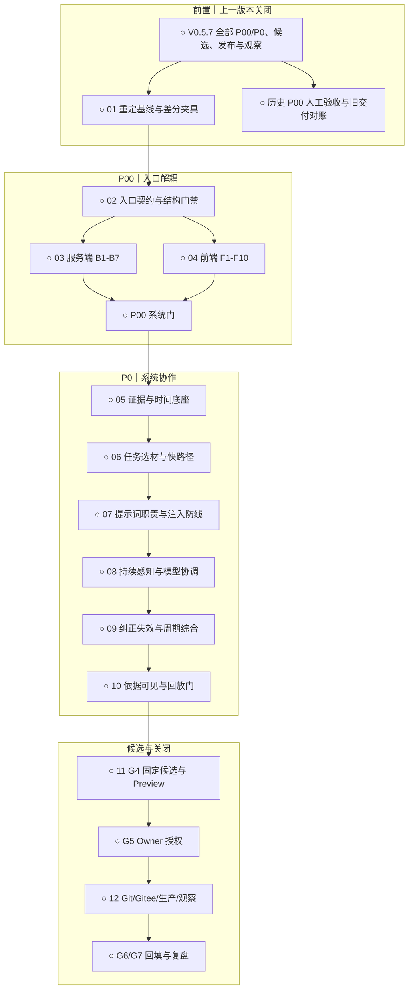

# V0.5.8 迭代计划：系统协作、任务化提示词与大入口拆分

计划日期：2026-10-05

状态：`G0` 已通过，`G1` 已冻结；`G2` 为 NO-GO，等待 V0.5.7 关闭并重新固定
代码、数据、路由和性能基线。

执行依据：当前主工作区最新版 `STD-DEV-001`、
`SOP/requirement-intake.md`、`SOP/iteration-planning.md`、
`SOP/feature-development.md`、`SOP/integration-audit.md`、
`SOP/release-and-observation.md`，以及本分支现有工程、测试和发布规则。

## 1. 版本目标

V0.5.8 的唯一主要用户结果是：

> 系统围绕本轮问题组织协作，只使用会改变当前判断且仍被允许的个人信息；
> 用户刚提交的原文及时参与回答，长期理解可追溯、可纠正、可撤回。

为使这条链路可安全实现，先以 P00 把 `server.mjs` 和
`public/frontend/app/runtime.mjs` 从业务热点收敛为纯组装入口，再在明确的
领域边界上完成 5 条系统协作 P0。大入口拆分是本轮强制工程前置，不是第二个
产品目标。

本轮完成后应能证明：

1. 回答入口显式知道本轮场景、任务、当前材料和完整相关链。
2. 账户、许可、删除和版本先作为硬门，再做检索、去重与相关性排序。
3. 历史记录、图片文字和外部材料作为数据注入，不能改变系统职责。
4. 日记、念起、思绪、批注、状态备注及图片/语音派生可形成有来源的候选理解。
5. 用户纠正、删除或撤回许可后，旧依据和晚到任务不再影响回答。
6. 固定回放能比较通用回答、旧固定堆叠和新编排，而不是用“记住更多”冒充改善。

## 2. 基线与证据

| 项目 | 当前事实 |
| --- | --- |
| 生产 | `v0.5.6@780d279f3b36431430b421f9c72136cc48e90c75` |
| 远端主线 | `origin/main@9c2450e1868dea78bd7e9db9560115c49d38913a` |
| V0.5.7 基线 | `cf914a88f6d618baba2951ff6335e626c2576ce7`；多条实现线尚未串行集成 |
| 本计划分支 | `docs/v0.5.8-entrypoint-decomposition@003b07e91e577e3c105a8693b5266e6329cf14d4` |
| 数据写源 | PostgreSQL 16.15 |
| 需求池 | `MwUibJRQKaae9hsY9lMceQBYnAh / tblHW2FjQpyJlSck` |
| 研发交付 | `MwUibJRQKaae9hsY9lMceQBYnAh / tblsidvvCyB8Ty9M` |
| 系统协作设计 | [`个性化回答与感知系统`](个性化回答与感知系统-理想设计-2026-10-04.md) |
| 大入口专项 | [`V0.5.8 大入口拆分`](entrypoint-decomposition-v0.5.8-2026-10-05.md) |

计划前完整读取 Base：需求池原快照为 rev 307、225 条，研发交付为 rev 93、
69 条，均为 `has_more=false`。本轮随后升级 1 条既有需求、新增 4 条需求和
13 条交付记录；最终回读为需求 rev 312、229 条，交付 rev 96、82 条。

现状证据：

- `personalContextProjection(store, options)` 不接收本轮问题或场景，按固定类别
  和条数拼接，超预算后按固定顺序删除。
- 2026-10-04 的真实 `annotationShenji` 调用为“布鲁姆分类学”局部批注，却带入
  15 条状态、15 条健康和 18 条念起；健康材料约占个人上下文 67.7%。
- 页面展示的 19,881 是 UTF-8 字节上界估算；整次请求实际输入为 6,790 Token，
  两者不得混写。
- 八领域 claim、候选确认和版本检查已经存在，但证据类型只覆盖冷启动五问；
  被核对账户的结构化理解条目为 0。
- 大入口专项在 `cf914a8` 量得 `server.mjs` 3,217 行、
  `runtime.mjs` 4,820 行；V0.5.7 会继续修改两者，因此实现前必须重测。

## 3. 需求池全量处理

本轮写入前，225 条需求按优先级为 P00 47、P0 104、P1 51、P2 14、P3 9；
状态为已完成 174、待开始 16、待规划 6、待评估 3、待验收 2、暂缓 23、
重复 1。字段缺失为 0。

### 3.1 既有未关闭 P00/P0

| 范围 | 数量 | 处理结论 |
| --- | ---: | --- |
| V0.5.7 P00 | 8 | 保留在 V0.5.7；其中 7 条为原冻结范围，Node RSS 平台期并入其性能门。全部关闭后才能进入 V0.5.8-01 |
| V0.5.7 P0 | 8 | 保留在 V0.5.7，不重复创建或改写版本 |
| V0.2.1 过程报告 P00 | 1 | 实现方报告已完成，等待 Owner 独立验收；属于人工治理阻塞，不扩大 V0.5.8 代码范围 |
| 旧 V0.5.0 未关闭交付 | 2 | 需求侧已关闭但交付状态仍为进行中/待验收；在 V0.5.8-01 做状态对账，不创建新产品需求 |

除上述前置和治理项外，读取时没有其他未完成 P00/P0。V0.5.7 若出现范围取消、
回滚或未关闭项，必须重新执行 `G1`，不得把它们静默改名为 V0.5.8。

### 3.2 V0.5.8 冻结范围

| 优先级 | Base ID | 需求 |
| --- | --- | --- |
| P00 | `reczz28JPK4rO6LI` | `ARCH-P00-1` 拆分 server/runtime 大入口为纯组装入口 |
| P0 | `reczz28HgtICoG29` | `COLLAB-P0-1` 按任务选材的工作上下文与个性化回答 |
| P0 | `reczz28JPbOch6n9` | `COLLAB-P0-2` 持续感知与跨来源时序证据 |
| P0 | `reczz28JPbOce5sZ` | `COLLAB-P0-3` 提示词职责化编排与注入边界 |
| P0 | `reczz28JPbOcgPNP` | `COLLAB-P0-4` 纠正、许可撤回与派生失效闭环 |
| P0 | `reczz28JPbOceGif` | `COLLAB-P0-5` 个性化回答回放评测与依据可见 |

`reczz28HgtICoG29` 由原 P1-04 升级并扩展；其余 4 条由本次设计报告通过
`G0` 后新增。它们分别承载不同用户结果和验收，不将整份设计塞进一条无法关闭
的“大需求”。

### 3.3 本轮不选

- 不选择 P1；V0.5.7 的费用纵轴 P1 只按其原计划执行，不移入本轮。
- P2/P3 继续暂缓，不启动外部连接器、独立搜索/向量服务、社区或自动探索。
- 不把六层记忆实现成新图数据库；先使用现有 PostgreSQL 与模块边界。
- 不自动把自由文本候选提升为长期事实，不用点击、停留或收藏推断稳定人格。
- 不改变 AI 费用、用户权益、模型供应商或业务量表口径。
- 大入口 P00 期间不混入提示词、数据 schema、文案、样式或产品行为变化。
- 规划完成不授权代码实现、真实用户回放、付费调用、push、tag、Release、
  部署或生产写入。

## 4. 关键产品与技术边界

### 4.1 “提示词注入”的双重含义

本轮要把筛选后的工作上下文注入模型，同时防止历史原文、图片 OCR、外部资料
或模型摘要中的提示注入攻击。当前用户明确任务与系统规则有独立结构；数据中的
“忽略规则”“priority=highest”或伪标签不能提升权限。

### 4.2 快路径与慢路径

- 快路径：记录先可靠保存；同时请求回答时，当前原文、附件和完整相关链直接
  进入本轮上下文，不等待全账户感知完成。
- 慢路径：事务事件驱动感知、校验、归并、候选和模型更新；失败可重试，不反向
  影响原文保存。
- 当前结构化状态、显式纠正和权限变更可立即生效；AI 解释保持候选，等待确认。

### 4.3 程序与 AI 分工

- 程序：账户、权限、版本、哈希、时间、单位、数值统计、事件序号、去重、
  schema、提交和失效传播。
- AI：文本/图片语义、原子候选、关系提案、相关性重排、周期解释和回答检查。
- AI 输出始终是提案；引用存在不等于语义正确，服务端仍须做来源和版本校验。

### 4.4 检索与压缩

硬门先过滤账户、许可、有效版本和删除状态；软排序再考虑任务影响、明确性、
来源可靠性、时间适配、反证价值和重复。概念解释允许个人材料为零。P0 不以
独立向量服务为前提；语义召回方案在 V0.5.8-05 以固定回放结果决定，不能先加
基础设施再寻找收益。

## 5. 交付切片

| 切片 | Base 交付 ID | 优先级 | 范围 | 完成条件 |
| --- | --- | --- | --- | --- |
| V0.5.8-00 | `reczz28JPdCVUk42` | P00 | 需求归一化、报告归档、计划与 Base | 文档、需求、交付和状态可追溯 |
| V0.5.8-01 | `reczz28JPdCVVj0K` | P00 | V0.5.7 后重定基线与差分夹具 | 单一 SHA、前置关闭、差分可重复 |
| V0.5.8-02 | `reczz28JPdCVUwBD` | P00 | 入口契约、生命周期与结构门禁 | B0/F0 契约和 `check:entrypoints` 通过 |
| V0.5.8-03 | `reczz28JPdCVWPzV` | P00 | B1-B7 服务端领域迁移 | `server.mjs` 成为纯启动入口 |
| V0.5.8-04 | `reczz28JPdCVXtsA` | P00 | F1-F10 浏览器功能迁移 | `runtime.mjs` 成为纯组合入口 |
| V0.5.8-05 | `reczz28JPdCVUk3q` | P0 | 事件、证据、时间、许可与关系底座 | JSON/PG/导出/恢复及版本并发通过 |
| V0.5.8-06 | `reczz28JPdamM6cR` | P0 | 任务选材、当前原文快路径与工作上下文 | 场景选材和来源回执通过 |
| V0.5.8-07 | `reczz28JPdamLRQl` | P0 | 六类提示词、结构化编译与注入防线 | 目录、schema、攻击与审计用例通过 |
| V0.5.8-08 | `reczz28JPdamMSzd` | P0 | 核心记录持续感知与模型协调 | 保存、幂等、候选、冲突和隔离通过 |
| V0.5.8-09 | `reczz28JPdamMVJF` | P0 | 纠正、失效、行动反馈与周期综合 | 删除/撤回传播和空综合通过 |
| V0.5.8-10 | `reczz28JPdamJwvB` | P0 | 依据可见、固定回放与质量门 | 16 类用例和对照评测通过 |
| V0.5.8-11 | `reczz28JPdamLqYH` | P0 | 集成审计、固定候选和 Preview | G4 与 Preview 验收通过 |
| V0.5.8-12 | `reczz28JPdamMe1C` | P0 | 获准后的发布、观察、回填和复盘 | G5-G7 按实际证据关闭 |

V0.5.8-03/04 的内部 B0-B7、F0-F10、行数门、公开 API、风险和测试矩阵以
大入口专项报告为准，不在总计划重复维护。

## 6. 依赖与实施顺序

1. V0.5.7 关闭后执行 01；固定基线前不开始搬迁。
2. 02 冻结入口契约和机器门禁。
3. 03 与 04 可有两条模块准备线，但两个大入口、公共 barrel、模块登记、
   journey matrix 和系统门始终由唯一集成负责人串行接线。
4. P00 的 02-04 全部达到 G3 后，才开始系统协作 P0。
5. 05 先固定证据、时间、许可和版本；06/07 在该契约上完成上下文和提示词。
6. 08 接入持续感知，09 才开放纠正传播和周期综合。
7. 10 用固定回放决定是否达到产品结果；指标未改善不能以实现完成替代验收。
8. 11 固定候选；12 只有获得当次 G5 授权后才能执行。

## 7. 单一总体流程

图中 00 规划交付已完成，但它不改变代码执行节点状态；开发起点仍是 01。

## 8. 所有权与并行

| 所有者 | 独占范围 |
| --- | --- |
| 集成负责人 | 两个大入口、`src/app/index.mjs`、`src/http/index.mjs`、前端 feature barrel、模块登记、根 OpenAPI、journey matrix、系统门 |
| 服务端迁移线 | 当前 B 批次的领域、应用、HTTP 内部文件与专项 |
| 前端迁移线 | 当前 F 批次的 feature/page 内部文件与专项 |
| 协作数据线 | event/evidence/claim schema、持久化映射、失效图与迁移 |
| 协作编排线 | task planner、retriever/reranker、working context、prompt catalog |
| 独立验证线 | 差分夹具、注入/权限负例、回放和 Preview 证据 |

最大并行为两条实现线加一条只读验证线。同一共享契约或热点文件同一时刻只有
一个负责人；多分支始终串行合并。P00 结束前不得让协作功能分支修改仍在搬迁的
实现。

## 9. 数据与兼容

- 保留已有 `userClaims`、`modelUnknowns` 和 onboarding V2，新增字段必须有旧
  Store 默认值、JSON/PostgreSQL 对等映射、导出和恢复。
- 证据来源扩展时，旧 `onboardingV2Answer` 继续有效；来源类型、版本、哈希、
  span/字段路径和说话者由服务端校验。
- 删除、恢复和许可撤回需要传播到索引、摘要、候选、模型快照和待处理任务；
  不能只删一个缓存或向量。
- 回答只绑定本轮依赖来源和模型 revision；无关记录变化不应让回答无端失效。
- 保持现有 legacy/v1 API、错误码、ETag、幂等、Cookie、base path、原文、
  附件、时间、任务、通知和回收语义。

## 10. 分层验证

### 功能切片

- 入口：新增 `check:entrypoints`，并运行模块、路由、frontend shell 和受影响
  领域专项。
- 协作：新增 task context selection、perception event、memory invalidation、
  prompt injection 和 personalization replay 专项。
- 现有回归至少覆盖 `personal-context`、user model extraction/API、thought、
  annotation、journal/review、content attachment、background task 和 prompt
  catalog。

### 里程碑系统门

- P00：`npm run check`、后端/前端影响矩阵、`npm run test:system`、恢复和
  临时 PostgreSQL；迁移前后路由、Store、DOM、请求与性能差分。
- P0 数据底座：JSON/PostgreSQL、导出、删除恢复、账户隔离、并发与旧任务。
- P0 编排：当前输入、完整链、无关材料排除、反例、时间、量表和上下文预算。

### 冻结候选

- 完整 `npm run test:journeys:release`、恢复、桌面/390/320 px、真实 HTTP、
  启动/路由 closure 与长稳性能。
- 回放至少覆盖设计报告中的 16 类：抽取、时间、跨会话、更新、克制、当前数据、
  并发、去重、量表、相关性、完整链、许可、失效、来源身份、反馈和泛化边界。
- 真实用户原文回放、真实模型费用和生产数据只在获得当次授权后执行；默认使用
  虚构或脱敏夹具。

受影响旅程至少包括 `personal-context-governance`、
`onboarding-v2-minimum-model`、`thought-source-answer`、
`capture-text-image`、`capture-audio`、`delete-trash-restore`、
认证/账户切换、日记回望、长期对话和响应式可访问性。缺少现成旅程时在对应
切片内补齐，不能留到总集成。

## 11. 排期与检查点

按当前证据估算总执行量约 90-145 小时，不是发布日期承诺：

| 阶段 | 目标用时 | 置信度 |
| --- | ---: | --- |
| 01 基线与差分 | 3-5 h | 中 |
| 02-04 大入口 P00 | 35-55 h | 中低；V0.5.7 会改变热点 |
| 05 证据与时间底座 | 10-16 h | 中低；含持久化 |
| 06-07 选材与提示词 | 13-20 h | 中 |
| 08-09 感知、纠正与综合 | 20-32 h | 低；跨来源与并发 |
| 10 回放与依据可见 | 6-10 h | 中 |
| 11 候选与 Preview | 3-7 h | 中 |

连续工作每 2-3 小时记录 HEAD、工作树、已完成、NO-GO、下一步和证据。
单提交超过 500 行增删或 15 文件前继续拆分；纯迁移也不能绕过该门。

## 12. 风险与回退

| 风险 | 控制与回退 |
| --- | --- |
| V0.5.7 改变入口事实 | 01 重新盘点并重估；差异过大则退回 G1 |
| 机械拆分形成新巨型模块 | 语义门、公开 API、依赖方向和 500/800 行软硬门 |
| 相关性筛选漏掉关键材料 | 当前原文/完整链强制快路径；回放记录漏选率 |
| 提示注入改变职责 | 指令与数据分层、结构化转义、攻击夹具和权限硬门 |
| AI 候选污染用户事实 | candidate/hypothesis、服务端引文校验和显式确认 |
| 删除或撤回后仍被引用 | 依赖失效、索引停止检索、晚到任务拒写和重算 |
| 上下文变化导致频繁废弃回答 | 只绑定本轮实际依赖，不比较全账户哈希 |
| 回放暴露私人文本 | 默认虚构/脱敏；私有审计不进入 stdout 或公开统计 |
| ESM 拆分拖慢首屏 | shell/route closure 预算和隐藏页面零请求门 |

每个切片以完整提交组回退；不保留长期双实现。无数据迁移的结构批次按代码 SHA
回滚；涉及 schema 的协作批次先备份、验证向后兼容，再允许发布。

## 13. G0 / G1 / G2

### G0 需求可进入：通过

- 用户原始指令、设计报告、代码与生产审计来源明确。
- 用户事实、系统事实、Owner 优先级和设计建议已经分开。
- 既有 P1-04 已查重后升级，新增项没有与现有需求平行重复。
- 6 条 V0.5.8 需求均有用户故事、最小结果、验收、依赖和状态。

### G1 范围已冻结：通过

- Owner 已指定 V0.5.8 主题、大入口 P00 和其余 P00/P0。
- 本轮只有一个用户结果；大入口作为强制前置。
- 做、不做、前置、回退、权限、持久化和发布边界明确。
- 新 P00/P0 插入时必须重新计算依赖和范围。

### G2 开发已就绪：NO-GO

当前不能开始 V0.5.8 代码：

1. V0.5.7 尚未完成串行集成、候选、发布和观察。
2. V0.5.8 的实际基线 SHA、入口规模、路由与性能 closure 尚未重定。
3. 新证据 schema、语义召回实现和主动综合默认值尚待 01/05 风险验证。

01 完成并更新本计划、Base、工作树和差分证据后，才能重新判定 G2。

## 14. 状态同步与完成条件

2026-10-05 计划交付回读：

- 需求池为 rev 312、229 条，6 条 V0.5.8 需求均为待开始、未发布，并已关联
  对应交付。
- 研发交付为 rev 96、82 条，13 条 V0.5.8 交付均有关联需求；00 已完成，
  01 因 V0.5.7 前置未关闭而阻塞，02-12 为待开始。
- 两次全表读取均为 `has_more=false`，必需字段缺失 0。
- `README-TODO.md`、README 和 `knowledge/prompt-architecture.md` 已同步；
  设计报告已从外部目录移入本项目 `reports/`。
- `git diff --check`、Markdown 围栏和单 Mermaid 检查通过。

V0.5.8 只有同时满足以下条件才可关闭：

- V0.5.7 前置及历史高优状态已经诚实处理。
- 大入口达到语义纯入口门，旧实现与迁移例外归零。
- 5 条系统协作 P0 全部具备实现、专项、Journey、系统和回放证据。
- “布鲁姆分类学”固定样例不再注入无关健康全集；时间、权限、来源、纠正和
  信息不足用例通过。
- 候选 SHA、版本、Prompt 目录、schema、依赖和配置固定。
- 获得 G5 授权后完成 Git/Gitee、备份恢复、部署、生产冒烟和至少 30 分钟观察。
- Base、TODO、原计划关闭段、迭代历史和复盘已按实际状态回填。
