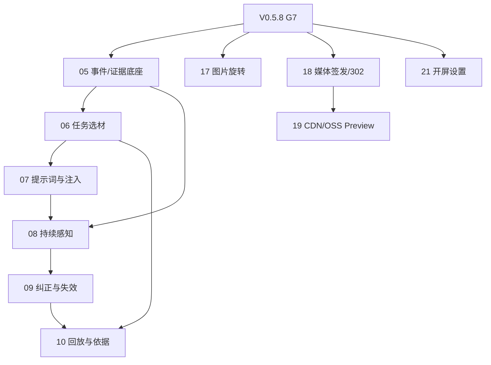

# V0.5.9 接收计划：媒体分发与系统协作

计划日期：2026-10-06

状态：`intake-frozen / development-not-started`

V0.5.9 接收从 V0.5.8 按完整需求原子迁出的 8 条 P0。当前没有实现、候选、
Preview 或发布证据；不得把 V0.5.8 的入口架构迁移进度计作这些需求进度。

## 1. Base 基线

| 对象 | 当前事实 |
| --- | --- |
| Base | `MwUibJRQKaae9hsY9lMceQBYnAh` |
| 版本记录 | `v0.5.9=reczz28K2FLyWwBC`，表 `tblGmYXwYXmaddqA`，`rev=16 / 31` |
| 需求池 | 表 `tblHW2FjQpyJlSck`，`rev=413 / 252`；V0.5.9 为 8 条 P0 |
| 研发交付 | 表 `tblsidvvCyB8Ty9M`，`rev=120 / 92`；V0.5.9 为 10 条 |
| 发布状态 | 未发布 |

登记所在版本和原始计划文本保留审计；正式排期以“计划上线版本”和交付表
“版本”为准。

## 2. 完整需求原子

| Base ID | 需求 | 交付 |
| --- | --- | --- |
| `reczz28JaWpeVkS6` | 上传图片连续旋转 | `17` |
| `reczz28Jd7mMnP8U` | 私有 OSS/CDN 媒体分发及真实 Preview | `18/19` |
| `reczz28Jd7mMnxJU` | 主账户开屏与氛围设置 | `21` |
| `reczz28HgtICoG29` | 任务选材与当前原文快路径 | `06` |
| `reczz28JPbOch6n9` | 持续感知与跨来源时序证据 | `05/08` |
| `reczz28JPbOce5sZ` | 职责化提示词与注入防线 | `07` |
| `reczz28JPbOcgPNP` | 纠正、许可撤回与派生失效 | `05/08/09` |
| `reczz28JPbOceGif` | 依据可见与个性化回放评测 | `10` |

`18/19` 是同一媒体分发需求的实现与真实验收，必须同版，不得把本地代码和
CDN Preview 拆开。`20` 的默认同步开屏属于 V0.5.8；`21` 的账户设置可独立
排入 V0.5.9。

## 3. 交付依赖

`17`、`18`、`21` 可在 V0.5.8 发布关闭后并行准备；`19` 等待 Owner 对 CDN、
OSS、DNS、证书和费用告警的单独授权。`05–10` 按数据契约依赖执行。

## 4. 验收与禁止项

- 每条需求在进入开发前冻结职责、状态/资源 owner、公开 API、不变量、负例、
  写集和测试矩阵。
- 账户权限、持久化恢复、幂等并发、提示注入、来源撤回、媒体安全、费用和
  Preview 为硬门，不能用本地 mock 冒充真实验收。
- V0.5.9 不回写 V0.5.8 候选，不在 V0.5.8 中顺手实现、预埋生产路径或放宽
  现有预算。
- 当前不授权 push、tag、Release、部署、真实云资源或生产写入。

## 5. 下一次启动门

V0.5.9 只有在 V0.5.8 完成 G7 后才进入正式排期。启动时重新读取 Base、
生产/远端 SHA、工作树、第三方授权和当前模块热点；本文件不构成开发或发布
授权。
