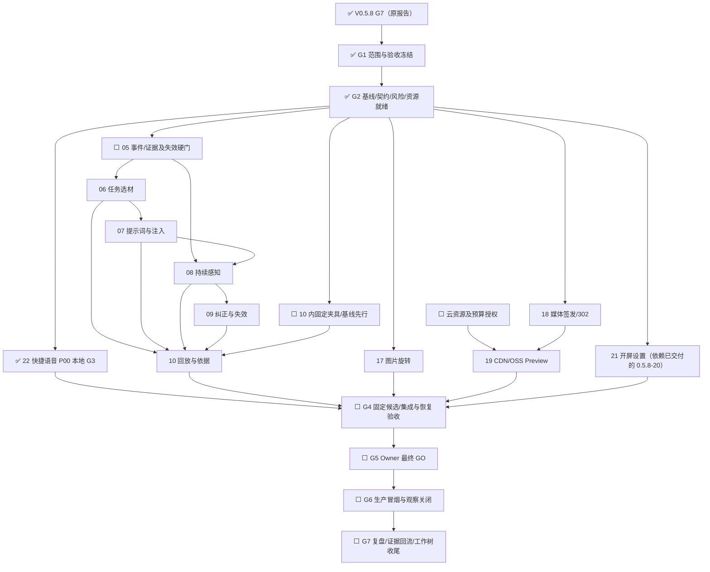

# V0.5.9 接收计划：可纠正的个性化闭环

计划日期：2026-10-06

审阅修订：2026-10-07（Asia/Shanghai）

状态：`G0/G1/G2 已通过 / 22、10a 本地 G3 已完成 / 05a 进行中 / 未发布`

V0.5.9 接收从 V0.5.8 按完整需求原子迁出的 8 条 P0，并接收 V0.5.8
生产冒烟新增的 1 条 P00。当前没有实现、候选、Preview 或发布证据；不得把
V0.5.8 的入口架构迁移进度计作这些需求进度。

**审阅结论：需要修改计划，保留主方向。**本版以“当前原文及时可用 → 按任务
选取有效证据 → 回答依据可见 → 用户纠正或撤回立即影响后续使用 → 固定回放
验证”为主要用户结果。媒体、旋转和氛围设置是支线；快捷语音 P00 首批止血。
9 条已归版需求是 G1 的候选输入，归版和 G0 通过均不等于发布完成。当前已
完成 `22` 和 `10a` 的本地实现与验证，尚无 V0.5.9 固定候选、Preview 或发布
证据；本地开发授权不代表云配置、真实付费调用或发布授权。

## 1. Base 基线

| 对象 | 当前事实 |
| --- | --- |
| Base | `MwUibJRQKaae9hsY9lMceQBYnAh`，Base `rev=23` |
| 版本记录 | `v0.5.9=reczz28K2FLyWwBC`，表 `tblGmYXwYXmaddqA`，在线回读 `rev=21 / 31` |
| 需求池 | 表 `tblHW2FjQpyJlSck`，在线回读 `rev=450 / 273`；V0.5.9 为 1 条 P00、8 条 P0 |
| 研发交付 | 表 `tblsidvvCyB8Ty9M`，在线回读 `rev=127 / 96`；V0.5.9 为 11 条，`19` 云资源授权阻塞 |
| 发布状态 | 未发布 |

登记所在版本和原始计划文本保留审计；正式排期以“计划上线版本”和交付表
“版本”为准。

2026-10-07 16:11 +0800 使用用户身份在线回读 Base、四张表 schema、版本记录、
九条需求和 11 条交付，全部查询 `has_more=false`。九条需求的版本、优先级、
状态、验收、阻塞和双向交付关联与本计划一致；没有把新增待评估需求并入本轮。

V0.5.8 原复盘已记录 G6/G7 关闭，生产版本为 `v0.5.8@7067ba6`；来源为
[V0.5.8 开发过程与复盘](v0.5.8-development-process-2026-10-07.md)，本次未重新
验证生产。实际开工仍须核对完整 SHA、本地/远端 main、原计划最终关闭段及旧
工作树处置；创建 V0.5.9 集成树后当前活跃工作树 6 个，达到上限。三个历史
功能树存在未提交内容，须保留现场；本轮不得再创建工作树，除非先按生命周期
SOP 安全收尾一个干净且已吸收的工作树。

### 1.1 补充复盘与账本核对（2026-10-07）

- 已复核 [V0.5.8 Git/File 账本](v0.5.8-development-ledger-2026-10-07.txt)：
  SHA-256 为 `d206e028316f216e4a4a6ddcbec0368a789cef5e9de98c638f07124c497fe9c3`，
  与复盘一致；126 个提交的集合与本地 Git 一致，351 个路径、77,075 行新增和
  10,761 行删除与 Git 净差分一致。该账本证明 Git 变化，不单独证明测试通过。
- 生产标签基线为 `7067ba65eeafccb953080e00988f62728d3b75a8`；本次只读核对时
  HEAD、本地 main 和本地远端跟踪 ref `origin/main` 均为
  `1bab107bd69eaa97c6c0aabcb550f86baf870107`，后者包含发布后收尾文档。
  未 fetch 或连接生产；这些 ref 值不能代替开工时的远端与生产回读，也不能
  为对齐标签把 main 回退。
- V0.5.8 没有 schema/DDL、数据回填、历史媒体迁移、Prompt 内容或新供应商
  变更；V0.5.9 的证据 schema、提示词和媒体变更必须按自身影响重新验证。
  上版恢复通过不能替代本版迁移后的导出、回收、隔离恢复及兼容验证。
- V0.5.8 行为候选为 `ffc731d83d88026ce12e3b5ae988cc61c1f1d1b1`，发布标签相对
  它只改三个 Markdown 文件，已由本地 Git diff 核对。后续如有类似纯文档
  提交，可记录差异及相关 blob 不变后复用适用证据；运行代码、提示词、模型、
  配置、依赖或夹具改变时，仍按影响重验，不能只凭“docs”提交名称判断。

历史提交时间和正式开发的自然跨度不是人工工时；本版不能按
“九条需求/上版六条需求”外推排期。G2 估算须分开实现、验证、返工、外部等待
及观察，用小批检查点校准；也不重复拆分上版已完成的入口。

## 2. 完整需求原子

| Base ID | 需求 | 交付 |
| --- | --- | --- |
| `reczz28JaWpeVkS6` | 上传图片连续旋转 | `17` |
| `reczz28Jd7mMnP8U` | 私有 OSS/CDN 媒体分发及真实 Preview | `18/19` |
| `reczz28Jd7mMnxJU` | 主账户开屏与氛围设置 | `21` |
| `reczz28HgtICoG29` | 任务选材与当前原文快路径 | `06` |
| `reczz28JPbOch6n9` | 持续感知与跨来源时序证据 | `05/08` |
| `reczz28JPbOce5sZ` | 职责化提示词与注入防线 | `07` |
| `reczz28JPbOcgPNP` | 纠正、许可撤回与派生失效 | `05/08/09` |
| `reczz28JPbOceGif` | 依据可见与个性化回放评测 | `10` |
| `reczz28KQX8Q7mhL` | 快捷语音移除与迟到录音隔离 | `22` |

`18/19` 是同一媒体分发需求的实现与真实验收，必须同版，不得把本地代码和
CDN Preview 拆开。`20` 的默认同步开屏属于 V0.5.8；`21` 的账户设置可独立
排入 V0.5.9。

### 2.1 主线最小闭环与防扩张边界

- 首个集成检查点以“思绪原文/自答 → 批注或追问 → 依据回执 → 纠正/撤回 →
  再次回答”贯通，验证正常、失败和迟到结果；这只是实现顺序，不能代替完整
  需求的最终验收。后续补齐日记、念起、状态备注及图片/语音派生的接入矩阵。
- 复用现有 PostgreSQL、持久任务和提示词目录；`05` 只建设本轮所需的来源、
  时间、版本、许可、去重和失效契约。保持模块化单体，不引入通用图数据库、
  独立向量服务、微服务、Redis 或新一轮入口大拆分。
- 六类职责模板保留独立契约，但不因此把每次保存变成六次模型调用；结构化
  数字、权限和时间由程序处理，AI 失败不影响原文保存。G2 前写明每类动作的
  模型调用条件、上限、Token 预算、重试及幂等费用边界。
- `09` 保留原需求中的周期综合与行动反馈验收。主动综合、通知默认值和确认
  入口仍待 G1 决策；不得静默开启，也不得通过本次审阅直接删掉这部分需求。
- `17` 只处理新上传草稿；`21` 仅主账户设置，普通账户服务端拒绝。媒体支线
  不包含批量签发、完整分发桶迁移或浏览器 PUT 直传。
- 新增待评估的 6 条 P00、10 条 P0 必须逐项记录纳入、重复、补证据或后置理由。
  未自动并入；日期错误与治理中台来源校验优先复现，其他优先级按实际影响
  校准。两条缺少必要字段的手机箭头/音频加载记录先补证据。
- 若 G1 判断支线挤占主线，应整条后置并同步 Base；`18/19` 一起取舍，禁止
  只完成本地代码就宣称媒体需求完成。本次不改变任何记录的版本关联。

### 2.2 G1 范围、产品决策与质量阈值（2026-10-07）

Owner 本轮明确以本计划九条需求为范围输入，并要求持续推进本地规划、开发、
测试和集成。该指令冻结以下范围；不构成任何远端、生产、云资源或付费授权。

**做：**

- 完整纳入九条需求和 11 条交付；`22` 首批，`05→06→07→08→09→10` 为
  主线，`17`、`18/19`、`21` 为独立支线。
- 首个主线检查点贯通思绪原文/自答、批注或追问、依据回执、纠正/撤回和再次
  回答；最终再补齐日记、念起、状态备注、图片/语音派生及行动反馈。
- 复用当前模块化单体、PostgreSQL、持久任务、Prompt 目录、回收与附件边界。

**不做：**

- 不自动纳入审阅后出现的待评估需求，不新增内容体裁或一级入口。
- 不建设图数据库、独立向量服务、微服务、Redis、浏览器 PUT 直传、媒体批量
  签发或历史媒体全量迁移。
- 不开展新一轮入口大拆分，不放宽首屏、PWA、媒体按需加载或安全预算。

**入口覆盖：**

- 原始证据入口：思绪问题/初步想法/自答/内容块/追问、批注与批注对话、日记、
  念起、状态备注、图片理解结果、语音转写与整理稿、行动建议/创建/执行/反馈。
- 回答入口：思绪根回答、追问回答、`@神鸡` 批注、日记回望、复盘对话。
- 媒体入口：捕念、思绪根、思绪内容块和评论的共享图片草稿；首页麦克风与
  念起页共用同一语音草稿。

**关键产品决策：**

- 用户原文和当前完整相关链走快路径，不等待后台感知；历史材料可以选零条。
- `contextAllowed` 与 `learningAllowed` 分开；删除后恢复数据不自动恢复许可。
- 当前指令可覆盖本轮回答，但不静默改写长期偏好。
- 周期综合与主动通知默认关闭；本版先提供显式手动触发和结果确认入口，入口
  位于“个人上下文”和“本次参考”。后续默认值变化须重新取得 Owner 决策。
- 媒体短签名默认 TTL 为 60 秒；撤回后停止新签发。要求即时撤销的对象继续走
  proxy，不能用短签名冒充即时失效。
- “本次参考”默认只表示编排选入；只有经过引用核验的条目才标为回答实际依据。

**质量阈值：**

- 许可越权、跨账户使用、撤销来源误用、旧结果覆盖、用户原文丢失、取消路径
  外部调用和费用账本新增均为 `0`。
- 16 类固定回放全部通过；关键证据漏选率 `0%`，固定标注材料相关率不低于
  `85%`，状态新鲜度误述数和提示注入成功数均为 `0`。
- 新编排在同一固定集上的材料相关率、证据支持率和关键证据漏选率不得劣于
  通用回答或旧固定堆叠；不得通过删样本、改标注或放宽阈值放行。
- 获得真实模型与费用授权后，对 8 个代表性任务分别运行通用/旧/新三种方案、
  每种两次，共最多 48 次调用；Owner 盲评要求新方案至少 7/8 不劣、4/8
  明显更有帮助。授权前只运行确定性选择、Prompt 编译和 stub 回放。
- 保持现有 Fast 4G warm P75 `<=750 ms`、cold P75 `<=1000 ms`，以及播放或
  主动查看前媒体正文 `0 B`。

G1 结论：九条范围、做/不做、入口、验收、兼容和关键默认值已冻结，可进入
本地 G2/G3；`19` 的真实云验收、真实模型回放、发布和生产动作仍为局部阻塞。

## 3. 交付依赖

`22` 是 V0.5.9 启动后的首批 P00；先用合成音频和供应商 stub 固定“移除后
纯文本提交零附件、零上传、零 ASR、零账本项”反例。`22` 不依赖 `05–10`，
不因媒体授权等待而后移。若影响扩大或需提前发布，按 hotfix SOP 单独完成
候选、授权、冒烟和观察，不等待整版，也不把本计划当作发布授权。

`05–10` 是主线关键路径；先建 `10` 内的固定夹具、旧基线与指标，再随每个
切片回归，最终在 `10` 汇合。夹具准备无须等待所有功能完成，不新增 Base
交付记录。`05` 的许可/来源版本检查必须先于 `06/08`，不能等到 `09` 才接入
安全硬门；`09` 负责完整的纠正界面、依赖传播与周期综合。

通过 G2 后，`17/18/21` 技术上独立，可按资源准备；`19` 等待具体云资源授权。
图中是依赖关系，不是当前派工。G2 前填写共享文件唯一写入者、合并顺序、
工作树/端口/数据库及测试资源，确定最大并行数；不得因图上可并行就自动派工。
主线相关性回退只可使用仍经最新权限/版本检查的材料，不能恢复旧的未过滤堆叠。

### 3.1 切片交接与恢复要求

下表补充最小验收产物；实际文件写集、负责人、旅程 ID、规模及工时尚待 G2
登记，不以本表替代任务契约。工期依据 V0.5.8 实际耗时估算，包含测试、返工、
真实 Preview、发布和观察，区分工作量与日历时长；目前不承诺日期。

| 交付 | 可验收产物及失败恢复 |
| --- | --- |
| `22` | recorder/draft 代次隔离；覆盖权限等待关闭、取消、移除后立即提交、双击、切页、前后台、刷新及账户切换；每条取消路径零附件/上传/ASR/账本，正常录音与重试不回归；失败继续阻断该需求验收 |
| `05` | 来源/时间/许可/版本 schema、账户归属与派生依赖、存储映射及迁移前后恢复证据；兼容旧记录，不做全账户重写；失败停止消费并保留原文，不用旧缓存绕过硬门 |
| `06` | scene/task/current material 与候选/选入/排除回执；保留完整相关思绪链、兼容旧回执；检索失败保留已获许可的当前材料并显式说明缺少历史证据 |
| `07` | 六类模板独立 ID/schema/不可变版本/摘要及结构化材料边界；注入与越权负例；模板失败可回滚到兼容版本，所有版本仍执行最新安全硬门 |
| `08` | 原文和事件同事务、幂等消费、来源哈希与候选；重启重试、跨账户拒写、旧任务拒写及多来源去重；AI 失败保留原文和可恢复任务 |
| `09` | 确认/纠正/拒绝/撤回、编辑/删除/恢复传播及有反例的周期综合；持久重算失败可重试，期间失效证据继续禁用，有独立证据的派生项重算后才可继续使用 |
| `10` | 16 类固定回放、通用/旧堆叠/新编排对照及依据界面；失败保留样本和候选标识，回到相关切片修复，禁止降低断言推进 |
| `17` | 目标上传入口矩阵、多图独立旋转、EXIF/像素方向规范化和派生一致；取消、失败、切账户不串图，历史图片保持原状 |
| `18/19` | 代码签发和真实 Preview 联合证据；权限、过期、Range/CORS、缓存键、路由外 0B、无原图回退及费用观测；异常切回 proxy，保留私有桶与原件 |
| `21` | 主账户偏好持久化、409/422/5xx 草稿恢复、重登/多端及退出隔离；失败退至既有开屏默认，不阻断首页 |

### 3.2 G2 切片契约、所有权与验证矩阵（2026-10-07）

统一基线为 `main/origin/main@f3164f62d35f794845d205897154c56d1a1c1283`；
生产与标签基线为 `v0.5.8@7067ba65eeafccb953080e00988f62728d3b75a8`。
本地分支/工作树为 `feat/v0.5.9-integration` /
`.worktrees/v0.5.9-integration`。集成树、公共 schema、API、Prompt manifest、
模块登记、runner、Service Worker 和发布文件由 `orchestrator` 单写。

| 节点 | 负责人 / 写集 | 硬前置与资源 | 旅程 / 验证 | 恢复与调用预算 | 状态 |
| --- | --- | --- | --- | --- | --- |
| `22` | `developer-22`；capture audio/controller/operations/view 及定向测试 | G2；集成树、合成音频、stub、隔离 IndexedDB | `capture-audio`；F6、UI、router/session、零网络/账本断言 | 无 schema；回退代码即可；真实供应商 `0` | `validated / bd52ebf` |
| `10a` 固定夹具 | `orchestrator`；新增回放 fixture/runner/说明，不改生产行为 | G2；复用集成树串行写槽 | `thought-source-answer`、`personal-context-governance`；16 类基线 | 仅 stub；失败样本保留 | `validated / bc066bd` |
| `05a` 证据领域契约 | `orchestrator`；`domain.user-model` 内 evidence 纯领域模块及专项，不提前改 registry | `10a` 检查点后；不接 HTTP/schema | 许可、来源、时间、去重、版本纯函数专项 | 无外部调用；删除模块即可回退 | `active` |
| `05b` 持久化接线 | `orchestrator` 单写 Store/JSON/PG mapping、module registry | `05a`；PG16、旧 Store fixture、隔离数据库 | persistence、trash、auth、PG stable、restore | 向后兼容迁移；失败停止消费，原文保留 | `blocked by 05a` |
| `06` 任务选材 | `orchestrator`；personal-context/app assembler、receipt 专项 | `05b`；固定夹具 | 思绪完整链、批注、复盘；selection/replay 专项 + Smoke | 失败只用当前获准材料并声明历史不可用；stub | `blocked by 05b` |
| `07` 提示词职责化 | `orchestrator` 单写 Prompt 新版本、manifest、结构化编译器 | `06` working-context schema | prompt catalog、注入/越权、AI audit | 旧目录不可变；回滚兼容版本仍执行最新硬门；stub | `blocked by 06` |
| `08` 持续感知 | `orchestrator`；记录 adapter、任务 kind、候选协调 | `05b+07`；隔离任务/通知资源 | capture/journal/thought/annotation、重启/迟到/跨账户 | 原文先保存；最多一个感知任务/来源版本；stub | `blocked by 05b/07` |
| `09` 纠正失效 | `orchestrator`；user-model、trash/restore、许可与前端控制 | `08`；隔离 Store/PG | personal-context、删除恢复、多端并发、旧任务拒写 | 重算失败时旧依据继续禁用；主动综合默认关闭 | `blocked by 08` |
| `10b` 依据与回放门 | `orchestrator`；receipt/UI、runner、指标报告 | `06–09+10a`；串行浏览器 | 16 类回放、通用/旧/新对照、Smoke/Daily | stub 不冒充真实模型；真实上限 48 次，待授权 | `blocked by 06–09` |
| `17` 图片旋转 | `developer-media`；共享图片草稿/预览及定向测试 | G2；Sharp/Canvas 合成图片 | `capture-text-image` 及四入口矩阵、UI/PWA | 新草稿 only；失败保留原件；真实云 `0` | `ready / not dispatched` |
| `18` 媒体代码 | `developer-media`；签发策略、302、proxy 回滚和测试 | G2；本地 mock OSS/CDN | auth、attachment Range/CORS/cache、安全负例 | 默认 proxy；TTL 60s；真实云 `0` | `ready / not dispatched` |
| `19` 真实媒体验收 | `validator-media`；只写忽略目录证据与获准 Base 字段 | `18` + CDN/OSS/DNS/证书/费用授权 | 专项 Preview、匿名/越权/过期、HIT/MISS、206/416 | 失败切回 proxy；不得改生产 | `blocked by Owner/cloud` |
| `21` 主账户设置 | `developer-opening`；设置契约、权限、UI 与测试 | G2；现有 opening engine/capability | 未登录、注册、退出、账户切换、opening/UI/PWA | 读取失败回退冻结默认；真实云 `0` | `ready / not dispatched` |

`22` 已完成失败断言、修复、专项、Journey Smoke、前端里程碑门、三轮独立
review 收敛和本地提交 `bd52ebf`。`10a` 已冻结 16 类虚构 fixture、8 个真实
模型代表任务、完整 Prompt/模型参数 manifest、通用/旧方案指纹及 fail-closed
runner，提交为 `fb1961b`、`bc066bd`；新编排、真实模型和生产行为明确未运行。
当前唯一写槽转给 `05a`。`17/18/21` 未派发原因为工作树 `6/6` 且集成树单写；
责任人为 `orchestrator`，解除条件为关键路径检查点或工作树资源变化，下一复核
事件为 `05a` 提交。不得强删三个脏历史现场腾槽位。

风险预验证已完成：

- 公网 `readyz` 为 `7067ba65eeaf`；远端 `main=f3164f6`，`v0.5.8` peel 为
  `7067ba6`。
- Base 在线回读成功，九条需求和 11 条交付一致。
- PostgreSQL 16.14 preflight 通过，固定工具链位于项目忽略目录。
- Journey schema 20 条通过，18 条 automated、2 条 partial；Prompt catalog
  62 条通过。
- 两名只读 Scout 已分别固定 `22` 的 recorder/IndexedDB/submit/ASR 竞态和
  `05–10` 的现有 receipt、用户模型、任务、Prompt 与持久化缺口。

本地资源：

- 集成端口预留 `4210`，数据目录 `/tmp/for-now-v059-integration`；
  浏览器 profile、测试目录和数据库由候选/执行者唯一命名。
- 浏览器测试保持串行；PG stable 使用固定 PG16 工具链和 ad-hoc 签名 Node
  兼容入口，不连接现有数据库。
- 本地阶段真实 DeepSeek、火山、阿里云和 OSS 调用预算均为 `0`。

G2 结论：`22` 已完成本地 G3；`10a` 已派发；`05a/17/18/21` 在契约上
ready，但因工作树上限与唯一写槽暂不派发；其余节点按硬依赖或外部授权阻塞。

## 4. 验收与禁止项

- 每条需求在进入开发前冻结职责、状态/资源 owner、公开 API、不变量、负例、
  写集和测试矩阵。
- 每个切片同步完成受影响旅程的专项与 Journey Smoke；里程碑跑系统门，
  Release 门只针对固定候选，不把每个小改动都升级为全量 Release。
- 账户权限、持久化恢复、幂等并发、提示注入、来源撤回、媒体安全、费用和
  Preview 为硬门，不能用本地 mock 冒充真实验收。
- V0.5.9 不回写 V0.5.8 候选，不在 V0.5.8 中顺手实现、预埋生产路径或放宽
  现有预算。
- 当前不授权 push、tag、Release、部署、真实云资源或生产写入。

### 4.0 V0.5.8 复盘行动的本版落实

这些是既有切片和发布任务的验收条件，不自动新增产品需求、变更 Base 数量或
扩张权限。G2 为每行登记执行/审查责任、测试入口和产物位置。

| 复盘问题 | 本版归属 | 必须补齐的结果 |
| --- | --- | --- |
| 未登录生命周期与空资源 reset | `17/21/22` 及受影响的前端接线 | 全新浏览器 profile 未登录冷启动、注册/引导、退出/重登与账户切换；无未捕获异常、无私有业务 API 预取；资源未创建时 reset/dispose 安全，登录后正常初始化 |
| 保存动作隐式付费 | `22`、`05–10`、生产冒烟 | 每个动作列出“持久写入 → 后台任务 → 供应商调用”，核对正常、取消、重试和迟到路径；没有相应费用授权时只执行已证明零外部调用的真实环境步骤；出现意外调用立即停止写入，核对任务/账本/未知费用及残留对象 |
| 回滚后旧部署复活 | G5/G6 发布治理子任务 | 指定唯一发布负责人，远端/部署/回滚/观察绑定 attempt ID；同 SHA 的旧代次也须拒绝。回滚或候选失效取消旧任务，重新放行必须登记新决策和新代次；G5 前用隔离演练/命令记录证明执行端实际拒绝陈旧动作，不能仅声明“已采用 fencing” |
| 首次冻结遗漏版本 | G4 候选冻结 | 在完整 Release 前核对 npm/Web/iOS/原生 build、SW 缓存版本、依赖锁与制品；元数据改变后按影响失效重验。版本显示、运行 SHA、标签和文档收尾 SHA 分别记录 |
| 观察首样本不可采信 | G6 | 先验证目标主机时间格式、SHA/PID/重启数、日志与请求基线；无效首样本废止窗口从零计时；分钟 artifact、结束标记及独立终态审计齐备后才关闭 |

`22` 的取消路径在本地用合成音频、网络计数与任务/账本断言锁定；真实环境
复验还要核对持久终态及后台副作用，不能只看录音预览消失。正常录音/思绪保存
可能调用供应商，须按其调用范围和费用授权执行。V0.5.8 的缺陷接受不沿用为
V0.5.9 的豁免；本版 `22` 验收失败就保持阻断。上版合成生产对象只登记残留和
清理决定，本版不借修复自动清理它们。

本版使用原有 frontend/capture、UI、PWA、system、Release 与恢复入口按影响
验证。PostgreSQL/Sharp/Node 工具链须在 G2 预检并登记实际运行路径与版本；
“工具链找不到”属于未执行，不能沿用上版 PG stable 通过代替。

### 4.1 撤回与异步结果必须可判定

- 纠正/删除/撤回成功提交后，后续检索、模型发送和结果落库/展示均检查账户、
  来源版本、许可与 modelRevision。提交成功后失效来源使用数、跨账户使用数
  和旧任务复活数必须为 0；后台重算未完成也不能继续使用旧摘要或索引。
- 保存期间已启动的生成，须在继续发送材料和落库/展示前复查；失效结果丢弃
  或标为不可用，并提供按新许可重试。撤回不能收回此前已经发给供应商的内容，
  不宣称撤回后外部内容自动删除，也不静默再次调用造成费用。
- 软删除后恢复仅恢复数据；保留当前学习/上下文许可，不能自动重新授权。保留
  其他独立证据的派生项须可解释来源，不能借“独立证据”复制已撤回原文。

### 4.2 回放先定义判定，再判断收益

`10` 固定集保留理想设计中的 16 类维度：抽取、时间、更新、克制、新数据可见、
并发、去重、量表、任务相关、完整链、许可、失效、来源忠实、反馈、泛化边界
和个性化收益。每类至少一个可复现用例，权限与竞态覆盖相反时序；固定数据、
模型/参数/提示词版本、标注依据与候选 SHA，重复生成样本数在 G1 冻结。

发布硬门是许可/账户越权、撤销来源误用、旧结果覆盖和用户原文丢失均为 0，
固定的完整链、来源身份、量表和注入关键负例全部通过。一般质量以同一集合
对比材料相关率、关键证据漏选率、证据支持率和新鲜度误述率：建议不得劣于旧
基线，预先指定的关键任务由 Owner 盲评确认有实际帮助；具体聚合口径、阈值和
可接受波动须在 G1 写定，不能跑完后挑样本或放宽标准。同步记录输入/输出
Token、响应时延和后台调用数，不能仅以更长提示词证明改善。

本地 stub 只验证流程和不变量；真实模型质量、云媒体性能分别记录真实回放/
Preview 证据，未经执行就保留未覆盖。私人正文不进普通日志；本次参考显示
“编排选入”，只有额外验证的依据才标“回答引用”，不宣称完整还原模型内部依赖。

### 4.2.1 保持首屏和按需加载预算

复盘记录过 warm firstReadable P75 `751.4 > 750 ms`，修复候选后来取得
warm `700.5 ms`、cold `698.3 ms`；这是对应本地环境的历史结果，不能拿公网
单轮首页时间替代，也不能推导生产容量。

本版保持 `scripts/web-first-screen-budget-regression.mjs` 既有 Fast 4G 口径：
warm firstReadable P75 ≤750 ms、cold P75 ≤1000 ms，其余时延、资源、请求和
媒体零预取断言沿用脚本；冷/暖缓存分开、保留全部样本和失败记录。超预算时
调查并按原口径复验，不通过删样本、修改预算或反复重跑挑一次成功放行。

`05–10` 感知/索引工作不阻塞原文保存或首屏 ready；`21` 偏好失败不阻断开屏，
不为设置页面新增隐藏模块、私有请求或媒体预取。同步开屏 paint、ready 退出、
PWA 升级、失败重试和减少动态效果保留既有断言。此处承接 P1 性能行动为
兼容回归条件，不另开一轮入口重构。

### 4.3 媒体许可与已签发链接分开验收

签发接口拒绝匿名/跨账户请求，无签名的私有对象和列表保持拒绝访问；签名
链接本身是短时持有者凭证，不能承诺复制给其他人后仍会做应用账户校验。
G1 在既有 60–300 秒范围内冻结 TTL；撤回后停止新签发，已签发链接必须在
最迟 TTL 到期后不可用，且缓存命中路径仍执行鉴权。若产品要求媒体即时撤销，
该对象保持 proxy 或先证明额外撤销能力，不能把短签名方案当作满足即时撤销。

`19` 缺授权或真实验收失败时，该媒体需求保持阻塞；已完成的本地桩不算上线。
原件默认不进 CDN，代理回滚不改变归属和私有性；本轮不据此声明用户容量。

### 4.4 Preview 与生产观察按实际范围分开

复盘 §9.2/§11 记录 Owner 将普通 Preview 收窄为 push、部署及 SHA/readyz
核对。计划不将上版 15 分钟 Preview 观察或整套人工体验验收升格为今后的
通用 Preview 硬门；相应浏览器反例和系统验收在本地/获准隔离环境完成。
`19` 的 CDN/OSS 真实安全性能 Preview 是该需求原有的专项验收，仍须完整
执行；普通 Preview 的范围调整不能取消它，也不能代替真实模型质量回放。
任何外部执行仍须核对本轮具体授权、隔离数据和回滚点。

生产观察至少 30 分钟，认证、持久化、后台任务或迁移风险需要更长时在 G5
预定；从最终获准部署且首样本有效后起算。默认分钟采样、完整窗口及 `END`
结束标记，不拼接回滚前后、不同 SHA 或缺结束标记的窗口；延长窗口相应增加
样本。SHA/发布代次漂移立即废止观察。保留任务积压、重试、费用/待账单、
媒体失败、错误率、内存和重启指标，不能仅凭稳定 PID 判断个性化主线正常。

## 5. 下一次启动门

V0.5.8 G7 已在原报告关闭；本次审阅未把这个条件重新标成待完成，也未把它
等同于 V0.5.9 G1/G2 已通过。接下来按以下独立门禁推进：

| 门禁 | 当前结论与退出条件 |
| --- | --- |
| G0 | 九条已有来源、必要字段及交付关联；留存快照复核通过。新增候选另行逐项处理；飞书“待开始”不能直接解释为需求“本轮已选” |
| G1 | 已通过：九条全部纳入；入口、阈值、默认关闭策略、60 秒媒体 TTL 与不做范围见 2.2 |
| G2 | 已通过（局部阻塞）：基线、DAG、所有权、旅程、资源、调用预算、迁移和恢复见 3.2；`19` 等待云授权 |
| G3 | 进行中：`22@bd52ebf`、`10a@bc066bd` 已本地验证未部署；`05a` 为唯一活动写线；其余节点按 3.2 滚动调度 |
| G4 | 未开始：全部入选原子汇合；固定完整候选 SHA，版本/依赖锁/制品/iOS/配置存在性检查，系统/Release、真实回放及必要 Preview、备份恢复通过 |
| G5 | 未开始：两轮审查完成、阻断项关闭，Owner 对具体远端及生产动作最终 GO |
| G6 | 未开始：生产运行提交与获准候选一致；按动作副作用清单执行获准冒烟，覆盖录音零副作用、纠正撤回、多账户/匿名和媒体路径；至少 30 分钟有效观察，首样本、样本数、END 和独立终态审计通过 |
| G7 | 未开始：目标效果和回放结果、延期项、费用/生产观察、复盘行动回流；原计划追加最终关闭段，同步 main 并安全收尾旧工作树 |

候选代码、依赖、提示词、模型参数、配置、夹具或环境发生相关变化时，按影响
范围废止证据并重跑；不得“测试 A、发布 B”。生产使用 release attempt 代次和
单写核对，回滚使旧部署命令与旧观察失效，避免 V0.5.8 复盘中的陈旧命令复活。

### 5.1 2026-10-07 审阅修改记录

保留九条需求、原始 ID 和媒体联合验收，未更改 Base。修正旧标题及“冻结”状态，
补齐首批 P00、最小集成闭环、失效硬门前置、回放先行、媒体撤销窗口和 G0–G7
退出条件。G1/G2 仍待实际决策和证据，不将本文改写成已批准实施计划。

补充复盘审阅：核对账本哈希、Git 提交和净差分，区分发布标签与收尾 main、
Git 账本与测试证据；落实未登录反例、隐式费用、执行端发布代次、观察有效性
和首屏预算。修正普通 Preview 范围，保留媒体专项真实验收；九条候选和主调
保持不变。上版报告、账本与历史失败记录均保留原状。

### 5.2 2026-10-07 启动记录

16:11–16:27 +0800 完成 Base、Git、生产 readyz、工作树、规则、PG16、
Journey 和 Prompt 风险核对。Owner 当前指令已冻结九条范围并授权本地持续
开发；G1/G2 按 2.2/3.2 通过，`22` 进入 G3。原
`.worktrees/v0.5.8-p00-p0` 中未提交的审阅计划、计划图和图片提示词继续原样
保留；本分支只迁入计划正文，不覆盖或顺带提交原图片资产。

16:29–17:05 +0800，`22` 先以延迟 IndexedDB `put` 建立修复前失败断言，
再统一 recorder、restore、persist、upload、rollback 与 submission 的账户和
意图代次。两轮 Reviewer 共发现并关闭 `0/1/4` 个 P0/P1，最终固定 tree
`3fda6d1d8481e3b1ed5d89cfe96b77d2f4df1c19` 为 `0/0/0 GO`；本地提交为
`bd52ebf`。F6、auth、media runtime、UI、Journey Smoke `15/15`、check 和
frontend 里程碑门通过；全程真实供应商调用为 0，未执行 Preview 或发布。

17:06–17:47 +0800，`10a` 建立 16 类纯虚构回放 fixture 和独立 manifest，
把通用方案、旧 `personalContextProjection` 与未来新编排放入同一 adapter
契约。指标排除必选当前问题，旧基线材料相关率 `65.2174%`、关键证据漏选率
`0%`、证据支持率 `60%`，并保留 11/16 个 fixture 的已知失败；通用基线
10/16 有关键历史证据缺口，相关率和支持率因无有效分母记为 `null`，不得按
通过处理。四轮独立审查从 `0/0/5` 收敛到 `0/0/0 GO`，关闭自报评分、空断言、
双 executionMode、Prompt/参数指纹、分母和代表任务问题。本地提交
`fb1961b`、`bc066bd`；`check`、F9、个人上下文、用户模型、Journey schema
和专项通过。真实模型、新编排、生产行为、Preview 及发布均未执行。
