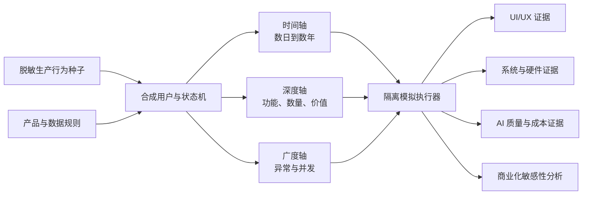
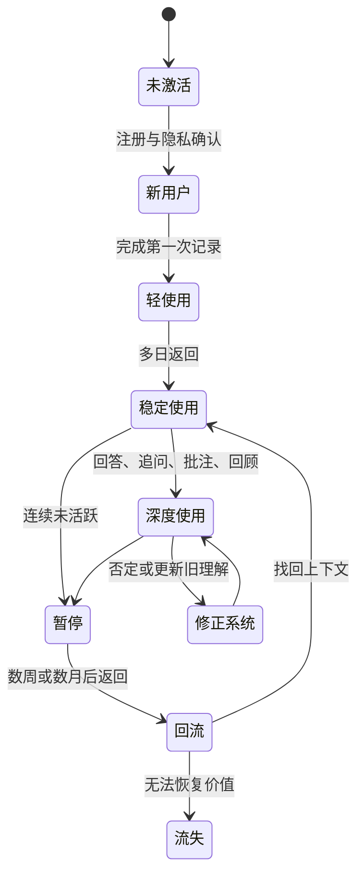

# 长期合成用户行为模拟与产品演化探索报告

- 报告类型：产品、体验、AI 与系统联合探索
- 形成日期：2026-10-01
- 真实日志观察截止：2026-10-01 22:00（Asia/Shanghai）
- 线上版本：`e3a7da5c7a66`
- 状态：探索基线，不是已完成的模拟测试结果

## 0. 摘要

产品只运行了数日，真实数据无法回答以下问题：

- 用户使用一个月、一年或数年后，首页、列表、回顾和搜索应是什么形态；
- 高活用户积累数千条记录、长思绪链和大量媒体后，交互是否仍然清楚；
- 长期上下文是否真正让 AI “越用越懂”，还是只让提示词越来越长、越来越贵；
- 单用户异常、多标签页和多用户并发会在哪个边界击穿系统；
- 现有 2 vCPU、1.57 GiB 内存和 5 Mb 公网带宽分别能支撑什么使用规模；
- 哪些能力构成可付费价值，哪些只是高成本但低感知的后台处理。

因此，本项目需要的不是一份操作 SOP，也不是简单生成几万条随机记录，而是一套：

> **长期合成用户群模拟**
> （Longitudinal Synthetic Cohort Simulation）

它以真实生产行为作为种子，生成具有时间连续性、个人偏好变化、记录关联、
中断恢复和多用户重叠的合成用户。模拟结果再分别用于：

1. 探索不同成长阶段的 UI/UX；
2. 验证长期数据下的核心价值是否出现；
3. 暴露数据、同步、检索、附件和异步任务的系统边界；
4. 建立提示词版本的长期质量评测集；
5. 分离“产品必要 AI”与“可以压缩或取消的 AI”；
6. 形成硬件、带宽和架构扩容依据；
7. 对商业模式做成本和权益敏感性分析。

当前最重要的初步判断是：

| 领域 | 判断 |
| --- | --- |
| UI/UX | 界面不能只为“刚使用几天”的账户设计，必须随数据成熟度从记录入口逐步转向回看、比较、检索和修正 |
| 核心系统 | 完整 `/api/state`、原图经应用转发和固定条数拼接上下文，都会随使用年限增长而失去可持续性 |
| AI 成本 | 当前已知 DeepSeek 成本高度集中在思绪回答、批注和追问；长期模拟必须优先验证检索、摘要、缓存和模型路由 |
| 提示词 | 不能只测单轮回答质量，要测跨月事实、观点变化、反证、删除传播和用户纠正是否被正确处理 |
| 硬件 | 5 Mb 公网带宽已经具备成为媒体与完整状态读取首要瓶颈的条件；先优化数据路径，再讨论单纯加 CPU |
| 商业化 | 模拟可以排除成本上不可行的方案，但不能证明留存、愿付费或市场规模；这些仍需真实用户验证 |

## 1. 问题定义

### 1.1 本报告要探索什么

模拟空间由三个互相独立的维度组成：

```text
时间 T：数日 → 30 天 → 90 天 → 1 年 → 3 年 → 5 年
深度 D：功能覆盖 → 长链路 → 大数据量 → 价值涌现
广度 B：单用户异常 → 多标签页 → 多用户并发 → 容量边界
```

一次模拟不是只选一个维度，而是一个坐标：

```text
SimulationCase = 时间阶段 T × 使用深度 D × 用户广度 B
```

例如：

```text
T=1 年
D=高活用户，完整使用记录、健康、思绪、批注、回顾和 AI
B=10 个并发账户，每户 1～2 个标签页，10% 请求发生网络抖动
```

### 1.2 模拟能证明什么

模拟可以证明：

- 在已定义的数据和行为条件下，功能是否正确；
- 界面在不同数据密度下是否可读、可找、可操作；
- 记录、版本、来源、删除、同步和异步结果是否保持一致；
- 系统资源、延迟、带宽、队列和费用如何随负载增长；
- 某版提示词是否更准确地使用长期信息、减少臆测并降低 Token。

模拟不能证明：

- 真实用户会长期坚持使用；
- 真实用户愿意付费或接受某个价格；
- 某个模拟人格代表真实市场人群；
- 合成内容产生的“洞察”具有真实人生意义；
- 通过压力测试就可以直接扩大生产邀请范围。

所有模拟结论必须标记为“工程证据”“产品假设”或“待真实用户验证”，不能把
合成数据包装成用户研究。

## 2. 真实线上种子

### 2.1 行为与数据基线

生产日志只读汇总得到：

| 项目 | 观察值 |
| --- | ---: |
| 日志时间范围 | 2026-09-27 至 2026-10-01 |
| 请求完成事件 | 3,559 |
| 可归属账户请求 | 2,513 |
| 非只读请求 | 314 |
| 当前有效账户 | 3 |
| 30 分钟空闲切分后的有效账户会话 | 34 |
| 已观察同时活跃账户 | 2 |
| 已观察峰值在途请求 | 8 |

当前主使用账户的只读聚合为：

- 184 个统计口径业务对象；
- 67 次 AI 或外部能力调用；
- 已知 AI 成本约 ¥11.78，另有 4 次费用未知调用；
- 42 个附件清单项，约 50.68 MB；
- 30 条捕念、13 条状态、15 条健康记录、9 件小物、9 条善言；
- 105 个思绪内容对象、55 个批注、13 轮批注 AI 对话和 5 个追问。

这组数据适合作为“高活、深度探索型用户”的种子，不适合作为普通用户平均值。

### 2.2 已观察行为原型

真实日志已经出现以下可复用原型：

1. **快速记录后修订**：连续创建捕念，随后修改正文、标签或发生时间。
2. **深度思考链**：问题、回答、追问、批注、批注 AI 回复交错增长。
3. **跨域使用**：用户不会按页面线性操作，会在捕念、善言、状态和思绪之间往返。
4. **识别后纠错**：健康截图多次识别、逐项保存、删除错误项并重新识别。
5. **媒体再加工**：查看多张原图、重新分割、编辑后保存并清理旧派生媒体。
6. **失败后降级**：高成本思绪流程重复失败后，用户仍可改走轻量捕念路径。
7. **新用户首个 AI 失败**：原始记录成功，模型失败后再进入设置调整。
8. **双账户短时重叠**：现有线上证据只覆盖 2 个账户，不足以证明更大并发。

### 2.3 当前等待时间

| 操作 | 成功样本 | P50 | P95 | 最大值 |
| --- | ---: | ---: | ---: | ---: |
| 完整状态读取 | 243 | 38 ms | 282 ms | 404 ms |
| 增量同步 | 1,148 | 149 ms | 177 ms | 509 ms |
| 小物分割 | 13 | 3.230 s | 6.096 s | 9.068 s |
| 健康图片识别 | 14 | 9.537 s | 12.052 s | 13.206 s |
| 历史直接式思绪回答 | 22 | 43.221 s | 71.350 s | 119.790 s |

主使用账户在同一会话内，相邻非只读操作间隔 P50 为 43.143 秒，P90 为
380.599 秒。真实模拟应保留阅读、思考和核对时间，不能把用户行为压缩成连续
零间隔接口调用。

### 2.4 当前流量与带宽证据

Nginx 访问日志在当前五日窗口中记录 `/now/` 约 985.06 MB 响应流量：

| 类别 | 响应字节 | 占 `/now/` 流量 |
| --- | ---: | ---: |
| JPG/PNG 私有附件 | 574.42 MB | 58.3% |
| `/api/state` 完整状态 | 261.31 MB | 26.5% |
| 两者合计 | 835.74 MB | 84.8% |
| `/api/v1/sync` | 1.17 MB | 0.1% 左右 |

成功的附件读取共 427 次，平均响应约 1.35 MB；成功的 `/api/state` 共 249 次，
平均响应约 1.05 MB。当前同步接口本身字节很小，但一个前台标签页在约
32 分钟内产生了 1,148 次同步请求，相邻完成间隔 P50 为 1.676 秒，因此它的
主要风险是请求与数据库读取放大，不是公网字节。

一次公开移动背景图实测：

```text
响应大小：891,340 bytes
总耗时：1.264 s
平均下载：705,075 bytes/s，约 5.64 Mbit/s
```

该结果与“公网带宽约 5 Mb”的备注接近。单次测量不能证明持续满载能力，但已经
足以把公网带宽列为当前高优先级约束。

理论上，在 5 Mbit/s 且不考虑协议损耗时：

| 数据量 | 单用户最低传输时间 | 5 用户同时共享 |
| ---: | ---: | ---: |
| 1 MB | 约 1.6 s | 约 8 s |
| 8 MB | 约 12.8 s | 约 64 s |
| 24 MB | 约 38.4 s | 约 192 s |
| 48 MB | 约 76.8 s | 约 384 s |

ECS 的入站和出站计费/限速方向仍应以云控制台为准，但私有附件目前经应用代理
返回浏览器，出站 5 Mb 会直接影响原图、批量图片和音频播放。单纯升级 CPU 或
数据库不能解决该瓶颈。

### 2.5 当前主机基线

2026-10-01 22:24 的只读采样：

| 项目 | 当前值 |
| --- | --- |
| CPU | 2 vCPU，负载约 0.07 / 0.26 / 0.32 |
| 内存 | 1,608 MiB，总可用约 624 MiB |
| 主应用 | 约 308 MiB，`MemoryHigh=512 MiB`，`MemoryMax=768 MiB` |
| PostgreSQL | 约 100 MiB |
| 中台 | 约 78 MiB |
| Swap | 2 GiB，当前 0 |
| 磁盘 | 40 GB，已用 44%，剩余约 21 GB |
| PostgreSQL 连接 | 7 条，其中 1 条活跃 |

当前资源足够支撑 Owner 和少量低并发使用，但没有长期高活数据、持续媒体并发或
10 人稳定同时在线的生产证据。

## 3. 三维模拟模型

### 3.1 总体结构



### 3.2 两套正交画像

模拟不能只定义“一个高活用户”。应把使用强度和使用意图分开：

**强度画像**

- 低活：偶尔记录，长时间空白。
- 中活：每周稳定使用，少量 AI。
- 高活：跨模块记录、频繁修订和深度问答。
- 满勤：每天多次使用，媒体和后台任务密集。

**意图画像**

- 捕捉型：以念起和快速记录为主。
- 内观型：日记、状态、回顾和认知复盘为主。
- 求真型：思绪、追问、批注和反例核查为主。
- 健康型：状态、睡眠、体重、运动和截图识别为主。
- 收藏型：书间、拾句、小物和图片原文为主。
- 综合型：在不同人生阶段切换主要用途。

`强度 × 意图` 组合后，才能同时覆盖产品复杂度和真实使用差异。

### 3.3 四层执行方式

| 层级 | 做什么 | 是否经过真实 UI | 是否调用真实 AI |
| --- | --- | --- | --- |
| L1 数据生成 | 快速生成数年结构化记录、版本、关系和附件清单 | 否 | 否 |
| L2 状态化 API 行为 | 按用户状态机执行创建、编辑、删除、同步和恢复 | 否 | 默认替身 |
| L3 浏览器旅程 | 对代表性阶段执行真实点击、输入、滚动、筛选和回看 | 是 | 默认替身 |
| L4 分层 AI 评测 | 用选定样本调用真实模型，对提示词版本做质量/成本对比 | 部分 | 是，受预算控制 |

大量数据不应全部通过浏览器慢慢录入；否则测到的是脚本速度，不是产品能力。
L1 建立规模，L2 验证状态机，L3 验证人机交互，L4 验证模型价值，四层结果再合并。

## 4. 时间轴：从数日到数年

### 4.1 时间阶段

| 阶段 | 数据特征 | 应探索的产品问题 |
| --- | --- | --- |
| T0：0–3 天 | 空账户、少量记录、无趋势 | 用户能否立即理解并信任保存 |
| T1：7–30 天 | 开始重复记录，出现第一批回看 | 首页是否从引导自然转入内容 |
| T2：31–90 天 | 形成弱周期、标签和中断 | 趋势是否有解释价值，缺失是否被正确表达 |
| T3：3–12 月 | 季节变化、习惯失败与重启 | 搜索、比较、阶段复盘是否成为主任务 |
| T4：1–3 年 | 观点变化、目标替换、旧记录再出现 | 系统能否识别“人已经变了”而不固化旧画像 |
| T5：3–5 年 | 大量历史、媒体、版本和派生内容 | 归档、检索、导出、删除传播和成本是否可持续 |

### 4.2 时间不是简单改日期

合成时间线必须包含：

- 工作日与周末不同的记录节奏；
- 早晚使用偏好和偶发夜间长会话；
- 连续使用、漏记、补记和数周不活跃；
- 旅行、时区变化、夏令时和跨午夜；
- 目标建立、尝试、失败、暂停、恢复和完成；
- 健康指标缓慢变化与偶发异常；
- 观点被新证据修正，而不是永久稳定；
- 同一主题数月后重新出现；
- 设备更换、重新登录、离线后恢复；
- 删除旧记录后，摘要、来源和记忆同步失效。

生成器必须维护因果顺序。例如，追问必须引用已存在的问题，年度回顾必须只读取
该年度及允许的长期上下文，删除传播不能发生在删除动作之前。

### 4.3 使用量级

沿用现有商业化模型中的四类强度假设，得到以下长期操作量。这里的“操作”是用户
发起的业务动作，不是后台同步请求，也不等于最终数据库行数。

| 强度 | 操作/月 | 操作/年 | 操作/5 年 | AI/月 | AI/5 年 | 图片/5 年 |
| --- | ---: | ---: | ---: | ---: | ---: | ---: |
| 低活 | 8 | 96 | 480 | 3 | 180 | 60 |
| 中活 | 30 | 360 | 1,800 | 21 | 1,260 | 180 |
| 高活 | 120 | 1,440 | 7,200 | 170 | 10,200 | 480 |
| 满勤 | 300 | 3,600 | 18,000 | 450 | 27,000 | 1,200 |

一项操作可能产生根记录、内容块、任务、通知、版本、批注和附件等多个对象。因此
长期系统测试另设与行为频率无关的数据压力档：

| 数据档 | 根与嵌套对象/账户 | 附件/账户 | 用途 |
| --- | ---: | ---: | --- |
| S0 | 0 | 0 | 冷启动 |
| S1 | 100 | 20 | 数周至数月 |
| S2 | 1,000 | 100 | 稳定使用一年 |
| S3 | 10,000 | 1,000 | 高活多年 |
| S4 | 50,000 | 5,000 | 极端单账户 |
| S5 | 100,000 | 10,000 | 架构破坏性探索 |

S4/S5 不是用户预测，而是验证分页、索引、导出、恢复和删除是否存在数量级缺陷。

### 4.4 时间轴应产生的价值样本

模拟内容不能使用随机句子填满数据库。每个合成用户应有可验证的“人生线索”：

1. 第 1 月记录睡眠不足与工作压力，但证据不足。
2. 第 2 月减少晚间咖啡，睡眠改善，同时工作压力下降。
3. 第 3 月咖啡恢复但睡眠未恶化，形成反证，系统不得下因果结论。
4. 第 6 月用户明确否定“咖啡是主要因素”的旧判断。
5. 第 9 月换工作后压力下降，运动增加。
6. 第 12 月年度回顾应指出阶段变化、证据和不确定性。
7. 第 2 年用户目标从效率转向健康，旧偏好不能继续拥有最高权重。

这种带真值、反证和修正的数据，才能测试“越用越懂你、但允许纠正”的价值主张。

## 5. 深度轴：功能、复杂度与价值涌现

### 5.1 功能深度

每类用户旅程按以下层级加深：

| 深度 | 要求 |
| --- | --- |
| D0 可发现 | 找到入口，理解主任务 |
| D1 可完成 | 正常提交并得到业务结果 |
| D2 可持续 | 刷新、重登、跨设备后仍存在 |
| D3 可修订 | 编辑、补充、版本变化和来源更新正确 |
| D4 可恢复 | 断网、超时、供应商失败和重启后可继续 |
| D5 可关联 | 记录能进入回答、追问、批注、行动和回顾 |
| D6 可解释 | AI 结论展示来源、时效、反证和不确定性 |
| D7 可治理 | 删除、导出、审计、成本和隐私边界闭合 |

“所有功能覆盖”只达到 D1，不等于深度完成。真正影响产品可信度的是 D3–D7。

### 5.2 记录数量复杂度

必须独立调节：

- 时间线记录总量；
- 同日多次记录；
- 标签数量与标签漂移；
- 单条正文长度；
- 思绪链深度；
- 批注和回复数量；
- 同一对象修订次数；
- 未完成和失败任务数量；
- 回收站与历史版本数量；
- 图片、音频和派生媒体数量；
- 跨记录来源关系数量；
- 搜索结果数量与重复主题密度。

推荐的破坏性边界：

| 结构 | 普通档 | 高活档 | 极端档 |
| --- | ---: | ---: | ---: |
| 单日记录 | 3 | 30 | 300 |
| 单条思绪内容块 | 5 | 50 | 200 |
| 单根记录批注 | 3 | 50 | 500 |
| 单账户标签 | 20 | 200 | 2,000 |
| 单对象修订版本 | 3 | 20 | 200 |
| 待处理任务 | 1 | 20 | 200 |
| 回收站对象 | 10 | 1,000 | 10,000 |

极端档用于发现算法和 DOM 结构问题，不要求界面一次展示全部内容。

### 5.3 核心价值涌现

产品价值应按时间成熟，而不是从第一天就展示所有“洞察”：

| 阶段 | 用户可感知价值 | UI 重点 | AI 责任 |
| --- | --- | --- | --- |
| V0 保存信任 | 内容不会丢 | 快速记录、明确保存状态 | 非必要不调用 |
| V1 连续性 | 能找回过去 | 时间线、搜索、来源 | 轻量整理 |
| V2 模式线索 | 看见重复与变化 | 周/月比较、证据数量 | 只提出弱线索 |
| V3 主动校正 | 系统理解可被修正 | 批注、否定、版本和反馈 | 吸收纠正，不固化旧判断 |
| V4 长期成长 | 建议结合阶段和历史 | 阶段回顾、目标与行动闭环 | 检索多时段证据和反证 |

模拟必须检查“价值出现得过早”和“价值一直不出现”两种失败：

- 数据不足时给出强人格判断，是过早。
- 使用一年后仍只展示记录数量，是没有涌现。

## 6. 广度轴：异常与并发

### 6.1 单用户异常

每条核心旅程至少覆盖以下异常族：

| 异常族 | 场景 |
| --- | --- |
| 网络 | 离线、慢网、请求已提交但响应丢失、乱序返回 |
| 会话 | Cookie 过期、退出中仍有请求、切换账户、双标签页 |
| 输入 | 空值、超长、重复、非法日期、跨时区、未来时间 |
| 媒体 | 8 MB 边界、48 MB 批次、损坏图片、错误 MIME、音频中断 |
| AI | 超时、限流、空正文、内容过滤、部分输出、重复回调 |
| 数据 | 旧版本更新、游标过期、重复幂等键、来源已删除 |
| 生命周期 | 删除、恢复、再次删除、永久清理、附件仍被引用 |
| 进程 | API 重启、数据库断连、任务运行中退出、恢复后重放 |
| 容量 | 配额耗尽、磁盘预警、日志增长、队列积压 |

异常测试的目标不是“出现错误码”，而是验证：

`原始内容是否安全 → 用户是否知道发生了什么 → 是否有明确恢复动作 → 是否没有重复副作用`

### 6.2 多用户并发

并发用户必须执行完整任务组合，而不是只重复读取 `/api/state`：

| 并发档 | 模型 | 用途 |
| --- | --- | --- |
| B0 | 1 用户、1 标签页 | 逐条行为基线 |
| B1 | 2 用户、各 1–2 标签页 | 复现当前线上重叠和账户隔离 |
| B2 | 5 用户、混合记录/AI/媒体 | 当前邀请规模基线 |
| B3 | 10 用户、混合深度任务 | 当前保守范围上界 |
| B4 | 20 用户、热点时段突发 | 压力探索，不代表可运营容量 |
| B5 | 50–100 用户 | 目标架构验证，当前单机不设通过要求 |

每个并发用户从状态机中抽取完整旅程：

```text
进入应用
→ 浏览或搜索
→ 创建/修改记录
→ 等待后台任务
→ 在等待期间进入另一页面
→ 收到结果或错误
→ 刷新/重登确认
```

后台同步按当前观测约为每前台标签页 0.60 RPS。10 个持续前台标签页仅同步就约
产生 6 RPS；20 个标签页约 12 RPS。测试必须确认请求量线性增长、每标签页最多
一个在途同步请求，并验证进入后台、退出或切换账户后是否停止。

## 7. 合成用户与状态机

### 7.1 用户状态



转移概率在真实样本不足时必须标记为假设。第一版可使用固定场景配额，不能声称
这些概率来自用户统计。

### 7.2 内容真值

每条合成记录除界面字段外，还需要测试真值：

```json
{
  "factState": "user_stated | observed_metric | model_derived",
  "validFrom": "virtual date",
  "validTo": "virtual date or null",
  "themes": ["sleep", "work"],
  "supports": ["synthetic-evidence-id"],
  "contradicts": ["synthetic-evidence-id"],
  "userCorrection": "confirmed | rejected | pending",
  "expectedRetrieval": true,
  "mustNotRepresentUser": false
}
```

真值只服务测试，不进入生产模型上下文。它让评测系统能够判断 AI 是否：

- 引用了正确时间段；
- 把用户原文和模型推断分开；
- 找到了反证；
- 使用了已被用户否定的新状态；
- 没有继续引用已删除或过期内容。

### 7.3 时间驱动

模拟器必须使用可注入的虚拟时钟：

- 生成历史数据时直接推进虚拟日期，不真实等待；
- 定时复盘、保留期、配额和跨日逻辑都读取同一时钟；
- 时区作为用户属性，不使用测试机默认时区；
- 随机行为使用固定 seed，可重复生成完全相同的数据；
- 每次运行保存场景版本、seed、提交版本和数据摘要。

## 8. 重点模拟剧本

### SIM-T01 三日新用户

- 首日完成引导，只留下一条捕念。
- 次日记录状态并上传一张健康截图。
- 第三日从捕念展开为思绪，首次请求 AI 回答。
- 验证：入口负担、保存信任、AI 来源层级、首次失败恢复。

### SIM-T02 九十日不稳定使用

- 每周使用 1–4 天，中间有两次 10 天以上空白。
- 同一因素出现数次，但样本不足。
- 用户补记过去日期并修改一次错误时间。
- 验证：缺失不补零、记录日与连续天区分、弱线索措辞、回流体验。

### SIM-T03 一年高活复盘

- 约 1,440 次用户操作、96 张图片和 2,040 次 AI 调用上限模型。
- 至少经历一次目标改变、一次习惯失败、一次阶段恢复。
- 产生跨季度重复主题和相互矛盾的证据。
- 验证：年度导航、检索、上下文选择、复盘证据和年度成本。

### SIM-T04 三年观点变化

- 第一年的偏好在第二年被明确否定。
- 第三年再次出现相似问题，但背景和目标已经变化。
- 删除支撑旧画像的关键记录。
- 验证：旧判断失效、删除传播、版本溯源、AI 不把历史标签当永久人格。

### SIM-T05 五年满勤极端账户

- 约 18,000 次用户操作、27,000 次 AI 调用假设、1,200 张图片。
- 数据对象数推进到 S3/S4，包含长思绪链、批注、回收站和附件。
- 验证：分页、搜索、导出、恢复、备份窗口、存储费用和 UI 信息密度。

### SIM-D01 一条思绪持续生长

- 问题 → 初步想法 → 回答 → 10 个追问 → 50 条批注 → 多次正文修订。
- AI 任务乱序完成，旧版本结果必须过期。
- 验证：DOM 性能、锚点漂流、上下文预算、来源和并发写冲突。

### SIM-D02 媒体重度账户

- 批量导入体重截图、睡眠截图、小物和语音。
- 同时包含失败识别、重复文件、替换原件和永久删除。
- 验证：5 Mb 带宽、缩略图、断点恢复、OSS 生命周期和移动端反馈。

### SIM-B01 单用户混沌

- 双标签页编辑同一对象；
- 一个标签离线后继续写，另一标签完成更新；
- 恢复网络后出现版本冲突；
- 用户退出并切换账户，旧请求迟到。
- 验证：幂等、冲突可见、会话代次、IndexedDB 归属和隐私。

### SIM-B02 十用户混合高峰

- 4 人记录文字；
- 2 人执行健康识别；
- 2 人编辑小物；
- 2 人进行思绪回答和批注；
- 每人保持一个前台同步标签。
- 验证：API、PostgreSQL、外部队列、内存、5 Mb 出站和账户隔离。

## 9. 对 UI/UX 的指导

### 9.1 不同成熟度需要不同首页

| 数据阶段 | 首页重点 | 不应出现 |
| --- | --- | --- |
| 空账户 | 一个清楚的记录入口和轻量引导 | 空统计、复杂筛选、伪洞察 |
| 数日 | 今日记录与最近内容 | 年度比较、人格结论 |
| 一月 | 周期回看、遗漏提示、最近主题 | 把偶然相关写成规律 |
| 一年 | 阶段、趋势、搜索和重要转折 | 无限时间线和全量卡片 |
| 多年 | 年度/人生阶段导航、旧观点修订 | 仅按创建时间平铺所有数据 |

这意味着首页应根据数据成熟度渐进呈现，但一级导航和主要记录入口必须稳定，避免
老用户每次达到新阶段都像换了一套产品。

### 9.2 长期数据会改变页面结构

需要重点探索：

- 捕念、日记、善言和思绪从“最近列表”切换到分页、筛选和搜索；
- 思绪长链采用摘要、锚点目录和按段加载，不能一次渲染全部内容；
- 回顾页按周、月、季、年组织，而不是无限增加统计卡片；
- 用户可建立“阶段”或“章节”，但系统不能自动给人生定性；
- 旧内容重现必须可控、可换一组、可查看来源，不做无限推荐流；
- AI 派生内容、用户原文和用户修正始终有稳定视觉层级；
- 删除、过期、漂流和冲突状态在多年历史中仍可理解。

### 9.3 UI 模拟的验收方式

每个时间档至少生成：

- 320×700、390×844、768px 和 1440×900 截图；
- 空、少量、正常、高密度和极端数据状态；
- 正常、加载、失败、冲突、恢复和后台完成状态；
- 键盘打开、横竖屏、系统字体放大和长文本；
- 首屏、滚动中段、列表末端和详情深层。

视觉验收不能只检查“没有溢出”，还要检查：

- 用户最可能的下一步是否清楚；
- 内容是否比控件更突出；
- 数据多时是否仍能建立位置感；
- 长期变化是否可理解而非只显示数量；
- 系统是否让用户知道“已保存、同步中、AI 处理中”的区别。

## 10. 对核心系统的指导

### 10.1 完整状态读取必须退出主路径

生产访问日志中的 `/api/state` 平均响应约 1.05 MB。当前主账户只有 184 个统计
口径业务对象，长期使用后完整状态会继续增长。即使数据库查询很快，5 Mb 出站、
JSON 解析和前端重绘也会成为共同瓶颈。

优先方向：

1. 冷启动只读取导航所需摘要和当前页面数据。
2. 各领域使用稳定游标分页，不在前端持有全部历史。
3. 首页读取专用聚合，不从完整状态自行计算。
4. 增量同步只返回变化领域和必要对象。
5. 大列表使用窗口化渲染，并保持滚动位置和编辑状态。

### 10.2 长期记忆需要独立数据层

当前个人上下文按固定数量读取最近 30 次状态、40 条健康、30 条捕念、12 篇日记和
40 套思绪，再按约 20,000 字节上限裁剪。它可以限制单次请求增长，但无法表达：

- 三个月、半年和一年以上的阶段；
- 旧观点被新证据替代；
- 支持证据和反证；
- 用户确认、否定和过期；
- 删除后派生记忆失效。

长期模拟应推动 `memory_items / memory_evidence / context_snapshots` 真正落地，
并以时间层级、来源权重和检索相关性装配上下文，而不是扩大“最近 N 条”。

### 10.3 媒体链路应绕开应用出站

当前附件读取经过应用代理，并使用 `private, no-store`。在 5 Mb 带宽下，重复打开
原图会反复占用 ECS 出站。

优先探索：

1. 列表固定使用小尺寸 WebP/AVIF 缩略图。
2. 原图只在用户主动查看时加载。
3. 使用短时签名的私有 OSS/CDN 读取，浏览器不接触长期凭据。
4. 大文件上传改为客户端直传私有 OSS，再由服务端确认清单和引用。
5. 音频支持 Range 请求和分段播放。
6. 派生媒体使用内容哈希和尺寸档位去重。

这些改变涉及隐私、签名 URL 和删除语义，必须独立设计，不能只为性能把对象改成
公开链接。

### 10.4 模拟能力需要成为工程基础设施

系统应具备：

- 可注入时钟；
- 稳定随机 seed；
- 批量 fixture 生成器；
- 通过正式映射写入隔离 PostgreSQL 的快速导入；
- API 状态机执行器；
- 浏览器关键旅程执行器；
- AI、OCR、ASR、TTS 和分割替身；
- 资源、流量、数据库和任务队列观测；
- 运行结束后的完整性与跨账户隔离校验。

所有合成数据只进入临时数据库、独立 OSS 前缀或本地模拟存储，禁止写入生产账户。

## 11. 对 AI 降本的指导

### 11.1 当前成本结构

主账户 63 次已知 DeepSeek 调用共约 ¥11.78，平均约 ¥0.187/次。费用分布：

| 场景 | 调用 | 已知成本 | 占比 |
| --- | ---: | ---: | ---: |
| 思绪回答，含失败 | 30 | 约 ¥6.97 | 59.2% |
| 批注 AI | 12 | 约 ¥2.82 | 23.9% |
| 追问回答 | 4 | 约 ¥1.66 | 14.1% |
| 思绪草稿 | 1 | 约 ¥0.16 | 1.4% |
| 健康识别 | 14 | 约 ¥0.16 | 1.4% |

前三类深度思考场景约占已知成本的 97.2%。因此，优化低成本提示或单纯减少 OCR
调用，不会显著改变总成本。

当前上下文也显示明显优化空间：

- 思绪回答平均请求约 4.4 万字符，输入缓存命中约 5.5%；
- 追问回答平均请求约 6.5 万字符，缓存命中约 0.8%；
- 批注 AI 平均请求约 6.0 万字符，缓存命中约 42.0%。

### 11.2 成本外推

若机械使用当前 ¥0.187/次的短期平均成本，且不计火山、阿里云、存储和带宽：

| 强度 | AI 调用/月 | 已知 AI 成本/月 | 已知 AI 成本/年 |
| --- | ---: | ---: | ---: |
| 低活 | 3 | ¥0.56 | ¥6.73 |
| 中活 | 21 | ¥3.93 | ¥47.13 |
| 高活 | 170 | ¥31.79 | ¥381.52 |
| 满勤 | 450 | ¥84.16 | ¥1,009.90 |
| 当前商业模型加权 | 65.1 | ¥12.17 | ¥146.10 |

这是压力敏感性计算，不是用户成本预测。当前样本高度偏向 Pro 深度思考，且真实
语音、视觉和分割合同费用尚不完整。

### 11.3 降本顺序

建议按价值损失最小的顺序测试：

1. **不调用**：无用户意图、无新证据或结果不可见时不触发 AI。
2. **复用**：相同记录版本、上下文指纹和任务不重复生成。
3. **检索**：只取与当前任务相关的长期证据，并保留反证和时间层级。
4. **摘要**：对稳定历史生成可重建摘要，原文仍是事实源。
5. **缓存**：稳定 SP 和长期摘要放在前缀，动态任务放在后部，提高缓存命中。
6. **路由**：提取、分类和候选检索用 Flash；最终高价值判断保留 Pro。
7. **预算**：按场景分别限制输入、推理和回答 Token。
8. **批处理**：周期复盘和索引更新合并执行，避免每条记录触发一次。
9. **降级**：供应商失败时保住原始内容，不用昂贵模型重复兜底。

长期模拟中的绝大多数 AI 调用必须使用确定性替身。真实模型只用于分层抽样：

```text
提示词版本 × 场景 × 时间阶段 × 冲突类型 × 代表样本
```

先做小样本筛选，再把候选版本扩大到 30–50 个高价值样本；不得为生成数年数据而
调用数万次真实模型。

## 12. 对提示词资产的指导

### 12.1 评测目标

当前提示词版本为 `2026.10.01.1`。长期评测不比较“哪段回答更好看”，而比较：

| 指标 | 问题 |
| --- | --- |
| 事实忠实度 | 是否只使用存在的用户事实和观点 |
| 时间正确性 | 是否知道某条信息属于过去、现在或已经失效 |
| 来源覆盖 | 关键判断是否可追溯到足够且多样的证据 |
| 反证敏感度 | 是否主动看到与主判断冲突的记录 |
| 修正服从度 | 用户否定后是否停止重复旧判断 |
| 不确定性 | 样本不足时是否明确降级措辞 |
| 行动性 | 是否给出可执行、可观察、可复盘的下一步 |
| 非重复性 | 是否避免跨轮次反复输出同一套话 |
| 价值传递 | 是否体现“越用越懂，但始终允许纠正” |
| Token 效率 | 每获得一分质量需要多少输入、输出和费用 |

### 12.2 长期提示词评测集

至少建立以下金标场景：

1. 只有 3 天记录，必须拒绝形成稳定人格结论。
2. 30 天有弱相关，必须区分相关和因果。
3. 90 天有明显模式，但存在一条强反证。
4. 旧偏好在一年后被用户明确否定。
5. 用户删除了支撑某个模型摘要的原始记录。
6. 同一主题跨三年出现，但目标和环境已经变化。
7. 长思绪链中最新追问只涉及局部问题。
8. 批注只针对一小段文字，长期上下文不得盖过当前标记。
9. 健康数据缺失或互相冲突，不得补值或医学诊断。
10. 用户要求建议时，输出必须包含行动、观察周期和反馈条件。

每个场景同时保存：

- 合成事实与观点；
- 支持证据、反证和失效证据；
- 必须引用和禁止引用的来源；
- 可接受结论范围；
- 禁止出现的强判断；
- 目标长度和最大 Token；
- 人工评分与确定性规则评分。

### 12.3 版本迭代方式

提示词 A/B 不直接在线随机影响用户。建议：

1. 用相同合成快照离线回放旧版和候选版。
2. 先跑确定性检查：JSON、来源、禁词、长度、事实 ID。
3. 再跑语义评分：忠实度、反证、修正、行动性。
4. 对高风险失败进行人工复核。
5. 计算质量增益、Token 变化和费用变化。
6. 只有质量不退化且成本可解释时，更新不可变提示词目录。

核心评价指标应是：

```text
单位已知成本的有效判断质量
= 通过人工/规则评测的有效分
÷ 已知人民币成本
```

不能以更短或更便宜单独代表成功。

## 13. 对硬件与架构选型的指导

### 13.1 当前最可能的瓶颈顺序

1. **公网带宽与媒体路径**：5 Mb 被原图和完整状态直接占用。
2. **完整状态载荷与浏览器渲染**：数据量随年限增长。
3. **单 Node 进程内的图片、音频和同步请求并发**。
4. **本机内存余量**：当前约 624 MiB 可用，主应用已约 308 MiB。
5. **PostgreSQL 与任务队列**：目前连接和负载较低，尚无真实瓶颈证据。
6. **CPU**：当前低负载，不是最先应升级的资源。

### 13.2 决策顺序

| 阶段 | 先做什么 | 再决定什么 |
| --- | --- | --- |
| H0 当前 | 分页、缩略图、缓存、减少完整状态、停止无效轮询 | 5 Mb 是否仍不足 |
| H1 5–10 用户 | 执行 B2/B3 混合旅程和媒体并发 | 是否升至 10/20 Mb、内存是否升至 4 GiB |
| H2 10–100 用户 | 直连私有 OSS/CDN、独立 worker、共享限流 | API 实例数和托管 PostgreSQL |
| H3 更大规模 | 按真实饱和点拆分读、任务和媒体路径 | 负载均衡、Redis、只读副本或托管队列 |

### 13.3 5 Mb 的具体判断

当前证据支持“5 Mb 很可能是用户体验瓶颈”，但尚不支持“已经持续打满”：

- 单文件实测速度接近 5 Mb 上限；
- 附件和完整状态占应用响应字节的 84.8%；
- 当前平均流量不高，问题主要发生在同时加载和大媒体；
- 五个 8 MB 原图同时读取时，理论完成时间约 64 秒；
- 即使升级到 20 Mb，同样场景理论仍需约 16 秒。

因此优先级应是：

1. 缩略图和按需原图；
2. 去掉完整状态主路径；
3. 私有 OSS/CDN 短时签名直读；
4. 静态资源版本化缓存；
5. 再根据 B2/B3 测试决定是否将公网带宽升级到 10 或 20 Mb。

### 13.4 模拟必须采集的容量指标

- API RPS、P50/P95/P99 和错误率；
- 每类响应字节及每个用户任务的总字节；
- Node RSS、堆、事件循环延迟和并发句柄；
- PostgreSQL 连接、锁等待、慢查询、缓存命中和事务回滚；
- 同步请求/标签页、重连次数和游标回退次数；
- AI 队列深度、最老任务年龄、供应商并发和失败重试；
- OSS 读写次数、原图/缩略图命中和出站字节；
- 备份大小、备份窗口和恢复耗时；
- 单账户结构化数据、日志和附件的月增长量。

硬件升级必须由这些指标触发，而不是由合成用户数量直接触发。

## 14. 对商业化的指导

### 14.1 模拟可以支持的商业判断

模拟可以：

- 估算不同活跃画像的资源成本上界；
- 找出“无限 AI”“无限原图”是否会破坏毛利；
- 比较订阅、BYOK、用量包和年度报告的成本结构；
- 计算不同权益组合下的服务器、存储、流量和模型成本；
- 判断某项高级能力是否只有长期数据积累后才有价值。

模拟不能：

- 证明用户愿意持续记录；
- 证明用户愿意为某项洞察付款；
- 证明某个价格合理；
- 替代有偿调研、访谈和真实购买实验。

### 14.2 价值层与候选权益

| 价值层 | 用户价值 | 商业化假设 |
| --- | --- | --- |
| 保存与找回 | 安全记录、搜索、导出 | 应保持低门槛，不能用数据锁定迫使付费 |
| 跨月理解 | 趋势、主题、回看和弱线索 | 订阅价值候选 |
| 深度思考 | 高质量回答、追问、批注和反证 | 按月额度或高阶订阅 |
| 长期成长 | 季度/年度回顾、目标与行动闭环 | 高阶订阅或一次性交付 |
| 高成本媒体 | OCR、ASR、TTS、图片分割 | 合理额度加用量包 |
| 自带密钥 | 用户承担模型费用 | 一次性交付或低服务费方案 |

记录、导出和用户原文不应因高 AI 成本被锁住。更合理的收费边界是高成本推理、
长期回顾、专业交付和额外媒体处理。

### 14.3 当前成本对商业方案的警示

按当前短期 Pro-heavy 样本外推：

- 商业模型的加权 65.1 次 AI/月，对应已知成本约 ¥12.17/月；
- 高活用户约 ¥31.79/月；
- 满勤用户约 ¥84.16/月；
- 火山语音/视觉、阿里分割、OSS、流量、支付和人工支持尚未计全。

因此，低价无限量订阅在当前提示词和模型结构下风险较高。商业化探索应同时测试：

1. 不同模型路由后的质量和成本；
2. 每月深度回答额度；
3. 超额用量包；
4. BYOK；
5. 年度回顾的一次性交付；
6. 媒体存储与流量是否需要独立权益。

价格和权益数值仍需 Owner 根据真实成本与用户研究确认。

## 15. 建议实施路径

### P0：建立可重复的合成数据底座

- 定义合成用户、虚拟时钟、随机 seed 和内容真值格式。
- 生成 T0–T5、S0–S3 的固定数据集。
- 使用正式 PostgreSQL 映射导入，不另造一套业务结构。
- 校验导出、恢复、RLS、来源和删除传播。

### P1：建立状态化行为模拟

- 将真实行为原型转成可复用状态机。
- 覆盖创建、编辑、删除、恢复、AI 任务、通知和同步。
- 注入网络、供应商、数据库和进程故障。
- 输出每个用户任务的业务结果和系统放大量。

### P2：进行长期 UI/UX 探索

- 为 0、30、365、1,000、10,000 条数据建立固定截图。
- 对首页、时间线、搜索、思绪长链、回顾和小物陈列分别设计。
- 使用真实浏览器执行代表性旅程，不用截图替代业务验证。
- 将结果输入 V0.4.0 UI/UX 原型和组件设计。

### P3：建立提示词回放评测

- 用合成真值建立长期、反证、修正和删除场景。
- 回放当前提示词与候选版本。
- 记录质量、Token、缓存命中、耗时和成本。
- 先离线比较，后以小样本真实模型确认。

### P4：执行容量与硬件矩阵

- B1：2 用户隔离；
- B2：5 用户低并发；
- B3：10 用户混合任务；
- B4：20 用户压力探索；
- 对每档分别执行无媒体、缩略图、原图和 AI 组合。
- 在 5 Mb、10 Mb、20 Mb 网络条件下对比任务完成时间。

### P5：更新商业化敏感性模型

- 用模拟产生的每类用户成本替换静态假设；
- 分开记录已知成本和费用未知服务；
- 比较订阅、BYOK、用量包和年度交付；
- 再通过真实有偿调研验证价值和愿付费。

## 16. 每轮模拟的输出

一次完整探索至少输出：

1. 场景版本、seed、代码提交和虚拟时间范围；
2. 合成账户、业务对象、附件、任务和关系数量；
3. 每个用户的操作时间线；
4. UI 截图、关键任务成功率和失败恢复记录；
5. API、数据库、内存、磁盘、网络和队列指标；
6. AI 场景、Token、缓存、费用和质量评分；
7. 发现的产品价值、误导性洞察和未出现价值；
8. UI/UX 修改建议；
9. 系统与硬件建议；
10. 商业化敏感性变化；
11. 与上一轮模拟的差异；
12. 仍需真实用户回答的问题。

建议机器结果写入忽略目录，报告只保存脱敏摘要。合成数据、自然用户数据和自动化
测试流量必须有明确来源标签。

## 17. 决策门

| 决策 | 模拟通过条件 | 仍需真实证据 |
| --- | --- | --- |
| UI 改版 | 各时间档核心任务可完成，极端数据不失控 | 用户是否理解并喜欢 |
| 上下文架构 | 长期资料可检索、可追溯、可修正，Token 不线性增长 | 回答是否真正更有帮助 |
| 提示词升级 | 质量不退化，事实/反证/修正提升，成本可解释 | 人工评价与小规模线上反馈 |
| 带宽升级 | 优化数据路径后 B2/B3 仍受 5 Mb 限制 | 云监控峰值和真实设备体验 |
| 内存升级 | B3 下可用内存低于 400 MiB、Swap 增长或 RSS 持续超线 | 生产趋势复核 |
| 商业权益 | 不同画像的单位经济可成立 | 愿付费、续费和流失 |
| 扩大邀请 | 5–10 用户混合旅程稳定，隐私和恢复闭合 | 实际邀请用户留存与反馈 |

## 18. 最终判断

长期合成用户模拟的价值不在于提前制造一组漂亮的“未来数据”，而在于让产品在真实
用户出现之前，先面对时间、复杂度和并发带来的结构性问题。

它应优先回答五个问题：

1. 使用数年后，用户仍能否轻松记录和找回内容；
2. 系统能否识别变化、反证和纠正，而不是把过去固化成人格；
3. AI 是否把更多历史转化为更高价值，而不是只转化为更多 Token；
4. 媒体、完整状态和同步是否会先于 CPU 击穿 5 Mb 与单机边界；
5. 商业权益是否建立在用户可感知的长期价值上，而不是建立在功能数量上。

第一阶段不应追求模拟一百万用户。应先构造少量但时间和语义完整的 1 年、3 年、
5 年账户，再用 2、5、10、20 用户逐级扩大并发。这样既能看见产品核心价值是否
涌现，也能得到可用于 UI、提示词、成本、架构和商业化的同一套可核验证据。

## 参考依据

- [产品定义](../knowledge/product-definition.md)
- [指标与统计口径](../knowledge/metrics.md)
- [AI 成本计算与控制](../knowledge/ai-cost-control.md)
- [提示词架构](../knowledge/prompt-architecture.md)
- [运行边界与运维](../knowledge/operations-capacity.md)
- [可扩展架构设计](../knowledge/scalable-architecture-design.md)
- [商业化与单位经济](../knowledge/commercialization.md)
