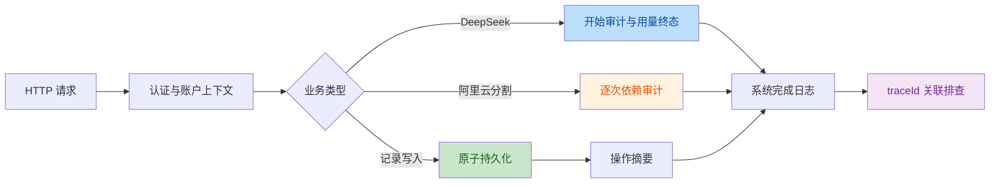

# 发布前检查报告（2026-09-27）

> 本报告记录较早一阶段“未连接生产”的检查结论。后续生产权限与恢复验证、运行边界及当前阻断项见 `reports/mvp-operations-validation-2026-09-27.md`。

## 结论

- 范围：当前工作区全部未提交变更；仅执行规则阅读、检查、修复、测试和文档维护。
- 本地代码结论：两轮检查发现的代码级阻断问题已修复，语法、主回归、认证、可观测性和部署控制流专项通过。
- 发布结论：**NO-GO（尚未执行生产发布）**。按用户要求未 commit、未 push、未连接或同步服务端；生产依赖、RAM 角色、备份恢复、真实 Nginx/systemd 回滚和部署后冒烟尚未验证。
- UI 结论：浏览器断言完成且桌面/移动截图已人工检查；TRAE 沙箱随后拒绝 Chrome Crashpad 等外部路径访问，进程退出码为 1，因此记为“断言通过但环境受限”，不是完整通过。

## 变更意图

把新增产品能力收敛到可发布状态：保护原始数据和异步编辑状态，统一系统/操作/AI 审计，修正统计与 AI 失败口径，并让部署失败可恢复代码、配置和版本。



## 两轮检查

| No. | 问题 | 处理结果 | 主要证据 |
| --- | --- | --- | --- |
| 1 | `usage=null` 或字段不全会二次报错/误算费用 | 未知用量统一记 0 Token、0 费用并保留 `usageKnown=false` | `scripts/observability-regression.mjs` |
| 2 | 旧账本会把未知状态、耗时和输入形态当成已知 | 旧值迁移为 `unknown`，耗时分母排除未知；本地和既有账户升级前备份 | `server.mjs`、认证/可观测性回归 |
| 3 | 供应商错误、推理或多行伪栈可能进入普通日志/响应 | 系统日志只保留机器码与文件行列；供应商正文只进入私有 AI 审计 | `logging.mjs`、可观测性回归 |
| 4 | JSON 解析或 I/O 失败可能回退为空库并覆盖原文件 | 仅 `ENOENT` 初始化；其他错误保留原文件并返回受控错误 | 可观测性及认证回归 |
| 5 | 缺少系统日志和关键写操作追踪 | 新增请求、持久化、外部依赖、后台任务和资源字段级摘要日志 | `knowledge/observability.md` |
| 6 | EOF、长度截断、内容过滤和空正文可能误记成功 | 独立错误码和失败终态；部分正文不写为业务成功 | 可观测性回归 |
| 7 | 日志只在启动清理，权限和并发写入缺少保证 | `0700/0600`、单文件串行队列、启动及每小时清理 | `logging.mjs`、可观测性回归 |
| 8 | 长期趋势按提交次数加权而不是按自然日 | 先算同日均值，再比较最近/之前 7 个记录日 | 主回归及可观测性回归 |
| 9 | 引子、图片加载或分割旧结果会覆盖新输入/画布 | 输入、重置、日期、账户、请求序号和画布目标均校验 | UI 回归 |
| 10 | 部署重启失败绕过回滚，配置版本不恢复；同提交安装依赖会修改活动 release | 候选目录安装和验证后切换；失败恢复代码、托管配置及 `APP_VERSION` | `scripts/deploy-regression.mjs` |
| 11 | 账户目录、附件和迁移备份权限依赖 umask | 私有目录固定 `0700`，文件固定 `0600`，启动及跨机迁移同时校正 | 认证回归、`deploy/migrate-data.sh` |

第二轮额外复核并修复了：多行异常伪装栈帧、既有账户启动迁移漏备份、同一提交重新部署时依赖安装破坏活动目录，以及私有数据权限依赖 umask。未发现新的已证实代码级阻断问题。

## 本地验证

| 检查 | 结果 |
| --- | --- |
| 全部项目 JavaScript `node --check`，全部部署 Shell `bash -n` | 通过 |
| `scripts/regression.mjs` | 通过 |
| `scripts/auth-regression.mjs` | 通过：跨站拒绝、登录/改密、跨账户资源与 AI/日志隔离、既有账户迁移备份、私有目录/附件/备份权限、损坏认证文件保护 |
| `scripts/observability-regression.mjs` | 通过：旧账本、null/部分 usage、HTTP/空正文/过滤/截断/EOF/超时、日均值、脱敏、权限、保留、损坏及 I/O 失败 |
| `scripts/deploy-regression.mjs` | 通过：候选构建、同提交安全、依赖/Nginx/重启/健康失败及代码配置版本恢复；未执行远程命令 |
| `scripts/ui-regression.mjs` | 页面断言输出通过；因 Chrome 外部 Crashpad 路径被沙箱拒绝，整体退出码 1 |
| 桌面/移动截图 | 已检查共参、小物、统计等关键页面，无明显横向溢出、重叠或空白关键区域 |
| `git diff --check` | 通过 |
| `package.json`、锁文件与本机安装的阿里云 SDK 版本 | 一致 |

测试通过均使用：

```text
node
```

环境 PATH 中没有 `node`/`npm`，因此按项目规则展开执行等价 Node 命令。

## 未关闭条件

以下不是本轮遗漏，而是按要求未执行或无法在本地证明：

1. 当前工作区包含大量同一轮产品改动且未提交，尚未形成可部署提交，也未核对远端 `main` 指向。
2. 旧服务器部署器首次引入 npm SDK 前需按 `deploy/README.md` 从已审查提交升级；未在服务器执行。
3. 未真实调用阿里云 `SegmentHDCommonImage`，RAM 角色权限、异步响应结构、费用和生产网络未验证。
4. 未验证生产 Node/npm、磁盘权限、证书、Nginx/systemd、OSS 生命周期、备份恢复和真实失败回滚。
5. 审计文件未做应用层静态加密，无自动告警、补写/对账或单日容量上限；当前实现只支持单实例文件写入。
6. 未执行生产健康检查、关键账户冒烟、日志生成检查或 30 分钟观察窗口。

## 后续发布门槛

只有用户重新明确授权第 6 步后，才按顺序执行：整理提交范围并提交 → 推送已审查提交 → 验证目标环境和备份 → 升级旧部署器 → 部署 → `/readyz`、版本、认证、记录、AI、小物和日志冒烟 → 观察并记录 GO/回滚结论。
